<!-- SPDX-License-Identifier: Apache-2.0 -->
# Stateless Agent Context Management

Status: plan specification (BDPv4), pending operator approval of the merged plan PLAN-SESSIONTURNREVIEW-001, into which this work is integrated (`docs/plans/PLAN-SESSIONTURN-SESSIONREVIEW-001.md` and the architecture document `docs/architecture/SessionTurn-Review-AgentContext-Architecture.md`, both on branch `worktree-session-20261009` until it merges into `develop`). Operator directives (2026-10-11, verbatim): "Integrate attached to current plan.", "Reconstruct plan with added requirements", "Also publish the doc to develop", "Outline now, catalog in P0", "No new code until I approve merged plan.", "I want every model defined.  I want every unit of work request and respone defined.  I want every endpoint defined.", "I want a single, complete activity diagram (mermaid) for every unit of work.  I want sequence diagrams for submitting each request type and processing every response.  I want a md doc describing the who plan as architecture documentation.", and "Ensure architecture doc includes all activity, sequence and use case diagrams for this plan."

Section numbers match the architecture document, which also covers the turn-logging (Phase A) and review (Phase B) work this feature builds on. The requirement records (FR, TR, and TEST with acceptance criteria and mappings) are created in Phase 1 of the merged plan (its P0 steps 1-9).

## Summary

Each agent invocation can run stateless: it receives a bounded, reproducible package containing the current request, the canonical operator profile and rules, the applicable requirements, related session-log evidence, trusted prior responses, and relevant code at the current commit. Conversation history is not carried forward.

- Packages, responses, grades, and relationships are authoritative relational records; response artifacts are projected into GraphRAG for semantic retrieval with a deterministic relational fallback.
- Every package records source hashes, commit identity, selection rationale, token usage, contradictions, blockers, and omitted candidates.
- Package construction fails explicitly when mandatory context exceeds the token budget.
- Every response is graded by deterministic evidence checks and by an independent model; it is trusted only at correctness and completeness of at least 98 percent with zero FAIL and zero UNKNOWN.
- Rejected and stale responses are preserved for audit and excluded from trusted retrieval.
- Relationships: `implements`, `verifies`, `depends_on`, `supports`, `contradicts`, `supersedes`, `blocks`, `derived_from`, `relevant_to`.
- An opt-in `Mcp:AgentContext` mode keeps the current stateful behavior during the pilot.

Execution follows the merged plan's four phases (section 8): requirements, interfaces and code stubs, test-driven unit tests with mocks, then implementation by bounded context with parallel coding agents; every unit of work is one CQRS command or query with its handler, and every identifier is a meaningful name. Plugin behavior lives once in the PowerShell plugin core, which all nine hosts use, the TypeScript hosts through logic-free adapters (operator, 2026-10-11: "You should be designing all scripts and script tools around PowerShell and only PowerShell."). The attached plan's BDPv4 implementation order, mapped onto those phases: register requirements, use cases, and acceptance criteria (Phase 1); define the interface contracts and code stubs (Phase 2); establish green, discriminating mock tests with negative controls; add authoritative storage; implement deterministic package construction; implement grading, acceptance, staleness, rejection, and supersession; add the GraphRAG projection with the deterministic fallback; expose REST, MCP, client, REPL, and plugin interfaces; pilot stateless execution against the stateful workflow before changing any default. Tests cover deterministic replay, mandatory profile completeness, ranking, contradictions, grading thresholds, stale dependencies, workspace isolation, secret exclusion, token overflow, GraphRAG fallback, concurrency, idempotency, and the full zero-failure, zero-skip suite.

## 6. Phase C: stateless agent context

### 6.1 Scope and principles

- Each agent invocation can run stateless: it receives a bounded, reproducible context package instead of carrying conversation history forward.
- A package contains the current request, the canonical operator profile and standing rules, the applicable requirements, related session-log evidence, trusted prior responses, and relevant code at the current commit, each with its provenance.
- The relational store is authoritative for packages, responses, grades, and relationships. Response artifacts are projected into GraphRAG for semantic retrieval, with a deterministic relational fallback that gives the same result whenever GraphRAG is disabled, uninitialized, or unavailable.
- A response becomes trusted only when a deterministic evidence grade and an independent model grade both reach correctness and completeness of at least 98 percent with zero FAIL and zero UNKNOWN findings. The model grade is recorded by the HV agent for the responses of an HV request that names a range of session-log turns; this effort has no grading worker or HV pipeline (operator, 2026-10-11). Rejected, stale, and superseded responses are kept for audit and never retrieved as trusted context.
- Mandatory context is never truncated: when it exceeds the token budget, package construction fails explicitly, and in `Pilot` or `Stateless` mode the invocation fails: no answer is produced (operator, 2026-10-11: "Fail the invocation").
- The mode is opt-in (`Mcp:AgentContext:Mode`); the current stateful behavior stays the default during the pilot.
- Requirement ids (reserved for Phase 1, the plan's P0 steps 1-9, and created there with acceptance criteria, mappings, and use cases): FR-MCP-AGENTCONTEXT-001 package construction and provenance; -002 token budget and overflow; -003 response submission; -004 grading, HV requests, and trust; -005 rejection, staleness, and supersession; -006 typed relationships; -007 GraphRAG projection and fallback; -008 REST, MCP, client, REPL, and plugin surfaces; -009 opt-in mode and pilot. The matching TR-MCP-AGENTCONTEXT-* and TEST-MCP-AGENTCONTEXT-* records are created in Phase 1.

### 6.2 Configuration: `AgentContextOptions`

Section `Mcp:AgentContext` (declared under `QBrainAi: AgentContext:` in `appsettings.yaml`, projected onto `Mcp:` by `CanonicalSectionProjectionProvider`), class `QBrainAi.Support.Mcp.Options.AgentContextOptions` with `SectionName = "Mcp:AgentContext"`, a `Validate()` method, and `ValidateOnStart()`.

- `Mode` (enum `AgentContextMode`: `Off`, `Pilot`, `Stateless`; default `Off`). `Off`: every agent-context endpoint except status returns 409 `agent_context_disabled`. `Pilot`: packages are built and responses graded, but plugins keep the stateful conversation (no injection). `Stateless`: plugins inject the package and carry no history.
- `TokenBudget` (int, default 32000, must be 1024..1000000).
- `BytesPerToken` (int, default 4, must be 1..16): the deterministic token estimate is `ceil(utf8ByteCount / BytesPerToken)` per item.
- `Trust:Correctness`, `Trust:Completeness` (decimal in [0.98, 1], default 0.98, inclusive): the attached plan's minimum of 98 percent is a floor that configuration cannot lower; a value below 0.98 or above 1 fails startup validation (`AgentContextOptions_TrustBelow098_FailsStartup`, `AgentContextOptions_TrustAt098And1_Accepted`), and RunDeterministicGradeCommand, RecordModelGradeCommand, and DecideAgentResponseTrustCommand apply `max(configured, 0.98)` so no stored or earlier value below the floor can trust a response (`Trust_StoredThresholdBelowFloor_FloorApplied`). The Phase B review thresholds (FR-MCP-SESSIONREVIEW-007) stay configurable as approved.
- `MaxCandidatesPerKind` (int, default 50, 1..1000) and `MaxPriorResponses` (int, default 10, 0..100).
- `ProfileSources` (list of file globs resolved on the server host; default `~/.claude/profile/*.md` excluding `add-profile*.md`, the set the `/add-profile` skill reads) and `RuleSources` (list of workspace-relative paths; default `CLAUDE.md`, `AGENTS.md`, and `AGENTS-README-FIRST.yaml`, secret values redacted). Profile and rules are mandatory: when no profile file or no rule file resolves, the build fails with 409 `agent_context_profile_unavailable` instead of building a package without them.
- `ModelGrader:AgentName` (default `Codex`), `ModelGrader:RequiredModel` (default `gpt-6-astra`), `ModelGrader:RequiredEffort` (default `max`), `ModelGrader:ReceiptRoot` (workspace-relative, default `docs/receipts/hv`): a model grade from any other grader, or whose receipts are outside the receipt root or do not verify, is refused.
- `HvRequest:MaxTurns` (int, default 200, 1..2000): the largest turn range one HV request may name.
- `GraphRag:ProjectionEnabled` (bool, default true) and `GraphRag:UseForRetrieval` (bool, default true).
- Validation failures (startup): `TokenBudget`, `BytesPerToken`, `HvRequest:MaxTurns`, thresholds outside their ranges, an empty `RuleSources`, an empty grader identity, or an empty `ModelGrader:ReceiptRoot`.

### 6.3 Entities (namespace `QBrainAi.Support.Mcp.Storage.Entities`)

Common rules: string keys `[StringLength(128)]`, human-readable and derived from the records they belong to (formats per entity below). Bounded readable keys: a key is `<prefix><parentId><tail>` when that is at most 128 characters; otherwise the embedded parent id is shortened to its first `128 - length(prefix) - length(tail) - 13` characters followed by `-` and the first 12 hex digits of the SHA-256 of the full parent id, so keys stay readable, deterministic, and distinct for distinct parents; the complete parent ids are always stored in their own root-id columns, which keep the live length of 256 (`SessionLogEntity.SessionId` and `SessionLogTurnEntity.RequestId` allow 256), so no root id is ever truncated (`AgentContextKeys_MaxLengthRootIds_FitAndStayDistinct` on SQLite, PostgreSQL, and SQL Server; `AgentContextKeys_ShortRootIds_KeepFullReadableForm`); a sequence suffix `<nn>` (two digits, from 01) is allocated as one more than the highest existing suffix for that prefix, and a unique-index violation from a concurrent insert retries with the next suffix (at most five times, then 409 `conflict`); child rows use `long` identity keys; every entity has `[Required][StringLength(1024)] WorkspaceId` with the named `Workspace` query filter and `StampWorkspaceId` on add; timestamps are `DateTimeOffset` named `*Utc`; decimals are `HasPrecision(29, 28)`; list-valued data is stored in 4NF child tables; idempotency comes from unique indexes (the store has no concurrency tokens). Per-response serialization: every write that changes a response's grades or status (RunDeterministicGradeCommand and RecordModelGradeCommand with DecideAgentResponseTrustCommand, RejectAgentResponseCommand, SupersedeAgentResponseCommand, and EvaluateStalenessCommand) runs in one transaction at `IsolationLevel.Serializable` (the convention of `SessionLogService.cs:156`) whose first statement increments that response's `StatusVersion`, so every such operation on one response takes the row's write lock first and they serialize in commit order on SQLite, PostgreSQL, and SQL Server; a serialization failure or deadlock (PostgreSQL 40001 or 40P01, SQL Server 1205, SQLite busy) rolls the whole operation back and retries it from the start, at most three times, then returns 409 `conflict` with `retryable: true` (`Trust_ForcedInterleaving_DeterministicFailVsModelPass_NeverTrustedOnSupersededGrade`, `Trust_ForcedInterleaving_RejectVsGrade_RejectedNeverRevived`, each on the three providers). Migrations `<yyyyMMddHHmmss>_AddAgentContext` are generated for SQLite, PostgreSQL, and SQL Server with the existing `dotnet ef migrations add` procedure.

`AgentContextPackageEntity` (table `AgentContextPackages`, key `PackageId` = `pkg-<requestId>-<nn>`, for example `pkg-req-20261011T223749Z-prompt-cc85-01`)

- `WorkspaceId`, `SessionId` (256, the MCP session), `Agent` (64), `RequestId` (256, the turn), all required.
- `IdempotencyKey` (128, required): unique with `WorkspaceId`.
- `Status` (16): `Built` or `Overflow`.
- `CommitSha` (64, required), `WorkingTreeDirty` (bool).
- `BuilderVersion` (32), `TokenBudget` (int), `BytesPerToken` (int), `MandatoryTokenCount` (int), `TotalTokenCount` (int).
- `InputsSha256` (64): hash of the canonical build inputs (request text, options in force, commit, and every candidate source hash).
- `OptionsSnapshotJson` (text, required): the canonical JSON of every `AgentContextOptions` value the build used (mode, budget, bytes per token, candidate limits, profile and rule sources, trust floor, GraphRAG flags), so replay never reads current configuration.
- `ContentSha256` (64): hash of the canonical rendered package; null for `Overflow`.
- `QueryText` (text, sanitized), `RenderedContent` (text; null for `Overflow`).
- `CreatedUtc`.
- Indexes: (`WorkspaceId`, `RequestId`), (`WorkspaceId`, `SessionId`, `CreatedUtc`), unique (`WorkspaceId`, `IdempotencyKey`).
- Children: `Items`, `Omissions`, `Findings`, `FocusRefs`, `Inputs` (`DeleteBehavior.Restrict`).

`AgentContextPackageItemEntity` (table `AgentContextPackageItems`, `long Id`)

- `WorkspaceId`, `PackageId` (FK), `Ordinal` (int, unique with `PackageId`).
- `Kind` (32): `Request`, `Profile`, `Rule`, `Requirement`, `SessionLogTurn`, `Todo`, `Code`, `Receipt`, `PriorResponse`.
- `SourceRef` (512): the requirement id, file path, `requestId`, TODO id, receipt path, or `responseId`.
- `SourceSha256` (64), `SourceCommitSha` (64, for `Code`).
- `Mandatory` (bool), `Score` (decimal 0..1, null for mandatory items), `Rationale` (2048), `TokenCount` (int).
- `RetrievalPath` (16): `Relational` or `GraphRag`.
- `Content` (text, sanitized; secret values redacted in mandatory items).

`AgentContextPackageFocusRefEntity` (table `AgentContextPackageFocusRefs`, `long Id`): `WorkspaceId`, `PackageId` (FK), `Ordinal`, `Kind` (32), `Ref` (512): the request's `focusRefs` exactly as given.

`AgentContextPackageInputEntity` (table `AgentContextPackageInputs`, `long Id`): the immutable replay snapshot of every candidate the builder considered, included or omitted: `WorkspaceId`, `PackageId` (FK), `Ordinal` (unique with `PackageId`), `Kind` (32), `SourceRef` (512), `SourceSha256` (64), `SourceCommitSha` (64), `SourceVersion` (128: the git blob id for files under version control, otherwise the record's version or `UpdatedUtc` as read), `Content` (text, exactly as the builder read it after sanitization and before ranking), `RankingFeaturesJson` (text: the canonical JSON of every ranking input of the candidate, including its raw score before rounding and its retrieval path). Replay reads only this snapshot, `OptionsSnapshotJson`, the focus refs, and `BuilderVersion`; it never reads live sources, so later changes to configuration, omitted sources, requirements, TODOs, turns, profile files, or the working tree cannot change a replay.

Source hashes (`SourceSha256`, `ToSha256`), all SHA-256 over UTF-8 bytes:

- `Code`, `Profile`, `Rule`, `Receipt`, `CodeFile`: the file content at the recorded commit for files under version control (never the working copy), otherwise the file content as read; line endings are kept as stored.
- `Requirement`: the canonical JSON of the record (id, title, description, status, and its acceptance criteria in order), serialized with sorted keys and no insignificant whitespace.
- `SessionLogTurn`: the canonical JSON of the turn's request text, response, status, actions, and decisions, excluding timestamps.
- `Todo`: the canonical JSON of the TODO's id, title, description lines, tasks, and done state.
- `PriorResponse`, `Response`: `ContentSha256`. `Package`: `ContentSha256`.
- `Request`: the sanitized request text.
- Response evidence (`AgentResponseEvidence.Sha256`, computed by the server at submission from the cited source): `File` as `Code`, and `Requirement`, `Receipt`, and `SessionLogTurn` as their kinds above; a submitted hash that differs makes that evidence check FAIL in the deterministic grade. These hashes are dependencies of the response: staleness compares them with the current source. `Commit` and `Command` evidence is not a dependency (a commit is immutable; a command result is checked only by the deterministic grade).

Ranking scores are decimals rounded half-even to 6 places before ordering, so float differences between hosts never reorder candidates; ties break on `sourceRef` by ordinal comparison.

`AgentContextOmissionEntity` (table `AgentContextOmissions`, `long Id`)

- `WorkspaceId`, `PackageId`, `Ordinal`, `Kind`, `SourceRef`, `SourceSha256`, `Score`.
- `Reason` (32): `budget`, `untrusted`, `stale`, `rejected`, `superseded`, `secret`, `duplicate`, `below_candidate_limit`.
- `Detail` (2048).

`AgentContextFindingEntity` (table `AgentContextFindings`, `long Id`)

- `WorkspaceId`, `PackageId`, `Ordinal`.
- `Kind` (16): `Contradiction` (two included items are linked by `contradicts`) or `Blocker` (an open item `blocks` the request's TODO or turn).
- `SourceRef` (512), `OtherSourceRef` (512, contradictions only), `RelationshipId` (128), `Summary` (2048).

`AgentResponseEntity` (table `AgentResponses`, key `ResponseId` = `rsp-<requestId>-<nn>`)

- `WorkspaceId`, `PackageId` (FK, required), `SessionId`, `RequestId`, `Agent`, all required (root ids).
- `Model` (128), `Effort` (32), `InvocationMode` (16): `Stateful` or `Stateless`.
- `IdempotencyKey` (128): unique with `WorkspaceId`.
- `SubmissionSha256` (64, required): SHA-256 of the canonical JSON (sorted keys, no insignificant whitespace) of the whole submission: `packageId`, `agent`, `model`, `effort`, `invocationMode`, `contentFormat`, `content`, and `claims` and `evidence` in order; a repeated idempotency key returns the stored response only when this fingerprint is equal, otherwise 409 `conflict`.
- `StatusVersion` (long, default 0): the lock counter of the per-response serialization rule (not an EF concurrency token).
- `Status` (16): `Submitted`, `Grading`, `Trusted`, `Rejected`, `Stale`, `Superseded`.
- `StatusReason` (2048), `SupersededByResponseId` (128).
- `ContentFormat` (16): `markdown`, `text`, or `json`. `Content` (text, sanitized), `ContentSha256` (64).
- `CommitSha` (64): the workspace commit at submission.
- `SubmittedUtc`, `StatusChangedUtc`, `TrustedUtc`.
- Indexes: (`WorkspaceId`, `Status`), (`WorkspaceId`, `RequestId`), (`WorkspaceId`, `PackageId`), unique (`WorkspaceId`, `IdempotencyKey`).
- Children: `Claims`, `Evidence`.

`AgentResponseClaimEntity` (table `AgentResponseClaims`, `long Id`): `WorkspaceId`, `ResponseId`, `Ordinal`, `ClaimId` (64, unique per response), `Text` (4096).

`AgentResponseEvidenceEntity` (table `AgentResponseEvidence`, `long Id`): `WorkspaceId`, `ResponseId`, `Ordinal`, `ClaimId` (64), `Kind` (16: `File`, `Requirement`, `Receipt`, `Commit`, `Command`, `SessionLogTurn`), `Ref` (2048), `Sha256` (64), `CommitSha` (64).

`AgentResponseGradeEntity` (table `AgentResponseGrades`, key `GradeId` = `grd-<responseId>-<deterministic|model>-<nn>`, for example `grd-rsp-req-20261011T223749Z-prompt-cc85-01-model-01`)

- `WorkspaceId`, `ResponseId` (FK), `PackageId`, `RequestId` (256) (root ids).
- `Kind` (16): `Deterministic` or `Model`.
- `Grader` (256): `agent-context-deterministic/<BuilderVersion>`, or `<AgentName>/<model>/<effort>`.
- `Correctness`, `Completeness`, `CorrectnessThreshold`, `CompletenessThreshold` (decimal).
- `PassCount`, `FailCount`, `UnknownCount` (int).
- `Verdict` (16): `Pass` or `Fail`, derived: `Pass` only when both scores meet their thresholds and `FailCount` and `UnknownCount` are zero.
- "Latest grade" of a kind means the grade with the greatest `GradedUtc`, ties broken by the greatest `GradeId` by ordinal comparison; concurrent grade writes are all kept, and the trust decision (DecideAgentResponseTrustCommand) is recomputed after each one inside that grade's serialized transaction (per-response serialization rule above), so the stored status always reflects the latest committed grade pair.
- `HvRequestId` (128, required for `Model`, null for `Deterministic`): the HV request whose review produced the grade.
- `ReviewerSessionId`, `ReviewerRequestId` (256, required for `Model`): the reviewer's own session-log turn that holds its entire result; `VerdictJsonSha256` (64): the hash of the verdict block the grade was verified against.
- `RequestJsonlPath`, `ResponseJsonlPath` (2048, required for `Model`, workspace-relative under `ModelGrader:ReceiptRoot`), `RequestJsonlSha256`, `ResponseJsonlSha256` (64): the receipts and their hashes as verified when the grade was recorded.
- `RolloutJsonlPath` (2048, required for `Model`, under `ModelGrader:ReceiptRoot`), `RolloutJsonlSha256` (64), `ReviewerThreadId` (64, required for `Model`): the reviewer's own Codex rollout receipt (the HV runner copies the completed reviewer thread's rollout file next to the request and response jsonl, redacted by the receipt rule) and the thread id it records; check 8 (`runtime_identity`) verifies them.
- `GradedUtc`.
- Child `Findings`.

`AgentResponseGradeFindingEntity` (table `AgentResponseGradeFindings`, `long Id`): `WorkspaceId`, `GradeId`, `Ordinal`, `ClaimId` (64), `Check` (256), `Outcome` (16: `PASS`, `FAIL`, `UNKNOWN`), `Evidence` (text, sanitized).

`AgentContextRelationshipEntity` (table `AgentContextRelationships`, key `RelationshipId` = `rel-<type>-<yyyyMMddTHHmmssZ>-<nn>`, for example `rel-depends_on-20261011T234000Z-01`)

- `WorkspaceId`, `FromKind` (32), `FromRef` (512), `Type` (32), `ToKind` (32), `ToRef` (512).
- Node kinds: `Package`, `Response`, `Requirement`, `SessionLogTurn`, `Todo`, `CodeFile`, `Receipt`, `Profile`, `Rule`.
- Types: `implements`, `verifies`, `depends_on`, `supports`, `contradicts`, `supersedes`, `blocks`, `derived_from`, `relevant_to`.
- `ToSha256` (64): the target's content hash when linked (used for staleness of `depends_on` and `derived_from`).
- `EvidenceRef` (2048), `CreatedBy` (128), `CreatedUtc`.
- Unique (`WorkspaceId`, `FromKind`, `FromRef`, `Type`, `ToKind`, `ToRef`); indexes on (`WorkspaceId`, `FromKind`, `FromRef`) and (`WorkspaceId`, `ToKind`, `ToRef`).

`AgentContextHvRequestEntity` (table `AgentContextHvRequests`, key `HvRequestId` = `hvr-<sessionId>-<yyyyMMddTHHmmssZ>`, with `-<nn>` appended only when two are created in the same second)

- `WorkspaceId`, `SessionId` (256), `Agent` (64): the MCP session whose turns are reviewed.
- `FromRequestId`, `ToRequestId` (256): the first and last turns of the range, inclusive, in the session's turn order.
- `RequestedBy` (128), `Reason` (2048).
- `Status` (16): `Open` (accepting grades) or `Completed` (no item is `Pending`: every item is `Graded` by this request or `Closed` because its response became `Rejected` or `Superseded`).
- `CreatedUtc`, `CompletedUtc`.
- Child `Items`.

`AgentContextHvRequestItemEntity` (table `AgentContextHvRequestItems`, `long Id`): `WorkspaceId`, `HvRequestId` (FK), `Ordinal`, `RequestId` (256), `ResponseId` (128, unique with `HvRequestId`), `Disposition` (16): `Pending`, `Graded`, or `Closed`, and `ClosedReason` (32): `rejected` or `superseded`. Items are the agent responses whose `RequestId` lies in the range when the request is created and whose status is `Submitted`, `Grading`, `Trusted`, or `Stale` (a `Rejected` or `Superseded` response is never listed); when a listed response becomes `Rejected` or `Superseded` while the request is `Open`, RejectAgentResponseCommand or SupersedeAgentResponseCommand sets its item `Closed` with that reason in the same serialized transaction and completes the request when no item stays `Pending` (`HvRequest_RangeWithRejectedResponse_NotListed`, `HvRequest_ItemRejectedMidReview_ClosedAndRequestCompletes`, `HvRequest_ItemSupersededMidReview_Closed`).

Receipt and reviewer verification (RecordModelGradeCommand), before a model grade is saved; each failure refuses the grade with 422 `agent_context_receipt_unverified` and `details.check` naming the check:

1. `receipt_path`: both jsonl paths resolve inside the workspace under `ModelGrader:ReceiptRoot`.
2. `request_meta`: the request jsonl's first line is a JSON object with `type` `hv_request_meta` whose `reviewer.agent` contains `ModelGrader:AgentName`, `reviewer.model` equals `ModelGrader:RequiredModel`, and `reviewer.effort` equals `ModelGrader:RequiredEffort` (the HV runner writes exactly this object), and the request jsonl's body record names the `hvRequestId`.
3. `verdict_block`: the response jsonl records a completed turn (`turn.completed`) whose last agent message contains exactly one `=== VERDICT JSON ===` block that parses as one JSON object.
4. `verdict_binding`: that verdict names this `hvRequestId` and has a `grades` entry for this `responseId` whose `contentSha256` equals the response's `ContentSha256`.
5. `verdict_match`: the submitted `correctness`, `completeness`, and `findings` equal that entry exactly (same score lexemes; the same claimIds, checks, and outcomes in the same order), and the entry's findings name every claim of the response at least once (an empty or partial finding list is refused).
6. `reviewer_turn`: the session-log turn (`reviewerSessionId`, `reviewerRequestId`) exists in the workspace, its session's agent is `ModelGrader:AgentName`, the turn was created at or after the HV request's `CreatedUtc`, and its stored result contains the same verdict block byte for byte, where the stored result is the turn's response followed by its processingDialog parts in part order with each part's header line removed (the HV protocol stores the entire result on the reviewer's own turn and splits a long result into ordered parts; `ModelGrade_VerdictSplitAcrossDialogParts_RejoinedAndAccepted`).
7. `reviewer_independent`: the reviewer's MCP session is neither the session the HV request reviews nor the session that submitted the response; independence is a separate review session and execution, not a different agent name, so an independently launched Codex reviewer grades a Codex-authored response (`ModelGrade_CodexResponse_IndependentCodexReviewerSession_Accepted`).
8. `runtime_identity`: the rollout receipt at `rolloutJsonlPath` resolves under `ModelGrader:ReceiptRoot`; its `session_meta` record's `id` equals `reviewerThreadId` and the `thread_id` of the response jsonl's `thread.started` event; every `turn_context` record in it has `model` equal to `ModelGrader:RequiredModel` and `effort` equal to `ModelGrader:RequiredEffort`; and the verdict JSON names the same `reviewerThreadId`. The declared `request_meta` alone never satisfies this check (`ModelGrade_LaunchMetaCorrect_RolloutTurnContextOtherModelOrEffort_Refused_RuntimeIdentity`, `ModelGrade_RolloutThreadDiffersFromResponseStream_Refused_RuntimeIdentity`).

The hashes of the three jsonl receipts (request, response, rollout) and of the verdict block are stored on the grade. The remaining trust assumption is the workspace's session-log identity model (every agent of a workspace authenticates with the workspace key), which this plan does not change: a forged grade would need a forged reviewer session, a forged verdict, a forged rollout, and matching receipts, and each is checked against the others. Negative cases: `ModelGrade_DisagreeVerdictPassingScores_Refused_VerdictMatch`, `ModelGrade_EmptyOrPartialFindings_Refused_VerdictMatch`, `ModelGrade_VerdictForOtherResponseOrContent_Refused_VerdictBinding`, `ModelGrade_NoCompletedTurnOrTwoVerdicts_Refused_VerdictBlock`, `ModelGrade_ReviewerTurnMissing_Refused_ReviewerTurn`, `ModelGrade_ReviewerTurnVerdictDiffers_Refused_ReviewerTurn`, `ModelGrade_ReviewerTurnBeforeHvRequest_Refused_ReviewerTurn`, `ModelGrade_ReviewerSameSessionAsProducingOrReviewed_Refused_ReviewerIndependent`, `ModelGrade_LaunchMetaCorrect_RolloutTurnContextOtherModelOrEffort_Refused_RuntimeIdentity`, `ModelGrade_RolloutThreadDiffersFromResponseStream_Refused_RuntimeIdentity`; acceptance case `ModelGrade_CodexResponse_IndependentCodexReviewerSession_Accepted`.

`AgentContextProjectionEntity` (table `AgentContextProjections`, key `ResponseId`)

- `WorkspaceId`.
- `State` (16): `Pending`, `Projected`, `Removed`, `Skipped`, `Failed`.
- `GraphRagDocumentId` (128), `ProjectedContentSha256` (64), `LastError` (2048), `UpdatedUtc`.
- Projection always uses `GraphRagStorageScope.Workspace`; a projected document never reaches the global GraphRAG scope or another workspace.

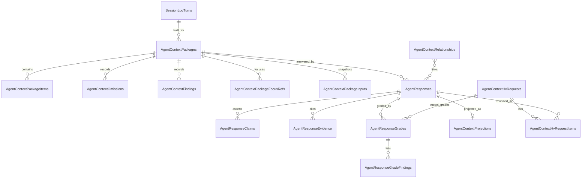

Response lifecycle:

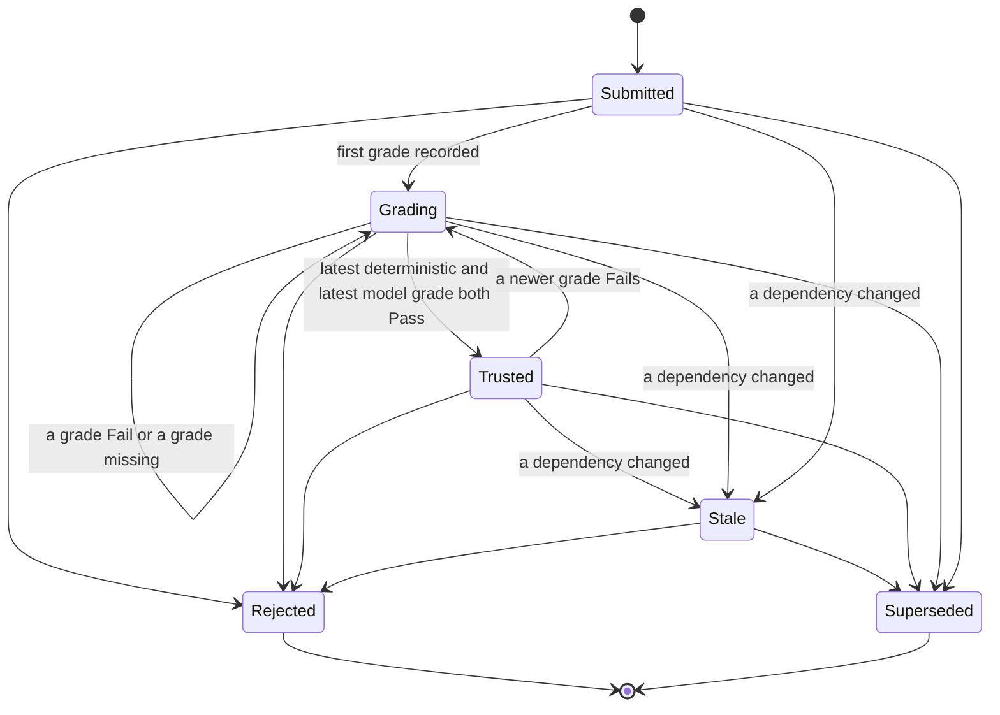

### 6.4 Data transfer objects

Server DTOs live in `src/QBrainAi.Services/Models/AgentContextModels.cs` (namespace `QBrainAi.Support.Mcp.Models`); client mirrors in `src/QBrainAi.Client/Models/AgentContextModels.cs` with `[JsonPropertyName]` on every property and registration in `McpClientJsonContext` (type, `List<>`, `IReadOnlyList<>`); a parity test keeps them identical. JSON is camelCase; unset optional fields are `null`; decimals travel as exact lexemes (the Phase B score rule).

Shared types

- `AgentContextItemDto { ordinal, kind, sourceRef, sourceSha256, sourceCommitSha, mandatory, score, rationale, tokenCount, retrievalPath, content }`.
- `AgentContextOmissionDto { ordinal, kind, sourceRef, sourceSha256, score, reason, detail }`.
- `AgentContextFindingDto { ordinal, kind, sourceRef, otherSourceRef, relationshipId, summary }`.
- `AgentResponseClaimDto { claimId, text }`; `AgentResponseEvidenceDto { claimId, kind, ref, sha256, commitSha }`.
- `AgentResponseGradeFindingDto { claimId, check, outcome, evidence }`.
- `AgentResponseGradeDto { gradeId, responseId, kind, grader, correctness, completeness, correctnessThreshold, completenessThreshold, passCount, failCount, unknownCount, verdict, hvRequestId, reviewerSessionId, reviewerRequestId, reviewerThreadId, requestJsonlPath, responseJsonlPath, rolloutJsonlPath, verdictJsonSha256, gradedUtc, findings }`.
- `AgentContextRelationshipDto { relationshipId, fromKind, fromRef, type, toKind, toRef, toSha256, evidenceRef, createdBy, createdUtc }`.
- `AgentContextCandidateDto { kind, sourceRef, sourceSha256, score, rationale, retrievalPath }`.
- Query results follow `{ totalCount, limit, offset, items }`.

Requests and results (one pair per unit of work, section 6.5)

- GetAgentContextStatusQuery `AgentContextStatusResult { mode, tokenBudget, bytesPerToken, trustCorrectness, trustCompleteness, graphRag { enabled, state, projectionEnabled, useForRetrieval }, counts { packages, responsesByStatus } }`.
- BuildAgentContextPackageCommand `BuildAgentContextPackageRequest { sessionId, agent, requestId, queryText, tokenBudget, focusRefs, idempotencyKey }` (`tokenBudget` optional and at most the configured budget; `focusRefs` optional list of `{ kind, ref }` to prefer); result `AgentContextPackageResult { packageId, status, sessionId, agent, requestId, commitSha, workingTreeDirty, builderVersion, tokenBudget, mandatoryTokenCount, totalTokenCount, inputsSha256, contentSha256, createdUtc, items, omissions, findings, renderedContent }`.
- GetAgentContextPackageQuery get package: route id plus `includeContent` (bool, default true); result `AgentContextPackageResult`.
- QueryAgentContextPackagesQuery `AgentContextPackageQuery { requestId, sessionId, status, limit, offset }`; result `AgentContextPackageQueryResult` of package summaries (all fields except items, omissions, findings, and content).
- ReplayAgentContextPackageQuery replay: route id; result `AgentContextReplayResult { packageId, builderVersion, identical, originalContentSha256, replayContentSha256, originalInputsSha256, replayInputsSha256, differences [{ ordinal, kind, sourceRef, change }] }` with `change` in `added`, `removed`, `hashChanged`, `reordered`.
- SubmitAgentResponseCommand `SubmitAgentResponseRequest { packageId, agent, model, effort, invocationMode, contentFormat, content, claims, evidence, idempotencyKey }` (at least one claim, and every claim at least one evidence item); result `AgentResponseResult { responseId, packageId, sessionId, requestId, agent, model, effort, invocationMode, status, statusReason, supersededByResponseId, contentFormat, contentSha256, submissionSha256, commitSha, submittedUtc, statusChangedUtc, trustedUtc, claims, evidence, grades, content }`.
- GetAgentResponseQuery get response: route id plus `includeContent`; result `AgentResponseResult`.
- QueryAgentResponsesQuery `AgentResponseQuery { requestId, packageId, status, trustedOnly, limit, offset }`; result `AgentResponseQueryResult` of response summaries.
- RunDeterministicGradeCommand deterministic grade: route id, no body; result `AgentResponseGradeResult { grade, responseStatus, statusReason }`.
- RecordModelGradeCommand `RecordModelGradeRequest { hvRequestId, reviewerSessionId, reviewerRequestId, reviewerThreadId, grader, model, effort, correctness, completeness, findings, requestJsonlPath, responseJsonlPath, rolloutJsonlPath, gradedUtc }` (scores and findings equal the reviewer's verdict entry for the response, section 6.3); result `AgentResponseGradeResult` plus `hvRequestStatus`.
- DecideAgentResponseTrustCommand trust decision (internal, no surface): result `AgentResponseTrustDecision { responseId, previousStatus, status, statusReason, deterministicGradeId, modelGradeId, decidedUtc }`; the dispatching grade handler copies `status` and `statusReason` into `AgentResponseGradeResult.responseStatus` and `statusReason`.
- RejectAgentResponseCommand `RejectAgentResponseRequest { reason }`; result `AgentResponseResult`.
- SupersedeAgentResponseCommand `SupersedeAgentResponseRequest { supersededByResponseId, reason }`; result `AgentResponseResult`.
- EvaluateStalenessCommand `EvaluateStalenessRequest { responseIds }` (empty means every non-terminal response); result `AgentContextStalenessResult { evaluatedCount, newlyStale [{ responseId, changedRef, relationshipId, reason }] }`.
- CreateAgentContextRelationshipCommand `CreateAgentContextRelationshipRequest { fromKind, fromRef, type, toKind, toRef, evidenceRef }`; result `AgentContextRelationshipDto` plus `created` (bool).
- DeleteAgentContextRelationshipCommand delete relationship: route id; result 204.
- QueryAgentContextRelationshipsQuery `AgentContextRelationshipQuery { nodeKind, nodeRef, type, direction (out, in, both), limit, offset }`; result `AgentContextRelationshipQueryResult`.
- RetrieveAgentContextCandidatesQuery `AgentContextRetrieveRequest { queryText, sessionId, requestId, focusRefs, kinds, limit, trustedOnly, preferGraphRag }` (`sessionId` and `requestId` together name the turn whose relationship neighborhood ranks the relational path, both or neither; `focusRefs` optional; `trustedOnly` defaults to true and only `true` is accepted for `PriorResponse`); result `AgentContextRetrieveResult { retrievalPath, fallbackReason, candidates }`.
- ProjectAgentResponsesCommand `ProjectAgentContextRequest { responseIds }` (empty means every response whose projection is pending or out of date); result `AgentContextProjectionResult { projected, removed, skipped, failed [{ responseId, error }], skippedReason }`.
- RunStatelessInvocation stateless invocation: plugin-internal; it uses GetAgentContextStatusQuery, BuildAgentContextPackageCommand, and SubmitAgentResponseCommand; on a build failure the invocation fails (no answer) and the turn is closed `canceled` with the error.
- CreateAgentContextHvRequestCommand `CreateAgentContextHvRequestRequest { sessionId, agent, fromRequestId, toRequestId, requestedBy, reason }`; result `AgentContextHvRequestResult { hvRequestId, status, sessionId, agent, fromRequestId, toRequestId, requestedBy, reason, createdUtc, completedUtc, items [{ requestId, responseId, disposition, closedReason }] }`.
- GetAgentContextHvRequestQuery get HV request: route id; result `AgentContextHvRequestResult`.
- QueryAgentContextHvRequestsQuery `AgentContextHvRequestQuery { sessionId, status, limit, offset }`; result `AgentContextHvRequestQueryResult` of results without items.
- GetAgentContextPilotReportQuery `AgentContextPilotReportQuery { fromUtc, toUtc }`; result `AgentContextPilotReport { fromUtc, toUtc, byMode [{ invocationMode, responses, trusted, rejected, stale, meanCorrectness, meanCompleteness, trustRate }] }`.

Error codes (problem+json body `{ type, title, status, detail, code, message, retryable, details }`; MCP tools return `{ code, error, message, retryable, details }`)

- 400 `validation_error` with `details.field` for malformed input, plus the Phase B score codes `review_score_format`, `review_score_precision`, `review_score_out_of_range` for grade scores.
- 400 `agent_context_receipt_paths_required` (model grade without its request, response, and rollout jsonl paths, the reviewer turn ids, or `reviewerThreadId`).
- 400 `agent_context_relationship_invalid` (unknown kind or type, or a self-link).
- 400 `agent_context_hv_request_invalid` (unknown session, an unknown or out-of-order range, a range over `HvRequest:MaxTurns`, or a range with no agent response).
- 403 `agent_context_grader_not_allowed` (model grade from a grader other than the configured one).
- 409 `agent_context_grade_not_in_hv_request` (the response is not an item of the named HV request) and 409 `agent_context_hv_request_closed` (the HV request is `Completed`).
- 404 `not_found` with `details.resource` (`package`, `response`, `relationship`, `session_turn`, `ref`).
- 409 `agent_context_disabled` (mode `Off`).
- 409 `agent_context_package_overflow` (a response or replay against an `Overflow` package).
- 409 `agent_context_response_not_gradable` (response `Rejected` or `Superseded`).
- 409 `agent_context_supersede_invalid` (cross-package request mismatch, a cycle, or a terminal target).
- 409 `agent_context_commit_unavailable` (the workspace is not a git checkout or the recorded commit cannot be read).
- 409 `agent_context_profile_unavailable` (no configured profile file or no rule file resolves; mandatory context cannot be assembled).
- 409 `conflict` (idempotency key reused with different inputs).
- 409 `agent_context_replay_snapshot_unavailable` (the package has no stored input snapshot) and 409 `agent_context_replay_builder_changed` (the package was built by another builder version; `details { recorded, current }`).
- 422 `agent_context_receipt_unverified` with `details.check` naming the failed check: `receipt_path`, `request_meta`, `verdict_block`, `verdict_binding`, `verdict_match`, `reviewer_turn`, `reviewer_independent`, or `runtime_identity`.
- 422 `agent_context_budget_exceeded` with `details { tokenBudget, mandatoryTokenCount, overflowTokenCount, mandatoryItems [{ kind, sourceRef, tokenCount }] }`.

### 6.5 Units of work (CQRS handlers), endpoints, and activity diagrams

Each unit is exactly one CQRS command or query with its handler (operator, 2026-10-11: "I want to be clear, unit of work maps to one CQRS handler"), in `src/QBrainAi.Services/AgentContext/Commands` or `Queries` (namespace `QBrainAi.Support.Mcp.AgentContext.Commands` or `.Queries`), one file per record and handler, registered by `AddCqrsHandlers`. Every surface dispatches the same record through `IDispatcher`: the controller and the MCP tool call `SendAsync` or `QueryAsync`; the typed client, REPL, and plugins reach them over REST. A handler reports a contract error as `Result<T>.Failure(new AgentContextException(code, statusCode, message, details))`; `McpErrorClassifier` maps `AgentContextException` to the problem+json body with that status and `code`. The stateless invocation is not a unit: it is the plugin process RunStatelessInvocation (section 6.6).

Every REST route below exists under `/qbrainai/agent-context` and the alias `/mcpserver/agent-context` (controller `AgentContextController`, `[ApiController]`, workspace required through `X-Workspace-Path`, authenticated by `WorkspaceAuthMiddleware`). MCP tools live in `FwhMcpTools.AgentContext.cs` with `workspacePath` as the first parameter and JSON-string bodies. The typed client is `AgentContextClient : McpClientBase`, exposed as `QBrainAiClient.AgentContext`. The REPL reaches it as `client.AgentContext.<Method>` (added to the `GenericClientPassthrough` allow-list as `AGENTCONTEXT`; mutating methods registered in `ClientMutationPolicy`; YAML validators registered with explicit `payload.params.<key>` paths). Typed client signatures, which the REPL binds by parameter name, case-insensitively (`GenericClientPassthrough.cs:649-695`; a missing required parameter fails with `Missing required parameter`): a route id is a separate `string` parameter named `packageId`, `responseId`, `relationshipId`, or `hvRequestId`; a command's body record is one parameter named `request`; a query's filter record is one parameter named `query`; a scalar such as `includeContent` keeps its name. So the REPL params of BuildPackageAsync are `{ request: { sessionId, agent, requestId, queryText, tokenBudget, focusRefs, idempotencyKey } }`, of GetPackageAsync `{ packageId, includeContent }`, of RejectResponseAsync `{ responseId, request: { reason } }`, and of QueryPackagesAsync `{ query: { requestId, sessionId, status, limit, offset } }`. PowerShell plugins call `Invoke-McpPlugin.ps1 -Command Invoke -Method client.AgentContext.<Method> -ParamsObject <params>` with `<params>` from the exported builder named in each unit (`McpPluginShim.psm1`). Builder contract, one builder per externally callable unit: `New-McpAgentContext<Verb>Params` takes one PowerShell parameter per route id, scalar, and body or filter field, named in PascalCase, typed string as `[string]`, bool as `[bool]`, int as `[int]`, a decimal score as `[string]` holding the exact lexeme, and a list as `[object[]]` of hashtables with the record's camelCase keys; a parameter is mandatory exactly when the client parameter or record field is required, and an omitted optional parameter is left out of the output (the server applies the default); the builder returns that envelope as an ordered hashtable: route ids and scalars at the top level under their client parameter names, and the record's camelCase fields, in record order with the values unchanged, nested under `request` or `query`; it never calls the server (`AgentContextBuilders_ParametersMatchRequestRecords_OutputKeysAndValuesExact`, generated over every unit from `docs/context/agent-context-contract.json`, and `AgentContextBuilders_EnvelopesBindThroughGenericClientPassthrough`, which binds every builder's output through the real `GenericClientPassthrough` binder against the real `AgentContextClient` signatures). Tool descriptor contract: each externally callable unit has one entry in `lib/tool-descriptors.json` with `name` (the `agent_context_*` name in each unit), `description`, `inputSchema` (the JSON schema of that same envelope: route ids and scalars as top-level properties, the body as a required `request` or `query` object with the record's schema, scores as strings), `method` (the `client.AgentContext.<Method>` REPL method listed in each unit), and `mutates` (true for commands, false for queries); a TypeScript host's adapter runs `Invoke-McpPlugin.ps1 -Command Invoke -Method <method> -InvocationFromStdin` with `{ params, hostContext }` as JSON on stdin (the call's arguments, an envelope of that schema, and the host's separate tool context) (TR-MCP-SESSIONTURN-008), so PowerShell and TypeScript hosts reach the same command (operator, 2026-10-11: "You should be designing all scripts and script tools around PowerShell and only PowerShell.").

Every unit except GetAgentContextStatusQuery, DecideAgentResponseTrustCommand, and RunStatelessInvocation (including CreateAgentContextHvRequestCommand, GetAgentContextHvRequestQuery, and QueryAgentContextHvRequestsQuery) starts with the same two checks, drawn in each diagram: the workspace resolves (otherwise 404 `Workspace required`), and the mode is not `Off` (otherwise 409 `agent_context_disabled`).

#### GetAgentContextStatusQuery: get status [FR-MCP-AGENTCONTEXT-008, -009]

- Handler: `GetAgentContextStatusQuery(string WorkspacePath) : IQuery<AgentContextStatusResult>` and `GetAgentContextStatusQueryHandler` in `src/QBrainAi.Services/AgentContext/Queries/GetAgentContextStatusQuery.cs`.
- REST `GET /qbrainai/agent-context/status`; MCP `agent_context_status(workspacePath)`; client `GetStatusAsync()`; REPL `client.AgentContext.GetStatusAsync`; PowerShell `New-McpAgentContextStatusParams`; tool descriptor `agent_context_status`.
- Request: none. Response 200 `AgentContextStatusResult`. Errors: 404 workspace.


#### BuildAgentContextPackageCommand: build a context package [FR-MCP-AGENTCONTEXT-001, -002]

- Handler: `BuildAgentContextPackageCommand(string WorkspacePath, BuildAgentContextPackageRequest Request) : ICommand<AgentContextPackageResult>` and `BuildAgentContextPackageCommandHandler` in `src/QBrainAi.Services/AgentContext/Commands/BuildAgentContextPackageCommand.cs`.
- REST `POST /qbrainai/agent-context/packages`; MCP `agent_context_build_package(workspacePath, requestJson)`; client `BuildPackageAsync(BuildAgentContextPackageRequest)`; REPL `client.AgentContext.BuildPackageAsync`; PowerShell `New-McpAgentContextBuildPackageParams`; tool descriptor `agent_context_build_package`.
- Request `BuildAgentContextPackageRequest`. Response 201 `AgentContextPackageResult` (Location `/qbrainai/agent-context/packages/{packageId}`), or 200 with the existing package when the idempotency key repeats with identical inputs.
- Errors: 400 `validation_error`; 404 `not_found` (`session_turn`); 409 `agent_context_disabled`, `agent_context_commit_unavailable`, `agent_context_profile_unavailable`, `conflict` (key reused with different inputs); 422 `agent_context_budget_exceeded` (an `Overflow` package is stored for audit).
- Concurrency: two builds with the same idempotency key race on the unique index; the loser re-reads the winner's package and returns it with 200 when the inputs match, or 409 `conflict` when they differ.
- Deterministic construction: candidates are gathered per kind, filtered, ranked by score descending then `sourceRef` ordinal, and rendered in the fixed kind order Request, Profile, Rule, Requirement, Todo, SessionLogTurn, Receipt, PriorResponse, Code; the rendered text is canonical (LF line endings, one header line per item `[kind] sourceRef sha256`), so the same inputs at the same commit give the same `contentSha256`.

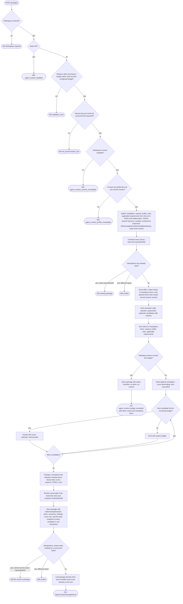

#### GetAgentContextPackageQuery: get a package [FR-MCP-AGENTCONTEXT-001]

- Handler: `GetAgentContextPackageQuery(string WorkspacePath, string PackageId, bool IncludeContent) : IQuery<AgentContextPackageResult>` and `GetAgentContextPackageQueryHandler` in `src/QBrainAi.Services/AgentContext/Queries/GetAgentContextPackageQuery.cs`.
- REST `GET /qbrainai/agent-context/packages/{packageId}?includeContent=true`; MCP `agent_context_get_package(workspacePath, packageId, includeContent)`; client `GetPackageAsync(packageId, includeContent)`; REPL `client.AgentContext.GetPackageAsync`; PowerShell `New-McpAgentContextGetPackageParams`; tool descriptor `agent_context_get_package`.
- Response 200 `AgentContextPackageResult`. Errors: 404 workspace or `not_found` (`package`), 409 `agent_context_disabled`.


#### QueryAgentContextPackagesQuery: query packages [FR-MCP-AGENTCONTEXT-001]

- Handler: `QueryAgentContextPackagesQuery(string WorkspacePath, AgentContextPackageQuery Query) : IQuery<AgentContextPackageQueryResult>` and `QueryAgentContextPackagesQueryHandler` in `src/QBrainAi.Services/AgentContext/Queries/QueryAgentContextPackagesQuery.cs`.
- REST `GET /qbrainai/agent-context/packages?requestId&sessionId&status&limit&offset` (limit default 50, max 1000); MCP `agent_context_query_packages(workspacePath, requestId, sessionId, status, limit, offset)`; client `QueryPackagesAsync(AgentContextPackageQuery)`; REPL `client.AgentContext.QueryPackagesAsync`; PowerShell `New-McpAgentContextQueryPackagesParams`; tool descriptor `agent_context_query_packages`.
- Response 200 `AgentContextPackageQueryResult`. Errors: 400 `validation_error` (limit or offset out of range, unknown status), 404 workspace, 409 `agent_context_disabled`.


#### ReplayAgentContextPackageQuery: replay a package [FR-MCP-AGENTCONTEXT-001]

- Handler: `ReplayAgentContextPackageQuery(string WorkspacePath, string PackageId) : IQuery<AgentContextReplayResult>` and `ReplayAgentContextPackageQueryHandler` in `src/QBrainAi.Services/AgentContext/Queries/ReplayAgentContextPackageQuery.cs`.
- REST `POST /qbrainai/agent-context/packages/{packageId}/replay`; MCP `agent_context_replay_package(workspacePath, packageId)`; client `ReplayPackageAsync(packageId)`; REPL `client.AgentContext.ReplayPackageAsync`; PowerShell `New-McpAgentContextReplayPackageParams`; tool descriptor `agent_context_replay_package`.
- Replay rebuilds the package in memory from its immutable input snapshot only (`OptionsSnapshotJson`, focus refs, and `AgentContextPackageInputs`, section 6.3) with the same builder version, reads no live source or configuration, stores nothing, and compares the result, so replay stays identical after configuration, omitted-source, and non-Git source changes (`Replay_AfterConfigChange_Identical`, `Replay_AfterOmittedSourceChange_Identical`, `Replay_AfterRequirementTodoTurnProfileChange_Identical`).
- Response 200 `AgentContextReplayResult`. Errors: 404 workspace or `not_found` (`package`), 409 `agent_context_disabled`, `agent_context_package_overflow`, `agent_context_replay_snapshot_unavailable` (no stored snapshot), `agent_context_replay_builder_changed` (built by another builder version; `details { recorded, current }`).

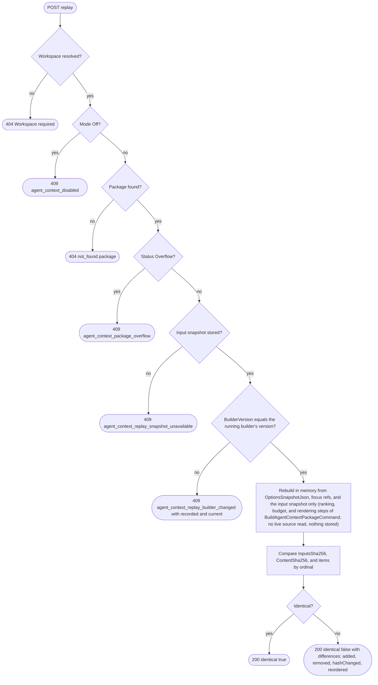

#### SubmitAgentResponseCommand: submit a response [FR-MCP-AGENTCONTEXT-003]

- Handler: `SubmitAgentResponseCommand(string WorkspacePath, SubmitAgentResponseRequest Request) : ICommand<AgentResponseResult>` and `SubmitAgentResponseCommandHandler` in `src/QBrainAi.Services/AgentContext/Commands/SubmitAgentResponseCommand.cs`.
- REST `POST /qbrainai/agent-context/responses`; MCP `agent_context_submit_response(workspacePath, requestJson)`; client `SubmitResponseAsync(SubmitAgentResponseRequest)`; REPL `client.AgentContext.SubmitResponseAsync`; PowerShell `New-McpAgentContextSubmitResponseParams`; tool descriptor `agent_context_submit_response`.
- Response 201 `AgentResponseResult` with status `Submitted`, or 200 with the existing response for a repeated idempotency key with an identical submission (`SubmissionSha256`, section 6.3; `Submit_SameKeyIdenticalSubmission_200Existing`, `Submit_SameKeySameContentDifferentPackage_409Conflict`, `Submit_SameKeySameContentDifferentClaimsOrEvidence_409Conflict`).
- Errors: 400 `validation_error` (empty content, no claim, a claim with no evidence item, duplicate claimId, evidence pointing to an unknown claim, unknown format or mode); 404 `not_found` (`package`); 409 `agent_context_disabled`, `agent_context_package_overflow`, `conflict` (key reused with a different submission: any differing package, agent, model, effort, mode, format, content, claim, or evidence).

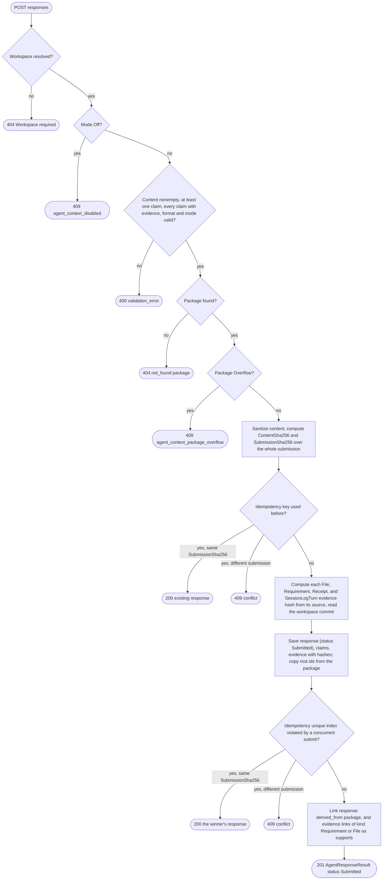

#### GetAgentResponseQuery: get a response [FR-MCP-AGENTCONTEXT-003]

- Handler: `GetAgentResponseQuery(string WorkspacePath, string ResponseId, bool IncludeContent) : IQuery<AgentResponseResult>` and `GetAgentResponseQueryHandler` in `src/QBrainAi.Services/AgentContext/Queries/GetAgentResponseQuery.cs`.
- REST `GET /qbrainai/agent-context/responses/{responseId}?includeContent=true`; MCP `agent_context_get_response(workspacePath, responseId, includeContent)`; client `GetResponseAsync(responseId, includeContent)`; REPL `client.AgentContext.GetResponseAsync`; PowerShell `New-McpAgentContextGetResponseParams`; tool descriptor `agent_context_get_response`.
- Response 200 `AgentResponseResult` (with every grade). Errors: 404 workspace or `not_found` (`response`), 409 `agent_context_disabled`.


#### QueryAgentResponsesQuery: query responses [FR-MCP-AGENTCONTEXT-003, -004]

- Handler: `QueryAgentResponsesQuery(string WorkspacePath, AgentResponseQuery Query) : IQuery<AgentResponseQueryResult>` and `QueryAgentResponsesQueryHandler` in `src/QBrainAi.Services/AgentContext/Queries/QueryAgentResponsesQuery.cs`.
- REST `GET /qbrainai/agent-context/responses?requestId&packageId&status&trustedOnly&limit&offset`; MCP `agent_context_query_responses(string workspacePath, string? requestId = null, string? packageId = null, string? status = null, bool trustedOnly = false, int limit = 50, int offset = 0)`; client `QueryResponsesAsync(AgentResponseQuery)`; REPL `client.AgentContext.QueryResponsesAsync`; PowerShell `New-McpAgentContextQueryResponsesParams`; tool descriptor `agent_context_query_responses`.
- Response 200 `AgentResponseQueryResult`. Errors: 400 `validation_error`, 404 workspace, 409 `agent_context_disabled`.


#### RunDeterministicGradeCommand: run the deterministic grade [FR-MCP-AGENTCONTEXT-004]

- Handler: `RunDeterministicGradeCommand(string WorkspacePath, string ResponseId) : ICommand<AgentResponseGradeResult>` and `RunDeterministicGradeCommandHandler` in `src/QBrainAi.Services/AgentContext/Commands/RunDeterministicGradeCommand.cs`.
- REST `POST /qbrainai/agent-context/responses/{responseId}/grades/deterministic`; MCP `agent_context_grade_deterministic(workspacePath, responseId)`; client `RunDeterministicGradeAsync(responseId)`; REPL `client.AgentContext.RunDeterministicGradeAsync`; PowerShell `New-McpAgentContextGradeDeterministicParams`; tool descriptor `agent_context_grade_deterministic`.
- Checks, one finding per check and claim: every claim has at least one evidence item; every `File` evidence exists at its commit with the cited hash; every `Requirement` evidence id exists in the requirement store; every `Receipt` path exists with the cited hash; every `SessionLogTurn` evidence resolves; the content, every claim text, and every evidence ref contain no secret; the package is not stale. A check that cannot be evaluated is UNKNOWN.
- Scores: correctness = PASS findings / (PASS + FAIL) over evaluated checks, and 0 when no check could be evaluated (PASS + FAIL = 0); completeness = claims whose every evidence check is PASS / all claims (SubmitAgentResponseCommand guarantees at least one claim, each with evidence); both exact decimals. Any UNKNOWN finding already fails the verdict, so a zero denominator can never yield trust.
- Response 201 `AgentResponseGradeResult`. Errors: 404 workspace or `not_found` (`response`), 409 `agent_context_disabled`, `agent_context_response_not_gradable`.

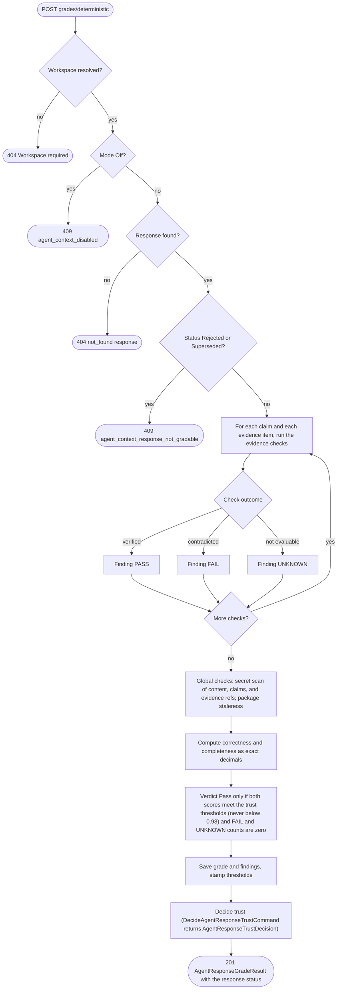

#### RecordModelGradeCommand: record a model grade from an HV review [FR-MCP-AGENTCONTEXT-004]

- Handler: `RecordModelGradeCommand(string WorkspacePath, string ResponseId, RecordModelGradeRequest Request) : ICommand<AgentResponseGradeResult>` and `RecordModelGradeCommandHandler` in `src/QBrainAi.Services/AgentContext/Commands/RecordModelGradeCommand.cs`.
- Caller: the HV agent (the configured grader, launched as every HV is) after it reviews the turns of an HV request (CreateAgentContextHvRequestCommand). There is no grading worker or HV pipeline in this effort (operator, 2026-10-11).
- REST `POST /qbrainai/agent-context/responses/{responseId}/grades/model`; MCP `agent_context_record_model_grade(string workspacePath, string responseId, string gradeJson)`; client `RecordModelGradeAsync(responseId, RecordModelGradeRequest)`; REPL `client.AgentContext.RecordModelGradeAsync`; PowerShell `New-McpAgentContextRecordModelGradeParams` (also builds the request from the reviewer's verdict: the scores and findings of its `grades` entry for the response copied exactly, the reviewer's own session-log turn ids, its thread id, and the request, response, and rollout jsonl paths); tool descriptor `agent_context_record_model_grade`.
- Response 201 `AgentResponseGradeResult` with `hvRequestStatus` (`Completed` once every item of the HV request is graded).
- Errors: 400 `validation_error`, `review_score_format`, `review_score_precision`, `review_score_out_of_range`, `agent_context_receipt_paths_required`; 403 `agent_context_grader_not_allowed`; 404 `not_found` (`response`, `hv_request`); 409 `agent_context_disabled`, `agent_context_response_not_gradable`, `agent_context_grade_not_in_hv_request`, `agent_context_hv_request_closed`; 422 `agent_context_receipt_unverified`.

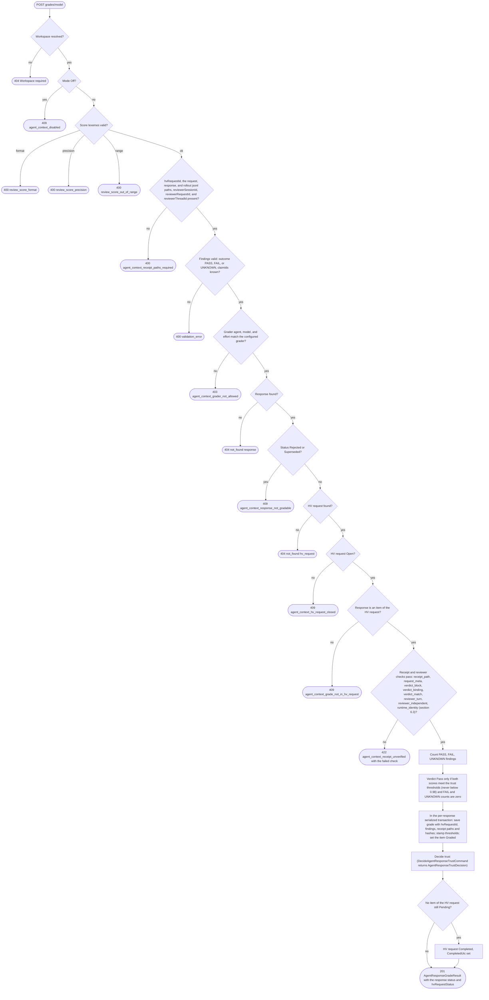

#### DecideAgentResponseTrustCommand: decide trust (internal, after every grade) [FR-MCP-AGENTCONTEXT-004]

- Handler: `DecideAgentResponseTrustCommand(string WorkspacePath, string ResponseId) : ICommand<AgentResponseTrustDecision>` and `DecideAgentResponseTrustCommandHandler` in `src/QBrainAi.Services/AgentContext/Commands/DecideAgentResponseTrustCommand.cs`; internal, dispatched through `IDispatcher.SendAsync` by the RunDeterministicGradeCommand and RecordModelGradeCommand handlers inside their transaction, never by a surface.
- Trigger: the RunDeterministicGradeCommand and RecordModelGradeCommand handlers dispatch it after their grade is saved, in the same transaction. No endpoint.
- Rule: a response is `Trusted` only when it is not `Rejected`, `Stale`, or `Superseded`, its latest deterministic grade is `Pass`, and its latest model grade is `Pass` ("latest" as defined in section 6.3: greatest `GradedUtc`, then greatest `GradeId`); otherwise it is `Grading`. The decision runs inside the grade's serialized transaction (per-response serialization rule, section 6.3), so the stored status always reflects the latest committed grade pair, and a concurrent reject, supersede, or staleness change on the same response is ordered before or after it, never interleaved.

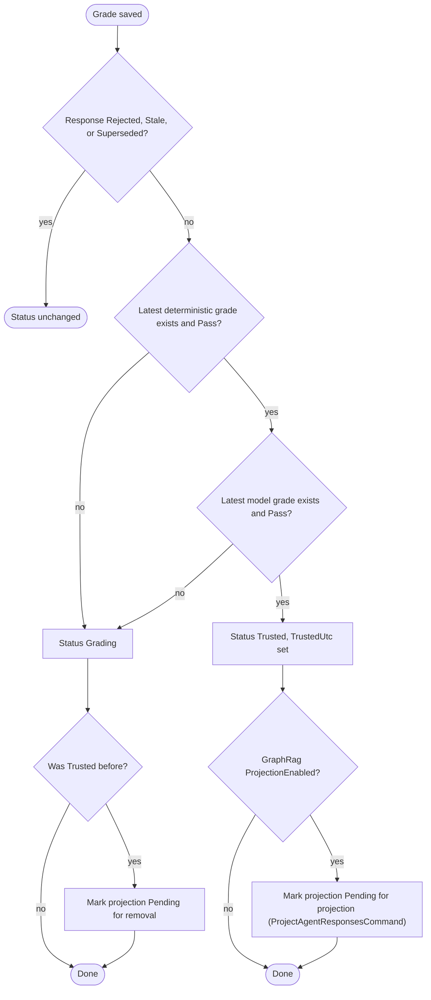

#### RejectAgentResponseCommand: reject a response [FR-MCP-AGENTCONTEXT-005]

- Handler: `RejectAgentResponseCommand(string WorkspacePath, string ResponseId, RejectAgentResponseRequest Request) : ICommand<AgentResponseResult>` and `RejectAgentResponseCommandHandler` in `src/QBrainAi.Services/AgentContext/Commands/RejectAgentResponseCommand.cs`.
- REST `POST /qbrainai/agent-context/responses/{responseId}/reject`; MCP `agent_context_reject_response(workspacePath, responseId, reason)`; client `RejectResponseAsync(responseId, RejectAgentResponseRequest)`; REPL `client.AgentContext.RejectResponseAsync`; PowerShell `New-McpAgentContextRejectResponseParams`; tool descriptor `agent_context_reject_response`.
- Response 200 `AgentResponseResult` with status `Rejected` (a repeat on a rejected response returns 200 unchanged). Errors: 400 `validation_error` (blank reason), 404, 409 `agent_context_disabled`, `agent_context_response_not_gradable` (already `Superseded`).

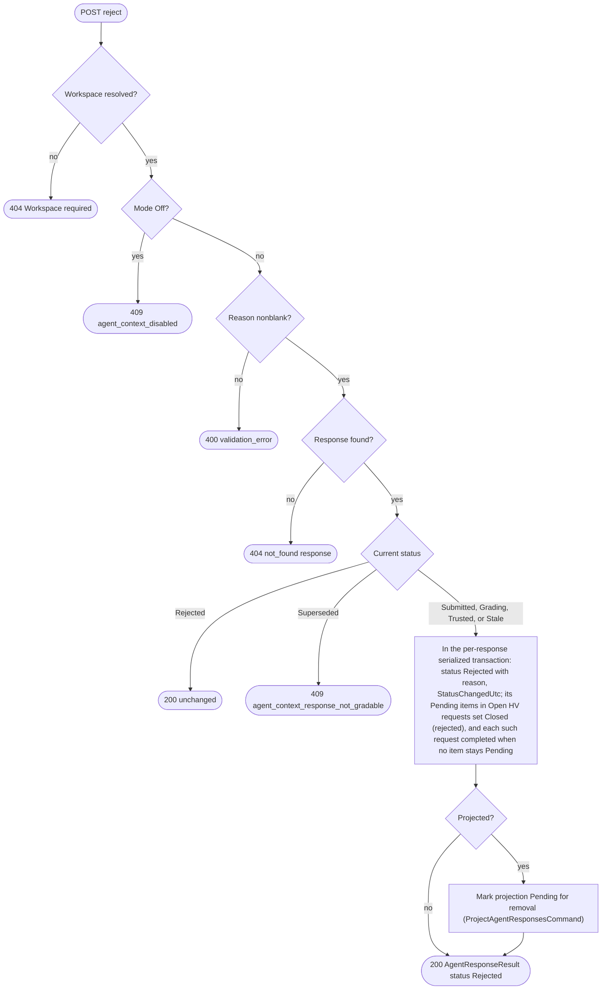

#### SupersedeAgentResponseCommand: supersede a response [FR-MCP-AGENTCONTEXT-005]

- Handler: `SupersedeAgentResponseCommand(string WorkspacePath, string ResponseId, SupersedeAgentResponseRequest Request) : ICommand<AgentResponseResult>` and `SupersedeAgentResponseCommandHandler` in `src/QBrainAi.Services/AgentContext/Commands/SupersedeAgentResponseCommand.cs`.
- REST `POST /qbrainai/agent-context/responses/{responseId}/supersede`; MCP `agent_context_supersede_response(workspacePath, responseId, supersededByResponseId, reason)`; client `SupersedeResponseAsync(responseId, SupersedeAgentResponseRequest)`; REPL `client.AgentContext.SupersedeResponseAsync`; PowerShell `New-McpAgentContextSupersedeResponseParams`; tool descriptor `agent_context_supersede_response`.
- Response 200 `AgentResponseResult` with status `Superseded`. Errors: 400 `validation_error` (self-reference, blank reason), 404 (either response), 409 `agent_context_disabled`, `agent_context_supersede_invalid` (different request, a supersede cycle, or the replacement itself rejected or superseded).

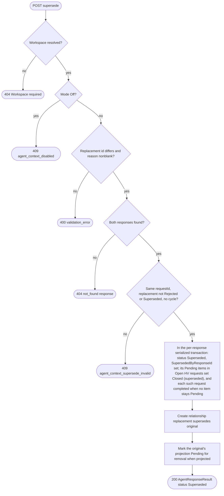

#### EvaluateStalenessCommand: evaluate staleness [FR-MCP-AGENTCONTEXT-005]

- Handler: `EvaluateStalenessCommand(string WorkspacePath, EvaluateStalenessRequest Request) : ICommand<AgentContextStalenessResult>` and `EvaluateStalenessCommandHandler` in `src/QBrainAi.Services/AgentContext/Commands/EvaluateStalenessCommand.cs`.
- REST `POST /qbrainai/agent-context/staleness/evaluate`; MCP `agent_context_evaluate_staleness(workspacePath, responseIdsJson)`; client `EvaluateStalenessAsync(EvaluateStalenessRequest)`; REPL `client.AgentContext.EvaluateStalenessAsync`; PowerShell `New-McpAgentContextEvaluateStalenessParams`; tool descriptor `agent_context_evaluate_staleness`.
- Also triggered internally before BuildAgentContextPackageCommand gathers prior responses, by RetrieveAgentContextCandidatesQuery for every prior-response candidate before it is returned, and after a requirement update or delete.
- Rule: a non-terminal response is stale when any `depends_on`, `derived_from`, or `supports` target of the response or of its package now hashes differently from its `ToSha256`, when any of its `File`, `Requirement`, `Receipt`, or `SessionLogTurn` evidence (including evidence outside its package) now hashes differently from the evidence's recorded `Sha256`, or when a cited requirement was deleted or superseded (`Staleness_ResponseOnlyEvidenceChanged_MarksStale`); each status change runs in the per-response serialized transaction.
- Response 200 `AgentContextStalenessResult`. Errors: 400 `validation_error` (malformed list, more than 1000 ids, an id without the `rsp-` prefix), 404 workspace, 409 `agent_context_disabled`.

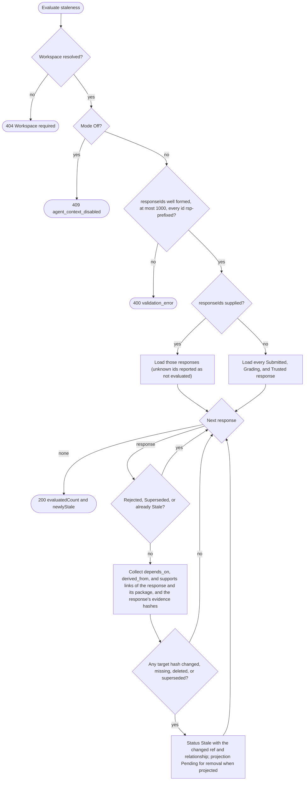

#### CreateAgentContextRelationshipCommand: create a relationship [FR-MCP-AGENTCONTEXT-006]

- Handler: `CreateAgentContextRelationshipCommand(string WorkspacePath, CreateAgentContextRelationshipRequest Request) : ICommand<AgentContextRelationshipResult>` and `CreateAgentContextRelationshipCommandHandler` in `src/QBrainAi.Services/AgentContext/Commands/CreateAgentContextRelationshipCommand.cs`.
- REST `POST /qbrainai/agent-context/relationships`; MCP `agent_context_create_relationship(workspacePath, relationshipJson)`; client `CreateRelationshipAsync(CreateAgentContextRelationshipRequest)`; REPL `client.AgentContext.CreateRelationshipAsync`; PowerShell `New-McpAgentContextCreateRelationshipParams`; tool descriptor `agent_context_create_relationship`.
- Response 201 with `created: true`, or 200 with `created: false` for an identical existing link. Errors: 400 `agent_context_relationship_invalid`, 404 `not_found` (`ref`), 409 `agent_context_disabled`, `agent_context_supersede_invalid` (a `supersedes` cycle).

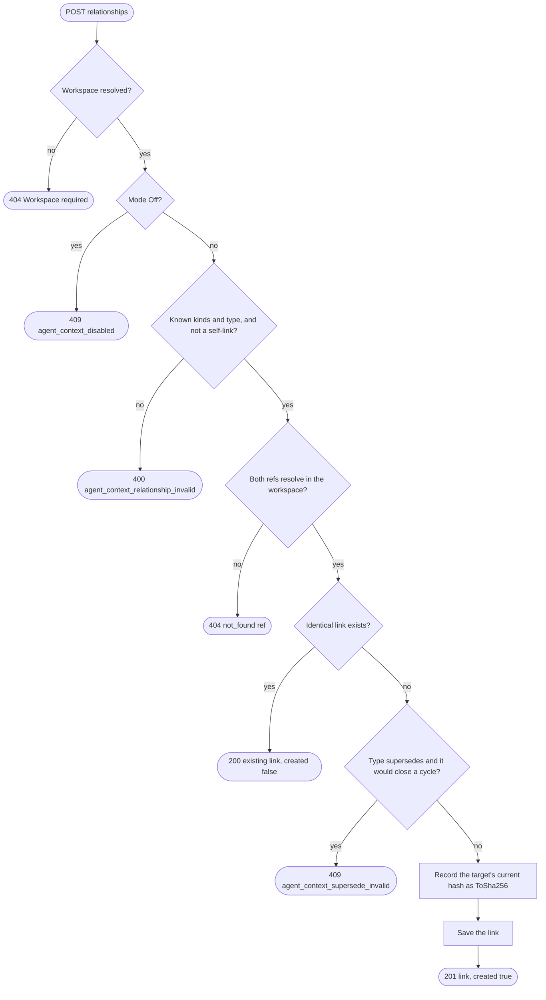

#### DeleteAgentContextRelationshipCommand: delete a relationship [FR-MCP-AGENTCONTEXT-006]

- Handler: `DeleteAgentContextRelationshipCommand(string WorkspacePath, string RelationshipId) : ICommand<bool>` and `DeleteAgentContextRelationshipCommandHandler` in `src/QBrainAi.Services/AgentContext/Commands/DeleteAgentContextRelationshipCommand.cs`.
- REST `DELETE /qbrainai/agent-context/relationships/{relationshipId}`; MCP `agent_context_delete_relationship(workspacePath, relationshipId)`; client `DeleteRelationshipAsync(relationshipId)`; REPL `client.AgentContext.DeleteRelationshipAsync`; PowerShell `New-McpAgentContextDeleteRelationshipParams`; tool descriptor `agent_context_delete_relationship`.
- Response 204. Errors: 404, 409 `agent_context_disabled`. A `supersedes` link created by SupersedeAgentResponseCommand cannot be deleted while the response stays `Superseded` (409 `agent_context_supersede_invalid`).


#### QueryAgentContextRelationshipsQuery: query relationships [FR-MCP-AGENTCONTEXT-006]

- Handler: `QueryAgentContextRelationshipsQuery(string WorkspacePath, AgentContextRelationshipQuery Query) : IQuery<AgentContextRelationshipQueryResult>` and `QueryAgentContextRelationshipsQueryHandler` in `src/QBrainAi.Services/AgentContext/Queries/QueryAgentContextRelationshipsQuery.cs`.
- REST `GET /qbrainai/agent-context/relationships?nodeKind&nodeRef&type&direction&limit&offset`; MCP `agent_context_query_relationships(string workspacePath, string? nodeKind = null, string? nodeRef = null, string? type = null, string direction = "both", int limit = 50, int offset = 0)`; client `QueryRelationshipsAsync(AgentContextRelationshipQuery)`; REPL `client.AgentContext.QueryRelationshipsAsync`; PowerShell `New-McpAgentContextQueryRelationshipsParams`; tool descriptor `agent_context_query_relationships`.
- Response 200 `AgentContextRelationshipQueryResult`. Errors: 400 `validation_error` (node kind without ref, unknown type or direction), 404 workspace, 409 `agent_context_disabled`.


#### RetrieveAgentContextCandidatesQuery: retrieve candidate context [FR-MCP-AGENTCONTEXT-007]

- Handler: `RetrieveAgentContextCandidatesQuery(string WorkspacePath, AgentContextRetrieveRequest Request) : IQuery<AgentContextRetrieveResult>` and `RetrieveAgentContextCandidatesQueryHandler` in `src/QBrainAi.Services/AgentContext/Queries/RetrieveAgentContextCandidatesQuery.cs`.
- REST `POST /qbrainai/agent-context/retrieve`; MCP `agent_context_retrieve(workspacePath, requestJson)`; client `RetrieveAsync(AgentContextRetrieveRequest)`; REPL `client.AgentContext.RetrieveAsync`; PowerShell `New-McpAgentContextRetrieveParams`; tool descriptor `agent_context_retrieve`. Also called by BuildAgentContextPackageCommand with the package's `sessionId`, `requestId`, and `focusRefs`.
- When the request names a turn (`sessionId` and `requestId`) or `focusRefs`, the relational path ranks by explicit relationships to that turn, its TODO, its requirements, and the focus refs first (`Retrieve_SameQueryTextTwoTurnNeighborhoods_DifferentRanking`); without them it ranks by the hybrid search alone. Every `PriorResponse` candidate is checked for staleness (EvaluateStalenessCommand) before it is returned, so a response whose dependency changed is marked `Stale` and omitted (`Retrieve_AfterEvidenceFileChange_ResponseStaleAndExcluded`). The relational path then ranks by the existing hybrid search (FTS5 BM25 with vector similarity), with ties broken by `sourceRef`. The GraphRAG path queries the projected responses; any fallback uses the relational path and reports `fallbackReason` (`graphrag_disabled`, `graphrag_not_initialized`, `graphrag_not_indexed`, `index_in_progress`, `retrieval_disabled`, or `graphrag_error`).
- Response 200 `AgentContextRetrieveResult`. Errors: 400 `validation_error` (`trustedOnly: false` with kind `PriorResponse`, limit out of range, only one of `sessionId` and `requestId`), 404 workspace, 404 `not_found` (`session_turn`) for a named turn that does not exist in the workspace (`Retrieve_UnknownTurn_404SessionTurn`), 409 `agent_context_disabled`.

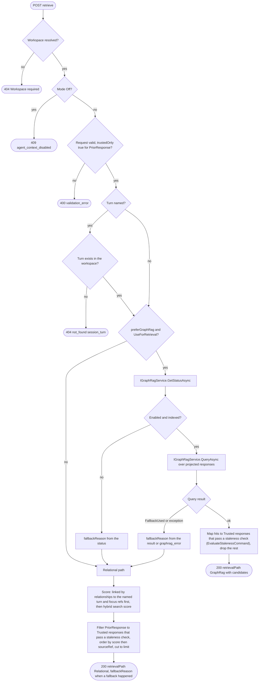

#### ProjectAgentResponsesCommand: project responses into GraphRAG [FR-MCP-AGENTCONTEXT-007]

- Handler: `ProjectAgentResponsesCommand(string WorkspacePath, ProjectAgentContextRequest Request) : ICommand<AgentContextProjectionResult>` and `ProjectAgentResponsesCommandHandler` in `src/QBrainAi.Services/AgentContext/Commands/ProjectAgentResponsesCommand.cs`.
- REST `POST /qbrainai/agent-context/projection/graphrag`; MCP `agent_context_project_graphrag(workspacePath, responseIdsJson)`; client `ProjectToGraphRagAsync(ProjectAgentContextRequest)`; REPL `client.AgentContext.ProjectToGraphRagAsync`; PowerShell `New-McpAgentContextProjectGraphRagParams`; tool descriptor `agent_context_project_graphrag`. Also run by a background pass after DecideAgentResponseTrustCommand, RejectAgentResponseCommand, SupersedeAgentResponseCommand, and EvaluateStalenessCommand mark a projection `Pending`.
- Response 200 `AgentContextProjectionResult`. Errors: 400 `validation_error` (malformed list, more than 1000 ids, an id without the `rsp-` prefix), 404 workspace, 409 `agent_context_disabled`. GraphRAG being disabled is not an error: every selected projection is `Skipped` with `skippedReason: graphrag_disabled`.

```mermaid
flowchart TD
    S(["Projection run"]) --> W{"Workspace resolved?"}
    W -->|no| E0(["404 Workspace required"])
    W -->|yes| MO{"Mode Off?"}
    MO -->|yes| E1(["409 agent_context_disabled"])
    MO -->|no| VID{"responseIds well formed, at most 1000, every id rsp-prefixed?"}
    VID -->|no| E2(["400 validation_error"])
    VID -->|yes| PE{"ProjectionEnabled and GraphRAG enabled?"}
    PE -->|no| SK["Every selected projection Skipped"]
    SK --> R0(["200 skipped with skippedReason"])
    PE -->|yes| SEL["Select requested responses, or every Pending or out-of-date projection"]
    SEL --> NX{"Next response"}
    NX -->|none| R(["200 projected, removed, skipped, failed"])
    NX -->|response| TR{"Status Trusted?"}
    TR -->|yes| UP{"Projected content hash equals ContentSha256?"}
    UP -->|yes| NX
    UP -->|no| ING["IGraphRagService.IngestTextAsync with the response content and its root ids"]
    ING --> IR{"Ingest result"}
    IR -->|ok| PJ["State Projected, document id and hash stored"]
    IR -->|error| FL["State Failed with LastError"]
    PJ --> NX
    FL --> NX
    TR -->|no| WAS{"Currently Projected?"}
    WAS -->|yes| DEL["IGraphRagService.DeleteDocumentAsync"]
    DEL --> DR{"Delete result"}
    DR -->|ok| RMV["State Removed"]
    DR -->|error| FL
    RMV --> NX
    WAS -->|no| NX
```

#### GetAgentContextPilotReportQuery: pilot report [FR-MCP-AGENTCONTEXT-009]

- Handler: `GetAgentContextPilotReportQuery(string WorkspacePath, AgentContextPilotReportQuery Query) : IQuery<AgentContextPilotReport>` and `GetAgentContextPilotReportQueryHandler` in `src/QBrainAi.Services/AgentContext/Queries/GetAgentContextPilotReportQuery.cs`.
- REST `GET /qbrainai/agent-context/pilot/report?fromUtc&toUtc`; MCP `agent_context_pilot_report(workspacePath, fromUtc, toUtc)`; client `GetPilotReportAsync(AgentContextPilotReportQuery)`; REPL `client.AgentContext.GetPilotReportAsync`; PowerShell `New-McpAgentContextPilotReportParams`; tool descriptor `agent_context_pilot_report`.
- Response 200 `AgentContextPilotReport`. Errors: 400 `validation_error` (missing offset or from after to), 404 workspace, 409 `agent_context_disabled`.

```mermaid
flowchart TD
    S(["GET pilot report"]) --> W{"Workspace resolved?"}
    W -->|no| E0(["404 Workspace required"])
    W -->|yes| MO{"Mode Off?"}
    MO -->|yes| E1(["409 agent_context_disabled"])
    MO -->|no| V{"fromUtc and toUtc valid UTC and from before to?"}
    V -->|no| E2(["400 validation_error"])
    V -->|yes| Q["Group responses submitted in the window by invocationMode"]
    Q --> AGG["Per mode: counts by status, mean latest model correctness and completeness, trust rate"]
    AGG --> R(["200 AgentContextPilotReport"])
```

#### CreateAgentContextHvRequestCommand: create an HV request for a range of turns [FR-MCP-AGENTCONTEXT-004]

- Handler: `CreateAgentContextHvRequestCommand(string WorkspacePath, CreateAgentContextHvRequestRequest Request) : ICommand<AgentContextHvRequestResult>` and `CreateAgentContextHvRequestCommandHandler` in `src/QBrainAi.Services/AgentContext/Commands/CreateAgentContextHvRequestCommand.cs`.
- Caller: any agent (operator, 2026-10-11: "Agents will specify a range of session turns to be HV, the HV agent will mark the grade you have been working.").
- REST `POST /qbrainai/agent-context/hv-requests`; MCP `agent_context_create_hv_request(string workspacePath, string sessionId, string agent, string fromRequestId, string toRequestId, string requestedBy, string reason)`; client `CreateHvRequestAsync(CreateAgentContextHvRequestRequest)`; REPL `client.AgentContext.CreateHvRequestAsync`; PowerShell `New-McpAgentContextCreateHvRequestParams`; tool descriptor `agent_context_create_hv_request`.
- Response 201 `AgentContextHvRequestResult` (Location `/qbrainai/agent-context/hv-requests/{hvRequestId}`) with its items: every agent response whose `RequestId` lies in the range and whose status is not `Rejected` or `Superseded`, in turn order, each `Pending`.
- Review contract: the brief for an HV request asks the reviewer to emit in its `=== VERDICT JSON ===` the `hvRequestId` and `grades`, one entry per item `{ responseId, contentSha256, correctness, completeness, findings [{ claimId, check, outcome }] }` naming every claim of the response, and to store its entire result on its own session-log turn; RecordModelGradeCommand accepts a grade only when it equals that entry and that turn (section 6.3).
- Errors: 400 `validation_error` (blank fields), `agent_context_hv_request_invalid` (unknown session, an endpoint turn not in the session, from after to, a range longer than `HvRequest:MaxTurns`, or a range with no gradable agent response); 404 workspace; 409 `agent_context_disabled`.

```mermaid
flowchart TD
    S(["POST hv-requests"]) --> W{"Workspace resolved?"}
    W -->|no| E0(["404 Workspace required"])
    W -->|yes| MO{"Mode Off?"}
    MO -->|yes| E1(["409 agent_context_disabled"])
    MO -->|no| V{"sessionId, agent, both requestIds, requestedBy, and reason nonblank?"}
    V -->|no| E2(["400 validation_error"])
    V -->|yes| SS{"Session exists for agent and sessionId?"}
    SS -->|no| E3(["400 agent_context_hv_request_invalid unknown session"])
    SS -->|yes| EP{"Both turns exist in the session and from is not after to?"}
    EP -->|no| E4(["400 agent_context_hv_request_invalid range"])
    EP -->|yes| LEN{"Turns in range at most HvRequest:MaxTurns?"}
    LEN -->|no| E5(["400 agent_context_hv_request_invalid too long"])
    LEN -->|yes| RS["Collect agent responses whose RequestId lies in the range and whose status is not Rejected or Superseded, in turn order, each Pending"]
    RS --> ANY{"At least one response?"}
    ANY -->|no| E6(["400 agent_context_hv_request_invalid no gradable responses"])
    ANY -->|yes| SV["Save HV request (Open) and its items"]
    SV --> R(["201 AgentContextHvRequestResult"])
```

#### GetAgentContextHvRequestQuery: get an HV request [FR-MCP-AGENTCONTEXT-004]

- Handler: `GetAgentContextHvRequestQuery(string WorkspacePath, string HvRequestId) : IQuery<AgentContextHvRequestResult>` and `GetAgentContextHvRequestQueryHandler` in `src/QBrainAi.Services/AgentContext/Queries/GetAgentContextHvRequestQuery.cs`.
- REST `GET /qbrainai/agent-context/hv-requests/{hvRequestId}`; MCP `agent_context_get_hv_request(string workspacePath, string hvRequestId)`; client `GetHvRequestAsync(hvRequestId)`; REPL `client.AgentContext.GetHvRequestAsync`; PowerShell `New-McpAgentContextGetHvRequestParams`; tool descriptor `agent_context_get_hv_request`.
- Response 200 `AgentContextHvRequestResult` with its items. Errors: 404 workspace or `not_found` (`hv_request`), 409 `agent_context_disabled`.

```mermaid
flowchart TD
    S(["GET hv-requests/{hvRequestId}"]) --> W{"Workspace resolved?"}
    W -->|no| E0(["404 Workspace required"])
    W -->|yes| MO{"Mode Off?"}
    MO -->|yes| E1(["409 agent_context_disabled"])
    MO -->|no| F{"HV request found?"}
    F -->|no| E2(["404 not_found hv_request"])
    F -->|yes| L["Load items with their dispositions"]
    L --> R(["200 AgentContextHvRequestResult"])
```

#### QueryAgentContextHvRequestsQuery: query HV requests [FR-MCP-AGENTCONTEXT-004]

- Handler: `QueryAgentContextHvRequestsQuery(string WorkspacePath, AgentContextHvRequestQuery Query) : IQuery<AgentContextHvRequestQueryResult>` and `QueryAgentContextHvRequestsQueryHandler` in `src/QBrainAi.Services/AgentContext/Queries/QueryAgentContextHvRequestsQuery.cs`.
- REST `GET /qbrainai/agent-context/hv-requests?sessionId&status&limit&offset`; MCP `agent_context_query_hv_requests(string workspacePath, string? sessionId = null, string? status = null, int limit = 50, int offset = 0)`; client `QueryHvRequestsAsync(AgentContextHvRequestQuery)`; REPL `client.AgentContext.QueryHvRequestsAsync`; PowerShell `New-McpAgentContextQueryHvRequestsParams`; tool descriptor `agent_context_query_hv_requests`.
- Response 200 `AgentContextHvRequestQueryResult`. Errors: 400 `validation_error` (unknown status, limit or offset out of range), 404 workspace, 409 `agent_context_disabled`.

```mermaid
flowchart TD
    S(["GET hv-requests"]) --> W{"Workspace resolved?"}
    W -->|no| E0(["404 Workspace required"])
    W -->|yes| MO{"Mode Off?"}
    MO -->|yes| E1(["409 agent_context_disabled"])
    MO -->|no| V{"Filters valid: known status, limit 1..1000, offset 0 or more?"}
    V -->|no| E2(["400 validation_error"])
    V -->|yes| Q["Filter, order by CreatedUtc descending then HvRequestId, count, page"]
    Q --> R(["200 totalCount, limit, offset, items"])
```

### 6.6 Processes (plugin)

#### Process RunStatelessInvocation: run a stateless invocation (plugin process) [FR-MCP-AGENTCONTEXT-009]

- Not a unit of work: the plugin orchestrates the handlers GetAgentContextStatusQuery (status), BuildAgentContextPackageCommand (build), SubmitAgentResponseCommand (submit), and RunDeterministicGradeCommand (deterministic grade) through the REPL.
- Trigger: a delivered user request (Phase A processes ApplyArrivalBridgeRecord and OpenTurnFromPromptHook) on a host whose plugin reads `Mode` through GetAgentContextStatusQuery.
- PowerShell core: `Invoke-PluginAgentContextInvocation` in `plugin-hook.ps1`, for all nine hosts (the TypeScript hosts through their adapters). Hosts inject the rendered package through their prompt-context mechanism (hook additional context or the host's system-context API).
- Output: in `Stateless` mode the model receives only the rendered package and the request, without prior conversation turns; in `Pilot` mode the package is built and recorded but not injected; in `Off` nothing happens.
- Package failure (operator, 2026-10-11: "Fail the invocation"): in `Pilot` or `Stateless` mode, when the build fails (budget overflow, profile unavailable, commit unavailable, any other error, or an outage), the plugin refuses the prompt with the error code and message shown to the operator, produces no answer, and closes the request's turn `canceled` with that reason (canceled turns are not gated, FR-MCP-SESSIONCLASS-002). This is the only `canceled` a hook ever writes, and only for the failed request's own turn, never another turn (the Phase A isolation rule, refined for this case: `Isolation_HooksNeverPersistCanceled_ExceptOwnTurnPackageFailure`); the plugin removes the request from `openDelivered` and the Stop ledger only after the server confirms the close, so the Stop gate never waits on a turn the plugin itself closed (`StatelessPackageFailure_ClosesOwnTurnCanceled_RemovedFromLedger_NoOtherTurnTouched`). A host whose prompt hook cannot refuse a prompt cannot run `Pilot` or `Stateless`; its plugin treats those modes as `Off` and its feature-matrix row records the limitation.
- History exclusion (operator: "Each agent invocation can run stateless"): in `Stateless` mode the model's input for the request is exactly the rendered package plus the current request. The plugin achieves it only through an authoritative host operation recorded in the host's P0.2 row: replacing the model's message list for that request (opencode `experimental.chat.messages.transform`, whose `output.messages` the adapter replaces with the list the core returns) or starting a fresh host invocation whose only input is the package and the request. A host without such an operation cannot run `Stateless`: its plugin treats `Stateless` as `Pilot` (the package is built and recorded, the model answers statefully) and its feature-matrix row records the limitation (`Stateless_HostWithoutHistoryExclusion_TreatedAsPilot_FeatureMatrixRow`). Each supported host has a host-level test that sends a sentinel prior turn and asserts, on the model request the host actually sends (recorded by the adapter fixture), that the sentinel is absent while the package and the current request are present (`StatelessHost_SentinelPriorTurn_AbsentFromModelRequest`).
- A host recorded `turn_logging_unsupported` (Phase A, D6) has no minted turn, so RunStatelessInvocation does not run there: the plugin stays stateful and reports `turn_logging_unsupported`.
- After the model answers, the response is submitted (SubmitAgentResponseCommand) at turn close and graded deterministically (RunDeterministicGradeCommand); its model grade comes later from an HV request covering its turn (CreateAgentContextHvRequestCommand, RecordModelGradeCommand).

```mermaid
flowchart TD
    S(["Request delivered"]) --> SUP{"Host supported for turn logging and the turn minted?"}
    SUP -->|no| UNS(["turn_logging_unsupported: stateful, no package"])
    SUP -->|yes| MD["Read Mode from status (cached per host session start)"]
    MD --> M{"Mode"}
    M -->|Off| OFF(["Stateful turn as today"])
    M -->|Pilot or Stateless| CAN{"Host prompt hook can refuse a prompt?"}
    CAN -->|no| LIM(["Treated as Off: stateful, limitation in the feature matrix"])
    CAN -->|yes| BP["Build package (BuildAgentContextPackageCommand) for sessionId and requestId, idempotency key = requestId"]
    BP --> BR{"Build result"}
    BR -->|any error or outage| REF["Refuse the prompt with the error code and message shown to the operator"]
    REF --> CN["Close this request's own turn canceled with the reason; after the server confirms, remove it from openDelivered and the Stop ledger"]
    CN --> FAIL(["Invocation failed: no answer produced"])
    BR -->|built| MM{"Mode"}
    MM -->|Pilot| PIL["Record packageId on the turn, no injection"]
    PIL --> RUN1["Model answers statefully"]
    MM -->|Stateless| HX{"Host has an authoritative history-exclusion operation (P0.2 row)?"}
    HX -->|no| PIL
    HX -->|yes| INJ["Replace the model input with the rendered package and the request (message-list replacement or fresh invocation): no history reaches the model"]
    INJ --> RUN2["Model answers from the package"]
    RUN1 --> SUB["At turn close submit the response (SubmitAgentResponseCommand) with claims, evidence, and invocationMode"]
    RUN2 --> SUB
    SUB --> SR{"Submit result"}
    SR -->|201 or 200| GRD["Deterministic grade (RunDeterministicGradeCommand)"]
    SR -->|error or outage| SE["Record the cause on the turn, keep the turn open for the Stop gate"]
    SE --> E3(["Response not recorded: the model or operator resubmits"])
    GRD --> GDR{"Grade result"}
    GDR -->|201| WAIT(["Response Grading until an HV request covering the turn records its model grade (CreateAgentContextHvRequestCommand, RecordModelGradeCommand)"])
    GDR -->|error| GE(["Cause recorded on the turn: the deterministic grade is re-run on request"])
```

### 6.7 Phase C sequence diagrams

In every diagram, `Caller` is any surface (plugin through the REPL, the REPL, the typed client, or an MCP client); REST requests go through `AgentContextController` and MCP requests through `FwhMcpTools.AgentContext`, both dispatching the unit's command or query through `IDispatcher` to its handler (shown as `SVC`). The mode-Off and workspace responses are the same for every request and are drawn once per diagram as the first `alt` branches.

#### Sequence: submit GetAgentContextStatusQuery

```mermaid
sequenceDiagram
    autonumber
    participant Caller
    participant API as AgentContextController or MCP tool
    participant SVC as IDispatcher and GetAgentContextStatusQueryHandler
    participant GR as IGraphRagService
    participant DB as Store
    Caller->>API: GET /qbrainai/agent-context/status
    alt workspace not resolved
        API-->>Caller: 404 Workspace required
        Caller->>Caller: report, fix X-Workspace-Path or workspacePath
    else resolved
        API->>SVC: QueryAsync(GetAgentContextStatusQuery)
        SVC->>GR: GetStatusAsync
        GR-->>SVC: enabled, state
        SVC->>DB: count packages and responses by status
        SVC-->>API: AgentContextStatusResult
        API-->>Caller: 200
        Caller->>Caller: plugins cache Mode for the host session, Off means stateful
    end
```

#### Sequence: submit BuildAgentContextPackageCommand

```mermaid
sequenceDiagram
    autonumber
    participant Caller
    participant API as Controller or MCP tool
    participant SVC as IDispatcher and BuildAgentContextPackageCommandHandler
    participant B as Package builder
    participant RT as Retrieval (RetrieveAgentContextCandidatesQuery)
    participant SL as Session log, requirements, TODO stores
    participant DB as Store
    Caller->>API: POST /packages (BuildAgentContextPackageRequest)
    alt workspace not resolved
        API-->>Caller: 404 Workspace required
    else mode Off
        API-->>Caller: 409 agent_context_disabled
        Caller->>Caller: continue statefully
    else invalid request
        API-->>Caller: 400 validation_error with details.field
        Caller->>Caller: fix the field, do not retry unchanged
    else accepted
        API->>SVC: SendAsync(BuildAgentContextPackageCommand)
        SVC->>SL: load turn, TODO, requirements, receipts
        alt turn missing
            SVC-->>API: not found
            API-->>Caller: 404 not_found session_turn
            Caller->>Caller: open or mint the turn first
        else commit unreadable
            SVC-->>API: commit unavailable
            API-->>Caller: 409 agent_context_commit_unavailable
            Caller->>Caller: refuse the prompt with the code, close the turn canceled (RunStatelessInvocation)
        else no profile or rule file resolves
            SVC-->>API: profile unavailable
            API-->>Caller: 409 agent_context_profile_unavailable
            Caller->>Caller: refuse the prompt with the code, close the turn canceled, operator fixes ProfileSources or RuleSources
        else turn, commit, profile, and rules available
            SVC->>B: gather, hash, filter, budget
            B->>RT: retrieve trusted prior responses and related items
            RT-->>B: candidates
            alt idempotency key reused with same inputs
                SVC-->>API: existing package
                API-->>Caller: 200 AgentContextPackageResult
                Caller->>Caller: use the returned package
            else idempotency key reused with different inputs
                SVC-->>API: conflict
                API-->>Caller: 409 conflict
                Caller->>Caller: new key or same inputs
            else mandatory context over budget
                B->>DB: store Overflow package
                SVC-->>API: budget exceeded
                API-->>Caller: 422 agent_context_budget_exceeded with token counts
                Caller->>Caller: refuse the prompt with the token counts, close the turn canceled, never truncate mandatory context
            else built
                B->>DB: save package, items, omissions, findings, input snapshot, links
                SVC-->>API: package
                API-->>Caller: 201 AgentContextPackageResult with Location
                Caller->>Caller: Stateless mode injects renderedContent. Pilot mode records packageId
            end
        end
    end
```

#### Sequence: submit GetAgentContextPackageQuery

```mermaid
sequenceDiagram
    autonumber
    participant Caller
    participant API as Controller or MCP tool
    participant SVC as IDispatcher and GetAgentContextPackageQueryHandler
    Caller->>API: GET /packages/{packageId}?includeContent
    alt workspace not resolved
        API-->>Caller: 404 Workspace required
    else mode Off
        API-->>Caller: 409 agent_context_disabled
    else accepted
        API->>SVC: QueryAsync(GetAgentContextPackageQuery)
        alt not found
            API-->>Caller: 404 not_found package
            Caller->>Caller: report the id
        else found
            API-->>Caller: 200 AgentContextPackageResult
            Caller->>Caller: verify contentSha256 of renderedContent before use
        end
    end
```

#### Sequence: submit QueryAgentContextPackagesQuery

```mermaid
sequenceDiagram
    autonumber
    participant Caller
    participant API as Controller or MCP tool
    participant SVC as IDispatcher and QueryAgentContextPackagesQueryHandler
    Caller->>API: GET /packages?requestId&sessionId&status&limit&offset
    alt workspace not resolved
        API-->>Caller: 404 Workspace required
    else mode Off
        API-->>Caller: 409 agent_context_disabled
    else invalid filters
        API-->>Caller: 400 validation_error
    else accepted
        API->>SVC: QueryAsync(QueryAgentContextPackagesQuery)
        SVC-->>API: page
        API-->>Caller: 200 totalCount, limit, offset, items
        Caller->>Caller: page with offset until offset plus count reaches totalCount
    end
```

#### Sequence: submit ReplayAgentContextPackageQuery

```mermaid
sequenceDiagram
    autonumber
    participant Caller
    participant API as Controller or MCP tool
    participant SVC as IDispatcher and ReplayAgentContextPackageQueryHandler
    participant B as Package builder
    Caller->>API: POST /packages/{packageId}/replay
    alt workspace not resolved
        API-->>Caller: 404 Workspace required
    else mode Off
        API-->>Caller: 409 agent_context_disabled
    else accepted
        API->>SVC: QueryAsync(ReplayAgentContextPackageQuery)
        alt package not found
            API-->>Caller: 404 not_found package
        else package Overflow
            API-->>Caller: 409 agent_context_package_overflow
        else no input snapshot stored
            API-->>Caller: 409 agent_context_replay_snapshot_unavailable
        else built by another builder version
            API-->>Caller: 409 agent_context_replay_builder_changed with recorded and current
            Caller->>Caller: report both versions, because replay is defined only for the same builder
        else replayed
            SVC->>B: rebuild in memory from the stored input snapshot and options
            B-->>SVC: replay hashes and items
            API-->>Caller: 200 AgentContextReplayResult
            alt identical
                Caller->>Caller: deterministic replay proven
            else differences
                Caller->>Caller: report each added, removed, hashChanged, reordered item
            end
        end
    end
```

#### Sequence: submit SubmitAgentResponseCommand

```mermaid
sequenceDiagram
    autonumber
    participant Caller as Plugin at turn close
    participant API as Controller or MCP tool
    participant SVC as IDispatcher and SubmitAgentResponseCommandHandler
    participant DB as Store
    Caller->>API: POST /responses (SubmitAgentResponseRequest)
    alt workspace not resolved
        API-->>Caller: 404 Workspace required
    else mode Off
        API-->>Caller: 409 agent_context_disabled
    else invalid content, claims, or evidence
        API-->>Caller: 400 validation_error with details.field
        Caller->>Caller: fix and resend
    else accepted
        API->>SVC: SendAsync(SubmitAgentResponseCommand)
        alt package not found
            API-->>Caller: 404 not_found package
        else package Overflow
            API-->>Caller: 409 agent_context_package_overflow
        else key reused with the same SubmissionSha256
            API-->>Caller: 200 existing AgentResponseResult
            Caller->>Caller: treat as submitted
        else key reused with a different submission (any field)
            API-->>Caller: 409 conflict
        else saved
            SVC->>DB: response, claims, evidence, links
            API-->>Caller: 201 AgentResponseResult status Submitted
            Caller->>Caller: record responseId on the turn, request the deterministic grade
        end
    end
```

#### Sequence: submit GetAgentResponseQuery

```mermaid
sequenceDiagram
    autonumber
    participant Caller
    participant API as Controller or MCP tool
    participant SVC as IDispatcher and GetAgentResponseQueryHandler
    Caller->>API: GET /responses/{responseId}?includeContent
    alt workspace not resolved
        API-->>Caller: 404 Workspace required
    else mode Off
        API-->>Caller: 409 agent_context_disabled
    else accepted
        API->>SVC: QueryAsync(GetAgentResponseQuery)
        alt not found
            API-->>Caller: 404 not_found response
        else found
            API-->>Caller: 200 AgentResponseResult with grades
            Caller->>Caller: use as context only if status Trusted
        end
    end
```

#### Sequence: submit QueryAgentResponsesQuery

```mermaid
sequenceDiagram
    autonumber
    participant Caller
    participant API as Controller or MCP tool
    participant SVC as IDispatcher and QueryAgentResponsesQueryHandler
    Caller->>API: GET /responses?requestId&packageId&status&trustedOnly&limit&offset
    alt workspace not resolved
        API-->>Caller: 404 Workspace required
    else mode Off
        API-->>Caller: 409 agent_context_disabled
    else invalid filters
        API-->>Caller: 400 validation_error
    else accepted
        API->>SVC: QueryAsync(QueryAgentResponsesQuery)
        API-->>Caller: 200 totalCount, limit, offset, items
        Caller->>Caller: page until complete
    end
```

#### Sequence: submit RunDeterministicGradeCommand

```mermaid
sequenceDiagram
    autonumber
    participant Caller
    participant API as Controller or MCP tool
    participant SVC as IDispatcher and RunDeterministicGradeCommandHandler
    participant DG as Deterministic grader
    participant SRC as Git, requirement, receipt, session-log stores
    participant DB as Store
    Caller->>API: POST /responses/{responseId}/grades/deterministic
    alt workspace not resolved
        API-->>Caller: 404 Workspace required
    else mode Off
        API-->>Caller: 409 agent_context_disabled
    else accepted
        API->>SVC: SendAsync(RunDeterministicGradeCommand)
        alt response not found
            API-->>Caller: 404 not_found response
        else Rejected or Superseded
            API-->>Caller: 409 agent_context_response_not_gradable
        else gradable
            SVC->>DG: grade claims and evidence
            DG->>SRC: verify files, hashes, requirement ids, receipts, turns
            SRC-->>DG: verified, contradicted, or not evaluable per check
            DG-->>SVC: findings and exact scores
            SVC->>DB: save grade, decide trust (DecideAgentResponseTrustCommand)
            API-->>Caller: 201 AgentResponseGradeResult with responseStatus
            alt verdict Pass and status Grading
                Caller->>Caller: the model grade comes from an HV request covering the turn (CreateAgentContextHvRequestCommand, then the HV agent's RecordModelGradeCommand)
            else verdict Fail
                Caller->>Caller: show every FAIL and UNKNOWN finding, fix and resubmit a new response
            end
        end
    end
```

#### Sequence: submit RecordModelGradeCommand from an HV review

```mermaid
sequenceDiagram
    autonumber
    participant AG as Agent
    participant HV as HV agent (Codex gpt-6-astra max, launched as every HV is)
    participant API as Controller or MCP tool
    participant SVC as IDispatcher and RecordModelGradeCommandHandler
    participant T as IDispatcher and DecideAgentResponseTrustCommandHandler
    participant DB as Store
    AG->>API: POST /hv-requests (CreateAgentContextHvRequestCommand) for a turn range
    API-->>AG: 201 hvRequestId with its response items
    HV->>HV: review the turns and responses, write request and response jsonl, emit the VERDICT JSON with a grades entry per response and its own thread id, store the entire result on its own session-log turn, and the runner copies the completed thread's rollout file next to the request and response jsonl
    loop each response item of the HV request
        HV->>API: POST /responses/{responseId}/grades/model (hvRequestId, scores and findings copied from its grades entry, receipt paths, reviewer turn ids)
        API->>SVC: SendAsync(RecordModelGradeCommand)
        alt workspace not resolved
            API-->>HV: 404 Workspace required
        else mode Off
            API-->>HV: 409 agent_context_disabled
        else score lexeme invalid
            API-->>HV: 400 review_score_format, review_score_precision, or review_score_out_of_range
        else hvRequestId, a request, response, or rollout jsonl path, a reviewer turn id, or reviewerThreadId missing
            API-->>HV: 400 agent_context_receipt_paths_required
        else invalid findings
            API-->>HV: 400 validation_error
        else grader not the configured one
            API-->>HV: 403 agent_context_grader_not_allowed
        else response or HV request not found
            API-->>HV: 404 not_found response or hv_request
        else response Rejected or Superseded
            API-->>HV: 409 agent_context_response_not_gradable
        else HV request Completed
            API-->>HV: 409 agent_context_hv_request_closed
        else response not an item of the HV request
            API-->>HV: 409 agent_context_grade_not_in_hv_request
        else a receipt, reviewer, or runtime-identity check fails (eight checks, section 6.3)
            API-->>HV: 422 agent_context_receipt_unverified with the failed check
            HV->>HV: make the submission equal its own verdict entry and turn, or rerun the HV on the configured grader
        else recorded
            SVC->>DB: save grade, findings, receipt hashes, mark item graded
            SVC->>T: SendAsync(DecideAgentResponseTrustCommand)
            T-->>SVC: Trusted or Grading
            API-->>HV: 201 AgentResponseGradeResult with responseStatus and hvRequestStatus
            alt responseStatus Trusted
                HV->>HV: response becomes retrievable context
            else responseStatus Grading
                HV->>HV: report every FAIL and UNKNOWN to the agent that requested the HV
            end
        end
    end
```

#### Sequence: submit RejectAgentResponseCommand

```mermaid
sequenceDiagram
    autonumber
    participant Caller
    participant API as Controller or MCP tool
    participant SVC as IDispatcher and RejectAgentResponseCommandHandler
    Caller->>API: POST /responses/{responseId}/reject (reason)
    alt workspace not resolved
        API-->>Caller: 404 Workspace required
    else mode Off
        API-->>Caller: 409 agent_context_disabled
    else blank reason
        API-->>Caller: 400 validation_error
    else accepted
        API->>SVC: SendAsync(RejectAgentResponseCommand)
        alt not found
            API-->>Caller: 404 not_found response
        else Superseded
            API-->>Caller: 409 agent_context_response_not_gradable
        else already Rejected
            API-->>Caller: 200 unchanged
        else rejected
            API-->>Caller: 200 AgentResponseResult status Rejected
            Caller->>Caller: excluded from trusted retrieval, projection removal pending, its Pending HV items closed
        end
    end
```

#### Sequence: submit SupersedeAgentResponseCommand

```mermaid
sequenceDiagram
    autonumber
    participant Caller
    participant API as Controller or MCP tool
    participant SVC as IDispatcher and SupersedeAgentResponseCommandHandler
    Caller->>API: POST /responses/{responseId}/supersede (supersededByResponseId, reason)
    alt workspace not resolved
        API-->>Caller: 404 Workspace required
    else mode Off
        API-->>Caller: 409 agent_context_disabled
    else self-reference or blank reason
        API-->>Caller: 400 validation_error
    else accepted
        API->>SVC: SendAsync(SupersedeAgentResponseCommand)
        alt either response not found
            API-->>Caller: 404 not_found response
        else different request, cycle, or invalid replacement
            API-->>Caller: 409 agent_context_supersede_invalid
        else superseded
            API-->>Caller: 200 AgentResponseResult status Superseded
            Caller->>Caller: retrieval now returns the replacement only
        end
    end
```

#### Sequence: submit EvaluateStalenessCommand

```mermaid
sequenceDiagram
    autonumber
    participant Caller
    participant API as Controller or MCP tool
    participant SVC as IDispatcher and EvaluateStalenessCommandHandler
    participant DB as Store
    Caller->>API: POST /staleness/evaluate (responseIds)
    alt workspace not resolved
        API-->>Caller: 404 Workspace required
    else mode Off
        API-->>Caller: 409 agent_context_disabled
    else invalid ids
        API-->>Caller: 400 validation_error
    else accepted
        API->>SVC: SendAsync(EvaluateStalenessCommand)
        SVC->>DB: compare current target hashes with ToSha256
        API-->>Caller: 200 evaluatedCount and newlyStale
        Caller->>Caller: list each stale response with its changed ref
    end
```

#### Sequence: submit CreateAgentContextRelationshipCommand

```mermaid
sequenceDiagram
    autonumber
    participant Caller
    participant API as Controller or MCP tool
    participant SVC as IDispatcher and CreateAgentContextRelationshipCommandHandler
    Caller->>API: POST /relationships
    alt workspace not resolved
        API-->>Caller: 404 Workspace required
    else mode Off
        API-->>Caller: 409 agent_context_disabled
    else invalid kind, type, or self-link
        API-->>Caller: 400 agent_context_relationship_invalid
    else accepted
        API->>SVC: SendAsync(CreateAgentContextRelationshipCommand)
        alt a ref does not resolve
            API-->>Caller: 404 not_found ref
        else supersedes cycle
            API-->>Caller: 409 agent_context_supersede_invalid
        else identical link exists
            API-->>Caller: 200 link, created false
        else created
            API-->>Caller: 201 link, created true
        end
    end
```

#### Sequence: submit DeleteAgentContextRelationshipCommand

```mermaid
sequenceDiagram
    autonumber
    participant Caller
    participant API as Controller or MCP tool
    participant SVC as IDispatcher and DeleteAgentContextRelationshipCommandHandler
    Caller->>API: DELETE /relationships/{relationshipId}
    alt workspace not resolved
        API-->>Caller: 404 Workspace required
    else mode Off
        API-->>Caller: 409 agent_context_disabled
    else accepted
        API->>SVC: SendAsync(DeleteAgentContextRelationshipCommand)
        alt not found
            API-->>Caller: 404 not_found relationship
        else backs a Superseded response
            API-->>Caller: 409 agent_context_supersede_invalid
        else deleted
            API-->>Caller: 204
        end
    end
```

#### Sequence: submit QueryAgentContextRelationshipsQuery

```mermaid
sequenceDiagram
    autonumber
    participant Caller
    participant API as Controller or MCP tool
    participant SVC as IDispatcher and QueryAgentContextRelationshipsQueryHandler
    Caller->>API: GET /relationships?nodeKind&nodeRef&type&direction&limit&offset
    alt workspace not resolved
        API-->>Caller: 404 Workspace required
    else mode Off
        API-->>Caller: 409 agent_context_disabled
    else invalid filters
        API-->>Caller: 400 validation_error
    else accepted
        API->>SVC: QueryAsync(QueryAgentContextRelationshipsQuery)
        API-->>Caller: 200 totalCount, limit, offset, items
        Caller->>Caller: page until complete
    end
```

#### Sequence: submit RetrieveAgentContextCandidatesQuery

```mermaid
sequenceDiagram
    autonumber
    participant Caller
    participant API as Controller or MCP tool
    participant SVC as IDispatcher and RetrieveAgentContextCandidatesQueryHandler
    participant GR as IGraphRagService
    participant HS as Hybrid search and relationships
    Caller->>API: POST /retrieve (queryText, sessionId and requestId or neither, focusRefs, kinds, limit, trustedOnly, preferGraphRag)
    alt workspace not resolved
        API-->>Caller: 404 Workspace required
    else mode Off
        API-->>Caller: 409 agent_context_disabled
    else invalid request
        API-->>Caller: 400 validation_error
    else named turn not found
        API-->>Caller: 404 not_found session_turn
    else accepted
        API->>SVC: QueryAsync(RetrieveAgentContextCandidatesQuery)
        alt GraphRAG preferred and enabled and indexed
            SVC->>GR: QueryAsync
            alt result ok
                GR-->>SVC: hits
                SVC->>SVC: keep Trusted responses that pass a staleness check (EvaluateStalenessCommand)
                API-->>Caller: 200 retrievalPath GraphRag
            else FallbackUsed or error
                GR-->>SVC: fallback reason
                SVC->>HS: relational path
                API-->>Caller: 200 retrievalPath Relational with fallbackReason
            end
        else not preferred, disabled, or not indexed
            SVC->>HS: relational path
            API-->>Caller: 200 retrievalPath Relational, fallbackReason when applicable
        end
        Caller->>Caller: same candidates for the same inputs on the relational path
    end
```

#### Sequence: submit ProjectAgentResponsesCommand

```mermaid
sequenceDiagram
    autonumber
    participant Caller as Caller or background pass
    participant API as Controller or MCP tool
    participant SVC as IDispatcher and ProjectAgentResponsesCommandHandler
    participant GR as IGraphRagService
    participant DB as Store
    Caller->>API: POST /projection/graphrag (responseIds)
    alt workspace not resolved
        API-->>Caller: 404 Workspace required
    else mode Off
        API-->>Caller: 409 agent_context_disabled
    else invalid ids
        API-->>Caller: 400 validation_error
    else accepted
        API->>SVC: SendAsync(ProjectAgentResponsesCommand)
        alt projection disabled or GraphRAG disabled
            SVC->>DB: projections Skipped
            API-->>Caller: 200 skipped with skippedReason
        else enabled
            loop each selected response
                alt Trusted and not yet projected at this hash
                    SVC->>GR: IngestTextAsync
                    alt ok
                        SVC->>DB: Projected
                    else error
                        SVC->>DB: Failed with LastError
                    end
                else no longer Trusted and projected
                    SVC->>GR: DeleteDocumentAsync
                    alt ok
                        SVC->>DB: Removed
                    else error
                        SVC->>DB: Failed with LastError
                    end
                end
            end
            API-->>Caller: 200 projected, removed, skipped, failed
            Caller->>Caller: retry Failed entries on the next pass
        end
    end
```

#### Sequence: stateless invocation end to end (process RunStatelessInvocation)

```mermaid
sequenceDiagram
    autonumber
    participant OP as Operator
    participant H as Host and plugin
    participant SL as Session log (Phase A)
    participant AC as Agent context API
    participant M as Model
    OP->>H: prompt
    H->>SL: mint turn (MintSessionTurnCommand), deliver (ApplyArrivalBridgeRecord or OpenTurnFromPromptHook)
    H->>AC: GET /status (GetAgentContextStatusQuery), Mode cached per host session
    alt Mode Off, or the host cannot refuse a prompt
        H->>M: prompt with conversation history (stateful)
    else Mode Pilot or Stateless
        H->>AC: POST /packages (BuildAgentContextPackageCommand), idempotency key requestId
        alt 201 or 200 package
            alt Stateless on a host with a history-exclusion operation (P0.2 row)
                H->>M: model input replaced by the rendered package plus the request (message-list replacement or fresh invocation), no history
            else Pilot, or Stateless on a host without that operation (treated as Pilot, feature-matrix limitation)
                H->>SL: record packageId on the turn
                H->>M: prompt with conversation history
            end
            M-->>H: answer with claims and evidence
            H->>AC: POST /responses (SubmitAgentResponseCommand) with invocationMode
            alt 201 or 200
                H->>AC: POST /responses/{responseId}/grades/deterministic (RunDeterministicGradeCommand)
                AC-->>H: grade and responseStatus Grading
                H->>H: model grade comes later from an HV request covering the turn (CreateAgentContextHvRequestCommand, RecordModelGradeCommand)
            else error or outage
                H->>SL: record the cause on the turn, keep it open for the Stop gate
            end
        else 422, 409, any other error, or an outage
            H-->>OP: prompt refused with the error code and message
            H->>SL: close the turn canceled with the reason
            Note over H,M: Invocation failed, no answer produced (operator: "Fail the invocation")
        end
    end
```

#### Sequence: submit GetAgentContextPilotReportQuery

```mermaid
sequenceDiagram
    autonumber
    participant Caller
    participant API as Controller or MCP tool
    participant SVC as IDispatcher and GetAgentContextPilotReportQueryHandler
    Caller->>API: GET /pilot/report?fromUtc&toUtc
    alt workspace not resolved
        API-->>Caller: 404 Workspace required
    else mode Off
        API-->>Caller: 409 agent_context_disabled
    else invalid window
        API-->>Caller: 400 validation_error
    else accepted
        API->>SVC: QueryAsync(GetAgentContextPilotReportQuery)
        API-->>Caller: 200 AgentContextPilotReport
        Caller->>Caller: compare trust rates by invocationMode before changing any default
    end
```

#### Sequence: submit CreateAgentContextHvRequestCommand

```mermaid
sequenceDiagram
    autonumber
    participant Caller as Agent
    participant API as Controller or MCP tool
    participant SVC as IDispatcher and CreateAgentContextHvRequestCommandHandler
    Caller->>API: POST /hv-requests (sessionId, agent, fromRequestId, toRequestId, requestedBy, reason)
    alt workspace not resolved
        API-->>Caller: 404 Workspace required
    else mode Off
        API-->>Caller: 409 agent_context_disabled
    else blank field
        API-->>Caller: 400 validation_error
    else accepted
        API->>SVC: SendAsync(CreateAgentContextHvRequestCommand)
        alt unknown session, bad range, too long, or no responses
            API-->>Caller: 400 agent_context_hv_request_invalid with the reason
            Caller->>Caller: correct the range
        else created
            API-->>Caller: 201 AgentContextHvRequestResult with items
            Caller->>Caller: hand hvRequestId to the HV agent in its brief
        end
    end
```

#### Sequence: submit GetAgentContextHvRequestQuery

```mermaid
sequenceDiagram
    autonumber
    participant Caller
    participant API as Controller or MCP tool
    participant SVC as IDispatcher and GetAgentContextHvRequestQueryHandler
    Caller->>API: GET /hv-requests/{hvRequestId}
    alt workspace not resolved
        API-->>Caller: 404 Workspace required
    else mode Off
        API-->>Caller: 409 agent_context_disabled
    else accepted
        API->>SVC: QueryAsync(GetAgentContextHvRequestQuery)
        alt not found
            API-->>Caller: 404 not_found hv_request
        else found
            API-->>Caller: 200 AgentContextHvRequestResult
            Caller->>Caller: list Pending items still awaiting the HV agent
        end
    end
```

#### Sequence: submit QueryAgentContextHvRequestsQuery

```mermaid
sequenceDiagram
    autonumber
    participant Caller
    participant API as Controller or MCP tool
    participant SVC as IDispatcher and QueryAgentContextHvRequestsQueryHandler
    Caller->>API: GET /hv-requests?sessionId&status&limit&offset
    alt workspace not resolved
        API-->>Caller: 404 Workspace required
    else mode Off
        API-->>Caller: 409 agent_context_disabled
    else invalid filters
        API-->>Caller: 400 validation_error
    else accepted
        API->>SVC: QueryAsync(QueryAgentContextHvRequestsQuery)
        API-->>Caller: 200 totalCount, limit, offset, items
        Caller->>Caller: page until complete
    end
```

## 7. Agent-context use cases

### 7.11 Use case: Build a context package for a request [FR-MCP-AGENTCONTEXT-001, -002]

Actors: agent host and plugin, server. Precondition: the request's turn exists (UC-1) and the mode is `Pilot` or `Stateless`. Basic flow: the plugin asks the server to build a package for the request; the server gathers the request, profile, rules, applicable requirements, related turns, TODOs, receipts, trusted prior responses, and code at the current commit, filters secrets and untrusted items, ranks, fills the budget, records provenance, and returns the rendered package. Alternate flows: mandatory context exceeds the budget and the build fails with `agent_context_budget_exceeded`; the same idempotency key returns the same package; the commit is unreadable; replay proves the package is reproducible.

```mermaid
flowchart LR
    HO(["Agent host and plugin"]) --- U(("Build a context package (BuildAgentContextPackageCommand)"))
    SV(["Server"]) --- U
    U -. include .-> I1(("Retrieve candidates (RetrieveAgentContextCandidatesQuery)"))
    U -. include .-> I2(("Record provenance, omissions, findings"))
    E1(("Mandatory over budget: 422, invocation fails")) -. extend .-> U
    E2(("Repeated key: same package")) -. extend .-> U
    E3(("Replay proves determinism (ReplayAgentContextPackageQuery)")) -. extend .-> U
```

### 7.12 Use case: Submit and grade an agent response [FR-MCP-AGENTCONTEXT-003, -004]

Actors: model, plugin, server, hostile reviewer. Basic flow: at turn close the plugin submits the model's response with its claims and evidence; the server runs the deterministic grade; an agent creates an HV request covering the turn (CreateAgentContextHvRequestCommand) and the HV agent records the model grade (RecordModelGradeCommand) after the receipt and reviewer checks; the server marks the response trusted when both grades pass at 98/98 with zero FAIL and zero UNKNOWN. Alternate flows: a grade fails and the response stays `Grading` with every failure shown; a grader other than the configured one is refused; the operator rejects the response.

```mermaid
flowchart LR
    MD(["Model"]) --- U(("Submit and grade a response"))
    PL(["Plugin"]) --- U
    HR(["Hostile reviewer"]) --- U
    SV(["Server"]) --- U
    U -. include .-> I1(("Submit (SubmitAgentResponseCommand)"))
    U -. include .-> I2(("Deterministic grade (RunDeterministicGradeCommand)"))
    U -. include .-> I3(("Model grade (RecordModelGradeCommand)"))
    U -. include .-> I4(("Decide trust (DecideAgentResponseTrustCommand)"))
    E1(("Grade fails: stays Grading, failures shown")) -. extend .-> U
    E2(("Unconfigured grader: 403")) -. extend .-> U
    E3(("Rejected by operator (RejectAgentResponseCommand)")) -. extend .-> U
```

### 7.13 Use case: Retrieve trusted prior context [FR-MCP-AGENTCONTEXT-007]

Actors: server (inside package construction), client apps. Basic flow: retrieval returns ranked candidates, only trusted responses among prior responses, preferring GraphRAG. Alternate flow: GraphRAG disabled, uninitialized, not indexed, or failing, and the deterministic relational path answers with the fallback reason.

```mermaid
flowchart LR
    SV(["Server: package builder"]) --- U(("Retrieve trusted prior context (RetrieveAgentContextCandidatesQuery)"))
    CA(["Client apps"]) --- U
    E1(("GraphRAG unavailable: relational fallback with reason")) -. extend .-> U
```

### 7.14 Use case: Maintain relationships, staleness, and supersession [FR-MCP-AGENTCONTEXT-005, -006]

Actors: model, operator, server. Basic flow: links are created between packages, responses, requirements, turns, TODOs, code, and receipts; when a dependency changes, its dependents become stale; a newer response supersedes an older one. Alternate flows: invalid link, cycle, or unresolvable ref refused.

```mermaid
flowchart LR
    MD(["Model"]) --- U(("Maintain relationships and staleness"))
    OP(["Operator"]) --- U
    SV(["Server"]) --- U
    U -. include .-> I1(("Create, delete, query links (CreateAgentContextRelationshipCommand to QueryAgentContextRelationshipsQuery)"))
    U -. include .-> I2(("Evaluate staleness (EvaluateStalenessCommand)"))
    E1(("Supersede a response (SupersedeAgentResponseCommand)")) -. extend .-> U
    E2(("Invalid link or cycle refused")) -. extend .-> U
```

### 7.15 Use case: Run a stateless or pilot invocation [FR-MCP-AGENTCONTEXT-009]

Actors: operator, agent host and plugin, model. Basic flow: in `Stateless` mode the plugin builds the package for a delivered request and the model answers from the package alone; in `Pilot` mode the package is built and recorded but the model answers statefully; the pilot report compares both before any default changes. Alternate flows: mode `Off` keeps today's behavior; a build failure (operator, 2026-10-11: "Fail the invocation") refuses the prompt with the error code and message shown to the operator, produces no answer, and closes the turn `canceled`; a host whose prompt hook cannot refuse a prompt treats `Pilot` and `Stateless` as `Off`, with the limitation in its feature-matrix row.

```mermaid
flowchart LR
    OP(["Operator"]) --- U(("Run a stateless or pilot invocation (RunStatelessInvocation)"))
    HO(["Agent host and plugin"]) --- U
    MD(["Model"]) --- U
    U -. include .-> I1(("Build a context package for a request"))
    U -. include .-> I2(("Submit and grade an agent response"))
    E1(("Mode Off: stateful")) -. extend .-> U
    E2(("Build fails: prompt refused, turn canceled")) -. extend .-> U
    E3(("Pilot report (GetAgentContextPilotReportQuery)")) -. extend .-> U
```

### 7.16 Use case: Project responses into GraphRAG [FR-MCP-AGENTCONTEXT-007]

Actors: server (background pass), operator. Basic flow: trusted responses are ingested into GraphRAG and responses that stop being trusted are removed. Alternate flows: GraphRAG disabled and every projection skipped; an ingest or delete error is recorded and retried on the next pass.

```mermaid
flowchart LR
    SV(["Server background pass"]) --- U(("Project responses into GraphRAG (ProjectAgentResponsesCommand)"))
    OP(["Operator"]) --- U
    E1(("GraphRAG disabled: skipped")) -. extend .-> U
    E2(("Ingest or delete error: Failed, retried")) -. extend .-> U
```

## 8. Delivery

### 8.1 Phase order

```mermaid
flowchart LR
    PRE["Prerequisites: P0.1 baseline, REPL generateDocument fix, Nuke Test parameters, TestPluginCore, TestAgentPlugins, bats cases ported to Pester, Build.Tests out of MigrationIntegrationTests"] --> REQ["Phase 1 Requirements (the plan's P0 steps 1-9): every FR, TR, TEST, AC, mapping, use case, TODO"]
    REQ --> DES["Phase 2 Interfaces and code stubs: every command, query, policy, seam, unregistered entity and configuration class, DTO, surface, plugin signature"]
    DES --> TST["Phase 3 TDD unit tests with mocks: every unit test RED on stubs, then green on mocks with negative checks"]
    TST --> IMP["Phase 4 Implementation: one coding agent per bounded context, in parallel"]
    IMP --> VER["Integration, live checks on Linux and Windows, phase-wide HV, operator approval"]
```

Each arrow is crossed only after that phase's gates are green with zero failures and zero skips, its hostile validation (Codex gpt-6-astra max) returns AGREE at accuracy and completeness of at least 98 with every claim PASS, and the operator approves.

### 8.2 What each phase delivers

- Prerequisites: every pre-existing failure fixed under its own TODO (P0.1, including the Windows findings), the REPL `generateDocument` validator fix, the Nuke targets every later gate runs through (`Test --test-projects --test-filter`, `TestPluginCore`, `TestAgentPlugins`), and the port of every bats case to Pester (P0.1b; Pester is the only plugin test runner, operator, 2026-10-11: "You should be designing all scripts and script tools around PowerShell and only PowerShell."), and Build.Tests removed from `MigrationIntegrationTests` (P0.1c, TR-MCP-NUKE-014).
- Phase 1, requirements (the plan's P0 steps 1-9): the whole catalog of Phases A, B, and C created in the requirement store from the plan text, the use cases, the feature matrix rows, and the phase and domain TODOs (`REQ-MERGEDPLAN-001`, `DESIGN-MERGEDPLAN-001`, `TEST-MERGEDPLAN-001`, one `IMPL-<CONTEXT>-001` per bounded context, `VERIFY-MERGEDPLAN-001`).
- Phase 2, interfaces and code stubs: every command and query record with a handler stub, every policy and seam interface with a stub, every new entity class and its `IEntityTypeConfiguration<T>` as compiling, unregistered classes (no `DbSet`, no registration in `McpDbContext`, and no new property on an existing entity, because `McpDbContext.cs:301-308` ignores the pending-model-changes warning, so a registered model change without its migration would make queries select columns the database lacks and regress the existing tests that call `Migrate()`; the registered model change, the three migrations, and the S3 backfill belong to the Phase 4 context StorageSchema), every DTO and client mirror with JSON context registration, every controller route, MCP tool, client method, and REPL method (they only dispatch), every plugin function and tool signature, the options classes and `appsettings.yaml` sections, DI, and the golden contract files. Stubs return neutral values and never throw, so Phase 3 tests fail on assertions.
- Phase 3, unit tests with mocks: every unit test the catalog names, written from the acceptance criteria, recorded RED against the stubs, then green against mocks with the oracle and mutant pattern and a recorded negative check each.
- Phase 4, implementation: each bounded context replaces its stubs with the real implementation until its Phase 3 tests pass unchanged, adds its integration tests, and runs its gates; then the contexts merge in the rollout order and the integration gates, live checks, and phase-wide HV run.

### 8.3 Bounded contexts (Phase 4 work packages)

```mermaid
flowchart TB
    SS["StorageSchema (serialized, first): registered McpDbContext model change, migrations for three providers, S3 backfill"]
    subgraph Server["Server (parallel)"]
        STL["SessionTurnLogging: turn handlers, minter, outcome guard, SessionLogService"]
        TR["TurnReviews: review handlers, classification, verdict mapping, completion gate, thresholds"]
        CP["ContextPackages: build, get, query, replay, status, relational retrieval"]
        RT["ResponsesAndTrust: submit, grades, trust, reject, supersede, staleness, HV requests, pilot report"]
        CG["ContextGraph: relationships, GraphRAG projection and retrieval path"]
        RA["ReplAndAgents: REPL lossless scores and pre-check, McpAgent fields and pre-check"]
    end
    subgraph Plugins["Plugins and build (parallel)"]
        PS["PluginCorePowerShell, the one plugin core: hooks, bridge, verbs, failsafe, Stop gate, clear-session, receipts, stateless invocation, TypeScript-host bindings, tool descriptors"]
        BT["BuildTooling: SyncAgentPlugins version, receipt, lib-ps to all nine, PowerShell-only validation, ConfigValidator thresholds"]
    end
    HPA["HostPluginAdoption: nine plugin repos, one agent per repo, TypeScript adapters with Pester suites"]
    DOC["Documentation"]
    PS --> HPA
    BT --> HPA
    STL --> DOC
    TR --> DOC
    CP --> DOC
    RT --> DOC
    CG --> DOC
    RA --> DOC
    HPA --> DOC
    SS --> STL
    SS --> TR
    SS --> CP
    SS --> RT
    SS --> CG
    CP -. "calls the retrieval seam" .- CG
    RT -. "reads packages through the query handler" .- CP
```

Ownership rule: Phase 2 completes every shared file except the registered model change and the migrations (`McpClientJsonContext`, DTOs, REPL allow-lists and validators, `ClientMutationPolicy`, DI, configuration, controllers, MCP tools, client methods, golden contracts, and the unregistered entity and configuration classes), so each context edits only its own files:

- StorageSchema: the registered `McpDbContext` model change (new `DbSet`s and configuration registrations, the new properties on `SessionLogTurnEntity`, the `ResolveWorkspaceIdForAddedEntity` cases), the three migrations per provider, and the S3 backfill.
- SessionTurnLogging: `SessionLogService.cs` and `TransactionGatedSessionLogService.cs`, including every review-related change in them (the S4 service wiring of the review seams, the review sections in `TurnSection` and `ParseSection`, default records at turn creation, the Chore flip, include chains, graph paths, and the S10 write-origin scope with the gate call next to `ValidateTerminalTurnCompliance`), and the bodies of MintSessionTurnCommand, SubmitSessionLogCommand, UpsertSessionTurnCommand, PatchSessionTurnCommand, ReplaceSessionTurnCommand, CompleteSessionTurnCommand, FailSessionTurnCommand, OpenSessionLogCommand, AppendTurnDialogCommand, SetTurnTitleCommand, SetSessionTitleCommand, GetSessionLogQuery, and QuerySessionLogsQuery, the minter, and the TerminalTurnOutcomeGuard implementation.
- TurnReviews: the S1 seams in `src/QBrainAi.Client/SessionLog/`, the review mapper, validator, normalizer, deriver, defaults, and threshold provider, the `SessionLogSanitizer` review paths, the RecordSessionTurnReviewCommand and ResetSessionTurnReviewCommand bodies, and the RequestClassification, HvVerdictMapping, and CompletionGate implementations; SessionTurnLogging calls them only through the Phase 2 seams, so the two contexts run in parallel.
- ContextPackages: the handler files of GetAgentContextStatusQuery, BuildAgentContextPackageCommand, GetAgentContextPackageQuery, QueryAgentContextPackagesQuery, ReplayAgentContextPackageQuery, and RetrieveAgentContextCandidatesQuery (with its relational path), and `src/QBrainAi.Services/AgentContext/Packages/` (builder, candidate sources, ranker, renderer, token estimator, secret filter, commit reader).
- ResponsesAndTrust: the handler files of SubmitAgentResponseCommand, GetAgentResponseQuery, QueryAgentResponsesQuery, RunDeterministicGradeCommand, RecordModelGradeCommand, DecideAgentResponseTrustCommand, RejectAgentResponseCommand, SupersedeAgentResponseCommand, EvaluateStalenessCommand, CreateAgentContextHvRequestCommand, GetAgentContextHvRequestQuery, QueryAgentContextHvRequestsQuery, and GetAgentContextPilotReportQuery, and `src/QBrainAi.Services/AgentContext/Responses/` (grader, receipt verifier, staleness).
- ContextGraph: the handler files of CreateAgentContextRelationshipCommand, DeleteAgentContextRelationshipCommand, QueryAgentContextRelationshipsQuery, and ProjectAgentResponsesCommand, the GraphRAG retrieval path behind the retrieval seam, and `src/QBrainAi.Services/AgentContext/Graph/`.
- ReplAndAgents: the REPL normalizer and workflow and the McpAgent workflow files named by S6 and S7.
- PluginCorePowerShell owns `plugins/core/lib-ps`; BuildTooling owns `build/`; HostPluginAdoption owns the nine plugin repos; Documentation owns `docs/` and `templates/`.

A context that needs a change outside its files stops and raises a Phase 2 amendment instead of editing another context's files.

#### Process RunPlanPhases: run the four phases

```mermaid
flowchart TD
    S(["Merged plan approved"]) --> P0["Run the prerequisites, each under its own TODO and HV"]
    P0 --> PH["Next phase: Requirements, Interfaces and stubs, or Unit tests with mocks"]
    PH --> WK["Do the phase's work for the entire plan"]
    WK --> GT{"Phase gates green with zero failures and zero skips?"}
    GT -->|no| FX["Fix within the phase"]
    FX --> GT
    GT -->|yes| HV["Launch the phase HV (Codex gpt-6-astra max) and store the full verdict"]
    HV --> HR{"AGREE, both scores at least 98, every claim PASS?"}
    HR -->|no| SH["Show every FAIL and UNKNOWN to the operator, fix, relaunch"]
    SH --> HV
    HR -->|yes| OA{"Operator approves?"}
    OA -->|no| WAIT(["Stop: wait for the operator"])
    OA -->|yes| MORE{"Phase 3 done?"}
    MORE -->|no| PH
    MORE -->|yes| P4["Phase 4: launch one coding agent per ready bounded context (process RunDomainCodingAgent)"]
    P4 --> ALL{"Every context merged in the rollout order?"}
    ALL -->|no| P4
    ALL -->|yes| INT["Integration gates, PluginSessionLogIntegration, live checks on Linux and Windows"]
    INT --> FHV["Phase-wide HV, then operator approval"]
    FHV --> E(["Plan complete"])
```

#### Process RunDomainCodingAgent: one Phase 4 work package

```mermaid
flowchart TD
    S(["Context TODO ready: its dependencies merged"]) --> BR["Branch from the Phase 3 head"]
    BR --> AG["Coding agent briefed with the context's files, stubs, tests, and standing rules"]
    AG --> IM["Replace stubs with the real implementation"]
    IM --> OUT{"Change needed outside the context's files?"}
    OUT -->|yes| AMD(["Stop: raise a Phase 2 amendment for the operator"])
    OUT -->|no| T3{"Context's Phase 3 tests green, unchanged?"}
    T3 -->|no| IM
    T3 -->|yes| IT["Add the context's integration tests"]
    IT --> G{"Context gates green, zero failures and zero skips, Linux and Windows?"}
    G -->|no| IM
    G -->|yes| HV["Context HV (Codex gpt-6-astra max)"]
    HV --> HR{"AGREE at 98/98, every claim PASS?"}
    HR -->|no| IM
    HR -->|yes| MG(["Ready to merge in the rollout order"])
```

### 8.4 Gates

- G1 targeted tests through `./build.ps1 Test --test-projects --test-filter`, G2 the unit gate (`./build.ps1 Test`), G3 integration suites, G4 the PowerShell plugin core through `./build.ps1 TestPluginCore`, G5 config and traceability (`./build.ps1 ValidateConfig`, `./build.ps1 ValidateTraceability`), G6 the plugin suites (Pester in all nine repos) through `./build.ps1 TestAgentPlugins`.
- Build.Tests is independent of Nuke and runs directly as the infrastructure check when `build/` changes.
- Windows evidence runs natively on PAYTON-LEGION2 through the operator's WSMan route in a worktree of `F:/GitHub/McpServer`; Linux evidence runs natively on LAB-OMARCHY.

### 8.5 Rollout and rollback

- Merge and deploy order: StorageSchema, SessionTurnLogging, TurnReviews without the CompletionGate enforcement change set, ContextPackages, ResponsesAndTrust, ContextGraph, ReplAndAgents; deploy the server (agent context Mode `Off`); merge PluginCorePowerShell, BuildTooling; sync all nine plugins once at one explicit version (`./build.ps1 SyncAgentPlugins --agent-plugin-parent /home/sharpninja/github --plugin-version 1.119.0`, which carries the Phase A, B, and C plugin work together; the installed-equals-synced step and the operator's codex hook trust follow, and a same-version re-sync, which refreshes content and never bumps the version, runs only when a later Phase 4 fix changes `plugins/core/lib-ps`); merge HostPluginAdoption (then `MAINT-LIBSHRETIRE-001`, and once Codex ACKs the 2026-10-12 PowerShell-only CONTRACT entry or the operator resolves it `MAINT-LIBNODERETIRE-001`); merge and deploy the CompletionGate enforcement change set; Documentation; then the integration checks.
- Mode `Pilot` only on the operator's instruction; the pilot report goes to the operator; `Stateless` as a default is a later operator decision.
- Server deploys run through the Nuke `UpdateService` target with operator approval; releases use Octopus only. Rollback: Mode `Off` stops agent-context behavior without a deploy; migrations roll back only through their tested Down.

### 8.6 End-to-end verification

- Turn logging and reviews: the live checks of the plan's "End-to-end verification" section.
- Agent context with Mode `Pilot` on LAB-OMARCHY and PAYTON-LEGION2: a delivered request builds one package with the request's root ids; replay reports `identical: true`; an over-budget fixture refuses the prompt with `agent_context_budget_exceeded` and closes the turn `canceled`; a submitted response passes the deterministic grade, an HV request covering its turn is created, the HV agent records a passing model grade with verified receipts, and the response becomes `Trusted`; a later package includes it as a prior response; changing a file it depends on makes it `Stale`; with GraphRAG disabled retrieval reports `graphrag_disabled` and answers from the relational path; with GraphRAG enabled the trusted response is projected and a rejected one removed.
