<!-- SPDX-License-Identifier: Apache-2.0 -->
# Stateless Agent Context Management

Status: plan specification (BDPv4), pending operator approval of the merged plan PLAN-SESSIONTURNREVIEW-001, into which this work is integrated (`docs/plans/PLAN-SESSIONTURN-SESSIONREVIEW-001.md` and the architecture document `docs/architecture/SessionTurn-Review-AgentContext-Architecture.md`, both on branch `worktree-session-20261009` until it merges into `develop`). Operator directives (2026-10-11, verbatim): "Integrate attached to current plan.", "Reconstruct plan with added requirements", "Also publish the doc to develop", "Outline now, catalog in P0", "No new code until I approve merged plan.", "I want every model defined.  I want every unit of work request and respone defined.  I want every endpoint defined.", "I want a single, complete activity diagram (mermaid) for every unit of work.  I want sequence diagrams for submitting each request type and processing every response.  I want a md doc describing the who plan as architecture documentation.", and "Ensure architecture doc includes all activity, sequence and use case diagrams for this plan."

Section numbers match the architecture document, which also covers the turn-logging (Phase A) and review (Phase B) work this feature builds on. The requirement records (FR, TR, and TEST with acceptance criteria and mappings) are created in P0 of the merged plan.

## Summary

Each agent invocation can run stateless: it receives a bounded, reproducible package containing the current request, the canonical operator profile and rules, the applicable requirements, related session-log evidence, trusted prior responses, and relevant code at the current commit. Conversation history is not carried forward.

- Packages, responses, grades, and relationships are authoritative relational records; response artifacts are projected into GraphRAG for semantic retrieval with a deterministic relational fallback.
- Every package records source hashes, commit identity, selection rationale, token usage, contradictions, blockers, and omitted candidates.
- Package construction fails explicitly when mandatory context exceeds the token budget.
- Every response is graded by deterministic evidence checks and by an independent model; it is trusted only at correctness and completeness of at least 98 percent with zero FAIL and zero UNKNOWN.
- Rejected and stale responses are preserved for audit and excluded from trusted retrieval.
- Relationships: `implements`, `verifies`, `depends_on`, `supports`, `contradicts`, `supersedes`, `blocks`, `derived_from`, `relevant_to`.
- An opt-in `Mcp:AgentContext` mode keeps the current stateful behavior during the pilot.

BDPv4 implementation order: register requirements, use cases, acceptance criteria, and interface contracts (P0); establish green, discriminating mock tests with negative controls; add authoritative storage; implement deterministic package construction; implement grading, acceptance, staleness, rejection, and supersession; add the GraphRAG projection with the deterministic fallback; expose REST, MCP, client, REPL, and plugin interfaces; pilot stateless execution against the stateful workflow before changing any default. Tests cover deterministic replay, mandatory profile completeness, ranking, contradictions, grading thresholds, stale dependencies, workspace isolation, secret exclusion, token overflow, GraphRAG fallback, concurrency, idempotency, and the full zero-failure, zero-skip suite.

## 6. Phase C: stateless agent context

### 6.1 Scope and principles

- Each agent invocation can run stateless: it receives a bounded, reproducible context package instead of carrying conversation history forward.
- A package contains the current request, the canonical operator profile and standing rules, the applicable requirements, related session-log evidence, trusted prior responses, and relevant code at the current commit, each with its provenance.
- The relational store is authoritative for packages, responses, grades, and relationships. Response artifacts are projected into GraphRAG for semantic retrieval, with a deterministic relational fallback that gives the same result whenever GraphRAG is disabled, uninitialized, or unavailable.
- A response becomes trusted only when a deterministic evidence grade and an independent model grade both reach correctness and completeness of at least 98 percent with zero FAIL and zero UNKNOWN findings. Rejected, stale, and superseded responses are kept for audit and never retrieved as trusted context.
- Mandatory context is never truncated: when it exceeds the token budget, package construction fails explicitly.
- The mode is opt-in (`Mcp:AgentContext:Mode`); the current stateful behavior stays the default during the pilot.
- Requirement ids (reserved for P0, created there with acceptance criteria, mappings, and use cases): FR-MCP-AGENTCONTEXT-001 package construction and provenance; -002 token budget and overflow; -003 response submission; -004 grading and trust; -005 rejection, staleness, and supersession; -006 typed relationships; -007 GraphRAG projection and fallback; -008 REST, MCP, client, REPL, and plugin surfaces; -009 opt-in mode and pilot. The matching TR-MCP-AGENTCONTEXT-* and TEST-MCP-AGENTCONTEXT-* records are created in P0.

### 6.2 Configuration: `AgentContextOptions`

Section `Mcp:AgentContext` (declared under `QBrainAi: AgentContext:` in `appsettings.yaml`, projected onto `Mcp:` by `CanonicalSectionProjectionProvider`), class `QBrainAi.Support.Mcp.Options.AgentContextOptions` with `SectionName = "Mcp:AgentContext"`, a `Validate()` method, and `ValidateOnStart()`.

- `Mode` (enum `AgentContextMode`: `Off`, `Pilot`, `Stateless`; default `Off`). `Off`: every agent-context endpoint except status returns 409 `agent_context_disabled`. `Pilot`: packages are built and responses graded, but plugins keep the stateful conversation (no injection). `Stateless`: plugins inject the package and carry no history.
- `TokenBudget` (int, default 32000, must be 1024..1000000).
- `BytesPerToken` (int, default 4, must be 1..16): the deterministic token estimate is `ceil(utf8ByteCount / BytesPerToken)` per item.
- `Trust:Correctness`, `Trust:Completeness` (decimal in [0,1], default 0.98, inclusive).
- `MaxCandidatesPerKind` (int, default 50, 1..1000) and `MaxPriorResponses` (int, default 10, 0..100).
- `ProfileSources` (list of file globs resolved on the server host; default `~/.claude/profile/*.md` excluding `add-profile*.md`, the set the `/add-profile` skill reads) and `RuleSources` (list of workspace-relative paths; default `CLAUDE.md`, `AGENTS.md`, and `AGENTS-README-FIRST.yaml`, secret values redacted). Profile and rules are mandatory: when no profile file or no rule file resolves, the build fails with 409 `agent_context_profile_unavailable` instead of building a package without them.
- `ModelGrader:AgentName` (default `Codex`), `ModelGrader:RequiredModel` (default `gpt-6-sol`), `ModelGrader:RequiredEffort` (default `xhigh`): a model grade from any other grader is refused.
- `GraphRag:ProjectionEnabled` (bool, default true) and `GraphRag:UseForRetrieval` (bool, default true).
- Validation failures (startup): `TokenBudget`, `BytesPerToken`, thresholds outside their ranges, an empty `RuleSources`, or an empty grader identity.

### 6.3 Entities (namespace `QBrainAi.Support.Mcp.Storage.Entities`)

Common rules: string keys `[StringLength(128)]` with the prefixes below; child rows use `long` identity keys; every entity has `[Required][StringLength(1024)] WorkspaceId` with the named `Workspace` query filter and `StampWorkspaceId` on add; timestamps are `DateTimeOffset` named `*Utc`; decimals are `HasPrecision(29, 28)`; list-valued data is stored in 4NF child tables; idempotency comes from unique indexes (the store has no concurrency tokens). Migrations `<yyyyMMddHHmmss>_AddAgentContext` are generated for SQLite, PostgreSQL, and SQL Server with the existing `dotnet ef migrations add` procedure.

`AgentContextPackageEntity` (table `AgentContextPackages`, key `PackageId` = `acp-{Guid:N}`)

- `WorkspaceId`, `SessionId` (128, the MCP session), `Agent` (64), `RequestId` (128, the turn), all required.
- `IdempotencyKey` (128, required): unique with `WorkspaceId`.
- `Status` (16): `Built` or `Overflow`.
- `CommitSha` (64, required), `WorkingTreeDirty` (bool).
- `BuilderVersion` (32), `TokenBudget` (int), `BytesPerToken` (int), `MandatoryTokenCount` (int), `TotalTokenCount` (int).
- `InputsSha256` (64): hash of the canonical build inputs (request text, options in force, commit, and every candidate source hash).
- `ContentSha256` (64): hash of the canonical rendered package; null for `Overflow`.
- `QueryText` (text, sanitized), `RenderedContent` (text; null for `Overflow`).
- `CreatedUtc`.
- Indexes: (`WorkspaceId`, `RequestId`), (`WorkspaceId`, `SessionId`, `CreatedUtc`), unique (`WorkspaceId`, `IdempotencyKey`).
- Children: `Items`, `Omissions`, `Findings` (`DeleteBehavior.Restrict`).

`AgentContextPackageItemEntity` (table `AgentContextPackageItems`, `long Id`)

- `WorkspaceId`, `PackageId` (FK), `Ordinal` (int, unique with `PackageId`).
- `Kind` (32): `Request`, `Profile`, `Rule`, `Requirement`, `SessionLogTurn`, `Todo`, `Code`, `Receipt`, `PriorResponse`.
- `SourceRef` (512): the requirement id, file path, `requestId`, TODO id, receipt path, or `responseId`.
- `SourceSha256` (64), `SourceCommitSha` (64, for `Code`).
- `Mandatory` (bool), `Score` (decimal 0..1, null for mandatory items), `Rationale` (2048), `TokenCount` (int).
- `RetrievalPath` (16): `Relational` or `GraphRag`.
- `Content` (text, sanitized; secret values redacted in mandatory items).

Source hashes (`SourceSha256`, `ToSha256`), all SHA-256 over UTF-8 bytes:

- `Code`, `Profile`, `Rule`, `Receipt`, `CodeFile`: the file content at the recorded commit for files under version control (never the working copy), otherwise the file content as read; line endings are kept as stored.
- `Requirement`: the canonical JSON of the record (id, title, description, status, and its acceptance criteria in order), serialized with sorted keys and no insignificant whitespace.
- `SessionLogTurn`: the canonical JSON of the turn's request text, response, status, actions, and decisions, excluding timestamps.
- `Todo`: the canonical JSON of the TODO's id, title, description lines, tasks, and done state.
- `PriorResponse`, `Response`: `ContentSha256`. `Package`: `ContentSha256`.
- `Request`: the sanitized request text.

Ranking scores are decimals rounded half-even to 6 places before ordering, so float differences between hosts never reorder candidates; ties break on `sourceRef` by ordinal comparison.

`AgentContextOmissionEntity` (table `AgentContextOmissions`, `long Id`)

- `WorkspaceId`, `PackageId`, `Ordinal`, `Kind`, `SourceRef`, `SourceSha256`, `Score`.
- `Reason` (32): `budget`, `untrusted`, `stale`, `rejected`, `superseded`, `secret`, `duplicate`, `below_candidate_limit`.
- `Detail` (2048).

`AgentContextFindingEntity` (table `AgentContextFindings`, `long Id`)

- `WorkspaceId`, `PackageId`, `Ordinal`.
- `Kind` (16): `Contradiction` (two included items are linked by `contradicts`) or `Blocker` (an open item `blocks` the request's TODO or turn).
- `SourceRef` (512), `OtherSourceRef` (512, contradictions only), `RelationshipId` (128), `Summary` (2048).

`AgentResponseEntity` (table `AgentResponses`, key `ResponseId` = `acr-{Guid:N}`)

- `WorkspaceId`, `PackageId` (FK, required), `SessionId`, `RequestId`, `Agent`, all required (root ids).
- `Model` (128), `Effort` (32), `InvocationMode` (16): `Stateful` or `Stateless`.
- `IdempotencyKey` (128): unique with `WorkspaceId`.
- `Status` (16): `Submitted`, `Grading`, `Trusted`, `Rejected`, `Stale`, `Superseded`.
- `StatusReason` (2048), `SupersededByResponseId` (128).
- `ContentFormat` (16): `markdown`, `text`, or `json`. `Content` (text, sanitized), `ContentSha256` (64).
- `CommitSha` (64): the workspace commit at submission.
- `SubmittedUtc`, `StatusChangedUtc`, `TrustedUtc`.
- Indexes: (`WorkspaceId`, `Status`), (`WorkspaceId`, `RequestId`), (`WorkspaceId`, `PackageId`), unique (`WorkspaceId`, `IdempotencyKey`).
- Children: `Claims`, `Evidence`.

`AgentResponseClaimEntity` (table `AgentResponseClaims`, `long Id`): `WorkspaceId`, `ResponseId`, `Ordinal`, `ClaimId` (64, unique per response), `Text` (4096).

`AgentResponseEvidenceEntity` (table `AgentResponseEvidence`, `long Id`): `WorkspaceId`, `ResponseId`, `Ordinal`, `ClaimId` (64), `Kind` (16: `File`, `Requirement`, `Receipt`, `Commit`, `Command`, `SessionLogTurn`), `Ref` (2048), `Sha256` (64), `CommitSha` (64).

`AgentResponseGradeEntity` (table `AgentResponseGrades`, key `GradeId` = `acg-{Guid:N}`)

- `WorkspaceId`, `ResponseId` (FK), `PackageId`, `RequestId` (root ids).
- `Kind` (16): `Deterministic` or `Model`.
- `Grader` (256): `agent-context-deterministic/<BuilderVersion>`, or `<AgentName>/<model>/<effort>`.
- `Correctness`, `Completeness`, `CorrectnessThreshold`, `CompletenessThreshold` (decimal).
- `PassCount`, `FailCount`, `UnknownCount` (int).
- `Verdict` (16): `Pass` or `Fail`, derived: `Pass` only when both scores meet their thresholds and `FailCount` and `UnknownCount` are zero.
- "Latest grade" of a kind means the grade with the greatest `GradedUtc`, ties broken by the greatest `GradeId` by ordinal comparison; concurrent grade writes are all kept and the trust decision (C11) is recomputed after each one inside the same transaction.
- `RequestJsonlPath`, `ResponseJsonlPath` (2048, required for `Model`).
- `GradedUtc`.
- Child `Findings`.

`AgentResponseGradeFindingEntity` (table `AgentResponseGradeFindings`, `long Id`): `WorkspaceId`, `GradeId`, `Ordinal`, `ClaimId` (64), `Check` (256), `Outcome` (16: `PASS`, `FAIL`, `UNKNOWN`), `Evidence` (text, sanitized).

`AgentContextRelationshipEntity` (table `AgentContextRelationships`, key `RelationshipId` = `acl-{Guid:N}`)

- `WorkspaceId`, `FromKind` (32), `FromRef` (512), `Type` (32), `ToKind` (32), `ToRef` (512).
- Node kinds: `Package`, `Response`, `Requirement`, `SessionLogTurn`, `Todo`, `CodeFile`, `Receipt`, `Profile`, `Rule`.
- Types: `implements`, `verifies`, `depends_on`, `supports`, `contradicts`, `supersedes`, `blocks`, `derived_from`, `relevant_to`.
- `ToSha256` (64): the target's content hash when linked (used for staleness of `depends_on` and `derived_from`).
- `EvidenceRef` (2048), `CreatedBy` (128), `CreatedUtc`.
- Unique (`WorkspaceId`, `FromKind`, `FromRef`, `Type`, `ToKind`, `ToRef`); indexes on (`WorkspaceId`, `FromKind`, `FromRef`) and (`WorkspaceId`, `ToKind`, `ToRef`).

`AgentContextProjectionEntity` (table `AgentContextProjections`, key `ResponseId`)

- `WorkspaceId`.
- `State` (16): `Pending`, `Projected`, `Removed`, `Skipped`, `Failed`.
- `GraphRagDocumentId` (128), `ProjectedContentSha256` (64), `LastError` (2048), `UpdatedUtc`.
- Projection always uses `GraphRagStorageScope.Workspace`; a projected document never reaches the global GraphRAG scope or another workspace.

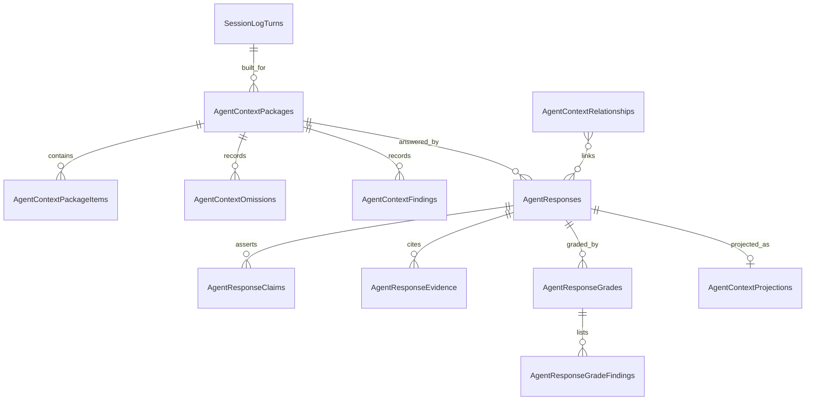

Response lifecycle:

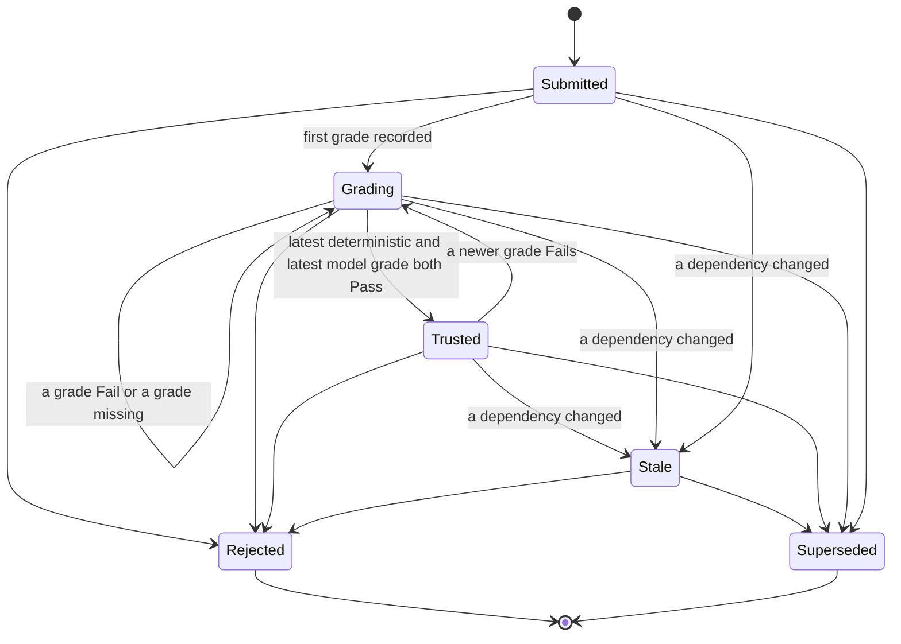

### 6.4 Data transfer objects

Server DTOs live in `src/QBrainAi.Services/Models/AgentContextModels.cs` (namespace `QBrainAi.Support.Mcp.Models`); client mirrors in `src/QBrainAi.Client/Models/AgentContextModels.cs` with `[JsonPropertyName]` on every property and registration in `McpClientJsonContext` (type, `List<>`, `IReadOnlyList<>`); a parity test keeps them identical. JSON is camelCase; unset optional fields are `null`; decimals travel as exact lexemes (the Phase B score rule).

Shared types

- `AgentContextItemDto { ordinal, kind, sourceRef, sourceSha256, sourceCommitSha, mandatory, score, rationale, tokenCount, retrievalPath, content }`.
- `AgentContextOmissionDto { ordinal, kind, sourceRef, sourceSha256, score, reason, detail }`.
- `AgentContextFindingDto { ordinal, kind, sourceRef, otherSourceRef, relationshipId, summary }`.
- `AgentResponseClaimDto { claimId, text }`; `AgentResponseEvidenceDto { claimId, kind, ref, sha256, commitSha }`.
- `AgentResponseGradeFindingDto { claimId, check, outcome, evidence }`.
- `AgentResponseGradeDto { gradeId, responseId, kind, grader, correctness, completeness, correctnessThreshold, completenessThreshold, passCount, failCount, unknownCount, verdict, requestJsonlPath, responseJsonlPath, gradedUtc, findings }`.
- `AgentContextRelationshipDto { relationshipId, fromKind, fromRef, type, toKind, toRef, toSha256, evidenceRef, createdBy, createdUtc }`.
- `AgentContextCandidateDto { kind, sourceRef, sourceSha256, score, rationale, retrievalPath }`.
- Query results follow `{ totalCount, limit, offset, items }`.

Requests and results (one pair per unit of work, section 6.5)

- C1 `AgentContextStatusResult { mode, tokenBudget, bytesPerToken, trustCorrectness, trustCompleteness, graphRag { enabled, state, projectionEnabled, useForRetrieval }, counts { packages, responsesByStatus } }`.
- C2 `BuildAgentContextPackageRequest { sessionId, agent, requestId, queryText, tokenBudget, focusRefs, idempotencyKey }` (`tokenBudget` optional and at most the configured budget; `focusRefs` optional list of `{ kind, ref }` to prefer); result `AgentContextPackageResult { packageId, status, sessionId, agent, requestId, commitSha, workingTreeDirty, builderVersion, tokenBudget, mandatoryTokenCount, totalTokenCount, inputsSha256, contentSha256, createdUtc, items, omissions, findings, renderedContent }`.
- C3 get package: route id plus `includeContent` (bool, default true); result `AgentContextPackageResult`.
- C4 `AgentContextPackageQuery { requestId, sessionId, status, limit, offset }`; result `AgentContextPackageQueryResult` of package summaries (all fields except items, omissions, findings, and content).
- C5 replay: route id; result `AgentContextReplayResult { packageId, identical, originalContentSha256, replayContentSha256, originalInputsSha256, replayInputsSha256, differences [{ ordinal, kind, sourceRef, change }] }` with `change` in `added`, `removed`, `hashChanged`, `reordered`.
- C6 `SubmitAgentResponseRequest { packageId, agent, model, effort, invocationMode, contentFormat, content, claims, evidence, idempotencyKey }`; result `AgentResponseResult { responseId, packageId, sessionId, requestId, agent, model, effort, invocationMode, status, statusReason, supersededByResponseId, contentFormat, contentSha256, commitSha, submittedUtc, statusChangedUtc, trustedUtc, claims, evidence, grades, content }`.
- C7 get response: route id plus `includeContent`; result `AgentResponseResult`.
- C8 `AgentResponseQuery { requestId, packageId, status, trustedOnly, limit, offset }`; result `AgentResponseQueryResult` of response summaries.
- C9 deterministic grade: route id, no body; result `AgentResponseGradeResult { grade, responseStatus, statusReason }`.
- C10 `RecordModelGradeRequest { grader, model, effort, correctness, completeness, findings, requestJsonlPath, responseJsonlPath, gradedUtc }`; result `AgentResponseGradeResult`.
- C11 trust decision: internal, result is the response status in `AgentResponseGradeResult`.
- C12 `RejectAgentResponseRequest { reason }`; result `AgentResponseResult`.
- C13 `SupersedeAgentResponseRequest { supersededByResponseId, reason }`; result `AgentResponseResult`.
- C14 `EvaluateStalenessRequest { responseIds }` (empty means every non-terminal response); result `AgentContextStalenessResult { evaluatedCount, newlyStale [{ responseId, changedRef, relationshipId, reason }] }`.
- C15 `CreateAgentContextRelationshipRequest { fromKind, fromRef, type, toKind, toRef, evidenceRef }`; result `AgentContextRelationshipDto` plus `created` (bool).
- C16 delete relationship: route id; result 204.
- C17 `AgentContextRelationshipQuery { nodeKind, nodeRef, type, direction (out, in, both), limit, offset }`; result `AgentContextRelationshipQueryResult`.
- C18 `AgentContextRetrieveRequest { queryText, kinds, limit, trustedOnly, preferGraphRag }` (`trustedOnly` defaults to true and only `true` is accepted for `PriorResponse`); result `AgentContextRetrieveResult { retrievalPath, fallbackReason, candidates }`.
- C19 `ProjectAgentContextRequest { responseIds }` (empty means every response whose projection is pending or out of date); result `AgentContextProjectionResult { projected, removed, skipped, failed [{ responseId, error }], skippedReason }`.
- C20 stateless invocation: plugin-internal; it uses C2, C6, and the grading chain.
- C21 `AgentContextPilotReportQuery { fromUtc, toUtc }`; result `AgentContextPilotReport { fromUtc, toUtc, byMode [{ invocationMode, responses, trusted, rejected, stale, meanCorrectness, meanCompleteness, trustRate }] }`.

Error codes (problem+json body `{ type, title, status, detail, code, message, retryable, details }`; MCP tools return `{ code, error, message, retryable, details }`)

- 400 `validation_error` with `details.field` for malformed input, plus the Phase B score codes `review_score_format`, `review_score_precision`, `review_score_out_of_range` for grade scores.
- 400 `agent_context_receipt_paths_required` (model grade without both jsonl paths).
- 400 `agent_context_relationship_invalid` (unknown kind or type, or a self-link).
- 403 `agent_context_grader_not_allowed` (model grade from a grader other than the configured one).
- 404 `not_found` with `details.resource` (`package`, `response`, `relationship`, `session_turn`, `ref`).
- 409 `agent_context_disabled` (mode `Off`).
- 409 `agent_context_package_overflow` (a response or replay against an `Overflow` package).
- 409 `agent_context_response_not_gradable` (response `Rejected` or `Superseded`).
- 409 `agent_context_supersede_invalid` (cross-package request mismatch, a cycle, or a terminal target).
- 409 `agent_context_commit_unavailable` (the workspace is not a git checkout or the recorded commit cannot be read).
- 409 `agent_context_profile_unavailable` (no configured profile file or no rule file resolves; mandatory context cannot be assembled).
- 409 `conflict` (idempotency key reused with different inputs).
- 422 `agent_context_budget_exceeded` with `details { tokenBudget, mandatoryTokenCount, overflowTokenCount, mandatoryItems [{ kind, sourceRef, tokenCount }] }`.

### 6.5 Units of work, endpoints, and activity diagrams

Every REST route below exists under `/qbrainai/agent-context` and the alias `/mcpserver/agent-context` (controller `AgentContextController`, `[ApiController]`, workspace required through `X-Workspace-Path`, authenticated by `WorkspaceAuthMiddleware`). MCP tools live in `FwhMcpTools.AgentContext.cs` with `workspacePath` as the first parameter and JSON-string bodies. The typed client is `AgentContextClient : McpClientBase`, exposed as `QBrainAiClient.AgentContext`. The REPL reaches it as `client.AgentContext.<Method>` (added to the `GenericClientPassthrough` allow-list as `AGENTCONTEXT`; mutating methods registered in `ClientMutationPolicy`; YAML validators registered with explicit `payload.params.<key>` paths). PowerShell plugins call `Invoke-McpPlugin.ps1 -Command Invoke -Method client.AgentContext.<Method>` with parameters built by exported `New-McpAgentContext<Verb>Params` builders in `McpPluginShim.psm1`; Node plugins use `plugins/core/lib-node/src/tools/agent-context.ts` (tool descriptors, a `toolMethodMap` to `client.AgentContext.*`, and a `mutatingAgentContextTools` set).

Every unit except C1, C11, and C20 starts with the same two checks, drawn in each diagram: the workspace resolves (otherwise 404 `Workspace required`), and the mode is not `Off` (otherwise 409 `agent_context_disabled`).

#### C1 Get status [FR-MCP-AGENTCONTEXT-008, -009]

- REST `GET /qbrainai/agent-context/status`; MCP `agent_context_status(workspacePath)`; client `GetStatusAsync()`; REPL `client.AgentContext.GetStatusAsync`; PowerShell `New-McpAgentContextStatusParams`; Node tool `agent_context_status`.
- Request: none. Response 200 `AgentContextStatusResult`. Errors: 404 workspace.

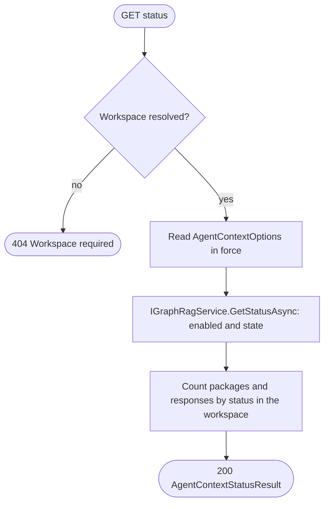

#### C2 Build a context package [FR-MCP-AGENTCONTEXT-001, -002]

- REST `POST /qbrainai/agent-context/packages`; MCP `agent_context_build_package(workspacePath, requestJson)`; client `BuildPackageAsync(BuildAgentContextPackageRequest)`; REPL `client.AgentContext.BuildPackageAsync`; PowerShell `New-McpAgentContextBuildPackageParams`; Node tool `agent_context_build_package`.
- Request `BuildAgentContextPackageRequest`. Response 201 `AgentContextPackageResult` (Location `/qbrainai/agent-context/packages/{packageId}`), or 200 with the existing package when the idempotency key repeats with identical inputs.
- Errors: 400 `validation_error`; 404 `not_found` (`session_turn`); 409 `agent_context_disabled`, `agent_context_commit_unavailable`, `agent_context_profile_unavailable`, `conflict` (key reused with different inputs); 422 `agent_context_budget_exceeded` (an `Overflow` package is stored for audit).
- Concurrency: two builds with the same idempotency key race on the unique index; the loser re-reads the winner's package and returns it with 200 when the inputs match, or 409 `conflict` when they differ.
- Deterministic construction: candidates are gathered per kind, filtered, ranked by score descending then `sourceRef` ordinal, and rendered in the fixed kind order Request, Profile, Rule, Requirement, Todo, SessionLogTurn, Receipt, PriorResponse, Code; the rendered text is canonical (LF line endings, one header line per item `[kind] sourceRef sha256`), so the same inputs at the same commit give the same `contentSha256`.

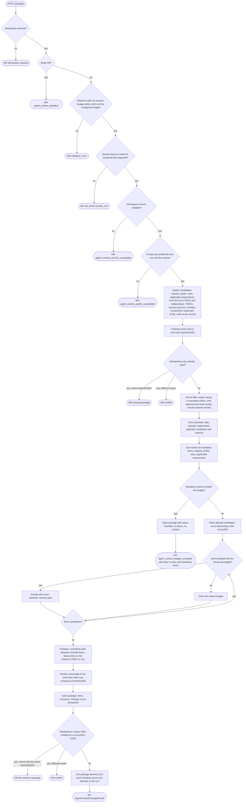

#### C3 Get a package [FR-MCP-AGENTCONTEXT-001]

- REST `GET /qbrainai/agent-context/packages/{packageId}?includeContent=true`; MCP `agent_context_get_package(workspacePath, packageId, includeContent)`; client `GetPackageAsync(packageId, includeContent)`; REPL `client.AgentContext.GetPackageAsync`; PowerShell `New-McpAgentContextGetPackageParams`; Node tool `agent_context_get_package`.
- Response 200 `AgentContextPackageResult`. Errors: 404 workspace or `not_found` (`package`), 409 `agent_context_disabled`.

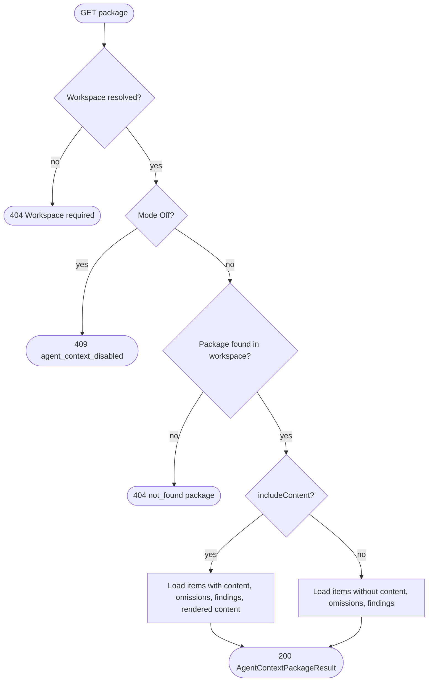

#### C4 Query packages [FR-MCP-AGENTCONTEXT-001]

- REST `GET /qbrainai/agent-context/packages?requestId&sessionId&status&limit&offset` (limit default 50, max 1000); MCP `agent_context_query_packages(workspacePath, requestId, sessionId, status, limit, offset)`; client `QueryPackagesAsync(AgentContextPackageQuery)`; REPL `client.AgentContext.QueryPackagesAsync`; PowerShell `New-McpAgentContextQueryPackagesParams`; Node tool `agent_context_query_packages`.
- Response 200 `AgentContextPackageQueryResult`. Errors: 400 `validation_error` (limit or offset out of range, unknown status), 404 workspace, 409 `agent_context_disabled`.

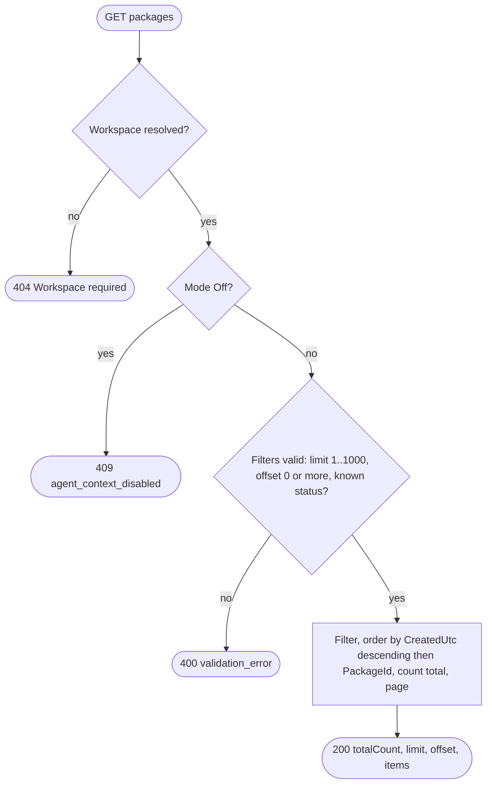

#### C5 Replay a package [FR-MCP-AGENTCONTEXT-001]

- REST `POST /qbrainai/agent-context/packages/{packageId}/replay`; MCP `agent_context_replay_package(workspacePath, packageId)`; client `ReplayPackageAsync(packageId)`; REPL `client.AgentContext.ReplayPackageAsync`; PowerShell `New-McpAgentContextReplayPackageParams`; Node tool `agent_context_replay_package`.
- Replay rebuilds the package from its recorded inputs at its recorded commit without storing anything and compares the result.
- Response 200 `AgentContextReplayResult`. Errors: 404 workspace or `not_found` (`package`), 409 `agent_context_disabled`, `agent_context_package_overflow`, `agent_context_commit_unavailable` (the recorded commit is no longer readable).

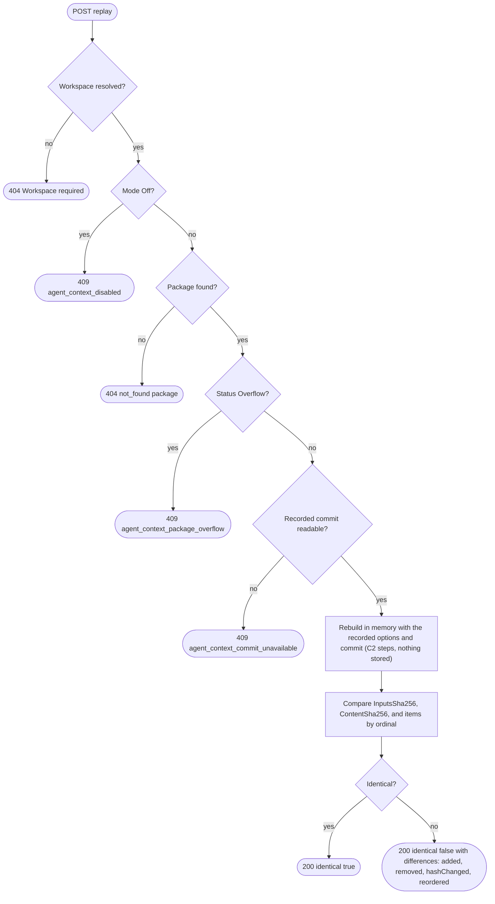

#### C6 Submit a response [FR-MCP-AGENTCONTEXT-003]

- REST `POST /qbrainai/agent-context/responses`; MCP `agent_context_submit_response(workspacePath, requestJson)`; client `SubmitResponseAsync(SubmitAgentResponseRequest)`; REPL `client.AgentContext.SubmitResponseAsync`; PowerShell `New-McpAgentContextSubmitResponseParams`; Node tool `agent_context_submit_response`.
- Response 201 `AgentResponseResult` with status `Submitted`, or 200 with the existing response for a repeated idempotency key with identical content.
- Errors: 400 `validation_error` (empty content, duplicate claimId, evidence pointing to an unknown claim, unknown format or mode); 404 `not_found` (`package`); 409 `agent_context_disabled`, `agent_context_package_overflow`, `conflict`.

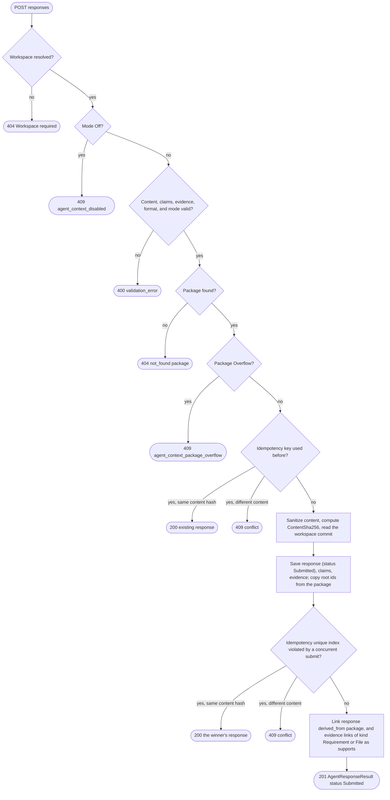

#### C7 Get a response [FR-MCP-AGENTCONTEXT-003]

- REST `GET /qbrainai/agent-context/responses/{responseId}?includeContent=true`; MCP `agent_context_get_response(workspacePath, responseId, includeContent)`; client `GetResponseAsync(responseId, includeContent)`; REPL `client.AgentContext.GetResponseAsync`; PowerShell `New-McpAgentContextGetResponseParams`; Node tool `agent_context_get_response`.
- Response 200 `AgentResponseResult` (with every grade). Errors: 404 workspace or `not_found` (`response`), 409 `agent_context_disabled`.

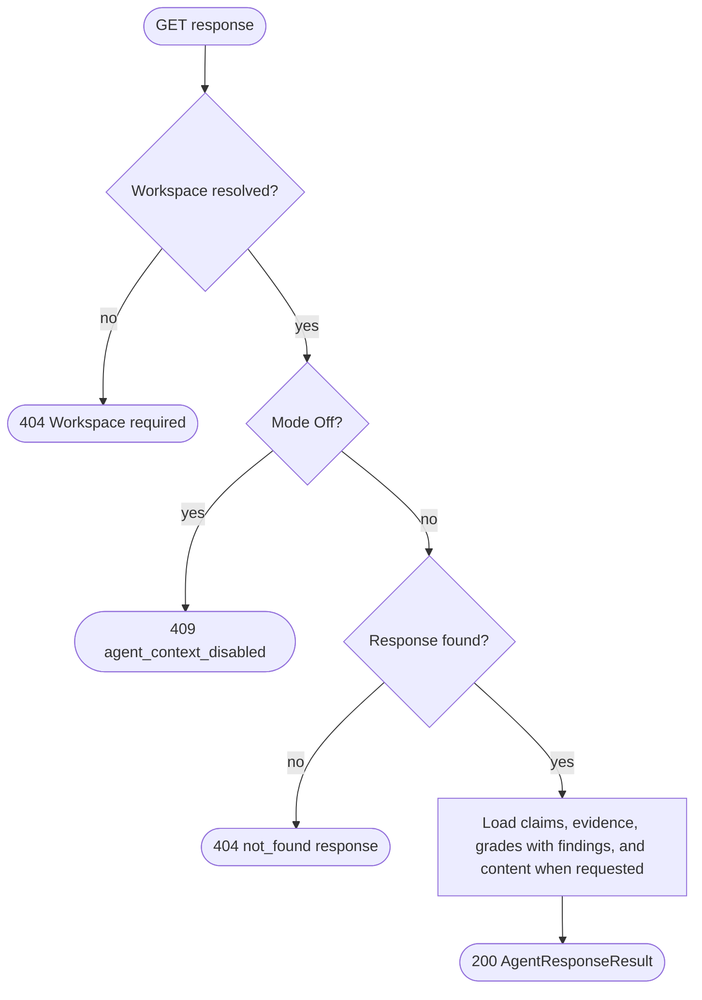

#### C8 Query responses [FR-MCP-AGENTCONTEXT-003, -004]

- REST `GET /qbrainai/agent-context/responses?requestId&packageId&status&trustedOnly&limit&offset`; MCP `agent_context_query_responses(...)`; client `QueryResponsesAsync(AgentResponseQuery)`; REPL `client.AgentContext.QueryResponsesAsync`; PowerShell `New-McpAgentContextQueryResponsesParams`; Node tool `agent_context_query_responses`.
- Response 200 `AgentResponseQueryResult`. Errors: 400 `validation_error`, 404 workspace, 409 `agent_context_disabled`.

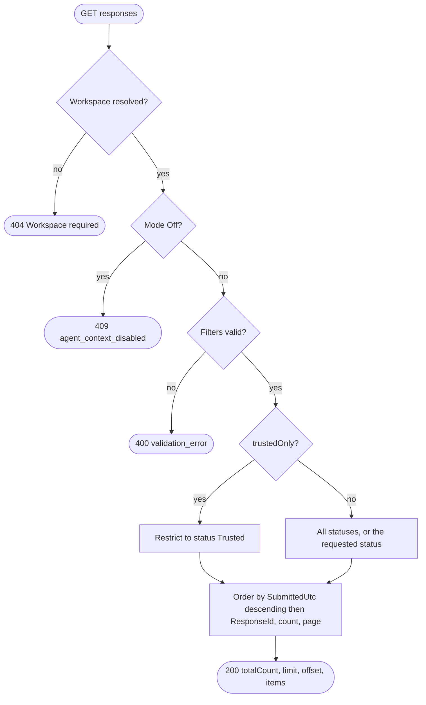

#### C9 Run the deterministic grade [FR-MCP-AGENTCONTEXT-004]

- REST `POST /qbrainai/agent-context/responses/{responseId}/grades/deterministic`; MCP `agent_context_grade_deterministic(workspacePath, responseId)`; client `RunDeterministicGradeAsync(responseId)`; REPL `client.AgentContext.RunDeterministicGradeAsync`; PowerShell `New-McpAgentContextGradeDeterministicParams`; Node tool `agent_context_grade_deterministic`.
- Checks, one finding per check and claim: every claim has at least one evidence item; every `File` evidence exists at its commit with the cited hash; every `Requirement` evidence id exists in the requirement store; every `Receipt` path exists with the cited hash; every `SessionLogTurn` evidence resolves; the content, every claim text, and every evidence ref contain no secret; the package is not stale. A check that cannot be evaluated is UNKNOWN.
- Scores: correctness = PASS findings / (PASS + FAIL) over evaluated checks; completeness = claims with every evidence check PASS / all claims; both exact decimals.
- Response 201 `AgentResponseGradeResult`. Errors: 404 workspace or `not_found` (`response`), 409 `agent_context_disabled`, `agent_context_response_not_gradable`.

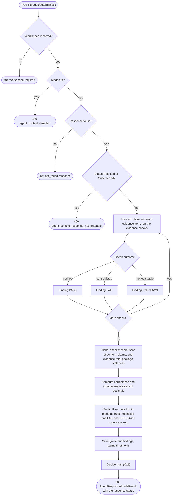

#### C10 Record a model grade [FR-MCP-AGENTCONTEXT-004]

- REST `POST /qbrainai/agent-context/responses/{responseId}/grades/model`; MCP `agent_context_record_model_grade(workspacePath, responseId, gradeJson)`; client `RecordModelGradeAsync(responseId, RecordModelGradeRequest)`; REPL `client.AgentContext.RecordModelGradeAsync`; PowerShell `New-McpAgentContextRecordModelGradeParams` (also builds the request from a Codex HV receipt, mapping accuracy to correctness as an exact decimal over 100, the same mapping as Unit B5); Node tool `agent_context_record_model_grade`.
- Response 201 `AgentResponseGradeResult`.
- Errors: 400 `validation_error`, `review_score_format`, `review_score_precision`, `review_score_out_of_range`, `agent_context_receipt_paths_required`; 403 `agent_context_grader_not_allowed`; 404 `not_found` (`response`); 409 `agent_context_disabled`, `agent_context_response_not_gradable`.

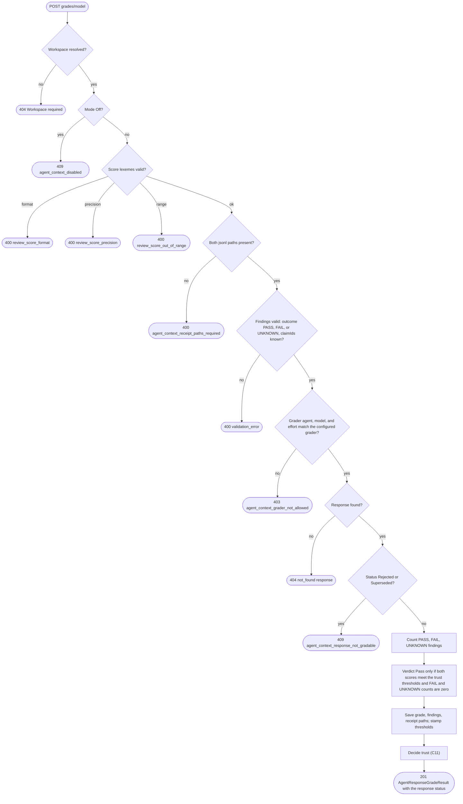

#### C11 Decide trust (internal, after every grade) [FR-MCP-AGENTCONTEXT-004]

- Trigger: C9 and C10 after their grade is saved. No endpoint.
- Rule: a response is `Trusted` only when it is not `Rejected`, `Stale`, or `Superseded`, its latest deterministic grade is `Pass`, and its latest model grade is `Pass` ("latest" as defined in section 6.3: greatest `GradedUtc`, then greatest `GradeId`); otherwise it is `Grading`. The decision runs in the same transaction as the grade insert, so concurrent grades each see a consistent latest pair.

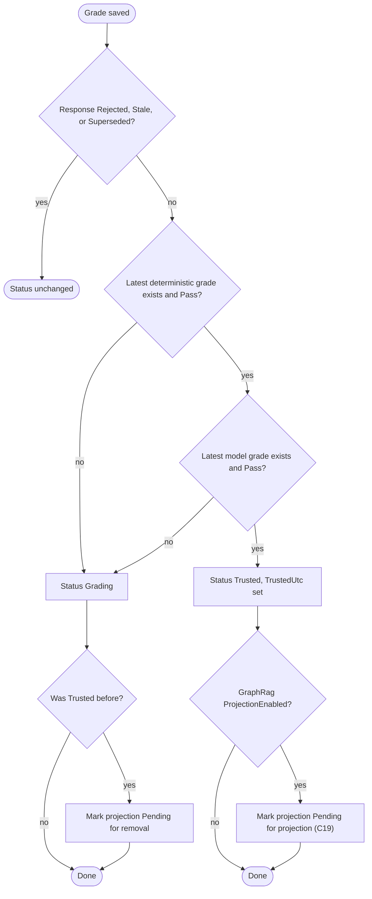

#### C12 Reject a response [FR-MCP-AGENTCONTEXT-005]

- REST `POST /qbrainai/agent-context/responses/{responseId}/reject`; MCP `agent_context_reject_response(workspacePath, responseId, reason)`; client `RejectResponseAsync(responseId, RejectAgentResponseRequest)`; REPL `client.AgentContext.RejectResponseAsync`; PowerShell `New-McpAgentContextRejectResponseParams`; Node tool `agent_context_reject_response`.
- Response 200 `AgentResponseResult` with status `Rejected` (a repeat on a rejected response returns 200 unchanged). Errors: 400 `validation_error` (blank reason), 404, 409 `agent_context_disabled`, `agent_context_response_not_gradable` (already `Superseded`).

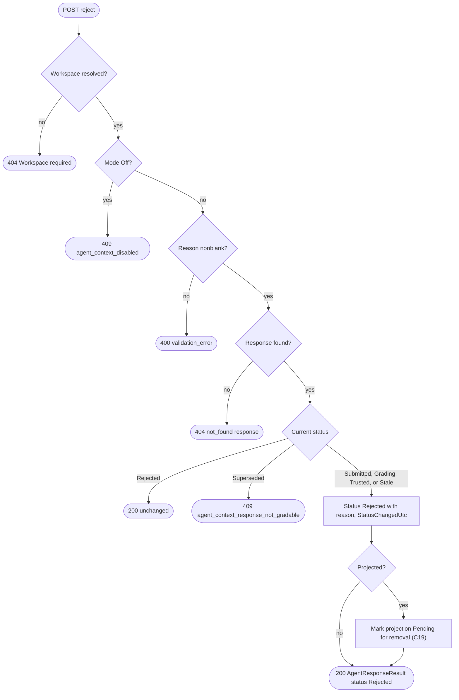

#### C13 Supersede a response [FR-MCP-AGENTCONTEXT-005]

- REST `POST /qbrainai/agent-context/responses/{responseId}/supersede`; MCP `agent_context_supersede_response(workspacePath, responseId, supersededByResponseId, reason)`; client `SupersedeResponseAsync(responseId, SupersedeAgentResponseRequest)`; REPL `client.AgentContext.SupersedeResponseAsync`; PowerShell `New-McpAgentContextSupersedeResponseParams`; Node tool `agent_context_supersede_response`.
- Response 200 `AgentResponseResult` with status `Superseded`. Errors: 400 `validation_error` (self-reference, blank reason), 404 (either response), 409 `agent_context_disabled`, `agent_context_supersede_invalid` (different request, a supersede cycle, or the replacement itself rejected or superseded).

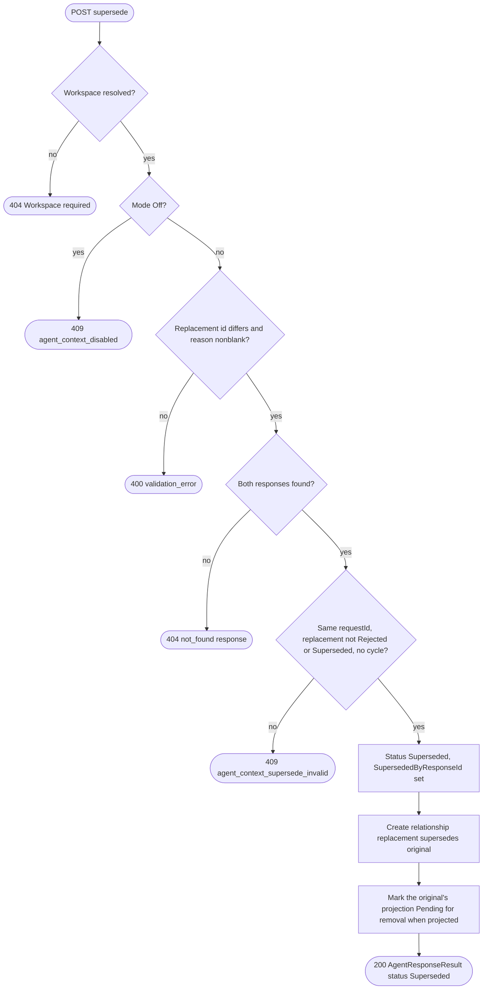

#### C14 Evaluate staleness [FR-MCP-AGENTCONTEXT-005]

- REST `POST /qbrainai/agent-context/staleness/evaluate`; MCP `agent_context_evaluate_staleness(workspacePath, responseIdsJson)`; client `EvaluateStalenessAsync(EvaluateStalenessRequest)`; REPL `client.AgentContext.EvaluateStalenessAsync`; PowerShell `New-McpAgentContextEvaluateStalenessParams`; Node tool `agent_context_evaluate_staleness`.
- Also triggered internally before C2 gathers prior responses and after a requirement update or delete.
- Rule: a non-terminal response is stale when any `depends_on` or `derived_from` target of the response or of its package now hashes differently from `ToSha256`, or a cited requirement was deleted or superseded.
- Response 200 `AgentContextStalenessResult`. Errors: 400 `validation_error`, 404 workspace, 409 `agent_context_disabled`.

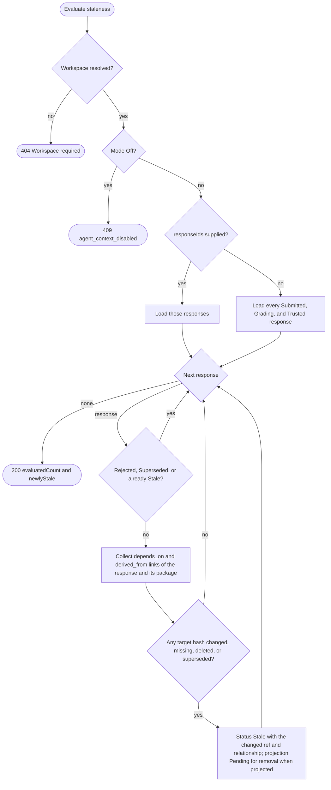

#### C15 Create a relationship [FR-MCP-AGENTCONTEXT-006]

- REST `POST /qbrainai/agent-context/relationships`; MCP `agent_context_create_relationship(workspacePath, relationshipJson)`; client `CreateRelationshipAsync(CreateAgentContextRelationshipRequest)`; REPL `client.AgentContext.CreateRelationshipAsync`; PowerShell `New-McpAgentContextCreateRelationshipParams`; Node tool `agent_context_create_relationship`.
- Response 201 with `created: true`, or 200 with `created: false` for an identical existing link. Errors: 400 `agent_context_relationship_invalid`, 404 `not_found` (`ref`), 409 `agent_context_disabled`, `agent_context_supersede_invalid` (a `supersedes` cycle).


#### C16 Delete a relationship [FR-MCP-AGENTCONTEXT-006]

- REST `DELETE /qbrainai/agent-context/relationships/{relationshipId}`; MCP `agent_context_delete_relationship(workspacePath, relationshipId)`; client `DeleteRelationshipAsync(relationshipId)`; REPL `client.AgentContext.DeleteRelationshipAsync`; PowerShell `New-McpAgentContextDeleteRelationshipParams`; Node tool `agent_context_delete_relationship`.
- Response 204. Errors: 404, 409 `agent_context_disabled`. A `supersedes` link created by C13 cannot be deleted while the response stays `Superseded` (409 `agent_context_supersede_invalid`).

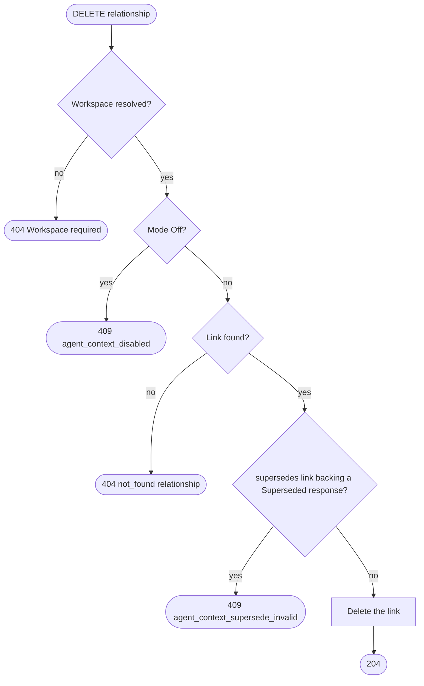

#### C17 Query relationships [FR-MCP-AGENTCONTEXT-006]

- REST `GET /qbrainai/agent-context/relationships?nodeKind&nodeRef&type&direction&limit&offset`; MCP `agent_context_query_relationships(...)`; client `QueryRelationshipsAsync(AgentContextRelationshipQuery)`; REPL `client.AgentContext.QueryRelationshipsAsync`; PowerShell `New-McpAgentContextQueryRelationshipsParams`; Node tool `agent_context_query_relationships`.
- Response 200 `AgentContextRelationshipQueryResult`. Errors: 400 `validation_error` (node kind without ref, unknown type or direction), 404 workspace, 409 `agent_context_disabled`.

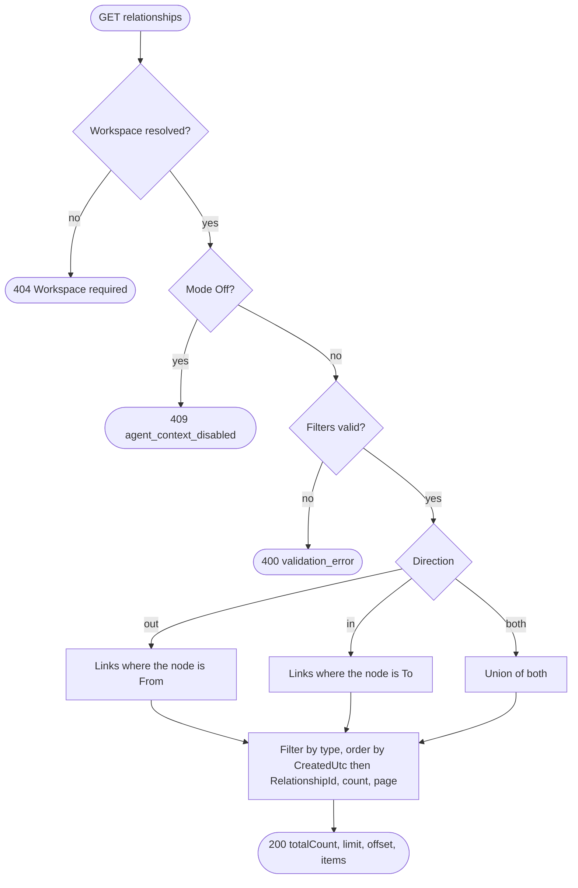

#### C18 Retrieve candidate context [FR-MCP-AGENTCONTEXT-007]

- REST `POST /qbrainai/agent-context/retrieve`; MCP `agent_context_retrieve(workspacePath, requestJson)`; client `RetrieveAsync(AgentContextRetrieveRequest)`; REPL `client.AgentContext.RetrieveAsync`; PowerShell `New-McpAgentContextRetrieveParams`; Node tool `agent_context_retrieve`. Also called by C2.
- The relational path ranks by explicit relationships to the request's requirements, TODO, and turn first, then by the existing hybrid search (FTS5 BM25 with vector similarity), with ties broken by `sourceRef`. The GraphRAG path queries the projected responses; any fallback uses the relational path and reports `fallbackReason` (`graphrag_disabled`, `graphrag_not_initialized`, `graphrag_not_indexed`, `index_in_progress`, `retrieval_disabled`, or `graphrag_error`).
- Response 200 `AgentContextRetrieveResult`. Errors: 400 `validation_error` (`trustedOnly: false` with kind `PriorResponse`, limit out of range), 404 workspace, 409 `agent_context_disabled`.

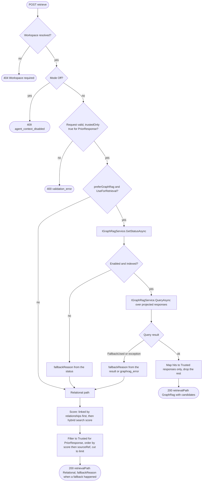

#### C19 Project responses into GraphRAG [FR-MCP-AGENTCONTEXT-007]

- REST `POST /qbrainai/agent-context/projection/graphrag`; MCP `agent_context_project_graphrag(workspacePath, responseIdsJson)`; client `ProjectToGraphRagAsync(ProjectAgentContextRequest)`; REPL `client.AgentContext.ProjectToGraphRagAsync`; PowerShell `New-McpAgentContextProjectGraphRagParams`; Node tool `agent_context_project_graphrag`. Also run by a background pass after C11, C12, C13, and C14 mark a projection `Pending`.
- Response 200 `AgentContextProjectionResult`. Errors: 400 `validation_error`, 404 workspace, 409 `agent_context_disabled`. GraphRAG being disabled is not an error: every selected projection is `Skipped` with `skippedReason: graphrag_disabled`.

```mermaid
flowchart TD
    S(["Projection run"]) --> W{"Workspace resolved?"}
    W -->|no| E0(["404 Workspace required"])
    W -->|yes| MO{"Mode Off?"}
    MO -->|yes| E1(["409 agent_context_disabled"])
    MO -->|no| PE{"ProjectionEnabled and GraphRAG enabled?"}
    PE -->|no| SK["Every selected projection Skipped"]
    SK --> R0(["200 skipped with skippedReason"])
    PE -->|yes| SEL["Select requested responses, or every Pending or out-of-date projection"]
    SEL --> NX{"Next response"}
    NX -->|none| R(["200 projected, removed, skipped, failed"])
    NX -->|response| TR{"Status Trusted?"}
    TR -->|yes| UP{"Projected content hash equals ContentSha256?"}
    UP -->|yes| NX
    UP -->|no| ING["IGraphRagService.IngestTextAsync with the response content and its root ids"]
    ING --> IR{"Ingest result"}
    IR -->|ok| PJ["State Projected, document id and hash stored"]
    IR -->|error| FL["State Failed with LastError"]
    PJ --> NX
    FL --> NX
    TR -->|no| WAS{"Currently Projected?"}
    WAS -->|yes| DEL["IGraphRagService.DeleteDocumentAsync"]
    DEL --> DR{"Delete result"}
    DR -->|ok| RMV["State Removed"]
    DR -->|error| FL
    RMV --> NX
    WAS -->|no| NX
```

#### C20 Run a stateless invocation (plugin) [FR-MCP-AGENTCONTEXT-009]

- Trigger: a delivered user request (Phase A Units A3 and A4) on a host whose plugin reads `Mode` through C1.
- PowerShell: `Invoke-PluginAgentContextInvocation` in `plugin-hook.ps1`; Node: `runAgentContextInvocation` in the Node core. Hosts inject the rendered package through their prompt-context mechanism (hook additional context or the host's system-context API).
- Output: in `Stateless` mode the model receives only the rendered package and the request, without prior conversation turns; in `Pilot` mode the package is built and recorded but not injected; in `Off` nothing happens.
- A host recorded `turn_logging_unsupported` (Phase A, D6) has no minted turn, so C20 does not run there: the plugin stays stateful and reports `turn_logging_unsupported`, and the feature-matrix row records the limitation.

```mermaid
flowchart TD
    S(["Request delivered"]) --> SUP{"Host supported for turn logging and the turn minted?"}
    SUP -->|no| UNS(["turn_logging_unsupported: stateful, no package"])
    SUP -->|yes| MD["Read Mode from status (cached per host session start)"]
    MD --> M{"Mode"}
    M -->|Off| OFF(["Stateful turn as today"])
    M -->|Pilot or Stateless| BP["Build package (C2) for sessionId and requestId, idempotency key = requestId"]
    BP --> BR{"Build result"}
    BR -->|budget exceeded| OVF["Report agent_context_budget_exceeded to the model and the session log"]
    OVF --> FBK(["Stateful turn: no injection"])
    BR -->|other error or outage| ERR["Record the cause on the turn"]
    ERR --> FBK
    BR -->|built| MM{"Mode"}
    MM -->|Pilot| PIL["Record packageId on the turn, no injection"]
    PIL --> RUN1(["Model answers statefully: response submitted with invocationMode Stateful"])
    MM -->|Stateless| INJ["Inject the rendered package as the model context, no history"]
    INJ --> RUN2(["Model answers: response submitted with invocationMode Stateless"])
    RUN1 --> SUB["Submit response (C6) with claims and evidence at turn close"]
    RUN2 --> SUB
    SUB --> GRD["Deterministic grade (C9) then the slice HV records the model grade (C10)"]
    GRD --> E(["Trust decided (C11)"])
```

#### C21 Pilot report [FR-MCP-AGENTCONTEXT-009]

- REST `GET /qbrainai/agent-context/pilot/report?fromUtc&toUtc`; MCP `agent_context_pilot_report(workspacePath, fromUtc, toUtc)`; client `GetPilotReportAsync(AgentContextPilotReportQuery)`; REPL `client.AgentContext.GetPilotReportAsync`; PowerShell `New-McpAgentContextPilotReportParams`; Node tool `agent_context_pilot_report`.
- Response 200 `AgentContextPilotReport`. Errors: 400 `validation_error` (missing offset or from after to), 404 workspace, 409 `agent_context_disabled`.

```mermaid
flowchart TD
    S(["GET pilot report"]) --> W{"Workspace resolved?"}
    W -->|no| E0(["404 Workspace required"])
    W -->|yes| MO{"Mode Off?"}
    MO -->|yes| E1(["409 agent_context_disabled"])
    MO -->|no| V{"fromUtc and toUtc valid UTC and from before to?"}
    V -->|no| E2(["400 validation_error"])
    V -->|yes| Q["Group responses submitted in the window by invocationMode"]
    Q --> AGG["Per mode: counts by status, mean latest model correctness and completeness, trust rate"]
    AGG --> R(["200 AgentContextPilotReport"])
```

### 6.6 Phase C sequence diagrams

In every diagram, `Caller` is any surface (plugin through the REPL, the REPL, the typed client, or an MCP client); REST requests go through `AgentContextController` and MCP requests through `FwhMcpTools.AgentContext`, both into `IAgentContextService`. The mode-Off and workspace responses are the same for every request and are drawn once per diagram as the first `alt` branches.

#### SC1: Get status

```mermaid
sequenceDiagram
    autonumber
    participant Caller
    participant API as AgentContextController or MCP tool
    participant SVC as IAgentContextService
    participant GR as IGraphRagService
    participant DB as Store
    Caller->>API: GET /qbrainai/agent-context/status
    alt workspace not resolved
        API-->>Caller: 404 Workspace required
        Caller->>Caller: report, fix X-Workspace-Path or workspacePath
    else resolved
        API->>SVC: GetStatusAsync
        SVC->>GR: GetStatusAsync
        GR-->>SVC: enabled, state
        SVC->>DB: count packages and responses by status
        SVC-->>API: AgentContextStatusResult
        API-->>Caller: 200
        Caller->>Caller: plugins cache Mode for the host session, Off means stateful
    end
```

#### SC2: Build a package

```mermaid
sequenceDiagram
    autonumber
    participant Caller
    participant API as Controller or MCP tool
    participant SVC as IAgentContextService
    participant B as Package builder
    participant RT as Retrieval (C18)
    participant SL as Session log, requirements, TODO stores
    participant DB as Store
    Caller->>API: POST /packages (BuildAgentContextPackageRequest)
    alt workspace not resolved
        API-->>Caller: 404 Workspace required
    else mode Off
        API-->>Caller: 409 agent_context_disabled
        Caller->>Caller: continue statefully
    else invalid request
        API-->>Caller: 400 validation_error with details.field
        Caller->>Caller: fix the field, do not retry unchanged
    else accepted
        API->>SVC: BuildPackageAsync
        SVC->>SL: load turn, TODO, requirements, receipts
        alt turn missing
            SVC-->>API: not found
            API-->>Caller: 404 not_found session_turn
            Caller->>Caller: open or mint the turn first
        else turn found
            SVC->>B: gather, hash, filter, budget
            B->>RT: retrieve trusted prior responses and related items
            RT-->>B: candidates
            alt commit unreadable
                B-->>SVC: commit unavailable
                API-->>Caller: 409 agent_context_commit_unavailable
            else no profile or rule file resolves
                B-->>SVC: profile unavailable
                API-->>Caller: 409 agent_context_profile_unavailable
                Caller->>Caller: report, run statefully, operator fixes ProfileSources or RuleSources
            else idempotency key reused with same inputs
                SVC-->>API: existing package
                API-->>Caller: 200 AgentContextPackageResult
                Caller->>Caller: use the returned package
            else idempotency key reused with different inputs
                API-->>Caller: 409 conflict
                Caller->>Caller: new key or same inputs
            else mandatory context over budget
                B->>DB: store Overflow package
                API-->>Caller: 422 agent_context_budget_exceeded with token counts
                Caller->>Caller: report overflow, run statefully, never truncate mandatory context
            else built
                B->>DB: save package, items, omissions, findings, links
                API-->>Caller: 201 AgentContextPackageResult with Location
                Caller->>Caller: Stateless mode injects renderedContent. Pilot mode records packageId
            end
        end
    end
```

#### SC3: Get a package

```mermaid
sequenceDiagram
    autonumber
    participant Caller
    participant API as Controller or MCP tool
    participant SVC as IAgentContextService
    Caller->>API: GET /packages/{packageId}?includeContent
    alt workspace not resolved
        API-->>Caller: 404 Workspace required
    else mode Off
        API-->>Caller: 409 agent_context_disabled
    else accepted
        API->>SVC: GetPackageAsync
        alt not found
            API-->>Caller: 404 not_found package
            Caller->>Caller: report the id
        else found
            API-->>Caller: 200 AgentContextPackageResult
            Caller->>Caller: verify contentSha256 of renderedContent before use
        end
    end
```

#### SC4: Query packages

```mermaid
sequenceDiagram
    autonumber
    participant Caller
    participant API as Controller or MCP tool
    participant SVC as IAgentContextService
    Caller->>API: GET /packages?requestId&sessionId&status&limit&offset
    alt workspace not resolved
        API-->>Caller: 404 Workspace required
    else mode Off
        API-->>Caller: 409 agent_context_disabled
    else invalid filters
        API-->>Caller: 400 validation_error
    else accepted
        API->>SVC: QueryPackagesAsync
        SVC-->>API: page
        API-->>Caller: 200 totalCount, limit, offset, items
        Caller->>Caller: page with offset until offset plus count reaches totalCount
    end
```

#### SC5: Replay a package

```mermaid
sequenceDiagram
    autonumber
    participant Caller
    participant API as Controller or MCP tool
    participant SVC as IAgentContextService
    participant B as Package builder
    Caller->>API: POST /packages/{packageId}/replay
    alt workspace not resolved
        API-->>Caller: 404 Workspace required
    else mode Off
        API-->>Caller: 409 agent_context_disabled
    else accepted
        API->>SVC: ReplayPackageAsync
        alt package not found
            API-->>Caller: 404 not_found package
        else package Overflow
            API-->>Caller: 409 agent_context_package_overflow
        else recorded commit unreadable
            API-->>Caller: 409 agent_context_commit_unavailable
        else replayed
            SVC->>B: rebuild in memory at the recorded commit
            B-->>SVC: replay hashes and items
            API-->>Caller: 200 AgentContextReplayResult
            alt identical
                Caller->>Caller: deterministic replay proven
            else differences
                Caller->>Caller: report each added, removed, hashChanged, reordered item
            end
        end
    end
```

#### SC6: Submit a response

```mermaid
sequenceDiagram
    autonumber
    participant Caller as Plugin at turn close
    participant API as Controller or MCP tool
    participant SVC as IAgentContextService
    participant DB as Store
    Caller->>API: POST /responses (SubmitAgentResponseRequest)
    alt workspace not resolved
        API-->>Caller: 404 Workspace required
    else mode Off
        API-->>Caller: 409 agent_context_disabled
    else invalid content, claims, or evidence
        API-->>Caller: 400 validation_error with details.field
        Caller->>Caller: fix and resend
    else accepted
        API->>SVC: SubmitResponseAsync
        alt package not found
            API-->>Caller: 404 not_found package
        else package Overflow
            API-->>Caller: 409 agent_context_package_overflow
        else key reused with same content
            API-->>Caller: 200 existing AgentResponseResult
            Caller->>Caller: treat as submitted
        else key reused with different content
            API-->>Caller: 409 conflict
        else saved
            SVC->>DB: response, claims, evidence, links
            API-->>Caller: 201 AgentResponseResult status Submitted
            Caller->>Caller: record responseId on the turn, request the deterministic grade
        end
    end
```

#### SC7: Get a response

```mermaid
sequenceDiagram
    autonumber
    participant Caller
    participant API as Controller or MCP tool
    participant SVC as IAgentContextService
    Caller->>API: GET /responses/{responseId}?includeContent
    alt workspace not resolved
        API-->>Caller: 404 Workspace required
    else mode Off
        API-->>Caller: 409 agent_context_disabled
    else accepted
        API->>SVC: GetResponseAsync
        alt not found
            API-->>Caller: 404 not_found response
        else found
            API-->>Caller: 200 AgentResponseResult with grades
            Caller->>Caller: use as context only if status Trusted
        end
    end
```

#### SC8: Query responses

```mermaid
sequenceDiagram
    autonumber
    participant Caller
    participant API as Controller or MCP tool
    participant SVC as IAgentContextService
    Caller->>API: GET /responses?requestId&packageId&status&trustedOnly&limit&offset
    alt workspace not resolved
        API-->>Caller: 404 Workspace required
    else mode Off
        API-->>Caller: 409 agent_context_disabled
    else invalid filters
        API-->>Caller: 400 validation_error
    else accepted
        API->>SVC: QueryResponsesAsync
        API-->>Caller: 200 totalCount, limit, offset, items
        Caller->>Caller: page until complete
    end
```

#### SC9: Run the deterministic grade

```mermaid
sequenceDiagram
    autonumber
    participant Caller
    participant API as Controller or MCP tool
    participant SVC as IAgentContextService
    participant DG as Deterministic grader
    participant SRC as Git, requirement, receipt, session-log stores
    participant DB as Store
    Caller->>API: POST /responses/{responseId}/grades/deterministic
    alt workspace not resolved
        API-->>Caller: 404 Workspace required
    else mode Off
        API-->>Caller: 409 agent_context_disabled
    else accepted
        API->>SVC: RunDeterministicGradeAsync
        alt response not found
            API-->>Caller: 404 not_found response
        else Rejected or Superseded
            API-->>Caller: 409 agent_context_response_not_gradable
        else gradable
            SVC->>DG: grade claims and evidence
            DG->>SRC: verify files, hashes, requirement ids, receipts, turns
            SRC-->>DG: verified, contradicted, or not evaluable per check
            DG-->>SVC: findings and exact scores
            SVC->>DB: save grade, decide trust (C11)
            API-->>Caller: 201 AgentResponseGradeResult with responseStatus
            alt verdict Pass and status Grading
                Caller->>Caller: launch the model grade (slice HV)
            else verdict Fail
                Caller->>Caller: show every FAIL and UNKNOWN finding, fix and resubmit a new response
            end
        end
    end
```

#### SC10: Record a model grade

```mermaid
sequenceDiagram
    autonumber
    participant HV as Coordinator after the Codex HV run
    participant API as Controller or MCP tool
    participant SVC as IAgentContextService
    participant DB as Store
    HV->>API: POST /responses/{responseId}/grades/model (RecordModelGradeRequest from the HV receipt)
    alt workspace not resolved
        API-->>HV: 404 Workspace required
    else mode Off
        API-->>HV: 409 agent_context_disabled
    else score lexeme invalid
        API-->>HV: 400 review_score_format, review_score_precision, or review_score_out_of_range
    else jsonl paths missing
        API-->>HV: 400 agent_context_receipt_paths_required
    else invalid findings
        API-->>HV: 400 validation_error
    else grader not the configured one
        API-->>HV: 403 agent_context_grader_not_allowed
        HV->>HV: rerun HV on the configured grader
    else accepted
        API->>SVC: RecordModelGradeAsync
        alt response not found
            API-->>HV: 404 not_found response
        else Rejected or Superseded
            API-->>HV: 409 agent_context_response_not_gradable
        else recorded
            SVC->>DB: save grade, decide trust (C11)
            API-->>HV: 201 AgentResponseGradeResult with responseStatus
            alt responseStatus Trusted
                HV->>HV: response becomes retrievable context, projection pending
            else responseStatus Grading
                HV->>HV: show every failure, remediate, rerun HV
            end
        end
    end
```

#### SC12: Reject a response

```mermaid
sequenceDiagram
    autonumber
    participant Caller
    participant API as Controller or MCP tool
    participant SVC as IAgentContextService
    Caller->>API: POST /responses/{responseId}/reject (reason)
    alt workspace not resolved
        API-->>Caller: 404 Workspace required
    else mode Off
        API-->>Caller: 409 agent_context_disabled
    else blank reason
        API-->>Caller: 400 validation_error
    else accepted
        API->>SVC: RejectResponseAsync
        alt not found
            API-->>Caller: 404 not_found response
        else Superseded
            API-->>Caller: 409 agent_context_response_not_gradable
        else already Rejected
            API-->>Caller: 200 unchanged
        else rejected
            API-->>Caller: 200 AgentResponseResult status Rejected
            Caller->>Caller: excluded from trusted retrieval, projection removal pending
        end
    end
```

#### SC13: Supersede a response

```mermaid
sequenceDiagram
    autonumber
    participant Caller
    participant API as Controller or MCP tool
    participant SVC as IAgentContextService
    Caller->>API: POST /responses/{responseId}/supersede (supersededByResponseId, reason)
    alt workspace not resolved
        API-->>Caller: 404 Workspace required
    else mode Off
        API-->>Caller: 409 agent_context_disabled
    else self-reference or blank reason
        API-->>Caller: 400 validation_error
    else accepted
        API->>SVC: SupersedeResponseAsync
        alt either response not found
            API-->>Caller: 404 not_found response
        else different request, cycle, or invalid replacement
            API-->>Caller: 409 agent_context_supersede_invalid
        else superseded
            API-->>Caller: 200 AgentResponseResult status Superseded
            Caller->>Caller: retrieval now returns the replacement only
        end
    end
```

#### SC14: Evaluate staleness

```mermaid
sequenceDiagram
    autonumber
    participant Caller
    participant API as Controller or MCP tool
    participant SVC as IAgentContextService
    participant DB as Store
    Caller->>API: POST /staleness/evaluate (responseIds)
    alt workspace not resolved
        API-->>Caller: 404 Workspace required
    else mode Off
        API-->>Caller: 409 agent_context_disabled
    else invalid ids
        API-->>Caller: 400 validation_error
    else accepted
        API->>SVC: EvaluateStalenessAsync
        SVC->>DB: compare current target hashes with ToSha256
        API-->>Caller: 200 evaluatedCount and newlyStale
        Caller->>Caller: list each stale response with its changed ref
    end
```

#### SC15: Create a relationship

```mermaid
sequenceDiagram
    autonumber
    participant Caller
    participant API as Controller or MCP tool
    participant SVC as IAgentContextService
    Caller->>API: POST /relationships
    alt workspace not resolved
        API-->>Caller: 404 Workspace required
    else mode Off
        API-->>Caller: 409 agent_context_disabled
    else invalid kind, type, or self-link
        API-->>Caller: 400 agent_context_relationship_invalid
    else accepted
        API->>SVC: CreateRelationshipAsync
        alt a ref does not resolve
            API-->>Caller: 404 not_found ref
        else supersedes cycle
            API-->>Caller: 409 agent_context_supersede_invalid
        else identical link exists
            API-->>Caller: 200 link, created false
        else created
            API-->>Caller: 201 link, created true
        end
    end
```

#### SC16: Delete a relationship

```mermaid
sequenceDiagram
    autonumber
    participant Caller
    participant API as Controller or MCP tool
    participant SVC as IAgentContextService
    Caller->>API: DELETE /relationships/{relationshipId}
    alt workspace not resolved
        API-->>Caller: 404 Workspace required
    else mode Off
        API-->>Caller: 409 agent_context_disabled
    else accepted
        API->>SVC: DeleteRelationshipAsync
        alt not found
            API-->>Caller: 404 not_found relationship
        else backs a Superseded response
            API-->>Caller: 409 agent_context_supersede_invalid
        else deleted
            API-->>Caller: 204
        end
    end
```

#### SC17: Query relationships

```mermaid
sequenceDiagram
    autonumber
    participant Caller
    participant API as Controller or MCP tool
    participant SVC as IAgentContextService
    Caller->>API: GET /relationships?nodeKind&nodeRef&type&direction&limit&offset
    alt workspace not resolved
        API-->>Caller: 404 Workspace required
    else mode Off
        API-->>Caller: 409 agent_context_disabled
    else invalid filters
        API-->>Caller: 400 validation_error
    else accepted
        API->>SVC: QueryRelationshipsAsync
        API-->>Caller: 200 totalCount, limit, offset, items
        Caller->>Caller: page until complete
    end
```

#### SC18: Retrieve candidate context

```mermaid
sequenceDiagram
    autonumber
    participant Caller
    participant API as Controller or MCP tool
    participant SVC as Retrieval service
    participant GR as IGraphRagService
    participant HS as Hybrid search and relationships
    Caller->>API: POST /retrieve (queryText, kinds, limit, trustedOnly, preferGraphRag)
    alt workspace not resolved
        API-->>Caller: 404 Workspace required
    else mode Off
        API-->>Caller: 409 agent_context_disabled
    else invalid request
        API-->>Caller: 400 validation_error
    else accepted
        API->>SVC: RetrieveAsync
        alt GraphRAG preferred and enabled and indexed
            SVC->>GR: QueryAsync
            alt result ok
                GR-->>SVC: hits
                SVC->>SVC: keep Trusted responses only
                API-->>Caller: 200 retrievalPath GraphRag
            else FallbackUsed or error
                GR-->>SVC: fallback reason
                SVC->>HS: relational path
                API-->>Caller: 200 retrievalPath Relational with fallbackReason
            end
        else not preferred, disabled, or not indexed
            SVC->>HS: relational path
            API-->>Caller: 200 retrievalPath Relational, fallbackReason when applicable
        end
        Caller->>Caller: same candidates for the same inputs on the relational path
    end
```

#### SC19: Project responses into GraphRAG

```mermaid
sequenceDiagram
    autonumber
    participant Caller as Caller or background pass
    participant API as Controller or MCP tool
    participant SVC as Projection service
    participant GR as IGraphRagService
    participant DB as Store
    Caller->>API: POST /projection/graphrag (responseIds)
    alt workspace not resolved
        API-->>Caller: 404 Workspace required
    else mode Off
        API-->>Caller: 409 agent_context_disabled
    else invalid ids
        API-->>Caller: 400 validation_error
    else accepted
        API->>SVC: ProjectToGraphRagAsync
        alt projection disabled or GraphRAG disabled
            SVC->>DB: projections Skipped
            API-->>Caller: 200 skipped with skippedReason
        else enabled
            loop each selected response
                alt Trusted and not yet projected at this hash
                    SVC->>GR: IngestTextAsync
                    alt ok
                        SVC->>DB: Projected
                    else error
                        SVC->>DB: Failed with LastError
                    end
                else no longer Trusted and projected
                    SVC->>GR: DeleteDocumentAsync
                    alt ok
                        SVC->>DB: Removed
                    else error
                        SVC->>DB: Failed with LastError
                    end
                end
            end
            API-->>Caller: 200 projected, removed, skipped, failed
            Caller->>Caller: retry Failed entries on the next pass
        end
    end
```

#### SC20: Stateless invocation end to end

```mermaid
sequenceDiagram
    autonumber
    participant OP as Operator
    participant H as Host and plugin
    participant SL as Session log (Phase A)
    participant AC as Agent context API
    participant M as Model
    participant HV as Codex HV
    OP->>H: prompt
    H->>SL: mint turn (A1), deliver (A3 or A4)
    H->>AC: status (cached Mode)
    alt Mode Off
        H->>M: prompt with conversation history (stateful)
    else Mode Pilot or Stateless
        H->>AC: build package (C2), idempotency key requestId
        alt 201 or 200 package
            alt Stateless
                H->>M: rendered package plus request, no history
            else Pilot
                H->>SL: record packageId on the turn
                H->>M: prompt with conversation history
            end
        else 422 budget exceeded or other error
            H->>SL: record the cause on the turn
            H->>M: prompt with conversation history
        end
        M-->>H: answer with claims and evidence
        H->>AC: submit response (C6) with invocationMode
        AC-->>H: 201 Submitted
        H->>AC: deterministic grade (C9)
        AC-->>H: grade and status
        HV->>AC: model grade (C10) after the slice HV
        AC-->>HV: Trusted or Grading
    end
```

#### SC21: Pilot report

```mermaid
sequenceDiagram
    autonumber
    participant Caller
    participant API as Controller or MCP tool
    participant SVC as IAgentContextService
    Caller->>API: GET /pilot/report?fromUtc&toUtc
    alt workspace not resolved
        API-->>Caller: 404 Workspace required
    else mode Off
        API-->>Caller: 409 agent_context_disabled
    else invalid window
        API-->>Caller: 400 validation_error
    else accepted
        API->>SVC: GetPilotReportAsync
        API-->>Caller: 200 AgentContextPilotReport
        Caller->>Caller: compare trust rates by invocationMode before changing any default
    end
```

## 7. Agent-context use cases

### 7.11 UC-10 Build a context package for a request [FR-MCP-AGENTCONTEXT-001, -002]

Actors: agent host and plugin, server. Precondition: the request's turn exists (UC-1) and the mode is `Pilot` or `Stateless`. Basic flow: the plugin asks the server to build a package for the request; the server gathers the request, profile, rules, applicable requirements, related turns, TODOs, receipts, trusted prior responses, and code at the current commit, filters secrets and untrusted items, ranks, fills the budget, records provenance, and returns the rendered package. Alternate flows: mandatory context exceeds the budget and the build fails with `agent_context_budget_exceeded`; the same idempotency key returns the same package; the commit is unreadable; replay proves the package is reproducible.

```mermaid
flowchart LR
    HO(["Agent host and plugin"]) --- U(("UC-10 Build a context package (C2)"))
    SV(["Server"]) --- U
    U -. include .-> I1(("Retrieve candidates (C18)"))
    U -. include .-> I2(("Record provenance, omissions, findings"))
    E1(("Mandatory over budget: 422, stateful fallback")) -. extend .-> U
    E2(("Repeated key: same package")) -. extend .-> U
    E3(("Replay proves determinism (C5)")) -. extend .-> U
```

### 7.12 UC-11 Submit and grade an agent response [FR-MCP-AGENTCONTEXT-003, -004]

Actors: model, plugin, server, hostile reviewer. Basic flow: at turn close the plugin submits the model's response with its claims and evidence; the server runs the deterministic grade; the coordinator runs the slice HV and records the model grade; the server marks the response trusted when both grades pass at 98/98 with zero FAIL and zero UNKNOWN. Alternate flows: a grade fails and the response stays `Grading` with every failure shown; a grader other than the configured one is refused; the operator rejects the response.

```mermaid
flowchart LR
    MD(["Model"]) --- U(("UC-11 Submit and grade a response"))
    PL(["Plugin"]) --- U
    HR(["Hostile reviewer"]) --- U
    SV(["Server"]) --- U
    U -. include .-> I1(("Submit (C6)"))
    U -. include .-> I2(("Deterministic grade (C9)"))
    U -. include .-> I3(("Model grade (C10)"))
    U -. include .-> I4(("Decide trust (C11)"))
    E1(("Grade fails: stays Grading, failures shown")) -. extend .-> U
    E2(("Unconfigured grader: 403")) -. extend .-> U
    E3(("Rejected by operator (C12)")) -. extend .-> U
```

### 7.13 UC-12 Retrieve trusted prior context [FR-MCP-AGENTCONTEXT-007]

Actors: server (inside package construction), client apps. Basic flow: retrieval returns ranked candidates, only trusted responses among prior responses, preferring GraphRAG. Alternate flow: GraphRAG disabled, uninitialized, not indexed, or failing, and the deterministic relational path answers with the fallback reason.

```mermaid
flowchart LR
    SV(["Server: package builder"]) --- U(("UC-12 Retrieve trusted prior context (C18)"))
    CA(["Client apps"]) --- U
    E1(("GraphRAG unavailable: relational fallback with reason")) -. extend .-> U
```

### 7.14 UC-13 Maintain relationships, staleness, and supersession [FR-MCP-AGENTCONTEXT-005, -006]

Actors: model, operator, server. Basic flow: links are created between packages, responses, requirements, turns, TODOs, code, and receipts; when a dependency changes, its dependents become stale; a newer response supersedes an older one. Alternate flows: invalid link, cycle, or unresolvable ref refused.

```mermaid
flowchart LR
    MD(["Model"]) --- U(("UC-13 Maintain relationships and staleness"))
    OP(["Operator"]) --- U
    SV(["Server"]) --- U
    U -. include .-> I1(("Create, delete, query links (C15 to C17)"))
    U -. include .-> I2(("Evaluate staleness (C14)"))
    E1(("Supersede a response (C13)")) -. extend .-> U
    E2(("Invalid link or cycle refused")) -. extend .-> U
```

### 7.15 UC-14 Run a stateless or pilot invocation [FR-MCP-AGENTCONTEXT-009]

Actors: operator, agent host and plugin, model. Basic flow: in `Stateless` mode the plugin builds the package for a delivered request and the model answers from the package alone; in `Pilot` mode the package is built and recorded but the model answers statefully; the pilot report compares both before any default changes. Alternate flows: mode `Off` keeps today's behavior; a build failure falls back to stateful with the cause recorded.

```mermaid
flowchart LR
    OP(["Operator"]) --- U(("UC-14 Run a stateless or pilot invocation (C20)"))
    HO(["Agent host and plugin"]) --- U
    MD(["Model"]) --- U
    U -. include .-> I1(("Build a context package (UC-10)"))
    U -. include .-> I2(("Submit and grade a response (UC-11)"))
    E1(("Mode Off: stateful")) -. extend .-> U
    E2(("Build fails: stateful fallback, cause recorded")) -. extend .-> U
    E3(("Pilot report (C21)")) -. extend .-> U
```

### 7.16 UC-15 Project responses into GraphRAG [FR-MCP-AGENTCONTEXT-007]

Actors: server (background pass), operator. Basic flow: trusted responses are ingested into GraphRAG and responses that stop being trusted are removed. Alternate flows: GraphRAG disabled and every projection skipped; an ingest or delete error is recorded and retried on the next pass.

```mermaid
flowchart LR
    SV(["Server background pass"]) --- U(("UC-15 Project responses into GraphRAG (C19)"))
    OP(["Operator"]) --- U
    E1(("GraphRAG disabled: skipped")) -. extend .-> U
    E2(("Ingest or delete error: Failed, retried")) -. extend .-> U
```

## 8. Delivery

### 8.2 Phase C slices (each a full BDPv4 loop ending in its own Codex gpt-6-sol xhigh HV)

- AC1 MCP-AGENTCONTEXT-001 Contracts: `AgentContextOptions` and validation, enums (`AgentContextMode`, item kinds, omission reasons, response statuses, grade kinds, relationship kinds and types), every DTO in section 6.4 (server and client) with `McpClientJsonContext` registration, error codes, and the golden contract file `docs/context/agent-context-contract.json` (kinds, types, statuses, error codes, trust rule cases, canonical rendering cases), frozen before RED. Gates G1, G2, G5.
- AC2 MCP-AGENTCONTEXT-002 Storage: the entities of section 6.3, `McpDbContext` configuration (query filters, indexes, restrict deletes), and migration `<utc>_AddAgentContext` for SQLite, PostgreSQL, and SQL Server with Up and Down tests. Gates G1, G2, G3 (`./build.ps1 MigrationIntegrationTests`), G5.
- AC3 MCP-AGENTCONTEXT-003 Package construction: C2 to C5 and the relational path of C18 (gathering, secret filter, ranking, budget and overflow, provenance, findings, canonical rendering, replay). Gates G1, G2, G3, G5.
- AC4 MCP-AGENTCONTEXT-004 Responses and trust: C6 to C14 (submission, deterministic grader, model grade intake with the grader allow rule, trust decision, rejection, supersession, staleness). Gates G1, G2, G3, G5.
- AC5 MCP-AGENTCONTEXT-005 Relationships: C15 to C17 and the link creation inside C2, C6, and C13. Gates G1, G2, G5.
- AC6 MCP-AGENTCONTEXT-006 GraphRAG: the GraphRAG path of C18 and C19 (projection, removal, fallback reasons, background pass). Gates G1, G2, G3, G5.
- AC7 MCP-AGENTCONTEXT-007 Server surfaces: `AgentContextController` (every route of section 6.5 with the alias), the MCP tools, `AgentContextClient`, the REPL passthrough allow-list entry, `ClientMutationPolicy`, YAML validators, C1, and C21. Gates G1, G2, G3, G5.
- AC8 MCP-AGENTCONTEXT-008 Plugin cores: PowerShell builders and C20 in `plugin-hook.ps1`, Node `src/tools/agent-context.ts` and `runAgentContextInvocation`, then `SyncAgentPlugins` at a fixed version for all nine plugins. Gates G4, G6 (all nine), G2, the Build.Tests infrastructure step when `build/` changes.
- AC9 MCP-AGENTCONTEXT-009 Documentation, pilot, and exit: `docs/Stateless-Agent-Context-Management.md`, this document, `docs/AGENT-PLUGIN-FEATURE-MATRIX.md` agent-context rows, config keys in `docs/MCP-SERVER.md`; full G1 to G6 with zero failures and zero skips; HV-C phase-wide.

### 8.3 Gates (unchanged from the plan, applied to Phase C)

- G1 targeted tests, G2 the unit gate (`./build.ps1 Test`), G3 integration suites, G4 PowerShell plugin core (Pester), G5 config and traceability (`./build.ps1 ValidateConfig`, `./build.ps1 ValidateTraceability`), G6 per-plugin suites (Pester and bats for the six PowerShell hosts; `npm ci; npm run build; npm test` for the Node core and cline, cline-v2, opencode).
- Build.Tests is independent of Nuke and runs directly as the infrastructure check when `build/` changes.
- Windows evidence runs natively on PAYTON-LEGION2 through the operator's WSMan route in a worktree of `F:/GitHub/McpServer`; Linux evidence runs natively on LAB-OMARCHY.

### 8.4 Rollout and rollback for Phase C

- Deploy order: server with AC1 to AC7 (Mode `Off` by default, so nothing changes for agents), then the plugin sync with AC8, then Mode `Pilot` on the operator's instruction, then the pilot report (C21) reviewed by the operator; `Stateless` becomes a default only by a later operator decision.
- Server deploys run through the Nuke `UpdateService` target with operator approval; releases use Octopus only.
- Rollback: Mode `Off` stops all agent-context behavior without a deploy; the migration rolls back only through its tested Down.

### 8.5 End-to-end verification for Phase C

- With Mode `Pilot` on this host: a delivered request builds one package (`client.AgentContext.QueryPackagesAsync` shows it with the request's root ids), replay reports `identical: true`, an over-budget fixture returns 422 with the token counts and stores an `Overflow` package, a submitted response passes the deterministic grade and, after the slice HV, the model grade, and becomes `Trusted`; a later package retrieves it as a prior response; changing a file it depends on makes it `Stale` and the next package omits it with reason `stale`; with GraphRAG disabled, retrieval reports `graphrag_disabled` and returns the relational candidates; with GraphRAG enabled, the trusted response is projected and a rejected one is removed.
- The same checks on PAYTON-LEGION2 through the WSMan route.
