<!-- SPDX-License-Identifier: Apache-2.0 -->
# Architecture: Turn Logging, Turn Reviews, and Stateless Agent Context

Status: architecture documentation of the merged plan PLAN-SESSIONTURNREVIEW-001 (`docs/plans/PLAN-SESSIONTURN-SESSIONREVIEW-001.md`), pending operator approval of the merged plan. Operator directives (2026-10-11, verbatim): "Integrate attached to current plan.", "Reconstruct plan with added requirements", "Also publish the doc to develop", "Outline now, catalog in P0", "No new code until I approve merged plan.", "I want every model defined.  I want every unit of work request and respone defined.  I want every endpoint defined.", and "I want a single, complete activity diagram (mermaid) for every unit of work.  I want sequence diagrams for submitting each request type and processing every response.  I want a md doc describing the who plan as architecture documentation."; for plugins and scripts, "You should be designing all scripts and script tools around PowerShell and only PowerShell.", "This should have already been the standard for plugins.", and "I have not chosen PowerShell for scripting because of Microsoft or Windows. I have chosen it because it is simply the best tool for the job."

This document describes the whole merged plan as architecture: the components, the data each part owns, every unit of work with its request, response, and error contract, one complete activity diagram per unit of work, and sequence diagrams for submitting each request type and processing each response. The plan document remains the authority for the scope entries, the four execution phases, gates, tests, and acceptance criteria; the agent-context contracts are specified in `docs/Stateless-Agent-Context-Management.md`, and this document repeats them so it stands alone.

How to read the diagrams:

- Activity diagrams are Mermaid flowcharts read top to bottom. A rounded terminal is a start or an end, a diamond is a decision, a rectangle is an action, and every error exit is drawn and ends in a terminal that names the error code.
- Sequence diagrams show who sends what. Each `alt` block lists every response the caller can receive and how the caller processes it.
- Three kinds of activity diagram: a unit of work is exactly one CQRS command or query with its handler (operator, 2026-10-11: "I want to be clear, unit of work maps to one CQRS handler") and is labelled by the record's name; a policy is a rule a handler applies (for example CompletionGate); a process is plugin, host, REPL, or build orchestration that calls handlers (for example ApplyArrivalBridgeRecord). All labels are meaningful names (operator: "Please use human-readable, meaningful identifiers.").
- Requirement ids in brackets name the functional requirement the unit of work realizes. Ids of the form `FR-MCP-AGENTCONTEXT-*` are reserved for Phase 1 (the plan's P0 steps 1-9), where the agent-context catalog is created.

## 1. Goals

1. One user request is exactly one session-log turn, minted by the server when the message arrives, and every write lands on the turn of the request that caused it (Phase A).
2. Every turn carries a request class and two review records (agent and hostile) with lossless decimal scores, a status lifecycle, configurable thresholds, and a server-enforced completion gate (Phase B).
3. Every agent invocation can run stateless: the server builds a bounded, reproducible context package from the profile, rules, requirements, session-log evidence, trusted prior responses, and current code, and only responses graded at 98/98 with no FAIL or UNKNOWN become trusted context for later requests (Phase C).

The agent-context scope depends on the turn-logging scope (turns are the unit a package is built for, and session-log turns are evidence) and on the review scope (the thresholds and the 98/98 grading rule). Phases A, B, and C name scope areas; execution runs in four phases across all three (section 8): requirements, interfaces and code stubs, test-driven unit tests with mocks, and implementation by bounded context with parallel coding agents.

## 2. System context

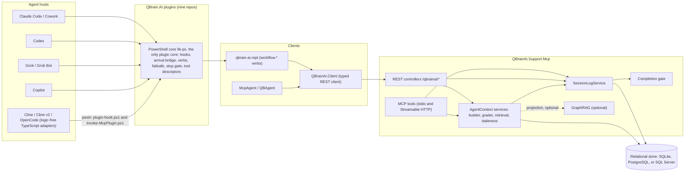

## 3. Cross-cutting conventions

- Workspace scoping: every request is scoped to one workspace through the `X-Workspace-Path` header (REST), the `workspacePath` parameter (MCP tools, REPL), or `MCP_WORKSPACE_PATH` (plugins). Every stored record carries its `WorkspaceId`, and no read ever crosses workspaces.
- Authentication: `X-Api-Key` (or `api_key`) from the workspace marker. Plugins never call REST directly; they use the REPL wrapper.
- Plugin scripting: PowerShell only (operator, 2026-10-11: "You should be designing all scripts and script tools around PowerShell and only PowerShell."). `plugins/core/lib-ps` is the one plugin core for all nine hosts; cline, cline-v2, and opencode keep only the adapter entry file their host API forces, which forwards each host hook invocation (`{ input, output }`) to `lib/plugin-hook.ps1 -HostEvent` and applies the returned `output`, forwards each tool call (`{ params, hostContext }`) to `lib/Invoke-McpPlugin.ps1 -InvocationFromStdin`, and registers the tools listed in `lib/tool-descriptors.json`; the host's own build compiles that one file into the git-ignored `dist/`; Pester is the only plugin test runner.
- Routes: every REST route exists under `/qbrainai/...` with the legacy alias `/mcpserver/...`.
- Errors: every REST error of a unit this plan adds or changes is the `ClassifiedError` problem+json body `{ "type", "title", "status", "detail", "code", "message", "retryable", "details" }` emitted through `McpErrorClassifier` (`SessionLogController.cs` and the agent-context controller); `code` carries the unit's error code (for example `review_status_conflict`, `agent_context_budget_exceeded`), the HTTP status is the one stated per unit (400 validation, 403 not allowed, 404 not found, 409 conflict or disabled, 422 semantic refusal), and MCP tools return `{ code, error, message, retryable, details }`. Existing routes whose behavior this plan does not change keep today's error bodies (for example the `{ error }` 400 of the dialog route and the "Invalid session identifier." problem of the open and title routes), stated per unit. The REPL error envelope is `type: error` with `code`, `message`, and `retryable`.
- Identifiers: every identifier is human-readable and meaningful (operator, 2026-10-11: "Please use human-readable, meaningful identifiers."). Session ids `<Agent>-<yyyyMMddTHHmmssZ>-<suffix>`; server-minted request ids `req-<yyyyMMddTHHmmssZ>-<8 hex>`; agent-context record keys derive from the turn and session they belong to (section 6.3): packages `pkg-<requestId>-<nn>`, responses `rsp-<requestId>-<nn>`, grades `grd-<responseId>-<kind>-<nn>`, relationships `rel-<type>-<yyyyMMddTHHmmssZ>-<nn>`, HV requests `hvr-<sessionId>-<yyyyMMddTHHmmssZ>`. Document labels use the command, query, process, and policy names.
- Root ids: every record carries the root ids of its parents (workspace, MCP session, request, and for agent context the package and response).
- Secrets: no API key, token, password, or credential is ever stored in a turn field, a context package, or a response; the session-log sanitizer and the agent-context secret filter redact on write and on every read surface.
- Process: the plan runs in the four execution phases of section 8 under the Byrd Development Process v4 (requirements, tests red, mocks green, implementation green, full gates with zero failures and zero skips); each prerequisite, the end of Phase 1, Phase 2, and Phase 3, each bounded context at the end of its Phase 4 work package, and the phase-wide Phase 4 HV end with a Codex gpt-6-astra max hostile validation at accuracy and completeness of at least 98 with every claim PASS. Builds and tests run as Nuke targets natively on Windows or Linux; GitHub Actions and Azure Pipelines are not part of any requirement or process; Octopus (container on LAB-OMARCHY) is used only for releases.

## 4. Phase A: correct, independent turn logging

### 4.1 Components and data

- Server: `SessionLogService.SubmitWithOutcomesAsync` (per-turn outcomes), `ISessionLogService.MintTurnAsync`, `ISessionLogRequestIdMinter`, `ISessionLogTurnUpsertGuard`, `SessionLogTurnEntity.IngressNonce` (unique filtered index on (WorkspaceId, SessionLogId, IngressNonce) where not null, and a second unique filtered index on (WorkspaceId, RequestId) where IngressNonce is not null, so minted request ids are unique across the workspace's sessions while legacy rows are untouched; TR-MCP-SESSIONTURN-004 AC-006).
- PowerShell plugin core (`plugins/core/lib-ps`): prompt hook, arrival bridge (claude-code, claude-cowork), `Sync-PluginArrivalLog`, verb binding (`New-ReplInvocationBinding`, `Resolve-ReplTargetTurn`), truthful persist (`Get-ReplTurnWriteOutcome`, `Invoke-ReplPersistTurn`), failsafe and alias journal, Stop gate (`Get-PluginStopGateTurns`, pure `Get-PluginStopGateFindings`).
- TypeScript-host bindings (cline, cline-v2, opencode) in the same PowerShell core, reached through each host's logic-free adapter, which forwards each host hook invocation (`{ input, output }`) to `lib/plugin-hook.ps1 -HostEvent` and applies the returned `output`, forwards each tool call (`{ params, hostContext }`) to `lib/Invoke-McpPlugin.ps1 -InvocationFromStdin`, and registers the tools listed in `lib/tool-descriptors.json` (operator, 2026-10-11: "You should be designing all scripts and script tools around PowerShell and only PowerShell."); `plugins/core/lib-node` receives no new work and is retired.
- Plugin per-host-session state (one directory per host session key under the plugin cache):
  - `turns/<requestId>.yaml` with its own lock `turns/<requestId>.lock`: one file per turn.
  - `sessions/<hostSessionKey>/turn-state.yaml`: `writeTarget { requestId, deliveredAtUtc, source }`, `openDelivered [requestId]`, `queue [{ kind, requestId, nonce, enqueueOffset, enqueueTimestamp, promptSha256, state, stateOffset, mintedAtUtc }]`, `appliedThroughOffset`, `mcpSessionId`, `ledger [...]`, `unsupportedSince { causeOffset, causeOperation, reason }`; every entry carries the root ids; written by one atomic replace under `turn-open.lock`.
  - `sessions/<hostSessionKey>/ended.yaml` (`reason: session_end`), `sessions/<hostSessionKey>/aliases.yaml` (alias journal), `sessions/<key>/arrival-bridge.pid`.
  - `current-turn.yaml` is a read-only legacy status file and is never used for targeting.

Request lifecycle (plugin queue entry):

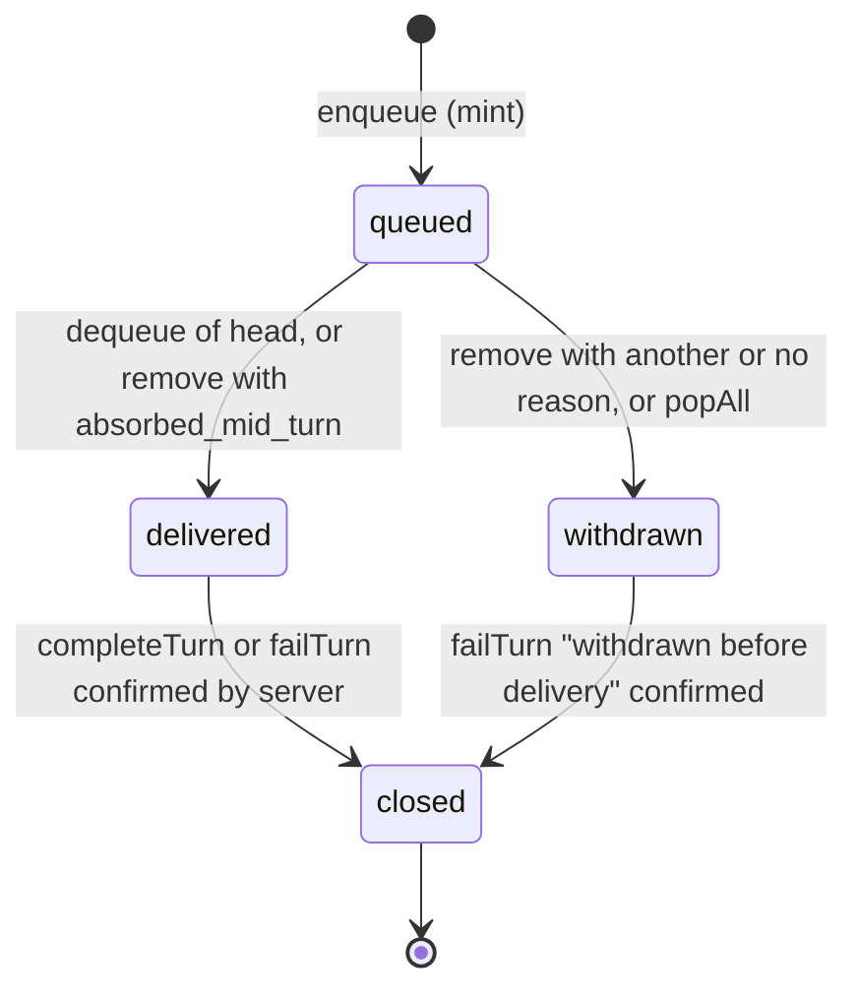

### 4.2 Units of work (CQRS handlers)

Each unit of work is exactly one CQRS command or query with its handler (operator, 2026-10-11: "I want to be clear, unit of work maps to one CQRS handler"), following `QBrainAi.Cqrs`: a `sealed record` implementing `ICommand<TResult>` or `IQuery<TResult>` and its handler in the same file under `src/QBrainAi.Services/<Area>/Commands` or `Queries`, registered by `AddCqrsHandlers`, returning `Result<TResult>`; controllers and MCP tools dispatch through `IDispatcher.SendAsync` or `QueryAsync` and map failures through `McpErrorClassifier`. Phase A and B handlers delegate to the `ISessionLogService` members the plan names.

#### MintSessionTurnCommand: mint a turn at ingress [FR-MCP-SESSIONTURN-001]

- Handler: `MintSessionTurnCommand(string WorkspacePath, string Agent, string SessionId, SessionLogMintTurnRequest Request) : ICommand<SessionLogMintTurnResult>` and `MintSessionTurnCommandHandler` in `src/QBrainAi.Services/SessionLog/Commands/MintSessionTurnCommand.cs`, delegating to `ISessionLogService.MintTurnAsync`.
- Trigger: a user message arrives at a host arrival mechanism (prompt hook, arrival bridge, or host-native adapter). Only hooks and adapters call it; there is no MCP tool, and the plugin wrapper refuses a model-originated call with `mint_requires_host_ingress`.
- Surfaces: `POST /qbrainai/sessionlog/{agent}/{sessionId}/mint` (alias `/mcpserver/...`), client `MintTurnAsync`, REPL `workflow.sessionlog.mintTurn`.
- Request `SessionLogMintTurnRequest`: `ingressNonce` (string, required: the host's per-message id or a SHA-256 of host event fields), `queryTitle`, `queryText`, `model`, `planFile` (value or the `None` sentinel), `todoId` (value or `None`).
- Response `SessionLogMintTurnResult`: `requestId` (`req-<yyyyMMddTHHmmssZ>-<8 hex>`), `outcome` (`created` or `merged`), `storedStatus`.
  - 201 `created`: a new in-progress turn.
  - 200 `merged`: the same nonce was already minted in this MCP session; the same `requestId` is returned and a terminal turn is not reopened.
- Errors: 400 `ingress_nonce_invalid` (missing or invalid nonce, TR-MCP-SESSIONTURN-004 AC-005), 400 `validation_error` (invalid `planFile` or `todoId`), 404 with detail code `session_not_open`, 500 with final detail code `mint_collision_exhausted` after six request-id collisions.

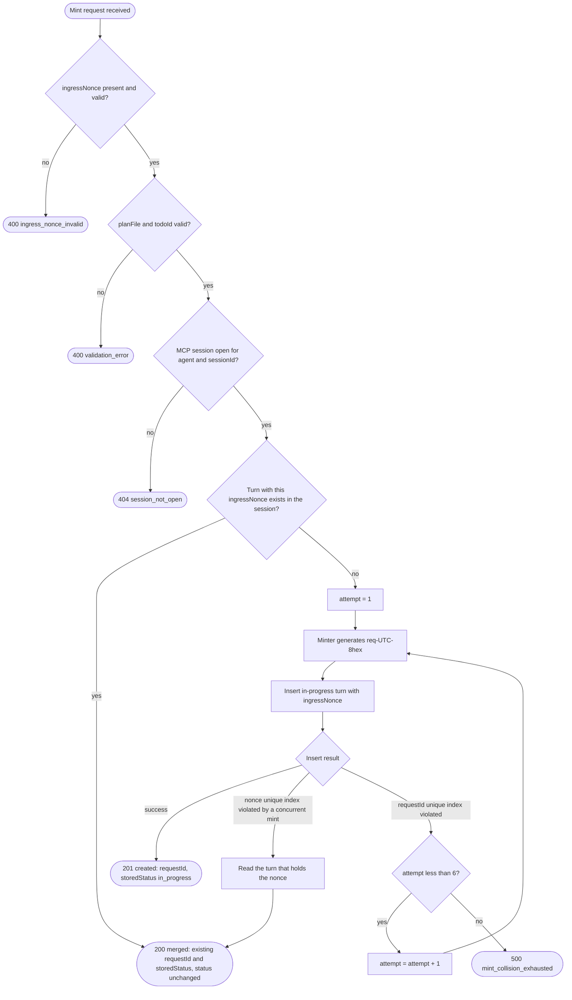

#### SubmitSessionLogCommand: submit a session log with per-turn outcomes [FR-MCP-SESSIONTURN-004]

- Handler: `SubmitSessionLogCommand(string WorkspacePath, UnifiedSessionLogDto Log) : ICommand<SessionLogSubmitResult>` and `SubmitSessionLogCommandHandler` in `src/QBrainAi.Services/SessionLog/Commands/SubmitSessionLogCommand.cs`, delegating to `ISessionLogService.SubmitWithOutcomesAsync` and applying, per turn, policy TerminalTurnOutcomeGuard, policy RequestClassification when the turn carries `requestClass`, and policy CompletionGate when the write moves the turn to `completed` or `failed` (from S10).
- Surfaces: `POST /qbrainai/sessionlog` (existing route), MCP `sessionlog_submit`, client `SubmitAsync`, REPL submit. This is the route every turn verb already uses: the plugin verbs `appendActions`, `appendDecisions`, `updateTurn`, `completeTurn`, and `failTurn` send the one bound turn in a session document (`Invoke-ReplPersistTurn`, `plugins/core/lib-ps/repl-invoke.ps1:1602-1736`, method `client.SessionLog.SubmitAsync`; process PersistTurnWriteWithReceipt), and so do the REPL workflow (`src/QBrainAi.Repl.Core/SessionLogWorkflow.cs`) and McpAgent (`src/QBrainAi.McpAgent/SessionLog/SessionLogWorkflow.cs`). Dialog and titles use their own routes (AppendTurnDialogCommand, SetTurnTitleCommand, SetSessionTitleCommand).
- Request: the unified session-log document (`UnifiedSessionLogDto`) with its turns.
- Response 201 `SessionLogSubmitResult`: existing fields plus `turns: [{ requestId, outcome, storedStatus, reason }]`, where `outcome` is `created`, `merged`, or `skipped_terminal`. MCP returns `{ success, id, turns }`. The status code stays 201.
- Rules: an identical resubmit is `merged` with reason `no_change`; duplicate request ids in one submission apply last-wins with one outcome each; a write whose status would move a terminal turn (the stored status is `completed`, `failed`, or `canceled`, and the incoming status is supplied, differs, and is not terminal, or the write is a superseded hook persist; today's guard at `SessionLogService.cs:1611-1618`, which the seam `ISessionLogTurnUpsertGuard` replaces unchanged, TR-MCP-SESSIONTURN-004 AC-002) is `skipped_terminal` and changes nothing, while a write that omits the status merges additively even on a terminal turn (omitted-status enrichment, FR-MCP-SESSIONTURN-004-AC003); there is no `skipped_duplicate` outcome.
- Errors: 400 `validation_error`; 400 `request_class_invalid`; 400 `session_turn_completion_gate` (from S10: a turn of the submission moves to `completed` or `failed` without meeting the gate; the whole submission is rejected atomically and the error names that `requestId` and its missing items).

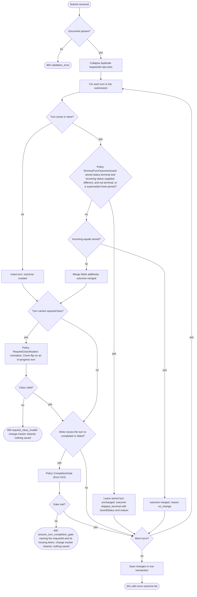

#### UpsertSessionTurnCommand: append or merge one turn [FR-MCP-SESSIONTURN-004, FR-MCP-SESSIONTURN-006, FR-MCP-SESSIONTURN-007]

- Handler: `UpsertSessionTurnCommand(string WorkspacePath, string Agent, string SessionId, SessionLogTurnUpsertRequest Request) : ICommand<SessionLogTurnWriteResult>` and `UpsertSessionTurnCommandHandler` in `src/QBrainAi.Services/SessionLog/Commands/UpsertSessionTurnCommand.cs`, delegating to `ISessionLogService.SubmitWithOutcomesAsync` for one turn.
- Surfaces: `POST /qbrainai/sessionlog/{agent}/{sessionId}/turn` (alias `/mcpserver/...`), client `UpsertTurnAsync`, REPL `client.SessionLog.UpsertTurnAsync`, no dedicated MCP tool (MCP callers write turns through `sessionlog_submit`, SubmitSessionLogCommand, and `sessionlog_replace_turn`, ReplaceSessionTurnCommand). The plugin, REPL workflow, and McpAgent verbs do not use this route; they persist through SubmitSessionLogCommand.
- Request `SessionLogTurnUpsertRequest`: the turn's `requestId` and the fields to add or merge (actions, dialog, `designDecisions`, `requirementsDiscovered`, `blockers`, title, `requestClass` from Phase B, status).
- Response `SessionLogTurnWriteResult { requestId, outcome, storedStatus, reason }` with `outcome` in `created`, `merged`, `skipped_terminal`.
- Errors: 400 `validation_error`; 400 `request_class_invalid` (policy RequestClassification); 400 `session_turn_completion_gate` when the write transitions the turn to `completed` or `failed` and the gate is unmet (policy CompletionGate, from S10); 404 `session_not_open`.

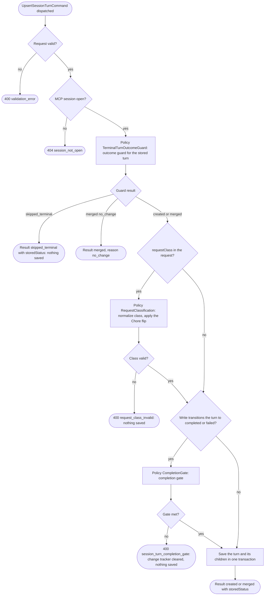

#### PatchSessionTurnCommand: change named fields of one turn [FR-MCP-SESSIONTURN-004, FR-MCP-SESSIONTURN-007]

- Handler: `PatchSessionTurnCommand(string WorkspacePath, string Agent, string SessionId, string RequestId, SessionLogTurnPatchRequest Request) : ICommand<SessionLogTurnWriteResult>` and `PatchSessionTurnCommandHandler` in `src/QBrainAi.Services/SessionLog/Commands/PatchSessionTurnCommand.cs`.
- Surfaces: `PATCH /qbrainai/sessionlog/{agent}/{sessionId}/{requestId}`, client `PatchTurnAsync`, REPL `client.SessionLog.PatchTurnAsync`, no MCP tool.
- Request: only the fields to change (null means unchanged); response and errors as UpsertSessionTurnCommand, plus 404 `not_found` for an unknown `requestId`.

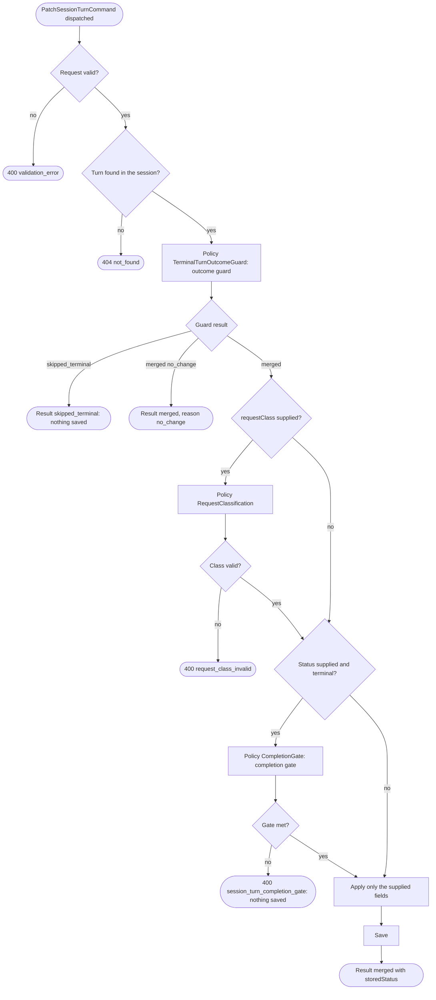

#### ReplaceSessionTurnCommand: replace one turn [FR-MCP-SESSIONTURN-004, FR-SUPPORT-016]

- Handler: `ReplaceSessionTurnCommand(string WorkspacePath, string Agent, string SessionId, string RequestId, SessionLogTurnReplaceRequest Request) : ICommand<SessionLogTurnWriteResult>` and `ReplaceSessionTurnCommandHandler` in `src/QBrainAi.Services/SessionLog/Commands/ReplaceSessionTurnCommand.cs`.
- Surfaces: `PUT /qbrainai/sessionlog/{agent}/{sessionId}/{requestId}`, MCP `sessionlog_replace_turn`, client `ReplaceTurnAsync`, REPL `client.SessionLog.ReplaceTurnAsync`.
- Request: the whole turn; response and errors as PatchSessionTurnCommand.

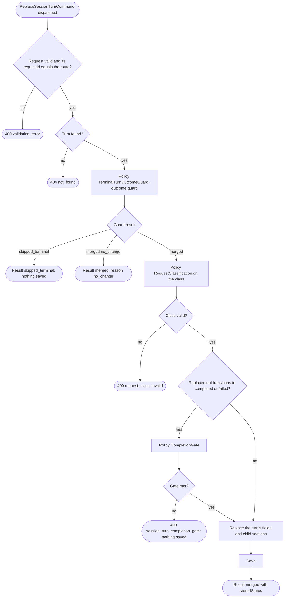

#### CompleteSessionTurnCommand: complete one turn [FR-MCP-SESSIONTURN-004, FR-MCP-SESSIONCLASS-002]

- Handler: `CompleteSessionTurnCommand(string WorkspacePath, string Agent, string SessionId, string RequestId, SessionLogTurnCloseRequest Request) : ICommand<SessionLogTurnWriteResult>` and `CompleteSessionTurnCommandHandler` in `src/QBrainAi.Services/SessionLog/Commands/CompleteSessionTurnCommand.cs`.
- Surfaces: `POST /qbrainai/sessionlog/{agent}/{sessionId}/{requestId}/complete`, MCP `sessionlog_complete_turn`, client `CompleteTurnAsync`, REPL `client.SessionLog.CompleteTurnAsync`. The plugin `completeTurn` verb does not call this route: it sends the bound turn with status `completed` through SubmitSessionLogCommand after its model-evidence check and advisory pre-check (processes PersistTurnWriteWithReceipt and AdvisoryCompletionPrecheck), and the same policies apply there.
- Request `SessionLogTurnCloseRequest { response, requestClass, designDecisions, requirementsDiscovered, blockers }`; response `SessionLogTurnWriteResult`.
- Errors: 400 `validation_error`, `request_class_invalid`, `session_turn_completion_gate` (from S10); 404 `not_found`; a terminal turn returns `skipped_terminal`.

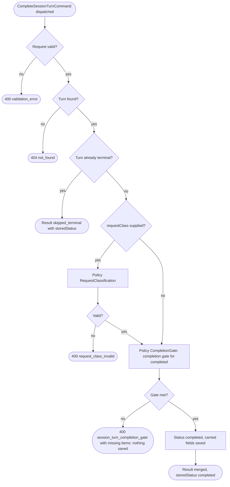

#### FailSessionTurnCommand: fail one turn [FR-MCP-SESSIONTURN-004, FR-MCP-SESSIONCLASS-002]

- Handler: `FailSessionTurnCommand(string WorkspacePath, string Agent, string SessionId, string RequestId, SessionLogTurnFailRequest Request) : ICommand<SessionLogTurnWriteResult>` and `FailSessionTurnCommandHandler` in `src/QBrainAi.Services/SessionLog/Commands/FailSessionTurnCommand.cs`.
- Surfaces: `POST /qbrainai/sessionlog/{agent}/{sessionId}/{requestId}/fail`, MCP `sessionlog_fail_turn`, client `FailTurnAsync`, REPL `client.SessionLog.FailTurnAsync`. The plugin `failTurn` verb sends the bound turn with status `failed` and its error message through SubmitSessionLogCommand (process PersistTurnWriteWithReceipt), where the same policies apply.
- Request `SessionLogTurnFailRequest { errorMessage, requestClass, designDecisions, requirementsDiscovered, blockers }`; response `SessionLogTurnWriteResult`.
- Errors: 400 `validation_error` (blank error message), `request_class_invalid`, `session_turn_completion_gate` (class missing, from S10); 404 `not_found`.

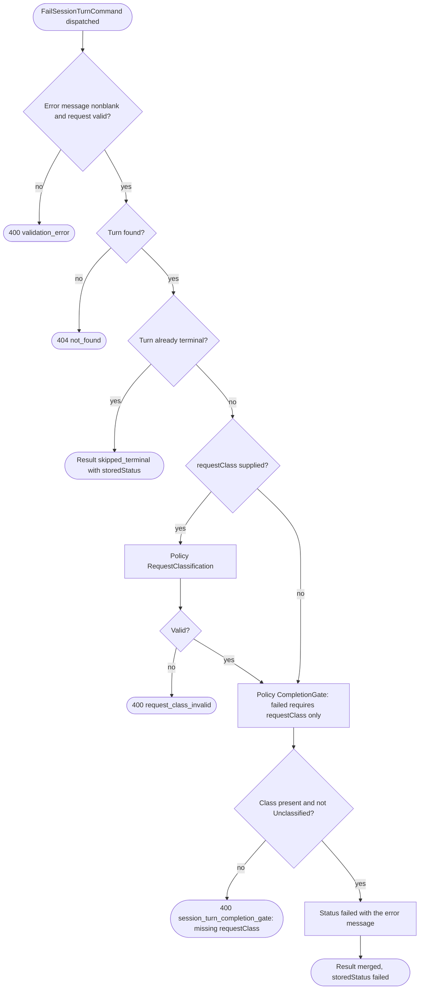

#### OpenSessionLogCommand: open (ensure) a session [FR-MCP-SESSIONTURN-001, FR-MCP-SESSIONTURN-007]

- Handler: `OpenSessionLogCommand(string WorkspacePath, string Agent, string SessionId, string? Title, string? Model) : ICommand<SessionLogOpenResult>` and `OpenSessionLogCommandHandler` in `src/QBrainAi.Services/SessionLog/Commands/OpenSessionLogCommand.cs`, delegating to `ISessionLogService.OpenSessionAsync` (`SessionLogService.cs:596-620`, behavior unchanged).
- Surfaces: `POST /qbrainai/sessionlog/{agent}/{sessionId}/open` (`SessionLogController.cs:282`), MCP `sessionlog_open`, client `OpenSessionAsync`, REPL and plugin `workflow.sessionlog.openSession`; called by processes StartHostSession, DrainFailsafe (the idempotent session open replayed before a drained mint), and the first-ingress writer of hosts without SessionStart.
- Request: route `agent` and `sessionId`, optional `title` and `model`. Response 200 `{ agent, sessionId, created }` (`created` false when the session already existed; an existing session is never changed).
- Errors: 400 problem "Invalid session identifier." for a session id invalid for the agent (today's body, unchanged).

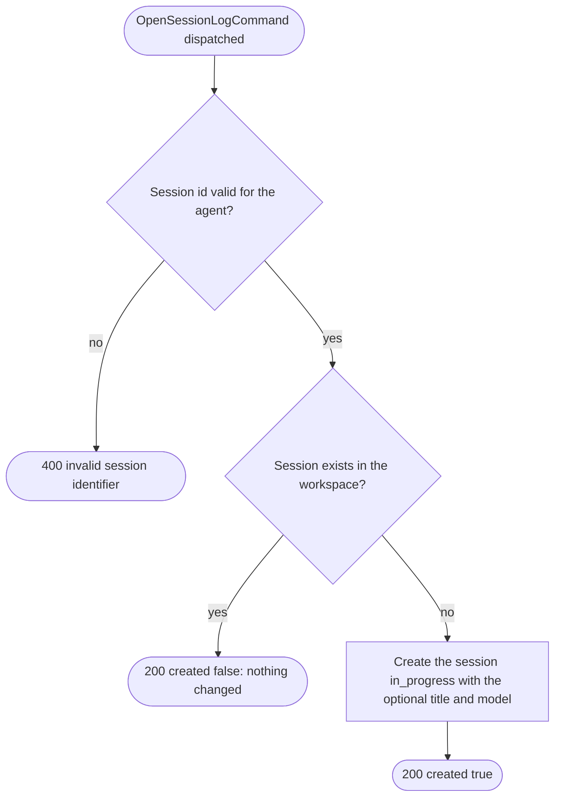

#### AppendTurnDialogCommand: append processing dialog to one turn [FR-MCP-SESSIONTURN-004, FR-MCP-SESSIONTURN-007]

- Handler: `AppendTurnDialogCommand(string WorkspacePath, string Agent, string SessionId, string RequestId, IReadOnlyList<ProcessingDialogItemDto> Items) : ICommand<SessionLogDialogAppendResult>` and `AppendTurnDialogCommandHandler` in `src/QBrainAi.Services/SessionLog/Commands/AppendTurnDialogCommand.cs`, delegating to `ISessionLogService.AppendProcessingDialogAsync` (`SessionLogService.cs:405-465`, behavior unchanged).
- Surfaces: `POST /qbrainai/sessionlog/{agent}/{sessionId}/{requestId}/dialog` (`SessionLogController.cs:232`), MCP `sessionlog_dialog`, client `AppendDialogAsync`, REPL `client.SessionLog.AppendDialogAsync`, plugin verb `appendDialog` (bound by process BindVerbToTurn; `repl-invoke.ps1:2492-2572`), the REPL workflow, and McpAgent. The HV protocol stores a long reviewer result as ordered dialog parts on the reviewer's own turn through this unit.
- Request: one or more `{ timestamp, role, content, category }` items, appended after the highest existing ordinal. Response 200 `{ agent, sessionId, requestId, totalDialogCount }`.
- Errors: 400 `{ error }` for no item or an invalid session or request id, and 404 for a missing turn (today's bodies, `SessionLogController.cs:232-280`, unchanged). The server appends on any turn status; the plugin refuses `appendDialog` on a turn it knows is terminal with `turn_immutable` before any call (FR-MCP-SESSIONTURN-004-AC004).

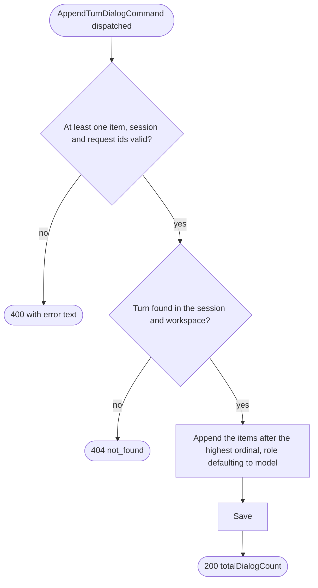

#### SetTurnTitleCommand: retitle one turn [FR-MCP-SESSIONTURN-003, FR-MCP-SESSIONTURN-007]

- Handler: `SetTurnTitleCommand(string WorkspacePath, string Agent, string SessionId, string RequestId, string Title) : ICommand<SessionLogTitleResult>` and `SetTurnTitleCommandHandler` in `src/QBrainAi.Services/SessionLog/Commands/SetTurnTitleCommand.cs`, delegating to `ISessionLogService.SetTurnTitleAsync` (`SessionLogService.cs:922-955`, behavior unchanged: an explicit overwrite of `QueryTitle` that incidental submits never reset, TR-MCP-SESSIONLOG-005).
- Surfaces: `POST /qbrainai/sessionlog/{agent}/{sessionId}/{requestId}/title` (`SessionLogController.cs:350`), client `SetTurnTitleAsync`, REPL `client.SessionLog.SetTurnTitleAsync`, plugin verb `setTurnTitle` (bound by process BindVerbToTurn, so an explicit `requestId` retitles only that turn, TR-MCP-SESSIONTURN-003 AC-005; `repl-invoke.ps1:2925-2941`); no MCP tool.
- Request `{ title }` (a missing body stores an empty title, as today). Response 200 `{ turnId, agent, sessionId, requestId, retitled: true }` (`SessionLogController.cs:363`). Errors: 400 for an invalid session or request id; 404 `not_found` for a missing session or turn (`ClassifiedError`). The plugin refuses `setTurnTitle` on a locally terminal turn with `turn_immutable` (FR-MCP-SESSIONTURN-004-AC004).

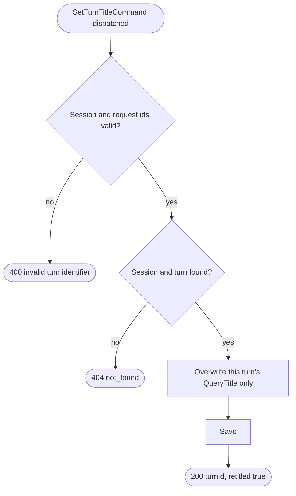

#### SetSessionTitleCommand: retitle a session [FR-MCP-SESSIONTURN-007]

- Handler: `SetSessionTitleCommand(string WorkspacePath, string Agent, string SessionId, string Title) : ICommand<SessionLogTitleResult>` and `SetSessionTitleCommandHandler` in `src/QBrainAi.Services/SessionLog/Commands/SetSessionTitleCommand.cs`, delegating to `ISessionLogService.SetSessionTitleAsync` (`SessionLogService.cs:892-918`, behavior unchanged).
- Surfaces: `POST /qbrainai/sessionlog/{agent}/{sessionId}/title` (`SessionLogController.cs:313`), client `SetSessionTitleAsync`, REPL `client.SessionLog.SetSessionTitleAsync`, plugin verb `setSessionTitle` (targets the host session's own `mcpSessionId`, process StartHostSession); no MCP tool.
- Request `{ title }` (a missing body stores an empty title, as today). Response 200 `{ turnId, agent, sessionId, retitled: true }`, where `turnId` carries the session row id (`SessionLogController.cs:326`, unchanged). Errors: 400 for an invalid session id; 404 `not_found` for a missing session (`ClassifiedError`).

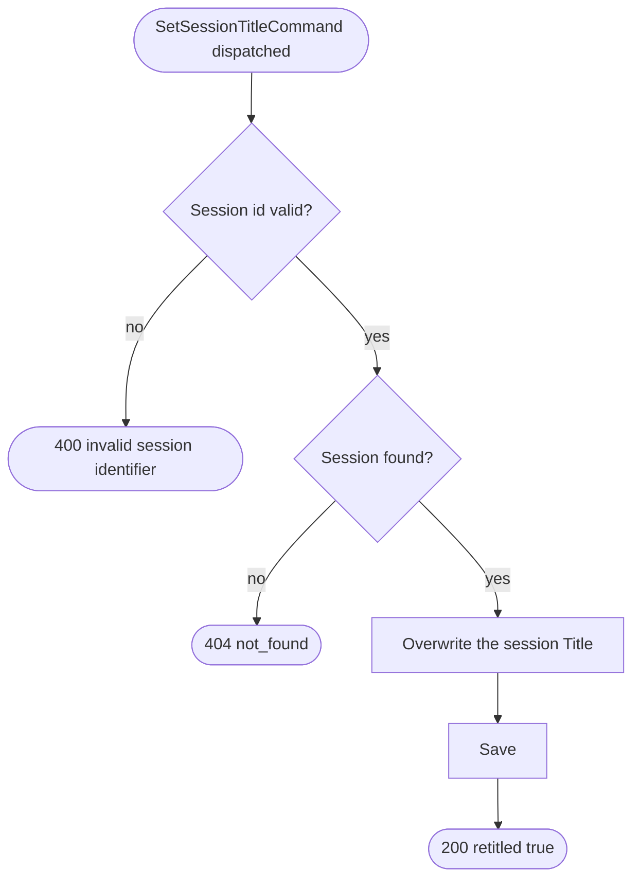

Existing session-log routes this plan does not change (they keep today's behavior and are not units of this plan): `POST .../{requestId}/begin` (`BeginTurnAsync`; the plugins stop calling it, because ingress mints through MintSessionTurnCommand), `DELETE .../{requestId}` and `DELETE .../{sessionId}` (turn and session delete), `POST /qbrainai/sessionlog/repair-workspace-stamps`, and the section routes `PUT` and `DELETE .../sections/{section}` and `DELETE .../sections/{section}/items/{itemKey}` for every section other than the two review sections. For `agentReview` and `hostileReview` (and their aliases) the section `PUT` dispatches RecordSessionTurnReviewCommand, the section `DELETE` dispatches ResetSessionTurnReviewCommand, and the item `DELETE` is refused by the existing delete-item handler (Phase B, S4).

### 4.3 Policies applied inside Phase A handlers

#### Policy TerminalTurnOutcomeGuard: terminal-turn outcome guard (`ISessionLogTurnUpsertGuard`) [FR-MCP-SESSIONTURN-004]

Applied by SubmitSessionLogCommand, UpsertSessionTurnCommand, PatchSessionTurnCommand, ReplaceSessionTurnCommand. It never saves; it returns the outcome the handler must honor. The seam replaces the inline guard at `SessionLogService.cs:1606-1618` without changing its rule (TR-MCP-SESSIONTURN-004 AC-002): only a status move away from a terminal status is skipped; a write that omits the status, a review-section write, and a requestClass-only write merge on a terminal turn (FR-MCP-SESSIONTURN-004-AC003, AC004).

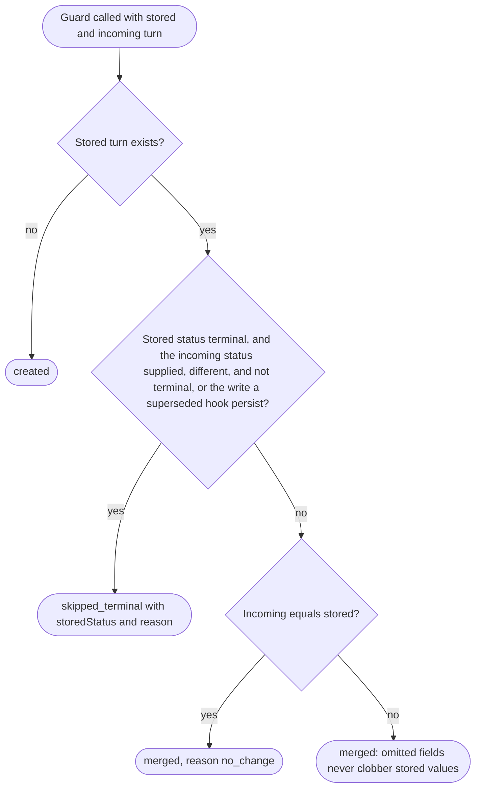

### 4.4 Processes (plugin, host, and build; they call the handlers above)

#### Process ApplyArrivalBridgeRecord: process a transcript record in the arrival bridge [FR-MCP-SESSIONTURN-001, FR-MCP-SESSIONTURN-002]

- Hosts: claude-code and claude-cowork (the bridge is their only minter; the prompt hook neither mints nor claims there).
- Trigger: a complete transcript record past `appliedThroughOffset`; also applied by `Sync-PluginArrivalLog` from a verb, the Stop hook, or SessionStart up to the transcript length recorded at their own start.
- Input: transcript `queue-operation` records `enqueue`, `dequeue`, `remove` (with reason `absorbed_mid_turn`, another reason, or none), and `popAll`.
- Output: queue and delivery state in `turn-state.yaml` (one atomic replace per record under `turn-open.lock`), mint calls (MintSessionTurnCommand), and `unsupportedSince` on a fail-closed condition.

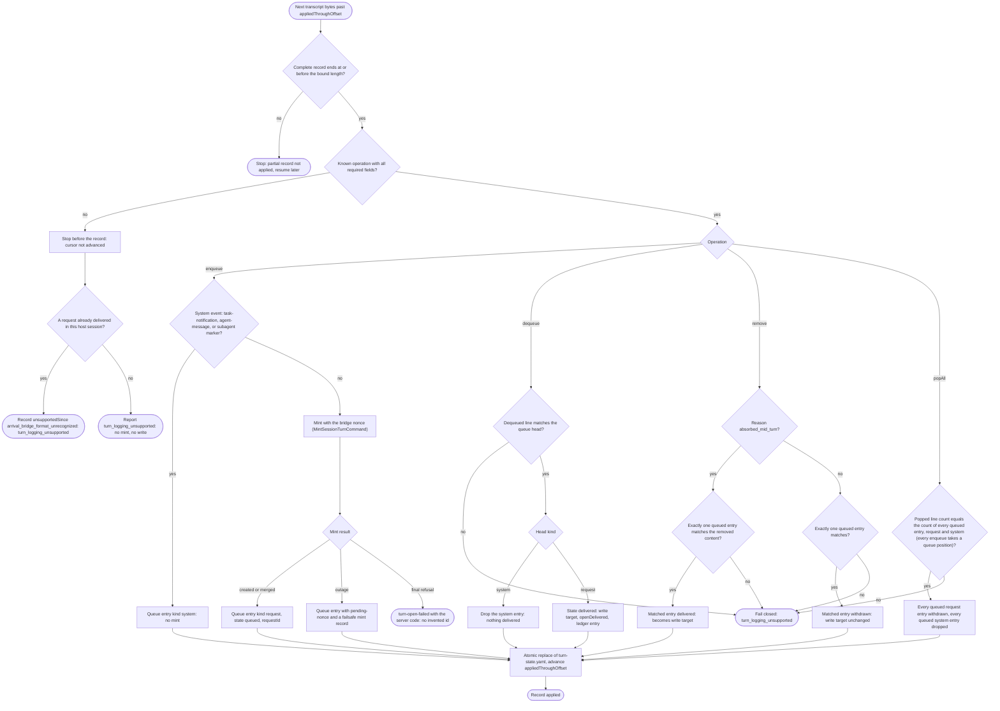

#### Process OpenTurnFromPromptHook: open a turn from the prompt hook (hosts without a bridge) [FR-MCP-SESSIONTURN-001, FR-MCP-SESSIONTURN-002, FR-MCP-SESSIONTURN-003]

- Hosts: codex, grok, grok-bot, copilot, and classic cline (its native UserPromptSubmit hook is a PowerShell command hook); cline-v2 and opencode through their adapters, which forward the prompt event to the same PowerShell core.
- Input: the host's prompt hook payload. Output: a delivered request and write target, or a hook status.
- Hook statuses: `turn-opened`, `turn-already-open`, `system-event-skipped`, `turn-open-contended`, `turn-open-failed` (reason `nonce_source_missing` or the server code), `turn_logging_unsupported`.

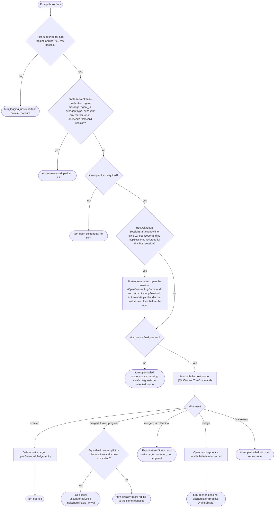

#### Process BindVerbToTurn: bind a session-log verb to its turn [FR-MCP-SESSIONTURN-007]

- Verbs: `appendActions`, `appendDialog`, `appendDecisions`, `updateTurn`, `completeTurn`, `failTurn`, `setTurnTitle`, and from Phase B `recordReview`.
- Request: the verb's payload plus an optional explicit `requestId`, or a trusted recovery pair (`sessionId`, `requestId`).
- Response: the resolved target request id and an immutable invocation binding `{ hostSessionKey, keySource, ingressNonce, requestId, boundAtUtc }` stored with the persist and failsafe records; or a refusal code.
- Refusal codes: `request_unknown`, `request_ambiguous`, `turn_immutable`, `host_session_unknown`, `host_session_ambiguous`, `turn_logging_unsupported`; warning `host_session_inferred`.

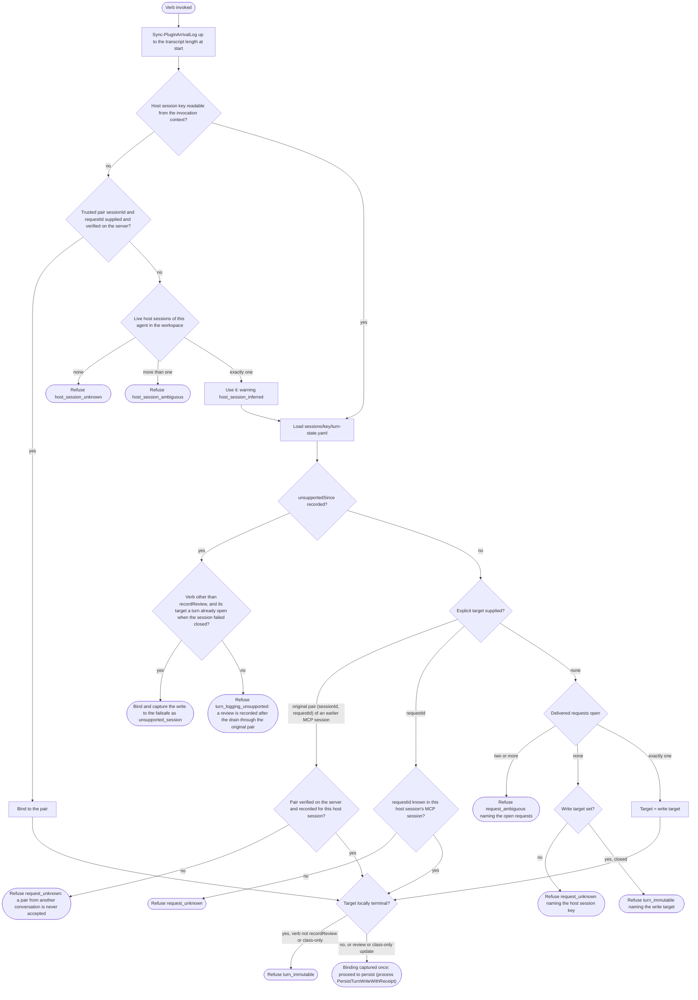

#### Process PersistTurnWriteWithReceipt: persist a turn write with a truthful receipt (dispatches SubmitSessionLogCommand with the one bound turn, AppendTurnDialogCommand, or SetTurnTitleCommand through the REPL) [FR-MCP-SESSIONTURN-004, FR-MCP-SESSIONTURN-005]

- Request: for `appendActions`, `appendDecisions`, `updateTurn`, `completeTurn`, and `failTurn`, a session document holding only the bound turn, built by `New-McpPluginTurnUpsertRequest` with the binding and sent as `client.SessionLog.SubmitAsync` (`POST /qbrainai/sessionlog`, `Invoke-ReplPersistTurn`); for `appendDialog`, `client.SessionLog.AppendDialogAsync` (`POST .../{requestId}/dialog`); for `setTurnTitle`, `client.SessionLog.SetTurnTitleAsync` (`POST .../{requestId}/title`).
- Close verbs first: `completeTurn` and `failTurn` are refused locally with `turn_missing_model_evidence` when the turn has no model-authored action, design decision, or commit (hook invocations excluded; FR-MCP-SESSIONTURN-005-AC002), and a close that carries evidence writes it as a verified additive non-transition write before the transition, so a gate refusal loses nothing (FR-MCP-SESSIONCLASS-004-AC003, from S8).
- Response (plugin receipt): `persisted` (bool), `code` (`persisted`, `skipped_terminal`, `queued`, `turn_missing_model_evidence`, or the server error code), `storedStatus`, `reason`, and `outcomeVerified` (false when the server answered without per-turn outcomes, FR-MCP-SESSIONTURN-004-AC005); exit code 0 or 1.

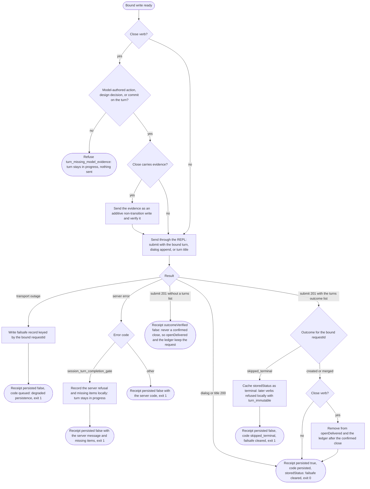

#### Process DrainFailsafe: drain the failsafe [FR-MCP-SESSIONTURN-001, FR-MCP-SESSIONTURN-004, FR-MCP-SESSIONTURN-005]

- Trigger: SessionStart, and the next verb after an outage.
- Input: failsafe records in their original order, each with its captured binding and root-id envelope.
- Output: minted ids journaled as aliases, writes replayed onto their own turns, records removed only after a confirmed result.

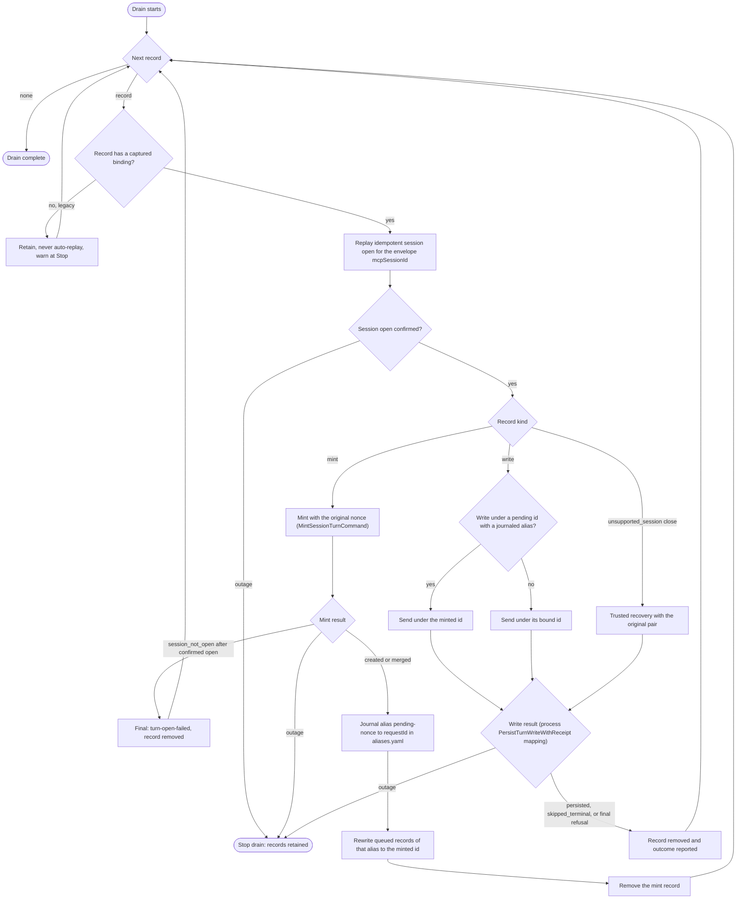

#### Process EvaluateStopGate: evaluate the Stop gate [FR-MCP-SESSIONTURN-005]

- Trigger: every host Stop (Claude Code `stop_hook_active`, Grok `stopHookActive`; on cline-v2 and opencode the stop-equivalent `afterRun` or `session.idle`, forwarded by the adapter to the same PowerShell gate).
- Output: `{}` (pass) or a block whose text is `session_turn_stop_gate: <n> turn(s) are not closed correctly:` followed by one line per turn `<id> (<code>): <remedy>` and `The stop gate never closes turns for you.`; warnings in either case. The gate never completes or fails a turn.

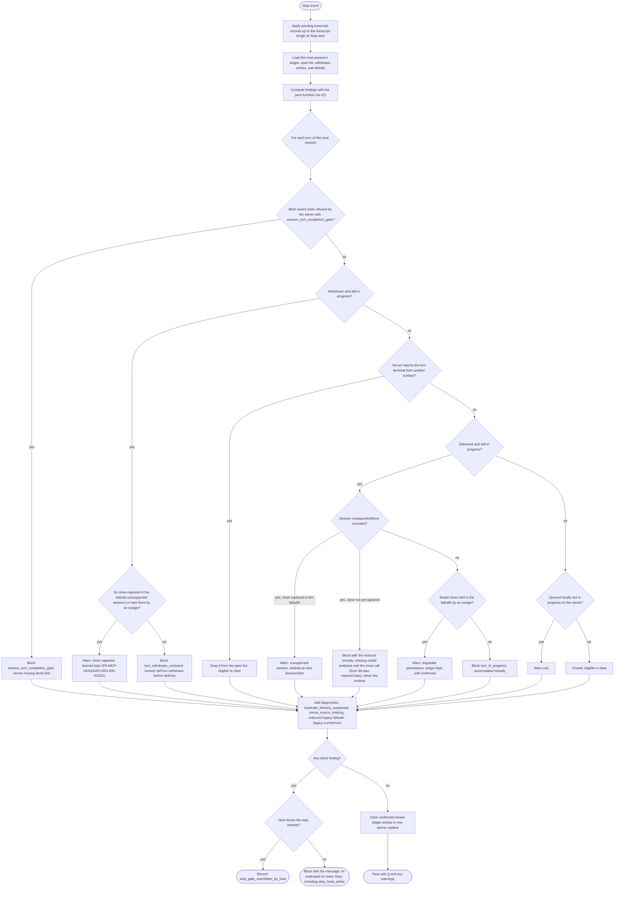

#### Process ValidateHookRegistration: validate and repair hook registration [FR-MCP-SESSIONTURN-001]

- Surfaces: `validate-claude-mcp-hooks.ps1` (check or repair) and `install-claude-mcp-hooks.ps1` in the Claude plugin repo.
- Output JSON: the validator's existing result plus the new `duplicate` and `repaired` statuses and the fields `duplicateHooks`, `pluginEnabled`, and `pluginKey`. The installer adds no bridge hook for an event the enabled plugin already covers, and removes managed duplicates with a backup.

```mermaid
flowchart TD
    S(["Validator runs"]) --> EN["Test-PluginEnabled: read the enabledPlugins map and resolve keys through known_marketplaces.json"]
    EN --> INV["Get-DuplicateHookCommands: inventory MCP hook commands in the active settings layers and the enabled plugin"]
    INV --> DUP{"Any event registered more than once?"}
    DUP -->|no| OK(["Existing result with pluginEnabled and pluginKey"])
    DUP -->|yes| CO{"CheckOnly?"}
    CO -->|yes| RD(["status duplicate with duplicateHooks: no file changed"])
    CO -->|no| BK["Back up settings files"]
    BK --> RMV["Remove managed duplicate bridge hooks, keep user hooks"]
    RMV --> RV(["status repaired: restart the host"])
```

#### Process StartHostSession: start a host session [FR-MCP-SESSIONTURN-001, FR-MCP-SESSIONTURN-007]

```mermaid
flowchart TD
    S(["SessionStart hook"]) --> K["Resolve host session key"]
    K --> LK["Take turn-open.lock"]
    LK --> MS["Record this host session's mcpSessionId in turn-state.yaml"]
    MS --> BR{"Host uses the arrival bridge?"}
    BR -->|yes| PID{"Bridge running for this key?"}
    PID -->|yes, live pid| SKIP["Keep it"]
    PID -->|no or stale pid| START["Start the bridge for this key"]
    BR -->|no| SY
    SKIP --> SY["Sync-PluginArrivalLog up to the transcript length at start"]
    START --> SY
    SY --> DR["Drain the failsafe (process DrainFailsafe)"]
    DR --> LG{"Legacy current-turn.yaml turn in progress?"}
    LG -->|yes| LST["List it: addressable by explicit requestId"]
    LG -->|no| OPN
    LST --> OPN["List this host session's open turns with their pairs"]
    OPN --> CAU{"unsupportedSince cause clearable by its rule?"}
    CAU -->|yes| CLR["Clear the cause"]
    CAU -->|no| E
    CLR --> E(["Session ready"])
```

#### Process EndHostSession: end a host session [FR-MCP-SESSIONTURN-007]

```mermaid
flowchart TD
    S(["SessionEnd hook"]) --> W["Write sessions/key/ended.yaml with reason session_end"]
    W --> B{"Arrival bridge running for the key?"}
    B -->|yes| ST["Stop the bridge"]
    B -->|no| E
    ST --> E(["Ended: an ended session is never revived"])
```

#### Process SyncAgentPluginsAtVersion: sync the agent plugins at a fixed version [TR-MCP-NUKE-003 under FR-MCP-BUILD-001]

- Surface: `./build.ps1 SyncAgentPlugins --agent-plugin-parent <dir> --plugin-version <x.y.z>` (Nuke), then `./build.ps1 ValidatePluginPowerShellOnly --agent-plugin-parent <dir>`.
- Output: a receipt listing exactly nine repos with version and `lib/plugin-hook.ps1` SHA-256; the gate fails on any other count or a mismatch. `ValidatePluginPowerShellOnly` then checks every tracked file (`git ls-files`) and allows on a TypeScript host only the adapter entry file `src/index.ts`, `tsconfig.json`, `package.json`, and the npm-owned lockfile, plus, in the git-ignored `dist/`, only the compiler output of that entry file (`index.js`, `index.d.ts`, and their `.map` files) from the host's existing `npm run build` (`tsc`); the git-ignored `node_modules/` holds installed dependencies, not plugin code, and is not scanned; any other bats, bash, Node, TypeScript, or Python file fails the run (TR-MCP-NUKE-003 AC-005).

```mermaid
flowchart TD
    S(["SyncAgentPlugins"]) --> PR{"Plugin parent resolves to the nine repos?"}
    PR -->|no| F1(["Fail: repos missing"])
    PR -->|yes| EACH["For each of the nine repos"]
    EACH --> PS["Copy lib-ps and lib/tool-descriptors.json, write CORE-MANIFEST.yaml hashes, run check-core-integrity"]
    PS --> KIND{"TypeScript host that loads compiled output?"}
    KIND -->|yes| BLD["Compile the adapter with the host's existing build: a build step, never a test"]
    BLD --> VER{"Version already the target?"}
    KIND -->|no| VER
    VER -->|yes| KEEP["Refresh content only: no bump"]
    VER -->|no| BUMP["Write the target version: npm version in a TypeScript host, never a lockfile edit"]
    KEEP --> MORE{"More repos?"}
    BUMP --> MORE
    MORE -->|yes| EACH
    MORE -->|no| RC["Write the receipt: nine repos, versions, plugin-hook SHA-256"]
    RC --> CV{"All nine converged on version and hash?"}
    CV -->|no| F3(["Fail the gate: re-run until converged"])
    CV -->|yes| PSO{"ValidatePluginPowerShellOnly: tracked files only the allowed set, and dist/ only the compiler output of src/index.ts?"}
    PSO -->|no| F4(["Fail: non-PowerShell script found"])
    PSO -->|yes| OK(["Sync passes"])
```

#### Process RunArrivalBridge: arrival bridge lifecycle (claude-code, claude-cowork) [FR-MCP-SESSIONTURN-001]

```mermaid
flowchart TD
    S(["SessionStart for a bridge host"]) --> PID{"arrival-bridge.pid for this host session key names a live bridge?"}
    PID -->|yes| KEEP(["Keep the running bridge"])
    PID -->|no or stale| ST["Start the bridge, write its pid"]
    ST --> CUR["Read appliedThroughOffset and the transcript path"]
    CUR --> LOOP{"New complete records past the offset?"}
    LOOP -->|no| WAIT["Wait for the transcript to grow"]
    WAIT --> END1{"SessionEnd marker written?"}
    END1 -->|yes| STOP(["Bridge stops"])
    END1 -->|no| LOOP
    LOOP -->|yes| APPLY["Apply each record (process ApplyArrivalBridgeRecord)"]
    APPLY --> FC{"Fail-closed condition recorded?"}
    FC -->|yes| UNS(["Bridge stops before the record: unsupported, cursor not advanced"])
    FC -->|no| LOOP
```

### 4.5 Phase A sequence diagrams

#### Sequence: submit MintSessionTurnCommand and process each response

```mermaid
sequenceDiagram
    autonumber
    participant H as Host (prompt hook or arrival bridge)
    participant P as Plugin core
    participant R as qbrain-ai-repl
    participant C as QBrainAi.Client
    participant S as SessionLogController
    participant X as IDispatcher and MintSessionTurnCommandHandler
    participant L as SessionLogService
    participant D as Store
    H->>P: user message event (payload or transcript enqueue)
    P->>P: classify system event, take turn-open.lock, derive nonce
    P->>R: workflow.sessionlog.mintTurn (MCP_PLUGIN_HOOK_INVOCATION=1)
    R->>C: MintTurnAsync(agent, sessionId, request)
    C->>S: POST /qbrainai/sessionlog/{agent}/{sessionId}/mint
    S->>X: SendAsync(MintSessionTurnCommand)
    X->>L: MintTurnAsync
    L->>D: find turn by ingressNonce in session
    alt nonce not found
        L->>D: insert turn with minted requestId (retry on requestId collision, at most 6 attempts)
        D-->>L: inserted
        L-->>S: created
        S-->>C: 201 requestId, outcome created, storedStatus in_progress
        C-->>P: result
        P->>P: bridge: queue entry queued. Prompt hook: deliver, write target, ledger
    else nonce found (retry, failsafe replay, or doubled hook)
        L-->>S: merged with existing requestId and storedStatus
        S-->>C: 200 outcome merged
        C-->>P: result
        alt stored turn in progress
            P->>P: turn-already-open, or fail closed on an equal-field host for a new invocation
        else stored turn terminal
            P->>P: report storedStatus, do not target, open, or ledger it
        end
    else session not open
        S-->>C: 404 detail session_not_open
        C-->>P: error
        P->>P: final refusal: turn-open-failed (in a drain, final only after the session open is confirmed)
    else six requestId collisions
        S-->>C: 500 detail mint_collision_exhausted
        C-->>P: error
        P->>P: final: turn-open-failed, never retried
    else missing or invalid nonce
        S-->>C: 400 ingress_nonce_invalid
        C-->>P: error
        P->>P: turn-open-failed with the code
    else invalid planFile or todoId
        S-->>C: 400 validation_error
        C-->>P: error
        P->>P: turn-open-failed with the code
    else transport outage or older server without the mint route
        C-->>P: outage
        P->>P: pending-nonce turn and failsafe mint record, drained later
    end
    P->>P: release turn-open.lock
```

#### Sequence: submit SubmitSessionLogCommand and process the per-turn outcomes

```mermaid
sequenceDiagram
    autonumber
    participant W as Writer (client, REPL, MCP caller, or a plugin, REPL-workflow, or McpAgent turn verb)
    participant S as SessionLogController or sessionlog_submit
    participant X as IDispatcher and SubmitSessionLogCommandHandler
    participant L as SessionLogService
    participant G as ISessionLogTurnUpsertGuard
    participant D as Store
    W->>S: POST /qbrainai/sessionlog (UnifiedSessionLogDto)
    S->>X: SendAsync(SubmitSessionLogCommand)
    X->>L: SubmitWithOutcomesAsync
    loop each turn after last-wins collapse
        L->>G: evaluate stored turn and incoming turn
        alt new turn
            G-->>L: created
        else stored status terminal and the incoming status supplied, different, and not terminal
            G-->>L: skipped_terminal with storedStatus and reason
        else identical
            G-->>L: merged, reason no_change
        else mergeable (omitted fields never clobber stored values)
            G-->>L: merged
        end
        L->>L: policy RequestClassification when the turn carries requestClass, policy CompletionGate when it moves to completed or failed (from S10)
    end
    alt saved
        L->>D: save in one transaction
        S-->>W: 201 with turns [requestId, outcome, storedStatus, reason]
        W->>W: persisted only for created and merged. skipped_terminal is reported, never retried
    else invalid document
        S-->>W: 400 validation_error
        W->>W: report the code, nothing persisted
    else invalid class
        S-->>W: 400 request_class_invalid, nothing saved
        W->>W: correct the class and resend
    else a transition refused by the gate
        S-->>W: 400 session_turn_completion_gate naming the requestId and its missing items, nothing saved
        W->>W: supply the missing items by the turn's pair, keep the turn open
    end
```

#### Sequence: submit SubmitSessionLogCommand from a plugin verb and process each response

```mermaid
sequenceDiagram
    autonumber
    participant M as Model
    participant P as Plugin verb
    participant F as Failsafe
    participant R as qbrain-ai-repl
    participant S as SessionLogController
    participant X as IDispatcher and SubmitSessionLogCommandHandler
    M->>P: appendActions, appendDecisions, or updateTurn (optional requestId or original pair)
    P->>P: Sync-PluginArrivalLog, bind once (process BindVerbToTurn)
    alt binding refused
        P-->>M: request_unknown, request_ambiguous, turn_immutable, host_session_unknown, host_session_ambiguous, or turn_logging_unsupported
    else unsupported session and turn already open
        P->>F: capture as unsupported_session record
        P-->>M: captured, drained at next SessionStart
    else bound
        P->>R: client.SessionLog.SubmitAsync with a session document holding only the bound turn
        R->>S: POST /qbrainai/sessionlog
        S->>X: SendAsync(SubmitSessionLogCommand): TerminalTurnOutcomeGuard, RequestClassification, CompletionGate per turn
        alt created or merged
            S-->>R: 201 turns outcome for the bound requestId
            R-->>P: outcome
            P-->>M: persisted true, exit 0
        else skipped_terminal
            S-->>R: 201 skipped_terminal with storedStatus
            R-->>P: outcome
            P->>P: cache terminal status, clear failsafe
            P-->>M: persisted false, code skipped_terminal, exit 1
        else server without per-turn outcomes
            S-->>R: 201 without turns
            R-->>P: result
            P-->>M: outcomeVerified false, never a confirmed close
        else validation, class, or gate error
            S-->>R: 400 with code (gate: missing items)
            R-->>P: error
            P->>P: on session_turn_completion_gate, record the refusal for the Stop gate
            P-->>M: persisted false with the code, exit 1
        else transport outage
            R-->>P: outage
            P->>F: record keyed by the bound requestId
            P-->>M: persisted false, code queued, exit 1
        end
    end
```

#### Sequence: submit UpsertSessionTurnCommand and process each response

```mermaid
sequenceDiagram
    autonumber
    participant C as Client or REPL (client.SessionLog.UpsertTurnAsync)
    participant S as SessionLogController
    participant X as IDispatcher and UpsertSessionTurnCommandHandler
    C->>S: POST /qbrainai/sessionlog/{agent}/{sessionId}/turn (SessionLogTurnUpsertRequest)
    S->>X: SendAsync(UpsertSessionTurnCommand)
    alt created or merged
        X-->>S: SessionLogTurnWriteResult
        S-->>C: 200 outcome and storedStatus
        C->>C: persisted
    else unchanged
        S-->>C: 200 merged, reason no_change
    else stored turn terminal and the status move refused
        S-->>C: 200 outcome skipped_terminal
        C->>C: report persisted false, never retry
    else invalid request or class
        S-->>C: 400 validation_error or request_class_invalid
        C->>C: fix and resend
    else session not open
        S-->>C: 404 session_not_open
        C->>C: open the session (OpenSessionLogCommand) first
    else transition refused by the gate
        S-->>C: 400 session_turn_completion_gate with missing items
        C->>C: supply the missing items, keep the turn open
    end
```

#### Sequence: submit PatchSessionTurnCommand and process each response

```mermaid
sequenceDiagram
    autonumber
    participant C as Client or REPL (client.SessionLog.PatchTurnAsync)
    participant S as SessionLogController
    participant X as IDispatcher and PatchSessionTurnCommandHandler
    C->>S: PATCH /qbrainai/sessionlog/{agent}/{sessionId}/{requestId} (fields to change)
    S->>X: SendAsync(PatchSessionTurnCommand)
    alt applied
        X-->>S: merged with storedStatus
        S-->>C: 200 SessionLogTurnWriteResult
        C->>C: persisted
    else unchanged
        X-->>S: merged, reason no_change
        S-->>C: 200
        C->>C: nothing to do
    else stored turn terminal
        X-->>S: skipped_terminal
        S-->>C: 200 outcome skipped_terminal
        C->>C: report persisted false, never retry
    else invalid request or class
        X-->>S: validation_error or request_class_invalid
        S-->>C: 400 problem+json with the code
        C->>C: fix and resend
    else unknown requestId
        S-->>C: 404 not_found
    else transition refused by the gate
        S-->>C: 400 session_turn_completion_gate with missing items
        C->>C: supply the missing items, keep the turn open
    end
```

#### Sequence: submit ReplaceSessionTurnCommand and process each response

```mermaid
sequenceDiagram
    autonumber
    participant C as Client, REPL, or MCP sessionlog_replace_turn
    participant S as SessionLogController or MCP tool
    participant X as IDispatcher and ReplaceSessionTurnCommandHandler
    C->>S: PUT /qbrainai/sessionlog/{agent}/{sessionId}/{requestId} (whole turn)
    S->>X: SendAsync(ReplaceSessionTurnCommand)
    alt replaced
        X-->>S: merged with storedStatus
        S-->>C: 200 SessionLogTurnWriteResult
    else identical
        S-->>C: 200 merged, reason no_change
    else stored turn terminal
        S-->>C: 200 outcome skipped_terminal
        C->>C: report persisted false
    else body requestId differs from the route, or invalid
        S-->>C: 400 validation_error
    else invalid class
        S-->>C: 400 request_class_invalid
    else unknown requestId
        S-->>C: 404 not_found
    else transition refused by the gate
        S-->>C: 400 session_turn_completion_gate with missing items
    end
```

#### Sequence: close a turn from a plugin verb (completeTurn or failTurn through SubmitSessionLogCommand) and process each response

```mermaid
sequenceDiagram
    autonumber
    participant M as Model or clear-session coordinator
    participant P as Plugin close verb
    participant R as qbrain-ai-repl
    participant S as SessionLogController
    participant X as IDispatcher and SubmitSessionLogCommandHandler
    participant G as Completion gate (Phase B, S10)
    M->>P: completeTurn, or failTurn with errorMessage (requestClass and evidence optional)
    P->>P: bind (process BindVerbToTurn), model-evidence check
    alt no model-authored action, decision, or commit
        P-->>M: refused turn_missing_model_evidence, turn stays in progress
    else evidence present
        P->>P: advisory pre-check against the golden completion policy
        opt items missing
            P-->>M: warning with the exact gate message (the close is still sent)
        end
        opt close carries evidence
            P->>R: additive non-transition write first (submit without a status), verified
        end
        P->>R: client.SessionLog.SubmitAsync with the bound turn at status completed or failed
        R->>S: POST /qbrainai/sessionlog
        S->>X: SendAsync(SubmitSessionLogCommand): RequestClassification, then CompletionGate for the transition (origin Agent)
        alt gate met
            X-->>S: turns outcome merged, storedStatus completed or failed
            S-->>R: 201
            R-->>P: confirmed
            P->>P: remove from openDelivered and the ledger
            P-->>M: persisted true
        else gate unmet
            G-->>X: SessionTurnCompletionGateException with missing items
            X-->>S: atomic rejection
            S-->>R: 400 session_turn_completion_gate, missing items in order (failed: requestClass only)
            R-->>P: refusal
            P->>P: record refusal for the Stop gate, keep open and ledgered
            P-->>M: server message and missing items, exit 1
        else invalid class or document
            S-->>R: 400 request_class_invalid or validation_error
            P-->>M: code surfaced, nothing changed
        else target already terminal
            S-->>R: 201 outcome skipped_terminal
            R-->>P: outcome
            P-->>M: persisted false, skipped_terminal
        else server without per-turn outcomes
            S-->>R: 201 without turns
            P-->>M: outcomeVerified false, request kept open and ledgered
        else outage
            R-->>P: outage
            P->>P: failsafe close, ledger kept until confirmed
            P-->>M: queued, degraded
        end
    end
```

#### Sequence: submit CompleteSessionTurnCommand and process each response

```mermaid
sequenceDiagram
    autonumber
    participant C as Client, REPL, or MCP sessionlog_complete_turn
    participant S as SessionLogController or MCP tool
    participant X as IDispatcher and CompleteSessionTurnCommandHandler
    participant G as Completion gate (Phase B, S10)
    C->>S: POST /qbrainai/sessionlog/{agent}/{sessionId}/{requestId}/complete (SessionLogTurnCloseRequest)
    S->>X: SendAsync(CompleteSessionTurnCommand): RequestClassification, then CompletionGate
    alt gate met
        X-->>S: merged, storedStatus completed
        S-->>C: 200 SessionLogTurnWriteResult
    else gate unmet
        G-->>X: SessionTurnCompletionGateException with missing items
        S-->>C: 400 session_turn_completion_gate, missing items in order, nothing saved
        C->>C: supply the class or reviews, then close again
    else invalid request or class
        S-->>C: 400 validation_error or request_class_invalid
    else unknown requestId
        S-->>C: 404 not_found
    else already terminal
        S-->>C: 200 outcome skipped_terminal
        C->>C: report persisted false, never retry
    end
```

#### Sequence: submit FailSessionTurnCommand and process each response

```mermaid
sequenceDiagram
    autonumber
    participant C as Client, REPL, or MCP sessionlog_fail_turn
    participant S as SessionLogController or MCP tool
    participant X as IDispatcher and FailSessionTurnCommandHandler
    C->>S: POST /qbrainai/sessionlog/{agent}/{sessionId}/{requestId}/fail (SessionLogTurnFailRequest)
    S->>X: SendAsync(FailSessionTurnCommand)
    alt class present and not Unclassified
        X-->>S: merged, storedStatus failed
        S-->>C: 200 SessionLogTurnWriteResult
    else class missing or Unclassified
        X-->>S: SessionTurnCompletionGateException
        S-->>C: 400 session_turn_completion_gate, missing requestClass
        C->>C: write the class, then fail again
    else blank error message or invalid class
        S-->>C: 400 validation_error or request_class_invalid
    else unknown requestId
        S-->>C: 404 not_found
    else already terminal
        S-->>C: 200 outcome skipped_terminal
    end
```

#### Sequence: submit OpenSessionLogCommand and process each response

```mermaid
sequenceDiagram
    autonumber
    participant C as Plugin (SessionStart, drain, or first ingress), client, REPL, or MCP sessionlog_open
    participant S as SessionLogController or MCP tool
    participant X as IDispatcher and OpenSessionLogCommandHandler
    C->>S: POST /qbrainai/sessionlog/{agent}/{sessionId}/open (optional title, model)
    S->>X: SendAsync(OpenSessionLogCommand)
    alt session created
        S-->>C: 200 created true
        C->>C: record the session's mcpSessionId in turn-state.yaml (plugin)
    else session already existed
        S-->>C: 200 created false, nothing changed
        C->>C: same as created: the open is idempotent
    else invalid session identifier
        S-->>C: 400 Invalid session identifier
        C->>C: final: report, never retry unchanged
    else outage
        C->>C: plugin drain stops and keeps its records
    end
```

#### Sequence: submit AppendTurnDialogCommand from a plugin verb and process each response

```mermaid
sequenceDiagram
    autonumber
    participant M as Model, or the HV reviewer storing its result
    participant P as Plugin appendDialog verb
    participant F as Failsafe
    participant R as qbrain-ai-repl
    participant S as SessionLogController or sessionlog_dialog
    participant X as IDispatcher and AppendTurnDialogCommandHandler
    M->>P: appendDialog (items, optional requestId or original pair)
    P->>P: bind once (process BindVerbToTurn)
    alt binding refused, or the turn known locally terminal
        P-->>M: refusal code, turn_immutable for a terminal turn
    else unsupported session and turn already open
        P->>F: capture as unsupported_session record
        P-->>M: captured, drained at next SessionStart
    else bound
        P->>R: client.SessionLog.AppendDialogAsync
        R->>S: POST /qbrainai/sessionlog/{agent}/{sessionId}/{requestId}/dialog
        S->>X: SendAsync(AppendTurnDialogCommand)
        alt appended
            S-->>R: 200 totalDialogCount
            R-->>P: result
            P-->>M: persisted true, exit 0
        else no item or invalid ids
            S-->>R: 400 with error text
            P-->>M: persisted false with the error, exit 1
        else turn not found
            S-->>R: 404
            P-->>M: persisted false, request_unknown, exit 1
        else outage
            R-->>P: outage
            P->>F: record keyed by the bound requestId
            P-->>M: persisted false, code queued, exit 1
        end
    end
```

#### Sequence: submit SetTurnTitleCommand from a plugin verb and process each response

```mermaid
sequenceDiagram
    autonumber
    participant M as Model
    participant P as Plugin setTurnTitle verb
    participant R as qbrain-ai-repl
    participant S as SessionLogController
    participant X as IDispatcher and SetTurnTitleCommandHandler
    M->>P: setTurnTitle (title, optional requestId)
    P->>P: bind once (process BindVerbToTurn): an explicit requestId retitles only that turn
    alt binding refused, or the turn known locally terminal
        P-->>M: refusal code, turn_immutable for a terminal turn
    else bound
        P->>R: client.SessionLog.SetTurnTitleAsync
        R->>S: POST /qbrainai/sessionlog/{agent}/{sessionId}/{requestId}/title
        S->>X: SendAsync(SetTurnTitleCommand)
        alt retitled
            S-->>R: 200 turnId, retitled true
            P-->>M: persisted true, exit 0
        else invalid ids
            S-->>R: 400 Invalid turn identifier
            P-->>M: persisted false, exit 1
        else session or turn not found
            S-->>R: 404 not_found
            P-->>M: persisted false, request_unknown, exit 1
        else outage
            R-->>P: outage
            P-->>M: persisted false, queued in the failsafe keyed by the bound requestId
        end
    end
```

#### Sequence: submit SetSessionTitleCommand and process each response

```mermaid
sequenceDiagram
    autonumber
    participant C as Plugin setSessionTitle verb, client, or REPL
    participant S as SessionLogController
    participant X as IDispatcher and SetSessionTitleCommandHandler
    C->>S: POST /qbrainai/sessionlog/{agent}/{sessionId}/title (title)
    S->>X: SendAsync(SetSessionTitleCommand)
    alt retitled
        S-->>C: 200 turnId (the session row id), retitled true
    else invalid session identifier
        S-->>C: 400 Invalid session identifier
    else session not found
        S-->>C: 404 not_found
        C->>C: open the session first (OpenSessionLogCommand)
    end
```

#### Sequence: replay the failsafe (process DrainFailsafe) and process each response

```mermaid
sequenceDiagram
    autonumber
    participant SS as SessionStart or next verb
    participant P as Plugin drain
    participant J as Alias journal
    participant R as qbrain-ai-repl
    participant S as Server
    SS->>P: drain
    loop records in original order
        alt legacy record without binding
            P->>P: retain, never auto-replay, warn at Stop
        else bound record
            P->>R: idempotent session open for the envelope mcpSessionId
            R->>S: POST /qbrainai/sessionlog/{agent}/{sessionId}/open
            alt open confirmed
                alt mint record
                    P->>R: mintTurn with the original nonce
                    R->>S: POST .../mint
                    alt created or merged
                        S-->>P: requestId
                        P->>J: journal pending-nonce to requestId (atomic)
                        P->>P: rewrite queued records under the minted id
                    else session_not_open
                        S-->>P: 404
                        P->>P: final turn-open-failed, remove record
                    else outage
                        P->>P: stop drain, keep records
                    end
                else write or close record
                    P->>R: send under the minted or bound id
                    R->>S: upsert or close
                    S-->>P: outcome
                    P->>P: map per process PersistTurnWriteWithReceipt, remove the record unless outage
                end
            else outage
                P->>P: stop drain, keep records
            end
        end
    end
```

## 5. Phase B: request class, review records, thresholds

### 5.1 Data model

- `SessionLogTurnEntity` gains `RequestClass` (16, indexed) and, per review kind (agent, hostile): `Status` (16, required), `OtherNotes` (text), `Correctness`, `Completeness`, `CorrectnessThreshold`, `CompletenessThreshold` (decimal, precision 29 scale 28), `Reviewer` (256), `ReviewedAt` (UTC), `RequestJsonlPath`, `ResponseJsonlPath` (2048).
- Child `SessionLogTurnReviewReasonEntity { Id, WorkspaceId, SessionLogTurnId, Kind, Ordinal, Value }`.
- Backfill: `RequestClass = Unclassified`, both review statuses `Unstarted`, on every existing row including soft-deleted rows.
- Wire shape on `UnifiedRequestEntryDto`: `requestClass` and the two review objects `agentReview`, `hostileReview` with `status`, `otherNotes`, `correctness`, `completeness`, `correctnessThreshold`, `completenessThreshold`, `reasons`, `reviewer`, `reviewedAt`, `requestJsonlPath`, `responseJsonlPath`; unset fields are emitted as `null`.
- Request classes: `Code`, `Docs`, `Chore` (case-insensitive in, PascalCase out); `Unclassified` exists only for legacy rows.
- Review statuses: `Unnecessary`, `Unstarted`, `Running`, `Pass`, `Fail`, `Other`; `Unnecessary` and `Unstarted` are server-managed, and a review body naming either is refused with `review_unnecessary_not_client_writable` (FR-MCP-SESSIONREVIEW-006-AC004, case `ReviewController_ClientCannotWriteUnstarted`).
- Thresholds: `Mcp:SessionLog:ReviewThresholds:{Agent|Hostile}:{Correctness|Completeness}`, decimal in [0,1], default 0.98, inclusive, per instance through `McpInstanceResolver`.

```mermaid
stateDiagram-v2
    [*] --> Unstarted: turn created
    Unstarted --> Unnecessary: hostile only, class set to Chore on an in-progress turn
    Unnecessary --> Unstarted: class changes away from Chore while still Unnecessary
    Unstarted --> Running: review started (reviewer required)
    Unstarted --> Pass: scores meet both thresholds
    Unstarted --> Fail: a score below its threshold
    Unstarted --> Other: otherNotes required
    Running --> Pass
    Running --> Fail
    Running --> Other
    Pass --> Pass: latest write wins
    Pass --> Fail
    Fail --> Pass
    Pass --> Other
    Fail --> Other
    Other --> Pass
    Other --> Fail
    Running --> Unstarted: section reset on a nonterminal turn
    Pass --> Unstarted: section reset on a nonterminal turn
    Fail --> Unstarted: section reset on a nonterminal turn
    Other --> Unstarted: section reset on a nonterminal turn
    Pass --> Unnecessary: hostile section reset on a nonterminal Chore turn
    Fail --> Unnecessary: hostile section reset on a nonterminal Chore turn
    Other --> Unnecessary: hostile section reset on a nonterminal Chore turn
    Running --> Unnecessary: hostile section reset on a nonterminal Chore turn
```

### 5.2 Units of work (CQRS handlers)

The same rule as section 4.2: each unit is one command or query and its handler. Request classification and the completion gate are not units of their own; they are policies the turn write and close handlers (SubmitSessionLogCommand, the route every plugin, REPL-workflow, and McpAgent turn verb uses, and UpsertSessionTurnCommand, PatchSessionTurnCommand, ReplaceSessionTurnCommand, CompleteSessionTurnCommand, FailSessionTurnCommand) apply (section 5.3).

#### RecordSessionTurnReviewCommand: record a review [FR-MCP-SESSIONREVIEW-001, -002, -003, -004, -005, -006, -007, FR-SUPPORT-016]

- Handler: `RecordSessionTurnReviewCommand(string WorkspacePath, string Agent, string SessionId, string RequestId, SessionLogTurnReviewKind Kind, SessionLogTurnReviewInput Review) : ICommand<SessionLogTurnReviewDto>` and `RecordSessionTurnReviewCommandHandler` in `src/QBrainAi.Services/SessionLog/Commands/RecordSessionTurnReviewCommand.cs`, applying policy HvVerdictMapping when `hvVerdict` is supplied.
- Surfaces: `PUT /qbrainai/sessionlog/{agent}/{sessionId}/{requestId}/sections/{section}` with section `agentReview` or `hostileReview` (aliases `agent-review`, `agent_review`, `hostile-review`, `hostile_review`, case-insensitive); MCP `sessionlog_record_review(agent, sessionId, requestId, kind, reviewJson, workspacePath)`; client `RecordTurnReviewAsync`; REPL and plugin `workflow.sessionlog.recordReview` (plugin also accepts `hvReceiptPath`, mapped locally; hostile kind accepts `hvVerdict`).
- Request `SessionLogTurnReviewInput`: `status` (optional), `otherNotes`, `correctness`, `completeness` (JSON number or numeric string, lexeme `^[0-9]+(\.[0-9]+)?$`, at most 28 fractional digits, value in [0,1]), `reasons`, `reviewer`, `reviewedAt` (UTC with offset), `requestJsonlPath`, `responseJsonlPath`, `hvVerdict` (hostile only: on an agent review it is refused with 400 `validation_error`, `details.field` `hvVerdict`). Thresholds on input are ignored.
- Response: the turn's review record with server-derived status and stamped thresholds. Works on every turn status, including completed and failed turns.
- Errors: 404 `not_found` (turn); 400 `validation_error` for an unknown section or `hvVerdict` on an agent review; 400 with the code: `review_invalid_status`, `review_unnecessary_not_client_writable`, `review_other_notes_not_allowed`, `review_other_notes_required`, `review_field_forbidden_for_status`, `review_field_required_for_status`, `review_score_out_of_range`, `review_receipt_paths_required`, `review_score_format`, `review_score_precision`, `review_field_too_long`, `review_timestamp_invalid`, `review_reason_blank`, 422 `review_status_conflict` (includes the thresholds in force and the derived status).

```mermaid
flowchart TD
    S(["Review write received"]) --> SEC{"Section is agentReview or hostileReview or an alias?"}
    SEC -->|no| E0(["400 validation_error unknown section"])
    SEC -->|yes| TF{"Turn found in the session?"}
    TF -->|no| E16(["404 not_found"])
    TF -->|yes| LEX{"Score lexemes match the pattern, at most 28 fraction digits, value in 0..1?"}
    LEX -->|format| E1(["400 review_score_format"])
    LEX -->|precision| E2(["400 review_score_precision"])
    LEX -->|range| E3(["400 review_score_out_of_range"])
    LEX -->|ok| HV{"hvVerdict supplied?"}
    HV -->|on an agent review| E17(["400 validation_error, details.field hvVerdict"])
    HV -->|on a hostile review| MAP["Policy HvVerdictMapping: map the verdict to status, reasons, and otherNotes"]
    HV -->|no| ST
    MAP --> ST{"Status supplied?"}
    ST -->|Unnecessary or Unstarted| E4(["400 review_unnecessary_not_client_writable"])
    ST -->|not a known status| E5(["400 review_invalid_status"])
    ST -->|omitted| DER{"Both scores present?"}
    DER -->|no| E6(["400 review_field_required_for_status"])
    DER -->|yes| DRV["Derive Pass or Fail against the thresholds in force"]
    ST -->|Pass or Fail| CMP["Derive from scores against the thresholds in force"]
    CMP --> CF{"Supplied status equals derived?"}
    CF -->|no| E7(["422 review_status_conflict with thresholds and derived status"])
    CF -->|yes| FLD
    ST -->|Running or Other| FLD
    DRV --> FLD{"Per-status fields valid?"}
    FLD -->|forbidden field present| E8(["400 review_field_forbidden_for_status"])
    FLD -->|required field missing| E9(["400 review_field_required_for_status"])
    FLD -->|hostile Pass or Fail without both jsonl paths| E10(["400 review_receipt_paths_required"])
    FLD -->|otherNotes text and status not Other| E11(["400 review_other_notes_not_allowed"])
    FLD -->|Other with blank otherNotes| E12(["400 review_other_notes_required"])
    FLD -->|blank reason| E13(["400 review_reason_blank"])
    FLD -->|timestamp without offset| E14(["400 review_timestamp_invalid"])
    FLD -->|field over its length| E15(["400 review_field_too_long"])
    FLD -->|valid| SAN["Sanitize text fields"]
    SAN --> STAMP["Stamp the thresholds in force"]
    STAMP --> SAVE["Replace the record: latest write wins, any turn status"]
    SAVE --> OK(["200 review record with derived status and stamped thresholds"])
```

#### ResetSessionTurnReviewCommand: reset a review section [FR-SUPPORT-016, FR-MCP-SESSIONREVIEW-001]

- Handler: `ResetSessionTurnReviewCommand(string WorkspacePath, string Agent, string SessionId, string RequestId, SessionLogTurnReviewKind Kind) : ICommand<SessionLogTurnReviewDto>` and `ResetSessionTurnReviewCommandHandler` in `src/QBrainAi.Services/SessionLog/Commands/ResetSessionTurnReviewCommand.cs`. The item route is not a review unit: it stays on the existing delete-item handler, which refuses review sections.
- Surface: `DELETE /qbrainai/sessionlog/{agent}/{sessionId}/{requestId}/sections/{section}`; client `ClearTurnReviewAsync`. Item delete `DELETE .../sections/{section}/items/{itemKey}` on a review section is rejected.
- Response: the record reset to the creation default for the turn's current class.
- Errors: 400 `validation_error` (unknown section); 404 `not_found` (turn); 400 `review_section_reset_on_terminal_turn` (record unchanged). The item delete on a review section never reaches this unit: the existing delete-item handler refuses it with 400.

```mermaid
flowchart TD
    S(["DELETE review section"]) --> SEC{"Section is agentReview or hostileReview or an alias?"}
    SEC -->|no| E0(["400 validation_error unknown section"])
    SEC -->|yes| TF{"Turn found in the session?"}
    TF -->|no| E1(["404 not_found"])
    TF -->|yes| TS{"Turn completed or failed?"}
    TS -->|yes| E2(["400 review_section_reset_on_terminal_turn: nothing changed"])
    TS -->|no| DEF{"Hostile kind and class Chore?"}
    DEF -->|yes| UN["Reset to Unnecessary"]
    DEF -->|no| US["Reset to Unstarted"]
    UN --> OK(["200 reset record"])
    US --> OK
```

#### GetSessionLogQuery: read one session with its turns and reviews [FR-MCP-SESSIONREVIEW-001, FR-MCP-SESSIONREVIEW-004]

- Handler: `GetSessionLogQuery(string WorkspacePath, string Agent, string SessionId) : IQuery<UnifiedSessionLogDto>` and `GetSessionLogQueryHandler` in `src/QBrainAi.Services/SessionLog/Queries/GetSessionLogQuery.cs`.
- Surfaces: REST `GET /qbrainai/sessionlog/{agent}/{sessionId}` only (the typed client and the REPL have no single-session read; they use QuerySessionLogsQuery with the sessionId filter).
- Response: both review records with exact decimal scores (a 28-digit score reads back byte-equal), sanitized text, and `null` for unset fields.

```mermaid
flowchart TD
    S(["Read request"]) --> W{"Workspace and session found?"}
    W -->|no| E(["404"])
    W -->|yes| LD["Load turns with review columns and reason children"]
    LD --> SAN["Sanitize review text fields on the read surface"]
    SAN --> SER["Serialize scores as their exact decimal lexeme, unset fields as null"]
    SER --> OK(["200 turns with requestClass, agentReview, hostileReview"])
```

#### QuerySessionLogsQuery: query sessions and turns with their reviews [FR-MCP-SESSIONREVIEW-001, FR-MCP-SESSIONREVIEW-004]

- Handler: `QuerySessionLogsQuery(string WorkspacePath, SessionLogQueryRequest Request) : IQuery<SessionLogQueryResult>` and `QuerySessionLogsQueryHandler` in `src/QBrainAi.Services/SessionLog/Queries/QuerySessionLogsQuery.cs`.
- Surfaces: REST `GET /qbrainai/sessionlog?agent&sessionId&limit&offset` (limit default 100, max 1000), MCP `sessionlog_query`, client `QueryAsync`, REPL `client.SessionLog.QueryAsync`, plugins.
- Response `SessionLogQueryResult { totalCount, limit, offset, items }`, each turn with both review records as in GetSessionLogQuery.
- Errors: 400 `validation_error` (limit or offset out of range).

```mermaid
flowchart TD
    S(["QuerySessionLogsQuery dispatched"]) --> V{"limit 1..1000 and offset 0 or more?"}
    V -->|no| E(["400 validation_error"])
    V -->|yes| Q["Filter by workspace, agent, and session; order; count total; page"]
    Q --> SAN["Sanitize review text fields"]
    SAN --> SER["Serialize scores as exact decimal lexemes, unset fields as null"]
    SER --> OK(["200 totalCount, limit, offset, items"])
```

### 5.3 Policies applied inside handlers

#### Policy RequestClassification: request classification and the Chore flip [FR-MCP-SESSIONCLASS-001, FR-MCP-SESSIONREVIEW-006]

- Applied by: SubmitSessionLogCommand, UpsertSessionTurnCommand, PatchSessionTurnCommand, ReplaceSessionTurnCommand, CompleteSessionTurnCommand, FailSessionTurnCommand whenever a write carries `requestClass` (surfaces: the plugin, REPL-workflow, and McpAgent verbs `updateTurn`, `completeTurn`, and `failTurn` through submit; REST turn upsert, PATCH, PUT, complete, and fail; MCP tools; client; REPL).
- Request: `requestClass` (string). Response: the turn with canonical `requestClass` and the review records after any lifecycle effect.
- Errors: 400 `request_class_invalid`.

```mermaid
flowchart TD
    S(["Write carries requestClass"]) --> N["Normalize case-insensitively"]
    N --> V{"Code, Docs, or Chore?"}
    V -->|no, including Unclassified from an agent surface| E(["400 request_class_invalid: nothing changed"])
    V -->|yes| SET["Store canonical PascalCase class"]
    SET --> IP{"Turn in progress?"}
    IP -->|no| DONE(["Class stored: no review lifecycle change"])
    IP -->|yes| CH{"New class Chore?"}
    CH -->|yes| HU{"Hostile status Unstarted?"}
    HU -->|yes| FL["Hostile becomes Unnecessary"]
    HU -->|no| DONE
    CH -->|no| HN{"Hostile status Unnecessary?"}
    HN -->|yes| BK["Hostile returns to Unstarted"]
    HN -->|no| DONE
    FL --> DONE
    BK --> DONE
```

#### Policy HvVerdictMapping: HV verdict mapping (server) [FR-MCP-SESSIONREVIEW-005]

- Applied by: RecordSessionTurnReviewCommand when a hostile review carries `hvVerdict`, with the thresholds in force at that write.

```mermaid
flowchart TD
    S(["hvVerdict and scores received"]) --> D["Derive Pass or Fail from the scores and the thresholds in force"]
    D --> V{"hvVerdict"}
    V -->|AGREE| R1(["Status = derived Pass or Fail"])
    V -->|DISAGREE| P{"Derived Pass?"}
    P -->|no| R2(["Status Fail"])
    P -->|yes| C{"Receipt names FAIL or UNKNOWN claims?"}
    C -->|yes| R3(["Status Other: otherNotes names those claims"])
    C -->|no| R4(["Status Other: otherNotes gives the verdict-level reason"])
```

#### Policy CompletionGate: completion gate [FR-MCP-SESSIONCLASS-002, -003, -004]

- Applied by: every handler that can transition a turn to `completed` or `failed` (SubmitSessionLogCommand submit, UpsertSessionTurnCommand upsert, PatchSessionTurnCommand patch, ReplaceSessionTurnCommand replace, CompleteSessionTurnCommand complete, FailSessionTurnCommand fail), from S10.
- Policy: `completed` needs `requestClass` and `agentReview.status` in Pass, Fail, or Other; for Code and Docs also `hostileReview.status` in Pass, Fail, or Other; for Chore the hostile review is not checked. `failed` needs `requestClass` only. `canceled` is not gated. Only the transition is gated; terminal enrichment is not re-gated.
- Exempt origins: ServerInternal (`AuditedAgentCliClient`, `WorkspacePolicyService`, `QuadBrainOpenAiChatService`), Replication (federation apply), Import (`SessionLogIngestor`, `TranscriptSessionLogPersister`). Gated: Agent (all external surfaces), `QuadBrainInternalToolExecutor`, REPL importRecovery.
- Error: 400 `session_turn_completion_gate`, message token-prefixed and listing the missing items in the order requestClass, agentReview, hostileReview; the whole write is rejected atomically.

```mermaid
flowchart TD
    S(["Write that transitions a turn"]) --> TR{"Transition to completed or failed?"}
    TR -->|no| PASS(["Not gated"])
    TR -->|yes| OR{"Write origin exempt: ServerInternal, Replication, or Import?"}
    OR -->|yes| PASS
    OR -->|no| CLS{"requestClass present and not Unclassified?"}
    CLS -->|no| MISS1["missing: requestClass"]
    CLS -->|yes| TGT{"Target status"}
    TGT -->|failed| OK
    TGT -->|completed| AR{"agentReview Pass, Fail, or Other?"}
    MISS1 --> TGT2{"Target status"}
    TGT2 -->|failed| REJ
    TGT2 -->|completed| AR
    AR -->|no| MISS2["missing: agentReview"]
    AR -->|yes| HC
    MISS2 --> HC{"Class Code or Docs?"}
    HC -->|no, Chore| DEC
    HC -->|yes| HR{"hostileReview Pass, Fail, or Other?"}
    HR -->|no| MISS3["missing: hostileReview"]
    HR -->|yes| DEC
    MISS3 --> DEC{"Any item missing?"}
    DEC -->|no| OK(["Transition applied"])
    DEC -->|yes| REJ["ChangeTracker cleared: nothing saved"]
    REJ --> ERR(["400 session_turn_completion_gate with missing items in order"])
```

### 5.4 Processes (plugin, REPL, and McpAgent)

#### Process ConvertHvReceiptToReview: convert a hostile-validation receipt into a review write (plugin), then policy HvVerdictMapping [FR-MCP-SESSIONREVIEW-005]

- Plugin side (`ConvertFrom-McpHvReceipt` in the PowerShell core, for every host): input the reviewer's JSON receipt and the response jsonl; output a `recordReview` payload with `correctness = accuracy/100`, `completeness = completeness/100` as exact decimals, `reasons`, `reviewer`, `reviewedAt`, both jsonl paths, and `hvVerdict`.
- Server side: maps `hvVerdict` with the thresholds in force at that write.

```mermaid
flowchart TD
    S(["HV receipt supplied"]) --> VAL{"Receipt valid: scores, verdict, paths, timestamps?"}
    VAL -->|no| E(["Refused before any write with the exact wire-contract code per field"])
    VAL -->|yes| CV["correctness = accuracy/100, completeness = completeness/100 as exact decimals"]
    CV --> AG{"Verdict AGREE?"}
    AG -->|yes| FU{"Any claim FAIL or UNKNOWN?"}
    FU -->|yes| DIS["Send hvVerdict DISAGREE"]
    FU -->|no| AGR["Send hvVerdict AGREE"]
    AG -->|no| DIS
    AGR --> SRV1["Server derives Pass or Fail from the scores"]
    SRV1 --> R1(["Stored Pass or Fail"])
    DIS --> SRV2{"Scores derive Pass?"}
    SRV2 -->|no| R2(["Stored Fail"])
    SRV2 -->|yes| OTH{"Receipt lists FAIL or UNKNOWN claims?"}
    OTH -->|yes| R3(["Stored Other: otherNotes names those claims"])
    OTH -->|no| R4(["Stored Other: otherNotes gives the verdict-level reason"])
```

#### Process ClearSession: clear a session (clear-session coordinator) [TR-MCP-CLEARSESSION-001 under FR-MCP-CLEARSESSION-001]

- Surfaces: the clear-session coordinator in the PowerShell core (S8), used by all nine plugins (the TypeScript hosts through their adapters, S9), driven by the clear-session skill in all nine plugins.
- Output: per open request turn of the host session, one of: completed, failed with a reason, or left in progress with its exact missing items. No review is ever fabricated.

```mermaid
flowchart TD
    S(["Clear-session run"]) --> EN["Enumerate open request turns of the host session by original sessionId and requestId pair"]
    EN --> NX{"Next turn"}
    NX -->|none| E(["Report: closed turns and turns left in progress with missing items"])
    NX -->|turn| WD{"Withdrawn?"}
    WD -->|yes| RSN1["Reason: withdrawn before delivery"]
    WD -->|no| BL{"blockers section holds a nonblank model-authored entry?"}
    BL -->|yes| RSN2["Reason: first blocker entry"]
    BL -->|no| RDY{"Meets the completion policy and has model evidence?"}
    RDY -->|yes| CT["completeTurn by original pair"]
    CT --> NX
    RDY -->|no| STAY["Leave in progress, report exact missing items"]
    STAY --> NX
    RSN1 --> PRE{"Model evidence present and class set (not missing or Unclassified)?"}
    RSN2 --> PRE
    PRE -->|yes| FT["failTurn by original pair with the reason"]
    FT --> NX
    PRE -->|no| REP["Report queryText, reason, and missing prerequisites in Stop remedy order: the model writes a designDecision and then the class by the original pair and reruns the coordinator, which reads them back at this decision"]
    REP --> NX
```

#### Process AdvisoryCompletionPrecheck: advisory completion pre-check (plugins, REPL, McpAgent) [FR-MCP-SESSIONCLASS-004]

- Run by: the plugin close verbs (S8, S9), the REPL workflow (S6), and McpAgent (S7) before they send the close (a turn at status `completed` or `failed` through SubmitSessionLogCommand, the route all three use). It never refuses: the server gate (CompletionGate) is the only authority.

```mermaid
flowchart TD
    S(["Close requested"]) --> RD["Read the turn's class and review statuses (local cache or server)"]
    RD --> POL["Evaluate the golden completion policy (docs/context/session-turn-review-contract.json)"]
    POL --> M{"Items missing?"}
    M -->|no| SEND(["Dispatch the close"])
    M -->|yes| W["Warn with the exact gate message and missing items"]
    W --> SEND2(["Dispatch the close anyway: the server decides"])
```

#### Process PreserveReviewScoreLexemes: lossless review score handling in the REPL [FR-MCP-SESSIONREVIEW-004]

- Run by: `IReplJsonNumberNormalizer` inside `ReplCommandDispatcher.NormalizeJsonElement` and `GenericClientPassthrough.NormalizeForJson` (S6).

```mermaid
flowchart TD
    S(["Number token in a REPL payload"]) --> K{"Key is correctness or completeness inside agentReview, hostileReview, or recordReview?"}
    K -->|no| OLD(["Existing handling unchanged"])
    K -->|yes| LX["Read the raw lexeme (JsonElement.GetRawText or the YAML scalar text)"]
    LX --> P{"Matches the score pattern, at most 28 fraction digits, value in 0..1?"}
    P -->|format| E1(["Error review_score_format"])
    P -->|precision| E2(["Error review_score_precision"])
    P -->|range| E3(["Error review_score_out_of_range"])
    P -->|ok| FW(["Forward the lexeme unchanged as a JSON number token"])
```

### 5.5 Phase B sequence diagrams

#### Sequence: submit RecordSessionTurnReviewCommand and process each response

```mermaid
sequenceDiagram
    autonumber
    participant A as Model or coordinator
    participant P as Plugin recordReview
    participant R as qbrain-ai-repl
    participant S as SessionLogController or sessionlog_record_review
    participant L as IDispatcher and RecordSessionTurnReviewCommandHandler
    A->>P: recordReview (kind, review input or hvReceiptPath, optional requestId or original pair)
    P->>P: bind (D2, D9, or trusted pair). No failsafe for reviews
    alt unsupported session
        P-->>A: refused, recorded after the drain through the original pair
    else hvReceiptPath given and receipt invalid
        P-->>A: refused before any write with the exact code
    else bound
        P->>R: recordReview with lossless score lexemes
        R->>S: PUT .../sections/agentReview or hostileReview
        S->>L: SendAsync(RecordSessionTurnReviewCommand): validate, derive, stamp, replace
        alt valid
            S-->>R: 200 record (derived status, stamped thresholds)
            R-->>P: record
            P-->>A: recorded, exact scores echoed
        else 422 review_status_conflict
            S-->>R: conflict with thresholds and derived status
            P-->>A: conflict surfaced. Resend without status or with the derived one
        else 400 field code
            S-->>R: validation code
            P-->>A: code surfaced, nothing changed
        else turn not found
            S-->>R: 404 not_found
            P-->>A: request_unknown, nothing changed
        else outage
            R-->>P: outage
            P-->>A: failed, not queued (an older review must never overwrite a newer one)
        end
    end
```

#### Sequence: submit ResetSessionTurnReviewCommand and process each response

```mermaid
sequenceDiagram
    autonumber
    participant C as Client
    participant S as SessionLogController
    participant X as IDispatcher and ResetSessionTurnReviewCommandHandler
    C->>S: DELETE .../sections/{section} (ClearTurnReviewAsync)
    S->>X: SendAsync(ResetSessionTurnReviewCommand)
    alt nonterminal turn
        X-->>S: reset to the default for the class
        S-->>C: 200 reset record
    else completed or failed turn
        S-->>C: 400 review_section_reset_on_terminal_turn
        C->>C: report, record unchanged
    else unknown section
        S-->>C: 400 validation_error
    else turn not found
        S-->>C: 404 not_found
    end
    Note over C,S: DELETE .../sections/{section}/items/{itemKey} on a review section goes to the existing delete-item handler, which refuses it with 400
```

#### Sequence: submit a classification through SubmitSessionLogCommand from the plugin updateTurn verb (policy RequestClassification) and process each response

```mermaid
sequenceDiagram
    autonumber
    participant M as Model
    participant P as Plugin updateTurn
    participant S as SessionLogController
    participant X as IDispatcher and SubmitSessionLogCommandHandler
    M->>P: updateTurn requestClass Chore (optional requestId, allowed on a locally terminal turn as a class-only update)
    P->>P: bind once (process BindVerbToTurn)
    P->>S: POST /qbrainai/sessionlog with the bound turn carrying requestClass (client.SessionLog.SubmitAsync)
    S->>X: SendAsync(SubmitSessionLogCommand)
    alt valid class
        X->>X: normalize, store, apply the Chore flip on an in-progress turn
        S-->>P: 201 turns outcome merged
        P-->>M: persisted, hostile status shown
    else invalid class
        S-->>P: 400 request_class_invalid
        P-->>M: refused, nothing changed
    end
```

The same policy runs when a client, REPL, or MCP caller sends `requestClass` through PatchSessionTurnCommand, UpsertSessionTurnCommand, ReplaceSessionTurnCommand, CompleteSessionTurnCommand, or FailSessionTurnCommand; their sequences in section 4.5 carry the `request_class_invalid` branch.

#### Sequence: submit GetSessionLogQuery and process the response

```mermaid
sequenceDiagram
    autonumber
    participant C as REST caller (the typed client, REPL, MCP, and plugins read through QuerySessionLogsQuery)
    participant S as SessionLogController
    participant X as IDispatcher and GetSessionLogQueryHandler
    C->>S: GET /qbrainai/sessionlog/{agent}/{sessionId}
    S->>X: QueryAsync(GetSessionLogQuery)
    alt found
        S-->>C: 200 turns with requestClass and both review records
        C->>C: read scores as exact decimals (lossless scalars in the PowerShell core, and the TypeScript-host adapters pass scores through as strings)
    else not found
        S-->>C: 404
    end
```

#### Sequence: submit QuerySessionLogsQuery and process the response

```mermaid
sequenceDiagram
    autonumber
    participant C as Client, REPL, MCP sessionlog_query, or plugin
    participant S as SessionLogController or MCP tool
    participant X as IDispatcher and QuerySessionLogsQueryHandler
    C->>S: GET /qbrainai/sessionlog?agent&sessionId&limit&offset
    S->>X: QueryAsync(QuerySessionLogsQuery)
    alt valid
        X-->>S: page
        S-->>C: 200 totalCount, limit, offset, items
        C->>C: page until complete, read scores as exact decimals
    else invalid paging
        S-->>C: 400 validation_error
        C->>C: correct limit or offset
    end
```

## 6. Phase C: stateless agent context

### 6.1 Scope and principles

- Each agent invocation can run stateless: it receives a bounded, reproducible context package instead of carrying conversation history forward.
- A package contains the current request, the canonical operator profile and standing rules, the applicable requirements, related session-log evidence, trusted prior responses, and relevant code at the current commit, each with its provenance.
- The relational store is authoritative for packages, responses, grades, and relationships. Response artifacts are projected into GraphRAG for semantic retrieval, with a deterministic relational fallback that gives the same result whenever GraphRAG is disabled, uninitialized, or unavailable.
- A response becomes trusted only when a deterministic evidence grade and an independent model grade both reach correctness and completeness of at least 98 percent with zero FAIL and zero UNKNOWN findings. The model grade is recorded by the HV agent for the responses of an HV request that names a range of session-log turns; this effort has no grading worker or HV pipeline (operator, 2026-10-11). Rejected, stale, and superseded responses are kept for audit and never retrieved as trusted context.
- Mandatory context is never truncated: when it exceeds the token budget, package construction fails explicitly, and in `Pilot` or `Stateless` mode the invocation fails: no answer is produced (operator, 2026-10-11: "Fail the invocation").
- The mode is opt-in (`Mcp:AgentContext:Mode`); the current stateful behavior stays the default during the pilot.
- Requirement ids (reserved for Phase 1, the plan's P0 steps 1-9, and created there with acceptance criteria, mappings, and use cases): FR-MCP-AGENTCONTEXT-001 package construction and provenance; -002 token budget and overflow; -003 response submission; -004 grading, HV requests, and trust; -005 rejection, staleness, and supersession; -006 typed relationships; -007 GraphRAG projection and fallback; -008 REST, MCP, client, REPL, and plugin surfaces; -009 opt-in mode and pilot. The matching TR-MCP-AGENTCONTEXT-* and TEST-MCP-AGENTCONTEXT-* records are created in Phase 1.

### 6.2 Configuration: `AgentContextOptions`

Section `Mcp:AgentContext` (declared under `QBrainAi: AgentContext:` in `appsettings.yaml`, projected onto `Mcp:` by `CanonicalSectionProjectionProvider`), class `QBrainAi.Support.Mcp.Options.AgentContextOptions` with `SectionName = "Mcp:AgentContext"`, a `Validate()` method, and `ValidateOnStart()`.

- `Mode` (enum `AgentContextMode`: `Off`, `Pilot`, `Stateless`; default `Off`). `Off`: every agent-context endpoint except status returns 409 `agent_context_disabled`. `Pilot`: packages are built and responses graded, but plugins keep the stateful conversation (no injection). `Stateless`: plugins inject the package and carry no history.
- `TokenBudget` (int, default 32000, must be 1024..1000000).
- `BytesPerToken` (int, default 4, must be 1..16): the deterministic token estimate is `ceil(utf8ByteCount / BytesPerToken)` per item.
- `Trust:Correctness`, `Trust:Completeness` (decimal in [0.98, 1], default 0.98, inclusive): the attached plan's minimum of 98 percent is a floor that configuration cannot lower; a value below 0.98 or above 1 fails startup validation (`AgentContextOptions_TrustBelow098_FailsStartup`, `AgentContextOptions_TrustAt098And1_Accepted`), and RunDeterministicGradeCommand, RecordModelGradeCommand, and DecideAgentResponseTrustCommand apply `max(configured, 0.98)` so no stored or earlier value below the floor can trust a response (`Trust_StoredThresholdBelowFloor_FloorApplied`). The Phase B review thresholds (FR-MCP-SESSIONREVIEW-007) stay configurable as approved.
- `MaxCandidatesPerKind` (int, default 50, 1..1000) and `MaxPriorResponses` (int, default 10, 0..100).
- `ProfileSources` (list of file globs resolved on the server host; default `~/.claude/profile/*.md` excluding `add-profile*.md`, the set the `/add-profile` skill reads) and `RuleSources` (list of workspace-relative paths; default `CLAUDE.md`, `AGENTS.md`, and `AGENTS-README-FIRST.yaml`, secret values redacted). Profile and rules are mandatory: when no profile file or no rule file resolves, the build fails with 409 `agent_context_profile_unavailable` instead of building a package without them.
- `ModelGrader:AgentName` (default `Codex`), `ModelGrader:RequiredModel` (default `gpt-6-astra`), `ModelGrader:RequiredEffort` (default `max`), `ModelGrader:ReceiptRoot` (workspace-relative, default `docs/receipts/hv`): a model grade from any other grader, or whose receipts are outside the receipt root or do not verify, is refused.
- `HvRequest:MaxTurns` (int, default 200, 1..2000): the largest turn range one HV request may name.
- `GraphRag:ProjectionEnabled` (bool, default true) and `GraphRag:UseForRetrieval` (bool, default true).
- Validation failures (startup): `TokenBudget`, `BytesPerToken`, `HvRequest:MaxTurns`, thresholds outside their ranges, an empty `RuleSources`, an empty grader identity, or an empty `ModelGrader:ReceiptRoot`.

### 6.3 Entities (namespace `QBrainAi.Support.Mcp.Storage.Entities`)

Common rules: string keys `[StringLength(128)]`, human-readable and derived from the records they belong to (formats per entity below). Bounded readable keys: a key is `<prefix><parentId><tail>` when that is at most 128 characters; otherwise the embedded parent id is shortened to its first `128 - length(prefix) - length(tail) - 13` characters followed by `-` and the first 12 hex digits of the SHA-256 of the full parent id, so keys stay readable, deterministic, and distinct for distinct parents; the complete parent ids are always stored in their own root-id columns, which keep the live length of 256 (`SessionLogEntity.SessionId` and `SessionLogTurnEntity.RequestId` allow 256), so no root id is ever truncated (`AgentContextKeys_MaxLengthRootIds_FitAndStayDistinct` on SQLite, PostgreSQL, and SQL Server; `AgentContextKeys_ShortRootIds_KeepFullReadableForm`); a sequence suffix `<nn>` (two digits, from 01) is allocated as one more than the highest existing suffix for that prefix, and a unique-index violation from a concurrent insert retries with the next suffix (at most five times, then 409 `conflict`); child rows use `long` identity keys; every entity has `[Required][StringLength(1024)] WorkspaceId` with the named `Workspace` query filter and `StampWorkspaceId` on add; timestamps are `DateTimeOffset` named `*Utc`; decimals are `HasPrecision(29, 28)`; list-valued data is stored in 4NF child tables; idempotency comes from unique indexes (the store has no concurrency tokens). Per-response serialization: every write that changes a response's grades or status (RunDeterministicGradeCommand and RecordModelGradeCommand with DecideAgentResponseTrustCommand, RejectAgentResponseCommand, SupersedeAgentResponseCommand, and EvaluateStalenessCommand) runs in one transaction at `IsolationLevel.Serializable` (the convention of `SessionLogService.cs:156`) whose first statement increments that response's `StatusVersion`, so every such operation on one response takes the row's write lock first and they serialize in commit order on SQLite, PostgreSQL, and SQL Server; a serialization failure or deadlock (PostgreSQL 40001 or 40P01, SQL Server 1205, SQLite busy) rolls the whole operation back and retries it from the start, at most three times, then returns 409 `conflict` with `retryable: true` (`Trust_ForcedInterleaving_DeterministicFailVsModelPass_NeverTrustedOnSupersededGrade`, `Trust_ForcedInterleaving_RejectVsGrade_RejectedNeverRevived`, each on the three providers). Migrations `<yyyyMMddHHmmss>_AddAgentContext` are generated for SQLite, PostgreSQL, and SQL Server with the existing `dotnet ef migrations add` procedure.

`AgentContextPackageEntity` (table `AgentContextPackages`, key `PackageId` = `pkg-<requestId>-<nn>`, for example `pkg-req-20261011T223749Z-prompt-cc85-01`)

- `WorkspaceId`, `SessionId` (256, the MCP session), `Agent` (64), `RequestId` (256, the turn), all required.
- `IdempotencyKey` (128, required): unique with `WorkspaceId`.
- `Status` (16): `Built` or `Overflow`.
- `CommitSha` (64, required), `WorkingTreeDirty` (bool).
- `BuilderVersion` (32), `TokenBudget` (int), `BytesPerToken` (int), `MandatoryTokenCount` (int), `TotalTokenCount` (int).
- `InputsSha256` (64): hash of the canonical build inputs (request text, options in force, commit, and every candidate source hash).
- `OptionsSnapshotJson` (text, required): the canonical JSON of every `AgentContextOptions` value the build used (mode, budget, bytes per token, candidate limits, profile and rule sources, trust floor, GraphRAG flags), so replay never reads current configuration.
- `ContentSha256` (64): hash of the canonical rendered package; null for `Overflow`.
- `QueryText` (text, sanitized), `RenderedContent` (text; null for `Overflow`).
- `CreatedUtc`.
- Indexes: (`WorkspaceId`, `RequestId`), (`WorkspaceId`, `SessionId`, `CreatedUtc`), unique (`WorkspaceId`, `IdempotencyKey`).
- Children: `Items`, `Omissions`, `Findings`, `FocusRefs`, `Inputs` (`DeleteBehavior.Restrict`).

`AgentContextPackageItemEntity` (table `AgentContextPackageItems`, `long Id`)

- `WorkspaceId`, `PackageId` (FK), `Ordinal` (int, unique with `PackageId`).
- `Kind` (32): `Request`, `Profile`, `Rule`, `Requirement`, `SessionLogTurn`, `Todo`, `Code`, `Receipt`, `PriorResponse`.
- `SourceRef` (512): the requirement id, file path, `requestId`, TODO id, receipt path, or `responseId`.
- `SourceSha256` (64), `SourceCommitSha` (64, for `Code`).
- `Mandatory` (bool), `Score` (decimal 0..1, null for mandatory items), `Rationale` (2048), `TokenCount` (int).
- `RetrievalPath` (16): `Relational` or `GraphRag`.
- `Content` (text, sanitized; secret values redacted in mandatory items).

`AgentContextPackageFocusRefEntity` (table `AgentContextPackageFocusRefs`, `long Id`): `WorkspaceId`, `PackageId` (FK), `Ordinal`, `Kind` (32), `Ref` (512): the request's `focusRefs` exactly as given.

`AgentContextPackageInputEntity` (table `AgentContextPackageInputs`, `long Id`): the immutable replay snapshot of every candidate the builder considered, included or omitted: `WorkspaceId`, `PackageId` (FK), `Ordinal` (unique with `PackageId`), `Kind` (32), `SourceRef` (512), `SourceSha256` (64), `SourceCommitSha` (64), `SourceVersion` (128: the git blob id for files under version control, otherwise the record's version or `UpdatedUtc` as read), `Content` (text, exactly as the builder read it after sanitization and before ranking), `RankingFeaturesJson` (text: the canonical JSON of every ranking input of the candidate, including its raw score before rounding and its retrieval path). Replay reads only this snapshot, `OptionsSnapshotJson`, the focus refs, and `BuilderVersion`; it never reads live sources, so later changes to configuration, omitted sources, requirements, TODOs, turns, profile files, or the working tree cannot change a replay.

Source hashes (`SourceSha256`, `ToSha256`), all SHA-256 over UTF-8 bytes:

- `Code`, `Profile`, `Rule`, `Receipt`, `CodeFile`: the file content at the recorded commit for files under version control (never the working copy), otherwise the file content as read; line endings are kept as stored.
- `Requirement`: the canonical JSON of the record (id, title, description, status, and its acceptance criteria in order), serialized with sorted keys and no insignificant whitespace.
- `SessionLogTurn`: the canonical JSON of the turn's request text, response, status, actions, and decisions, excluding timestamps.
- `Todo`: the canonical JSON of the TODO's id, title, description lines, tasks, and done state.
- `PriorResponse`, `Response`: `ContentSha256`. `Package`: `ContentSha256`.
- `Request`: the sanitized request text.
- Response evidence (`AgentResponseEvidence.Sha256`, computed by the server at submission from the cited source): `File` as `Code`, and `Requirement`, `Receipt`, and `SessionLogTurn` as their kinds above; a submitted hash that differs makes that evidence check FAIL in the deterministic grade. These hashes are dependencies of the response: staleness compares them with the current source. `Commit` and `Command` evidence is not a dependency (a commit is immutable; a command result is checked only by the deterministic grade).

Ranking scores are decimals rounded half-even to 6 places before ordering, so float differences between hosts never reorder candidates; ties break on `sourceRef` by ordinal comparison.

`AgentContextOmissionEntity` (table `AgentContextOmissions`, `long Id`)

- `WorkspaceId`, `PackageId`, `Ordinal`, `Kind`, `SourceRef`, `SourceSha256`, `Score`.
- `Reason` (32): `budget`, `untrusted`, `stale`, `rejected`, `superseded`, `secret`, `duplicate`, `below_candidate_limit`.
- `Detail` (2048).

`AgentContextFindingEntity` (table `AgentContextFindings`, `long Id`)

- `WorkspaceId`, `PackageId`, `Ordinal`.
- `Kind` (16): `Contradiction` (two included items are linked by `contradicts`) or `Blocker` (an open item `blocks` the request's TODO or turn).
- `SourceRef` (512), `OtherSourceRef` (512, contradictions only), `RelationshipId` (128), `Summary` (2048).

`AgentResponseEntity` (table `AgentResponses`, key `ResponseId` = `rsp-<requestId>-<nn>`)

- `WorkspaceId`, `PackageId` (FK, required), `SessionId`, `RequestId`, `Agent`, all required (root ids).
- `Model` (128), `Effort` (32), `InvocationMode` (16): `Stateful` or `Stateless`.
- `IdempotencyKey` (128): unique with `WorkspaceId`.
- `SubmissionSha256` (64, required): SHA-256 of the canonical JSON (sorted keys, no insignificant whitespace) of the whole submission: `packageId`, `agent`, `model`, `effort`, `invocationMode`, `contentFormat`, `content`, and `claims` and `evidence` in order; a repeated idempotency key returns the stored response only when this fingerprint is equal, otherwise 409 `conflict`.
- `StatusVersion` (long, default 0): the lock counter of the per-response serialization rule (not an EF concurrency token).
- `Status` (16): `Submitted`, `Grading`, `Trusted`, `Rejected`, `Stale`, `Superseded`.
- `StatusReason` (2048), `SupersededByResponseId` (128).
- `ContentFormat` (16): `markdown`, `text`, or `json`. `Content` (text, sanitized), `ContentSha256` (64).
- `CommitSha` (64): the workspace commit at submission.
- `SubmittedUtc`, `StatusChangedUtc`, `TrustedUtc`.
- Indexes: (`WorkspaceId`, `Status`), (`WorkspaceId`, `RequestId`), (`WorkspaceId`, `PackageId`), unique (`WorkspaceId`, `IdempotencyKey`).
- Children: `Claims`, `Evidence`.

`AgentResponseClaimEntity` (table `AgentResponseClaims`, `long Id`): `WorkspaceId`, `ResponseId`, `Ordinal`, `ClaimId` (64, unique per response), `Text` (4096).

`AgentResponseEvidenceEntity` (table `AgentResponseEvidence`, `long Id`): `WorkspaceId`, `ResponseId`, `Ordinal`, `ClaimId` (64), `Kind` (16: `File`, `Requirement`, `Receipt`, `Commit`, `Command`, `SessionLogTurn`), `Ref` (2048), `Sha256` (64), `CommitSha` (64).

`AgentResponseGradeEntity` (table `AgentResponseGrades`, key `GradeId` = `grd-<responseId>-<deterministic|model>-<nn>`, for example `grd-rsp-req-20261011T223749Z-prompt-cc85-01-model-01`)

- `WorkspaceId`, `ResponseId` (FK), `PackageId`, `RequestId` (256) (root ids).
- `Kind` (16): `Deterministic` or `Model`.
- `Grader` (256): `agent-context-deterministic/<BuilderVersion>`, or `<AgentName>/<model>/<effort>`.
- `Correctness`, `Completeness`, `CorrectnessThreshold`, `CompletenessThreshold` (decimal).
- `PassCount`, `FailCount`, `UnknownCount` (int).
- `Verdict` (16): `Pass` or `Fail`, derived: `Pass` only when both scores meet their thresholds and `FailCount` and `UnknownCount` are zero.
- "Latest grade" of a kind means the grade with the greatest `GradedUtc`, ties broken by the greatest `GradeId` by ordinal comparison; concurrent grade writes are all kept, and the trust decision (DecideAgentResponseTrustCommand) is recomputed after each one inside that grade's serialized transaction (per-response serialization rule above), so the stored status always reflects the latest committed grade pair.
- `HvRequestId` (128, required for `Model`, null for `Deterministic`): the HV request whose review produced the grade.
- `ReviewerSessionId`, `ReviewerRequestId` (256, required for `Model`): the reviewer's own session-log turn that holds its entire result; `VerdictJsonSha256` (64): the hash of the verdict block the grade was verified against.
- `RequestJsonlPath`, `ResponseJsonlPath` (2048, required for `Model`, workspace-relative under `ModelGrader:ReceiptRoot`), `RequestJsonlSha256`, `ResponseJsonlSha256` (64): the receipts and their hashes as verified when the grade was recorded.
- `RolloutJsonlPath` (2048, required for `Model`, under `ModelGrader:ReceiptRoot`), `RolloutJsonlSha256` (64), `ReviewerThreadId` (64, required for `Model`): the reviewer's own Codex rollout receipt (the HV runner copies the completed reviewer thread's rollout file next to the request and response jsonl, redacted by the receipt rule) and the thread id it records; check 8 (`runtime_identity`) verifies them.
- `GradedUtc`.
- Child `Findings`.

`AgentResponseGradeFindingEntity` (table `AgentResponseGradeFindings`, `long Id`): `WorkspaceId`, `GradeId`, `Ordinal`, `ClaimId` (64), `Check` (256), `Outcome` (16: `PASS`, `FAIL`, `UNKNOWN`), `Evidence` (text, sanitized).

`AgentContextRelationshipEntity` (table `AgentContextRelationships`, key `RelationshipId` = `rel-<type>-<yyyyMMddTHHmmssZ>-<nn>`, for example `rel-depends_on-20261011T234000Z-01`)

- `WorkspaceId`, `FromKind` (32), `FromRef` (512), `Type` (32), `ToKind` (32), `ToRef` (512).
- Node kinds: `Package`, `Response`, `Requirement`, `SessionLogTurn`, `Todo`, `CodeFile`, `Receipt`, `Profile`, `Rule`.
- Types: `implements`, `verifies`, `depends_on`, `supports`, `contradicts`, `supersedes`, `blocks`, `derived_from`, `relevant_to`.
- `ToSha256` (64): the target's content hash when linked (used for staleness of `depends_on` and `derived_from`).
- `EvidenceRef` (2048), `CreatedBy` (128), `CreatedUtc`.
- Unique (`WorkspaceId`, `FromKind`, `FromRef`, `Type`, `ToKind`, `ToRef`); indexes on (`WorkspaceId`, `FromKind`, `FromRef`) and (`WorkspaceId`, `ToKind`, `ToRef`).

`AgentContextHvRequestEntity` (table `AgentContextHvRequests`, key `HvRequestId` = `hvr-<sessionId>-<yyyyMMddTHHmmssZ>`, with `-<nn>` appended only when two are created in the same second)

- `WorkspaceId`, `SessionId` (256), `Agent` (64): the MCP session whose turns are reviewed.
- `FromRequestId`, `ToRequestId` (256): the first and last turns of the range, inclusive, in the session's turn order.
- `RequestedBy` (128), `Reason` (2048).
- `Status` (16): `Open` (accepting grades) or `Completed` (no item is `Pending`: every item is `Graded` by this request or `Closed` because its response became `Rejected` or `Superseded`).
- `CreatedUtc`, `CompletedUtc`.
- Child `Items`.

`AgentContextHvRequestItemEntity` (table `AgentContextHvRequestItems`, `long Id`): `WorkspaceId`, `HvRequestId` (FK), `Ordinal`, `RequestId` (256), `ResponseId` (128, unique with `HvRequestId`), `Disposition` (16): `Pending`, `Graded`, or `Closed`, and `ClosedReason` (32): `rejected` or `superseded`. Items are the agent responses whose `RequestId` lies in the range when the request is created and whose status is `Submitted`, `Grading`, `Trusted`, or `Stale` (a `Rejected` or `Superseded` response is never listed); when a listed response becomes `Rejected` or `Superseded` while the request is `Open`, RejectAgentResponseCommand or SupersedeAgentResponseCommand sets its item `Closed` with that reason in the same serialized transaction and completes the request when no item stays `Pending` (`HvRequest_RangeWithRejectedResponse_NotListed`, `HvRequest_ItemRejectedMidReview_ClosedAndRequestCompletes`, `HvRequest_ItemSupersededMidReview_Closed`).

Receipt and reviewer verification (RecordModelGradeCommand), before a model grade is saved; each failure refuses the grade with 422 `agent_context_receipt_unverified` and `details.check` naming the check:

1. `receipt_path`: both jsonl paths resolve inside the workspace under `ModelGrader:ReceiptRoot`.
2. `request_meta`: the request jsonl's first line is a JSON object with `type` `hv_request_meta` whose `reviewer.agent` contains `ModelGrader:AgentName`, `reviewer.model` equals `ModelGrader:RequiredModel`, and `reviewer.effort` equals `ModelGrader:RequiredEffort` (the HV runner writes exactly this object), and the request jsonl's body record names the `hvRequestId`.
3. `verdict_block`: the response jsonl records a completed turn (`turn.completed`) whose last agent message contains exactly one `=== VERDICT JSON ===` block that parses as one JSON object.
4. `verdict_binding`: that verdict names this `hvRequestId` and has a `grades` entry for this `responseId` whose `contentSha256` equals the response's `ContentSha256`.
5. `verdict_match`: the submitted `correctness`, `completeness`, and `findings` equal that entry exactly (same score lexemes; the same claimIds, checks, and outcomes in the same order), and the entry's findings name every claim of the response at least once (an empty or partial finding list is refused).
6. `reviewer_turn`: the session-log turn (`reviewerSessionId`, `reviewerRequestId`) exists in the workspace, its session's agent is `ModelGrader:AgentName`, the turn was created at or after the HV request's `CreatedUtc`, and its stored result contains the same verdict block byte for byte, where the stored result is the turn's response followed by its processingDialog parts in part order with each part's header line removed (the HV protocol stores the entire result on the reviewer's own turn and splits a long result into ordered parts; `ModelGrade_VerdictSplitAcrossDialogParts_RejoinedAndAccepted`).
7. `reviewer_independent`: the reviewer's MCP session is neither the session the HV request reviews nor the session that submitted the response; independence is a separate review session and execution, not a different agent name, so an independently launched Codex reviewer grades a Codex-authored response (`ModelGrade_CodexResponse_IndependentCodexReviewerSession_Accepted`).
8. `runtime_identity`: the rollout receipt at `rolloutJsonlPath` resolves under `ModelGrader:ReceiptRoot`; its `session_meta` record's `id` equals `reviewerThreadId` and the `thread_id` of the response jsonl's `thread.started` event; every `turn_context` record in it has `model` equal to `ModelGrader:RequiredModel` and `effort` equal to `ModelGrader:RequiredEffort`; and the verdict JSON names the same `reviewerThreadId`. The declared `request_meta` alone never satisfies this check (`ModelGrade_LaunchMetaCorrect_RolloutTurnContextOtherModelOrEffort_Refused_RuntimeIdentity`, `ModelGrade_RolloutThreadDiffersFromResponseStream_Refused_RuntimeIdentity`).

The hashes of the three jsonl receipts (request, response, rollout) and of the verdict block are stored on the grade. The remaining trust assumption is the workspace's session-log identity model (every agent of a workspace authenticates with the workspace key), which this plan does not change: a forged grade would need a forged reviewer session, a forged verdict, a forged rollout, and matching receipts, and each is checked against the others. Negative cases: `ModelGrade_DisagreeVerdictPassingScores_Refused_VerdictMatch`, `ModelGrade_EmptyOrPartialFindings_Refused_VerdictMatch`, `ModelGrade_VerdictForOtherResponseOrContent_Refused_VerdictBinding`, `ModelGrade_NoCompletedTurnOrTwoVerdicts_Refused_VerdictBlock`, `ModelGrade_ReviewerTurnMissing_Refused_ReviewerTurn`, `ModelGrade_ReviewerTurnVerdictDiffers_Refused_ReviewerTurn`, `ModelGrade_ReviewerTurnBeforeHvRequest_Refused_ReviewerTurn`, `ModelGrade_ReviewerSameSessionAsProducingOrReviewed_Refused_ReviewerIndependent`, `ModelGrade_LaunchMetaCorrect_RolloutTurnContextOtherModelOrEffort_Refused_RuntimeIdentity`, `ModelGrade_RolloutThreadDiffersFromResponseStream_Refused_RuntimeIdentity`; acceptance case `ModelGrade_CodexResponse_IndependentCodexReviewerSession_Accepted`.

`AgentContextProjectionEntity` (table `AgentContextProjections`, key `ResponseId`)

- `WorkspaceId`.
- `State` (16): `Pending`, `Projected`, `Removed`, `Skipped`, `Failed`.
- `GraphRagDocumentId` (128), `ProjectedContentSha256` (64), `LastError` (2048), `UpdatedUtc`.
- Projection always uses `GraphRagStorageScope.Workspace`; a projected document never reaches the global GraphRAG scope or another workspace.

```mermaid
erDiagram
    AgentContextPackages ||--o{ AgentContextPackageItems : contains
    AgentContextPackages ||--o{ AgentContextOmissions : records
    AgentContextPackages ||--o{ AgentContextFindings : records
    AgentContextPackages ||--o{ AgentContextPackageFocusRefs : focuses
    AgentContextPackages ||--o{ AgentContextPackageInputs : snapshots
    AgentContextPackages ||--o{ AgentResponses : answered_by
    AgentResponses ||--o{ AgentResponseClaims : asserts
    AgentResponses ||--o{ AgentResponseEvidence : cites
    AgentResponses ||--o{ AgentResponseGrades : graded_by
    AgentResponseGrades ||--o{ AgentResponseGradeFindings : lists
    AgentResponses ||--o| AgentContextProjections : projected_as
    AgentContextHvRequests ||--o{ AgentContextHvRequestItems : lists
    AgentResponses ||--o{ AgentContextHvRequestItems : reviewed_in
    AgentContextHvRequests ||--o{ AgentResponseGrades : model_grades
    AgentContextRelationships }o--o{ AgentResponses : links
    SessionLogTurns ||--o{ AgentContextPackages : built_for
```

Response lifecycle:

```mermaid
stateDiagram-v2
    [*] --> Submitted
    Submitted --> Grading: first grade recorded
    Grading --> Trusted: latest deterministic and latest model grade both Pass
    Grading --> Grading: a grade Fail or a grade missing
    Trusted --> Grading: a newer grade Fails
    Submitted --> Rejected
    Grading --> Rejected
    Trusted --> Rejected
    Trusted --> Stale: a dependency changed
    Grading --> Stale: a dependency changed
    Submitted --> Stale: a dependency changed
    Stale --> Superseded
    Stale --> Rejected
    Trusted --> Superseded
    Grading --> Superseded
    Submitted --> Superseded
    Rejected --> [*]
    Superseded --> [*]
```

### 6.4 Data transfer objects

Server DTOs live in `src/QBrainAi.Services/Models/AgentContextModels.cs` (namespace `QBrainAi.Support.Mcp.Models`); client mirrors in `src/QBrainAi.Client/Models/AgentContextModels.cs` with `[JsonPropertyName]` on every property and registration in `McpClientJsonContext` (type, `List<>`, `IReadOnlyList<>`); a parity test keeps them identical. JSON is camelCase; unset optional fields are `null`; decimals travel as exact lexemes (the Phase B score rule).

Shared types

- `AgentContextItemDto { ordinal, kind, sourceRef, sourceSha256, sourceCommitSha, mandatory, score, rationale, tokenCount, retrievalPath, content }`.
- `AgentContextOmissionDto { ordinal, kind, sourceRef, sourceSha256, score, reason, detail }`.
- `AgentContextFindingDto { ordinal, kind, sourceRef, otherSourceRef, relationshipId, summary }`.
- `AgentResponseClaimDto { claimId, text }`; `AgentResponseEvidenceDto { claimId, kind, ref, sha256, commitSha }`.
- `AgentResponseGradeFindingDto { claimId, check, outcome, evidence }`.
- `AgentResponseGradeDto { gradeId, responseId, kind, grader, correctness, completeness, correctnessThreshold, completenessThreshold, passCount, failCount, unknownCount, verdict, hvRequestId, reviewerSessionId, reviewerRequestId, reviewerThreadId, requestJsonlPath, responseJsonlPath, rolloutJsonlPath, verdictJsonSha256, gradedUtc, findings }`.
- `AgentContextRelationshipDto { relationshipId, fromKind, fromRef, type, toKind, toRef, toSha256, evidenceRef, createdBy, createdUtc }`.
- `AgentContextCandidateDto { kind, sourceRef, sourceSha256, score, rationale, retrievalPath }`.
- Query results follow `{ totalCount, limit, offset, items }`.

Requests and results (one pair per unit of work, section 6.5)

- GetAgentContextStatusQuery `AgentContextStatusResult { mode, tokenBudget, bytesPerToken, trustCorrectness, trustCompleteness, graphRag { enabled, state, projectionEnabled, useForRetrieval }, counts { packages, responsesByStatus } }`.
- BuildAgentContextPackageCommand `BuildAgentContextPackageRequest { sessionId, agent, requestId, queryText, tokenBudget, focusRefs, idempotencyKey }` (`tokenBudget` optional and at most the configured budget; `focusRefs` optional list of `{ kind, ref }` to prefer); result `AgentContextPackageResult { packageId, status, sessionId, agent, requestId, commitSha, workingTreeDirty, builderVersion, tokenBudget, mandatoryTokenCount, totalTokenCount, inputsSha256, contentSha256, createdUtc, items, omissions, findings, renderedContent }`.
- GetAgentContextPackageQuery get package: route id plus `includeContent` (bool, default true); result `AgentContextPackageResult`.
- QueryAgentContextPackagesQuery `AgentContextPackageQuery { requestId, sessionId, status, limit, offset }`; result `AgentContextPackageQueryResult` of package summaries (all fields except items, omissions, findings, and content).
- ReplayAgentContextPackageQuery replay: route id; result `AgentContextReplayResult { packageId, builderVersion, identical, originalContentSha256, replayContentSha256, originalInputsSha256, replayInputsSha256, differences [{ ordinal, kind, sourceRef, change }] }` with `change` in `added`, `removed`, `hashChanged`, `reordered`.
- SubmitAgentResponseCommand `SubmitAgentResponseRequest { packageId, agent, model, effort, invocationMode, contentFormat, content, claims, evidence, idempotencyKey }` (at least one claim, and every claim at least one evidence item); result `AgentResponseResult { responseId, packageId, sessionId, requestId, agent, model, effort, invocationMode, status, statusReason, supersededByResponseId, contentFormat, contentSha256, submissionSha256, commitSha, submittedUtc, statusChangedUtc, trustedUtc, claims, evidence, grades, content }`.
- GetAgentResponseQuery get response: route id plus `includeContent`; result `AgentResponseResult`.
- QueryAgentResponsesQuery `AgentResponseQuery { requestId, packageId, status, trustedOnly, limit, offset }`; result `AgentResponseQueryResult` of response summaries.
- RunDeterministicGradeCommand deterministic grade: route id, no body; result `AgentResponseGradeResult { grade, responseStatus, statusReason }`.
- RecordModelGradeCommand `RecordModelGradeRequest { hvRequestId, reviewerSessionId, reviewerRequestId, reviewerThreadId, grader, model, effort, correctness, completeness, findings, requestJsonlPath, responseJsonlPath, rolloutJsonlPath, gradedUtc }` (scores and findings equal the reviewer's verdict entry for the response, section 6.3); result `AgentResponseGradeResult` plus `hvRequestStatus`.
- DecideAgentResponseTrustCommand trust decision (internal, no surface): result `AgentResponseTrustDecision { responseId, previousStatus, status, statusReason, deterministicGradeId, modelGradeId, decidedUtc }`; the dispatching grade handler copies `status` and `statusReason` into `AgentResponseGradeResult.responseStatus` and `statusReason`.
- RejectAgentResponseCommand `RejectAgentResponseRequest { reason }`; result `AgentResponseResult`.
- SupersedeAgentResponseCommand `SupersedeAgentResponseRequest { supersededByResponseId, reason }`; result `AgentResponseResult`.
- EvaluateStalenessCommand `EvaluateStalenessRequest { responseIds }` (empty means every non-terminal response); result `AgentContextStalenessResult { evaluatedCount, newlyStale [{ responseId, changedRef, relationshipId, reason }] }`.
- CreateAgentContextRelationshipCommand `CreateAgentContextRelationshipRequest { fromKind, fromRef, type, toKind, toRef, evidenceRef }`; result `AgentContextRelationshipDto` plus `created` (bool).
- DeleteAgentContextRelationshipCommand delete relationship: route id; result 204.
- QueryAgentContextRelationshipsQuery `AgentContextRelationshipQuery { nodeKind, nodeRef, type, direction (out, in, both), limit, offset }`; result `AgentContextRelationshipQueryResult`.
- RetrieveAgentContextCandidatesQuery `AgentContextRetrieveRequest { queryText, sessionId, requestId, focusRefs, kinds, limit, trustedOnly, preferGraphRag }` (`sessionId` and `requestId` together name the turn whose relationship neighborhood ranks the relational path, both or neither; `focusRefs` optional; `trustedOnly` defaults to true and only `true` is accepted for `PriorResponse`); result `AgentContextRetrieveResult { retrievalPath, fallbackReason, candidates }`.
- ProjectAgentResponsesCommand `ProjectAgentContextRequest { responseIds }` (empty means every response whose projection is pending or out of date); result `AgentContextProjectionResult { projected, removed, skipped, failed [{ responseId, error }], skippedReason }`.
- RunStatelessInvocation stateless invocation: plugin-internal; it uses GetAgentContextStatusQuery, BuildAgentContextPackageCommand, and SubmitAgentResponseCommand; on a build failure the invocation fails (no answer) and the turn is closed `canceled` with the error.
- CreateAgentContextHvRequestCommand `CreateAgentContextHvRequestRequest { sessionId, agent, fromRequestId, toRequestId, requestedBy, reason }`; result `AgentContextHvRequestResult { hvRequestId, status, sessionId, agent, fromRequestId, toRequestId, requestedBy, reason, createdUtc, completedUtc, items [{ requestId, responseId, disposition, closedReason }] }`.
- GetAgentContextHvRequestQuery get HV request: route id; result `AgentContextHvRequestResult`.
- QueryAgentContextHvRequestsQuery `AgentContextHvRequestQuery { sessionId, status, limit, offset }`; result `AgentContextHvRequestQueryResult` of results without items.
- GetAgentContextPilotReportQuery `AgentContextPilotReportQuery { fromUtc, toUtc }`; result `AgentContextPilotReport { fromUtc, toUtc, byMode [{ invocationMode, responses, trusted, rejected, stale, meanCorrectness, meanCompleteness, trustRate }] }`.

Error codes (problem+json body `{ type, title, status, detail, code, message, retryable, details }`; MCP tools return `{ code, error, message, retryable, details }`)

- 400 `validation_error` with `details.field` for malformed input, plus the Phase B score codes `review_score_format`, `review_score_precision`, `review_score_out_of_range` for grade scores.
- 400 `agent_context_receipt_paths_required` (model grade without its request, response, and rollout jsonl paths, the reviewer turn ids, or `reviewerThreadId`).
- 400 `agent_context_relationship_invalid` (unknown kind or type, or a self-link).
- 400 `agent_context_hv_request_invalid` (unknown session, an unknown or out-of-order range, a range over `HvRequest:MaxTurns`, or a range with no agent response).
- 403 `agent_context_grader_not_allowed` (model grade from a grader other than the configured one).
- 409 `agent_context_grade_not_in_hv_request` (the response is not an item of the named HV request) and 409 `agent_context_hv_request_closed` (the HV request is `Completed`).
- 404 `not_found` with `details.resource` (`package`, `response`, `relationship`, `session_turn`, `ref`).
- 409 `agent_context_disabled` (mode `Off`).
- 409 `agent_context_package_overflow` (a response or replay against an `Overflow` package).
- 409 `agent_context_response_not_gradable` (response `Rejected` or `Superseded`).
- 409 `agent_context_supersede_invalid` (cross-package request mismatch, a cycle, or a terminal target).
- 409 `agent_context_commit_unavailable` (the workspace is not a git checkout or the recorded commit cannot be read).
- 409 `agent_context_profile_unavailable` (no configured profile file or no rule file resolves; mandatory context cannot be assembled).
- 409 `conflict` (idempotency key reused with different inputs).
- 409 `agent_context_replay_snapshot_unavailable` (the package has no stored input snapshot) and 409 `agent_context_replay_builder_changed` (the package was built by another builder version; `details { recorded, current }`).
- 422 `agent_context_receipt_unverified` with `details.check` naming the failed check: `receipt_path`, `request_meta`, `verdict_block`, `verdict_binding`, `verdict_match`, `reviewer_turn`, `reviewer_independent`, or `runtime_identity`.
- 422 `agent_context_budget_exceeded` with `details { tokenBudget, mandatoryTokenCount, overflowTokenCount, mandatoryItems [{ kind, sourceRef, tokenCount }] }`.

### 6.5 Units of work (CQRS handlers), endpoints, and activity diagrams

Each unit is exactly one CQRS command or query with its handler (operator, 2026-10-11: "I want to be clear, unit of work maps to one CQRS handler"), in `src/QBrainAi.Services/AgentContext/Commands` or `Queries` (namespace `QBrainAi.Support.Mcp.AgentContext.Commands` or `.Queries`), one file per record and handler, registered by `AddCqrsHandlers`. Every surface dispatches the same record through `IDispatcher`: the controller and the MCP tool call `SendAsync` or `QueryAsync`; the typed client, REPL, and plugins reach them over REST. A handler reports a contract error as `Result<T>.Failure(new AgentContextException(code, statusCode, message, details))`; `McpErrorClassifier` maps `AgentContextException` to the problem+json body with that status and `code`. The stateless invocation is not a unit: it is the plugin process RunStatelessInvocation (section 6.6).

Every REST route below exists under `/qbrainai/agent-context` and the alias `/mcpserver/agent-context` (controller `AgentContextController`, `[ApiController]`, workspace required through `X-Workspace-Path`, authenticated by `WorkspaceAuthMiddleware`). MCP tools live in `FwhMcpTools.AgentContext.cs` with `workspacePath` as the first parameter and JSON-string bodies. The typed client is `AgentContextClient : McpClientBase`, exposed as `QBrainAiClient.AgentContext`. The REPL reaches it as `client.AgentContext.<Method>` (added to the `GenericClientPassthrough` allow-list as `AGENTCONTEXT`; mutating methods registered in `ClientMutationPolicy`; YAML validators registered with explicit `payload.params.<key>` paths). Typed client signatures, which the REPL binds by parameter name, case-insensitively (`GenericClientPassthrough.cs:649-695`; a missing required parameter fails with `Missing required parameter`): a route id is a separate `string` parameter named `packageId`, `responseId`, `relationshipId`, or `hvRequestId`; a command's body record is one parameter named `request`; a query's filter record is one parameter named `query`; a scalar such as `includeContent` keeps its name. So the REPL params of BuildPackageAsync are `{ request: { sessionId, agent, requestId, queryText, tokenBudget, focusRefs, idempotencyKey } }`, of GetPackageAsync `{ packageId, includeContent }`, of RejectResponseAsync `{ responseId, request: { reason } }`, and of QueryPackagesAsync `{ query: { requestId, sessionId, status, limit, offset } }`. PowerShell plugins call `Invoke-McpPlugin.ps1 -Command Invoke -Method client.AgentContext.<Method> -ParamsObject <params>` with `<params>` from the exported builder named in each unit (`McpPluginShim.psm1`). Builder contract, one builder per externally callable unit: `New-McpAgentContext<Verb>Params` takes one PowerShell parameter per route id, scalar, and body or filter field, named in PascalCase, typed string as `[string]`, bool as `[bool]`, int as `[int]`, a decimal score as `[string]` holding the exact lexeme, and a list as `[object[]]` of hashtables with the record's camelCase keys; a parameter is mandatory exactly when the client parameter or record field is required, and an omitted optional parameter is left out of the output (the server applies the default); the builder returns that envelope as an ordered hashtable: route ids and scalars at the top level under their client parameter names, and the record's camelCase fields, in record order with the values unchanged, nested under `request` or `query`; it never calls the server (`AgentContextBuilders_ParametersMatchRequestRecords_OutputKeysAndValuesExact`, generated over every unit from `docs/context/agent-context-contract.json`, and `AgentContextBuilders_EnvelopesBindThroughGenericClientPassthrough`, which binds every builder's output through the real `GenericClientPassthrough` binder against the real `AgentContextClient` signatures). Tool descriptor contract: each externally callable unit has one entry in `lib/tool-descriptors.json` with `name` (the `agent_context_*` name in each unit), `description`, `inputSchema` (the JSON schema of that same envelope: route ids and scalars as top-level properties, the body as a required `request` or `query` object with the record's schema, scores as strings), `method` (the `client.AgentContext.<Method>` REPL method listed in each unit), and `mutates` (true for commands, false for queries); a TypeScript host's adapter runs `Invoke-McpPlugin.ps1 -Command Invoke -Method <method> -InvocationFromStdin` with `{ params, hostContext }` as JSON on stdin (the call's arguments, an envelope of that schema, and the host's separate tool context) (TR-MCP-SESSIONTURN-008), so PowerShell and TypeScript hosts reach the same command (operator, 2026-10-11: "You should be designing all scripts and script tools around PowerShell and only PowerShell.").

Every unit except GetAgentContextStatusQuery, DecideAgentResponseTrustCommand, and RunStatelessInvocation (including CreateAgentContextHvRequestCommand, GetAgentContextHvRequestQuery, and QueryAgentContextHvRequestsQuery) starts with the same two checks, drawn in each diagram: the workspace resolves (otherwise 404 `Workspace required`), and the mode is not `Off` (otherwise 409 `agent_context_disabled`).

#### GetAgentContextStatusQuery: get status [FR-MCP-AGENTCONTEXT-008, -009]

- Handler: `GetAgentContextStatusQuery(string WorkspacePath) : IQuery<AgentContextStatusResult>` and `GetAgentContextStatusQueryHandler` in `src/QBrainAi.Services/AgentContext/Queries/GetAgentContextStatusQuery.cs`.
- REST `GET /qbrainai/agent-context/status`; MCP `agent_context_status(workspacePath)`; client `GetStatusAsync()`; REPL `client.AgentContext.GetStatusAsync`; PowerShell `New-McpAgentContextStatusParams`; tool descriptor `agent_context_status`.
- Request: none. Response 200 `AgentContextStatusResult`. Errors: 404 workspace.

```mermaid
flowchart TD
    S(["GET status"]) --> W{"Workspace resolved?"}
    W -->|no| E(["404 Workspace required"])
    W -->|yes| O["Read AgentContextOptions in force"]
    O --> G["IGraphRagService.GetStatusAsync: enabled and state"]
    G --> C["Count packages and responses by status in the workspace"]
    C --> R(["200 AgentContextStatusResult"])
```

#### BuildAgentContextPackageCommand: build a context package [FR-MCP-AGENTCONTEXT-001, -002]

- Handler: `BuildAgentContextPackageCommand(string WorkspacePath, BuildAgentContextPackageRequest Request) : ICommand<AgentContextPackageResult>` and `BuildAgentContextPackageCommandHandler` in `src/QBrainAi.Services/AgentContext/Commands/BuildAgentContextPackageCommand.cs`.
- REST `POST /qbrainai/agent-context/packages`; MCP `agent_context_build_package(workspacePath, requestJson)`; client `BuildPackageAsync(BuildAgentContextPackageRequest)`; REPL `client.AgentContext.BuildPackageAsync`; PowerShell `New-McpAgentContextBuildPackageParams`; tool descriptor `agent_context_build_package`.
- Request `BuildAgentContextPackageRequest`. Response 201 `AgentContextPackageResult` (Location `/qbrainai/agent-context/packages/{packageId}`), or 200 with the existing package when the idempotency key repeats with identical inputs.
- Errors: 400 `validation_error`; 404 `not_found` (`session_turn`); 409 `agent_context_disabled`, `agent_context_commit_unavailable`, `agent_context_profile_unavailable`, `conflict` (key reused with different inputs); 422 `agent_context_budget_exceeded` (an `Overflow` package is stored for audit).
- Concurrency: two builds with the same idempotency key race on the unique index; the loser re-reads the winner's package and returns it with 200 when the inputs match, or 409 `conflict` when they differ.
- Deterministic construction: candidates are gathered per kind, filtered, ranked by score descending then `sourceRef` ordinal, and rendered in the fixed kind order Request, Profile, Rule, Requirement, Todo, SessionLogTurn, Receipt, PriorResponse, Code; the rendered text is canonical (LF line endings, one header line per item `[kind] sourceRef sha256`), so the same inputs at the same commit give the same `contentSha256`.

```mermaid
flowchart TD
    S(["POST packages"]) --> W{"Workspace resolved?"}
    W -->|no| E0(["404 Workspace required"])
    W -->|yes| MO{"Mode Off?"}
    MO -->|yes| E1(["409 agent_context_disabled"])
    MO -->|no| V{"Request valid: ids present, budget within 1024 and the configured budget?"}
    V -->|no| E2(["400 validation_error"])
    V -->|yes| T{"Session-log turn exists for sessionId and requestId?"}
    T -->|no| E3(["404 not_found session_turn"])
    T -->|yes| GIT{"Workspace commit readable?"}
    GIT -->|no| E4(["409 agent_context_commit_unavailable"])
    GIT -->|yes| PRF{"At least one profile file and one rule file resolve?"}
    PRF -->|no| E7(["409 agent_context_profile_unavailable"])
    PRF -->|yes| GA["Gather candidates: request, profile, rules, applicable requirements from the turn's TODO and relationships, TODOs, session-log turns, receipts, trusted prior responses (RetrieveAgentContextCandidatesQuery), code at the commit"]
    GA --> IH["Compute every source hash and InputsSha256"]
    IH --> ID{"Idempotency key already used?"}
    ID -->|yes, same InputsSha256| EX(["200 existing package"])
    ID -->|yes, different inputs| E5(["409 conflict"])
    ID -->|no| SEC["Secret filter: redact values in mandatory items, omit optional items that contain secrets (reason secret)"]
    SEC --> FT["Omit untrusted, stale, rejected, superseded, duplicate candidates with reasons"]
    FT --> MAN["Sum tokens of mandatory items: request, profile, rules, applicable requirements"]
    MAN --> OV{"Mandatory tokens exceed the budget?"}
    OV -->|yes| SO["Store package with status Overflow, no items, no content"]
    SO --> E6(["422 agent_context_budget_exceeded with token counts and mandatory items"])
    OV -->|no| RK["Rank optional candidates: score descending, then sourceRef"]
    RK --> FILL{"Next candidate fits the remaining budget?"}
    FILL -->|yes| ADD["Include with score, rationale, retrieval path"]
    ADD --> MORE{"More candidates?"}
    FILL -->|no| OMB["Omit with reason budget"]
    OMB --> MORE
    MORE -->|yes| FILL
    MORE -->|no| FD["Findings: contradicts links between included items, blocks links on the request's TODO or turn"]
    FD --> RD["Render canonically in the fixed kind order and compute ContentSha256"]
    RD --> SV["Save package with OptionsSnapshotJson, items, omissions, findings, focus refs, and the input snapshot of every candidate in one transaction"]
    SV --> RACE{"Idempotency unique index violated by a concurrent build?"}
    RACE -->|yes, winner has the same InputsSha256| EX2(["200 the winner's package"])
    RACE -->|yes, different inputs| E8(["409 conflict"])
    RACE -->|no| REL["Link package derived_from each included source and relevant_to the turn"]
    REL --> OK(["201 AgentContextPackageResult"])
```

#### GetAgentContextPackageQuery: get a package [FR-MCP-AGENTCONTEXT-001]

- Handler: `GetAgentContextPackageQuery(string WorkspacePath, string PackageId, bool IncludeContent) : IQuery<AgentContextPackageResult>` and `GetAgentContextPackageQueryHandler` in `src/QBrainAi.Services/AgentContext/Queries/GetAgentContextPackageQuery.cs`.
- REST `GET /qbrainai/agent-context/packages/{packageId}?includeContent=true`; MCP `agent_context_get_package(workspacePath, packageId, includeContent)`; client `GetPackageAsync(packageId, includeContent)`; REPL `client.AgentContext.GetPackageAsync`; PowerShell `New-McpAgentContextGetPackageParams`; tool descriptor `agent_context_get_package`.
- Response 200 `AgentContextPackageResult`. Errors: 404 workspace or `not_found` (`package`), 409 `agent_context_disabled`.

```mermaid
flowchart TD
    S(["GET package"]) --> W{"Workspace resolved?"}
    W -->|no| E0(["404 Workspace required"])
    W -->|yes| MO{"Mode Off?"}
    MO -->|yes| E1(["409 agent_context_disabled"])
    MO -->|no| F{"Package found in workspace?"}
    F -->|no| E2(["404 not_found package"])
    F -->|yes| IC{"includeContent?"}
    IC -->|yes| FULL["Load items with content, omissions, findings, rendered content"]
    IC -->|no| SUM["Load items without content, omissions, findings"]
    FULL --> R(["200 AgentContextPackageResult"])
    SUM --> R
```

#### QueryAgentContextPackagesQuery: query packages [FR-MCP-AGENTCONTEXT-001]

- Handler: `QueryAgentContextPackagesQuery(string WorkspacePath, AgentContextPackageQuery Query) : IQuery<AgentContextPackageQueryResult>` and `QueryAgentContextPackagesQueryHandler` in `src/QBrainAi.Services/AgentContext/Queries/QueryAgentContextPackagesQuery.cs`.
- REST `GET /qbrainai/agent-context/packages?requestId&sessionId&status&limit&offset` (limit default 50, max 1000); MCP `agent_context_query_packages(workspacePath, requestId, sessionId, status, limit, offset)`; client `QueryPackagesAsync(AgentContextPackageQuery)`; REPL `client.AgentContext.QueryPackagesAsync`; PowerShell `New-McpAgentContextQueryPackagesParams`; tool descriptor `agent_context_query_packages`.
- Response 200 `AgentContextPackageQueryResult`. Errors: 400 `validation_error` (limit or offset out of range, unknown status), 404 workspace, 409 `agent_context_disabled`.

```mermaid
flowchart TD
    S(["GET packages"]) --> W{"Workspace resolved?"}
    W -->|no| E0(["404 Workspace required"])
    W -->|yes| MO{"Mode Off?"}
    MO -->|yes| E1(["409 agent_context_disabled"])
    MO -->|no| V{"Filters valid: limit 1..1000, offset 0 or more, known status?"}
    V -->|no| E2(["400 validation_error"])
    V -->|yes| Q["Filter, order by CreatedUtc descending then PackageId, count total, page"]
    Q --> R(["200 totalCount, limit, offset, items"])
```

#### ReplayAgentContextPackageQuery: replay a package [FR-MCP-AGENTCONTEXT-001]

- Handler: `ReplayAgentContextPackageQuery(string WorkspacePath, string PackageId) : IQuery<AgentContextReplayResult>` and `ReplayAgentContextPackageQueryHandler` in `src/QBrainAi.Services/AgentContext/Queries/ReplayAgentContextPackageQuery.cs`.
- REST `POST /qbrainai/agent-context/packages/{packageId}/replay`; MCP `agent_context_replay_package(workspacePath, packageId)`; client `ReplayPackageAsync(packageId)`; REPL `client.AgentContext.ReplayPackageAsync`; PowerShell `New-McpAgentContextReplayPackageParams`; tool descriptor `agent_context_replay_package`.
- Replay rebuilds the package in memory from its immutable input snapshot only (`OptionsSnapshotJson`, focus refs, and `AgentContextPackageInputs`, section 6.3) with the same builder version, reads no live source or configuration, stores nothing, and compares the result, so replay stays identical after configuration, omitted-source, and non-Git source changes (`Replay_AfterConfigChange_Identical`, `Replay_AfterOmittedSourceChange_Identical`, `Replay_AfterRequirementTodoTurnProfileChange_Identical`).
- Response 200 `AgentContextReplayResult`. Errors: 404 workspace or `not_found` (`package`), 409 `agent_context_disabled`, `agent_context_package_overflow`, `agent_context_replay_snapshot_unavailable` (no stored snapshot), `agent_context_replay_builder_changed` (built by another builder version; `details { recorded, current }`).

```mermaid
flowchart TD
    S(["POST replay"]) --> W{"Workspace resolved?"}
    W -->|no| E0(["404 Workspace required"])
    W -->|yes| MO{"Mode Off?"}
    MO -->|yes| E1(["409 agent_context_disabled"])
    MO -->|no| F{"Package found?"}
    F -->|no| E2(["404 not_found package"])
    F -->|yes| OV{"Status Overflow?"}
    OV -->|yes| E3(["409 agent_context_package_overflow"])
    OV -->|no| SN{"Input snapshot stored?"}
    SN -->|no| E4(["409 agent_context_replay_snapshot_unavailable"])
    SN -->|yes| BV{"BuilderVersion equals the running builder's version?"}
    BV -->|no| E5(["409 agent_context_replay_builder_changed with recorded and current"])
    BV -->|yes| RB["Rebuild in memory from OptionsSnapshotJson, focus refs, and the input snapshot only (ranking, budget, and rendering steps of BuildAgentContextPackageCommand; no live source read, nothing stored)"]
    RB --> CMP["Compare InputsSha256, ContentSha256, and items by ordinal"]
    CMP --> SAME{"Identical?"}
    SAME -->|yes| R1(["200 identical true"])
    SAME -->|no| R2(["200 identical false with differences: added, removed, hashChanged, reordered"])
```

#### SubmitAgentResponseCommand: submit a response [FR-MCP-AGENTCONTEXT-003]

- Handler: `SubmitAgentResponseCommand(string WorkspacePath, SubmitAgentResponseRequest Request) : ICommand<AgentResponseResult>` and `SubmitAgentResponseCommandHandler` in `src/QBrainAi.Services/AgentContext/Commands/SubmitAgentResponseCommand.cs`.
- REST `POST /qbrainai/agent-context/responses`; MCP `agent_context_submit_response(workspacePath, requestJson)`; client `SubmitResponseAsync(SubmitAgentResponseRequest)`; REPL `client.AgentContext.SubmitResponseAsync`; PowerShell `New-McpAgentContextSubmitResponseParams`; tool descriptor `agent_context_submit_response`.
- Response 201 `AgentResponseResult` with status `Submitted`, or 200 with the existing response for a repeated idempotency key with an identical submission (`SubmissionSha256`, section 6.3; `Submit_SameKeyIdenticalSubmission_200Existing`, `Submit_SameKeySameContentDifferentPackage_409Conflict`, `Submit_SameKeySameContentDifferentClaimsOrEvidence_409Conflict`).
- Errors: 400 `validation_error` (empty content, no claim, a claim with no evidence item, duplicate claimId, evidence pointing to an unknown claim, unknown format or mode); 404 `not_found` (`package`); 409 `agent_context_disabled`, `agent_context_package_overflow`, `conflict` (key reused with a different submission: any differing package, agent, model, effort, mode, format, content, claim, or evidence).

```mermaid
flowchart TD
    S(["POST responses"]) --> W{"Workspace resolved?"}
    W -->|no| E0(["404 Workspace required"])
    W -->|yes| MO{"Mode Off?"}
    MO -->|yes| E1(["409 agent_context_disabled"])
    MO -->|no| V{"Content nonempty, at least one claim, every claim with evidence, format and mode valid?"}
    V -->|no| E2(["400 validation_error"])
    V -->|yes| P{"Package found?"}
    P -->|no| E3(["404 not_found package"])
    P -->|yes| OV{"Package Overflow?"}
    OV -->|yes| E4(["409 agent_context_package_overflow"])
    OV -->|no| FP["Sanitize content, compute ContentSha256 and SubmissionSha256 over the whole submission"]
    FP --> ID{"Idempotency key used before?"}
    ID -->|yes, same SubmissionSha256| EX(["200 existing response"])
    ID -->|yes, different submission| E5(["409 conflict"])
    ID -->|no| SAN["Compute each File, Requirement, Receipt, and SessionLogTurn evidence hash from its source, read the workspace commit"]
    SAN --> SV["Save response (status Submitted), claims, evidence with hashes; copy root ids from the package"]
    SV --> RACE{"Idempotency unique index violated by a concurrent submit?"}
    RACE -->|yes, same SubmissionSha256| EX2(["200 the winner's response"])
    RACE -->|yes, different submission| E6(["409 conflict"])
    RACE -->|no| REL["Link response derived_from package, and evidence links of kind Requirement or File as supports"]
    REL --> OK(["201 AgentResponseResult status Submitted"])
```

#### GetAgentResponseQuery: get a response [FR-MCP-AGENTCONTEXT-003]

- Handler: `GetAgentResponseQuery(string WorkspacePath, string ResponseId, bool IncludeContent) : IQuery<AgentResponseResult>` and `GetAgentResponseQueryHandler` in `src/QBrainAi.Services/AgentContext/Queries/GetAgentResponseQuery.cs`.
- REST `GET /qbrainai/agent-context/responses/{responseId}?includeContent=true`; MCP `agent_context_get_response(workspacePath, responseId, includeContent)`; client `GetResponseAsync(responseId, includeContent)`; REPL `client.AgentContext.GetResponseAsync`; PowerShell `New-McpAgentContextGetResponseParams`; tool descriptor `agent_context_get_response`.
- Response 200 `AgentResponseResult` (with every grade). Errors: 404 workspace or `not_found` (`response`), 409 `agent_context_disabled`.

```mermaid
flowchart TD
    S(["GET response"]) --> W{"Workspace resolved?"}
    W -->|no| E0(["404 Workspace required"])
    W -->|yes| MO{"Mode Off?"}
    MO -->|yes| E1(["409 agent_context_disabled"])
    MO -->|no| F{"Response found?"}
    F -->|no| E2(["404 not_found response"])
    F -->|yes| L["Load claims, evidence, grades with findings, and content when requested"]
    L --> R(["200 AgentResponseResult"])
```

#### QueryAgentResponsesQuery: query responses [FR-MCP-AGENTCONTEXT-003, -004]

- Handler: `QueryAgentResponsesQuery(string WorkspacePath, AgentResponseQuery Query) : IQuery<AgentResponseQueryResult>` and `QueryAgentResponsesQueryHandler` in `src/QBrainAi.Services/AgentContext/Queries/QueryAgentResponsesQuery.cs`.
- REST `GET /qbrainai/agent-context/responses?requestId&packageId&status&trustedOnly&limit&offset`; MCP `agent_context_query_responses(string workspacePath, string? requestId = null, string? packageId = null, string? status = null, bool trustedOnly = false, int limit = 50, int offset = 0)`; client `QueryResponsesAsync(AgentResponseQuery)`; REPL `client.AgentContext.QueryResponsesAsync`; PowerShell `New-McpAgentContextQueryResponsesParams`; tool descriptor `agent_context_query_responses`.
- Response 200 `AgentResponseQueryResult`. Errors: 400 `validation_error`, 404 workspace, 409 `agent_context_disabled`.

```mermaid
flowchart TD
    S(["GET responses"]) --> W{"Workspace resolved?"}
    W -->|no| E0(["404 Workspace required"])
    W -->|yes| MO{"Mode Off?"}
    MO -->|yes| E1(["409 agent_context_disabled"])
    MO -->|no| V{"Filters valid?"}
    V -->|no| E2(["400 validation_error"])
    V -->|yes| TO{"trustedOnly?"}
    TO -->|yes| T["Restrict to status Trusted"]
    TO -->|no| A["All statuses, or the requested status"]
    T --> Q["Order by SubmittedUtc descending then ResponseId, count, page"]
    A --> Q
    Q --> R(["200 totalCount, limit, offset, items"])
```

#### RunDeterministicGradeCommand: run the deterministic grade [FR-MCP-AGENTCONTEXT-004]

- Handler: `RunDeterministicGradeCommand(string WorkspacePath, string ResponseId) : ICommand<AgentResponseGradeResult>` and `RunDeterministicGradeCommandHandler` in `src/QBrainAi.Services/AgentContext/Commands/RunDeterministicGradeCommand.cs`.
- REST `POST /qbrainai/agent-context/responses/{responseId}/grades/deterministic`; MCP `agent_context_grade_deterministic(workspacePath, responseId)`; client `RunDeterministicGradeAsync(responseId)`; REPL `client.AgentContext.RunDeterministicGradeAsync`; PowerShell `New-McpAgentContextGradeDeterministicParams`; tool descriptor `agent_context_grade_deterministic`.
- Checks, one finding per check and claim: every claim has at least one evidence item; every `File` evidence exists at its commit with the cited hash; every `Requirement` evidence id exists in the requirement store; every `Receipt` path exists with the cited hash; every `SessionLogTurn` evidence resolves; the content, every claim text, and every evidence ref contain no secret; the package is not stale. A check that cannot be evaluated is UNKNOWN.
- Scores: correctness = PASS findings / (PASS + FAIL) over evaluated checks, and 0 when no check could be evaluated (PASS + FAIL = 0); completeness = claims whose every evidence check is PASS / all claims (SubmitAgentResponseCommand guarantees at least one claim, each with evidence); both exact decimals. Any UNKNOWN finding already fails the verdict, so a zero denominator can never yield trust.
- Response 201 `AgentResponseGradeResult`. Errors: 404 workspace or `not_found` (`response`), 409 `agent_context_disabled`, `agent_context_response_not_gradable`.

```mermaid
flowchart TD
    S(["POST grades/deterministic"]) --> W{"Workspace resolved?"}
    W -->|no| E0(["404 Workspace required"])
    W -->|yes| MO{"Mode Off?"}
    MO -->|yes| E1(["409 agent_context_disabled"])
    MO -->|no| F{"Response found?"}
    F -->|no| E2(["404 not_found response"])
    F -->|yes| GS{"Status Rejected or Superseded?"}
    GS -->|yes| E3(["409 agent_context_response_not_gradable"])
    GS -->|no| CL["For each claim and each evidence item, run the evidence checks"]
    CL --> CK{"Check outcome"}
    CK -->|verified| PF["Finding PASS"]
    CK -->|contradicted| FF["Finding FAIL"]
    CK -->|not evaluable| UF["Finding UNKNOWN"]
    PF --> NX{"More checks?"}
    FF --> NX
    UF --> NX
    NX -->|yes| CL
    NX -->|no| GL["Global checks: secret scan of content, claims, and evidence refs; package staleness"]
    GL --> SC["Compute correctness and completeness as exact decimals"]
    SC --> VD["Verdict Pass only if both scores meet the trust thresholds (never below 0.98) and FAIL and UNKNOWN counts are zero"]
    VD --> SV["Save grade and findings, stamp thresholds"]
    SV --> TR["Decide trust (DecideAgentResponseTrustCommand returns AgentResponseTrustDecision)"]
    TR --> R(["201 AgentResponseGradeResult with the response status"])
```

#### RecordModelGradeCommand: record a model grade from an HV review [FR-MCP-AGENTCONTEXT-004]

- Handler: `RecordModelGradeCommand(string WorkspacePath, string ResponseId, RecordModelGradeRequest Request) : ICommand<AgentResponseGradeResult>` and `RecordModelGradeCommandHandler` in `src/QBrainAi.Services/AgentContext/Commands/RecordModelGradeCommand.cs`.
- Caller: the HV agent (the configured grader, launched as every HV is) after it reviews the turns of an HV request (CreateAgentContextHvRequestCommand). There is no grading worker or HV pipeline in this effort (operator, 2026-10-11).
- REST `POST /qbrainai/agent-context/responses/{responseId}/grades/model`; MCP `agent_context_record_model_grade(string workspacePath, string responseId, string gradeJson)`; client `RecordModelGradeAsync(responseId, RecordModelGradeRequest)`; REPL `client.AgentContext.RecordModelGradeAsync`; PowerShell `New-McpAgentContextRecordModelGradeParams` (also builds the request from the reviewer's verdict: the scores and findings of its `grades` entry for the response copied exactly, the reviewer's own session-log turn ids, its thread id, and the request, response, and rollout jsonl paths); tool descriptor `agent_context_record_model_grade`.
- Response 201 `AgentResponseGradeResult` with `hvRequestStatus` (`Completed` once every item of the HV request is graded).
- Errors: 400 `validation_error`, `review_score_format`, `review_score_precision`, `review_score_out_of_range`, `agent_context_receipt_paths_required`; 403 `agent_context_grader_not_allowed`; 404 `not_found` (`response`, `hv_request`); 409 `agent_context_disabled`, `agent_context_response_not_gradable`, `agent_context_grade_not_in_hv_request`, `agent_context_hv_request_closed`; 422 `agent_context_receipt_unverified`.

```mermaid
flowchart TD
    S(["POST grades/model"]) --> W{"Workspace resolved?"}
    W -->|no| E0(["404 Workspace required"])
    W -->|yes| MO{"Mode Off?"}
    MO -->|yes| E1(["409 agent_context_disabled"])
    MO -->|no| LX{"Score lexemes valid?"}
    LX -->|format| E2(["400 review_score_format"])
    LX -->|precision| E3(["400 review_score_precision"])
    LX -->|range| E4(["400 review_score_out_of_range"])
    LX -->|ok| RP{"hvRequestId, the request, response, and rollout jsonl paths, reviewerSessionId, reviewerRequestId, and reviewerThreadId present?"}
    RP -->|no| E5(["400 agent_context_receipt_paths_required"])
    RP -->|yes| FV{"Findings valid: outcome PASS, FAIL, or UNKNOWN, claimIds known?"}
    FV -->|no| E6(["400 validation_error"])
    FV -->|yes| GR{"Grader agent, model, and effort match the configured grader?"}
    GR -->|no| E7(["403 agent_context_grader_not_allowed"])
    GR -->|yes| F{"Response found?"}
    F -->|no| E8(["404 not_found response"])
    F -->|yes| GS{"Status Rejected or Superseded?"}
    GS -->|yes| E9(["409 agent_context_response_not_gradable"])
    GS -->|no| HR{"HV request found?"}
    HR -->|no| E10(["404 not_found hv_request"])
    HR -->|yes| HO{"HV request Open?"}
    HO -->|no| E11(["409 agent_context_hv_request_closed"])
    HO -->|yes| IT{"Response is an item of the HV request?"}
    IT -->|no| E12(["409 agent_context_grade_not_in_hv_request"])
    IT -->|yes| RV{"Receipt and reviewer checks pass: receipt_path, request_meta, verdict_block, verdict_binding, verdict_match, reviewer_turn, reviewer_independent, runtime_identity (section 6.3)?"}
    RV -->|no| E13(["422 agent_context_receipt_unverified with the failed check"])
    RV -->|yes| CNT["Count PASS, FAIL, UNKNOWN findings"]
    CNT --> VD["Verdict Pass only if both scores meet the trust thresholds (never below 0.98) and FAIL and UNKNOWN counts are zero"]
    VD --> SV["In the per-response serialized transaction: save grade with hvRequestId, findings, receipt paths and hashes; stamp thresholds; set the item Graded"]
    SV --> TR["Decide trust (DecideAgentResponseTrustCommand returns AgentResponseTrustDecision)"]
    TR --> ALL{"No item of the HV request still Pending?"}
    ALL -->|yes| CMP["HV request Completed, CompletedUtc set"]
    ALL -->|no| R
    CMP --> R(["201 AgentResponseGradeResult with the response status and hvRequestStatus"])
```

#### DecideAgentResponseTrustCommand: decide trust (internal, after every grade) [FR-MCP-AGENTCONTEXT-004]

- Handler: `DecideAgentResponseTrustCommand(string WorkspacePath, string ResponseId) : ICommand<AgentResponseTrustDecision>` and `DecideAgentResponseTrustCommandHandler` in `src/QBrainAi.Services/AgentContext/Commands/DecideAgentResponseTrustCommand.cs`; internal, dispatched through `IDispatcher.SendAsync` by the RunDeterministicGradeCommand and RecordModelGradeCommand handlers inside their transaction, never by a surface.
- Trigger: the RunDeterministicGradeCommand and RecordModelGradeCommand handlers dispatch it after their grade is saved, in the same transaction. No endpoint.
- Rule: a response is `Trusted` only when it is not `Rejected`, `Stale`, or `Superseded`, its latest deterministic grade is `Pass`, and its latest model grade is `Pass` ("latest" as defined in section 6.3: greatest `GradedUtc`, then greatest `GradeId`); otherwise it is `Grading`. The decision runs inside the grade's serialized transaction (per-response serialization rule, section 6.3), so the stored status always reflects the latest committed grade pair, and a concurrent reject, supersede, or staleness change on the same response is ordered before or after it, never interleaved.

```mermaid
flowchart TD
    S(["Grade saved"]) --> ST{"Response Rejected, Stale, or Superseded?"}
    ST -->|yes| KEEP(["Status unchanged"])
    ST -->|no| D{"Latest deterministic grade exists and Pass?"}
    D -->|no| G["Status Grading"]
    D -->|yes| M{"Latest model grade exists and Pass?"}
    M -->|no| G
    M -->|yes| T["Status Trusted, TrustedUtc set"]
    G --> WAS{"Was Trusted before?"}
    WAS -->|yes| PR["Mark projection Pending for removal"]
    WAS -->|no| E1(["Done"])
    PR --> E1
    T --> PJ{"GraphRag ProjectionEnabled?"}
    PJ -->|yes| PP["Mark projection Pending for projection (ProjectAgentResponsesCommand)"]
    PJ -->|no| E2(["Done"])
    PP --> E2
```

#### RejectAgentResponseCommand: reject a response [FR-MCP-AGENTCONTEXT-005]

- Handler: `RejectAgentResponseCommand(string WorkspacePath, string ResponseId, RejectAgentResponseRequest Request) : ICommand<AgentResponseResult>` and `RejectAgentResponseCommandHandler` in `src/QBrainAi.Services/AgentContext/Commands/RejectAgentResponseCommand.cs`.
- REST `POST /qbrainai/agent-context/responses/{responseId}/reject`; MCP `agent_context_reject_response(workspacePath, responseId, reason)`; client `RejectResponseAsync(responseId, RejectAgentResponseRequest)`; REPL `client.AgentContext.RejectResponseAsync`; PowerShell `New-McpAgentContextRejectResponseParams`; tool descriptor `agent_context_reject_response`.
- Response 200 `AgentResponseResult` with status `Rejected` (a repeat on a rejected response returns 200 unchanged). Errors: 400 `validation_error` (blank reason), 404, 409 `agent_context_disabled`, `agent_context_response_not_gradable` (already `Superseded`).

```mermaid
flowchart TD
    S(["POST reject"]) --> W{"Workspace resolved?"}
    W -->|no| E0(["404 Workspace required"])
    W -->|yes| MO{"Mode Off?"}
    MO -->|yes| E1(["409 agent_context_disabled"])
    MO -->|no| V{"Reason nonblank?"}
    V -->|no| E2(["400 validation_error"])
    V -->|yes| F{"Response found?"}
    F -->|no| E3(["404 not_found response"])
    F -->|yes| ST{"Current status"}
    ST -->|Rejected| SAME(["200 unchanged"])
    ST -->|Superseded| E4(["409 agent_context_response_not_gradable"])
    ST -->|Submitted, Grading, Trusted, or Stale| RJ["In the per-response serialized transaction: status Rejected with reason, StatusChangedUtc; its Pending items in Open HV requests set Closed (rejected), and each such request completed when no item stays Pending"]
    RJ --> PR{"Projected?"}
    PR -->|yes| RM["Mark projection Pending for removal (ProjectAgentResponsesCommand)"]
    PR -->|no| OK
    RM --> OK(["200 AgentResponseResult status Rejected"])
```

#### SupersedeAgentResponseCommand: supersede a response [FR-MCP-AGENTCONTEXT-005]

- Handler: `SupersedeAgentResponseCommand(string WorkspacePath, string ResponseId, SupersedeAgentResponseRequest Request) : ICommand<AgentResponseResult>` and `SupersedeAgentResponseCommandHandler` in `src/QBrainAi.Services/AgentContext/Commands/SupersedeAgentResponseCommand.cs`.
- REST `POST /qbrainai/agent-context/responses/{responseId}/supersede`; MCP `agent_context_supersede_response(workspacePath, responseId, supersededByResponseId, reason)`; client `SupersedeResponseAsync(responseId, SupersedeAgentResponseRequest)`; REPL `client.AgentContext.SupersedeResponseAsync`; PowerShell `New-McpAgentContextSupersedeResponseParams`; tool descriptor `agent_context_supersede_response`.
- Response 200 `AgentResponseResult` with status `Superseded`. Errors: 400 `validation_error` (self-reference, blank reason), 404 (either response), 409 `agent_context_disabled`, `agent_context_supersede_invalid` (different request, a supersede cycle, or the replacement itself rejected or superseded).

```mermaid
flowchart TD
    S(["POST supersede"]) --> W{"Workspace resolved?"}
    W -->|no| E0(["404 Workspace required"])
    W -->|yes| MO{"Mode Off?"}
    MO -->|yes| E1(["409 agent_context_disabled"])
    MO -->|no| V{"Replacement id differs and reason nonblank?"}
    V -->|no| E2(["400 validation_error"])
    V -->|yes| F{"Both responses found?"}
    F -->|no| E3(["404 not_found response"])
    F -->|yes| RQ{"Same requestId, replacement not Rejected or Superseded, no cycle?"}
    RQ -->|no| E4(["409 agent_context_supersede_invalid"])
    RQ -->|yes| SP["In the per-response serialized transaction: status Superseded, SupersededByResponseId set; its Pending items in Open HV requests set Closed (superseded), and each such request completed when no item stays Pending"]
    SP --> LK["Create relationship replacement supersedes original"]
    LK --> PR["Mark the original's projection Pending for removal when projected"]
    PR --> OK(["200 AgentResponseResult status Superseded"])
```

#### EvaluateStalenessCommand: evaluate staleness [FR-MCP-AGENTCONTEXT-005]

- Handler: `EvaluateStalenessCommand(string WorkspacePath, EvaluateStalenessRequest Request) : ICommand<AgentContextStalenessResult>` and `EvaluateStalenessCommandHandler` in `src/QBrainAi.Services/AgentContext/Commands/EvaluateStalenessCommand.cs`.
- REST `POST /qbrainai/agent-context/staleness/evaluate`; MCP `agent_context_evaluate_staleness(workspacePath, responseIdsJson)`; client `EvaluateStalenessAsync(EvaluateStalenessRequest)`; REPL `client.AgentContext.EvaluateStalenessAsync`; PowerShell `New-McpAgentContextEvaluateStalenessParams`; tool descriptor `agent_context_evaluate_staleness`.
- Also triggered internally before BuildAgentContextPackageCommand gathers prior responses, by RetrieveAgentContextCandidatesQuery for every prior-response candidate before it is returned, and after a requirement update or delete.
- Rule: a non-terminal response is stale when any `depends_on`, `derived_from`, or `supports` target of the response or of its package now hashes differently from its `ToSha256`, when any of its `File`, `Requirement`, `Receipt`, or `SessionLogTurn` evidence (including evidence outside its package) now hashes differently from the evidence's recorded `Sha256`, or when a cited requirement was deleted or superseded (`Staleness_ResponseOnlyEvidenceChanged_MarksStale`); each status change runs in the per-response serialized transaction.
- Response 200 `AgentContextStalenessResult`. Errors: 400 `validation_error` (malformed list, more than 1000 ids, an id without the `rsp-` prefix), 404 workspace, 409 `agent_context_disabled`.

```mermaid
flowchart TD
    S(["Evaluate staleness"]) --> W{"Workspace resolved?"}
    W -->|no| E0(["404 Workspace required"])
    W -->|yes| MO{"Mode Off?"}
    MO -->|yes| E1(["409 agent_context_disabled"])
    MO -->|no| VID{"responseIds well formed, at most 1000, every id rsp-prefixed?"}
    VID -->|no| E2(["400 validation_error"])
    VID -->|yes| SEL{"responseIds supplied?"}
    SEL -->|yes| L1["Load those responses (unknown ids reported as not evaluated)"]
    SEL -->|no| L2["Load every Submitted, Grading, and Trusted response"]
    L1 --> NX{"Next response"}
    L2 --> NX
    NX -->|none| R(["200 evaluatedCount and newlyStale"])
    NX -->|response| TERM{"Rejected, Superseded, or already Stale?"}
    TERM -->|yes| NX
    TERM -->|no| DEP["Collect depends_on, derived_from, and supports links of the response and its package, and the response's evidence hashes"]
    DEP --> H{"Any target hash changed, missing, deleted, or superseded?"}
    H -->|no| NX
    H -->|yes| MK["Status Stale with the changed ref and relationship; projection Pending for removal when projected"]
    MK --> NX
```

#### CreateAgentContextRelationshipCommand: create a relationship [FR-MCP-AGENTCONTEXT-006]

- Handler: `CreateAgentContextRelationshipCommand(string WorkspacePath, CreateAgentContextRelationshipRequest Request) : ICommand<AgentContextRelationshipResult>` and `CreateAgentContextRelationshipCommandHandler` in `src/QBrainAi.Services/AgentContext/Commands/CreateAgentContextRelationshipCommand.cs`.
- REST `POST /qbrainai/agent-context/relationships`; MCP `agent_context_create_relationship(workspacePath, relationshipJson)`; client `CreateRelationshipAsync(CreateAgentContextRelationshipRequest)`; REPL `client.AgentContext.CreateRelationshipAsync`; PowerShell `New-McpAgentContextCreateRelationshipParams`; tool descriptor `agent_context_create_relationship`.
- Response 201 with `created: true`, or 200 with `created: false` for an identical existing link. Errors: 400 `agent_context_relationship_invalid`, 404 `not_found` (`ref`), 409 `agent_context_disabled`, `agent_context_supersede_invalid` (a `supersedes` cycle).

```mermaid
flowchart TD
    S(["POST relationships"]) --> W{"Workspace resolved?"}
    W -->|no| E0(["404 Workspace required"])
    W -->|yes| MO{"Mode Off?"}
    MO -->|yes| E1(["409 agent_context_disabled"])
    MO -->|no| V{"Known kinds and type, and not a self-link?"}
    V -->|no| E2(["400 agent_context_relationship_invalid"])
    V -->|yes| RS{"Both refs resolve in the workspace?"}
    RS -->|no| E3(["404 not_found ref"])
    RS -->|yes| EX{"Identical link exists?"}
    EX -->|yes| SAME(["200 existing link, created false"])
    EX -->|no| CY{"Type supersedes and it would close a cycle?"}
    CY -->|yes| E4(["409 agent_context_supersede_invalid"])
    CY -->|no| HS["Record the target's current hash as ToSha256"]
    HS --> SV["Save the link"]
    SV --> OK(["201 link, created true"])
```

#### DeleteAgentContextRelationshipCommand: delete a relationship [FR-MCP-AGENTCONTEXT-006]

- Handler: `DeleteAgentContextRelationshipCommand(string WorkspacePath, string RelationshipId) : ICommand<bool>` and `DeleteAgentContextRelationshipCommandHandler` in `src/QBrainAi.Services/AgentContext/Commands/DeleteAgentContextRelationshipCommand.cs`.
- REST `DELETE /qbrainai/agent-context/relationships/{relationshipId}`; MCP `agent_context_delete_relationship(workspacePath, relationshipId)`; client `DeleteRelationshipAsync(relationshipId)`; REPL `client.AgentContext.DeleteRelationshipAsync`; PowerShell `New-McpAgentContextDeleteRelationshipParams`; tool descriptor `agent_context_delete_relationship`.
- Response 204. Errors: 404, 409 `agent_context_disabled`. A `supersedes` link created by SupersedeAgentResponseCommand cannot be deleted while the response stays `Superseded` (409 `agent_context_supersede_invalid`).

```mermaid
flowchart TD
    S(["DELETE relationship"]) --> W{"Workspace resolved?"}
    W -->|no| E0(["404 Workspace required"])
    W -->|yes| MO{"Mode Off?"}
    MO -->|yes| E1(["409 agent_context_disabled"])
    MO -->|no| F{"Link found?"}
    F -->|no| E2(["404 not_found relationship"])
    F -->|yes| SUP{"supersedes link backing a Superseded response?"}
    SUP -->|yes| E3(["409 agent_context_supersede_invalid"])
    SUP -->|no| D["Delete the link"]
    D --> OK(["204"])
```

#### QueryAgentContextRelationshipsQuery: query relationships [FR-MCP-AGENTCONTEXT-006]

- Handler: `QueryAgentContextRelationshipsQuery(string WorkspacePath, AgentContextRelationshipQuery Query) : IQuery<AgentContextRelationshipQueryResult>` and `QueryAgentContextRelationshipsQueryHandler` in `src/QBrainAi.Services/AgentContext/Queries/QueryAgentContextRelationshipsQuery.cs`.
- REST `GET /qbrainai/agent-context/relationships?nodeKind&nodeRef&type&direction&limit&offset`; MCP `agent_context_query_relationships(string workspacePath, string? nodeKind = null, string? nodeRef = null, string? type = null, string direction = "both", int limit = 50, int offset = 0)`; client `QueryRelationshipsAsync(AgentContextRelationshipQuery)`; REPL `client.AgentContext.QueryRelationshipsAsync`; PowerShell `New-McpAgentContextQueryRelationshipsParams`; tool descriptor `agent_context_query_relationships`.
- Response 200 `AgentContextRelationshipQueryResult`. Errors: 400 `validation_error` (node kind without ref, unknown type or direction), 404 workspace, 409 `agent_context_disabled`.

```mermaid
flowchart TD
    S(["GET relationships"]) --> W{"Workspace resolved?"}
    W -->|no| E0(["404 Workspace required"])
    W -->|yes| MO{"Mode Off?"}
    MO -->|yes| E1(["409 agent_context_disabled"])
    MO -->|no| V{"Filters valid?"}
    V -->|no| E2(["400 validation_error"])
    V -->|yes| DIR{"Direction"}
    DIR -->|out| Q1["Links where the node is From"]
    DIR -->|in| Q2["Links where the node is To"]
    DIR -->|both| Q3["Union of both"]
    Q1 --> P["Filter by type, order by CreatedUtc then RelationshipId, count, page"]
    Q2 --> P
    Q3 --> P
    P --> R(["200 totalCount, limit, offset, items"])
```

#### RetrieveAgentContextCandidatesQuery: retrieve candidate context [FR-MCP-AGENTCONTEXT-007]

- Handler: `RetrieveAgentContextCandidatesQuery(string WorkspacePath, AgentContextRetrieveRequest Request) : IQuery<AgentContextRetrieveResult>` and `RetrieveAgentContextCandidatesQueryHandler` in `src/QBrainAi.Services/AgentContext/Queries/RetrieveAgentContextCandidatesQuery.cs`.
- REST `POST /qbrainai/agent-context/retrieve`; MCP `agent_context_retrieve(workspacePath, requestJson)`; client `RetrieveAsync(AgentContextRetrieveRequest)`; REPL `client.AgentContext.RetrieveAsync`; PowerShell `New-McpAgentContextRetrieveParams`; tool descriptor `agent_context_retrieve`. Also called by BuildAgentContextPackageCommand with the package's `sessionId`, `requestId`, and `focusRefs`.
- When the request names a turn (`sessionId` and `requestId`) or `focusRefs`, the relational path ranks by explicit relationships to that turn, its TODO, its requirements, and the focus refs first (`Retrieve_SameQueryTextTwoTurnNeighborhoods_DifferentRanking`); without them it ranks by the hybrid search alone. Every `PriorResponse` candidate is checked for staleness (EvaluateStalenessCommand) before it is returned, so a response whose dependency changed is marked `Stale` and omitted (`Retrieve_AfterEvidenceFileChange_ResponseStaleAndExcluded`). The relational path then ranks by the existing hybrid search (FTS5 BM25 with vector similarity), with ties broken by `sourceRef`. The GraphRAG path queries the projected responses; any fallback uses the relational path and reports `fallbackReason` (`graphrag_disabled`, `graphrag_not_initialized`, `graphrag_not_indexed`, `index_in_progress`, `retrieval_disabled`, or `graphrag_error`).
- Response 200 `AgentContextRetrieveResult`. Errors: 400 `validation_error` (`trustedOnly: false` with kind `PriorResponse`, limit out of range, only one of `sessionId` and `requestId`), 404 workspace, 404 `not_found` (`session_turn`) for a named turn that does not exist in the workspace (`Retrieve_UnknownTurn_404SessionTurn`), 409 `agent_context_disabled`.

```mermaid
flowchart TD
    S(["POST retrieve"]) --> W{"Workspace resolved?"}
    W -->|no| E0(["404 Workspace required"])
    W -->|yes| MO{"Mode Off?"}
    MO -->|yes| E1(["409 agent_context_disabled"])
    MO -->|no| V{"Request valid, trustedOnly true for PriorResponse?"}
    V -->|no| E2(["400 validation_error"])
    V -->|yes| NT{"Turn named?"}
    NT -->|yes| TF{"Turn exists in the workspace?"}
    TF -->|no| E3(["404 not_found session_turn"])
    TF -->|yes| UG
    NT -->|no| UG{"preferGraphRag and UseForRetrieval?"}
    UG -->|no| REL["Relational path"]
    UG -->|yes| GS["IGraphRagService.GetStatusAsync"]
    GS --> EN{"Enabled and indexed?"}
    EN -->|no| FB1["fallbackReason from the status"]
    FB1 --> REL
    EN -->|yes| GQ["IGraphRagService.QueryAsync over projected responses"]
    GQ --> GQR{"Query result"}
    GQR -->|FallbackUsed or exception| FB2["fallbackReason from the result or graphrag_error"]
    FB2 --> REL
    GQR -->|ok| MAPG["Map hits to Trusted responses that pass a staleness check (EvaluateStalenessCommand), drop the rest"]
    MAPG --> RES(["200 retrievalPath GraphRag with candidates"])
    REL --> R1["Score: linked by relationships to the named turn and focus refs first, then hybrid search score"]
    R1 --> R2["Filter PriorResponse to Trusted responses that pass a staleness check, order by score then sourceRef, cut to limit"]
    R2 --> RES2(["200 retrievalPath Relational, fallbackReason when a fallback happened"])
```

#### ProjectAgentResponsesCommand: project responses into GraphRAG [FR-MCP-AGENTCONTEXT-007]

- Handler: `ProjectAgentResponsesCommand(string WorkspacePath, ProjectAgentContextRequest Request) : ICommand<AgentContextProjectionResult>` and `ProjectAgentResponsesCommandHandler` in `src/QBrainAi.Services/AgentContext/Commands/ProjectAgentResponsesCommand.cs`.
- REST `POST /qbrainai/agent-context/projection/graphrag`; MCP `agent_context_project_graphrag(workspacePath, responseIdsJson)`; client `ProjectToGraphRagAsync(ProjectAgentContextRequest)`; REPL `client.AgentContext.ProjectToGraphRagAsync`; PowerShell `New-McpAgentContextProjectGraphRagParams`; tool descriptor `agent_context_project_graphrag`. Also run by a background pass after DecideAgentResponseTrustCommand, RejectAgentResponseCommand, SupersedeAgentResponseCommand, and EvaluateStalenessCommand mark a projection `Pending`.
- Response 200 `AgentContextProjectionResult`. Errors: 400 `validation_error` (malformed list, more than 1000 ids, an id without the `rsp-` prefix), 404 workspace, 409 `agent_context_disabled`. GraphRAG being disabled is not an error: every selected projection is `Skipped` with `skippedReason: graphrag_disabled`.

```mermaid
flowchart TD
    S(["Projection run"]) --> W{"Workspace resolved?"}
    W -->|no| E0(["404 Workspace required"])
    W -->|yes| MO{"Mode Off?"}
    MO -->|yes| E1(["409 agent_context_disabled"])
    MO -->|no| VID{"responseIds well formed, at most 1000, every id rsp-prefixed?"}
    VID -->|no| E2(["400 validation_error"])
    VID -->|yes| PE{"ProjectionEnabled and GraphRAG enabled?"}
    PE -->|no| SK["Every selected projection Skipped"]
    SK --> R0(["200 skipped with skippedReason"])
    PE -->|yes| SEL["Select requested responses, or every Pending or out-of-date projection"]
    SEL --> NX{"Next response"}
    NX -->|none| R(["200 projected, removed, skipped, failed"])
    NX -->|response| TR{"Status Trusted?"}
    TR -->|yes| UP{"Projected content hash equals ContentSha256?"}
    UP -->|yes| NX
    UP -->|no| ING["IGraphRagService.IngestTextAsync with the response content and its root ids"]
    ING --> IR{"Ingest result"}
    IR -->|ok| PJ["State Projected, document id and hash stored"]
    IR -->|error| FL["State Failed with LastError"]
    PJ --> NX
    FL --> NX
    TR -->|no| WAS{"Currently Projected?"}
    WAS -->|yes| DEL["IGraphRagService.DeleteDocumentAsync"]
    DEL --> DR{"Delete result"}
    DR -->|ok| RMV["State Removed"]
    DR -->|error| FL
    RMV --> NX
    WAS -->|no| NX
```

#### GetAgentContextPilotReportQuery: pilot report [FR-MCP-AGENTCONTEXT-009]

- Handler: `GetAgentContextPilotReportQuery(string WorkspacePath, AgentContextPilotReportQuery Query) : IQuery<AgentContextPilotReport>` and `GetAgentContextPilotReportQueryHandler` in `src/QBrainAi.Services/AgentContext/Queries/GetAgentContextPilotReportQuery.cs`.
- REST `GET /qbrainai/agent-context/pilot/report?fromUtc&toUtc`; MCP `agent_context_pilot_report(workspacePath, fromUtc, toUtc)`; client `GetPilotReportAsync(AgentContextPilotReportQuery)`; REPL `client.AgentContext.GetPilotReportAsync`; PowerShell `New-McpAgentContextPilotReportParams`; tool descriptor `agent_context_pilot_report`.
- Response 200 `AgentContextPilotReport`. Errors: 400 `validation_error` (missing offset or from after to), 404 workspace, 409 `agent_context_disabled`.

```mermaid
flowchart TD
    S(["GET pilot report"]) --> W{"Workspace resolved?"}
    W -->|no| E0(["404 Workspace required"])
    W -->|yes| MO{"Mode Off?"}
    MO -->|yes| E1(["409 agent_context_disabled"])
    MO -->|no| V{"fromUtc and toUtc valid UTC and from before to?"}
    V -->|no| E2(["400 validation_error"])
    V -->|yes| Q["Group responses submitted in the window by invocationMode"]
    Q --> AGG["Per mode: counts by status, mean latest model correctness and completeness, trust rate"]
    AGG --> R(["200 AgentContextPilotReport"])
```

#### CreateAgentContextHvRequestCommand: create an HV request for a range of turns [FR-MCP-AGENTCONTEXT-004]

- Handler: `CreateAgentContextHvRequestCommand(string WorkspacePath, CreateAgentContextHvRequestRequest Request) : ICommand<AgentContextHvRequestResult>` and `CreateAgentContextHvRequestCommandHandler` in `src/QBrainAi.Services/AgentContext/Commands/CreateAgentContextHvRequestCommand.cs`.
- Caller: any agent (operator, 2026-10-11: "Agents will specify a range of session turns to be HV, the HV agent will mark the grade you have been working.").
- REST `POST /qbrainai/agent-context/hv-requests`; MCP `agent_context_create_hv_request(string workspacePath, string sessionId, string agent, string fromRequestId, string toRequestId, string requestedBy, string reason)`; client `CreateHvRequestAsync(CreateAgentContextHvRequestRequest)`; REPL `client.AgentContext.CreateHvRequestAsync`; PowerShell `New-McpAgentContextCreateHvRequestParams`; tool descriptor `agent_context_create_hv_request`.
- Response 201 `AgentContextHvRequestResult` (Location `/qbrainai/agent-context/hv-requests/{hvRequestId}`) with its items: every agent response whose `RequestId` lies in the range and whose status is not `Rejected` or `Superseded`, in turn order, each `Pending`.
- Review contract: the brief for an HV request asks the reviewer to emit in its `=== VERDICT JSON ===` the `hvRequestId` and `grades`, one entry per item `{ responseId, contentSha256, correctness, completeness, findings [{ claimId, check, outcome }] }` naming every claim of the response, and to store its entire result on its own session-log turn; RecordModelGradeCommand accepts a grade only when it equals that entry and that turn (section 6.3).
- Errors: 400 `validation_error` (blank fields), `agent_context_hv_request_invalid` (unknown session, an endpoint turn not in the session, from after to, a range longer than `HvRequest:MaxTurns`, or a range with no gradable agent response); 404 workspace; 409 `agent_context_disabled`.

```mermaid
flowchart TD
    S(["POST hv-requests"]) --> W{"Workspace resolved?"}
    W -->|no| E0(["404 Workspace required"])
    W -->|yes| MO{"Mode Off?"}
    MO -->|yes| E1(["409 agent_context_disabled"])
    MO -->|no| V{"sessionId, agent, both requestIds, requestedBy, and reason nonblank?"}
    V -->|no| E2(["400 validation_error"])
    V -->|yes| SS{"Session exists for agent and sessionId?"}
    SS -->|no| E3(["400 agent_context_hv_request_invalid unknown session"])
    SS -->|yes| EP{"Both turns exist in the session and from is not after to?"}
    EP -->|no| E4(["400 agent_context_hv_request_invalid range"])
    EP -->|yes| LEN{"Turns in range at most HvRequest:MaxTurns?"}
    LEN -->|no| E5(["400 agent_context_hv_request_invalid too long"])
    LEN -->|yes| RS["Collect agent responses whose RequestId lies in the range and whose status is not Rejected or Superseded, in turn order, each Pending"]
    RS --> ANY{"At least one response?"}
    ANY -->|no| E6(["400 agent_context_hv_request_invalid no gradable responses"])
    ANY -->|yes| SV["Save HV request (Open) and its items"]
    SV --> R(["201 AgentContextHvRequestResult"])
```

#### GetAgentContextHvRequestQuery: get an HV request [FR-MCP-AGENTCONTEXT-004]

- Handler: `GetAgentContextHvRequestQuery(string WorkspacePath, string HvRequestId) : IQuery<AgentContextHvRequestResult>` and `GetAgentContextHvRequestQueryHandler` in `src/QBrainAi.Services/AgentContext/Queries/GetAgentContextHvRequestQuery.cs`.
- REST `GET /qbrainai/agent-context/hv-requests/{hvRequestId}`; MCP `agent_context_get_hv_request(string workspacePath, string hvRequestId)`; client `GetHvRequestAsync(hvRequestId)`; REPL `client.AgentContext.GetHvRequestAsync`; PowerShell `New-McpAgentContextGetHvRequestParams`; tool descriptor `agent_context_get_hv_request`.
- Response 200 `AgentContextHvRequestResult` with its items. Errors: 404 workspace or `not_found` (`hv_request`), 409 `agent_context_disabled`.

```mermaid
flowchart TD
    S(["GET hv-requests/{hvRequestId}"]) --> W{"Workspace resolved?"}
    W -->|no| E0(["404 Workspace required"])
    W -->|yes| MO{"Mode Off?"}
    MO -->|yes| E1(["409 agent_context_disabled"])
    MO -->|no| F{"HV request found?"}
    F -->|no| E2(["404 not_found hv_request"])
    F -->|yes| L["Load items with their dispositions"]
    L --> R(["200 AgentContextHvRequestResult"])
```

#### QueryAgentContextHvRequestsQuery: query HV requests [FR-MCP-AGENTCONTEXT-004]

- Handler: `QueryAgentContextHvRequestsQuery(string WorkspacePath, AgentContextHvRequestQuery Query) : IQuery<AgentContextHvRequestQueryResult>` and `QueryAgentContextHvRequestsQueryHandler` in `src/QBrainAi.Services/AgentContext/Queries/QueryAgentContextHvRequestsQuery.cs`.
- REST `GET /qbrainai/agent-context/hv-requests?sessionId&status&limit&offset`; MCP `agent_context_query_hv_requests(string workspacePath, string? sessionId = null, string? status = null, int limit = 50, int offset = 0)`; client `QueryHvRequestsAsync(AgentContextHvRequestQuery)`; REPL `client.AgentContext.QueryHvRequestsAsync`; PowerShell `New-McpAgentContextQueryHvRequestsParams`; tool descriptor `agent_context_query_hv_requests`.
- Response 200 `AgentContextHvRequestQueryResult`. Errors: 400 `validation_error` (unknown status, limit or offset out of range), 404 workspace, 409 `agent_context_disabled`.

```mermaid
flowchart TD
    S(["GET hv-requests"]) --> W{"Workspace resolved?"}
    W -->|no| E0(["404 Workspace required"])
    W -->|yes| MO{"Mode Off?"}
    MO -->|yes| E1(["409 agent_context_disabled"])
    MO -->|no| V{"Filters valid: known status, limit 1..1000, offset 0 or more?"}
    V -->|no| E2(["400 validation_error"])
    V -->|yes| Q["Filter, order by CreatedUtc descending then HvRequestId, count, page"]
    Q --> R(["200 totalCount, limit, offset, items"])
```

### 6.6 Processes (plugin)

#### Process RunStatelessInvocation: run a stateless invocation (plugin process) [FR-MCP-AGENTCONTEXT-009]

- Not a unit of work: the plugin orchestrates the handlers GetAgentContextStatusQuery (status), BuildAgentContextPackageCommand (build), SubmitAgentResponseCommand (submit), and RunDeterministicGradeCommand (deterministic grade) through the REPL.
- Trigger: a delivered user request (Phase A processes ApplyArrivalBridgeRecord and OpenTurnFromPromptHook) on a host whose plugin reads `Mode` through GetAgentContextStatusQuery.
- PowerShell core: `Invoke-PluginAgentContextInvocation` in `plugin-hook.ps1`, for all nine hosts (the TypeScript hosts through their adapters). Hosts inject the rendered package through their prompt-context mechanism (hook additional context or the host's system-context API).
- Output: in `Stateless` mode the model receives only the rendered package and the request, without prior conversation turns; in `Pilot` mode the package is built and recorded but not injected; in `Off` nothing happens.
- Package failure (operator, 2026-10-11: "Fail the invocation"): in `Pilot` or `Stateless` mode, when the build fails (budget overflow, profile unavailable, commit unavailable, any other error, or an outage), the plugin refuses the prompt with the error code and message shown to the operator, produces no answer, and closes the request's turn `canceled` with that reason (canceled turns are not gated, FR-MCP-SESSIONCLASS-002). This is the only `canceled` a hook ever writes, and only for the failed request's own turn, never another turn (the Phase A isolation rule, refined for this case: `Isolation_HooksNeverPersistCanceled_ExceptOwnTurnPackageFailure`); the plugin removes the request from `openDelivered` and the Stop ledger only after the server confirms the close, so the Stop gate never waits on a turn the plugin itself closed (`StatelessPackageFailure_ClosesOwnTurnCanceled_RemovedFromLedger_NoOtherTurnTouched`). A host whose prompt hook cannot refuse a prompt cannot run `Pilot` or `Stateless`; its plugin treats those modes as `Off` and its feature-matrix row records the limitation.
- History exclusion (operator: "Each agent invocation can run stateless"): in `Stateless` mode the model's input for the request is exactly the rendered package plus the current request. The plugin achieves it only through an authoritative host operation recorded in the host's P0.2 row: replacing the model's message list for that request (opencode `experimental.chat.messages.transform`, whose `output.messages` the adapter replaces with the list the core returns) or starting a fresh host invocation whose only input is the package and the request. A host without such an operation cannot run `Stateless`: its plugin treats `Stateless` as `Pilot` (the package is built and recorded, the model answers statefully) and its feature-matrix row records the limitation (`Stateless_HostWithoutHistoryExclusion_TreatedAsPilot_FeatureMatrixRow`). Each supported host has a host-level test that sends a sentinel prior turn and asserts, on the model request the host actually sends (recorded by the adapter fixture), that the sentinel is absent while the package and the current request are present (`StatelessHost_SentinelPriorTurn_AbsentFromModelRequest`).
- A host recorded `turn_logging_unsupported` (Phase A, D6) has no minted turn, so RunStatelessInvocation does not run there: the plugin stays stateful and reports `turn_logging_unsupported`.
- After the model answers, the response is submitted (SubmitAgentResponseCommand) at turn close and graded deterministically (RunDeterministicGradeCommand); its model grade comes later from an HV request covering its turn (CreateAgentContextHvRequestCommand, RecordModelGradeCommand).

```mermaid
flowchart TD
    S(["Request delivered"]) --> SUP{"Host supported for turn logging and the turn minted?"}
    SUP -->|no| UNS(["turn_logging_unsupported: stateful, no package"])
    SUP -->|yes| MD["Read Mode from status (cached per host session start)"]
    MD --> M{"Mode"}
    M -->|Off| OFF(["Stateful turn as today"])
    M -->|Pilot or Stateless| CAN{"Host prompt hook can refuse a prompt?"}
    CAN -->|no| LIM(["Treated as Off: stateful, limitation in the feature matrix"])
    CAN -->|yes| BP["Build package (BuildAgentContextPackageCommand) for sessionId and requestId, idempotency key = requestId"]
    BP --> BR{"Build result"}
    BR -->|any error or outage| REF["Refuse the prompt with the error code and message shown to the operator"]
    REF --> CN["Close this request's own turn canceled with the reason; after the server confirms, remove it from openDelivered and the Stop ledger"]
    CN --> FAIL(["Invocation failed: no answer produced"])
    BR -->|built| MM{"Mode"}
    MM -->|Pilot| PIL["Record packageId on the turn, no injection"]
    PIL --> RUN1["Model answers statefully"]
    MM -->|Stateless| HX{"Host has an authoritative history-exclusion operation (P0.2 row)?"}
    HX -->|no| PIL
    HX -->|yes| INJ["Replace the model input with the rendered package and the request (message-list replacement or fresh invocation): no history reaches the model"]
    INJ --> RUN2["Model answers from the package"]
    RUN1 --> SUB["At turn close submit the response (SubmitAgentResponseCommand) with claims, evidence, and invocationMode"]
    RUN2 --> SUB
    SUB --> SR{"Submit result"}
    SR -->|201 or 200| GRD["Deterministic grade (RunDeterministicGradeCommand)"]
    SR -->|error or outage| SE["Record the cause on the turn, keep the turn open for the Stop gate"]
    SE --> E3(["Response not recorded: the model or operator resubmits"])
    GRD --> GDR{"Grade result"}
    GDR -->|201| WAIT(["Response Grading until an HV request covering the turn records its model grade (CreateAgentContextHvRequestCommand, RecordModelGradeCommand)"])
    GDR -->|error| GE(["Cause recorded on the turn: the deterministic grade is re-run on request"])
```

### 6.7 Phase C sequence diagrams

In every diagram, `Caller` is any surface (plugin through the REPL, the REPL, the typed client, or an MCP client); REST requests go through `AgentContextController` and MCP requests through `FwhMcpTools.AgentContext`, both dispatching the unit's command or query through `IDispatcher` to its handler (shown as `SVC`). The mode-Off and workspace responses are the same for every request and are drawn once per diagram as the first `alt` branches.

#### Sequence: submit GetAgentContextStatusQuery

```mermaid
sequenceDiagram
    autonumber
    participant Caller
    participant API as AgentContextController or MCP tool
    participant SVC as IDispatcher and GetAgentContextStatusQueryHandler
    participant GR as IGraphRagService
    participant DB as Store
    Caller->>API: GET /qbrainai/agent-context/status
    alt workspace not resolved
        API-->>Caller: 404 Workspace required
        Caller->>Caller: report, fix X-Workspace-Path or workspacePath
    else resolved
        API->>SVC: QueryAsync(GetAgentContextStatusQuery)
        SVC->>GR: GetStatusAsync
        GR-->>SVC: enabled, state
        SVC->>DB: count packages and responses by status
        SVC-->>API: AgentContextStatusResult
        API-->>Caller: 200
        Caller->>Caller: plugins cache Mode for the host session, Off means stateful
    end
```

#### Sequence: submit BuildAgentContextPackageCommand

```mermaid
sequenceDiagram
    autonumber
    participant Caller
    participant API as Controller or MCP tool
    participant SVC as IDispatcher and BuildAgentContextPackageCommandHandler
    participant B as Package builder
    participant RT as Retrieval (RetrieveAgentContextCandidatesQuery)
    participant SL as Session log, requirements, TODO stores
    participant DB as Store
    Caller->>API: POST /packages (BuildAgentContextPackageRequest)
    alt workspace not resolved
        API-->>Caller: 404 Workspace required
    else mode Off
        API-->>Caller: 409 agent_context_disabled
        Caller->>Caller: continue statefully
    else invalid request
        API-->>Caller: 400 validation_error with details.field
        Caller->>Caller: fix the field, do not retry unchanged
    else accepted
        API->>SVC: SendAsync(BuildAgentContextPackageCommand)
        SVC->>SL: load turn, TODO, requirements, receipts
        alt turn missing
            SVC-->>API: not found
            API-->>Caller: 404 not_found session_turn
            Caller->>Caller: open or mint the turn first
        else commit unreadable
            SVC-->>API: commit unavailable
            API-->>Caller: 409 agent_context_commit_unavailable
            Caller->>Caller: refuse the prompt with the code, close the turn canceled (RunStatelessInvocation)
        else no profile or rule file resolves
            SVC-->>API: profile unavailable
            API-->>Caller: 409 agent_context_profile_unavailable
            Caller->>Caller: refuse the prompt with the code, close the turn canceled, operator fixes ProfileSources or RuleSources
        else turn, commit, profile, and rules available
            SVC->>B: gather, hash, filter, budget
            B->>RT: retrieve trusted prior responses and related items
            RT-->>B: candidates
            alt idempotency key reused with same inputs
                SVC-->>API: existing package
                API-->>Caller: 200 AgentContextPackageResult
                Caller->>Caller: use the returned package
            else idempotency key reused with different inputs
                SVC-->>API: conflict
                API-->>Caller: 409 conflict
                Caller->>Caller: new key or same inputs
            else mandatory context over budget
                B->>DB: store Overflow package
                SVC-->>API: budget exceeded
                API-->>Caller: 422 agent_context_budget_exceeded with token counts
                Caller->>Caller: refuse the prompt with the token counts, close the turn canceled, never truncate mandatory context
            else built
                B->>DB: save package, items, omissions, findings, input snapshot, links
                SVC-->>API: package
                API-->>Caller: 201 AgentContextPackageResult with Location
                Caller->>Caller: Stateless mode injects renderedContent. Pilot mode records packageId
            end
        end
    end
```

#### Sequence: submit GetAgentContextPackageQuery

```mermaid
sequenceDiagram
    autonumber
    participant Caller
    participant API as Controller or MCP tool
    participant SVC as IDispatcher and GetAgentContextPackageQueryHandler
    Caller->>API: GET /packages/{packageId}?includeContent
    alt workspace not resolved
        API-->>Caller: 404 Workspace required
    else mode Off
        API-->>Caller: 409 agent_context_disabled
    else accepted
        API->>SVC: QueryAsync(GetAgentContextPackageQuery)
        alt not found
            API-->>Caller: 404 not_found package
            Caller->>Caller: report the id
        else found
            API-->>Caller: 200 AgentContextPackageResult
            Caller->>Caller: verify contentSha256 of renderedContent before use
        end
    end
```

#### Sequence: submit QueryAgentContextPackagesQuery

```mermaid
sequenceDiagram
    autonumber
    participant Caller
    participant API as Controller or MCP tool
    participant SVC as IDispatcher and QueryAgentContextPackagesQueryHandler
    Caller->>API: GET /packages?requestId&sessionId&status&limit&offset
    alt workspace not resolved
        API-->>Caller: 404 Workspace required
    else mode Off
        API-->>Caller: 409 agent_context_disabled
    else invalid filters
        API-->>Caller: 400 validation_error
    else accepted
        API->>SVC: QueryAsync(QueryAgentContextPackagesQuery)
        SVC-->>API: page
        API-->>Caller: 200 totalCount, limit, offset, items
        Caller->>Caller: page with offset until offset plus count reaches totalCount
    end
```

#### Sequence: submit ReplayAgentContextPackageQuery

```mermaid
sequenceDiagram
    autonumber
    participant Caller
    participant API as Controller or MCP tool
    participant SVC as IDispatcher and ReplayAgentContextPackageQueryHandler
    participant B as Package builder
    Caller->>API: POST /packages/{packageId}/replay
    alt workspace not resolved
        API-->>Caller: 404 Workspace required
    else mode Off
        API-->>Caller: 409 agent_context_disabled
    else accepted
        API->>SVC: QueryAsync(ReplayAgentContextPackageQuery)
        alt package not found
            API-->>Caller: 404 not_found package
        else package Overflow
            API-->>Caller: 409 agent_context_package_overflow
        else no input snapshot stored
            API-->>Caller: 409 agent_context_replay_snapshot_unavailable
        else built by another builder version
            API-->>Caller: 409 agent_context_replay_builder_changed with recorded and current
            Caller->>Caller: report both versions, because replay is defined only for the same builder
        else replayed
            SVC->>B: rebuild in memory from the stored input snapshot and options
            B-->>SVC: replay hashes and items
            API-->>Caller: 200 AgentContextReplayResult
            alt identical
                Caller->>Caller: deterministic replay proven
            else differences
                Caller->>Caller: report each added, removed, hashChanged, reordered item
            end
        end
    end
```

#### Sequence: submit SubmitAgentResponseCommand

```mermaid
sequenceDiagram
    autonumber
    participant Caller as Plugin at turn close
    participant API as Controller or MCP tool
    participant SVC as IDispatcher and SubmitAgentResponseCommandHandler
    participant DB as Store
    Caller->>API: POST /responses (SubmitAgentResponseRequest)
    alt workspace not resolved
        API-->>Caller: 404 Workspace required
    else mode Off
        API-->>Caller: 409 agent_context_disabled
    else invalid content, claims, or evidence
        API-->>Caller: 400 validation_error with details.field
        Caller->>Caller: fix and resend
    else accepted
        API->>SVC: SendAsync(SubmitAgentResponseCommand)
        alt package not found
            API-->>Caller: 404 not_found package
        else package Overflow
            API-->>Caller: 409 agent_context_package_overflow
        else key reused with the same SubmissionSha256
            API-->>Caller: 200 existing AgentResponseResult
            Caller->>Caller: treat as submitted
        else key reused with a different submission (any field)
            API-->>Caller: 409 conflict
        else saved
            SVC->>DB: response, claims, evidence, links
            API-->>Caller: 201 AgentResponseResult status Submitted
            Caller->>Caller: record responseId on the turn, request the deterministic grade
        end
    end
```

#### Sequence: submit GetAgentResponseQuery

```mermaid
sequenceDiagram
    autonumber
    participant Caller
    participant API as Controller or MCP tool
    participant SVC as IDispatcher and GetAgentResponseQueryHandler
    Caller->>API: GET /responses/{responseId}?includeContent
    alt workspace not resolved
        API-->>Caller: 404 Workspace required
    else mode Off
        API-->>Caller: 409 agent_context_disabled
    else accepted
        API->>SVC: QueryAsync(GetAgentResponseQuery)
        alt not found
            API-->>Caller: 404 not_found response
        else found
            API-->>Caller: 200 AgentResponseResult with grades
            Caller->>Caller: use as context only if status Trusted
        end
    end
```

#### Sequence: submit QueryAgentResponsesQuery

```mermaid
sequenceDiagram
    autonumber
    participant Caller
    participant API as Controller or MCP tool
    participant SVC as IDispatcher and QueryAgentResponsesQueryHandler
    Caller->>API: GET /responses?requestId&packageId&status&trustedOnly&limit&offset
    alt workspace not resolved
        API-->>Caller: 404 Workspace required
    else mode Off
        API-->>Caller: 409 agent_context_disabled
    else invalid filters
        API-->>Caller: 400 validation_error
    else accepted
        API->>SVC: QueryAsync(QueryAgentResponsesQuery)
        API-->>Caller: 200 totalCount, limit, offset, items
        Caller->>Caller: page until complete
    end
```

#### Sequence: submit RunDeterministicGradeCommand

```mermaid
sequenceDiagram
    autonumber
    participant Caller
    participant API as Controller or MCP tool
    participant SVC as IDispatcher and RunDeterministicGradeCommandHandler
    participant DG as Deterministic grader
    participant SRC as Git, requirement, receipt, session-log stores
    participant DB as Store
    Caller->>API: POST /responses/{responseId}/grades/deterministic
    alt workspace not resolved
        API-->>Caller: 404 Workspace required
    else mode Off
        API-->>Caller: 409 agent_context_disabled
    else accepted
        API->>SVC: SendAsync(RunDeterministicGradeCommand)
        alt response not found
            API-->>Caller: 404 not_found response
        else Rejected or Superseded
            API-->>Caller: 409 agent_context_response_not_gradable
        else gradable
            SVC->>DG: grade claims and evidence
            DG->>SRC: verify files, hashes, requirement ids, receipts, turns
            SRC-->>DG: verified, contradicted, or not evaluable per check
            DG-->>SVC: findings and exact scores
            SVC->>DB: save grade, decide trust (DecideAgentResponseTrustCommand)
            API-->>Caller: 201 AgentResponseGradeResult with responseStatus
            alt verdict Pass and status Grading
                Caller->>Caller: the model grade comes from an HV request covering the turn (CreateAgentContextHvRequestCommand, then the HV agent's RecordModelGradeCommand)
            else verdict Fail
                Caller->>Caller: show every FAIL and UNKNOWN finding, fix and resubmit a new response
            end
        end
    end
```

#### Sequence: submit RecordModelGradeCommand from an HV review

```mermaid
sequenceDiagram
    autonumber
    participant AG as Agent
    participant HV as HV agent (Codex gpt-6-astra max, launched as every HV is)
    participant API as Controller or MCP tool
    participant SVC as IDispatcher and RecordModelGradeCommandHandler
    participant T as IDispatcher and DecideAgentResponseTrustCommandHandler
    participant DB as Store
    AG->>API: POST /hv-requests (CreateAgentContextHvRequestCommand) for a turn range
    API-->>AG: 201 hvRequestId with its response items
    HV->>HV: review the turns and responses, write request and response jsonl, emit the VERDICT JSON with a grades entry per response and its own thread id, store the entire result on its own session-log turn, and the runner copies the completed thread's rollout file next to the request and response jsonl
    loop each response item of the HV request
        HV->>API: POST /responses/{responseId}/grades/model (hvRequestId, scores and findings copied from its grades entry, receipt paths, reviewer turn ids)
        API->>SVC: SendAsync(RecordModelGradeCommand)
        alt workspace not resolved
            API-->>HV: 404 Workspace required
        else mode Off
            API-->>HV: 409 agent_context_disabled
        else score lexeme invalid
            API-->>HV: 400 review_score_format, review_score_precision, or review_score_out_of_range
        else hvRequestId, a request, response, or rollout jsonl path, a reviewer turn id, or reviewerThreadId missing
            API-->>HV: 400 agent_context_receipt_paths_required
        else invalid findings
            API-->>HV: 400 validation_error
        else grader not the configured one
            API-->>HV: 403 agent_context_grader_not_allowed
        else response or HV request not found
            API-->>HV: 404 not_found response or hv_request
        else response Rejected or Superseded
            API-->>HV: 409 agent_context_response_not_gradable
        else HV request Completed
            API-->>HV: 409 agent_context_hv_request_closed
        else response not an item of the HV request
            API-->>HV: 409 agent_context_grade_not_in_hv_request
        else a receipt, reviewer, or runtime-identity check fails (eight checks, section 6.3)
            API-->>HV: 422 agent_context_receipt_unverified with the failed check
            HV->>HV: make the submission equal its own verdict entry and turn, or rerun the HV on the configured grader
        else recorded
            SVC->>DB: save grade, findings, receipt hashes, mark item graded
            SVC->>T: SendAsync(DecideAgentResponseTrustCommand)
            T-->>SVC: Trusted or Grading
            API-->>HV: 201 AgentResponseGradeResult with responseStatus and hvRequestStatus
            alt responseStatus Trusted
                HV->>HV: response becomes retrievable context
            else responseStatus Grading
                HV->>HV: report every FAIL and UNKNOWN to the agent that requested the HV
            end
        end
    end
```

#### Sequence: submit RejectAgentResponseCommand

```mermaid
sequenceDiagram
    autonumber
    participant Caller
    participant API as Controller or MCP tool
    participant SVC as IDispatcher and RejectAgentResponseCommandHandler
    Caller->>API: POST /responses/{responseId}/reject (reason)
    alt workspace not resolved
        API-->>Caller: 404 Workspace required
    else mode Off
        API-->>Caller: 409 agent_context_disabled
    else blank reason
        API-->>Caller: 400 validation_error
    else accepted
        API->>SVC: SendAsync(RejectAgentResponseCommand)
        alt not found
            API-->>Caller: 404 not_found response
        else Superseded
            API-->>Caller: 409 agent_context_response_not_gradable
        else already Rejected
            API-->>Caller: 200 unchanged
        else rejected
            API-->>Caller: 200 AgentResponseResult status Rejected
            Caller->>Caller: excluded from trusted retrieval, projection removal pending, its Pending HV items closed
        end
    end
```

#### Sequence: submit SupersedeAgentResponseCommand

```mermaid
sequenceDiagram
    autonumber
    participant Caller
    participant API as Controller or MCP tool
    participant SVC as IDispatcher and SupersedeAgentResponseCommandHandler
    Caller->>API: POST /responses/{responseId}/supersede (supersededByResponseId, reason)
    alt workspace not resolved
        API-->>Caller: 404 Workspace required
    else mode Off
        API-->>Caller: 409 agent_context_disabled
    else self-reference or blank reason
        API-->>Caller: 400 validation_error
    else accepted
        API->>SVC: SendAsync(SupersedeAgentResponseCommand)
        alt either response not found
            API-->>Caller: 404 not_found response
        else different request, cycle, or invalid replacement
            API-->>Caller: 409 agent_context_supersede_invalid
        else superseded
            API-->>Caller: 200 AgentResponseResult status Superseded
            Caller->>Caller: retrieval now returns the replacement only
        end
    end
```

#### Sequence: submit EvaluateStalenessCommand

```mermaid
sequenceDiagram
    autonumber
    participant Caller
    participant API as Controller or MCP tool
    participant SVC as IDispatcher and EvaluateStalenessCommandHandler
    participant DB as Store
    Caller->>API: POST /staleness/evaluate (responseIds)
    alt workspace not resolved
        API-->>Caller: 404 Workspace required
    else mode Off
        API-->>Caller: 409 agent_context_disabled
    else invalid ids
        API-->>Caller: 400 validation_error
    else accepted
        API->>SVC: SendAsync(EvaluateStalenessCommand)
        SVC->>DB: compare current target hashes with ToSha256
        API-->>Caller: 200 evaluatedCount and newlyStale
        Caller->>Caller: list each stale response with its changed ref
    end
```

#### Sequence: submit CreateAgentContextRelationshipCommand

```mermaid
sequenceDiagram
    autonumber
    participant Caller
    participant API as Controller or MCP tool
    participant SVC as IDispatcher and CreateAgentContextRelationshipCommandHandler
    Caller->>API: POST /relationships
    alt workspace not resolved
        API-->>Caller: 404 Workspace required
    else mode Off
        API-->>Caller: 409 agent_context_disabled
    else invalid kind, type, or self-link
        API-->>Caller: 400 agent_context_relationship_invalid
    else accepted
        API->>SVC: SendAsync(CreateAgentContextRelationshipCommand)
        alt a ref does not resolve
            API-->>Caller: 404 not_found ref
        else supersedes cycle
            API-->>Caller: 409 agent_context_supersede_invalid
        else identical link exists
            API-->>Caller: 200 link, created false
        else created
            API-->>Caller: 201 link, created true
        end
    end
```

#### Sequence: submit DeleteAgentContextRelationshipCommand

```mermaid
sequenceDiagram
    autonumber
    participant Caller
    participant API as Controller or MCP tool
    participant SVC as IDispatcher and DeleteAgentContextRelationshipCommandHandler
    Caller->>API: DELETE /relationships/{relationshipId}
    alt workspace not resolved
        API-->>Caller: 404 Workspace required
    else mode Off
        API-->>Caller: 409 agent_context_disabled
    else accepted
        API->>SVC: SendAsync(DeleteAgentContextRelationshipCommand)
        alt not found
            API-->>Caller: 404 not_found relationship
        else backs a Superseded response
            API-->>Caller: 409 agent_context_supersede_invalid
        else deleted
            API-->>Caller: 204
        end
    end
```

#### Sequence: submit QueryAgentContextRelationshipsQuery

```mermaid
sequenceDiagram
    autonumber
    participant Caller
    participant API as Controller or MCP tool
    participant SVC as IDispatcher and QueryAgentContextRelationshipsQueryHandler
    Caller->>API: GET /relationships?nodeKind&nodeRef&type&direction&limit&offset
    alt workspace not resolved
        API-->>Caller: 404 Workspace required
    else mode Off
        API-->>Caller: 409 agent_context_disabled
    else invalid filters
        API-->>Caller: 400 validation_error
    else accepted
        API->>SVC: QueryAsync(QueryAgentContextRelationshipsQuery)
        API-->>Caller: 200 totalCount, limit, offset, items
        Caller->>Caller: page until complete
    end
```

#### Sequence: submit RetrieveAgentContextCandidatesQuery

```mermaid
sequenceDiagram
    autonumber
    participant Caller
    participant API as Controller or MCP tool
    participant SVC as IDispatcher and RetrieveAgentContextCandidatesQueryHandler
    participant GR as IGraphRagService
    participant HS as Hybrid search and relationships
    Caller->>API: POST /retrieve (queryText, sessionId and requestId or neither, focusRefs, kinds, limit, trustedOnly, preferGraphRag)
    alt workspace not resolved
        API-->>Caller: 404 Workspace required
    else mode Off
        API-->>Caller: 409 agent_context_disabled
    else invalid request
        API-->>Caller: 400 validation_error
    else named turn not found
        API-->>Caller: 404 not_found session_turn
    else accepted
        API->>SVC: QueryAsync(RetrieveAgentContextCandidatesQuery)
        alt GraphRAG preferred and enabled and indexed
            SVC->>GR: QueryAsync
            alt result ok
                GR-->>SVC: hits
                SVC->>SVC: keep Trusted responses that pass a staleness check (EvaluateStalenessCommand)
                API-->>Caller: 200 retrievalPath GraphRag
            else FallbackUsed or error
                GR-->>SVC: fallback reason
                SVC->>HS: relational path
                API-->>Caller: 200 retrievalPath Relational with fallbackReason
            end
        else not preferred, disabled, or not indexed
            SVC->>HS: relational path
            API-->>Caller: 200 retrievalPath Relational, fallbackReason when applicable
        end
        Caller->>Caller: same candidates for the same inputs on the relational path
    end
```

#### Sequence: submit ProjectAgentResponsesCommand

```mermaid
sequenceDiagram
    autonumber
    participant Caller as Caller or background pass
    participant API as Controller or MCP tool
    participant SVC as IDispatcher and ProjectAgentResponsesCommandHandler
    participant GR as IGraphRagService
    participant DB as Store
    Caller->>API: POST /projection/graphrag (responseIds)
    alt workspace not resolved
        API-->>Caller: 404 Workspace required
    else mode Off
        API-->>Caller: 409 agent_context_disabled
    else invalid ids
        API-->>Caller: 400 validation_error
    else accepted
        API->>SVC: SendAsync(ProjectAgentResponsesCommand)
        alt projection disabled or GraphRAG disabled
            SVC->>DB: projections Skipped
            API-->>Caller: 200 skipped with skippedReason
        else enabled
            loop each selected response
                alt Trusted and not yet projected at this hash
                    SVC->>GR: IngestTextAsync
                    alt ok
                        SVC->>DB: Projected
                    else error
                        SVC->>DB: Failed with LastError
                    end
                else no longer Trusted and projected
                    SVC->>GR: DeleteDocumentAsync
                    alt ok
                        SVC->>DB: Removed
                    else error
                        SVC->>DB: Failed with LastError
                    end
                end
            end
            API-->>Caller: 200 projected, removed, skipped, failed
            Caller->>Caller: retry Failed entries on the next pass
        end
    end
```

#### Sequence: stateless invocation end to end (process RunStatelessInvocation)

```mermaid
sequenceDiagram
    autonumber
    participant OP as Operator
    participant H as Host and plugin
    participant SL as Session log (Phase A)
    participant AC as Agent context API
    participant M as Model
    OP->>H: prompt
    H->>SL: mint turn (MintSessionTurnCommand), deliver (ApplyArrivalBridgeRecord or OpenTurnFromPromptHook)
    H->>AC: GET /status (GetAgentContextStatusQuery), Mode cached per host session
    alt Mode Off, or the host cannot refuse a prompt
        H->>M: prompt with conversation history (stateful)
    else Mode Pilot or Stateless
        H->>AC: POST /packages (BuildAgentContextPackageCommand), idempotency key requestId
        alt 201 or 200 package
            alt Stateless on a host with a history-exclusion operation (P0.2 row)
                H->>M: model input replaced by the rendered package plus the request (message-list replacement or fresh invocation), no history
            else Pilot, or Stateless on a host without that operation (treated as Pilot, feature-matrix limitation)
                H->>SL: record packageId on the turn
                H->>M: prompt with conversation history
            end
            M-->>H: answer with claims and evidence
            H->>AC: POST /responses (SubmitAgentResponseCommand) with invocationMode
            alt 201 or 200
                H->>AC: POST /responses/{responseId}/grades/deterministic (RunDeterministicGradeCommand)
                AC-->>H: grade and responseStatus Grading
                H->>H: model grade comes later from an HV request covering the turn (CreateAgentContextHvRequestCommand, RecordModelGradeCommand)
            else error or outage
                H->>SL: record the cause on the turn, keep it open for the Stop gate
            end
        else 422, 409, any other error, or an outage
            H-->>OP: prompt refused with the error code and message
            H->>SL: close the turn canceled with the reason
            Note over H,M: Invocation failed, no answer produced (operator: "Fail the invocation")
        end
    end
```

#### Sequence: submit GetAgentContextPilotReportQuery

```mermaid
sequenceDiagram
    autonumber
    participant Caller
    participant API as Controller or MCP tool
    participant SVC as IDispatcher and GetAgentContextPilotReportQueryHandler
    Caller->>API: GET /pilot/report?fromUtc&toUtc
    alt workspace not resolved
        API-->>Caller: 404 Workspace required
    else mode Off
        API-->>Caller: 409 agent_context_disabled
    else invalid window
        API-->>Caller: 400 validation_error
    else accepted
        API->>SVC: QueryAsync(GetAgentContextPilotReportQuery)
        API-->>Caller: 200 AgentContextPilotReport
        Caller->>Caller: compare trust rates by invocationMode before changing any default
    end
```

#### Sequence: submit CreateAgentContextHvRequestCommand

```mermaid
sequenceDiagram
    autonumber
    participant Caller as Agent
    participant API as Controller or MCP tool
    participant SVC as IDispatcher and CreateAgentContextHvRequestCommandHandler
    Caller->>API: POST /hv-requests (sessionId, agent, fromRequestId, toRequestId, requestedBy, reason)
    alt workspace not resolved
        API-->>Caller: 404 Workspace required
    else mode Off
        API-->>Caller: 409 agent_context_disabled
    else blank field
        API-->>Caller: 400 validation_error
    else accepted
        API->>SVC: SendAsync(CreateAgentContextHvRequestCommand)
        alt unknown session, bad range, too long, or no responses
            API-->>Caller: 400 agent_context_hv_request_invalid with the reason
            Caller->>Caller: correct the range
        else created
            API-->>Caller: 201 AgentContextHvRequestResult with items
            Caller->>Caller: hand hvRequestId to the HV agent in its brief
        end
    end
```

#### Sequence: submit GetAgentContextHvRequestQuery

```mermaid
sequenceDiagram
    autonumber
    participant Caller
    participant API as Controller or MCP tool
    participant SVC as IDispatcher and GetAgentContextHvRequestQueryHandler
    Caller->>API: GET /hv-requests/{hvRequestId}
    alt workspace not resolved
        API-->>Caller: 404 Workspace required
    else mode Off
        API-->>Caller: 409 agent_context_disabled
    else accepted
        API->>SVC: QueryAsync(GetAgentContextHvRequestQuery)
        alt not found
            API-->>Caller: 404 not_found hv_request
        else found
            API-->>Caller: 200 AgentContextHvRequestResult
            Caller->>Caller: list Pending items still awaiting the HV agent
        end
    end
```

#### Sequence: submit QueryAgentContextHvRequestsQuery

```mermaid
sequenceDiagram
    autonumber
    participant Caller
    participant API as Controller or MCP tool
    participant SVC as IDispatcher and QueryAgentContextHvRequestsQueryHandler
    Caller->>API: GET /hv-requests?sessionId&status&limit&offset
    alt workspace not resolved
        API-->>Caller: 404 Workspace required
    else mode Off
        API-->>Caller: 409 agent_context_disabled
    else invalid filters
        API-->>Caller: 400 validation_error
    else accepted
        API->>SVC: QueryAsync(QueryAgentContextHvRequestsQuery)
        API-->>Caller: 200 totalCount, limit, offset, items
        Caller->>Caller: page until complete
    end
```

## 7. Use cases

Mermaid has no UML use case diagram, so each use case is drawn as a flowchart: actors are on the left as stadium shapes, the use case is the central oval, and included or extending behaviors are ovals linked with `include` and `extend` labels. UC-1 to UC-9 are the plan's existing use cases (verbatim flows in the plan's "Use cases (new, 9)" section). Sections 7.11 to 7.16 are the agent-context use cases, named by their titles; their records are created in Phase 1 with the FR-MCP-AGENTCONTEXT catalog.

### 7.1 Overview

```mermaid
flowchart LR
    OP(["Operator"])
    MD(["Model"])
    HO(["Agent host and plugin"])
    SV(["Server"])
    HR(["Hostile reviewer (Codex gpt-6-astra max)"])
    CA(["Client apps"])
    UC1(("Log each request as one turn"))
    UC2(("Persist writes with truthful receipts"))
    UC3(("Close every turn before stopping"))
    UC4(("Classify a request"))
    UC5(("Complete or fail under the gate"))
    UC6(("Record an agent self-review"))
    UC7(("Record a hostile review with receipts"))
    UC8(("Configure pass thresholds"))
    UC9(("Read scores losslessly"))
    UC10(("Build a context package"))
    UC11(("Submit and grade a response"))
    UC12(("Retrieve trusted prior context"))
    UC13(("Maintain relationships and staleness"))
    UC14(("Run a stateless or pilot invocation"))
    UC15(("Project responses into GraphRAG"))
    OP --- UC1
    OP --- UC8
    OP --- UC14
    HO --- UC1
    HO --- UC3
    HO --- UC10
    HO --- UC14
    MD --- UC2
    MD --- UC3
    MD --- UC4
    MD --- UC5
    MD --- UC6
    MD --- UC11
    SV --- UC5
    SV --- UC15
    HR --- UC7
    HR --- UC11
    CA --- UC9
    CA --- UC12
    CA --- UC13
```

### 7.2 Use case: Log each user request as exactly one turn (plan UC-1) [FR-MCP-SESSIONTURN-001, -002, -003, -007, -008]

```mermaid
flowchart LR
    OP(["Operator"]) --- U(("Log each user request as exactly one turn"))
    HO(["Agent host: hooks or arrival bridge"]) --- U
    MD(["Model"]) --- U
    SV(["Server"]) --- U
    U -. include .-> I1(("Mint the request token at ingress (MintSessionTurnCommand)"))
    U -. include .-> I2(("Bind every verb to the write target (BindVerbToTurn)"))
    E1(("Retry or failsafe replay returns the same id")) -. extend .-> U
    E2(("Queued message minted at enqueue, delivered later (ApplyArrivalBridgeRecord)")) -. extend .-> U
    E3(("Withdrawn by popAll or remove: stop gate asks to fail it")) -. extend .-> U
    E4(("Background or subagent event skipped")) -. extend .-> U
    E5(("Two delivered requests open: request_ambiguous")) -. extend .-> U
    E6(("Host without arrival mechanism: turn_logging_unsupported")) -. extend .-> U
    E7(("Outage: pending-nonce rebound on drain (DrainFailsafe)")) -. extend .-> U
```

### 7.3 Use case: Persist session-log writes with truthful receipts (plan UC-2) [FR-MCP-SESSIONTURN-004]

```mermaid
flowchart LR
    MD(["Model"]) --- U(("Persist writes with truthful receipts"))
    PL(["Plugin"]) --- U
    SV(["Server"]) --- U
    U -. include .-> I1(("Per-turn outcome from the server (SubmitSessionLogCommand, PersistTurnWriteWithReceipt)"))
    E1(("Terminal target: skipped_terminal, persisted false, exit 1")) -. extend .-> U
    E2(("Legacy server: outcomeVerified false")) -. extend .-> U
```

### 7.4 Use case: Close every request turn before stopping (plan UC-3) [FR-MCP-SESSIONTURN-005, -006]

```mermaid
flowchart LR
    MD(["Model"]) --- U(("Close every request turn before stopping"))
    HS(["Host Stop hook"]) --- U
    U -. include .-> I1(("Evaluate the Stop gate (EvaluateStopGate)"))
    U -. include .-> I2(("Record actions and decisions as evidence"))
    E1(("Open turn: block with remedy")) -. extend .-> U
    E2(("Close refused by the completion gate: block with server items")) -. extend .-> U
    E3(("Unsupported session: close captured, warn, drained later")) -. extend .-> U
```

### 7.5 Use case: Classify a request (plan UC-4) [FR-MCP-SESSIONCLASS-001, FR-MCP-SESSIONREVIEW-006]

```mermaid
flowchart LR
    MD(["Model"]) --- U(("Classify a request (policy RequestClassification)"))
    E1(("Chore flips an Unstarted hostile review to Unnecessary")) -. extend .-> U
    E2(("Class changes away: Unnecessary returns to Unstarted")) -. extend .-> U
    E3(("Invalid value: request_class_invalid")) -. extend .-> U
```

### 7.6 Use case: Complete or fail a turn under the completion gate (plan UC-5) [FR-MCP-SESSIONCLASS-002, -003, -004]

```mermaid
flowchart LR
    MD(["Model"]) --- U(("Complete or fail under the gate (policy CompletionGate)"))
    SV(["Server"]) --- U
    SI(["Server-internal writers"]) --- U
    U -. include .-> I1(("Advisory pre-check: warns, never refuses"))
    E1(("Gate unmet: 400 with missing items, turn stays open")) -. extend .-> U
    E2(("Fail requires class only")) -. extend .-> U
    E3(("Exempt origin bypasses the gate")) -. extend .-> U
```

### 7.7 Use case: Record an agent self-review (plan UC-6) [FR-MCP-SESSIONREVIEW-001, -002, -003, -006, -008, FR-SUPPORT-016]

```mermaid
flowchart LR
    MD(["Model via any of the nine plugins"]) --- U(("Record an agent self-review (RecordSessionTurnReviewCommand)"))
    SV(["Server"]) --- U
    U -. include .-> I1(("Derive Pass or Fail and stamp thresholds"))
    E1(("Conflicting supplied status: 422")) -. extend .-> U
    E2(("Invalid fields: 400 with the field code")) -. extend .-> U
    E3(("Review recorded after completion")) -. extend .-> U
    E4(("Unsupported host: turn_logging_unsupported")) -. extend .-> U
```

### 7.8 Use case: Record a hostile validation review with receipts (plan UC-7) [FR-MCP-SESSIONREVIEW-002, -005]

```mermaid
flowchart LR
    HR(["Hostile reviewer: Codex gpt-6-astra max"]) --- U(("Record a hostile review with receipts"))
    CO(["Coordinator agent"]) --- U
    U -. include .-> I1(("Runner writes request and response jsonl"))
    U -. include .-> I2(("Map the receipt to a review (process ConvertHvReceiptToReview)"))
    E1(("DISAGREE with passing scores: Other with notes")) -. extend .-> U
    E2(("Missing receipt paths: rejected")) -. extend .-> U
    E3(("Wrong live model or effort: not accepted as HV")) -. extend .-> U
    E4(("Backfill by original pair")) -. extend .-> U
```

### 7.9 Use case: Configure review pass thresholds (plan UC-8) [FR-MCP-SESSIONREVIEW-007]

```mermaid
flowchart LR
    OP(["Operator"]) --- U(("Configure review pass thresholds"))
    U -. include .-> I1(("Startup validation of values in 0..1"))
    E1(("Per-instance override")) -. extend .-> U
    E2(("Value outside 0..1: startup rejected")) -. extend .-> U
```

### 7.10 Use case: Read review scores losslessly (plan UC-9) [FR-MCP-SESSIONREVIEW-004]

```mermaid
flowchart LR
    AG(["Agents"]) --- U(("Read review scores losslessly (GetSessionLogQuery, QuerySessionLogsQuery)"))
    CA(["Client apps"]) --- U
    U -. include .-> I1(("Exact decimal lexeme on REST, MCP, client, REPL, plugins"))
```

### 7.11 Use case: Build a context package for a request [FR-MCP-AGENTCONTEXT-001, -002]

Actors: agent host and plugin, server. Precondition: the request's turn exists (UC-1) and the mode is `Pilot` or `Stateless`. Basic flow: the plugin asks the server to build a package for the request; the server gathers the request, profile, rules, applicable requirements, related turns, TODOs, receipts, trusted prior responses, and code at the current commit, filters secrets and untrusted items, ranks, fills the budget, records provenance, and returns the rendered package. Alternate flows: mandatory context exceeds the budget and the build fails with `agent_context_budget_exceeded`; the same idempotency key returns the same package; the commit is unreadable; replay proves the package is reproducible.

```mermaid
flowchart LR
    HO(["Agent host and plugin"]) --- U(("Build a context package (BuildAgentContextPackageCommand)"))
    SV(["Server"]) --- U
    U -. include .-> I1(("Retrieve candidates (RetrieveAgentContextCandidatesQuery)"))
    U -. include .-> I2(("Record provenance, omissions, findings"))
    E1(("Mandatory over budget: 422, invocation fails")) -. extend .-> U
    E2(("Repeated key: same package")) -. extend .-> U
    E3(("Replay proves determinism (ReplayAgentContextPackageQuery)")) -. extend .-> U
```

### 7.12 Use case: Submit and grade an agent response [FR-MCP-AGENTCONTEXT-003, -004]

Actors: model, plugin, server, hostile reviewer. Basic flow: at turn close the plugin submits the model's response with its claims and evidence; the server runs the deterministic grade; an agent creates an HV request covering the turn (CreateAgentContextHvRequestCommand) and the HV agent records the model grade (RecordModelGradeCommand) after the receipt and reviewer checks; the server marks the response trusted when both grades pass at 98/98 with zero FAIL and zero UNKNOWN. Alternate flows: a grade fails and the response stays `Grading` with every failure shown; a grader other than the configured one is refused; the operator rejects the response.

```mermaid
flowchart LR
    MD(["Model"]) --- U(("Submit and grade a response"))
    PL(["Plugin"]) --- U
    HR(["Hostile reviewer"]) --- U
    SV(["Server"]) --- U
    U -. include .-> I1(("Submit (SubmitAgentResponseCommand)"))
    U -. include .-> I2(("Deterministic grade (RunDeterministicGradeCommand)"))
    U -. include .-> I3(("Model grade (RecordModelGradeCommand)"))
    U -. include .-> I4(("Decide trust (DecideAgentResponseTrustCommand)"))
    E1(("Grade fails: stays Grading, failures shown")) -. extend .-> U
    E2(("Unconfigured grader: 403")) -. extend .-> U
    E3(("Rejected by operator (RejectAgentResponseCommand)")) -. extend .-> U
```

### 7.13 Use case: Retrieve trusted prior context [FR-MCP-AGENTCONTEXT-007]

Actors: server (inside package construction), client apps. Basic flow: retrieval returns ranked candidates, only trusted responses among prior responses, preferring GraphRAG. Alternate flow: GraphRAG disabled, uninitialized, not indexed, or failing, and the deterministic relational path answers with the fallback reason.

```mermaid
flowchart LR
    SV(["Server: package builder"]) --- U(("Retrieve trusted prior context (RetrieveAgentContextCandidatesQuery)"))
    CA(["Client apps"]) --- U
    E1(("GraphRAG unavailable: relational fallback with reason")) -. extend .-> U
```

### 7.14 Use case: Maintain relationships, staleness, and supersession [FR-MCP-AGENTCONTEXT-005, -006]

Actors: model, operator, server. Basic flow: links are created between packages, responses, requirements, turns, TODOs, code, and receipts; when a dependency changes, its dependents become stale; a newer response supersedes an older one. Alternate flows: invalid link, cycle, or unresolvable ref refused.

```mermaid
flowchart LR
    MD(["Model"]) --- U(("Maintain relationships and staleness"))
    OP(["Operator"]) --- U
    SV(["Server"]) --- U
    U -. include .-> I1(("Create, delete, query links (CreateAgentContextRelationshipCommand to QueryAgentContextRelationshipsQuery)"))
    U -. include .-> I2(("Evaluate staleness (EvaluateStalenessCommand)"))
    E1(("Supersede a response (SupersedeAgentResponseCommand)")) -. extend .-> U
    E2(("Invalid link or cycle refused")) -. extend .-> U
```

### 7.15 Use case: Run a stateless or pilot invocation [FR-MCP-AGENTCONTEXT-009]

Actors: operator, agent host and plugin, model. Basic flow: in `Stateless` mode the plugin builds the package for a delivered request and the model answers from the package alone; in `Pilot` mode the package is built and recorded but the model answers statefully; the pilot report compares both before any default changes. Alternate flows: mode `Off` keeps today's behavior; a build failure (operator, 2026-10-11: "Fail the invocation") refuses the prompt with the error code and message shown to the operator, produces no answer, and closes the turn `canceled`; a host whose prompt hook cannot refuse a prompt treats `Pilot` and `Stateless` as `Off`, with the limitation in its feature-matrix row.

```mermaid
flowchart LR
    OP(["Operator"]) --- U(("Run a stateless or pilot invocation (RunStatelessInvocation)"))
    HO(["Agent host and plugin"]) --- U
    MD(["Model"]) --- U
    U -. include .-> I1(("Build a context package for a request"))
    U -. include .-> I2(("Submit and grade an agent response"))
    E1(("Mode Off: stateful")) -. extend .-> U
    E2(("Build fails: prompt refused, turn canceled")) -. extend .-> U
    E3(("Pilot report (GetAgentContextPilotReportQuery)")) -. extend .-> U
```

### 7.16 Use case: Project responses into GraphRAG [FR-MCP-AGENTCONTEXT-007]

Actors: server (background pass), operator. Basic flow: trusted responses are ingested into GraphRAG and responses that stop being trusted are removed. Alternate flows: GraphRAG disabled and every projection skipped; an ingest or delete error is recorded and retried on the next pass.

```mermaid
flowchart LR
    SV(["Server background pass"]) --- U(("Project responses into GraphRAG (ProjectAgentResponsesCommand)"))
    OP(["Operator"]) --- U
    E1(("GraphRAG disabled: skipped")) -. extend .-> U
    E2(("Ingest or delete error: Failed, retried")) -. extend .-> U
```

## 8. Delivery: four execution phases and parallel domain coding

Operator directive (2026-10-11, verbatim): "I want the implementation plan to be organized into requirements as a phase, interfaces and code stubs as a phase for the entire plan, test-driven development unit tests with mocks as a single phase, and then you can begin implementation coding in a domain-driven design breakdown so that agents can be run in parallel for the coding." The plan's section "Execution organization" is authoritative; this section describes it as architecture.

### 8.1 Phase order

```mermaid
flowchart LR
    PRE["Prerequisites: P0.1 baseline, REPL generateDocument fix, Nuke Test parameters, TestPluginCore, TestAgentPlugins, bats cases ported to Pester, Build.Tests out of MigrationIntegrationTests"] --> REQ["Phase 1 Requirements (the plan's P0 steps 1-9): every FR, TR, TEST, AC, mapping, use case, TODO"]
    REQ --> DES["Phase 2 Interfaces and code stubs: every command, query, policy, seam, unregistered entity and configuration class, DTO, surface, plugin signature"]
    DES --> TST["Phase 3 TDD unit tests with mocks: every unit test RED on stubs, then green on mocks with negative checks"]
    TST --> IMP["Phase 4 Implementation: one coding agent per bounded context, in parallel"]
    IMP --> VER["Integration, live checks on Linux and Windows, phase-wide HV, operator approval"]
```

Each arrow is crossed only after that phase's gates are green with zero failures and zero skips, its hostile validation (Codex gpt-6-astra max) returns AGREE at accuracy and completeness of at least 98 with every claim PASS, and the operator approves.

### 8.2 What each phase delivers

- Prerequisites: every pre-existing failure fixed under its own TODO (P0.1, including the Windows findings), the REPL `generateDocument` validator fix, the Nuke targets every later gate runs through (`Test --test-projects --test-filter`, `TestPluginCore`, `TestAgentPlugins`), and the port of every bats case to Pester (P0.1b; Pester is the only plugin test runner, operator, 2026-10-11: "You should be designing all scripts and script tools around PowerShell and only PowerShell."), and Build.Tests removed from `MigrationIntegrationTests` (P0.1c, TR-MCP-NUKE-014).
- Phase 1, requirements (the plan's P0 steps 1-9): the whole catalog of Phases A, B, and C created in the requirement store from the plan text, the use cases, the feature matrix rows, and the phase and domain TODOs (`REQ-MERGEDPLAN-001`, `DESIGN-MERGEDPLAN-001`, `TEST-MERGEDPLAN-001`, one `IMPL-<CONTEXT>-001` per bounded context, `VERIFY-MERGEDPLAN-001`).
- Phase 2, interfaces and code stubs: every command and query record with a handler stub, every policy and seam interface with a stub, every new entity class and its `IEntityTypeConfiguration<T>` as compiling, unregistered classes (no `DbSet`, no registration in `McpDbContext`, and no new property on an existing entity, because `McpDbContext.cs:301-308` ignores the pending-model-changes warning, so a registered model change without its migration would make queries select columns the database lacks and regress the existing tests that call `Migrate()`; the registered model change, the three migrations, and the S3 backfill belong to the Phase 4 context StorageSchema), every DTO and client mirror with JSON context registration, every controller route, MCP tool, client method, and REPL method (they only dispatch), every plugin function and tool signature, the options classes and `appsettings.yaml` sections, DI, and the golden contract files. Stubs return neutral values and never throw, so Phase 3 tests fail on assertions.
- Phase 3, unit tests with mocks: every unit test the catalog names, written from the acceptance criteria, recorded RED against the stubs, then green against mocks with the oracle and mutant pattern and a recorded negative check each.
- Phase 4, implementation: each bounded context replaces its stubs with the real implementation until its Phase 3 tests pass unchanged, adds its integration tests, and runs its gates; then the contexts merge in the rollout order and the integration gates, live checks, and phase-wide HV run.

### 8.3 Bounded contexts (Phase 4 work packages)

```mermaid
flowchart TB
    SS["StorageSchema (serialized, first): registered McpDbContext model change, migrations for three providers, S3 backfill"]
    subgraph Server["Server (parallel)"]
        STL["SessionTurnLogging: turn handlers, minter, outcome guard, SessionLogService"]
        TR["TurnReviews: review handlers, classification, verdict mapping, completion gate, thresholds"]
        CP["ContextPackages: build, get, query, replay, status, relational retrieval"]
        RT["ResponsesAndTrust: submit, grades, trust, reject, supersede, staleness, HV requests, pilot report"]
        CG["ContextGraph: relationships, GraphRAG projection and retrieval path"]
        RA["ReplAndAgents: REPL lossless scores and pre-check, McpAgent fields and pre-check"]
    end
    subgraph Plugins["Plugins and build (parallel)"]
        PS["PluginCorePowerShell, the one plugin core: hooks, bridge, verbs, failsafe, Stop gate, clear-session, receipts, stateless invocation, TypeScript-host bindings, tool descriptors"]
        BT["BuildTooling: SyncAgentPlugins version, receipt, lib-ps to all nine, PowerShell-only validation, ConfigValidator thresholds"]
    end
    HPA["HostPluginAdoption: nine plugin repos, one agent per repo, TypeScript adapters with Pester suites"]
    DOC["Documentation"]
    PS --> HPA
    BT --> HPA
    STL --> DOC
    TR --> DOC
    CP --> DOC
    RT --> DOC
    CG --> DOC
    RA --> DOC
    HPA --> DOC
    SS --> STL
    SS --> TR
    SS --> CP
    SS --> RT
    SS --> CG
    CP -. "calls the retrieval seam" .- CG
    RT -. "reads packages through the query handler" .- CP
```

Ownership rule: Phase 2 completes every shared file except the registered model change and the migrations (`McpClientJsonContext`, DTOs, REPL allow-lists and validators, `ClientMutationPolicy`, DI, configuration, controllers, MCP tools, client methods, golden contracts, and the unregistered entity and configuration classes), so each context edits only its own files:

- StorageSchema: the registered `McpDbContext` model change (new `DbSet`s and configuration registrations, the new properties on `SessionLogTurnEntity`, the `ResolveWorkspaceIdForAddedEntity` cases), the three migrations per provider, and the S3 backfill.
- SessionTurnLogging: `SessionLogService.cs` and `TransactionGatedSessionLogService.cs`, including every review-related change in them (the S4 service wiring of the review seams, the review sections in `TurnSection` and `ParseSection`, default records at turn creation, the Chore flip, include chains, graph paths, and the S10 write-origin scope with the gate call next to `ValidateTerminalTurnCompliance`), and the bodies of MintSessionTurnCommand, SubmitSessionLogCommand, UpsertSessionTurnCommand, PatchSessionTurnCommand, ReplaceSessionTurnCommand, CompleteSessionTurnCommand, FailSessionTurnCommand, OpenSessionLogCommand, AppendTurnDialogCommand, SetTurnTitleCommand, SetSessionTitleCommand, GetSessionLogQuery, and QuerySessionLogsQuery, the minter, and the TerminalTurnOutcomeGuard implementation.
- TurnReviews: the S1 seams in `src/QBrainAi.Client/SessionLog/`, the review mapper, validator, normalizer, deriver, defaults, and threshold provider, the `SessionLogSanitizer` review paths, the RecordSessionTurnReviewCommand and ResetSessionTurnReviewCommand bodies, and the RequestClassification, HvVerdictMapping, and CompletionGate implementations; SessionTurnLogging calls them only through the Phase 2 seams, so the two contexts run in parallel.
- ContextPackages: the handler files of GetAgentContextStatusQuery, BuildAgentContextPackageCommand, GetAgentContextPackageQuery, QueryAgentContextPackagesQuery, ReplayAgentContextPackageQuery, and RetrieveAgentContextCandidatesQuery (with its relational path), and `src/QBrainAi.Services/AgentContext/Packages/` (builder, candidate sources, ranker, renderer, token estimator, secret filter, commit reader).
- ResponsesAndTrust: the handler files of SubmitAgentResponseCommand, GetAgentResponseQuery, QueryAgentResponsesQuery, RunDeterministicGradeCommand, RecordModelGradeCommand, DecideAgentResponseTrustCommand, RejectAgentResponseCommand, SupersedeAgentResponseCommand, EvaluateStalenessCommand, CreateAgentContextHvRequestCommand, GetAgentContextHvRequestQuery, QueryAgentContextHvRequestsQuery, and GetAgentContextPilotReportQuery, and `src/QBrainAi.Services/AgentContext/Responses/` (grader, receipt verifier, staleness).
- ContextGraph: the handler files of CreateAgentContextRelationshipCommand, DeleteAgentContextRelationshipCommand, QueryAgentContextRelationshipsQuery, and ProjectAgentResponsesCommand, the GraphRAG retrieval path behind the retrieval seam, and `src/QBrainAi.Services/AgentContext/Graph/`.
- ReplAndAgents: the REPL normalizer and workflow and the McpAgent workflow files named by S6 and S7.
- PluginCorePowerShell owns `plugins/core/lib-ps`; BuildTooling owns `build/`; HostPluginAdoption owns the nine plugin repos; Documentation owns `docs/` and `templates/`.

A context that needs a change outside its files stops and raises a Phase 2 amendment instead of editing another context's files.

#### Process RunPlanPhases: run the four phases

```mermaid
flowchart TD
    S(["Merged plan approved"]) --> P0["Run the prerequisites, each under its own TODO and HV"]
    P0 --> PH["Next phase: Requirements, Interfaces and stubs, or Unit tests with mocks"]
    PH --> WK["Do the phase's work for the entire plan"]
    WK --> GT{"Phase gates green with zero failures and zero skips?"}
    GT -->|no| FX["Fix within the phase"]
    FX --> GT
    GT -->|yes| HV["Launch the phase HV (Codex gpt-6-astra max) and store the full verdict"]
    HV --> HR{"AGREE, both scores at least 98, every claim PASS?"}
    HR -->|no| SH["Show every FAIL and UNKNOWN to the operator, fix, relaunch"]
    SH --> HV
    HR -->|yes| OA{"Operator approves?"}
    OA -->|no| WAIT(["Stop: wait for the operator"])
    OA -->|yes| MORE{"Phase 3 done?"}
    MORE -->|no| PH
    MORE -->|yes| P4["Phase 4: launch one coding agent per ready bounded context (process RunDomainCodingAgent)"]
    P4 --> ALL{"Every context merged in the rollout order?"}
    ALL -->|no| P4
    ALL -->|yes| INT["Integration gates, PluginSessionLogIntegration, live checks on Linux and Windows"]
    INT --> FHV["Phase-wide HV, then operator approval"]
    FHV --> E(["Plan complete"])
```

#### Process RunDomainCodingAgent: one Phase 4 work package

```mermaid
flowchart TD
    S(["Context TODO ready: its dependencies merged"]) --> BR["Branch from the Phase 3 head"]
    BR --> AG["Coding agent briefed with the context's files, stubs, tests, and standing rules"]
    AG --> IM["Replace stubs with the real implementation"]
    IM --> OUT{"Change needed outside the context's files?"}
    OUT -->|yes| AMD(["Stop: raise a Phase 2 amendment for the operator"])
    OUT -->|no| T3{"Context's Phase 3 tests green, unchanged?"}
    T3 -->|no| IM
    T3 -->|yes| IT["Add the context's integration tests"]
    IT --> G{"Context gates green, zero failures and zero skips, Linux and Windows?"}
    G -->|no| IM
    G -->|yes| HV["Context HV (Codex gpt-6-astra max)"]
    HV --> HR{"AGREE at 98/98, every claim PASS?"}
    HR -->|no| IM
    HR -->|yes| MG(["Ready to merge in the rollout order"])
```

### 8.4 Gates

- G1 targeted tests through `./build.ps1 Test --test-projects --test-filter`, G2 the unit gate (`./build.ps1 Test`), G3 integration suites, G4 the PowerShell plugin core through `./build.ps1 TestPluginCore`, G5 config and traceability (`./build.ps1 ValidateConfig`, `./build.ps1 ValidateTraceability`), G6 the plugin suites (Pester in all nine repos) through `./build.ps1 TestAgentPlugins`.
- Build.Tests is independent of Nuke and runs directly as the infrastructure check when `build/` changes.
- Windows evidence runs natively on PAYTON-LEGION2 through the operator's WSMan route in a worktree of `F:/GitHub/McpServer`; Linux evidence runs natively on LAB-OMARCHY.

### 8.5 Rollout and rollback

- Merge and deploy order: StorageSchema, SessionTurnLogging, TurnReviews without the CompletionGate enforcement change set, ContextPackages, ResponsesAndTrust, ContextGraph, ReplAndAgents; deploy the server (agent context Mode `Off`); merge PluginCorePowerShell, BuildTooling; sync all nine plugins once at one explicit version (`./build.ps1 SyncAgentPlugins --agent-plugin-parent /home/sharpninja/github --plugin-version 1.119.0`, which carries the Phase A, B, and C plugin work together; the installed-equals-synced step and the operator's codex hook trust follow, and a same-version re-sync, which refreshes content and never bumps the version, runs only when a later Phase 4 fix changes `plugins/core/lib-ps`); merge HostPluginAdoption (then `MAINT-LIBSHRETIRE-001`, and once Codex ACKs the 2026-10-12 PowerShell-only CONTRACT entry or the operator resolves it `MAINT-LIBNODERETIRE-001`); merge and deploy the CompletionGate enforcement change set; Documentation; then the integration checks.
- Mode `Pilot` only on the operator's instruction; the pilot report goes to the operator; `Stateless` as a default is a later operator decision.
- Server deploys run through the Nuke `UpdateService` target with operator approval; releases use Octopus only. Rollback: Mode `Off` stops agent-context behavior without a deploy; migrations roll back only through their tested Down.

### 8.6 End-to-end verification

- Turn logging and reviews: the live checks of the plan's "End-to-end verification" section.
- Agent context with Mode `Pilot` on LAB-OMARCHY and PAYTON-LEGION2: a delivered request builds one package with the request's root ids; replay reports `identical: true`; an over-budget fixture refuses the prompt with `agent_context_budget_exceeded` and closes the turn `canceled`; a submitted response passes the deterministic grade, an HV request covering its turn is created, the HV agent records a passing model grade with verified receipts, and the response becomes `Trusted`; a later package includes it as a prior response; changing a file it depends on makes it `Stale`; with GraphRAG disabled retrieval reports `graphrag_disabled` and answers from the relational path; with GraphRAG enabled the trusted response is projected and a rejected one removed.

## 9. Diagram index

- Activity diagrams, one per unit of work (each a CQRS command or query): turn logging (MintSessionTurnCommand, SubmitSessionLogCommand, UpsertSessionTurnCommand, PatchSessionTurnCommand, ReplaceSessionTurnCommand, CompleteSessionTurnCommand, FailSessionTurnCommand, OpenSessionLogCommand, AppendTurnDialogCommand, SetTurnTitleCommand, SetSessionTitleCommand), reviews (RecordSessionTurnReviewCommand, ResetSessionTurnReviewCommand, GetSessionLogQuery, QuerySessionLogsQuery), and agent context (the twenty-three handlers of section 6.5).
- Activity diagrams for policies (TerminalTurnOutcomeGuard, RequestClassification, HvVerdictMapping, CompletionGate) and processes (ApplyArrivalBridgeRecord, OpenTurnFromPromptHook, BindVerbToTurn, PersistTurnWriteWithReceipt, DrainFailsafe, EvaluateStopGate, ValidateHookRegistration, StartHostSession, EndHostSession, SyncAgentPluginsAtVersion, RunArrivalBridge, ConvertHvReceiptToReview, ClearSession, AdvisoryCompletionPrecheck, PreserveReviewScoreLexemes, RunStatelessInvocation, RunPlanPhases, RunDomainCodingAgent).
- Sequence diagrams: one per command or query submitted by a surface, each processing every response (sections 4.5, 5.5, 6.7), plus the plugin-verb sequences (turn writes and closes through SubmitSessionLogCommand, dialog, turn title, classification) and the process sequences for DrainFailsafe and RunStatelessInvocation.
- Use case diagrams: the overview and every use case (section 7).
- State diagrams: request lifecycle (4.1), review status (5.1), response lifecycle (6.3). Entity relationship diagrams: 6.3 and Addendum A. System context: 2. Phase order and bounded contexts: 8.1, 8.3.

## Addendum A. Entity diagram with relationships

Operator directive (2026-10-11, verbatim): "I want an entity diagram with relationships as an addendum".

This diagram shows every entity the merged plan adds or changes, and every existing entity those reference, with keys and relationships. Existing entities are read from `src/QBrainAi.Storage/Entities` (properties and keys as they stand at the plan baseline); Phase A and Phase B additions are marked in the attribute comments; Phase C entities are those of section 6.3. Every entity also carries `WorkspaceId` (required, the canonical workspace path, with the named `Workspace` query filter); it is listed once per entity and no relationship crosses workspaces.

Notation:

- `||--o{` and similar solid lines are database foreign keys (cascade or restrict as configured in `McpDbContext`).
- `..` dotted lines (`||..o{`, `}o..o{`) are logical references by root ids or polymorphic refs (for example `SessionId` and `RequestId` strings, or a relationship's `FromKind`/`FromRef`); the store enforces them in the service layer, not with a foreign key.
- Attribute keys: `PK` primary key, `FK` foreign key, `UK` part of a unique index.

```mermaid
erDiagram
    SessionLog {
        long Id PK
        string WorkspaceId UK
        string SourceType UK "agent"
        string SessionId UK
        string Status
        datetimeoffset Started
        datetimeoffset LastUpdated
    }
    SessionLogTurn {
        long Id PK
        string WorkspaceId
        long SessionLogId FK
        string RequestId UK "server-minted from Phase A, workspace-unique where IngressNonce is set"
        string IngressNonce UK "Phase A, unique filtered per session"
        string QueryTitle
        string QueryText
        string Status "in_progress, completed, failed, canceled"
        string PlanFile
        string TodoId
        string RequestClass "Phase B: Code, Docs, Chore, Unclassified"
        string AgentReviewStatus "Phase B"
        decimal AgentReviewCorrectness "Phase B, precision 29 scale 28"
        decimal AgentReviewCompleteness "Phase B"
        decimal AgentReviewCorrectnessThreshold "Phase B, stamped"
        decimal AgentReviewCompletenessThreshold "Phase B, stamped"
        string AgentReviewOtherNotes "Phase B"
        string AgentReviewReviewer "Phase B"
        datetimeoffset AgentReviewReviewedAt "Phase B"
        string AgentReviewRequestJsonlPath "Phase B"
        string AgentReviewResponseJsonlPath "Phase B"
        string HostileReviewStatus "Phase B"
        decimal HostileReviewCorrectness "Phase B"
        decimal HostileReviewCompleteness "Phase B"
        decimal HostileReviewCorrectnessThreshold "Phase B, stamped"
        decimal HostileReviewCompletenessThreshold "Phase B, stamped"
        string HostileReviewOtherNotes "Phase B"
        string HostileReviewReviewer "Phase B"
        datetimeoffset HostileReviewReviewedAt "Phase B"
        string HostileReviewRequestJsonlPath "Phase B"
        string HostileReviewResponseJsonlPath "Phase B"
    }
    SessionLogTurnReviewReason {
        long Id PK
        string WorkspaceId
        long SessionLogTurnId FK
        string Kind UK "Agent or Hostile, Phase B"
        int Ordinal UK
        string Value
    }
    SessionLogAction {
        long Id PK
        string WorkspaceId
        long SessionLogTurnId FK
        int Order
        string Type
        string Status
        string FilePath
    }
    SessionLogProcessingDialog {
        long Id PK
        string WorkspaceId
        long SessionLogTurnId FK
        int Ordinal
        string Role
        string Category "decision items from Phase A"
        string Content
    }
    SessionLogTurnStringList {
        long Id PK
        string WorkspaceId
        long SessionLogTurnId FK
        string ListType "designDecisions, requirementsDiscovered, blockers, filesModified"
        int Ordinal
        string Value
    }
    SessionLogCommit {
        long Id PK
        string WorkspaceId
        long SessionLogTurnId FK
        int Ordinal
        string Sha
    }
    SessionLogTurnContext {
        long Id PK
        string WorkspaceId
        long SessionLogTurnId FK
        int Ordinal
        string ContextItem
    }
    TodoItem {
        string WorkspaceId PK
        string Id PK
        string Title
        string Section
        bool Done
    }
    TodoRequirementLink {
        string WorkspaceId PK
        string TodoId PK
        string RequirementKind PK
        string RequirementId PK
    }
    Requirement {
        string WorkspaceId PK
        string Kind PK "FR, TR, TEST"
        string Id PK
        string Title
        string Status
    }
    RequirementAcceptanceCriterion {
        long Id PK
        string WorkspaceId
        string RequirementKind FK
        string RequirementId FK
        string CriterionId
        bool IsSatisfied
    }
    RequirementTraceabilityLink {
        string WorkspaceId PK
        string SourceKind PK
        string FrId PK
        string TargetKind PK
        string TargetId PK
    }
    UseCase {
        long UseCaseId PK
        string WorkspaceId
        string Title
        string ApprovalStatus
    }
    UseCaseFrLink {
        long LinkId PK
        string WorkspaceId
        long UseCaseId FK
        string FrId FK
        string LinkType "Realizes"
    }
    GraphEntity {
        string Id PK "ge-Guid"
        string WorkspaceId
        string Name
        string EntityType
    }
    GraphRelationship {
        string Id PK "gr-Guid"
        string WorkspaceId
        string SourceEntityId FK
        string TargetEntityId FK
        string RelationshipType
    }
    AgentContextPackage {
        string PackageId PK "pkg-requestId-nn"
        string WorkspaceId UK
        string SessionId "root id"
        string Agent "root id"
        string RequestId "root id"
        string IdempotencyKey UK
        string Status "Built or Overflow"
        string CommitSha
        string InputsSha256
        string OptionsSnapshotJson
        string ContentSha256
        int TokenBudget
        int MandatoryTokenCount
        int TotalTokenCount
        datetimeoffset CreatedUtc
    }
    AgentContextPackageItem {
        long Id PK
        string WorkspaceId
        string PackageId FK
        int Ordinal UK
        string Kind
        string SourceRef
        string SourceSha256
        bool Mandatory
        decimal Score
        string RetrievalPath
    }
    AgentContextPackageFocusRef {
        long Id PK
        string WorkspaceId
        string PackageId FK
        int Ordinal
        string Kind
        string Ref
    }
    AgentContextPackageInput {
        long Id PK
        string WorkspaceId
        string PackageId FK
        int Ordinal UK
        string Kind
        string SourceRef
        string SourceSha256
        string SourceVersion
        string RankingFeaturesJson
    }
    AgentContextOmission {
        long Id PK
        string WorkspaceId
        string PackageId FK
        int Ordinal
        string Kind
        string SourceRef
        string Reason
    }
    AgentContextFinding {
        long Id PK
        string WorkspaceId
        string PackageId FK
        int Ordinal
        string Kind "Contradiction or Blocker"
        string SourceRef
        string OtherSourceRef
        string RelationshipId
    }
    AgentResponse {
        string ResponseId PK "rsp-requestId-nn"
        string WorkspaceId UK
        string PackageId FK
        string SessionId "root id"
        string RequestId "root id"
        string IdempotencyKey UK
        string SubmissionSha256 "whole-submission fingerprint"
        long StatusVersion "per-response lock counter"
        string InvocationMode "Stateful or Stateless"
        string Status "Submitted, Grading, Trusted, Rejected, Stale, Superseded"
        string SupersededByResponseId "self reference"
        string ContentSha256
        string CommitSha
        datetimeoffset SubmittedUtc
    }
    AgentResponseClaim {
        long Id PK
        string WorkspaceId
        string ResponseId FK
        int Ordinal
        string ClaimId UK
    }
    AgentResponseEvidence {
        long Id PK
        string WorkspaceId
        string ResponseId FK
        int Ordinal
        string ClaimId
        string Kind
        string Ref
        string Sha256
    }
    AgentResponseGrade {
        string GradeId PK "grd-responseId-kind-nn"
        string WorkspaceId
        string ResponseId FK
        string PackageId "root id"
        string RequestId "root id"
        string Kind "Deterministic or Model"
        string Grader
        decimal Correctness
        decimal Completeness
        decimal CorrectnessThreshold
        decimal CompletenessThreshold
        int FailCount
        int UnknownCount
        string Verdict "Pass or Fail"
        string HvRequestId FK "model grades only"
        string ReviewerSessionId "model grades only"
        string ReviewerRequestId "model grades only"
        string ReviewerThreadId "model grades only, runtime identity"
        string RolloutJsonlSha256 "model grades only"
        string VerdictJsonSha256
        string RequestJsonlSha256
        string ResponseJsonlSha256
        datetimeoffset GradedUtc
    }
    AgentContextHvRequest {
        string HvRequestId PK "hvr-sessionId-utc"
        string WorkspaceId
        string SessionId "root id"
        string Agent "root id"
        string FromRequestId
        string ToRequestId
        string Status "Open or Completed"
        datetimeoffset CreatedUtc
    }
    AgentContextHvRequestItem {
        long Id PK
        string WorkspaceId
        string HvRequestId FK
        int Ordinal
        string RequestId
        string ResponseId UK
        string Disposition "Pending, Graded, Closed"
        string ClosedReason "rejected or superseded"
    }
    AgentResponseGradeFinding {
        long Id PK
        string WorkspaceId
        string GradeId FK
        int Ordinal
        string ClaimId
        string Outcome "PASS, FAIL, UNKNOWN"
    }
    AgentContextRelationship {
        string RelationshipId PK "rel-type-utc-nn"
        string WorkspaceId UK
        string FromKind UK
        string FromRef UK
        string Type UK
        string ToKind UK
        string ToRef UK
        string ToSha256
    }
    ContextDocument {
        string Id PK "adhoc-Guid, GraphRAG ingest"
        string WorkspaceId
        string SourceType
        string SourceKey
        string ContentHash
    }
    ContextChunk {
        string Id PK
        string WorkspaceId
        string DocumentId FK
        int ChunkIndex
        int TokenCount
    }
    AgentContextProjection {
        string ResponseId PK
        string WorkspaceId
        string State "Pending, Projected, Removed, Skipped, Failed"
        string GraphRagDocumentId
        string ProjectedContentSha256
    }

    SessionLog ||--o{ SessionLogTurn : "has turns"
    SessionLogTurn ||--o{ SessionLogTurnReviewReason : "review reasons"
    SessionLogTurn ||--o{ SessionLogAction : "actions"
    SessionLogTurn ||--o{ SessionLogProcessingDialog : "dialog"
    SessionLogTurn ||--o{ SessionLogTurnStringList : "decision lists"
    SessionLogTurn ||--o{ SessionLogCommit : "commits"
    SessionLogTurn ||--o{ SessionLogTurnContext : "context items"
    TodoItem ||--o{ TodoRequirementLink : "links"
    Requirement ||--o{ TodoRequirementLink : "linked by"
    Requirement ||--o{ RequirementAcceptanceCriterion : "acceptance criteria"
    Requirement ||--o{ RequirementTraceabilityLink : "FR to TR or TEST"
    UseCase ||--o{ UseCaseFrLink : "links"
    Requirement ||--o{ UseCaseFrLink : "realized by"
    GraphEntity ||--o{ GraphRelationship : "source"
    GraphEntity ||--o{ GraphRelationship : "target"
    AgentContextPackage ||--o{ AgentContextPackageItem : "items"
    AgentContextPackage ||--o{ AgentContextOmission : "omissions"
    AgentContextPackage ||--o{ AgentContextFinding : "findings"
    AgentContextPackage ||--o{ AgentContextPackageFocusRef : "focus refs"
    AgentContextPackage ||--o{ AgentContextPackageInput : "replay snapshot"
    AgentContextPackage ||--o{ AgentResponse : "answered by"
    AgentResponse ||--o{ AgentResponseClaim : "claims"
    AgentResponse ||--o{ AgentResponseEvidence : "evidence"
    AgentResponse ||--o{ AgentResponseGrade : "grades"
    AgentResponseGrade ||--o{ AgentResponseGradeFinding : "findings"
    AgentResponse ||--o| AgentContextProjection : "projection"
    AgentContextHvRequest ||--o{ AgentContextHvRequestItem : "items"
    AgentContextHvRequest ||--o{ AgentResponseGrade : "model grades"
    AgentResponse ||--o{ AgentContextHvRequestItem : "reviewed in"
    SessionLog ||..o{ AgentContextHvRequest : "turn range, by SessionId"

    SessionLogTurn ||..o{ AgentContextPackage : "built for, by SessionId and RequestId"
    SessionLogTurn ||..o{ AgentResponse : "answers, by SessionId and RequestId"
    SessionLogTurn ||..o{ AgentResponseGrade : "reviewer turn, by ReviewerSessionId and ReviewerRequestId"
    TodoItem ||..o{ SessionLogTurn : "TodoId on the turn"
    AgentResponse |o..o| AgentResponse : "SupersededByResponseId"
    AgentContextPackageItem }o..|| Requirement : "SourceRef of kind Requirement"
    AgentContextPackageItem }o..|| SessionLogTurn : "SourceRef of kind SessionLogTurn"
    AgentContextPackageItem }o..|| TodoItem : "SourceRef of kind Todo"
    AgentContextPackageItem }o..|| AgentResponse : "SourceRef of kind PriorResponse, Trusted only"
    AgentContextFinding }o..|| AgentContextRelationship : "RelationshipId"
    AgentContextRelationship }o..o{ AgentContextPackage : "From or To kind Package"
    AgentContextRelationship }o..o{ AgentResponse : "From or To kind Response"
    AgentContextRelationship }o..o{ Requirement : "From or To kind Requirement"
    AgentContextRelationship }o..o{ SessionLogTurn : "From or To kind SessionLogTurn"
    AgentContextRelationship }o..o{ TodoItem : "From or To kind Todo"
    ContextDocument ||--o{ ContextChunk : "chunks"
    AgentContextProjection |o..|| ContextDocument : "GraphRagDocumentId, workspace scope"
```

Relationship notes:

- `SessionLog` to `SessionLogTurn` and every turn child are existing foreign keys; Phase B adds `SessionLogTurnReviewReason` as a new child of the turn (one row per reason, discriminated by `Kind`, ordered by `Ordinal`), and the review fields as columns on the turn row (one record per kind per turn, so no separate review table).
- Phase A adds `SessionLogTurn.IngressNonce` with a unique filtered index per MCP session (WorkspaceId, SessionLogId, IngressNonce), and a second unique filtered index on (WorkspaceId, RequestId) where IngressNonce is set, so a server-minted `RequestId` is unique across the workspace's sessions; legacy rows keep their per-session uniqueness (TR-MCP-SESSIONTURN-004 AC-006).
- `AgentContextPackage` and `AgentResponse` refer to their turn by the root ids `SessionId` and `RequestId` (with `Agent` on the package), not by the turn's numeric `Id`, so packages and responses survive turn soft-delete and federation snapshots that renumber turn rows; the service validates the turn exists when a package is built (BuildAgentContextPackageCommand).
- `AgentContextPackageItem.SourceRef`, `AgentContextRelationship.FromRef`/`ToRef`, and `AgentContextFinding.RelationshipId` are polymorphic or soft references resolved by kind in the service layer; staleness (EvaluateStalenessCommand) compares each reference's current hash with the stored `SourceSha256` or `ToSha256`.
- `AgentResponse.SupersededByResponseId` is a self reference within one request; SupersedeAgentResponseCommand prevents cycles, and a `supersedes` row in `AgentContextRelationship` records the same link with its evidence.
- `AgentContextProjection` has at most one row per response (key `ResponseId`); its `GraphRagDocumentId` is the id of the `ContextDocumentEntity` row (the `Documents` set, id `adhoc-<Guid>`) that `IGraphRagService.IngestTextAsync` creates with its `ContextChunkEntity` children (`src/QBrainAi.GraphRag/Services/GraphRagService.cs:348-372`), always in the workspace scope; removal deletes that document and its chunks (`IGraphRagService.DeleteDocumentAsync`). It never points at a knowledge-graph entity (`GraphEntity`, which stays a separate graph node) or at the global scope.
- Requirement-family keys are composite (`WorkspaceId`, `Kind`, `Id`); TODO keys are (`WorkspaceId`, `Id`); agent-context keys are human-readable strings derived from the turn and session they belong to (`pkg-`, `rsp-`, `grd-`, `rel-`, `hvr-`, section 6.3); every child row of the new tables uses a `long` identity key.
- `AgentContextHvRequest` names a range of turns of one MCP session (logical reference by `SessionId`); its items list the responses in that range when it was created; each model grade names the HV request that produced it (foreign key), and the request completes when every item is graded.
