<!-- SPDX-License-Identifier: Apache-2.0 -->
# Architecture: Turn Logging, Turn Reviews, and Stateless Agent Context

Status: architecture documentation of the merged plan PLAN-SESSIONTURNREVIEW-001 (`docs/plans/PLAN-SESSIONTURN-SESSIONREVIEW-001.md`), pending operator approval of the merged plan. Operator directives (2026-10-11, verbatim): "Integrate attached to current plan.", "Reconstruct plan with added requirements", "Also publish the doc to develop", "Outline now, catalog in P0", "No new code until I approve merged plan.", "I want every model defined.  I want every unit of work request and respone defined.  I want every endpoint defined.", and "I want a single, complete activity diagram (mermaid) for every unit of work.  I want sequence diagrams for submitting each request type and processing every response.  I want a md doc describing the who plan as architecture documentation."

This document describes the whole merged plan as architecture: the components, the data each part owns, every unit of work with its request, response, and error contract, one complete activity diagram per unit of work, and sequence diagrams for submitting each request type and processing each response. The plan document remains the authority for slices, gates, tests, and acceptance criteria; the agent-context contracts are specified in `docs/Stateless-Agent-Context-Management.md`, and this document repeats them so it stands alone.

How to read the diagrams:

- Activity diagrams are Mermaid flowcharts read top to bottom. A rounded terminal is a start or an end, a diamond is a decision, a rectangle is an action, and every error exit is drawn and ends in a terminal that names the error code.
- Sequence diagrams show who sends what. Each `alt` block lists every response the caller can receive and how the caller processes it.
- Requirement ids in brackets name the functional requirement the unit of work realizes. Ids of the form `FR-MCP-AGENTCONTEXT-*` are reserved for P0, where the agent-context catalog is created.

## 1. Goals

1. One user request is exactly one session-log turn, minted by the server when the message arrives, and every write lands on the turn of the request that caused it (Phase A).
2. Every turn carries a request class and two review records (agent and hostile) with lossless decimal scores, a status lifecycle, configurable thresholds, and a server-enforced completion gate (Phase B).
3. Every agent invocation can run stateless: the server builds a bounded, reproducible context package from the profile, rules, requirements, session-log evidence, trusted prior responses, and current code, and only responses graded at 98/98 with no FAIL or UNKNOWN become trusted context for later requests (Phase C).

Phase C depends on Phase A (turns are the unit a package is built for, and session-log turns are evidence) and on Phase B (the review thresholds and the 98/98 grading rule).

## 2. System context

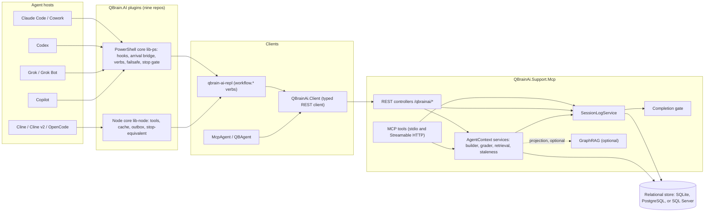

## 3. Cross-cutting conventions

- Workspace scoping: every request is scoped to one workspace through the `X-Workspace-Path` header (REST), the `workspacePath` parameter (MCP tools, REPL), or `MCP_WORKSPACE_PATH` (plugins). Every stored record carries its `WorkspaceId`, and no read ever crosses workspaces.
- Authentication: `X-Api-Key` (or `api_key`) from the workspace marker. Plugins never call REST directly; they use the REPL wrapper.
- Routes: every REST route exists under `/qbrainai/...` with the legacy alias `/mcpserver/...`.
- Errors: a REST error body is `{ "error": "<code>", "message": "<text>", "details": { ... } }`; validation failures are 400, conflicts 409 or 422 as stated per unit, missing resources 404. The REPL error envelope is `type: error` with `code`, `message`, and `retryable`.
- Identifiers: session ids `<Agent>-<yyyyMMddTHHmmssZ>-<suffix>`; server-minted request ids `req-<yyyyMMddTHHmmssZ>-<8 hex>`; agent-context record ids are prefixed GUIDs (section 7.2).
- Root ids: every record carries the root ids of its parents (workspace, MCP session, request, and for agent context the package and response).
- Secrets: no API key, token, password, or credential is ever stored in a turn field, a context package, or a response; the session-log sanitizer and the agent-context secret filter redact on write and on every read surface.
- Process: every slice follows the Byrd Development Process v4 (requirements, tests red, mocks green, implementation green, full gates with zero failures and zero skips) and ends with a Codex gpt-6-sol xhigh hostile validation at accuracy and completeness of at least 98 with every claim PASS. Builds and tests run as Nuke targets natively on Windows or Linux; GitHub Actions and Azure Pipelines are not part of any requirement or process; Octopus (container on LAB-OMARCHY) is used only for releases.

## 4. Phase A: correct, independent turn logging

### 4.1 Components and data

- Server: `SessionLogService.SubmitWithOutcomesAsync` (per-turn outcomes), `ISessionLogService.MintTurnAsync`, `ISessionLogRequestIdMinter`, `ISessionLogTurnUpsertGuard`, `SessionLogTurnEntity.IngressNonce` (unique filtered index per MCP session).
- PowerShell plugin core (`plugins/core/lib-ps`): prompt hook, arrival bridge (claude-code, claude-cowork), `Sync-PluginArrivalLog`, verb binding (`New-ReplInvocationBinding`, `Resolve-ReplTargetTurn`), truthful persist (`Get-ReplTurnWriteOutcome`, `Invoke-ReplPersistTurn`), failsafe and alias journal, Stop gate (`Get-PluginStopGateTurns`, pure `Get-PluginStopGateFindings`).
- Node plugin core (`plugins/core/lib-node`): the same contracts in TypeScript for cline, cline-v2, and opencode (`classifySystemEvent`, `ingressNonce`, `mintRequest`, `bindInvocation`, `resolveTargetTurn`, `mapTurnWriteOutcome`, alias consumers).
- Plugin per-host-session state (one directory per host session key under the plugin cache):
  - `turns/<requestId>.yaml` with its own lock `turns/<requestId>.lock`: one file per turn.
  - `sessions/<hostSessionKey>/turn-state.yaml`: `writeTarget { requestId, deliveredAtUtc, source }`, `openDelivered [requestId]`, `queue [{ kind, requestId, nonce, enqueueOffset, enqueueTimestamp, promptSha256, state, stateOffset, mintedAtUtc }]`, `appliedThroughOffset`, `mcpSessionId`, `ledger [...]`, `unsupportedSince { causeOffset, causeOperation, reason }`; every entry carries the root ids; written by one atomic replace under `turn-open.lock`.
  - `sessions/<hostSessionKey>/ended.yaml` (`reason: session_end`), `sessions/<hostSessionKey>/aliases.yaml` (alias journal), `sessions/<key>/arrival-bridge.pid`.
  - `current-turn.yaml` is a read-only legacy status file and is never used for targeting.

Request lifecycle (plugin queue entry):

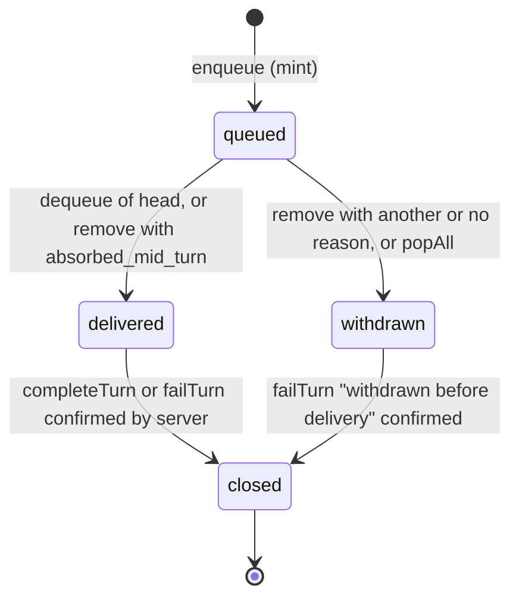

### 4.2 Unit A1: Mint a turn at ingress [FR-MCP-SESSIONTURN-001]

- Trigger: a user message arrives at a host arrival mechanism (prompt hook, arrival bridge, or host-native adapter). Only hooks and adapters call it; there is no MCP tool, and the plugin wrapper refuses a model-originated call with `mint_requires_host_ingress`.
- Surfaces: `POST /qbrainai/sessionlog/{agent}/{sessionId}/mint` (alias `/mcpserver/...`), client `MintTurnAsync`, REPL `workflow.sessionlog.mintTurn`.
- Request `SessionLogMintTurnRequest`: `ingressNonce` (string, required: the host's per-message id or a SHA-256 of host event fields), `queryTitle`, `queryText`, `model`, `planFile` (value or the `None` sentinel), `todoId` (value or `None`).
- Response `SessionLogMintTurnResult`: `requestId` (`req-<yyyyMMddTHHmmssZ>-<8 hex>`), `outcome` (`created` or `merged`), `storedStatus`.
  - 201 `created`: a new in-progress turn.
  - 200 `merged`: the same nonce was already minted in this MCP session; the same `requestId` is returned and a terminal turn is not reopened.
- Errors: 400 `validation_error` (missing nonce, invalid `planFile` or `todoId`), 404 with detail code `session_not_open`, 500 with final detail code `mint_collision_exhausted` after six request-id collisions.

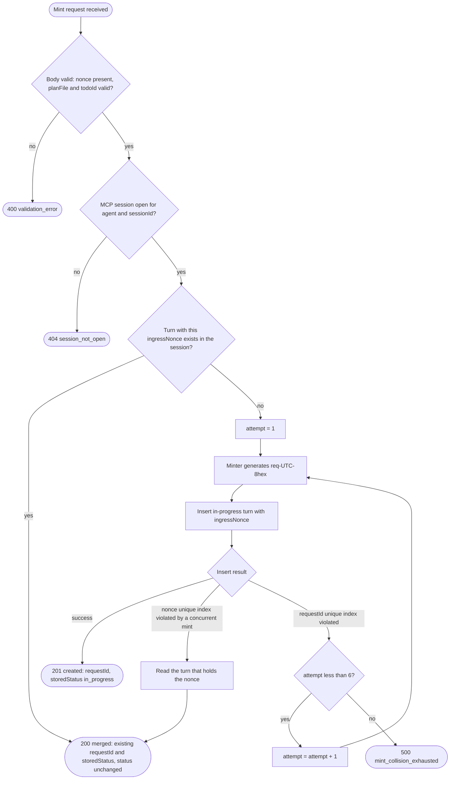

### 4.3 Unit A2: Submit a session log with per-turn outcomes [FR-MCP-SESSIONTURN-004]

- Surfaces: `POST /qbrainai/sessionlog` (existing route), MCP `sessionlog_submit`, client `SubmitAsync`, REPL submit.
- Request: the unified session-log document (`UnifiedSessionLogDto`) with its turns.
- Response 201 `SessionLogSubmitResult`: existing fields plus `turns: [{ requestId, outcome, storedStatus, reason }]`, where `outcome` is `created`, `merged`, or `skipped_terminal`. MCP returns `{ success, id, turns }`. The status code stays 201.
- Rules: an identical resubmit is `merged` with reason `no_change`; duplicate request ids in one submission apply last-wins with one outcome each; a write that would move a terminal turn is `skipped_terminal` and changes nothing; there is no `skipped_duplicate` outcome.

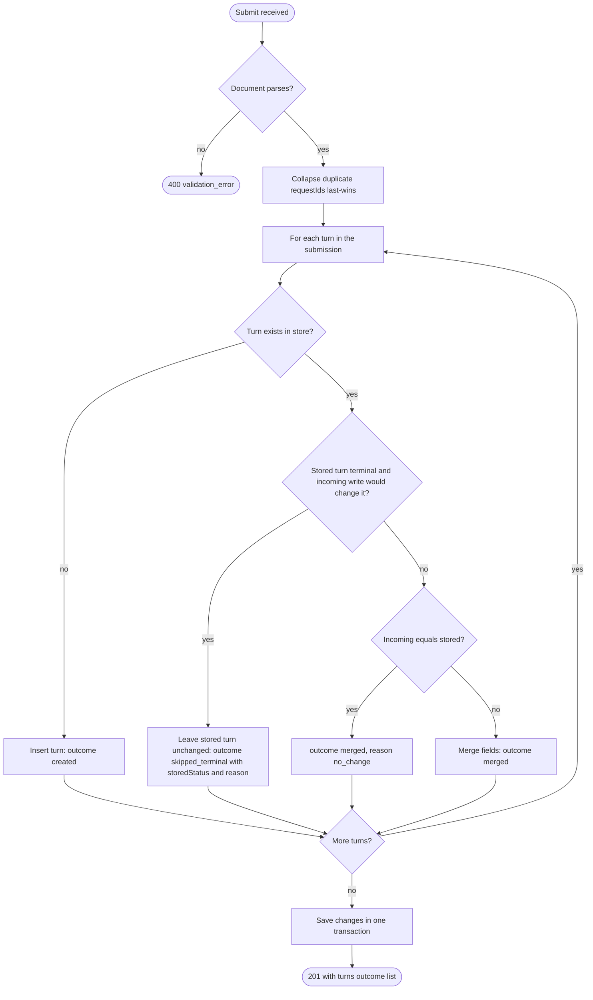

### 4.4 Unit A3: Process a transcript record in the arrival bridge [FR-MCP-SESSIONTURN-001, FR-MCP-SESSIONTURN-002]

- Hosts: claude-code and claude-cowork (the bridge is their only minter; the prompt hook neither mints nor claims there).
- Trigger: a complete transcript record past `appliedThroughOffset`; also applied by `Sync-PluginArrivalLog` from a verb, the Stop hook, or SessionStart up to the transcript length recorded at their own start.
- Input: transcript `queue-operation` records `enqueue`, `dequeue`, `remove` (with reason `absorbed_mid_turn`, another reason, or none), and `popAll`.
- Output: queue and delivery state in `turn-state.yaml` (one atomic replace per record under `turn-open.lock`), mint calls (A1), and `unsupportedSince` on a fail-closed condition.

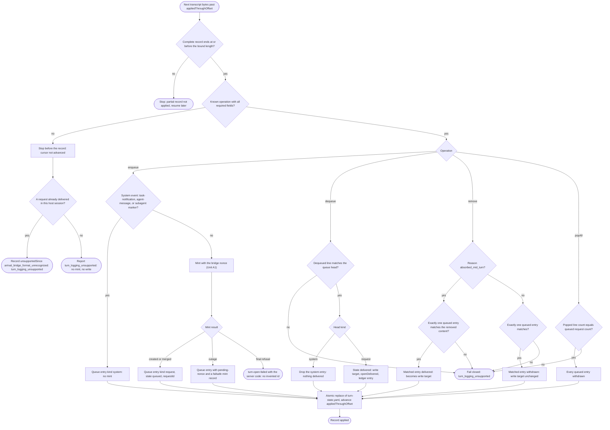

### 4.5 Unit A4: Open a turn from the prompt hook (hosts without a bridge) [FR-MCP-SESSIONTURN-001, FR-MCP-SESSIONTURN-002, FR-MCP-SESSIONTURN-003]

- Hosts: codex, grok, grok-bot, copilot (PowerShell core), and classic cline (Node core) through its native-hook adapter; cline-v2 and opencode through their handlers.
- Input: the host's prompt hook payload. Output: a delivered request and write target, or a hook status.
- Hook statuses: `turn-opened`, `turn-already-open`, `system-event-skipped`, `turn-open-contended`, `turn-open-failed` (reason `nonce_source_missing` or the server code), `turn_logging_unsupported`.

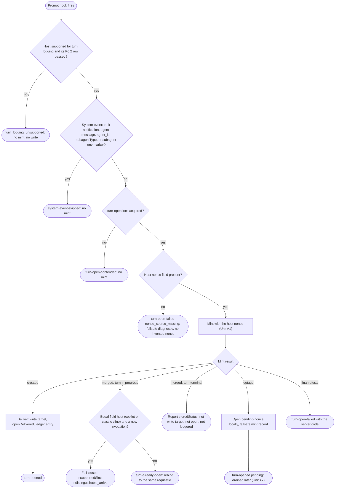

### 4.6 Unit A5: Bind a session-log verb to its turn [FR-MCP-SESSIONTURN-007]

- Verbs: `appendActions`, `appendDialog`, `appendDecisions`, `updateTurn`, `completeTurn`, `failTurn`, `setTurnTitle`, and from Phase B `recordReview`.
- Request: the verb's payload plus an optional explicit `requestId`, or a trusted recovery pair (`sessionId`, `requestId`).
- Response: the resolved target request id and an immutable invocation binding `{ hostSessionKey, keySource, ingressNonce, requestId, boundAtUtc }` stored with the persist and failsafe records; or a refusal code.
- Refusal codes: `request_unknown`, `request_ambiguous`, `turn_immutable`, `host_session_unknown`, `host_session_ambiguous`, `turn_logging_unsupported`; warning `host_session_inferred`.

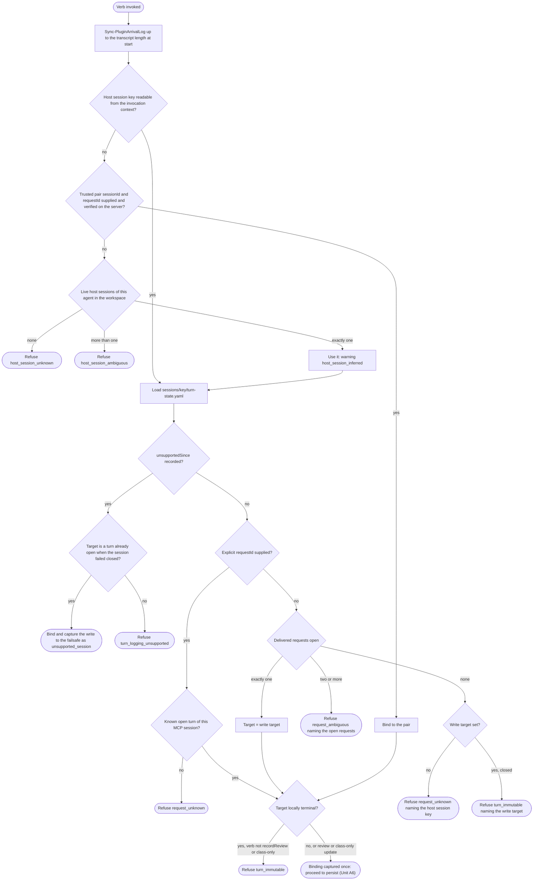

### 4.7 Unit A6: Persist a turn write with a truthful receipt [FR-MCP-SESSIONTURN-004]

- Request: a turn upsert (`POST /qbrainai/sessionlog/{agent}/{sessionId}/turn`, `PATCH` or `PUT .../{requestId}`, `POST .../complete` or `.../fail`) built by `New-McpPluginTurnUpsertRequest` with the binding.
- Response (plugin receipt): `persisted` (bool), `code` (`persisted`, `skipped_terminal`, `queued`, or the server error code), `storedStatus`, `reason`; exit code 0 or 1.

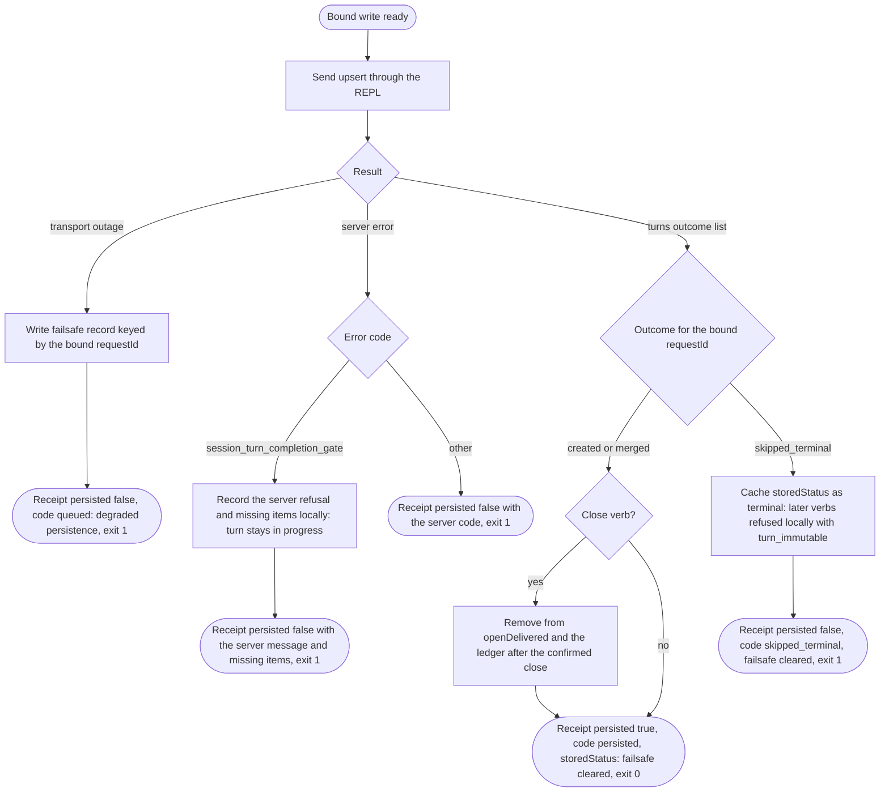

### 4.8 Unit A7: Drain the failsafe [FR-MCP-SESSIONTURN-001, FR-MCP-SESSIONTURN-004, FR-MCP-SESSIONTURN-005]

- Trigger: SessionStart, and the next verb after an outage.
- Input: failsafe records in their original order, each with its captured binding and root-id envelope.
- Output: minted ids journaled as aliases, writes replayed onto their own turns, records removed only after a confirmed result.

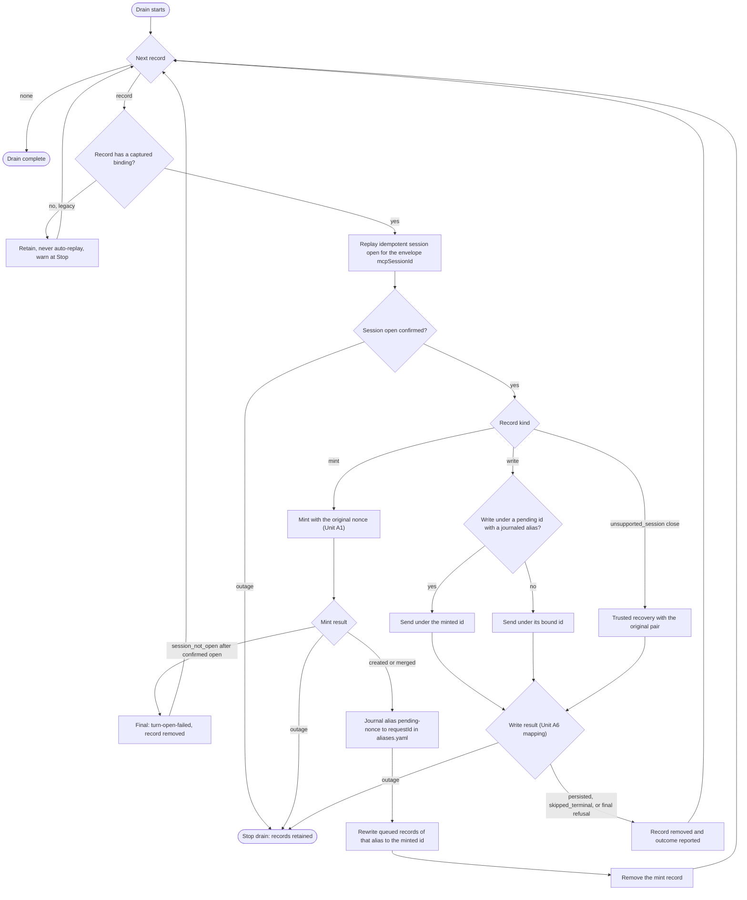

### 4.9 Unit A8: Evaluate the Stop gate [FR-MCP-SESSIONTURN-005]

- Trigger: every host Stop (Claude Code `stop_hook_active`, Grok `stopHookActive`; the Node stop-equivalent on Node hosts).
- Output: `{}` (pass) or a block whose text is `session_turn_stop_gate: <n> turn(s) are not closed correctly:` followed by one line per turn `<id> (<code>): <remedy>` and `The stop gate never closes turns for you.`; warnings in either case. The gate never completes or fails a turn.

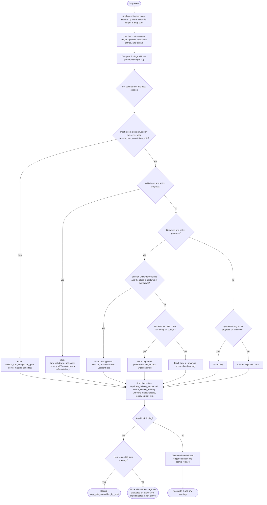

### 4.10 Unit A9: Validate and repair hook registration [FR-MCP-SESSIONTURN-001]

- Surfaces: `validate-claude-mcp-hooks.ps1` (check or repair) and `install-claude-mcp-hooks.ps1` in the Claude plugin repo.
- Output JSON: the validator's existing result plus the new `duplicate` and `repaired` statuses and the fields `duplicateHooks`, `pluginEnabled`, and `pluginKey`. The installer adds no bridge hook for an event the enabled plugin already covers, and removes managed duplicates with a backup.

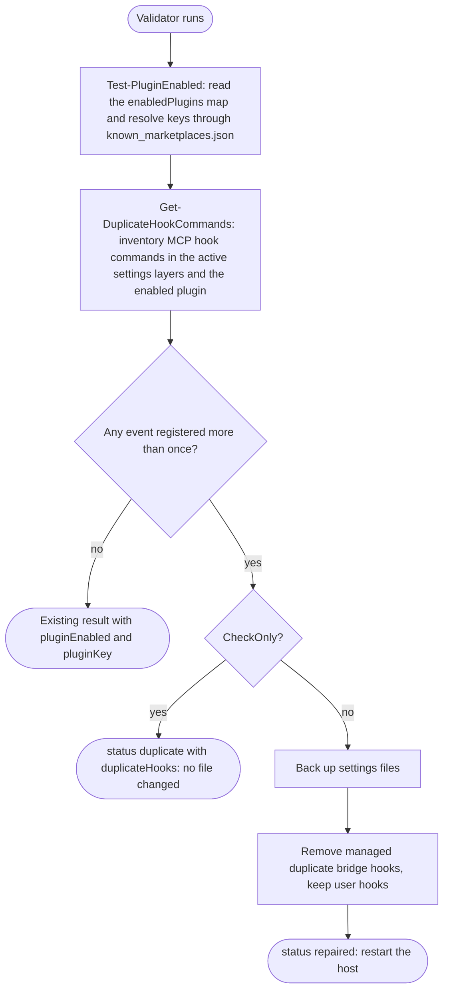

### 4.11 Unit A10: Start a host session [FR-MCP-SESSIONTURN-001, FR-MCP-SESSIONTURN-007]

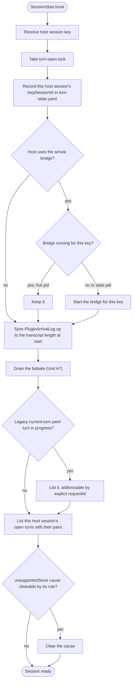

### 4.12 Unit A11: End a host session [FR-MCP-SESSIONTURN-007]

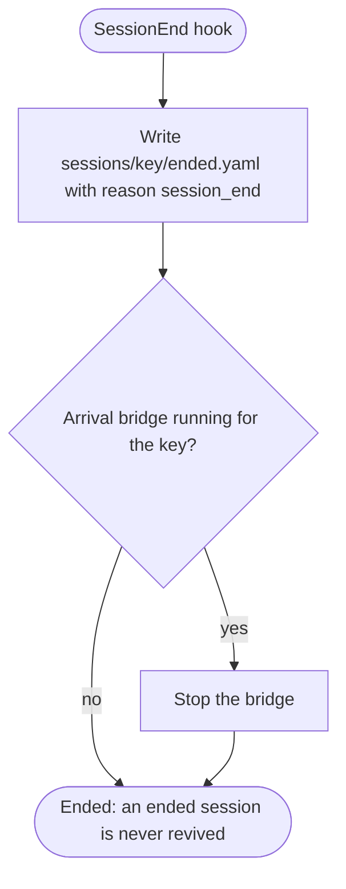

### 4.13 Unit A12: Sync the agent plugins at a fixed version [TR-MCP-NUKE-003 under FR-MCP-BUILD-001]

- Surface: `./build.ps1 SyncAgentPlugins --agent-plugin-parent <dir> --plugin-version <x.y.z>` (Nuke), then `./build.ps1 ValidatePluginPowerShellOnly --agent-plugin-parent <dir>`.
- Output: a receipt listing exactly nine repos with version, `lib/plugin-hook.ps1` SHA-256, and packed-core pins; the gate fails on any other count or a mismatch.

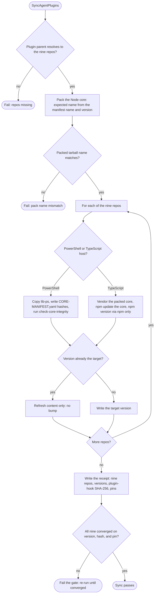

### 4.14 Phase A sequence diagrams

#### SA1: Submit a mint request and process each response

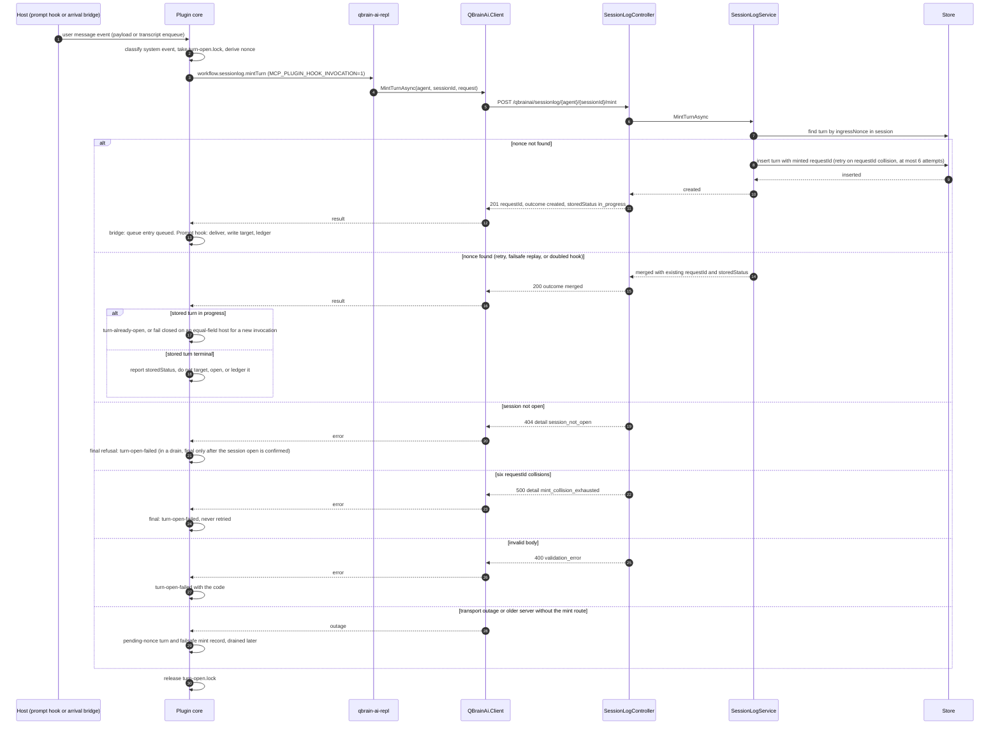

#### SA2: Submit a session log and process the per-turn outcomes

```mermaid
sequenceDiagram
    autonumber
    participant W as Writer (client, REPL, MCP caller)
    participant S as SessionLogController or sessionlog_submit
    participant L as SessionLogService
    participant G as ISessionLogTurnUpsertGuard
    participant D as Store
    W->>S: POST /qbrainai/sessionlog (UnifiedSessionLogDto)
    S->>L: SubmitWithOutcomesAsync
    loop each turn after last-wins collapse
        L->>G: evaluate stored turn and incoming turn
        alt new turn
            G-->>L: created
        else stored terminal and change requested
            G-->>L: skipped_terminal with storedStatus and reason
        else identical
            G-->>L: merged, reason no_change
        else mergeable
            G-->>L: merged
        end
    end
    L->>D: save in one transaction
    alt saved
        S-->>W: 201 with turns [requestId, outcome, storedStatus, reason]
        W->>W: persisted only for created and merged. skipped_terminal is reported, never retried
    else invalid document
        S-->>W: 400 validation_error
        W->>W: report the code, nothing persisted
    end
```

#### SA3: Submit a turn write from a verb and process each response

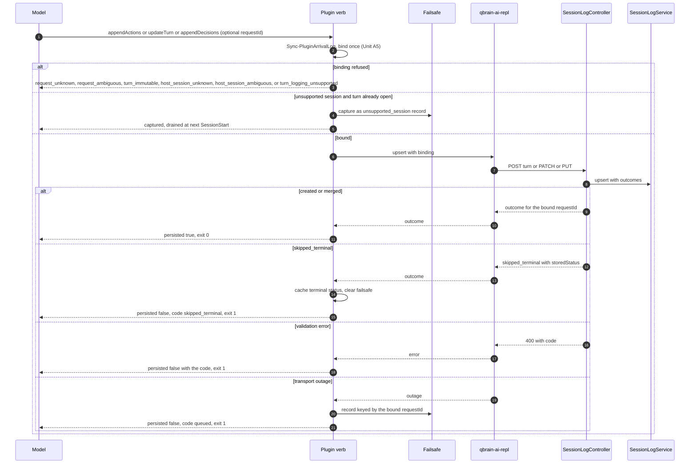

#### SA4: Submit a close (complete or fail) and process each response

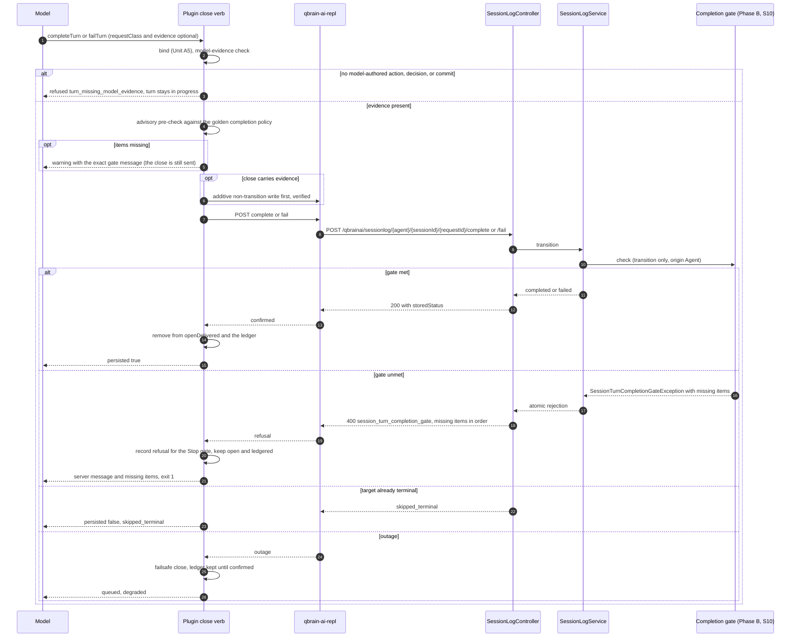

#### SA5: Replay the failsafe and process each response

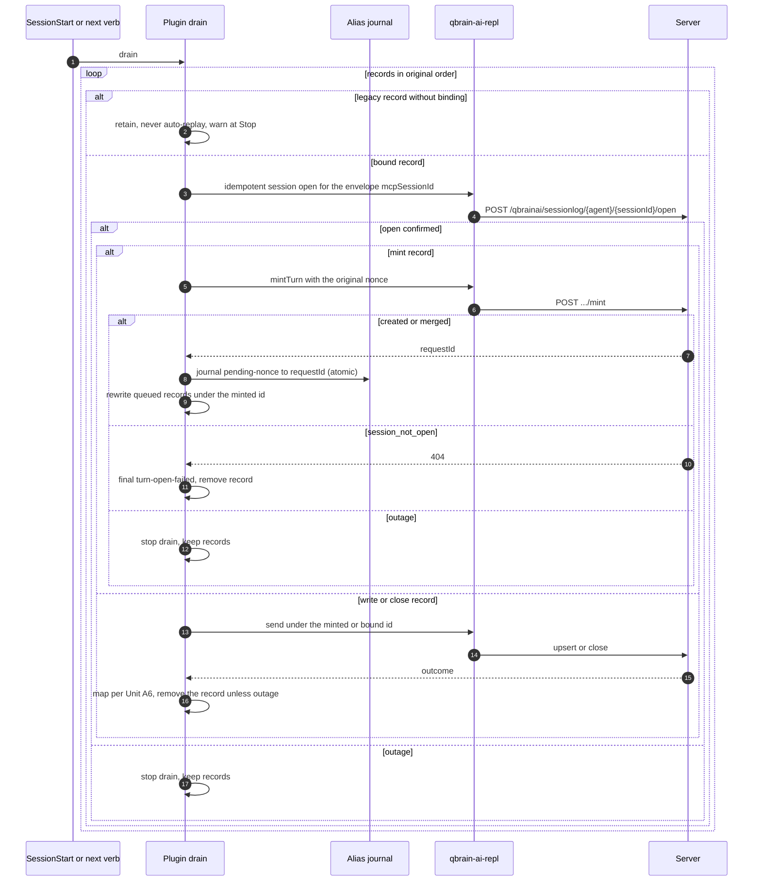

## 5. Phase B: request class, review records, thresholds

### 5.1 Data model

- `SessionLogTurnEntity` gains `RequestClass` (16, indexed) and, per review kind (agent, hostile): `Status` (16, required), `OtherNotes` (text), `Correctness`, `Completeness`, `CorrectnessThreshold`, `CompletenessThreshold` (decimal, precision 29 scale 28), `Reviewer` (256), `ReviewedAt` (UTC), `RequestJsonlPath`, `ResponseJsonlPath` (2048).
- Child `SessionLogTurnReviewReasonEntity { Id, WorkspaceId, SessionLogTurnId, Kind, Ordinal, Value }`.
- Backfill: `RequestClass = Unclassified`, both review statuses `Unstarted`, on every existing row including soft-deleted rows.
- Wire shape on `UnifiedRequestEntryDto`: `requestClass` and the two review objects `agentReview`, `hostileReview` with `status`, `otherNotes`, `correctness`, `completeness`, `correctnessThreshold`, `completenessThreshold`, `reasons`, `reviewer`, `reviewedAt`, `requestJsonlPath`, `responseJsonlPath`; unset fields are emitted as `null`.
- Request classes: `Code`, `Docs`, `Chore` (case-insensitive in, PascalCase out); `Unclassified` exists only for legacy rows.
- Review statuses: `Unnecessary` (server-managed), `Unstarted`, `Running`, `Pass`, `Fail`, `Other`.
- Thresholds: `Mcp:SessionLog:ReviewThresholds:{Agent|Hostile}:{Correctness|Completeness}`, decimal in [0,1], default 0.98, inclusive, per instance through `McpInstanceResolver`.

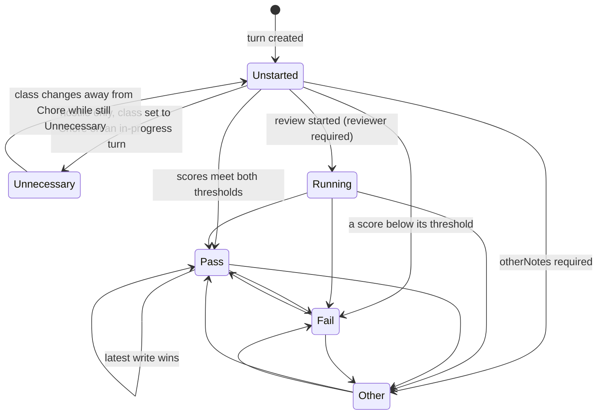

### 5.2 Unit B1: Classify a request [FR-MCP-SESSIONCLASS-001, FR-MCP-SESSIONREVIEW-006]

- Surfaces: `requestClass` on `updateTurn`, `completeTurn`, `failTurn` (REST turn upsert, PATCH, PUT, complete, fail; MCP tools; client; REPL; plugin verbs).
- Request: `requestClass` (string). Response: the turn with canonical `requestClass` and the review records after any lifecycle effect.
- Errors: 400 `request_class_invalid`.

```mermaid
flowchart TD
    S(["Write carries requestClass"]) --> N["Normalize case-insensitively"]
    N --> V{"Code, Docs, or Chore?"}
    V -->|no, including Unclassified from an agent surface| E(["400 request_class_invalid: nothing changed"])
    V -->|yes| SET["Store canonical PascalCase class"]
    SET --> IP{"Turn in progress?"}
    IP -->|no| DONE(["Class stored: no review lifecycle change"])
    IP -->|yes| CH{"New class Chore?"}
    CH -->|yes| HU{"Hostile status Unstarted?"}
    HU -->|yes| FL["Hostile becomes Unnecessary"]
    HU -->|no| DONE
    CH -->|no| HN{"Hostile status Unnecessary?"}
    HN -->|yes| BK["Hostile returns to Unstarted"]
    HN -->|no| DONE
    FL --> DONE
    BK --> DONE
```

### 5.3 Unit B2: Record a review [FR-MCP-SESSIONREVIEW-001, -002, -003, -004, -005, -006, -007, FR-SUPPORT-016]

- Surfaces: `PUT /qbrainai/sessionlog/{agent}/{sessionId}/{requestId}/sections/{section}` with section `agentReview` or `hostileReview` (aliases `agent-review`, `agent_review`, `hostile-review`, `hostile_review`, case-insensitive); MCP `sessionlog_record_review(agent, sessionId, requestId, kind, reviewJson, workspacePath)`; client `RecordTurnReviewAsync`; REPL and plugin `workflow.sessionlog.recordReview` (plugin also accepts `hvReceiptPath`, mapped locally; hostile kind accepts `hvVerdict`).
- Request `SessionLogTurnReviewInput`: `status` (optional), `otherNotes`, `correctness`, `completeness` (JSON number or numeric string, lexeme `^[0-9]+(\.[0-9]+)?$`, at most 28 fractional digits, value in [0,1]), `reasons`, `reviewer`, `reviewedAt` (UTC with offset), `requestJsonlPath`, `responseJsonlPath`, `hvVerdict` (hostile only). Thresholds on input are ignored.
- Response: the turn's review record with server-derived status and stamped thresholds. Works on every turn status, including completed and failed turns.
- Errors (400 `validation_error` with the code unless noted): `review_invalid_status`, `review_unnecessary_not_client_writable`, `review_other_notes_not_allowed`, `review_other_notes_required`, `review_field_forbidden_for_status`, `review_field_required_for_status`, `review_score_out_of_range`, `review_receipt_paths_required`, `review_score_format`, `review_score_precision`, `review_field_too_long`, `review_timestamp_invalid`, `review_reason_blank`, 422 `review_status_conflict` (includes the thresholds in force and the derived status).

```mermaid
flowchart TD
    S(["Review write received"]) --> SEC{"Section is agentReview or hostileReview or an alias?"}
    SEC -->|no| E0(["400 validation_error unknown section"])
    SEC -->|yes| LEX{"Score lexemes match the pattern, at most 28 fraction digits, value in 0..1?"}
    LEX -->|format| E1(["400 review_score_format"])
    LEX -->|precision| E2(["400 review_score_precision"])
    LEX -->|range| E3(["400 review_score_out_of_range"])
    LEX -->|ok| HV{"Hostile kind with hvVerdict?"}
    HV -->|yes| MAP["Map the verdict (Unit B5) to status, reasons, and otherNotes"]
    HV -->|no| ST
    MAP --> ST{"Status supplied?"}
    ST -->|Unnecessary| E4(["400 review_unnecessary_not_client_writable"])
    ST -->|not a known status| E5(["400 review_invalid_status"])
    ST -->|omitted| DER{"Both scores present?"}
    DER -->|no| E6(["400 review_field_required_for_status"])
    DER -->|yes| DRV["Derive Pass or Fail against the thresholds in force"]
    ST -->|Pass or Fail| CMP["Derive from scores against the thresholds in force"]
    CMP --> CF{"Supplied status equals derived?"}
    CF -->|no| E7(["422 review_status_conflict with thresholds and derived status"])
    CF -->|yes| FLD
    ST -->|Unstarted, Running, or Other| FLD
    DRV --> FLD{"Per-status fields valid?"}
    FLD -->|forbidden field present| E8(["400 review_field_forbidden_for_status"])
    FLD -->|required field missing| E9(["400 review_field_required_for_status"])
    FLD -->|hostile Pass or Fail without both jsonl paths| E10(["400 review_receipt_paths_required"])
    FLD -->|otherNotes text and status not Other| E11(["400 review_other_notes_not_allowed"])
    FLD -->|Other with blank otherNotes| E12(["400 review_other_notes_required"])
    FLD -->|blank reason| E13(["400 review_reason_blank"])
    FLD -->|timestamp without offset| E14(["400 review_timestamp_invalid"])
    FLD -->|field over its length| E15(["400 review_field_too_long"])
    FLD -->|valid| SAN["Sanitize text fields"]
    SAN --> STAMP["Stamp the thresholds in force"]
    STAMP --> SAVE["Replace the record: latest write wins, any turn status"]
    SAVE --> OK(["200 review record with derived status and stamped thresholds"])
```

### 5.4 Unit B3: Reset a review section [FR-SUPPORT-016, FR-MCP-SESSIONREVIEW-001]

- Surface: `DELETE /qbrainai/sessionlog/{agent}/{sessionId}/{requestId}/sections/{section}`; client `ClearTurnReviewAsync`. Item delete `DELETE .../sections/{section}/items/{itemKey}` on a review section is rejected.
- Response: the record reset to the creation default for the turn's current class.
- Errors: 400 `review_section_reset_on_terminal_turn` (record unchanged), 400 on item delete.

```mermaid
flowchart TD
    S(["DELETE review section"]) --> IT{"Item key in the route?"}
    IT -->|yes| E1(["400: items cannot be deleted from a review section"])
    IT -->|no| TS{"Turn completed or failed?"}
    TS -->|yes| E2(["400 review_section_reset_on_terminal_turn: nothing changed"])
    TS -->|no| DEF{"Hostile kind and class Chore?"}
    DEF -->|yes| UN["Reset to Unnecessary"]
    DEF -->|no| US["Reset to Unstarted"]
    UN --> OK(["200 reset record"])
    US --> OK
```

### 5.5 Unit B4: Complete or fail under the completion gate [FR-MCP-SESSIONCLASS-002, -003, -004]

- Surfaces: every transition path to `completed` or `failed` (upsert, PATCH, PUT, lifecycle complete and fail, submit).
- Policy: `completed` needs `requestClass` and `agentReview.status` in Pass, Fail, or Other; for Code and Docs also `hostileReview.status` in Pass, Fail, or Other; for Chore the hostile review is not checked. `failed` needs `requestClass` only. `canceled` is not gated. Only the transition is gated; terminal enrichment is not re-gated.
- Exempt origins: ServerInternal (`AuditedAgentCliClient`, `WorkspacePolicyService`, `QuadBrainOpenAiChatService`), Replication (federation apply), Import (`SessionLogIngestor`, `TranscriptSessionLogPersister`). Gated: Agent (all external surfaces), `QuadBrainInternalToolExecutor`, REPL importRecovery.
- Error: 400 `session_turn_completion_gate`, message token-prefixed and listing the missing items in the order requestClass, agentReview, hostileReview; the whole write is rejected atomically.

```mermaid
flowchart TD
    S(["Write that transitions a turn"]) --> TR{"Transition to completed or failed?"}
    TR -->|no| PASS(["Not gated"])
    TR -->|yes| OR{"Write origin exempt: ServerInternal, Replication, or Import?"}
    OR -->|yes| PASS
    OR -->|no| CLS{"requestClass present and not Unclassified?"}
    CLS -->|no| MISS1["missing: requestClass"]
    CLS -->|yes| TGT{"Target status"}
    TGT -->|failed| OK
    TGT -->|completed| AR{"agentReview Pass, Fail, or Other?"}
    MISS1 --> TGT2{"Target status"}
    TGT2 -->|failed| REJ
    TGT2 -->|completed| AR
    AR -->|no| MISS2["missing: agentReview"]
    AR -->|yes| HC
    MISS2 --> HC{"Class Code or Docs?"}
    HC -->|no, Chore| DEC
    HC -->|yes| HR{"hostileReview Pass, Fail, or Other?"}
    HR -->|no| MISS3["missing: hostileReview"]
    HR -->|yes| DEC
    MISS3 --> DEC{"Any item missing?"}
    DEC -->|no| OK(["Transition applied"])
    DEC -->|yes| REJ["ChangeTracker cleared: nothing saved"]
    REJ --> ERR(["400 session_turn_completion_gate with missing items in order"])
```

### 5.6 Unit B5: Map a hostile-validation receipt to a review [FR-MCP-SESSIONREVIEW-005]

- Plugin side (`ConvertFrom-McpHvReceipt`, Node mapper): input the reviewer's JSON receipt and the response jsonl; output a `recordReview` payload with `correctness = accuracy/100`, `completeness = completeness/100` as exact decimals, `reasons`, `reviewer`, `reviewedAt`, both jsonl paths, and `hvVerdict`.
- Server side: maps `hvVerdict` with the thresholds in force at that write.

```mermaid
flowchart TD
    S(["HV receipt supplied"]) --> VAL{"Receipt valid: scores, verdict, paths, timestamps?"}
    VAL -->|no| E(["Refused before any write with the exact wire-contract code per field"])
    VAL -->|yes| CV["correctness = accuracy/100, completeness = completeness/100 as exact decimals"]
    CV --> AG{"Verdict AGREE?"}
    AG -->|yes| FU{"Any claim FAIL or UNKNOWN?"}
    FU -->|yes| DIS["Send hvVerdict DISAGREE"]
    FU -->|no| AGR["Send hvVerdict AGREE"]
    AG -->|no| DIS
    AGR --> SRV1["Server derives Pass or Fail from the scores"]
    SRV1 --> R1(["Stored Pass or Fail"])
    DIS --> SRV2{"Scores derive Pass?"}
    SRV2 -->|no| R2(["Stored Fail"])
    SRV2 -->|yes| OTH{"Receipt lists FAIL or UNKNOWN claims?"}
    OTH -->|yes| R3(["Stored Other: otherNotes names those claims"])
    OTH -->|no| R4(["Stored Other: otherNotes gives the verdict-level reason"])
```

### 5.7 Unit B6: Clear a session [TR-MCP-CLEARSESSION-001 under FR-MCP-CLEARSESSION-001]

- Surfaces: the PowerShell clear-session coordinator (S8) and the Node coordinator (S9), driven by the clear-session skill in all nine plugins.
- Output: per open request turn of the host session, one of: completed, failed with a reason, or left in progress with its exact missing items. No review is ever fabricated.

```mermaid
flowchart TD
    S(["Clear-session run"]) --> EN["Enumerate open request turns of the host session by original sessionId and requestId pair"]
    EN --> NX{"Next turn"}
    NX -->|none| E(["Report: closed turns and turns left in progress with missing items"])
    NX -->|turn| WD{"Withdrawn?"}
    WD -->|yes| RSN1["Reason: withdrawn before delivery"]
    WD -->|no| BL{"blockers section holds a nonblank model-authored entry?"}
    BL -->|yes| RSN2["Reason: first blocker entry"]
    BL -->|no| RDY{"Meets the completion policy and has model evidence?"}
    RDY -->|yes| CT["completeTurn by original pair"]
    CT --> NX
    RDY -->|no| STAY["Leave in progress, report exact missing items"]
    STAY --> NX
    RSN1 --> PRE{"Model evidence present and class set (not missing or Unclassified)?"}
    RSN2 --> PRE
    PRE -->|yes| FT["failTurn by original pair with the reason"]
    FT --> NX
    PRE -->|no| REP["Report queryText, reason, and missing prerequisites in Stop remedy order"]
    REP --> MW["Model writes designDecision then class by the original pair"]
    MW --> RR["Coordinator rerun reads them back"]
    RR --> FT
```

### 5.8 Unit B7: Read a turn with its reviews [FR-MCP-SESSIONREVIEW-001, FR-MCP-SESSIONREVIEW-004]

- Surfaces: REST `GET /qbrainai/sessionlog/{agent}/{sessionId}` and query, MCP session-log read tools, client `QueryAsync`, REPL, plugins.
- Response: both review records with exact decimal scores (a 28-digit score reads back byte-equal), sanitized text, and `null` for unset fields.

```mermaid
flowchart TD
    S(["Read request"]) --> W{"Workspace and session found?"}
    W -->|no| E(["404"])
    W -->|yes| LD["Load turns with review columns and reason children"]
    LD --> SAN["Sanitize review text fields on the read surface"]
    SAN --> SER["Serialize scores as their exact decimal lexeme, unset fields as null"]
    SER --> OK(["200 turns with requestClass, agentReview, hostileReview"])
```

### 5.9 Phase B sequence diagrams

#### SB1: Submit a review write and process each response

```mermaid
sequenceDiagram
    autonumber
    participant A as Model or coordinator
    participant P as Plugin recordReview
    participant R as qbrain-ai-repl
    participant S as SessionLogController or sessionlog_record_review
    participant L as SessionLogService
    A->>P: recordReview (kind, review input or hvReceiptPath, optional requestId or original pair)
    P->>P: bind (D2, D9, or trusted pair). No failsafe for reviews
    alt unsupported session
        P-->>A: refused, recorded after the drain through the original pair
    else hvReceiptPath given and receipt invalid
        P-->>A: refused before any write with the exact code
    else bound
        P->>R: recordReview with lossless score lexemes
        R->>S: PUT .../sections/agentReview or hostileReview
        S->>L: validate, derive, stamp, replace
        alt valid
            S-->>R: 200 record (derived status, stamped thresholds)
            R-->>P: record
            P-->>A: recorded, exact scores echoed
        else 422 review_status_conflict
            S-->>R: conflict with thresholds and derived status
            P-->>A: conflict surfaced. Resend without status or with the derived one
        else 400 field code
            S-->>R: validation code
            P-->>A: code surfaced, nothing changed
        else outage
            R-->>P: outage
            P-->>A: failed, not queued (an older review must never overwrite a newer one)
        end
    end
```

#### SB2: Submit a review reset and process each response

```mermaid
sequenceDiagram
    autonumber
    participant C as Client
    participant S as SessionLogController
    participant L as SessionLogService
    C->>S: DELETE .../sections/{section} (ClearTurnReviewAsync)
    S->>L: reset section
    alt in-progress turn
        L-->>S: reset to the default for the class
        S-->>C: 200 reset record
    else completed or failed turn
        S-->>C: 400 review_section_reset_on_terminal_turn
        C->>C: report, record unchanged
    else item key in route
        S-->>C: 400 item delete rejected
    end
```

#### SB3: Submit a classification and process each response

```mermaid
sequenceDiagram
    autonumber
    participant M as Model
    participant P as Plugin updateTurn
    participant S as Server
    M->>P: updateTurn requestClass Chore
    P->>S: PATCH .../{requestId} with requestClass
    alt valid class
        S->>S: normalize, store, apply the Chore flip on an in-progress turn
        S-->>P: turn with canonical class and review statuses
        P-->>M: persisted, hostile status shown
    else invalid class
        S-->>P: 400 request_class_invalid
        P-->>M: refused, nothing changed
    end
```

#### SB4: Submit a read and process the response

```mermaid
sequenceDiagram
    autonumber
    participant C as Client, REPL, MCP caller, or plugin
    participant S as Server
    C->>S: GET /qbrainai/sessionlog/{agent}/{sessionId}
    alt found
        S-->>C: 200 turns with requestClass and both review records
        C->>C: read scores as exact decimals (raw-token parser on Node, lossless scalars in PowerShell)
    else not found
        S-->>C: 404
    end
```

## 6. Phase C: stateless agent context

### 6.1 Scope and principles

- Each agent invocation can run stateless: it receives a bounded, reproducible context package instead of carrying conversation history forward.
- A package contains the current request, the canonical operator profile and standing rules, the applicable requirements, related session-log evidence, trusted prior responses, and relevant code at the current commit, each with its provenance.
- The relational store is authoritative for packages, responses, grades, and relationships. Response artifacts are projected into GraphRAG for semantic retrieval, with a deterministic relational fallback that gives the same result whenever GraphRAG is disabled, uninitialized, or unavailable.
- A response becomes trusted only when a deterministic evidence grade and an independent model grade both reach correctness and completeness of at least 98 percent with zero FAIL and zero UNKNOWN findings. Rejected, stale, and superseded responses are kept for audit and never retrieved as trusted context.
- Mandatory context is never truncated: when it exceeds the token budget, package construction fails explicitly.
- The mode is opt-in (`Mcp:AgentContext:Mode`); the current stateful behavior stays the default during the pilot.
- Requirement ids (reserved for P0, created there with acceptance criteria, mappings, and use cases): FR-MCP-AGENTCONTEXT-001 package construction and provenance; -002 token budget and overflow; -003 response submission; -004 grading and trust; -005 rejection, staleness, and supersession; -006 typed relationships; -007 GraphRAG projection and fallback; -008 REST, MCP, client, REPL, and plugin surfaces; -009 opt-in mode and pilot. The matching TR-MCP-AGENTCONTEXT-* and TEST-MCP-AGENTCONTEXT-* records are created in P0.

### 6.2 Configuration: `AgentContextOptions`

Section `Mcp:AgentContext` (declared under `QBrainAi: AgentContext:` in `appsettings.yaml`, projected onto `Mcp:` by `CanonicalSectionProjectionProvider`), class `QBrainAi.Support.Mcp.Options.AgentContextOptions` with `SectionName = "Mcp:AgentContext"`, a `Validate()` method, and `ValidateOnStart()`.

- `Mode` (enum `AgentContextMode`: `Off`, `Pilot`, `Stateless`; default `Off`). `Off`: every agent-context endpoint except status returns 409 `agent_context_disabled`. `Pilot`: packages are built and responses graded, but plugins keep the stateful conversation (no injection). `Stateless`: plugins inject the package and carry no history.
- `TokenBudget` (int, default 32000, must be 1024..1000000).
- `BytesPerToken` (int, default 4, must be 1..16): the deterministic token estimate is `ceil(utf8ByteCount / BytesPerToken)` per item.
- `Trust:Correctness`, `Trust:Completeness` (decimal in [0,1], default 0.98, inclusive).
- `MaxCandidatesPerKind` (int, default 50, 1..1000) and `MaxPriorResponses` (int, default 10, 0..100).
- `ProfileSources` (list of file globs; default the operator profile files configured for the workspace) and `RuleSources` (list; default `CLAUDE.md`, `AGENTS.md`, and `AGENTS-README-FIRST.yaml` with secret values redacted).
- `ModelGrader:AgentName` (default `Codex`), `ModelGrader:RequiredModel` (default `gpt-6-sol`), `ModelGrader:RequiredEffort` (default `xhigh`): a model grade from any other grader is refused.
- `GraphRag:ProjectionEnabled` (bool, default true) and `GraphRag:UseForRetrieval` (bool, default true).
- Validation failures (startup): `TokenBudget`, `BytesPerToken`, thresholds outside their ranges, an empty `RuleSources`, or an empty grader identity.

### 6.3 Entities (namespace `QBrainAi.Support.Mcp.Storage.Entities`)

Common rules: string keys `[StringLength(128)]` with the prefixes below; child rows use `long` identity keys; every entity has `[Required][StringLength(1024)] WorkspaceId` with the named `Workspace` query filter and `StampWorkspaceId` on add; timestamps are `DateTimeOffset` named `*Utc`; decimals are `HasPrecision(29, 28)`; list-valued data is stored in 4NF child tables; idempotency comes from unique indexes (the store has no concurrency tokens). Migrations `<yyyyMMddHHmmss>_AddAgentContext` are generated for SQLite, PostgreSQL, and SQL Server with the existing `dotnet ef migrations add` procedure.

`AgentContextPackageEntity` (table `AgentContextPackages`, key `PackageId` = `acp-{Guid:N}`)

- `WorkspaceId`, `SessionId` (128, the MCP session), `Agent` (64), `RequestId` (128, the turn), all required.
- `IdempotencyKey` (128, required): unique with `WorkspaceId`.
- `Status` (16): `Built` or `Overflow`.
- `CommitSha` (64, required), `WorkingTreeDirty` (bool).
- `BuilderVersion` (32), `TokenBudget` (int), `BytesPerToken` (int), `MandatoryTokenCount` (int), `TotalTokenCount` (int).
- `InputsSha256` (64): hash of the canonical build inputs (request text, options in force, commit, and every candidate source hash).
- `ContentSha256` (64): hash of the canonical rendered package; null for `Overflow`.
- `QueryText` (text, sanitized), `RenderedContent` (text; null for `Overflow`).
- `CreatedUtc`.
- Indexes: (`WorkspaceId`, `RequestId`), (`WorkspaceId`, `SessionId`, `CreatedUtc`), unique (`WorkspaceId`, `IdempotencyKey`).
- Children: `Items`, `Omissions`, `Findings` (`DeleteBehavior.Restrict`).

`AgentContextPackageItemEntity` (table `AgentContextPackageItems`, `long Id`)

- `WorkspaceId`, `PackageId` (FK), `Ordinal` (int, unique with `PackageId`).
- `Kind` (32): `Request`, `Profile`, `Rule`, `Requirement`, `SessionLogTurn`, `Todo`, `Code`, `Receipt`, `PriorResponse`.
- `SourceRef` (512): the requirement id, file path, `requestId`, TODO id, receipt path, or `responseId`.
- `SourceSha256` (64), `SourceCommitSha` (64, for `Code`).
- `Mandatory` (bool), `Score` (decimal 0..1, null for mandatory items), `Rationale` (2048), `TokenCount` (int).
- `RetrievalPath` (16): `Relational` or `GraphRag`.
- `Content` (text, sanitized; secret values redacted in mandatory items).

`AgentContextOmissionEntity` (table `AgentContextOmissions`, `long Id`)

- `WorkspaceId`, `PackageId`, `Ordinal`, `Kind`, `SourceRef`, `SourceSha256`, `Score`.
- `Reason` (32): `budget`, `untrusted`, `stale`, `rejected`, `superseded`, `secret`, `duplicate`, `below_candidate_limit`.
- `Detail` (2048).

`AgentContextFindingEntity` (table `AgentContextFindings`, `long Id`)

- `WorkspaceId`, `PackageId`, `Ordinal`.
- `Kind` (16): `Contradiction` (two included items are linked by `contradicts`) or `Blocker` (an open item `blocks` the request's TODO or turn).
- `SourceRef` (512), `OtherSourceRef` (512, contradictions only), `RelationshipId` (128), `Summary` (2048).

`AgentResponseEntity` (table `AgentResponses`, key `ResponseId` = `acr-{Guid:N}`)

- `WorkspaceId`, `PackageId` (FK, required), `SessionId`, `RequestId`, `Agent`, all required (root ids).
- `Model` (128), `Effort` (32), `InvocationMode` (16): `Stateful` or `Stateless`.
- `IdempotencyKey` (128): unique with `WorkspaceId`.
- `Status` (16): `Submitted`, `Grading`, `Trusted`, `Rejected`, `Stale`, `Superseded`.
- `StatusReason` (2048), `SupersededByResponseId` (128).
- `ContentFormat` (16): `markdown`, `text`, or `json`. `Content` (text, sanitized), `ContentSha256` (64).
- `CommitSha` (64): the workspace commit at submission.
- `SubmittedUtc`, `StatusChangedUtc`, `TrustedUtc`.
- Indexes: (`WorkspaceId`, `Status`), (`WorkspaceId`, `RequestId`), (`WorkspaceId`, `PackageId`), unique (`WorkspaceId`, `IdempotencyKey`).
- Children: `Claims`, `Evidence`.

`AgentResponseClaimEntity` (table `AgentResponseClaims`, `long Id`): `WorkspaceId`, `ResponseId`, `Ordinal`, `ClaimId` (64, unique per response), `Text` (4096).

`AgentResponseEvidenceEntity` (table `AgentResponseEvidence`, `long Id`): `WorkspaceId`, `ResponseId`, `Ordinal`, `ClaimId` (64), `Kind` (16: `File`, `Requirement`, `Receipt`, `Commit`, `Command`, `SessionLogTurn`), `Ref` (2048), `Sha256` (64), `CommitSha` (64).

`AgentResponseGradeEntity` (table `AgentResponseGrades`, key `GradeId` = `acg-{Guid:N}`)

- `WorkspaceId`, `ResponseId` (FK), `PackageId`, `RequestId` (root ids).
- `Kind` (16): `Deterministic` or `Model`.
- `Grader` (256): `agent-context-deterministic/<BuilderVersion>`, or `<AgentName>/<model>/<effort>`.
- `Correctness`, `Completeness`, `CorrectnessThreshold`, `CompletenessThreshold` (decimal).
- `PassCount`, `FailCount`, `UnknownCount` (int).
- `Verdict` (16): `Pass` or `Fail`, derived: `Pass` only when both scores meet their thresholds and `FailCount` and `UnknownCount` are zero.
- `RequestJsonlPath`, `ResponseJsonlPath` (2048, required for `Model`).
- `GradedUtc`.
- Child `Findings`.

`AgentResponseGradeFindingEntity` (table `AgentResponseGradeFindings`, `long Id`): `WorkspaceId`, `GradeId`, `Ordinal`, `ClaimId` (64), `Check` (256), `Outcome` (16: `PASS`, `FAIL`, `UNKNOWN`), `Evidence` (text, sanitized).

`AgentContextRelationshipEntity` (table `AgentContextRelationships`, key `RelationshipId` = `acl-{Guid:N}`)

- `WorkspaceId`, `FromKind` (32), `FromRef` (512), `Type` (32), `ToKind` (32), `ToRef` (512).
- Node kinds: `Package`, `Response`, `Requirement`, `SessionLogTurn`, `Todo`, `CodeFile`, `Receipt`, `Profile`, `Rule`.
- Types: `implements`, `verifies`, `depends_on`, `supports`, `contradicts`, `supersedes`, `blocks`, `derived_from`, `relevant_to`.
- `ToSha256` (64): the target's content hash when linked (used for staleness of `depends_on` and `derived_from`).
- `EvidenceRef` (2048), `CreatedBy` (128), `CreatedUtc`.
- Unique (`WorkspaceId`, `FromKind`, `FromRef`, `Type`, `ToKind`, `ToRef`); indexes on (`WorkspaceId`, `FromKind`, `FromRef`) and (`WorkspaceId`, `ToKind`, `ToRef`).

`AgentContextProjectionEntity` (table `AgentContextProjections`, key `ResponseId`)

- `WorkspaceId`.
- `State` (16): `Pending`, `Projected`, `Removed`, `Skipped`, `Failed`.
- `GraphRagDocumentId` (128), `ProjectedContentSha256` (64), `LastError` (2048), `UpdatedUtc`.

```mermaid
erDiagram
    AgentContextPackages ||--o{ AgentContextPackageItems : contains
    AgentContextPackages ||--o{ AgentContextOmissions : records
    AgentContextPackages ||--o{ AgentContextFindings : records
    AgentContextPackages ||--o{ AgentResponses : answered_by
    AgentResponses ||--o{ AgentResponseClaims : asserts
    AgentResponses ||--o{ AgentResponseEvidence : cites
    AgentResponses ||--o{ AgentResponseGrades : graded_by
    AgentResponseGrades ||--o{ AgentResponseGradeFindings : lists
    AgentResponses ||--o| AgentContextProjections : projected_as
    AgentContextRelationships }o--o{ AgentResponses : links
    SessionLogTurns ||--o{ AgentContextPackages : built_for
```

Response lifecycle:

```mermaid
stateDiagram-v2
    [*] --> Submitted
    Submitted --> Grading: first grade recorded
    Grading --> Trusted: latest deterministic and latest model grade both Pass
    Grading --> Grading: a grade Fail or a grade missing
    Trusted --> Grading: a newer grade Fails
    Submitted --> Rejected
    Grading --> Rejected
    Trusted --> Rejected
    Trusted --> Stale: a dependency changed
    Grading --> Stale: a dependency changed
    Submitted --> Stale: a dependency changed
    Stale --> Superseded
    Stale --> Rejected
    Trusted --> Superseded
    Grading --> Superseded
    Submitted --> Superseded
    Rejected --> [*]
    Superseded --> [*]
```

### 6.4 Data transfer objects

Server DTOs live in `src/QBrainAi.Services/Models/AgentContextModels.cs` (namespace `QBrainAi.Support.Mcp.Models`); client mirrors in `src/QBrainAi.Client/Models/AgentContextModels.cs` with `[JsonPropertyName]` on every property and registration in `McpClientJsonContext` (type, `List<>`, `IReadOnlyList<>`); a parity test keeps them identical. JSON is camelCase; unset optional fields are `null`; decimals travel as exact lexemes (the Phase B score rule).

Shared types

- `AgentContextItemDto { ordinal, kind, sourceRef, sourceSha256, sourceCommitSha, mandatory, score, rationale, tokenCount, retrievalPath, content }`.
- `AgentContextOmissionDto { ordinal, kind, sourceRef, sourceSha256, score, reason, detail }`.
- `AgentContextFindingDto { ordinal, kind, sourceRef, otherSourceRef, relationshipId, summary }`.
- `AgentResponseClaimDto { claimId, text }`; `AgentResponseEvidenceDto { claimId, kind, ref, sha256, commitSha }`.
- `AgentResponseGradeFindingDto { claimId, check, outcome, evidence }`.
- `AgentResponseGradeDto { gradeId, responseId, kind, grader, correctness, completeness, correctnessThreshold, completenessThreshold, passCount, failCount, unknownCount, verdict, requestJsonlPath, responseJsonlPath, gradedUtc, findings }`.
- `AgentContextRelationshipDto { relationshipId, fromKind, fromRef, type, toKind, toRef, toSha256, evidenceRef, createdBy, createdUtc }`.
- `AgentContextCandidateDto { kind, sourceRef, sourceSha256, score, rationale, retrievalPath }`.
- Query results follow `{ totalCount, limit, offset, items }`.

Requests and results (one pair per unit of work, section 6.5)

- C1 `AgentContextStatusResult { mode, tokenBudget, bytesPerToken, trustCorrectness, trustCompleteness, graphRag { enabled, state, projectionEnabled, useForRetrieval }, counts { packages, responsesByStatus } }`.
- C2 `BuildAgentContextPackageRequest { sessionId, agent, requestId, queryText, tokenBudget, focusRefs, idempotencyKey }` (`tokenBudget` optional and at most the configured budget; `focusRefs` optional list of `{ kind, ref }` to prefer); result `AgentContextPackageResult { packageId, status, sessionId, agent, requestId, commitSha, workingTreeDirty, builderVersion, tokenBudget, mandatoryTokenCount, totalTokenCount, inputsSha256, contentSha256, createdUtc, items, omissions, findings, renderedContent }`.
- C3 get package: route id plus `includeContent` (bool, default true); result `AgentContextPackageResult`.
- C4 `AgentContextPackageQuery { requestId, sessionId, status, limit, offset }`; result `AgentContextPackageQueryResult` of package summaries (all fields except items, omissions, findings, and content).
- C5 replay: route id; result `AgentContextReplayResult { packageId, identical, originalContentSha256, replayContentSha256, originalInputsSha256, replayInputsSha256, differences [{ ordinal, kind, sourceRef, change }] }` with `change` in `added`, `removed`, `hashChanged`, `reordered`.
- C6 `SubmitAgentResponseRequest { packageId, agent, model, effort, invocationMode, contentFormat, content, claims, evidence, idempotencyKey }`; result `AgentResponseResult { responseId, packageId, sessionId, requestId, agent, model, effort, invocationMode, status, statusReason, supersededByResponseId, contentFormat, contentSha256, commitSha, submittedUtc, statusChangedUtc, trustedUtc, claims, evidence, grades, content }`.
- C7 get response: route id plus `includeContent`; result `AgentResponseResult`.
- C8 `AgentResponseQuery { requestId, packageId, status, trustedOnly, limit, offset }`; result `AgentResponseQueryResult` of response summaries.
- C9 deterministic grade: route id, no body; result `AgentResponseGradeResult { grade, responseStatus, statusReason }`.
- C10 `RecordModelGradeRequest { grader, model, effort, correctness, completeness, findings, requestJsonlPath, responseJsonlPath, gradedUtc }`; result `AgentResponseGradeResult`.
- C11 trust decision: internal, result is the response status in `AgentResponseGradeResult`.
- C12 `RejectAgentResponseRequest { reason }`; result `AgentResponseResult`.
- C13 `SupersedeAgentResponseRequest { supersededByResponseId, reason }`; result `AgentResponseResult`.
- C14 `EvaluateStalenessRequest { responseIds }` (empty means every non-terminal response); result `AgentContextStalenessResult { evaluatedCount, newlyStale [{ responseId, changedRef, relationshipId, reason }] }`.
- C15 `CreateAgentContextRelationshipRequest { fromKind, fromRef, type, toKind, toRef, evidenceRef }`; result `AgentContextRelationshipDto` plus `created` (bool).
- C16 delete relationship: route id; result 204.
- C17 `AgentContextRelationshipQuery { nodeKind, nodeRef, type, direction (out, in, both), limit, offset }`; result `AgentContextRelationshipQueryResult`.
- C18 `AgentContextRetrieveRequest { queryText, kinds, limit, trustedOnly, preferGraphRag }` (`trustedOnly` defaults to true and only `true` is accepted for `PriorResponse`); result `AgentContextRetrieveResult { retrievalPath, fallbackReason, candidates }`.
- C19 `ProjectAgentContextRequest { responseIds }` (empty means every response whose projection is pending or out of date); result `AgentContextProjectionResult { projected, removed, skipped, failed [{ responseId, error }], skippedReason }`.
- C20 stateless invocation: plugin-internal; it uses C2, C6, and the grading chain.
- C21 `AgentContextPilotReportQuery { fromUtc, toUtc }`; result `AgentContextPilotReport { fromUtc, toUtc, byMode [{ invocationMode, responses, trusted, rejected, stale, meanCorrectness, meanCompleteness, trustRate }] }`.

Error codes (problem+json body `{ type, title, status, detail, code, message, retryable, details }`; MCP tools return `{ code, error, message, retryable, details }`)

- 400 `validation_error` with `details.field` for malformed input, plus the Phase B score codes `review_score_format`, `review_score_precision`, `review_score_out_of_range` for grade scores.
- 400 `agent_context_receipt_paths_required` (model grade without both jsonl paths).
- 400 `agent_context_relationship_invalid` (unknown kind or type, or a self-link).
- 403 `agent_context_grader_not_allowed` (model grade from a grader other than the configured one).
- 404 `not_found` with `details.resource` (`package`, `response`, `relationship`, `session_turn`, `ref`).
- 409 `agent_context_disabled` (mode `Off`).
- 409 `agent_context_package_overflow` (a response or replay against an `Overflow` package).
- 409 `agent_context_response_not_gradable` (response `Rejected` or `Superseded`).
- 409 `agent_context_supersede_invalid` (cross-package request mismatch, a cycle, or a terminal target).
- 409 `agent_context_commit_unavailable` (the workspace is not a git checkout or the recorded commit cannot be read).
- 409 `conflict` (idempotency key reused with different inputs).
- 422 `agent_context_budget_exceeded` with `details { tokenBudget, mandatoryTokenCount, overflowTokenCount, mandatoryItems [{ kind, sourceRef, tokenCount }] }`.

### 6.5 Units of work, endpoints, and activity diagrams

Every REST route below exists under `/qbrainai/agent-context` and the alias `/mcpserver/agent-context` (controller `AgentContextController`, `[ApiController]`, workspace required through `X-Workspace-Path`, authenticated by `WorkspaceAuthMiddleware`). MCP tools live in `FwhMcpTools.AgentContext.cs` with `workspacePath` as the first parameter and JSON-string bodies. The typed client is `AgentContextClient : McpClientBase`, exposed as `QBrainAiClient.AgentContext`. The REPL reaches it as `client.AgentContext.<Method>` (added to the `GenericClientPassthrough` allow-list as `AGENTCONTEXT`; mutating methods registered in `ClientMutationPolicy`; YAML validators registered with explicit `payload.params.<key>` paths). PowerShell plugins call `Invoke-McpPlugin.ps1 -Command Invoke -Method client.AgentContext.<Method>` with parameters built by exported `New-McpAgentContext<Verb>Params` builders in `McpPluginShim.psm1`; Node plugins use `plugins/core/lib-node/src/tools/agent-context.ts` (tool descriptors, a `toolMethodMap` to `client.AgentContext.*`, and a `mutatingAgentContextTools` set).

Every unit except C1, C11, and C20 starts with the same two checks, drawn in each diagram: the workspace resolves (otherwise 404 `Workspace required`), and the mode is not `Off` (otherwise 409 `agent_context_disabled`).

#### C1 Get status [FR-MCP-AGENTCONTEXT-008, -009]

- REST `GET /qbrainai/agent-context/status`; MCP `agent_context_status(workspacePath)`; client `GetStatusAsync()`; REPL `client.AgentContext.GetStatusAsync`; PowerShell `New-McpAgentContextStatusParams`; Node tool `agent_context_status`.
- Request: none. Response 200 `AgentContextStatusResult`. Errors: 404 workspace.

```mermaid
flowchart TD
    S(["GET status"]) --> W{"Workspace resolved?"}
    W -->|no| E(["404 Workspace required"])
    W -->|yes| O["Read AgentContextOptions in force"]
    O --> G["IGraphRagService.GetStatusAsync: enabled and state"]
    G --> C["Count packages and responses by status in the workspace"]
    C --> R(["200 AgentContextStatusResult"])
```

#### C2 Build a context package [FR-MCP-AGENTCONTEXT-001, -002]

- REST `POST /qbrainai/agent-context/packages`; MCP `agent_context_build_package(workspacePath, requestJson)`; client `BuildPackageAsync(BuildAgentContextPackageRequest)`; REPL `client.AgentContext.BuildPackageAsync`; PowerShell `New-McpAgentContextBuildPackageParams`; Node tool `agent_context_build_package`.
- Request `BuildAgentContextPackageRequest`. Response 201 `AgentContextPackageResult` (Location `/qbrainai/agent-context/packages/{packageId}`), or 200 with the existing package when the idempotency key repeats with identical inputs.
- Errors: 400 `validation_error`; 404 `not_found` (`session_turn`); 409 `agent_context_disabled`, `agent_context_commit_unavailable`, `conflict` (key reused with different inputs); 422 `agent_context_budget_exceeded` (an `Overflow` package is stored for audit).
- Deterministic construction: candidates are gathered per kind, filtered, ranked by score descending then `sourceRef` ordinal, and rendered in the fixed kind order Request, Profile, Rule, Requirement, Todo, SessionLogTurn, Receipt, PriorResponse, Code; the rendered text is canonical (LF line endings, one header line per item `[kind] sourceRef sha256`), so the same inputs at the same commit give the same `contentSha256`.

```mermaid
flowchart TD
    S(["POST packages"]) --> W{"Workspace resolved?"}
    W -->|no| E0(["404 Workspace required"])
    W -->|yes| MO{"Mode Off?"}
    MO -->|yes| E1(["409 agent_context_disabled"])
    MO -->|no| V{"Request valid: ids present, budget within 1024 and the configured budget?"}
    V -->|no| E2(["400 validation_error"])
    V -->|yes| T{"Session-log turn exists for sessionId and requestId?"}
    T -->|no| E3(["404 not_found session_turn"])
    T -->|yes| GIT{"Workspace commit readable?"}
    GIT -->|no| E4(["409 agent_context_commit_unavailable"])
    GIT -->|yes| GA["Gather candidates: request, profile, rules, applicable requirements from the turn's TODO and relationships, TODOs, session-log turns, receipts, trusted prior responses (C18), code at the commit"]
    GA --> IH["Compute every source hash and InputsSha256"]
    IH --> ID{"Idempotency key already used?"}
    ID -->|yes, same InputsSha256| EX(["200 existing package"])
    ID -->|yes, different inputs| E5(["409 conflict"])
    ID -->|no| SEC["Secret filter: redact values in mandatory items, omit optional items that contain secrets (reason secret)"]
    SEC --> FT["Omit untrusted, stale, rejected, superseded, duplicate candidates with reasons"]
    FT --> MAN["Sum tokens of mandatory items: request, profile, rules, applicable requirements"]
    MAN --> OV{"Mandatory tokens exceed the budget?"}
    OV -->|yes| SO["Store package with status Overflow, no items, no content"]
    SO --> E6(["422 agent_context_budget_exceeded with token counts and mandatory items"])
    OV -->|no| RK["Rank optional candidates: score descending, then sourceRef"]
    RK --> FILL{"Next candidate fits the remaining budget?"}
    FILL -->|yes| ADD["Include with score, rationale, retrieval path"]
    ADD --> MORE{"More candidates?"}
    FILL -->|no| OMB["Omit with reason budget"]
    OMB --> MORE
    MORE -->|yes| FILL
    MORE -->|no| FD["Findings: contradicts links between included items, blocks links on the request's TODO or turn"]
    FD --> RD["Render canonically in the fixed kind order and compute ContentSha256"]
    RD --> SV["Save package, items, omissions, findings in one transaction"]
    SV --> REL["Link package derived_from each included source and relevant_to the turn"]
    REL --> OK(["201 AgentContextPackageResult"])
```

#### C3 Get a package [FR-MCP-AGENTCONTEXT-001]

- REST `GET /qbrainai/agent-context/packages/{packageId}?includeContent=true`; MCP `agent_context_get_package(workspacePath, packageId, includeContent)`; client `GetPackageAsync(packageId, includeContent)`; REPL `client.AgentContext.GetPackageAsync`; PowerShell `New-McpAgentContextGetPackageParams`; Node tool `agent_context_get_package`.
- Response 200 `AgentContextPackageResult`. Errors: 404 workspace or `not_found` (`package`), 409 `agent_context_disabled`.

```mermaid
flowchart TD
    S(["GET package"]) --> W{"Workspace resolved?"}
    W -->|no| E0(["404 Workspace required"])
    W -->|yes| MO{"Mode Off?"}
    MO -->|yes| E1(["409 agent_context_disabled"])
    MO -->|no| F{"Package found in workspace?"}
    F -->|no| E2(["404 not_found package"])
    F -->|yes| IC{"includeContent?"}
    IC -->|yes| FULL["Load items with content, omissions, findings, rendered content"]
    IC -->|no| SUM["Load items without content, omissions, findings"]
    FULL --> R(["200 AgentContextPackageResult"])
    SUM --> R
```

#### C4 Query packages [FR-MCP-AGENTCONTEXT-001]

- REST `GET /qbrainai/agent-context/packages?requestId&sessionId&status&limit&offset` (limit default 50, max 1000); MCP `agent_context_query_packages(workspacePath, requestId, sessionId, status, limit, offset)`; client `QueryPackagesAsync(AgentContextPackageQuery)`; REPL `client.AgentContext.QueryPackagesAsync`; PowerShell `New-McpAgentContextQueryPackagesParams`; Node tool `agent_context_query_packages`.
- Response 200 `AgentContextPackageQueryResult`. Errors: 400 `validation_error` (limit or offset out of range, unknown status), 404 workspace, 409 `agent_context_disabled`.

```mermaid
flowchart TD
    S(["GET packages"]) --> W{"Workspace resolved?"}
    W -->|no| E0(["404 Workspace required"])
    W -->|yes| MO{"Mode Off?"}
    MO -->|yes| E1(["409 agent_context_disabled"])
    MO -->|no| V{"Filters valid: limit 1..1000, offset 0 or more, known status?"}
    V -->|no| E2(["400 validation_error"])
    V -->|yes| Q["Filter, order by CreatedUtc descending then PackageId, count total, page"]
    Q --> R(["200 totalCount, limit, offset, items"])
```

#### C5 Replay a package [FR-MCP-AGENTCONTEXT-001]

- REST `POST /qbrainai/agent-context/packages/{packageId}/replay`; MCP `agent_context_replay_package(workspacePath, packageId)`; client `ReplayPackageAsync(packageId)`; REPL `client.AgentContext.ReplayPackageAsync`; PowerShell `New-McpAgentContextReplayPackageParams`; Node tool `agent_context_replay_package`.
- Replay rebuilds the package from its recorded inputs at its recorded commit without storing anything and compares the result.
- Response 200 `AgentContextReplayResult`. Errors: 404 workspace or `not_found` (`package`), 409 `agent_context_disabled`, `agent_context_package_overflow`, `agent_context_commit_unavailable` (the recorded commit is no longer readable).

```mermaid
flowchart TD
    S(["POST replay"]) --> W{"Workspace resolved?"}
    W -->|no| E0(["404 Workspace required"])
    W -->|yes| MO{"Mode Off?"}
    MO -->|yes| E1(["409 agent_context_disabled"])
    MO -->|no| F{"Package found?"}
    F -->|no| E2(["404 not_found package"])
    F -->|yes| OV{"Status Overflow?"}
    OV -->|yes| E3(["409 agent_context_package_overflow"])
    OV -->|no| C{"Recorded commit readable?"}
    C -->|no| E4(["409 agent_context_commit_unavailable"])
    C -->|yes| RB["Rebuild in memory with the recorded options and commit (C2 steps, nothing stored)"]
    RB --> CMP["Compare InputsSha256, ContentSha256, and items by ordinal"]
    CMP --> SAME{"Identical?"}
    SAME -->|yes| R1(["200 identical true"])
    SAME -->|no| R2(["200 identical false with differences: added, removed, hashChanged, reordered"])
```

#### C6 Submit a response [FR-MCP-AGENTCONTEXT-003]

- REST `POST /qbrainai/agent-context/responses`; MCP `agent_context_submit_response(workspacePath, requestJson)`; client `SubmitResponseAsync(SubmitAgentResponseRequest)`; REPL `client.AgentContext.SubmitResponseAsync`; PowerShell `New-McpAgentContextSubmitResponseParams`; Node tool `agent_context_submit_response`.
- Response 201 `AgentResponseResult` with status `Submitted`, or 200 with the existing response for a repeated idempotency key with identical content.
- Errors: 400 `validation_error` (empty content, duplicate claimId, evidence pointing to an unknown claim, unknown format or mode); 404 `not_found` (`package`); 409 `agent_context_disabled`, `agent_context_package_overflow`, `conflict`.

```mermaid
flowchart TD
    S(["POST responses"]) --> W{"Workspace resolved?"}
    W -->|no| E0(["404 Workspace required"])
    W -->|yes| MO{"Mode Off?"}
    MO -->|yes| E1(["409 agent_context_disabled"])
    MO -->|no| V{"Content, claims, evidence, format, and mode valid?"}
    V -->|no| E2(["400 validation_error"])
    V -->|yes| P{"Package found?"}
    P -->|no| E3(["404 not_found package"])
    P -->|yes| OV{"Package Overflow?"}
    OV -->|yes| E4(["409 agent_context_package_overflow"])
    OV -->|no| ID{"Idempotency key used before?"}
    ID -->|yes, same content hash| EX(["200 existing response"])
    ID -->|yes, different content| E5(["409 conflict"])
    ID -->|no| SAN["Sanitize content, compute ContentSha256, read the workspace commit"]
    SAN --> SV["Save response (status Submitted), claims, evidence; copy root ids from the package"]
    SV --> REL["Link response derived_from package, and evidence links of kind Requirement or File as supports"]
    REL --> OK(["201 AgentResponseResult status Submitted"])
```

#### C7 Get a response [FR-MCP-AGENTCONTEXT-003]

- REST `GET /qbrainai/agent-context/responses/{responseId}?includeContent=true`; MCP `agent_context_get_response(workspacePath, responseId, includeContent)`; client `GetResponseAsync(responseId, includeContent)`; REPL `client.AgentContext.GetResponseAsync`; PowerShell `New-McpAgentContextGetResponseParams`; Node tool `agent_context_get_response`.
- Response 200 `AgentResponseResult` (with every grade). Errors: 404 workspace or `not_found` (`response`), 409 `agent_context_disabled`.

```mermaid
flowchart TD
    S(["GET response"]) --> W{"Workspace resolved?"}
    W -->|no| E0(["404 Workspace required"])
    W -->|yes| MO{"Mode Off?"}
    MO -->|yes| E1(["409 agent_context_disabled"])
    MO -->|no| F{"Response found?"}
    F -->|no| E2(["404 not_found response"])
    F -->|yes| L["Load claims, evidence, grades with findings, and content when requested"]
    L --> R(["200 AgentResponseResult"])
```

#### C8 Query responses [FR-MCP-AGENTCONTEXT-003, -004]

- REST `GET /qbrainai/agent-context/responses?requestId&packageId&status&trustedOnly&limit&offset`; MCP `agent_context_query_responses(...)`; client `QueryResponsesAsync(AgentResponseQuery)`; REPL `client.AgentContext.QueryResponsesAsync`; PowerShell `New-McpAgentContextQueryResponsesParams`; Node tool `agent_context_query_responses`.
- Response 200 `AgentResponseQueryResult`. Errors: 400 `validation_error`, 404 workspace, 409 `agent_context_disabled`.

```mermaid
flowchart TD
    S(["GET responses"]) --> W{"Workspace resolved?"}
    W -->|no| E0(["404 Workspace required"])
    W -->|yes| MO{"Mode Off?"}
    MO -->|yes| E1(["409 agent_context_disabled"])
    MO -->|no| V{"Filters valid?"}
    V -->|no| E2(["400 validation_error"])
    V -->|yes| TO{"trustedOnly?"}
    TO -->|yes| T["Restrict to status Trusted"]
    TO -->|no| A["All statuses, or the requested status"]
    T --> Q["Order by SubmittedUtc descending then ResponseId, count, page"]
    A --> Q
    Q --> R(["200 totalCount, limit, offset, items"])
```

#### C9 Run the deterministic grade [FR-MCP-AGENTCONTEXT-004]

- REST `POST /qbrainai/agent-context/responses/{responseId}/grades/deterministic`; MCP `agent_context_grade_deterministic(workspacePath, responseId)`; client `RunDeterministicGradeAsync(responseId)`; REPL `client.AgentContext.RunDeterministicGradeAsync`; PowerShell `New-McpAgentContextGradeDeterministicParams`; Node tool `agent_context_grade_deterministic`.
- Checks, one finding per check and claim: every claim has at least one evidence item; every `File` evidence exists at its commit with the cited hash; every `Requirement` evidence id exists in the requirement store; every `Receipt` path exists with the cited hash; every `SessionLogTurn` evidence resolves; the content contains no secret; the package is not stale. A check that cannot be evaluated is UNKNOWN.
- Scores: correctness = PASS findings / (PASS + FAIL) over evaluated checks; completeness = claims with every evidence check PASS / all claims; both exact decimals.
- Response 201 `AgentResponseGradeResult`. Errors: 404 workspace or `not_found` (`response`), 409 `agent_context_disabled`, `agent_context_response_not_gradable`.

```mermaid
flowchart TD
    S(["POST grades/deterministic"]) --> W{"Workspace resolved?"}
    W -->|no| E0(["404 Workspace required"])
    W -->|yes| MO{"Mode Off?"}
    MO -->|yes| E1(["409 agent_context_disabled"])
    MO -->|no| F{"Response found?"}
    F -->|no| E2(["404 not_found response"])
    F -->|yes| GS{"Status Rejected or Superseded?"}
    GS -->|yes| E3(["409 agent_context_response_not_gradable"])
    GS -->|no| CL["For each claim and each evidence item, run the evidence checks"]
    CL --> CK{"Check outcome"}
    CK -->|verified| PF["Finding PASS"]
    CK -->|contradicted| FF["Finding FAIL"]
    CK -->|not evaluable| UF["Finding UNKNOWN"]
    PF --> NX{"More checks?"}
    FF --> NX
    UF --> NX
    NX -->|yes| CL
    NX -->|no| GL["Global checks: secret scan of content, package staleness"]
    GL --> SC["Compute correctness and completeness as exact decimals"]
    SC --> VD["Verdict Pass only if both meet the trust thresholds and FAIL and UNKNOWN counts are zero"]
    VD --> SV["Save grade and findings, stamp thresholds"]
    SV --> TR["Decide trust (C11)"]
    TR --> R(["201 AgentResponseGradeResult with the response status"])
```

#### C10 Record a model grade [FR-MCP-AGENTCONTEXT-004]

- REST `POST /qbrainai/agent-context/responses/{responseId}/grades/model`; MCP `agent_context_record_model_grade(workspacePath, responseId, gradeJson)`; client `RecordModelGradeAsync(responseId, RecordModelGradeRequest)`; REPL `client.AgentContext.RecordModelGradeAsync`; PowerShell `New-McpAgentContextRecordModelGradeParams` (also builds the request from a Codex HV receipt, mapping accuracy to correctness as an exact decimal over 100, the same mapping as Unit B5); Node tool `agent_context_record_model_grade`.
- Response 201 `AgentResponseGradeResult`.
- Errors: 400 `validation_error`, `review_score_format`, `review_score_precision`, `review_score_out_of_range`, `agent_context_receipt_paths_required`; 403 `agent_context_grader_not_allowed`; 404 `not_found` (`response`); 409 `agent_context_disabled`, `agent_context_response_not_gradable`.

```mermaid
flowchart TD
    S(["POST grades/model"]) --> W{"Workspace resolved?"}
    W -->|no| E0(["404 Workspace required"])
    W -->|yes| MO{"Mode Off?"}
    MO -->|yes| E1(["409 agent_context_disabled"])
    MO -->|no| LX{"Score lexemes valid?"}
    LX -->|format| E2(["400 review_score_format"])
    LX -->|precision| E3(["400 review_score_precision"])
    LX -->|range| E4(["400 review_score_out_of_range"])
    LX -->|ok| RP{"Both jsonl paths present?"}
    RP -->|no| E5(["400 agent_context_receipt_paths_required"])
    RP -->|yes| FV{"Findings valid: outcome PASS, FAIL, or UNKNOWN, claimIds known?"}
    FV -->|no| E6(["400 validation_error"])
    FV -->|yes| GR{"Grader agent, model, and effort match the configured grader?"}
    GR -->|no| E7(["403 agent_context_grader_not_allowed"])
    GR -->|yes| F{"Response found?"}
    F -->|no| E8(["404 not_found response"])
    F -->|yes| GS{"Status Rejected or Superseded?"}
    GS -->|yes| E9(["409 agent_context_response_not_gradable"])
    GS -->|no| CNT["Count PASS, FAIL, UNKNOWN findings"]
    CNT --> VD["Verdict Pass only if both scores meet the trust thresholds and FAIL and UNKNOWN counts are zero"]
    VD --> SV["Save grade, findings, receipt paths; stamp thresholds"]
    SV --> TR["Decide trust (C11)"]
    TR --> R(["201 AgentResponseGradeResult with the response status"])
```

#### C11 Decide trust (internal, after every grade) [FR-MCP-AGENTCONTEXT-004]

- Trigger: C9 and C10 after their grade is saved. No endpoint.
- Rule: a response is `Trusted` only when it is not `Rejected`, `Stale`, or `Superseded`, its latest deterministic grade is `Pass`, and its latest model grade is `Pass`; otherwise it is `Grading`.

```mermaid
flowchart TD
    S(["Grade saved"]) --> ST{"Response Rejected, Stale, or Superseded?"}
    ST -->|yes| KEEP(["Status unchanged"])
    ST -->|no| D{"Latest deterministic grade exists and Pass?"}
    D -->|no| G["Status Grading"]
    D -->|yes| M{"Latest model grade exists and Pass?"}
    M -->|no| G
    M -->|yes| T["Status Trusted, TrustedUtc set"]
    G --> WAS{"Was Trusted before?"}
    WAS -->|yes| PR["Mark projection Pending for removal"]
    WAS -->|no| E1(["Done"])
    PR --> E1
    T --> PJ{"GraphRag ProjectionEnabled?"}
    PJ -->|yes| PP["Mark projection Pending for projection (C19)"]
    PJ -->|no| E2(["Done"])
    PP --> E2
```

#### C12 Reject a response [FR-MCP-AGENTCONTEXT-005]

- REST `POST /qbrainai/agent-context/responses/{responseId}/reject`; MCP `agent_context_reject_response(workspacePath, responseId, reason)`; client `RejectResponseAsync(responseId, RejectAgentResponseRequest)`; REPL `client.AgentContext.RejectResponseAsync`; PowerShell `New-McpAgentContextRejectResponseParams`; Node tool `agent_context_reject_response`.
- Response 200 `AgentResponseResult` with status `Rejected` (a repeat on a rejected response returns 200 unchanged). Errors: 400 `validation_error` (blank reason), 404, 409 `agent_context_disabled`, `agent_context_response_not_gradable` (already `Superseded`).

```mermaid
flowchart TD
    S(["POST reject"]) --> W{"Workspace resolved?"}
    W -->|no| E0(["404 Workspace required"])
    W -->|yes| MO{"Mode Off?"}
    MO -->|yes| E1(["409 agent_context_disabled"])
    MO -->|no| V{"Reason nonblank?"}
    V -->|no| E2(["400 validation_error"])
    V -->|yes| F{"Response found?"}
    F -->|no| E3(["404 not_found response"])
    F -->|yes| ST{"Current status"}
    ST -->|Rejected| SAME(["200 unchanged"])
    ST -->|Superseded| E4(["409 agent_context_response_not_gradable"])
    ST -->|Submitted, Grading, Trusted, or Stale| RJ["Status Rejected with reason, StatusChangedUtc"]
    RJ --> PR{"Projected?"}
    PR -->|yes| RM["Mark projection Pending for removal (C19)"]
    PR -->|no| OK
    RM --> OK(["200 AgentResponseResult status Rejected"])
```

#### C13 Supersede a response [FR-MCP-AGENTCONTEXT-005]

- REST `POST /qbrainai/agent-context/responses/{responseId}/supersede`; MCP `agent_context_supersede_response(workspacePath, responseId, supersededByResponseId, reason)`; client `SupersedeResponseAsync(responseId, SupersedeAgentResponseRequest)`; REPL `client.AgentContext.SupersedeResponseAsync`; PowerShell `New-McpAgentContextSupersedeResponseParams`; Node tool `agent_context_supersede_response`.
- Response 200 `AgentResponseResult` with status `Superseded`. Errors: 400 `validation_error` (self-reference, blank reason), 404 (either response), 409 `agent_context_disabled`, `agent_context_supersede_invalid` (different request, a supersede cycle, or the replacement itself rejected or superseded).

```mermaid
flowchart TD
    S(["POST supersede"]) --> W{"Workspace resolved?"}
    W -->|no| E0(["404 Workspace required"])
    W -->|yes| MO{"Mode Off?"}
    MO -->|yes| E1(["409 agent_context_disabled"])
    MO -->|no| V{"Replacement id differs and reason nonblank?"}
    V -->|no| E2(["400 validation_error"])
    V -->|yes| F{"Both responses found?"}
    F -->|no| E3(["404 not_found response"])
    F -->|yes| RQ{"Same requestId, replacement not Rejected or Superseded, no cycle?"}
    RQ -->|no| E4(["409 agent_context_supersede_invalid"])
    RQ -->|yes| SP["Status Superseded, SupersededByResponseId set"]
    SP --> LK["Create relationship replacement supersedes original"]
    LK --> PR["Mark the original's projection Pending for removal when projected"]
    PR --> OK(["200 AgentResponseResult status Superseded"])
```

#### C14 Evaluate staleness [FR-MCP-AGENTCONTEXT-005]

- REST `POST /qbrainai/agent-context/staleness/evaluate`; MCP `agent_context_evaluate_staleness(workspacePath, responseIdsJson)`; client `EvaluateStalenessAsync(EvaluateStalenessRequest)`; REPL `client.AgentContext.EvaluateStalenessAsync`; PowerShell `New-McpAgentContextEvaluateStalenessParams`; Node tool `agent_context_evaluate_staleness`.
- Also triggered internally before C2 gathers prior responses and after a requirement update or delete.
- Rule: a non-terminal response is stale when any `depends_on` or `derived_from` target of the response or of its package now hashes differently from `ToSha256`, or a cited requirement was deleted or superseded.
- Response 200 `AgentContextStalenessResult`. Errors: 400 `validation_error`, 404 workspace, 409 `agent_context_disabled`.

```mermaid
flowchart TD
    S(["Evaluate staleness"]) --> W{"Workspace resolved?"}
    W -->|no| E0(["404 Workspace required"])
    W -->|yes| MO{"Mode Off?"}
    MO -->|yes| E1(["409 agent_context_disabled"])
    MO -->|no| SEL{"responseIds supplied?"}
    SEL -->|yes| L1["Load those responses"]
    SEL -->|no| L2["Load every Submitted, Grading, and Trusted response"]
    L1 --> NX{"Next response"}
    L2 --> NX
    NX -->|none| R(["200 evaluatedCount and newlyStale"])
    NX -->|response| TERM{"Rejected, Superseded, or already Stale?"}
    TERM -->|yes| NX
    TERM -->|no| DEP["Collect depends_on and derived_from links of the response and its package"]
    DEP --> H{"Any target hash changed, missing, deleted, or superseded?"}
    H -->|no| NX
    H -->|yes| MK["Status Stale with the changed ref and relationship; projection Pending for removal when projected"]
    MK --> NX
```

#### C15 Create a relationship [FR-MCP-AGENTCONTEXT-006]

- REST `POST /qbrainai/agent-context/relationships`; MCP `agent_context_create_relationship(workspacePath, relationshipJson)`; client `CreateRelationshipAsync(CreateAgentContextRelationshipRequest)`; REPL `client.AgentContext.CreateRelationshipAsync`; PowerShell `New-McpAgentContextCreateRelationshipParams`; Node tool `agent_context_create_relationship`.
- Response 201 with `created: true`, or 200 with `created: false` for an identical existing link. Errors: 400 `agent_context_relationship_invalid`, 404 `not_found` (`ref`), 409 `agent_context_disabled`, `agent_context_supersede_invalid` (a `supersedes` cycle).

```mermaid
flowchart TD
    S(["POST relationships"]) --> W{"Workspace resolved?"}
    W -->|no| E0(["404 Workspace required"])
    W -->|yes| MO{"Mode Off?"}
    MO -->|yes| E1(["409 agent_context_disabled"])
    MO -->|no| V{"Known kinds and type, and not a self-link?"}
    V -->|no| E2(["400 agent_context_relationship_invalid"])
    V -->|yes| RS{"Both refs resolve in the workspace?"}
    RS -->|no| E3(["404 not_found ref"])
    RS -->|yes| EX{"Identical link exists?"}
    EX -->|yes| SAME(["200 existing link, created false"])
    EX -->|no| CY{"Type supersedes and it would close a cycle?"}
    CY -->|yes| E4(["409 agent_context_supersede_invalid"])
    CY -->|no| HS["Record the target's current hash as ToSha256"]
    HS --> SV["Save the link"]
    SV --> OK(["201 link, created true"])
```

#### C16 Delete a relationship [FR-MCP-AGENTCONTEXT-006]

- REST `DELETE /qbrainai/agent-context/relationships/{relationshipId}`; MCP `agent_context_delete_relationship(workspacePath, relationshipId)`; client `DeleteRelationshipAsync(relationshipId)`; REPL `client.AgentContext.DeleteRelationshipAsync`; PowerShell `New-McpAgentContextDeleteRelationshipParams`; Node tool `agent_context_delete_relationship`.
- Response 204. Errors: 404, 409 `agent_context_disabled`. A `supersedes` link created by C13 cannot be deleted while the response stays `Superseded` (409 `agent_context_supersede_invalid`).

```mermaid
flowchart TD
    S(["DELETE relationship"]) --> W{"Workspace resolved?"}
    W -->|no| E0(["404 Workspace required"])
    W -->|yes| MO{"Mode Off?"}
    MO -->|yes| E1(["409 agent_context_disabled"])
    MO -->|no| F{"Link found?"}
    F -->|no| E2(["404 not_found relationship"])
    F -->|yes| SUP{"supersedes link backing a Superseded response?"}
    SUP -->|yes| E3(["409 agent_context_supersede_invalid"])
    SUP -->|no| D["Delete the link"]
    D --> OK(["204"])
```

#### C17 Query relationships [FR-MCP-AGENTCONTEXT-006]

- REST `GET /qbrainai/agent-context/relationships?nodeKind&nodeRef&type&direction&limit&offset`; MCP `agent_context_query_relationships(...)`; client `QueryRelationshipsAsync(AgentContextRelationshipQuery)`; REPL `client.AgentContext.QueryRelationshipsAsync`; PowerShell `New-McpAgentContextQueryRelationshipsParams`; Node tool `agent_context_query_relationships`.
- Response 200 `AgentContextRelationshipQueryResult`. Errors: 400 `validation_error` (node kind without ref, unknown type or direction), 404 workspace, 409 `agent_context_disabled`.

```mermaid
flowchart TD
    S(["GET relationships"]) --> W{"Workspace resolved?"}
    W -->|no| E0(["404 Workspace required"])
    W -->|yes| MO{"Mode Off?"}
    MO -->|yes| E1(["409 agent_context_disabled"])
    MO -->|no| V{"Filters valid?"}
    V -->|no| E2(["400 validation_error"])
    V -->|yes| DIR{"Direction"}
    DIR -->|out| Q1["Links where the node is From"]
    DIR -->|in| Q2["Links where the node is To"]
    DIR -->|both| Q3["Union of both"]
    Q1 --> P["Filter by type, order by CreatedUtc then RelationshipId, count, page"]
    Q2 --> P
    Q3 --> P
    P --> R(["200 totalCount, limit, offset, items"])
```

#### C18 Retrieve candidate context [FR-MCP-AGENTCONTEXT-007]

- REST `POST /qbrainai/agent-context/retrieve`; MCP `agent_context_retrieve(workspacePath, requestJson)`; client `RetrieveAsync(AgentContextRetrieveRequest)`; REPL `client.AgentContext.RetrieveAsync`; PowerShell `New-McpAgentContextRetrieveParams`; Node tool `agent_context_retrieve`. Also called by C2.
- The relational path ranks by explicit relationships to the request's requirements, TODO, and turn first, then by the existing hybrid search (FTS5 BM25 with vector similarity), with ties broken by `sourceRef`. The GraphRAG path queries the projected responses; any fallback uses the relational path and reports `fallbackReason` (`graphrag_disabled`, `graphrag_not_initialized`, `graphrag_not_indexed`, `index_in_progress`, `retrieval_disabled`, or `graphrag_error`).
- Response 200 `AgentContextRetrieveResult`. Errors: 400 `validation_error` (`trustedOnly: false` with kind `PriorResponse`, limit out of range), 404 workspace, 409 `agent_context_disabled`.

```mermaid
flowchart TD
    S(["POST retrieve"]) --> W{"Workspace resolved?"}
    W -->|no| E0(["404 Workspace required"])
    W -->|yes| MO{"Mode Off?"}
    MO -->|yes| E1(["409 agent_context_disabled"])
    MO -->|no| V{"Request valid, trustedOnly true for PriorResponse?"}
    V -->|no| E2(["400 validation_error"])
    V -->|yes| UG{"preferGraphRag and UseForRetrieval?"}
    UG -->|no| REL["Relational path"]
    UG -->|yes| GS["IGraphRagService.GetStatusAsync"]
    GS --> EN{"Enabled and indexed?"}
    EN -->|no| FB1["fallbackReason from the status"]
    FB1 --> REL
    EN -->|yes| GQ["IGraphRagService.QueryAsync over projected responses"]
    GQ --> GQR{"Query result"}
    GQR -->|FallbackUsed or exception| FB2["fallbackReason from the result or graphrag_error"]
    FB2 --> REL
    GQR -->|ok| MAPG["Map hits to Trusted responses only, drop the rest"]
    MAPG --> RES(["200 retrievalPath GraphRag with candidates"])
    REL --> R1["Score: linked by relationships first, then hybrid search score"]
    R1 --> R2["Filter to Trusted for PriorResponse, order by score then sourceRef, cut to limit"]
    R2 --> RES2(["200 retrievalPath Relational, fallbackReason when a fallback happened"])
```

#### C19 Project responses into GraphRAG [FR-MCP-AGENTCONTEXT-007]

- REST `POST /qbrainai/agent-context/projection/graphrag`; MCP `agent_context_project_graphrag(workspacePath, responseIdsJson)`; client `ProjectToGraphRagAsync(ProjectAgentContextRequest)`; REPL `client.AgentContext.ProjectToGraphRagAsync`; PowerShell `New-McpAgentContextProjectGraphRagParams`; Node tool `agent_context_project_graphrag`. Also run by a background pass after C11, C12, C13, and C14 mark a projection `Pending`.
- Response 200 `AgentContextProjectionResult`. Errors: 400 `validation_error`, 404 workspace, 409 `agent_context_disabled`. GraphRAG being disabled is not an error: every selected projection is `Skipped` with `skippedReason: graphrag_disabled`.

```mermaid
flowchart TD
    S(["Projection run"]) --> W{"Workspace resolved?"}
    W -->|no| E0(["404 Workspace required"])
    W -->|yes| MO{"Mode Off?"}
    MO -->|yes| E1(["409 agent_context_disabled"])
    MO -->|no| PE{"ProjectionEnabled and GraphRAG enabled?"}
    PE -->|no| SK["Every selected projection Skipped"]
    SK --> R0(["200 skipped with skippedReason"])
    PE -->|yes| SEL["Select requested responses, or every Pending or out-of-date projection"]
    SEL --> NX{"Next response"}
    NX -->|none| R(["200 projected, removed, skipped, failed"])
    NX -->|response| TR{"Status Trusted?"}
    TR -->|yes| UP{"Projected content hash equals ContentSha256?"}
    UP -->|yes| NX
    UP -->|no| ING["IGraphRagService.IngestTextAsync with the response content and its root ids"]
    ING --> IR{"Ingest result"}
    IR -->|ok| PJ["State Projected, document id and hash stored"]
    IR -->|error| FL["State Failed with LastError"]
    PJ --> NX
    FL --> NX
    TR -->|no| WAS{"Currently Projected?"}
    WAS -->|yes| DEL["IGraphRagService.DeleteDocumentAsync"]
    DEL --> DR{"Delete result"}
    DR -->|ok| RMV["State Removed"]
    DR -->|error| FL
    RMV --> NX
    WAS -->|no| NX
```

#### C20 Run a stateless invocation (plugin) [FR-MCP-AGENTCONTEXT-009]

- Trigger: a delivered user request (Phase A Units A3 and A4) on a host whose plugin reads `Mode` through C1.
- PowerShell: `Invoke-PluginAgentContextInvocation` in `plugin-hook.ps1`; Node: `runAgentContextInvocation` in the Node core. Hosts inject the rendered package through their prompt-context mechanism (hook additional context or the host's system-context API).
- Output: in `Stateless` mode the model receives only the rendered package and the request, without prior conversation turns; in `Pilot` mode the package is built and recorded but not injected; in `Off` nothing happens.

```mermaid
flowchart TD
    S(["Request delivered and minted"]) --> MD["Read Mode from status (cached per host session start)"]
    MD --> M{"Mode"}
    M -->|Off| OFF(["Stateful turn as today"])
    M -->|Pilot or Stateless| BP["Build package (C2) for sessionId and requestId, idempotency key = requestId"]
    BP --> BR{"Build result"}
    BR -->|budget exceeded| OVF["Report agent_context_budget_exceeded to the model and the session log"]
    OVF --> FBK(["Stateful turn: no injection"])
    BR -->|other error or outage| ERR["Record the cause on the turn"]
    ERR --> FBK
    BR -->|built| MM{"Mode"}
    MM -->|Pilot| PIL["Record packageId on the turn, no injection"]
    PIL --> RUN1(["Model answers statefully: response submitted with invocationMode Stateful"])
    MM -->|Stateless| INJ["Inject the rendered package as the model context, no history"]
    INJ --> RUN2(["Model answers: response submitted with invocationMode Stateless"])
    RUN1 --> SUB["Submit response (C6) with claims and evidence at turn close"]
    RUN2 --> SUB
    SUB --> GRD["Deterministic grade (C9) then the slice HV records the model grade (C10)"]
    GRD --> E(["Trust decided (C11)"])
```

#### C21 Pilot report [FR-MCP-AGENTCONTEXT-009]

- REST `GET /qbrainai/agent-context/pilot/report?fromUtc&toUtc`; MCP `agent_context_pilot_report(workspacePath, fromUtc, toUtc)`; client `GetPilotReportAsync(AgentContextPilotReportQuery)`; REPL `client.AgentContext.GetPilotReportAsync`; PowerShell `New-McpAgentContextPilotReportParams`; Node tool `agent_context_pilot_report`.
- Response 200 `AgentContextPilotReport`. Errors: 400 `validation_error` (missing offset or from after to), 404 workspace, 409 `agent_context_disabled`.

```mermaid
flowchart TD
    S(["GET pilot report"]) --> W{"Workspace resolved?"}
    W -->|no| E0(["404 Workspace required"])
    W -->|yes| MO{"Mode Off?"}
    MO -->|yes| E1(["409 agent_context_disabled"])
    MO -->|no| V{"fromUtc and toUtc valid UTC and from before to?"}
    V -->|no| E2(["400 validation_error"])
    V -->|yes| Q["Group responses submitted in the window by invocationMode"]
    Q --> AGG["Per mode: counts by status, mean latest model correctness and completeness, trust rate"]
    AGG --> R(["200 AgentContextPilotReport"])
```

### 6.6 Phase C sequence diagrams

In every diagram, `Caller` is any surface (plugin through the REPL, the REPL, the typed client, or an MCP client); REST requests go through `AgentContextController` and MCP requests through `FwhMcpTools.AgentContext`, both into `IAgentContextService`. The mode-Off and workspace responses are the same for every request and are drawn once per diagram as the first `alt` branches.

#### SC1: Get status

```mermaid
sequenceDiagram
    autonumber
    participant Caller
    participant API as AgentContextController or MCP tool
    participant SVC as IAgentContextService
    participant GR as IGraphRagService
    participant DB as Store
    Caller->>API: GET /qbrainai/agent-context/status
    alt workspace not resolved
        API-->>Caller: 404 Workspace required
        Caller->>Caller: report, fix X-Workspace-Path or workspacePath
    else resolved
        API->>SVC: GetStatusAsync
        SVC->>GR: GetStatusAsync
        GR-->>SVC: enabled, state
        SVC->>DB: count packages and responses by status
        SVC-->>API: AgentContextStatusResult
        API-->>Caller: 200
        Caller->>Caller: plugins cache Mode for the host session, Off means stateful
    end
```

#### SC2: Build a package

```mermaid
sequenceDiagram
    autonumber
    participant Caller
    participant API as Controller or MCP tool
    participant SVC as IAgentContextService
    participant B as Package builder
    participant RT as Retrieval (C18)
    participant SL as Session log, requirements, TODO stores
    participant DB as Store
    Caller->>API: POST /packages (BuildAgentContextPackageRequest)
    alt workspace not resolved
        API-->>Caller: 404 Workspace required
    else mode Off
        API-->>Caller: 409 agent_context_disabled
        Caller->>Caller: continue statefully
    else invalid request
        API-->>Caller: 400 validation_error with details.field
        Caller->>Caller: fix the field, do not retry unchanged
    else accepted
        API->>SVC: BuildPackageAsync
        SVC->>SL: load turn, TODO, requirements, receipts
        alt turn missing
            SVC-->>API: not found
            API-->>Caller: 404 not_found session_turn
            Caller->>Caller: open or mint the turn first
        else turn found
            SVC->>B: gather, hash, filter, budget
            B->>RT: retrieve trusted prior responses and related items
            RT-->>B: candidates
            alt commit unreadable
                B-->>SVC: commit unavailable
                API-->>Caller: 409 agent_context_commit_unavailable
            else idempotency key reused with same inputs
                SVC-->>API: existing package
                API-->>Caller: 200 AgentContextPackageResult
                Caller->>Caller: use the returned package
            else idempotency key reused with different inputs
                API-->>Caller: 409 conflict
                Caller->>Caller: new key or same inputs
            else mandatory context over budget
                B->>DB: store Overflow package
                API-->>Caller: 422 agent_context_budget_exceeded with token counts
                Caller->>Caller: report overflow, run statefully, never truncate mandatory context
            else built
                B->>DB: save package, items, omissions, findings, links
                API-->>Caller: 201 AgentContextPackageResult with Location
                Caller->>Caller: Stateless mode injects renderedContent. Pilot mode records packageId
            end
        end
    end
```

#### SC3: Get a package

```mermaid
sequenceDiagram
    autonumber
    participant Caller
    participant API as Controller or MCP tool
    participant SVC as IAgentContextService
    Caller->>API: GET /packages/{packageId}?includeContent
    alt workspace not resolved
        API-->>Caller: 404 Workspace required
    else mode Off
        API-->>Caller: 409 agent_context_disabled
    else accepted
        API->>SVC: GetPackageAsync
        alt not found
            API-->>Caller: 404 not_found package
            Caller->>Caller: report the id
        else found
            API-->>Caller: 200 AgentContextPackageResult
            Caller->>Caller: verify contentSha256 of renderedContent before use
        end
    end
```

#### SC4: Query packages

```mermaid
sequenceDiagram
    autonumber
    participant Caller
    participant API as Controller or MCP tool
    participant SVC as IAgentContextService
    Caller->>API: GET /packages?requestId&sessionId&status&limit&offset
    alt workspace not resolved
        API-->>Caller: 404 Workspace required
    else mode Off
        API-->>Caller: 409 agent_context_disabled
    else invalid filters
        API-->>Caller: 400 validation_error
    else accepted
        API->>SVC: QueryPackagesAsync
        SVC-->>API: page
        API-->>Caller: 200 totalCount, limit, offset, items
        Caller->>Caller: page with offset until offset plus count reaches totalCount
    end
```

#### SC5: Replay a package

```mermaid
sequenceDiagram
    autonumber
    participant Caller
    participant API as Controller or MCP tool
    participant SVC as IAgentContextService
    participant B as Package builder
    Caller->>API: POST /packages/{packageId}/replay
    alt workspace not resolved
        API-->>Caller: 404 Workspace required
    else mode Off
        API-->>Caller: 409 agent_context_disabled
    else accepted
        API->>SVC: ReplayPackageAsync
        alt package not found
            API-->>Caller: 404 not_found package
        else package Overflow
            API-->>Caller: 409 agent_context_package_overflow
        else recorded commit unreadable
            API-->>Caller: 409 agent_context_commit_unavailable
        else replayed
            SVC->>B: rebuild in memory at the recorded commit
            B-->>SVC: replay hashes and items
            API-->>Caller: 200 AgentContextReplayResult
            alt identical
                Caller->>Caller: deterministic replay proven
            else differences
                Caller->>Caller: report each added, removed, hashChanged, reordered item
            end
        end
    end
```

#### SC6: Submit a response

```mermaid
sequenceDiagram
    autonumber
    participant Caller as Plugin at turn close
    participant API as Controller or MCP tool
    participant SVC as IAgentContextService
    participant DB as Store
    Caller->>API: POST /responses (SubmitAgentResponseRequest)
    alt workspace not resolved
        API-->>Caller: 404 Workspace required
    else mode Off
        API-->>Caller: 409 agent_context_disabled
    else invalid content, claims, or evidence
        API-->>Caller: 400 validation_error with details.field
        Caller->>Caller: fix and resend
    else accepted
        API->>SVC: SubmitResponseAsync
        alt package not found
            API-->>Caller: 404 not_found package
        else package Overflow
            API-->>Caller: 409 agent_context_package_overflow
        else key reused with same content
            API-->>Caller: 200 existing AgentResponseResult
            Caller->>Caller: treat as submitted
        else key reused with different content
            API-->>Caller: 409 conflict
        else saved
            SVC->>DB: response, claims, evidence, links
            API-->>Caller: 201 AgentResponseResult status Submitted
            Caller->>Caller: record responseId on the turn, request the deterministic grade
        end
    end
```

#### SC7: Get a response

```mermaid
sequenceDiagram
    autonumber
    participant Caller
    participant API as Controller or MCP tool
    participant SVC as IAgentContextService
    Caller->>API: GET /responses/{responseId}?includeContent
    alt workspace not resolved
        API-->>Caller: 404 Workspace required
    else mode Off
        API-->>Caller: 409 agent_context_disabled
    else accepted
        API->>SVC: GetResponseAsync
        alt not found
            API-->>Caller: 404 not_found response
        else found
            API-->>Caller: 200 AgentResponseResult with grades
            Caller->>Caller: use as context only if status Trusted
        end
    end
```

#### SC8: Query responses

```mermaid
sequenceDiagram
    autonumber
    participant Caller
    participant API as Controller or MCP tool
    participant SVC as IAgentContextService
    Caller->>API: GET /responses?requestId&packageId&status&trustedOnly&limit&offset
    alt workspace not resolved
        API-->>Caller: 404 Workspace required
    else mode Off
        API-->>Caller: 409 agent_context_disabled
    else invalid filters
        API-->>Caller: 400 validation_error
    else accepted
        API->>SVC: QueryResponsesAsync
        API-->>Caller: 200 totalCount, limit, offset, items
        Caller->>Caller: page until complete
    end
```

#### SC9: Run the deterministic grade

```mermaid
sequenceDiagram
    autonumber
    participant Caller
    participant API as Controller or MCP tool
    participant SVC as IAgentContextService
    participant DG as Deterministic grader
    participant SRC as Git, requirement, receipt, session-log stores
    participant DB as Store
    Caller->>API: POST /responses/{responseId}/grades/deterministic
    alt workspace not resolved
        API-->>Caller: 404 Workspace required
    else mode Off
        API-->>Caller: 409 agent_context_disabled
    else accepted
        API->>SVC: RunDeterministicGradeAsync
        alt response not found
            API-->>Caller: 404 not_found response
        else Rejected or Superseded
            API-->>Caller: 409 agent_context_response_not_gradable
        else gradable
            SVC->>DG: grade claims and evidence
            DG->>SRC: verify files, hashes, requirement ids, receipts, turns
            SRC-->>DG: verified, contradicted, or not evaluable per check
            DG-->>SVC: findings and exact scores
            SVC->>DB: save grade, decide trust (C11)
            API-->>Caller: 201 AgentResponseGradeResult with responseStatus
            alt verdict Pass and status Grading
                Caller->>Caller: launch the model grade (slice HV)
            else verdict Fail
                Caller->>Caller: show every FAIL and UNKNOWN finding, fix and resubmit a new response
            end
        end
    end
```

#### SC10: Record a model grade

```mermaid
sequenceDiagram
    autonumber
    participant HV as Coordinator after the Codex HV run
    participant API as Controller or MCP tool
    participant SVC as IAgentContextService
    participant DB as Store
    HV->>API: POST /responses/{responseId}/grades/model (RecordModelGradeRequest from the HV receipt)
    alt workspace not resolved
        API-->>HV: 404 Workspace required
    else mode Off
        API-->>HV: 409 agent_context_disabled
    else score lexeme invalid
        API-->>HV: 400 review_score_format, review_score_precision, or review_score_out_of_range
    else jsonl paths missing
        API-->>HV: 400 agent_context_receipt_paths_required
    else invalid findings
        API-->>HV: 400 validation_error
    else grader not the configured one
        API-->>HV: 403 agent_context_grader_not_allowed
        HV->>HV: rerun HV on the configured grader
    else accepted
        API->>SVC: RecordModelGradeAsync
        alt response not found
            API-->>HV: 404 not_found response
        else Rejected or Superseded
            API-->>HV: 409 agent_context_response_not_gradable
        else recorded
            SVC->>DB: save grade, decide trust (C11)
            API-->>HV: 201 AgentResponseGradeResult with responseStatus
            alt responseStatus Trusted
                HV->>HV: response becomes retrievable context, projection pending
            else responseStatus Grading
                HV->>HV: show every failure, remediate, rerun HV
            end
        end
    end
```

#### SC12: Reject a response

```mermaid
sequenceDiagram
    autonumber
    participant Caller
    participant API as Controller or MCP tool
    participant SVC as IAgentContextService
    Caller->>API: POST /responses/{responseId}/reject (reason)
    alt workspace not resolved
        API-->>Caller: 404 Workspace required
    else mode Off
        API-->>Caller: 409 agent_context_disabled
    else blank reason
        API-->>Caller: 400 validation_error
    else accepted
        API->>SVC: RejectResponseAsync
        alt not found
            API-->>Caller: 404 not_found response
        else Superseded
            API-->>Caller: 409 agent_context_response_not_gradable
        else already Rejected
            API-->>Caller: 200 unchanged
        else rejected
            API-->>Caller: 200 AgentResponseResult status Rejected
            Caller->>Caller: excluded from trusted retrieval, projection removal pending
        end
    end
```

#### SC13: Supersede a response

```mermaid
sequenceDiagram
    autonumber
    participant Caller
    participant API as Controller or MCP tool
    participant SVC as IAgentContextService
    Caller->>API: POST /responses/{responseId}/supersede (supersededByResponseId, reason)
    alt workspace not resolved
        API-->>Caller: 404 Workspace required
    else mode Off
        API-->>Caller: 409 agent_context_disabled
    else self-reference or blank reason
        API-->>Caller: 400 validation_error
    else accepted
        API->>SVC: SupersedeResponseAsync
        alt either response not found
            API-->>Caller: 404 not_found response
        else different request, cycle, or invalid replacement
            API-->>Caller: 409 agent_context_supersede_invalid
        else superseded
            API-->>Caller: 200 AgentResponseResult status Superseded
            Caller->>Caller: retrieval now returns the replacement only
        end
    end
```

#### SC14: Evaluate staleness

```mermaid
sequenceDiagram
    autonumber
    participant Caller
    participant API as Controller or MCP tool
    participant SVC as IAgentContextService
    participant DB as Store
    Caller->>API: POST /staleness/evaluate (responseIds)
    alt workspace not resolved
        API-->>Caller: 404 Workspace required
    else mode Off
        API-->>Caller: 409 agent_context_disabled
    else invalid ids
        API-->>Caller: 400 validation_error
    else accepted
        API->>SVC: EvaluateStalenessAsync
        SVC->>DB: compare current target hashes with ToSha256
        API-->>Caller: 200 evaluatedCount and newlyStale
        Caller->>Caller: list each stale response with its changed ref
    end
```

#### SC15: Create a relationship

```mermaid
sequenceDiagram
    autonumber
    participant Caller
    participant API as Controller or MCP tool
    participant SVC as IAgentContextService
    Caller->>API: POST /relationships
    alt workspace not resolved
        API-->>Caller: 404 Workspace required
    else mode Off
        API-->>Caller: 409 agent_context_disabled
    else invalid kind, type, or self-link
        API-->>Caller: 400 agent_context_relationship_invalid
    else accepted
        API->>SVC: CreateRelationshipAsync
        alt a ref does not resolve
            API-->>Caller: 404 not_found ref
        else supersedes cycle
            API-->>Caller: 409 agent_context_supersede_invalid
        else identical link exists
            API-->>Caller: 200 link, created false
        else created
            API-->>Caller: 201 link, created true
        end
    end
```

#### SC16: Delete a relationship

```mermaid
sequenceDiagram
    autonumber
    participant Caller
    participant API as Controller or MCP tool
    participant SVC as IAgentContextService
    Caller->>API: DELETE /relationships/{relationshipId}
    alt workspace not resolved
        API-->>Caller: 404 Workspace required
    else mode Off
        API-->>Caller: 409 agent_context_disabled
    else accepted
        API->>SVC: DeleteRelationshipAsync
        alt not found
            API-->>Caller: 404 not_found relationship
        else backs a Superseded response
            API-->>Caller: 409 agent_context_supersede_invalid
        else deleted
            API-->>Caller: 204
        end
    end
```

#### SC17: Query relationships

```mermaid
sequenceDiagram
    autonumber
    participant Caller
    participant API as Controller or MCP tool
    participant SVC as IAgentContextService
    Caller->>API: GET /relationships?nodeKind&nodeRef&type&direction&limit&offset
    alt workspace not resolved
        API-->>Caller: 404 Workspace required
    else mode Off
        API-->>Caller: 409 agent_context_disabled
    else invalid filters
        API-->>Caller: 400 validation_error
    else accepted
        API->>SVC: QueryRelationshipsAsync
        API-->>Caller: 200 totalCount, limit, offset, items
        Caller->>Caller: page until complete
    end
```

#### SC18: Retrieve candidate context

```mermaid
sequenceDiagram
    autonumber
    participant Caller
    participant API as Controller or MCP tool
    participant SVC as Retrieval service
    participant GR as IGraphRagService
    participant HS as Hybrid search and relationships
    Caller->>API: POST /retrieve (queryText, kinds, limit, trustedOnly, preferGraphRag)
    alt workspace not resolved
        API-->>Caller: 404 Workspace required
    else mode Off
        API-->>Caller: 409 agent_context_disabled
    else invalid request
        API-->>Caller: 400 validation_error
    else accepted
        API->>SVC: RetrieveAsync
        alt GraphRAG preferred and enabled and indexed
            SVC->>GR: QueryAsync
            alt result ok
                GR-->>SVC: hits
                SVC->>SVC: keep Trusted responses only
                API-->>Caller: 200 retrievalPath GraphRag
            else FallbackUsed or error
                GR-->>SVC: fallback reason
                SVC->>HS: relational path
                API-->>Caller: 200 retrievalPath Relational with fallbackReason
            end
        else not preferred, disabled, or not indexed
            SVC->>HS: relational path
            API-->>Caller: 200 retrievalPath Relational, fallbackReason when applicable
        end
        Caller->>Caller: same candidates for the same inputs on the relational path
    end
```

#### SC19: Project responses into GraphRAG

```mermaid
sequenceDiagram
    autonumber
    participant Caller as Caller or background pass
    participant API as Controller or MCP tool
    participant SVC as Projection service
    participant GR as IGraphRagService
    participant DB as Store
    Caller->>API: POST /projection/graphrag (responseIds)
    alt workspace not resolved
        API-->>Caller: 404 Workspace required
    else mode Off
        API-->>Caller: 409 agent_context_disabled
    else invalid ids
        API-->>Caller: 400 validation_error
    else accepted
        API->>SVC: ProjectToGraphRagAsync
        alt projection disabled or GraphRAG disabled
            SVC->>DB: projections Skipped
            API-->>Caller: 200 skipped with skippedReason
        else enabled
            loop each selected response
                alt Trusted and not yet projected at this hash
                    SVC->>GR: IngestTextAsync
                    alt ok
                        SVC->>DB: Projected
                    else error
                        SVC->>DB: Failed with LastError
                    end
                else no longer Trusted and projected
                    SVC->>GR: DeleteDocumentAsync
                    alt ok
                        SVC->>DB: Removed
                    else error
                        SVC->>DB: Failed with LastError
                    end
                end
            end
            API-->>Caller: 200 projected, removed, skipped, failed
            Caller->>Caller: retry Failed entries on the next pass
        end
    end
```

#### SC20: Stateless invocation end to end

```mermaid
sequenceDiagram
    autonumber
    participant OP as Operator
    participant H as Host and plugin
    participant SL as Session log (Phase A)
    participant AC as Agent context API
    participant M as Model
    participant HV as Codex HV
    OP->>H: prompt
    H->>SL: mint turn (A1), deliver (A3 or A4)
    H->>AC: status (cached Mode)
    alt Mode Off
        H->>M: prompt with conversation history (stateful)
    else Mode Pilot or Stateless
        H->>AC: build package (C2), idempotency key requestId
        alt 201 or 200 package
            alt Stateless
                H->>M: rendered package plus request, no history
            else Pilot
                H->>SL: record packageId on the turn
                H->>M: prompt with conversation history
            end
        else 422 budget exceeded or other error
            H->>SL: record the cause on the turn
            H->>M: prompt with conversation history
        end
        M-->>H: answer with claims and evidence
        H->>AC: submit response (C6) with invocationMode
        AC-->>H: 201 Submitted
        H->>AC: deterministic grade (C9)
        AC-->>H: grade and status
        HV->>AC: model grade (C10) after the slice HV
        AC-->>HV: Trusted or Grading
    end
```

#### SC21: Pilot report

```mermaid
sequenceDiagram
    autonumber
    participant Caller
    participant API as Controller or MCP tool
    participant SVC as IAgentContextService
    Caller->>API: GET /pilot/report?fromUtc&toUtc
    alt workspace not resolved
        API-->>Caller: 404 Workspace required
    else mode Off
        API-->>Caller: 409 agent_context_disabled
    else invalid window
        API-->>Caller: 400 validation_error
    else accepted
        API->>SVC: GetPilotReportAsync
        API-->>Caller: 200 AgentContextPilotReport
        Caller->>Caller: compare trust rates by invocationMode before changing any default
    end
```

## 7. Use cases

Mermaid has no UML use case diagram, so each use case is drawn as a flowchart: actors are on the left as stadium shapes, the use case is the central oval, and included or extending behaviors are ovals linked with `include` and `extend` labels. UC-1 to UC-9 are the plan's existing use cases (verbatim flows in the plan's "Use cases (new, 9)" section). UC-10 to UC-15 are the agent-context use cases; their ids are reserved here and created in P0 with the FR-MCP-AGENTCONTEXT catalog.

### 7.1 Overview

```mermaid
flowchart LR
    OP(["Operator"])
    MD(["Model"])
    HO(["Agent host and plugin"])
    SV(["Server"])
    HR(["Hostile reviewer (Codex gpt-6-sol xhigh)"])
    CA(["Client apps"])
    UC1(("UC-1 Log each request as one turn"))
    UC2(("UC-2 Persist writes with truthful receipts"))
    UC3(("UC-3 Close every turn before stopping"))
    UC4(("UC-4 Classify a request"))
    UC5(("UC-5 Complete or fail under the gate"))
    UC6(("UC-6 Record an agent self-review"))
    UC7(("UC-7 Record a hostile review with receipts"))
    UC8(("UC-8 Configure pass thresholds"))
    UC9(("UC-9 Read scores losslessly"))
    UC10(("UC-10 Build a context package"))
    UC11(("UC-11 Submit and grade a response"))
    UC12(("UC-12 Retrieve trusted prior context"))
    UC13(("UC-13 Maintain relationships and staleness"))
    UC14(("UC-14 Run a stateless or pilot invocation"))
    UC15(("UC-15 Project responses into GraphRAG"))
    OP --- UC1
    OP --- UC8
    OP --- UC14
    HO --- UC1
    HO --- UC3
    HO --- UC10
    HO --- UC14
    MD --- UC2
    MD --- UC3
    MD --- UC4
    MD --- UC5
    MD --- UC6
    MD --- UC11
    SV --- UC5
    SV --- UC15
    HR --- UC7
    HR --- UC11
    CA --- UC9
    CA --- UC12
    CA --- UC13
```

### 7.2 UC-1 Log each user request as exactly one turn [FR-MCP-SESSIONTURN-001, -002, -003, -007, -008]

```mermaid
flowchart LR
    OP(["Operator"]) --- U(("UC-1 Log each user request as exactly one turn"))
    HO(["Agent host: hooks or arrival bridge"]) --- U
    MD(["Model"]) --- U
    SV(["Server"]) --- U
    U -. include .-> I1(("Mint the request token at ingress (A1)"))
    U -. include .-> I2(("Bind every verb to the write target (A5)"))
    E1(("Retry or failsafe replay returns the same id")) -. extend .-> U
    E2(("Queued message minted at enqueue, delivered later (A3)")) -. extend .-> U
    E3(("Withdrawn by popAll or remove: stop gate asks to fail it")) -. extend .-> U
    E4(("Background or subagent event skipped")) -. extend .-> U
    E5(("Two delivered requests open: request_ambiguous")) -. extend .-> U
    E6(("Host without arrival mechanism: turn_logging_unsupported")) -. extend .-> U
    E7(("Outage: pending-nonce rebound on drain (A7)")) -. extend .-> U
```

### 7.3 UC-2 Persist session-log writes with truthful receipts [FR-MCP-SESSIONTURN-004]

```mermaid
flowchart LR
    MD(["Model"]) --- U(("UC-2 Persist writes with truthful receipts"))
    PL(["Plugin"]) --- U
    SV(["Server"]) --- U
    U -. include .-> I1(("Per-turn outcome from the server (A2, A6)"))
    E1(("Terminal target: skipped_terminal, persisted false, exit 1")) -. extend .-> U
    E2(("Legacy server: outcomeVerified false")) -. extend .-> U
```

### 7.4 UC-3 Close every request turn before stopping [FR-MCP-SESSIONTURN-005, -006]

```mermaid
flowchart LR
    MD(["Model"]) --- U(("UC-3 Close every request turn before stopping"))
    HS(["Host Stop hook"]) --- U
    U -. include .-> I1(("Evaluate the Stop gate (A8)"))
    U -. include .-> I2(("Record actions and decisions as evidence"))
    E1(("Open turn: block with remedy")) -. extend .-> U
    E2(("Close refused by the completion gate: block with server items")) -. extend .-> U
    E3(("Unsupported session: close captured, warn, drained later")) -. extend .-> U
```

### 7.5 UC-4 Classify a request [FR-MCP-SESSIONCLASS-001, FR-MCP-SESSIONREVIEW-006]

```mermaid
flowchart LR
    MD(["Model"]) --- U(("UC-4 Classify a request (B1)"))
    E1(("Chore flips an Unstarted hostile review to Unnecessary")) -. extend .-> U
    E2(("Class changes away: Unnecessary returns to Unstarted")) -. extend .-> U
    E3(("Invalid value: request_class_invalid")) -. extend .-> U
```

### 7.6 UC-5 Complete or fail a turn under the completion gate [FR-MCP-SESSIONCLASS-002, -003, -004]

```mermaid
flowchart LR
    MD(["Model"]) --- U(("UC-5 Complete or fail under the gate (B4)"))
    SV(["Server"]) --- U
    SI(["Server-internal writers"]) --- U
    U -. include .-> I1(("Advisory pre-check: warns, never refuses"))
    E1(("Gate unmet: 400 with missing items, turn stays open")) -. extend .-> U
    E2(("Fail requires class only")) -. extend .-> U
    E3(("Exempt origin bypasses the gate")) -. extend .-> U
```

### 7.7 UC-6 Record an agent self-review [FR-MCP-SESSIONREVIEW-001, -002, -003, -006, -008, FR-SUPPORT-016]

```mermaid
flowchart LR
    MD(["Model via any of the nine plugins"]) --- U(("UC-6 Record an agent self-review (B2)"))
    SV(["Server"]) --- U
    U -. include .-> I1(("Derive Pass or Fail and stamp thresholds"))
    E1(("Conflicting supplied status: 422")) -. extend .-> U
    E2(("Invalid fields: 400 with the field code")) -. extend .-> U
    E3(("Review recorded after completion")) -. extend .-> U
    E4(("Unsupported host: turn_logging_unsupported")) -. extend .-> U
```

### 7.8 UC-7 Record a hostile validation review with receipts [FR-MCP-SESSIONREVIEW-002, -005]

```mermaid
flowchart LR
    HR(["Hostile reviewer: Codex gpt-6-sol xhigh"]) --- U(("UC-7 Record a hostile review with receipts"))
    CO(["Coordinator agent"]) --- U
    U -. include .-> I1(("Runner writes request and response jsonl"))
    U -. include .-> I2(("Map the receipt to a review (B5)"))
    E1(("DISAGREE with passing scores: Other with notes")) -. extend .-> U
    E2(("Missing receipt paths: rejected")) -. extend .-> U
    E3(("Wrong live model or effort: not accepted as HV")) -. extend .-> U
    E4(("Backfill by original pair")) -. extend .-> U
```

### 7.9 UC-8 Configure review pass thresholds [FR-MCP-SESSIONREVIEW-007]

```mermaid
flowchart LR
    OP(["Operator"]) --- U(("UC-8 Configure review pass thresholds"))
    U -. include .-> I1(("Startup validation of values in 0..1"))
    E1(("Per-instance override")) -. extend .-> U
    E2(("Value outside 0..1: startup rejected")) -. extend .-> U
```

### 7.10 UC-9 Read review scores losslessly [FR-MCP-SESSIONREVIEW-004]

```mermaid
flowchart LR
    AG(["Agents"]) --- U(("UC-9 Read review scores losslessly (B7)"))
    CA(["Client apps"]) --- U
    U -. include .-> I1(("Exact decimal lexeme on REST, MCP, client, REPL, plugins"))
```

### 7.11 UC-10 Build a context package for a request [FR-MCP-AGENTCONTEXT-001, -002]

Actors: agent host and plugin, server. Precondition: the request's turn exists (UC-1) and the mode is `Pilot` or `Stateless`. Basic flow: the plugin asks the server to build a package for the request; the server gathers the request, profile, rules, applicable requirements, related turns, TODOs, receipts, trusted prior responses, and code at the current commit, filters secrets and untrusted items, ranks, fills the budget, records provenance, and returns the rendered package. Alternate flows: mandatory context exceeds the budget and the build fails with `agent_context_budget_exceeded`; the same idempotency key returns the same package; the commit is unreadable; replay proves the package is reproducible.

```mermaid
flowchart LR
    HO(["Agent host and plugin"]) --- U(("UC-10 Build a context package (C2)"))
    SV(["Server"]) --- U
    U -. include .-> I1(("Retrieve candidates (C18)"))
    U -. include .-> I2(("Record provenance, omissions, findings"))
    E1(("Mandatory over budget: 422, stateful fallback")) -. extend .-> U
    E2(("Repeated key: same package")) -. extend .-> U
    E3(("Replay proves determinism (C5)")) -. extend .-> U
```

### 7.12 UC-11 Submit and grade an agent response [FR-MCP-AGENTCONTEXT-003, -004]

Actors: model, plugin, server, hostile reviewer. Basic flow: at turn close the plugin submits the model's response with its claims and evidence; the server runs the deterministic grade; the coordinator runs the slice HV and records the model grade; the server marks the response trusted when both grades pass at 98/98 with zero FAIL and zero UNKNOWN. Alternate flows: a grade fails and the response stays `Grading` with every failure shown; a grader other than the configured one is refused; the operator rejects the response.

```mermaid
flowchart LR
    MD(["Model"]) --- U(("UC-11 Submit and grade a response"))
    PL(["Plugin"]) --- U
    HR(["Hostile reviewer"]) --- U
    SV(["Server"]) --- U
    U -. include .-> I1(("Submit (C6)"))
    U -. include .-> I2(("Deterministic grade (C9)"))
    U -. include .-> I3(("Model grade (C10)"))
    U -. include .-> I4(("Decide trust (C11)"))
    E1(("Grade fails: stays Grading, failures shown")) -. extend .-> U
    E2(("Unconfigured grader: 403")) -. extend .-> U
    E3(("Rejected by operator (C12)")) -. extend .-> U
```

### 7.13 UC-12 Retrieve trusted prior context [FR-MCP-AGENTCONTEXT-007]

Actors: server (inside package construction), client apps. Basic flow: retrieval returns ranked candidates, only trusted responses among prior responses, preferring GraphRAG. Alternate flow: GraphRAG disabled, uninitialized, not indexed, or failing, and the deterministic relational path answers with the fallback reason.

```mermaid
flowchart LR
    SV(["Server: package builder"]) --- U(("UC-12 Retrieve trusted prior context (C18)"))
    CA(["Client apps"]) --- U
    E1(("GraphRAG unavailable: relational fallback with reason")) -. extend .-> U
```

### 7.14 UC-13 Maintain relationships, staleness, and supersession [FR-MCP-AGENTCONTEXT-005, -006]

Actors: model, operator, server. Basic flow: links are created between packages, responses, requirements, turns, TODOs, code, and receipts; when a dependency changes, its dependents become stale; a newer response supersedes an older one. Alternate flows: invalid link, cycle, or unresolvable ref refused.

```mermaid
flowchart LR
    MD(["Model"]) --- U(("UC-13 Maintain relationships and staleness"))
    OP(["Operator"]) --- U
    SV(["Server"]) --- U
    U -. include .-> I1(("Create, delete, query links (C15 to C17)"))
    U -. include .-> I2(("Evaluate staleness (C14)"))
    E1(("Supersede a response (C13)")) -. extend .-> U
    E2(("Invalid link or cycle refused")) -. extend .-> U
```

### 7.15 UC-14 Run a stateless or pilot invocation [FR-MCP-AGENTCONTEXT-009]

Actors: operator, agent host and plugin, model. Basic flow: in `Stateless` mode the plugin builds the package for a delivered request and the model answers from the package alone; in `Pilot` mode the package is built and recorded but the model answers statefully; the pilot report compares both before any default changes. Alternate flows: mode `Off` keeps today's behavior; a build failure falls back to stateful with the cause recorded.

```mermaid
flowchart LR
    OP(["Operator"]) --- U(("UC-14 Run a stateless or pilot invocation (C20)"))
    HO(["Agent host and plugin"]) --- U
    MD(["Model"]) --- U
    U -. include .-> I1(("Build a context package (UC-10)"))
    U -. include .-> I2(("Submit and grade a response (UC-11)"))
    E1(("Mode Off: stateful")) -. extend .-> U
    E2(("Build fails: stateful fallback, cause recorded")) -. extend .-> U
    E3(("Pilot report (C21)")) -. extend .-> U
```

### 7.16 UC-15 Project responses into GraphRAG [FR-MCP-AGENTCONTEXT-007]

Actors: server (background pass), operator. Basic flow: trusted responses are ingested into GraphRAG and responses that stop being trusted are removed. Alternate flows: GraphRAG disabled and every projection skipped; an ingest or delete error is recorded and retried on the next pass.

```mermaid
flowchart LR
    SV(["Server background pass"]) --- U(("UC-15 Project responses into GraphRAG (C19)"))
    OP(["Operator"]) --- U
    E1(("GraphRAG disabled: skipped")) -. extend .-> U
    E2(("Ingest or delete error: Failed, retried")) -. extend .-> U
```

## 8. Delivery: phases, slices, gates, rollout

### 8.1 Phase order

```mermaid
flowchart LR
    P0["P0: requirements, use cases, interfaces, TODOs, baselines (no product code)"] --> PA["Phase A: turn logging A1 to A9"]
    PA --> PB["Phase B: class and reviews S1 to S11"]
    PB --> PC["Phase C: agent context AC1 to AC9"]
    PC --> PIL["Pilot: Mode Pilot, report, operator decision"]
```

- P0 additionally creates the agent-context catalog: FR-MCP-AGENTCONTEXT-001..009 with acceptance criteria, the matching TR-MCP-AGENTCONTEXT-* and TEST-MCP-AGENTCONTEXT-* records, mappings, use cases UC-10..UC-15, and the TODOs MCP-AGENTCONTEXT-001..009. HV-P0 covers it.
- Each phase starts only after its predecessor's phase-wide HV is AGREE, the operator approves, and every phase PR is merged and verified on its target branch.

### 8.2 Phase C slices (each a full BDPv4 loop ending in its own Codex gpt-6-sol xhigh HV)

- AC1 MCP-AGENTCONTEXT-001 Contracts: `AgentContextOptions` and validation, enums (`AgentContextMode`, item kinds, omission reasons, response statuses, grade kinds, relationship kinds and types), every DTO in section 6.4 (server and client) with `McpClientJsonContext` registration, error codes, and the golden contract file `docs/context/agent-context-contract.json` (kinds, types, statuses, error codes, trust rule cases, canonical rendering cases), frozen before RED. Gates G1, G2, G5.
- AC2 MCP-AGENTCONTEXT-002 Storage: the entities of section 6.3, `McpDbContext` configuration (query filters, indexes, restrict deletes), and migration `<utc>_AddAgentContext` for SQLite, PostgreSQL, and SQL Server with Up and Down tests. Gates G1, G2, G3 (`./build.ps1 MigrationIntegrationTests`), G5.
- AC3 MCP-AGENTCONTEXT-003 Package construction: C2 to C5 and the relational path of C18 (gathering, secret filter, ranking, budget and overflow, provenance, findings, canonical rendering, replay). Gates G1, G2, G3, G5.
- AC4 MCP-AGENTCONTEXT-004 Responses and trust: C6 to C14 (submission, deterministic grader, model grade intake with the grader allow rule, trust decision, rejection, supersession, staleness). Gates G1, G2, G3, G5.
- AC5 MCP-AGENTCONTEXT-005 Relationships: C15 to C17 and the link creation inside C2, C6, and C13. Gates G1, G2, G5.
- AC6 MCP-AGENTCONTEXT-006 GraphRAG: the GraphRAG path of C18 and C19 (projection, removal, fallback reasons, background pass). Gates G1, G2, G3, G5.
- AC7 MCP-AGENTCONTEXT-007 Server surfaces: `AgentContextController` (every route of section 6.5 with the alias), the MCP tools, `AgentContextClient`, the REPL passthrough allow-list entry, `ClientMutationPolicy`, YAML validators, C1, and C21. Gates G1, G2, G3, G5.
- AC8 MCP-AGENTCONTEXT-008 Plugin cores: PowerShell builders and C20 in `plugin-hook.ps1`, Node `src/tools/agent-context.ts` and `runAgentContextInvocation`, then `SyncAgentPlugins` at a fixed version for all nine plugins. Gates G4, G6 (all nine), G2, the Build.Tests infrastructure step when `build/` changes.
- AC9 MCP-AGENTCONTEXT-009 Documentation, pilot, and exit: `docs/Stateless-Agent-Context-Management.md`, this document, `docs/AGENT-PLUGIN-FEATURE-MATRIX.md` agent-context rows, config keys in `docs/MCP-SERVER.md`; full G1 to G6 with zero failures and zero skips; HV-C phase-wide.

### 8.3 Gates (unchanged from the plan, applied to Phase C)

- G1 targeted tests, G2 the unit gate (`./build.ps1 Test`), G3 integration suites, G4 PowerShell plugin core (Pester), G5 config and traceability (`./build.ps1 ValidateConfig`, `./build.ps1 ValidateTraceability`), G6 per-plugin suites (Pester and bats for the six PowerShell hosts; `npm ci; npm run build; npm test` for the Node core and cline, cline-v2, opencode).
- Build.Tests is independent of Nuke and runs directly as the infrastructure check when `build/` changes.
- Windows evidence runs natively on PAYTON-LEGION2 through the operator's WSMan route in a worktree of `F:/GitHub/McpServer`; Linux evidence runs natively on LAB-OMARCHY.

### 8.4 Rollout and rollback for Phase C

- Deploy order: server with AC1 to AC7 (Mode `Off` by default, so nothing changes for agents), then the plugin sync with AC8, then Mode `Pilot` on the operator's instruction, then the pilot report (C21) reviewed by the operator; `Stateless` becomes a default only by a later operator decision.
- Server deploys run through the Nuke `UpdateService` target with operator approval; releases use Octopus only.
- Rollback: Mode `Off` stops all agent-context behavior without a deploy; the migration rolls back only through its tested Down.

### 8.5 End-to-end verification for Phase C

- With Mode `Pilot` on this host: a delivered request builds one package (`client.AgentContext.QueryPackagesAsync` shows it with the request's root ids), replay reports `identical: true`, an over-budget fixture returns 422 with the token counts and stores an `Overflow` package, a submitted response passes the deterministic grade and, after the slice HV, the model grade, and becomes `Trusted`; a later package retrieves it as a prior response; changing a file it depends on makes it `Stale` and the next package omits it with reason `stale`; with GraphRAG disabled, retrieval reports `graphrag_disabled` and returns the relational candidates; with GraphRAG enabled, the trusted response is projected and a rejected one is removed.
- The same checks on PAYTON-LEGION2 through the WSMan route.

## 9. Diagram index

- Activity diagrams (one per unit of work): A1 to A12 (section 4), B1 to B7 (section 5), C1 to C21 (section 6.5).
- Sequence diagrams (one per request type, every response processed): SA1 to SA5 (section 4.14), SB1 to SB4 (section 5.9), SC1 to SC10 and SC12 to SC21 (section 6.6; C11 is internal and appears inside SC9, SC10, and SC20).
- Use case diagrams: overview and UC-1 to UC-15 (section 7).
- State diagrams: request lifecycle (4.1), review status (5.1), response lifecycle (6.3). Entity relationship diagram: 6.3. System context: 2. Phase order: 8.1.
