<!-- SPDX-License-Identifier: Apache-2.0 -->
# Architecture: TODO Plans, Tasks, Task Groups, and Session Work Dispatch

Status: proposed architecture for `PLAN-TODOTASK-001`, requirements defined and implementation pending. This document follows the organization and diagram conventions of [Turn Logging, Turn Reviews, and Stateless Agent Context](SessionTurn-Review-AgentContext-Architecture.md). It is scoped to the Task workflow rather than reproducing unrelated turn-review and agent-context internals. The implementation plan derives its contracts, test cases and delivery slices from this architecture; the document does not claim that the proposed handlers, DTOs, routes or tables already exist.

Operator requirements: a unit of work is called a Task; each Task is a TODO child with FR/AC coverage and TR constraints; Plans specialize the same TODO entity; TODO details hydrate GraphRAG references; Task states are Planning, Ready, Started, Success and Failure; failed work is remediable and successful work immutable; turns own the Task FK; TODO-defined groups order Tasks; group status is calculated with Failing before Blocked; Task/Group dependencies gate Task dispatch; agents delegate multiple groups through sessions and receive them in receipt order; AC rows must never be deleted/recreated to implement edits.

The complete catalog is in [Functional Requirements](../Project/Functional-Requirements.md), [Technical Requirements](../Project/Technical-Requirements.md), [Testing Requirements](../Project/Testing-Requirements.md), [FR/TR/TEST mappings](../Project/TR-per-FR-Mapping.md), and [the use-case projection](../Project/Task-Workflow-Use-Cases.md). The MCP database is canonical. Additive detailed records resolve the earlier baseline notes that left policies unspecified. Additional lifecycle, queue and hydration policies below are authored specification decisions under the request to complete the plan, not separately confirmed operator statements.

Provider correction: `TR-MCP-TASKAPI-002` supersedes the SQLite-only and retained-YAML clauses of `TR-MCP-TASKAPI-001`, including its AC-002 and matching old test expectations. Current code uses the configured relational database through `McpDatabaseProviderFactory` (SQLite, SQL Server or PostgreSQL); `TodoStorage.Provider=sqlite` is an alias for `database`, and YAML storage has been removed. Original AC rows are retained, with explicit supersession instead of replacement.

How to read the diagrams:

- Activity diagrams are top-down Mermaid flowcharts: rounded nodes are terminals, diamonds are decisions, rectangles are actions and double-bordered nodes call a shared component or policy defined once in section 3.5.
- Each command/query is one CQRS handler and has its own complete activity and submission/response sequence. A domain **Task** is the agent's business unit of work and can span several handler calls and session turns; it is not renamed to a CQRS handler.
- Every operation draws shared request/commit refusals and its own domain refusals. Sequence alternatives tell the caller how to handle success, replay, no-work/no-task and errors.
- State diagrams describe allowed domain changes; aggregate Group status is calculated, not a stored state machine. Entity diagrams distinguish relational FKs from typed GraphRAG references.
- New symbols and paths are proposed. Existing infrastructure references are verified against this checkout, not assumed to be implemented from another architecture document.

## 1. Goals

1. Turn TODOs into traceable Plans and Tasks without duplicating the TODO entity or silently converting legacy checklist entries.
2. Preserve FR/AC identity, TR constraints and immutable evidence from Plan-down and Task-up.
3. Execute ordered eligible Tasks with explicit remediation, dependency gates and calculated group status.
4. Delegate multiple Task Groups to agent sessions and dispatch them through durable, retry-safe FIFO queues.
5. Load bounded, current GraphRAG context inline while preserving historical execution snapshots.
6. Publish equivalent server, typed-client and PowerShell plugin contracts with relational validation on all supported database backends.

## 2. System context

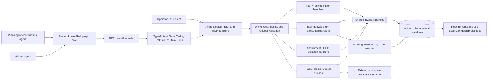

## 3. Cross-cutting conventions, design decisions, and contracts

### 3.1 Decisions and boundaries

- **Identity and ownership.** Plans keep their TODO IDs and `ItemKind=plan`; ordinary TODOs use `standard`. New Task, Group, Assignment, Attempt and operation IDs are canonical lowercase UUID strings on the wire. Task parents and Group keys never change. A Task belongs to zero or one same-parent Group, with a parent ordinal and, if grouped, a group ordinal. Group keys are 1-128 characters, unique case-insensitively per TODO. A Session has many assignments; a Group has at most one active assignment.
- **Requirements.** Every persisted Task, including Planning, has at least one FR and at least one AC of every mapped FR. TR links are optional; every supplied TR is a real implementation constraint. Task-AC relations point at original AC rows. Attempt snapshots preserve the version of requirements/context used even when the requirement itself is later edited in place.
- **Success.** All Task definition, linkage, order, evidence and outcome fields freeze at Success; identical operation replays are harmless. Corrections use a new Task with a `correctsTaskId`. A late turn may point to a successful Task because the turn changes, not the Task or its frozen evidence.
- **Membership.** First Group dispatch seals its membership and order. Earlier definition changes require never-started affected Tasks. Empty groups are allowed during planning but cannot be assigned. Completed groups cannot acquire new members.
- **Sequencing.** Return an already Started member as a resume; otherwise select the lowest-ordinal Ready and unblocked member. Skip Success, Failure, Planning and blocked members. Explicit prerequisites impose required ordering; ordinal alone is a selection preference. There is at most one Started member per Group, but a Session may hold multiple dispatched groups.
- **FIFO.** Queue ordering is per receiving Session and based on a server-allocated receipt sequence. A distinct work request dispatches the oldest queued Group even if previous groups remain unfinished or the selected group's Tasks are currently blocked/failing. A replay returns the original result. An empty queue returns NoWork, not an automatic claim. Assignment history is retained; release requires no Started member and re-assignment appends a new queue receipt.
- **Scope.** Every request resolves a registered workspace; Session identity resolves the current agent context plus public session ID to a unique stored Session. Cross-workspace identifiers are never treated as a valid relationship. A collision across source types is AmbiguousSession rather than an arbitrary lookup.
- **Storage.** SQLite, PostgreSQL and SQL Server use the existing provider factory and equivalent constraints/transactions. No new YAML runtime or independent Task datastore is added. Existing checklist entries and legacy null turn links stay intact.

### 3.2 Transport, authentication and error contract

REST routes below use `/qbrainai`; every added route also has the existing `/mcpserver` compatibility alias. `X-Workspace-Path` selects the workspace and the existing workspace authentication protects the request. MCP/REPL adapters carry the same workspace through their established context. Plugin scripts are PowerShell under `plugins/core/lib-ps`; hosts forward to shared core and do not duplicate selection, queue or dependency policy.

The existing workspace API key is the authorization boundary; it is not a distinct credential for each agent. Session/attempt ownership checks enforce workflow consistency and audit attribution, not cryptographic isolation between callers sharing that key. A coordinator is a workspace-authorized caller performing explicit assignment/recovery with its own real Session identity; this architecture does not invent an unimplemented agent-role authentication system. Recovery completion on another Session's attempt is permitted only when that owning Session is closed/interrupted, outcome is Failure and the reason identifies the interruption; successful outcomes still require the owning execution context.

New handlers live under `QBrainAi.Support.Mcp.Tasks` in `src/QBrainAi.Services/Tasks/{Commands,Queries}`. Storage types live under the existing Storage.Entities namespace and use `WorkTaskEntity` rather than a C# type named `Task`, avoiding collision with `System.Threading.Tasks.Task`. DTOs live in the services model and typed-client model projects with XMLDocs and requirement IDs. REST and MCP adapters dispatch the same handler. Client classes are `TasksClient`, `TaskGroupsClient` and `TaskTurnsClient`; existing TODO and Requirements clients gain the documented extensions.

Each write has a UUID `operationId`; the plugin generates it once per logical call and retains it for retries. Editing an existing definition also requires `expectedVersion` (positive int64). Create, assignment, work-queue selection and turn compare-and-set use their own transactional uniqueness predicates; they do not require a caller to predict a queue version. Successful writes return `version` where the aggregate is versioned. Null means an explicitly nullable value; omitted optional patch fields mean unchanged. Empty arrays are intentional, but never waive Task coverage or implicitly remove AC rows.

For new mutation responses, `operationId:uuid` and `replayed:bool` are top-level fields in addition to the stated DTO/result fields. A single DTO result is flat; a response combining several records uses the explicitly named wrapper fields in its operation contract. The existing TODO update retains its `TodoMutationResult` envelope and adds workflow metadata without replacing its established fields. Query results contain no mutation metadata. Nominal `<Operation>Result` type names in the catalog refer to those exact wire shapes, not an extra unmentioned JSON nesting level.

New REST errors use the existing classified problem envelope: `{type,title,status,detail,code,message,retryable,details}`. MCP returns `{code,message,retryable,details}`; REPL wraps that in its established error envelope. PascalCase codes below are the newly defined Task contract, not a rewrite of unchanged legacy error codes. Details identify field or conflicting IDs without exposing another workspace. All domain refusals are nonretryable until inputs/state change. `WriteConflict` and `PersistenceUnavailable` are retryable using the **same** operation ID; no client claims work was assigned/started from an outage, queued federation write or unconfirmed receipt.

- 400 `ValidationFailed`: malformed IDs, required fields, enums, page/size bounds or inconsistent payload.
- 401/403 `AuthenticationRequired` / `Forbidden`: the established authentication/authorization boundary refuses the caller before handler work.
- 404 `NotFound`: an addressed record cannot be found in the resolved workspace.
- 409 `VersionConflict`, `InvalidTransition`, `ImmutableTask`, `AssignmentConflict`, `SessionClosed`, `AmbiguousSession`, `TurnTaskConflict`, `IdempotencyConflict`, `GroupSealed` or `ReferencedRecord`: no domain change committed.
- 422 `DependencyBlocked`, `DependencyCycle` or `CoverageInvalid`: semantically invalid proposed work or graph.
- 409 `WriteConflict`: bounded transient serialization retries were exhausted; same-operation retry allowed.
- 503 `PersistenceUnavailable`: durable outcome is unavailable or unknown; retain operation identity and obtain a confirmed response before execution.
- Provider configuration rejects removed/unknown providers through the existing startup validation. `UnsupportedTodoProvider` remains an adapter compatibility classification if an unsupported caller configuration reaches an exposed workflow boundary; it does not enable YAML or disable a supported relational backend.

All operations can return the common request errors and storage errors drawn in their diagrams. A query does not create a workflow operation receipt, except request-work is intentionally a command despite looking like a fetch. Read pagination uses opaque workspace-scoped cursors, default 50/max 200 items, stable ordering and an explicit next cursor. A partial inspection page never authorizes dispatch.

### 3.3 Persisted model catalog

All new rows carry `WorkspaceId`; all links include it in the FK scope even where a numeric or UUID surrogate exists. UTC fields use DateTimeOffset. Versions are int64 starting at 1. Tables use restrict-delete for execution/requirement evidence; there is no path that cascades away successful work. In-memory ordering and timestamps alone are never authoritative.

- **TodoItemEntity (existing, extended):** `(WorkspaceId,Id)` key; existing Title/Description/Reference/requirements remain; `ItemKind` accepts standard/plan; `WorkflowVersion:int64` protects new workflow-field edits and parent-scope reorder. Group definitions and GraphRAG references are child relations of this aggregate. Plan documentation is the existing Reference plus ordered GraphRAG document/chunk references, not a second document store. Explicit FR/TR scope stays distinct from derived Task coverage in responses. Existing TODO.Done remains explicit metadata, not a stored copy of Group status; unrelated legacy updates keep their existing optional-field contract.
- **WorkTaskEntity:** `(WorkspaceId,TaskId)` key; immutable `TodoId` FK; `Title` (1-1024), `Description` (nullable text), `Status`, `ParentOrdinal` (positive int32), nullable `GroupId` and `GroupOrdinal`, nullable `CorrectsTaskId`, `Version`, CreatedAtUtc/UpdatedAtUtc. Unique parent ordinal; unique group ordinal when grouped. `GroupId`/`GroupOrdinal` are both null or both present. Correction targets are immutable historical references and cannot create a correction cycle.
- **TaskGroupEntity:** `(WorkspaceId,GroupId)` key; `TodoId` FK; `GroupKey`, `NormalizedGroupKey`, `DisplayName` (1-1024), `MembershipSealed`, `Version`, CreatedAtUtc. Unique `(WorkspaceId,TodoId,NormalizedGroupKey)`. No authoritative GroupStatus field. A transaction guard on this row serializes starts, membership and dependent graph changes.
- **TaskFunctionalRequirementEntity:** Task FK plus requirement key `(WorkspaceId,fr,RequirementId)`; unique Task/FR pair. **TaskAcceptanceCriterionEntity:** Task/FR pair FK plus `AcceptanceCriterionId` FK to the original long AC key, unique Task/AC; ownership validated against its FR. **TaskTechnicalRequirementEntity:** Task FK plus `(WorkspaceId,tr,RequirementId)`; unique Task/TR pair.
- **TaskDependencyEntity:** `(WorkspaceId,DependencyId)` key; `DependentTaskId`; `TargetKind=Task|Group`; exactly one of `PrerequisiteTaskId`/`PrerequisiteGroupId`; unique dependent/typed target. Cross-TODO same-workspace prerequisites are permitted. Groups expand to members only for graph validation/inspection, not into duplicated persisted edges.
- **TaskAttemptEntity:** `(WorkspaceId,AttemptId)` key; `TaskId`, `AttemptNumber`, `OwnerSessionLogId`, `StartTurnId`, StartedAtUtc, nullable EndedAtUtc, nullable Outcome=Success|Failure, Summary/FailureReason, optional RemediationReason captured when this attempt starts. Unique Task/attempt number and at most one open attempt per Task. Closed attempt rows never change. **TaskRemediationEntity:** append-only event with Task FK, failed Attempt FK, reason, author Session/Turn and timestamp; the next attempt snapshots that reason. Remediation creates a new attempt only on the next start.
- **TaskAttemptRequirementSnapshotEntity:** attempt FK, source kind FR|AC|TR|GraphReference, source stable key, owning FR where applicable, source version/hash, text, resolution status, capturedAtUtc, ordinal. Snapshot text is never hydrated again as if it were historical evidence. **TaskAttemptEvidenceEntity:** attempt FK, mapped AC FK, evidence text and optional artifact reference, ordinal, recordedAtUtc. Freeze the completed attempt's evidence with its outcome.
- **SessionLogEntity (existing):** long Id, WorkspaceId, SourceType, SessionId; unique workspace/source/session. **SessionLogTurnEntity (extended):** existing long Id and SessionLogId FK, nullable TaskId FK, nullable explicit AttemptId FK where the turn is attributed to an attempt. Existing TodoId stays. Task/session history comes from these FKs; no Task-side turn array. A late audit turn may omit AttemptId.
- **TaskGroupAssignmentEntity:** `(WorkspaceId,AssignmentId)` key; GroupId, AssigningSessionLogId, ReceivingSessionLogId, ReceiptSequence, ReceivedAtUtc, nullable DispatchedAtUtc/CompletedAtUtc/ReleasedAtUtc, State=Queued|Dispatched|Completed|Released. Unique active Group ownership; unique receiving-session/sequence. Active means Queued or Dispatched. Terminal records persist. **SessionWorkQueueEntity:** workspace/session FK key and NextReceiptSequence; row lock/CAS allocates monotonic order without timestamp ties.
- **TaskWorkflowOperationReceiptEntity:** workspace/session/operation-kind/operationId key, normalized request fingerprint, serialized typed response, HTTP outcome, CreatedAtUtc. Same fingerprint replays the response; another fingerprint conflicts. Receipts include NoWork and no-task results of mutating selection commands. Deterministic domain refusals may be persisted with the fingerprint and no domain writes; transient uncommitted failures are retried by the same key. Receipts remain for the retained Session lifetime and are not garbage-collected while an assignment or execution history depends on them.
- **TodoGraphReferenceEntity:** `(WorkspaceId,ReferenceId)` key; TodoId, Kind=Document|Chunk|Entity|Relationship, TargetId, optional DocumentId (required only for Chunk), Ordinal, optional Label. Unique parent/typed target and parent/ordinal. Reference target IDs are typed service references, not relational FKs into every GraphRAG backend. Only workspace-local scope is supported.
- **LegacyTaskPromotionEntity:** workspace/TodoId/legacy implementation-entry identity key; new TaskId FK, operation identity and promotedAtUtc. It prevents accidental double promotion without changing the old checklist row. **TaskWorkflowAuditEntity/outbox:** immutable event ID, operation ID, actual agent/session/turn identity, entity IDs, event kind, timestamp and changed-field summary; written with the domain transaction, then projected into session logs without inventing turns.

Existing AC rows keep their long PK and unique owner-scoped CriterionId. Reconciliation mutates text/evidence/satisfaction/ordinal in place, inserts only new criteria and requires explicit removal IDs. Missing IDs may be generated once for genuinely new criteria; a blank supplied ID is invalid. Preflight reports legacy duplicates without replacing or silently remapping rows. A referenced AC or owning requirement cannot be removed. All existing single/batch/import/copy/resurrection entry points use the same reconciliation component.

Existing requirement records gain an additive `WorkflowVersion:int64`, initialized to 1 without changing any requirement or AC identity. `CriterionReconcileRequest.expectedVersion` compares this owning-record value. Every successful metadata or criterion mutation through single, batch, import, copy or resurrection paths increments it in the same transaction; identical receipt replay does not increment it again. Legacy callers may omit a version under their existing contract, but the shared writer still serializes the mutation and increments the version. Explicit workflow reconciliation requires the version and returns it. The entity diagrams show the identity-bearing fields; this shared concurrency field also applies to their Requirement entity.

An **open Session** means the existing SessionLog status is exactly `in_progress`. Assignment, request-work and new execution require that status; `completed` and other non-open states cannot receive new work. Historical turn queries remain available. Recovery from a closed owner's interrupted attempt uses the explicit failure/recovery command and its recorded reason, rather than silently treating the Session as open.

### 3.4 Data transfer objects and wire primitives

- **MutationContext:** `operationId:uuid`, `sessionId:string`, optional current `requestId:string`; editing DTOs add `expectedVersion:int64`. Workspace and trusted agent identity come from the transport context. A session ID must resolve uniquely within that context.
- **FrAcSelection:** `frId:string`, `criterionIds:string[1..]`; duplicate selections are invalid. The server resolves stable long AC keys and validates parent FR ownership. **TaskDefinition:** `title`, nullable `description`, `todoId`, `functionalRequirements:FrAcSelection[1..]`, `technicalRequirementIds:string[]`, positive `parentOrdinal`, optional `groupId/groupOrdinal`, optional `correctsTaskId` on create only.
- **WorkTaskDto:** `taskId,todoId,title,description,status,parentOrdinal,groupId,groupOrdinal,correctsTaskId,version,functionalRequirements,technicalRequirementIds,currentAttemptId,eligibility`. Eligibility is `{canStart,reasonCodes,incompleteDependencyCount}` and never a sixth Task status. Detail includes mapped IDs/text; successful historical evidence comes from attempt snapshots, clearly labelled.
- **TaskAttemptDto:** `attemptId,taskId,attemptNumber,ownerSessionId,startTurnId,startedAtUtc,endedAtUtc,outcome,summary,failureReason,remediationReason,requirementsSnapshot,evidence`. `evidence` is a list of `{frId,criterionId,text,artifactRef?}`; success requires nonblank text for each mapped AC. Evidence remains attributed to its attempt.
- **TaskGroupDto:** `taskGroupId,todoId,groupKey,displayName,version,membershipSealed,status,memberCount,countsByTaskStatus,blockedTaskCount`. `status` is always calculated over complete membership. Group details return a separate paged `members` collection ordered by group ordinal; summary/list DTOs do not smuggle an unbounded member-ID list into a paginated response. Aggregate totals are computed independently of the visible page.
- **TaskGroupAssignmentDto:** `assignmentId,taskGroupId,assigningSessionId,receivingSessionId,receiptSequence,receivedAtUtc,dispatchedAtUtc,completedAtUtc,releasedAtUtc,state`. Assignment state is separate from Group status. **WorkDispatchResult:** `outcome:Dispatched|NoWork`, nullable `taskGroupId,assignmentId,receiptSequence`, `operationId`, `replayed:bool`. A NoWork result has null assignment/group/sequence.
- **TaskSequenceResult:** `outcome:Started|Resumed|NoTask`, nullable `task:WorkTaskDto`, nullable `attempt:TaskAttemptDto`, calculated `groupStatus`, `reasons:[{taskId,code}]`, `operationId,replayed`. Readiness, blockers and unresolved failures remain visible in NoTask; at most one Started Task exists per group.
- **DependencyTarget:** `{kind:Task|Group,id:uuid}`. **IncompleteDependencyDto:** `target:DependencyTarget,status:string,affectedTaskIds:uuid[],paths:DependencyTarget[][]`. `status=Missing` is a blocker. **DependencyReport:** `subject:DependencyTarget,transitive:bool,items,nextCursor,complete:bool`; complete=false while additional pages exist.
- **TurnTaskLinkDto:** `turnId,sessionId,requestId,taskId,attemptId?,outcome:Linked|Unchanged`. **TaskTurnHistoryItem:** the same identities plus agent, timestamp and existing turn title/status; **TaskTurnHistoryResult** uses PageResult and distinct Session identifiers for the returned scope. A separate query-all-distinct-sessions field is explicitly labelled when included.
- **TraceResultItem:** `todoId,itemKind,taskId,groupId,parentOrdinal,frId,criterionId,technicalRequirementIds,taskStatus,coverage:Mapped|SuccessfulEvidence,evidenceAttemptIds`. **PageResult<T>:** `items:T[],nextCursor:string?,totalCount:int?`; totalCount is nullable when not computed, never the page length mislabeled as a total.
- **GraphReferenceDto:** `referenceId,kind,targetId,documentId?,ordinal,label?`. **GraphHydrationItem:** `reference:GraphReferenceDto,status:Resolved|Missing|Unavailable|Truncated,content?,sourceVersionOrHash?,retrievedAtUtc?,originalLength?,returnedLength,truncationReason?`. **TodoWorkflowDetail:** existing TodoFlatItem fields plus `itemKind,graphRagReferences,graphRagContext,explicitRequirementScope,derivedTaskCoverage,taskGroups`. List DTOs include references only. `hydrateGraphRag=false` omits lookup and returns an empty context array with a hydration-disabled flag.
- **CriterionPatch:** `criterionId?`, optional retained `persistedId`, mutable `text,isSatisfied,evidence,ordinal`; blank IDs invalid; a new ID inserts. **CriterionReconcileRequest:** owning requirement kind/id, optional criteria patch collection, `removeAcceptanceCriterionIds:string[]`, expectedVersion and MutationContext. **CriterionReconcileResult:** owning requirement identity/version and `updated,inserted,removed` criterion IDs plus persisted IDs; retained rows never appear as removed+inserted.
- **ReorderRequest:** `scope:Todo|Group`, parent ID, complete ordered eligible ID list, expectedVersion and MutationContext. **PromotionResult:** `todoId,legacyEntryId,taskId,status=Planning,created,replayed`. Legacy done is never a Success signal.

### 3.5 Shared components and policies

#### 3.5.1 RequestPipeline

Resolve authenticated workspace and agent/session identity, bind/validate the DTO, then dispatch a scoped handler. The guard returns a typed refusal before any domain write. Existing authentication middleware keeps its wire shape where this architecture does not change it.

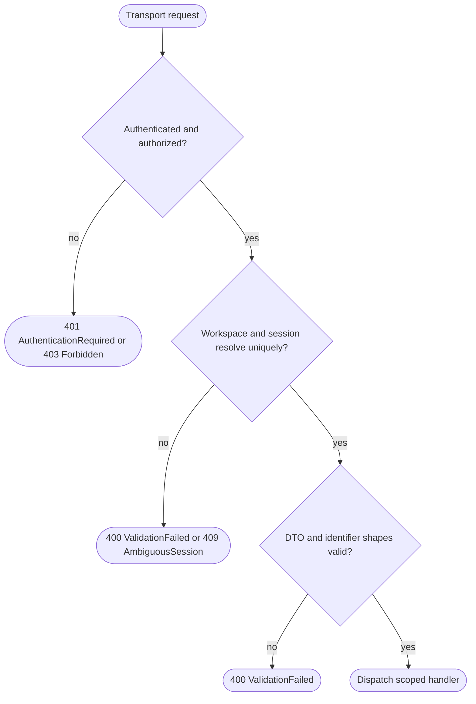

#### 3.5.2 AtomicMutation and OperationReceipts

Use provider-specific serializable transactions/row locking or compare-and-set guards with equivalent behavior. Lock queue, group and dependency graph guards in a stable ID order. Try transient serialization at most four times with bounded backoff; business conflicts never retry invisibly. Claim/lookup the operation receipt in the same authoritative database. A replay returns before version/state checks so a legitimate old success can replay after the aggregate advances. Deterministic refusal records contain no partial domain updates. Commit failures/unknown acknowledgement never authorize agent execution. Federation queues may retain a write, but a queued receipt is not a dispatched Task.

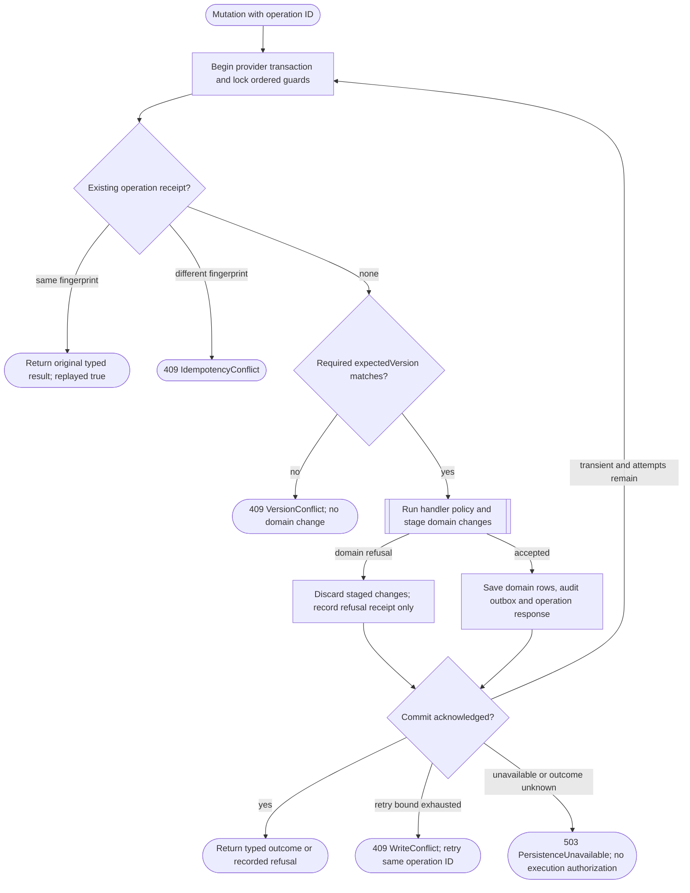

#### 3.5.3 TaskDefinitionAndTransitionPolicy

Validate parent/group ownership, FR/AC coverage and TR constraints on every definition write. Ready definition edits reset to Planning. Started definitions and successful aggregates are immutable. Completion validates the owning open attempt and evidence; it does not update global AC satisfaction. Failure remediation appends a separate remediation event and moves the Task back to Planning; the closed attempt row, outcome, evidence and snapshots never change. Correction links reject self/cycles and reference an existing successful Task.

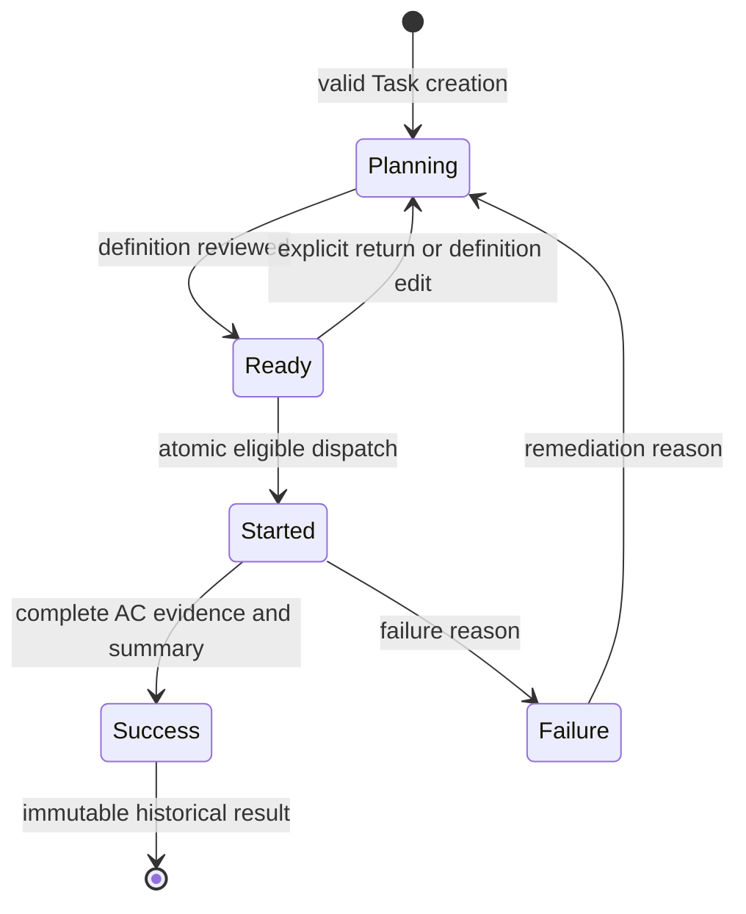

#### 3.5.4 DependencyResolver and GroupStatusPolicy

Dependency mutation expands Group targets into current member Task nodes for cycle checks and validates the proposed graph under the same lock scope as membership writes. A Task start tests all direct prerequisites; a Group target completes only when its own complete member set calculates Completed. Empty groups remain Unstarted and block. Recursive evaluation uses memoization and a visited set; corrupt cycles/missing targets produce blockers instead of recursion or false completion. Inspection pagination never changes eligibility. Already successful dependent Tasks are not reopened; active attempts are not aborted automatically if a prerequisite becomes incomplete.

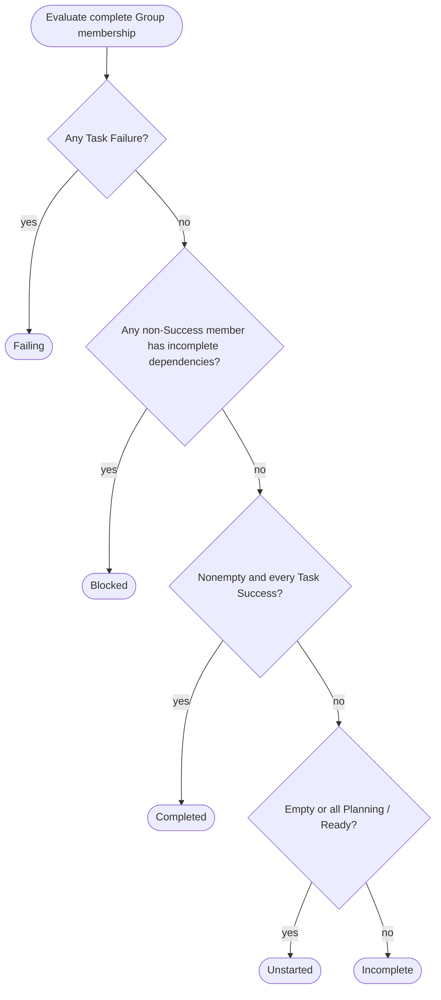

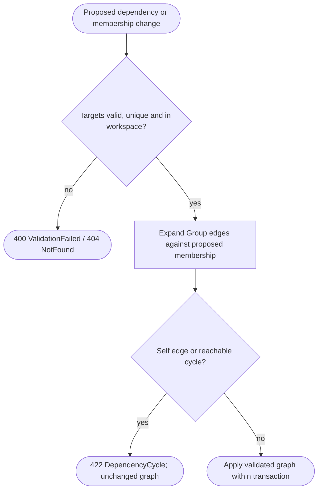

#### 3.5.5 SessionQueuePolicy and AssignmentReconciler

Receipt order is allocated once per new assignment. Same-owner assignment retries preserve the receipt sequence. Work dispatch never skips a queued blocked/failing Group. Dispatched groups can coexist and are not completion gates for the next queue item. Group completion transitions any active assignment to Completed in the same Task-completion transaction. Closed Sessions retain pending ownership for coordinator recovery; no implicit lease timeout or automatic work stealing exists. A coordinator first records an interrupted Started attempt as Failure with evidence of interruption, then explicitly releases/reassigns it; this recovery is audited and never edits a successful Task.

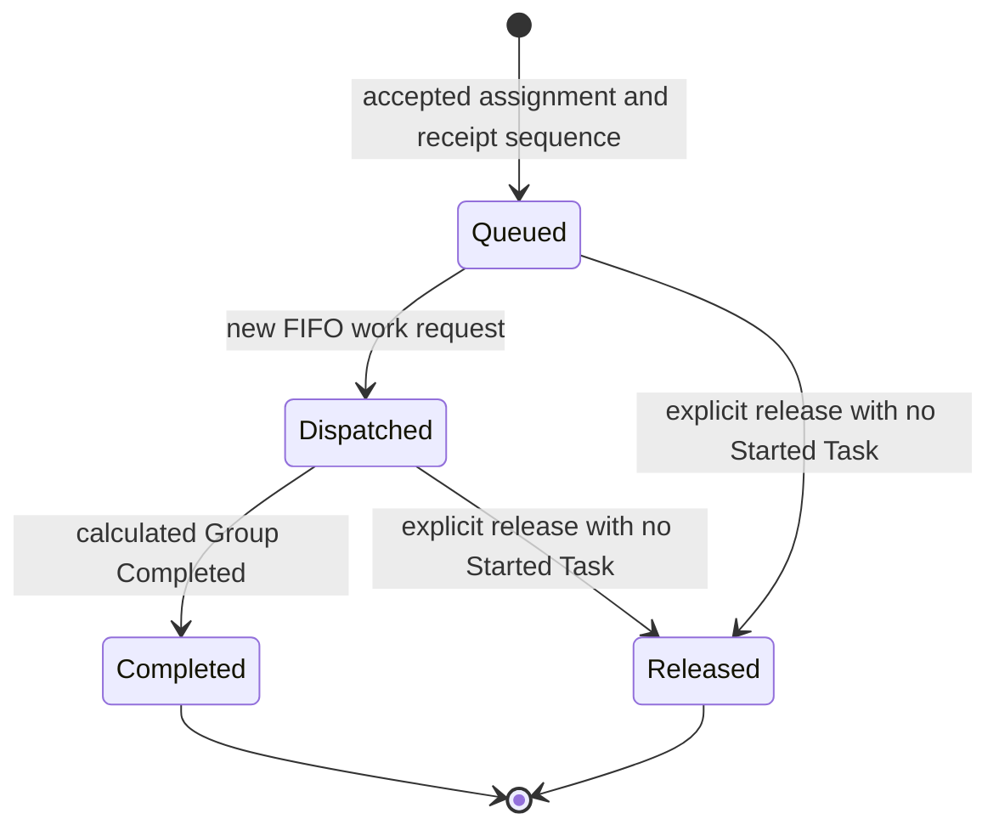

#### 3.5.6 CriterionReconciler

Preflight criterion identities, match owner-scoped CriterionId to retained rows, stage only mutable field changes and genuinely new inserts, and require explicit removal IDs. Restrict-delete Task links are validated before removal. Duplicate IDs, conflicting persisted ID/criterion ID or referenced removal reject the complete update. The same implementation is called by every single, batch, import, copy and resurrect-existing requirement write; no legacy shortcut may invoke blanket RemoveRange/AddRange. Metadata-only updates do not touch AC rows. AC uniqueness preflight and any necessary missing-ID backfill preserve numeric PKs.

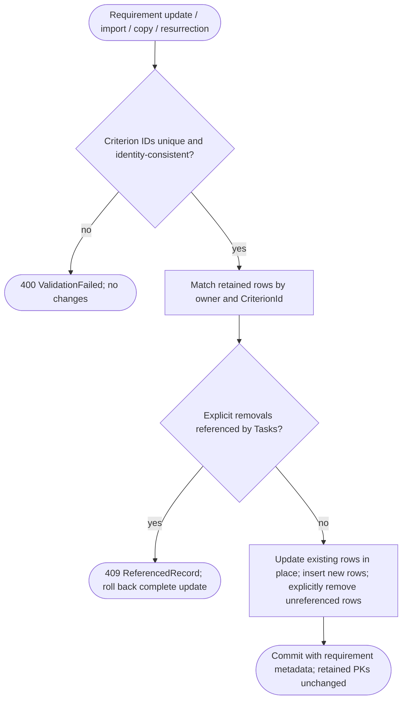

#### 3.5.7 GraphReferenceHydrator

Use existing workspace GraphRAG document/chunk/entity/relationship getters; do not follow arbitrary URLs or host-global references. Validate target existence when adding a reference. During reads, a disappeared target is Missing; failures/timeouts are Unavailable. At most 100 references, four concurrent lookups, five seconds overall, 20,000 Unicode scalar values per reference and 100,000 total are permitted. Preserve order and identity even for missing/truncated entries. Per-request memoization avoids duplicate fetches without stale cross-request caching. Caller cancellation stops outstanding work; a transport-aborted request is not turned into a fabricated successful payload. Once the hydration time budget expires, return partial results and Unavailable for unfinished references.

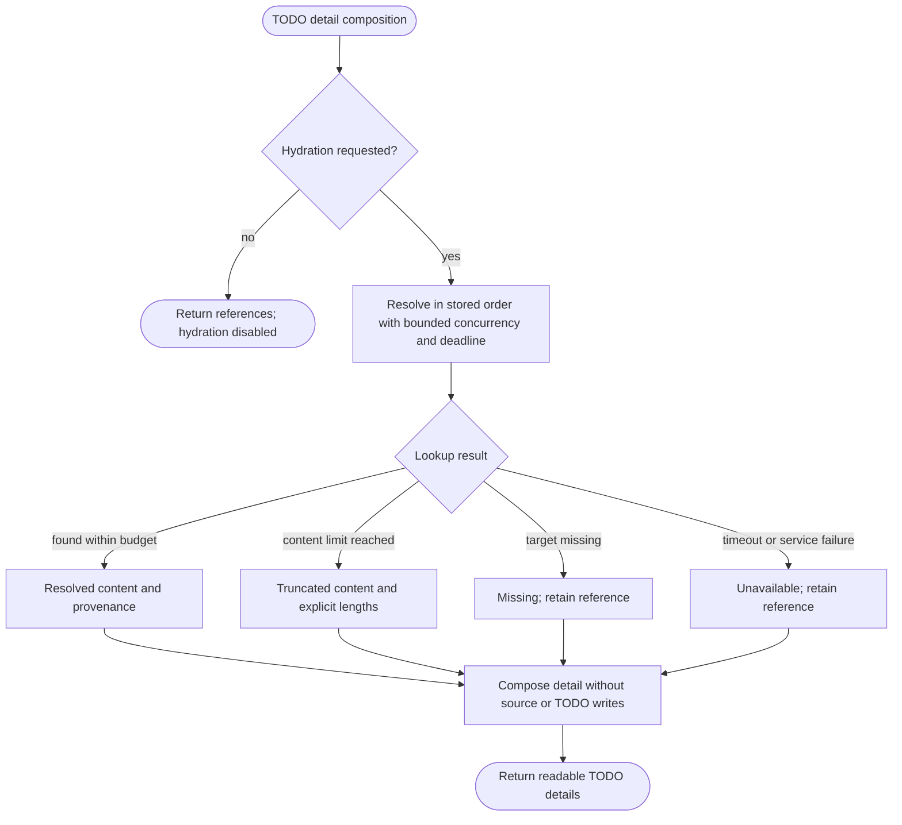

#### 3.5.8 TurnAttribution and AuditWriter

Turn attribution is compare-and-set null-or-same. A different Task is TurnTaskConflict, including during atomic dispatch. Query indexed turn FKs for Task-to-turn-to-Session history. Preserve the caller's real Pascal-Case agent identity; delegation is not evidence of execution. Dispatch and completion write immutable domain audit/outbox records with the exact current turn. Background assignment reconciliation records its causative operation/turn instead of fabricating a user turn. A successful Task does not receive a LastUpdated/version bump for an external audit turn association.

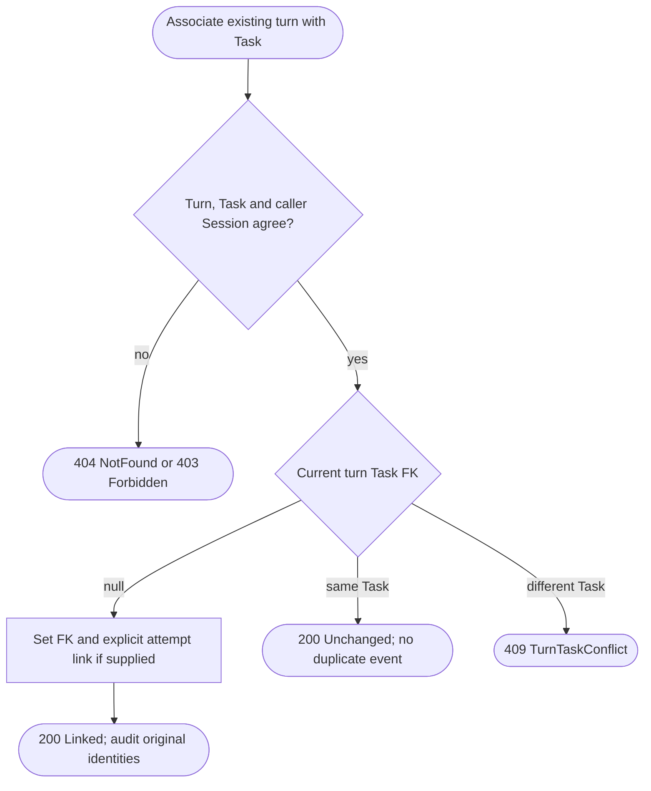

#### 3.5.9 TaskSequencingPolicy

This policy runs inside NextGroupTaskCommand's atomic callback. Group assignment must already be Dispatched to the requesting open Session. A resume associates the current turn to the same Task only if the turn is null-or-same; it does not create another attempt or change frozen definition fields. NoTask records the selection response without changing Task state. Before any new start, recheck every prerequisite while the graph/group guard is held, capture actual FR/AC/TR/context, and commit turn linkage, attempt and Ready->Started together.

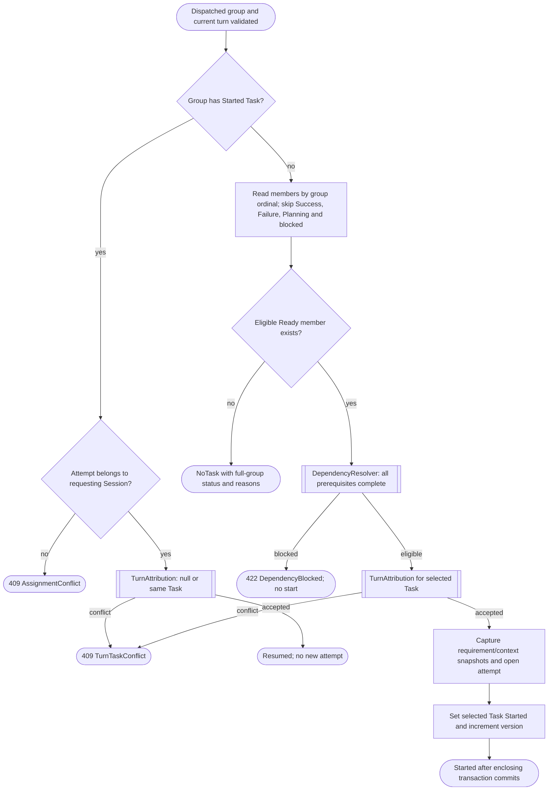

#### 3.5.10 GroupAssignmentPolicy and SessionWorkDispatchPolicy

Group assignment validates both Sessions and nonempty/non-Completed group state. A duplicate same-owner request returns the original active assignment even under a new operation ID. A different active owner conflicts. Allocation of a new receipt sequence and insert are one transaction. Request-work locks the receiving queue, selects only Queued rows and preserves their order irrespective of computed group status; each distinct request can dispatch another group without waiting for prior completion.

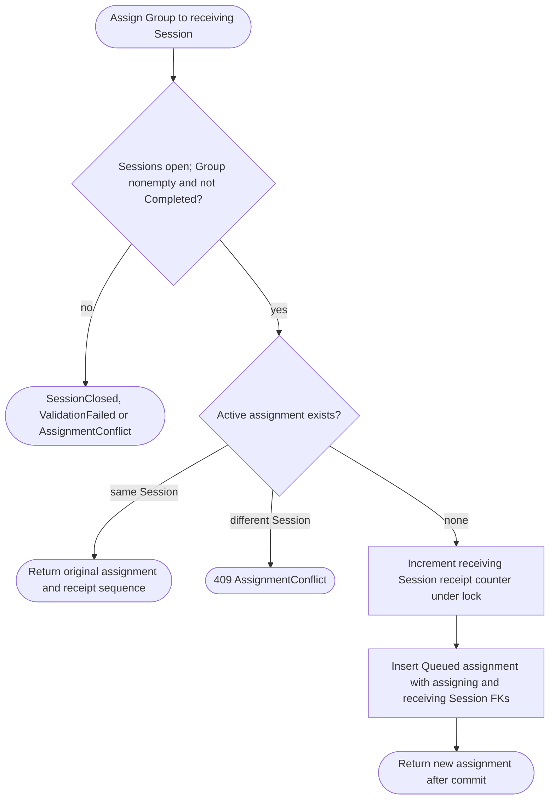

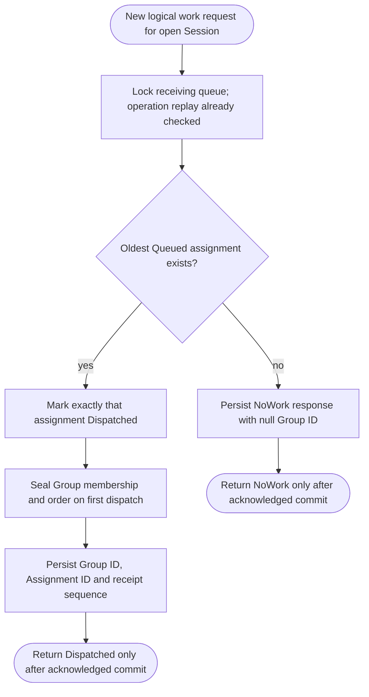

## 4. Phase A: stable definitions, Plans, requirement identity and context

### 4.1 Components and data

Definition handlers own TODO specialization, Task/group definitions, stable AC reconciliation and typed GraphRAG reference links. Existing TODO and requirement entities remain authoritative. AC identity repair is the prerequisite for Task-to-AC foreign keys; no Task schema migration may backfill references by matching mutable text. TaskGroup IDs and definitions belong to the parent TODO aggregate. Phase A reads expose current scoped data, while snapshots become immutable only at attempt start in Phase B.

### 4.2 Units of work (CQRS handlers), endpoints and activity diagrams

Every listed type, route and tool is proposed unless explicitly identified as an extension of an existing surface. Request fields below are normative together with section 3.4. Handler-specific validation runs inside AtomicMutation for writes; a domain refusal records no partial business change. Read handlers do not create operation receipts. The diagrams expand the handler body and call the begin/receipt and commit portions of the shared atomic component rather than duplicating its provider implementation.

#### SetTodoPlanDefinitionCommand: FR-MCP-TODOPLAN-001, FR-MCP-TODOPLAN-002

- Handler: `SetTodoPlanDefinitionCommand(WorkspaceContext, SetTodoPlanDefinitionRequest) : ICommand<SetTodoPlanDefinitionResult>`; proposed file `src/QBrainAi.Services/Tasks/Commands/SetTodoPlanDefinitionCommand.cs`, handler `SetTodoPlanDefinitionCommandHandler`.
- Surfaces: `PUT /qbrainai/todo/{todoId}`; compatibility alias `/mcpserver/...`; shared plugin `workflow.todo.update`; typed client `Todo.UpdateAsync`. The MCP descriptor uses the verb name with dots replaced by underscores and forwards to the same handler.
- Request: SetTodoPlanDefinitionRequest: existing TodoUpdateRequest extended with itemKind:standard|plan; explicitFrIds:string[]; explicitTrIds:string[]; reference:string?; expectedVersion:int64; MutationContext. todoId is in the path. Existing unrelated fields retain their current optional-field update contract.
- Response `SetTodoPlanDefinitionResult`: Existing TodoMutationResult envelope with additive workflow version and item details; existing TODO ID retained. Workflow clients may read TodoWorkflowDetail through the details query.
- Outcomes: 200 accepted. An operation replay returns the original typed outcome with replayed=true. Request-work and next-Task no-work outcomes are durable receipts.
- Behavior: Resolve existing TODO and validate explicit requirement references. Reject kind change after any Task start or group assignment. Apply ItemKind and explicit scope to the existing TODO row. Return existing mutation envelope with additive workflow metadata.
- Errors: 400 ValidationFailed: malformed input or workspace; 401 AuthenticationRequired: authentication missing; 403 Forbidden: caller not authorized; 404 NotFound: TODO or explicit requirement missing; 409 VersionConflict: stale TODO definition; 409 InvalidTransition: kind change after execution or assignment; 409 IdempotencyConflict: operation ID reused with another payload; 409 WriteConflict: bounded serialization retry exhausted; 503 PersistenceUnavailable: durable storage result unavailable.
- Validation trace: FR-MCP-TODOPLAN-001, FR-MCP-TODOPLAN-002 and their mapped TR/TEST records; the same operation contract is exercised against the fake and real handlers before adapters are released.

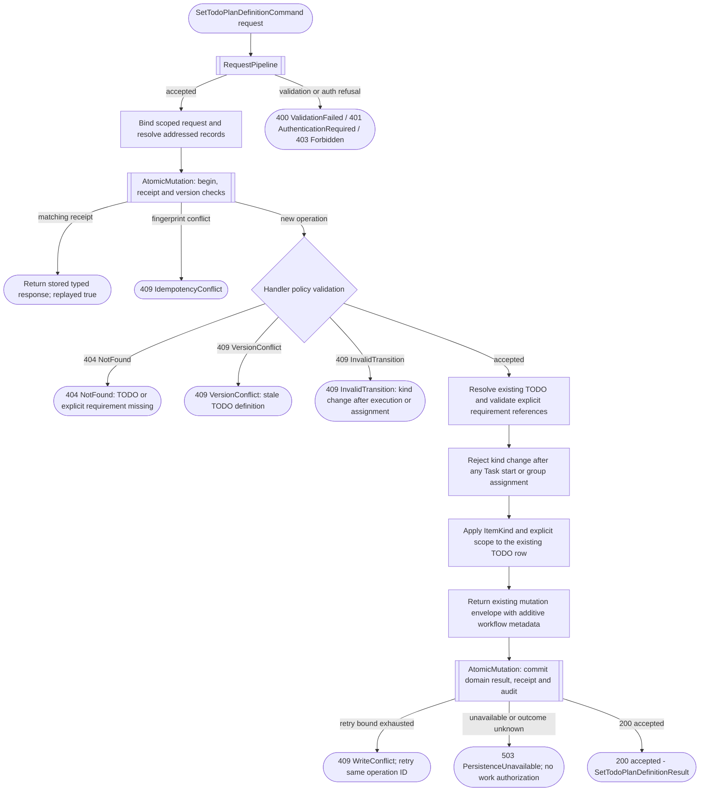

#### SetTodoGraphReferencesCommand: FR-MCP-TODOGRAPH-001, FR-MCP-TODOGRAPH-002

- Handler: `SetTodoGraphReferencesCommand(WorkspaceContext, SetTodoGraphReferencesRequest) : ICommand<SetTodoGraphReferencesResult>`; proposed file `src/QBrainAi.Services/Tasks/Commands/SetTodoGraphReferencesCommand.cs`, handler `SetTodoGraphReferencesCommandHandler`.
- Surfaces: `PUT /qbrainai/todo/{todoId}/graph-references`; compatibility alias `/mcpserver/...`; shared plugin `workflow.todo.setGraphReferences`; typed client `Todo.SetTodoGraphReferencesAsync`. The MCP descriptor uses the verb name with dots replaced by underscores and forwards to the same handler.
- Request: SetTodoGraphReferencesRequest: todoId path; references:GraphReferenceDto[0..100] as a full intended set; expectedVersion:int64; MutationContext. Existing referenceId retains identity; omission explicitly removes a TODO reference, not a graph target.
- Response `SetTodoGraphReferencesResult`: TodoWorkflowDetail metadata with stored ordered references and new version; graph targets unchanged.
- Outcomes: 200 accepted. An operation replay returns the original typed outcome with replayed=true. Request-work and next-Task no-work outcomes are durable receipts.
- Behavior: Resolve TODO and validate typed target uniqueness and ordinal permutation. Resolve existence of newly added workspace targets through GraphRAG. Update retained reference rows; insert new references; remove explicitly omitted reference links. Return reference metadata without persisting hydrated content.
- Errors: 400 ValidationFailed: malformed input or workspace; 401 AuthenticationRequired: authentication missing; 403 Forbidden: caller not authorized; 404 NotFound: TODO or newly added target missing; 400 ValidationFailed: duplicate target, invalid kind, order, count or arbitrary URL; 503 GraphRagUnavailable: new target existence cannot be confirmed; 409 VersionConflict: stale reference set; 409 IdempotencyConflict: operation ID reused with another payload; 409 WriteConflict: bounded serialization retry exhausted; 503 PersistenceUnavailable: durable storage result unavailable.
- Validation trace: FR-MCP-TODOGRAPH-001, FR-MCP-TODOGRAPH-002 and their mapped TR/TEST records; the same operation contract is exercised against the fake and real handlers before adapters are released.

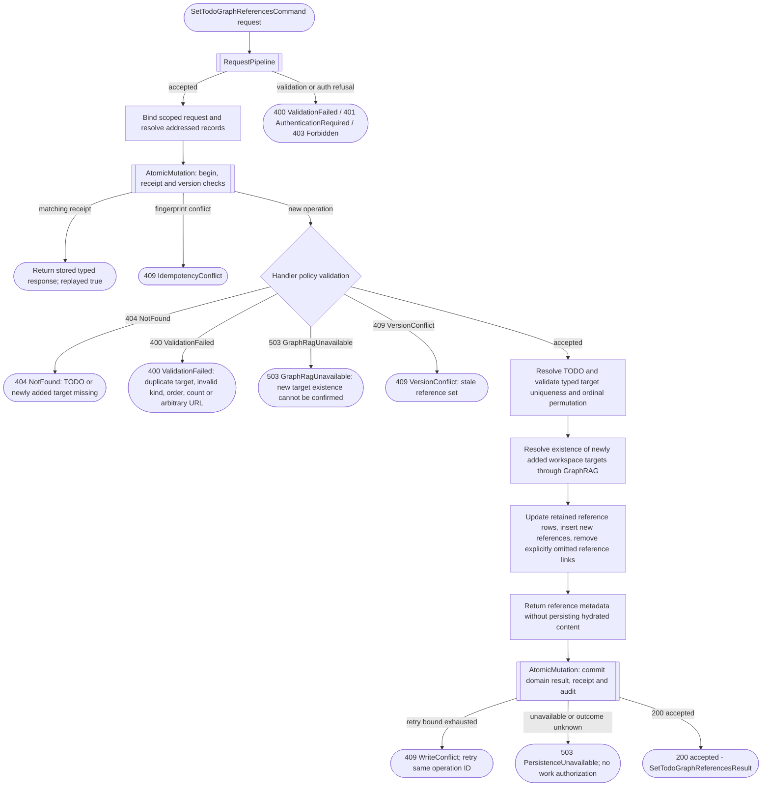

#### GetTodoWorkflowDetailsQuery: FR-MCP-TODOPLAN-002, FR-MCP-TODOGRAPH-002

- Handler: `GetTodoWorkflowDetailsQuery(WorkspaceContext, GetTodoWorkflowDetailsRequest) : IQuery<GetTodoWorkflowDetailsResult>`; proposed file `src/QBrainAi.Services/Tasks/Queries/GetTodoWorkflowDetailsQuery.cs`, handler `GetTodoWorkflowDetailsQueryHandler`.
- Surfaces: `GET /qbrainai/todo/{todoId}`; compatibility alias `/mcpserver/...`; shared plugin `workflow.todo.get`; typed client `Todo.GetAsync`. The MCP descriptor uses the verb name with dots replaced by underscores and forwards to the same handler.
- Request: GetTodoWorkflowDetailsQuery: todoId path; hydrateGraphRag:bool default true; workspace context. Existing TODO list queries retain metadata-only reference results.
- Response `GetTodoWorkflowDetailsResult`: TodoWorkflowDetail; every hydration result classified and bounded; missing/unavailable references do not fail an otherwise readable TODO.
- Outcomes: 200 accepted. A query is read-only; no lifecycle or assignment transition occurs.
- Behavior: Read TODO, explicit scope, group definitions and derived coverage in workspace. Call GraphReferenceHydrator when hydrateGraphRag is true. Return current references and partial classified context in stored order.
- Errors: 400 ValidationFailed: malformed input or workspace; 401 AuthenticationRequired: authentication missing; 403 Forbidden: caller not authorized; 404 NotFound: TODO absent; 503 PersistenceUnavailable: durable storage result unavailable.
- Validation trace: FR-MCP-TODOPLAN-002, FR-MCP-TODOGRAPH-002 and their mapped TR/TEST records; the same operation contract is exercised against the fake and real handlers before adapters are released.

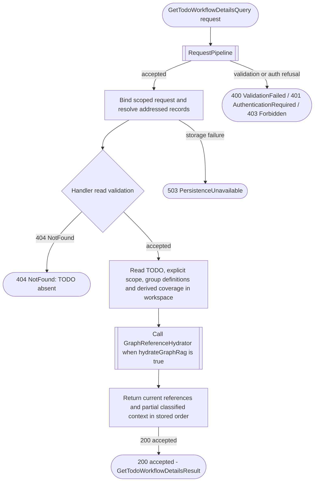

#### CreateWorkTaskCommand: FR-MCP-TODOTASK-001, FR-MCP-TODOTASK-002, FR-MCP-TODOPLAN-002

- Handler: `CreateWorkTaskCommand(WorkspaceContext, CreateWorkTaskRequest) : ICommand<CreateWorkTaskResult>`; proposed file `src/QBrainAi.Services/Tasks/Commands/CreateWorkTaskCommand.cs`, handler `CreateWorkTaskCommandHandler`.
- Surfaces: `POST /qbrainai/tasks`; compatibility alias `/mcpserver/...`; shared plugin `workflow.tasks.create`; typed client `Tasks.CreateWorkTaskAsync`. The MCP descriptor uses the verb name with dots replaced by underscores and forwards to the same handler.
- Request: CreateWorkTaskRequest: TaskDefinition; MutationContext. taskId and status are server-owned; initial status is Planning.
- Response `CreateWorkTaskResult`: WorkTaskDto; stable server UUID, version 1 and validated normalized requirement links.
- Outcomes: 201 created. An operation replay returns the original typed outcome with replayed=true. Request-work and next-Task no-work outcomes are durable receipts.
- Behavior: Call TaskDefinitionAndTransitionPolicy for complete FR/AC/TR and parent/group validation. Check correction target and immutable parent-scoped order uniqueness. Insert Planning Task and requirement links as one aggregate. Return new Task and creation audit identity.
- Errors: 400 ValidationFailed: malformed input or workspace; 401 AuthenticationRequired: authentication missing; 403 Forbidden: caller not authorized; 404 NotFound: parent, group, correction target or requirement missing; 422 CoverageInvalid: missing per-FR AC coverage or wrong owner; 400 ValidationFailed: duplicate order, invalid correction link or malformed definition; 409 GroupSealed: attempted insertion into sealed group; 409 IdempotencyConflict: operation ID reused with another payload; 409 WriteConflict: bounded serialization retry exhausted; 503 PersistenceUnavailable: durable storage result unavailable.
- Validation trace: FR-MCP-TODOTASK-001, FR-MCP-TODOTASK-002, FR-MCP-TODOPLAN-002 and their mapped TR/TEST records; the same operation contract is exercised against the fake and real handlers before adapters are released.

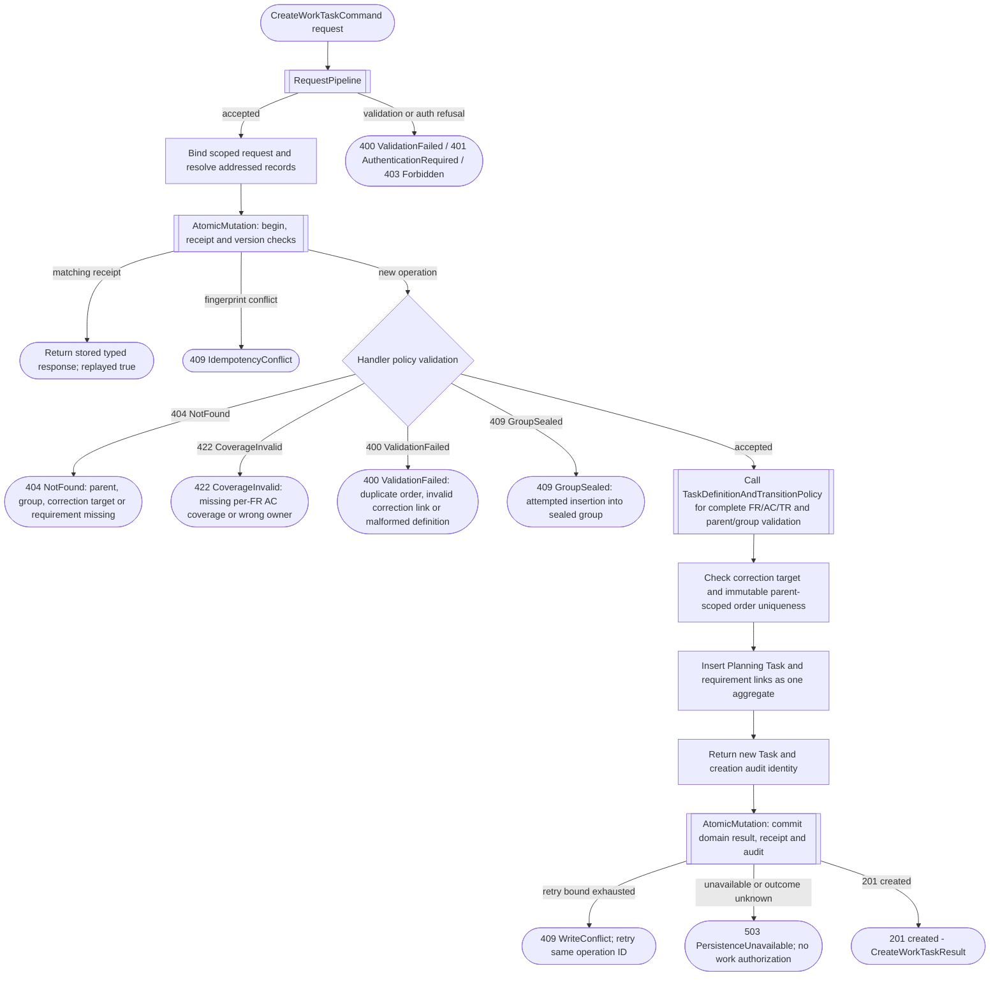

#### GetWorkTaskQuery: FR-MCP-TODOTASK-001, FR-MCP-TODOPLAN-002

- Handler: `GetWorkTaskQuery(WorkspaceContext, GetWorkTaskRequest) : IQuery<GetWorkTaskResult>`; proposed file `src/QBrainAi.Services/Tasks/Queries/GetWorkTaskQuery.cs`, handler `GetWorkTaskQueryHandler`.
- Surfaces: `GET /qbrainai/tasks/{taskId}`; compatibility alias `/mcpserver/...`; shared plugin `workflow.tasks.get`; typed client `Tasks.GetWorkTaskAsync`. The MCP descriptor uses the verb name with dots replaced by underscores and forwards to the same handler.
- Request: GetWorkTaskQuery: taskId path; includeCurrentAttempt:bool default true; workspace context.
- Response `GetWorkTaskResult`: {task:WorkTaskDto,currentAttempt:TaskAttemptDto|null}; currentAttempt is null when not requested or absent. Live requirement text and captured attempt text remain distinct.
- Outcomes: 200 accepted. A query is read-only; no lifecycle or assignment transition occurs.
- Behavior: Read Task and real parent/FR/AC/TR relations. Evaluate current eligibility using complete dependencies. Read current attempt snapshot when requested; do not rehydrate historical context. Return Task state and eligibility as separate fields.
- Errors: 400 ValidationFailed: malformed input or workspace; 401 AuthenticationRequired: authentication missing; 403 Forbidden: caller not authorized; 404 NotFound: Task absent; 503 PersistenceUnavailable: durable storage result unavailable.
- Validation trace: FR-MCP-TODOTASK-001, FR-MCP-TODOPLAN-002 and their mapped TR/TEST records; the same operation contract is exercised against the fake and real handlers before adapters are released.

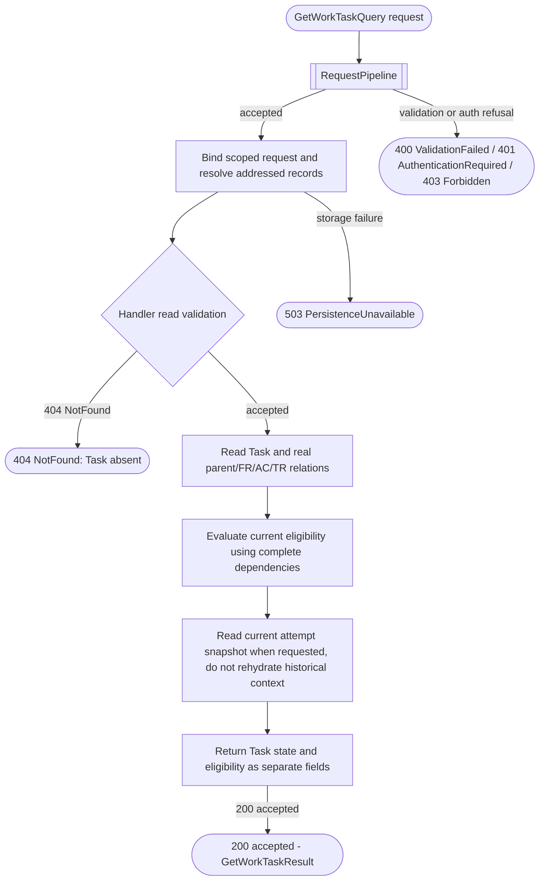

#### QueryWorkTasksQuery: FR-MCP-TODOPLAN-002, FR-MCP-TASKAPI-001

- Handler: `QueryWorkTasksQuery(WorkspaceContext, QueryWorkTasksRequest) : IQuery<QueryWorkTasksResult>`; proposed file `src/QBrainAi.Services/Tasks/Queries/QueryWorkTasksQuery.cs`, handler `QueryWorkTasksQueryHandler`.
- Surfaces: `GET /qbrainai/tasks`; compatibility alias `/mcpserver/...`; shared plugin `workflow.tasks.query`; typed client `Tasks.QueryWorkTasksAsync`. The MCP descriptor uses the verb name with dots replaced by underscores and forwards to the same handler.
- Request: QueryWorkTasksQuery: todoId?,groupId?,status?,frId?,criterionId? with owning frId required; cursor?; pageSize:int default 50 maximum 200; workspace context.
- Response `QueryWorkTasksResult`: PageResult<WorkTaskDto>; deterministic parent ordinal then Task ID order; no state mutation.
- Outcomes: 200 accepted. A query is read-only; no lifecycle or assignment transition occurs.
- Behavior: Validate filter combinations and scoped cursor. Query matching Tasks and normalized mappings. Read bounded page and complete eligibility summaries. Return nextCursor explicitly when more rows remain.
- Errors: 400 ValidationFailed: malformed input or workspace; 401 AuthenticationRequired: authentication missing; 403 Forbidden: caller not authorized; 400 ValidationFailed: bad filter, orphan criterion filter or cursor; 503 PersistenceUnavailable: durable storage result unavailable.
- Validation trace: FR-MCP-TODOPLAN-002, FR-MCP-TASKAPI-001 and their mapped TR/TEST records; the same operation contract is exercised against the fake and real handlers before adapters are released.

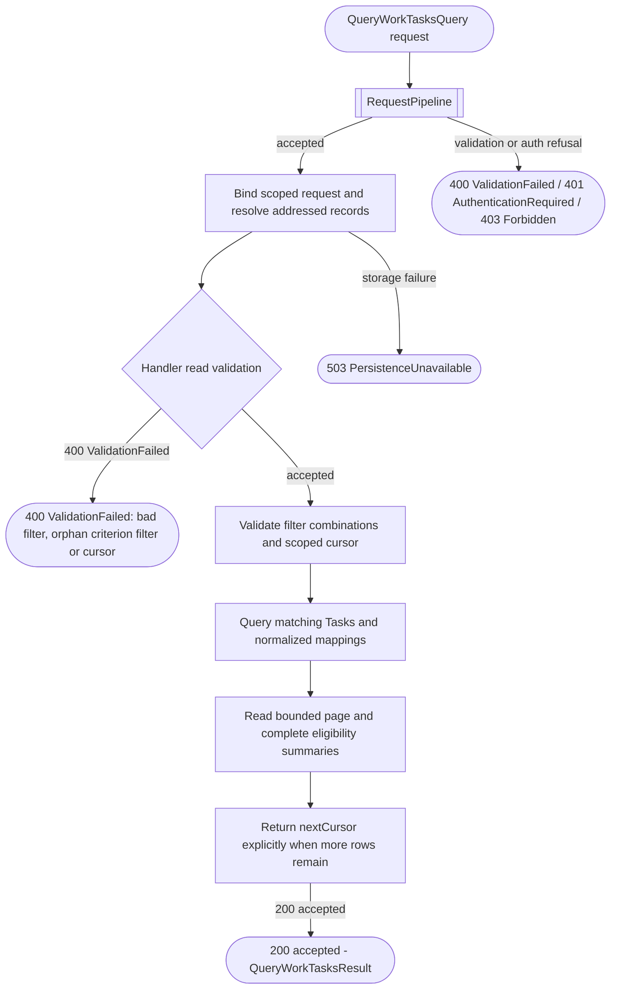

#### UpdateWorkTaskDefinitionCommand: FR-MCP-TODOTASK-002, FR-MCP-TODOPLAN-002

- Handler: `UpdateWorkTaskDefinitionCommand(WorkspaceContext, UpdateWorkTaskDefinitionRequest) : ICommand<UpdateWorkTaskDefinitionResult>`; proposed file `src/QBrainAi.Services/Tasks/Commands/UpdateWorkTaskDefinitionCommand.cs`, handler `UpdateWorkTaskDefinitionCommandHandler`.
- Surfaces: `PATCH /qbrainai/tasks/{taskId}`; compatibility alias `/mcpserver/...`; shared plugin `workflow.tasks.update`; typed client `Tasks.UpdateWorkTaskDefinitionAsync`. The MCP descriptor uses the verb name with dots replaced by underscores and forwards to the same handler.
- Request: UpdateWorkTaskDefinitionRequest: taskId path; optional title,description,functionalRequirements,technicalRequirementIds,groupId/groupOrdinal,parentOrdinal; expectedVersion; MutationContext. todoId/correctsTaskId cannot change. Null groupId unassigns only before sealing and first start.
- Response `UpdateWorkTaskDefinitionResult`: WorkTaskDto with incremented version; Ready definition edits return Planning.
- Outcomes: 200 accepted. An operation replay returns the original typed outcome with replayed=true. Request-work and next-Task no-work outcomes are durable receipts.
- Behavior: Resolve Task and reject Started, Failure or Success definition edits. Validate complete merged definition and group seal/order constraints. Replace only explicit relationship sets while preserving unchanged rows. Reset Ready to Planning if definition changed; save version and audit.
- Errors: 400 ValidationFailed: malformed input or workspace; 401 AuthenticationRequired: authentication missing; 403 Forbidden: caller not authorized; 404 NotFound: Task or referenced record absent; 409 ImmutableTask: Task is Success; 409 InvalidTransition: definition editing in Started or Failure; 409 GroupSealed: membership/order frozen; 422 CoverageInvalid: merged definition lacks valid coverage; 409 VersionConflict: stale Task version; 409 IdempotencyConflict: operation ID reused with another payload; 409 WriteConflict: bounded serialization retry exhausted; 503 PersistenceUnavailable: durable storage result unavailable.
- Validation trace: FR-MCP-TODOTASK-002, FR-MCP-TODOPLAN-002 and their mapped TR/TEST records; the same operation contract is exercised against the fake and real handlers before adapters are released.

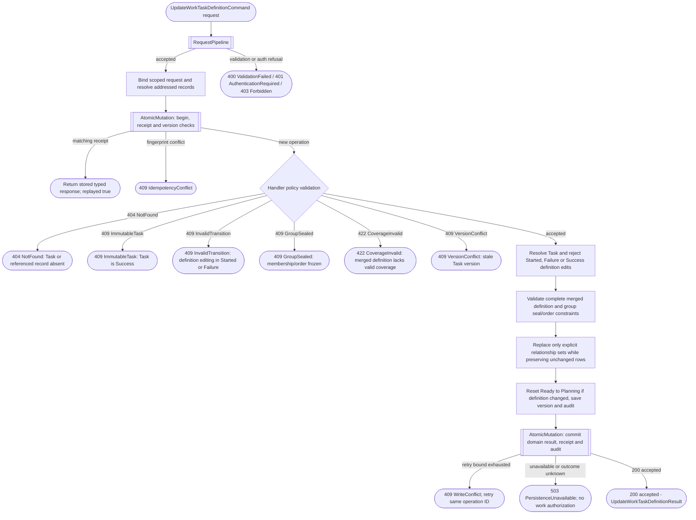

#### DeleteWorkTaskCommand: FR-MCP-TODOTASK-002, FR-MCP-TASKAPI-001

- Handler: `DeleteWorkTaskCommand(WorkspaceContext, DeleteWorkTaskRequest) : ICommand<DeleteWorkTaskResult>`; proposed file `src/QBrainAi.Services/Tasks/Commands/DeleteWorkTaskCommand.cs`, handler `DeleteWorkTaskCommandHandler`.
- Surfaces: `DELETE /qbrainai/tasks/{taskId}`; compatibility alias `/mcpserver/...`; shared plugin `workflow.tasks.delete`; typed client `Tasks.DeleteWorkTaskAsync`. The MCP descriptor uses the verb name with dots replaced by underscores and forwards to the same handler.
- Request: DeleteWorkTaskRequest: taskId path; expectedVersion; MutationContext. This is physical removal only for never-started unreferenced Tasks; no cancellation status is introduced.
- Response `DeleteWorkTaskResult`: DeletionResult {taskId,deleted:true,operationId,replayed}; remaining relative order is preserved without renumbering immutable Tasks.
- Outcomes: 200 accepted. An operation replay returns the original typed outcome with replayed=true. Request-work and next-Task no-work outcomes are durable receipts.
- Behavior: Read Task, group seal, attempts and incoming references. Reject successful, previously started, sealed-member or referenced Tasks. Delete eligible definition and its owned never-executed mapping rows. Persist deletion receipt so an identical retry succeeds after the row is gone.
- Errors: 400 ValidationFailed: malformed input or workspace; 401 AuthenticationRequired: authentication missing; 403 Forbidden: caller not authorized; 404 NotFound: Task absent and no matching operation receipt; 409 ImmutableTask: successful Task; 409 ReferencedRecord: attempts, dependency or correction references exist; 409 GroupSealed: Task belongs to sealed group; 409 VersionConflict: stale Task; 409 IdempotencyConflict: operation ID reused with another payload; 409 WriteConflict: bounded serialization retry exhausted; 503 PersistenceUnavailable: durable storage result unavailable.
- Validation trace: FR-MCP-TODOTASK-002, FR-MCP-TASKAPI-001 and their mapped TR/TEST records; the same operation contract is exercised against the fake and real handlers before adapters are released.

```mermaid
flowchart TD
    S(["DeleteWorkTaskCommand request"]) --> P[["RequestPipeline"]]
    P -->|accepted| B["Bind scoped request and resolve addressed records"]
    P -->|validation or auth refusal| PE(["400 ValidationFailed / 401 AuthenticationRequired / 403 Forbidden"])
    B --> TX[["AtomicMutation: begin, receipt and version checks"]]
    TX -->|matching receipt| Replay(["Return stored typed response; replayed true"])
    TX -->|fingerprint conflict| IDE(["409 IdempotencyConflict"])
    TX -->|new operation| V{"Handler policy validation"}
    V -->|404 NotFound| E0(["404 NotFound: Task absent and no matching operation receipt"])
    V -->|409 ImmutableTask| E1(["409 ImmutableTask: successful Task"])
    V -->|409 ReferencedRecord| E2(["409 ReferencedRecord: attempts, dependency or correction references exist"])
    V -->|409 GroupSealed| E3(["409 GroupSealed: Task belongs to sealed group"])
    V -->|409 VersionConflict| E4(["409 VersionConflict: stale Task"])
    V -->|accepted| A0["Read Task, group seal, attempts and incoming references"]
    A0 --> A1["Reject successful, previously started, sealed-member or referenced Tasks"]
    A1 --> A2["Delete eligible definition and its owned never-executed mapping rows"]
    A2 --> A3["Persist deletion receipt so an identical retry succeeds after the row is gone"]
    A3 --> C[["AtomicMutation: commit domain result, receipt and audit"]]
    C -->|retry bound exhausted| WC(["409 WriteConflict; retry same operation ID"])
    C -->|unavailable or outcome unknown| DB(["503 PersistenceUnavailable; no work authorization"])
    C -->|200 accepted| OK0(["200 accepted - DeleteWorkTaskResult"])
```

#### ChangeWorkTaskReadinessCommand: FR-MCP-TODOTASK-002

- Handler: `ChangeWorkTaskReadinessCommand(WorkspaceContext, ChangeWorkTaskReadinessRequest) : ICommand<ChangeWorkTaskReadinessResult>`; proposed file `src/QBrainAi.Services/Tasks/Commands/ChangeWorkTaskReadinessCommand.cs`, handler `ChangeWorkTaskReadinessCommandHandler`.
- Surfaces: `POST /qbrainai/tasks/{taskId}/transitions`; compatibility alias `/mcpserver/...`; shared plugin `workflow.tasks.transition`; typed client `Tasks.ChangeWorkTaskReadinessAsync`. The MCP descriptor uses the verb name with dots replaced by underscores and forwards to the same handler.
- Request: ChangeWorkTaskReadinessRequest: taskId; targetStatus:Planning|Ready; expectedVersion; MutationContext. Only Planning->Ready and Ready->Planning are accepted here; start, outcome and remediation have dedicated commands.
- Response `ChangeWorkTaskReadinessResult`: WorkTaskDto with updated status/version; optional reason captured in audit.
- Outcomes: 200 accepted. An operation replay returns the original typed outcome with replayed=true. Request-work and next-Task no-work outcomes are durable receipts.
- Behavior: Resolve Task and validate one of the two readiness transitions. For Planning to Ready validate full definition coverage. Change readiness and version without creating an execution attempt.
- Errors: 400 ValidationFailed: malformed input or workspace; 401 AuthenticationRequired: authentication missing; 403 Forbidden: caller not authorized; 404 NotFound: Task absent; 409 InvalidTransition: unsupported pair; 409 ImmutableTask: successful Task; 422 CoverageInvalid: readiness validation failed; 409 VersionConflict: stale Task; 409 IdempotencyConflict: operation ID reused with another payload; 409 WriteConflict: bounded serialization retry exhausted; 503 PersistenceUnavailable: durable storage result unavailable.
- Validation trace: FR-MCP-TODOTASK-002 and their mapped TR/TEST records; the same operation contract is exercised against the fake and real handlers before adapters are released.

```mermaid
flowchart TD
    S(["ChangeWorkTaskReadinessCommand request"]) --> P[["RequestPipeline"]]
    P -->|accepted| B["Bind scoped request and resolve addressed records"]
    P -->|validation or auth refusal| PE(["400 ValidationFailed / 401 AuthenticationRequired / 403 Forbidden"])
    B --> TX[["AtomicMutation: begin, receipt and version checks"]]
    TX -->|matching receipt| Replay(["Return stored typed response; replayed true"])
    TX -->|fingerprint conflict| IDE(["409 IdempotencyConflict"])
    TX -->|new operation| V{"Handler policy validation"}
    V -->|404 NotFound| E0(["404 NotFound: Task absent"])
    V -->|409 InvalidTransition| E1(["409 InvalidTransition: unsupported pair"])
    V -->|409 ImmutableTask| E2(["409 ImmutableTask: successful Task"])
    V -->|422 CoverageInvalid| E3(["422 CoverageInvalid: readiness validation failed"])
    V -->|409 VersionConflict| E4(["409 VersionConflict: stale Task"])
    V -->|accepted| A0["Resolve Task and validate one of the two readiness transitions"]
    A0 --> A1["For Planning to Ready validate full definition coverage"]
    A1 --> A2["Change readiness and version without creating an execution attempt"]
    A2 --> C[["AtomicMutation: commit domain result, receipt and audit"]]
    C -->|retry bound exhausted| WC(["409 WriteConflict; retry same operation ID"])
    C -->|unavailable or outcome unknown| DB(["503 PersistenceUnavailable; no work authorization"])
    C -->|200 accepted| OK0(["200 accepted - ChangeWorkTaskReadinessResult"])
```

#### PromoteLegacyChecklistTaskCommand: FR-MCP-TASKAPI-001, FR-MCP-TODOTASK-002

- Handler: `PromoteLegacyChecklistTaskCommand(WorkspaceContext, PromoteLegacyChecklistTaskRequest) : ICommand<PromoteLegacyChecklistTaskResult>`; proposed file `src/QBrainAi.Services/Tasks/Commands/PromoteLegacyChecklistTaskCommand.cs`, handler `PromoteLegacyChecklistTaskCommandHandler`.
- Surfaces: `POST /qbrainai/todo/{todoId}/implementation-tasks/{legacyEntryId}/promote`; compatibility alias `/mcpserver/...`; shared plugin `workflow.tasks.promoteLegacy`; typed client `Tasks.PromoteLegacyChecklistTaskAsync`. The MCP descriptor uses the verb name with dots replaced by underscores and forwards to the same handler.
- Request: PromoteLegacyChecklistTaskRequest: todoId,legacyEntryId path; TaskDefinition with same parent and caller-supplied FR/AC mappings; MutationContext. Legacy row done is ignored for new status.
- Response `PromoteLegacyChecklistTaskResult`: PromotionResult; created Planning Task or existing promotion mapping; old entry preserved.
- Outcomes: 201 new promotion; 200 existing promotion. An operation replay returns the original typed outcome with replayed=true. Request-work and next-Task no-work outcomes are durable receipts.
- Behavior: Resolve legacy entry under parent and check existing promotion mapping. If promoted already return its Task mapping without creating another Task. Otherwise validate supplied TaskDefinition and create Planning Task plus promotion link. Return mapping without deleting or changing legacy text/done fields.
- Errors: 400 ValidationFailed: malformed input or workspace; 401 AuthenticationRequired: authentication missing; 403 Forbidden: caller not authorized; 404 NotFound: parent or legacy entry absent; 422 CoverageInvalid: missing or invalid FR/AC mappings; 409 GroupSealed: target group already dispatched; 409 IdempotencyConflict: promotion conflicts with retained definition fingerprint; 409 IdempotencyConflict: operation ID reused with another payload; 409 WriteConflict: bounded serialization retry exhausted; 503 PersistenceUnavailable: durable storage result unavailable.
- Validation trace: FR-MCP-TASKAPI-001, FR-MCP-TODOTASK-002 and their mapped TR/TEST records; the same operation contract is exercised against the fake and real handlers before adapters are released.

```mermaid
flowchart TD
    S(["PromoteLegacyChecklistTaskCommand request"]) --> P[["RequestPipeline"]]
    P -->|accepted| B["Bind scoped request and resolve addressed records"]
    P -->|validation or auth refusal| PE(["400 ValidationFailed / 401 AuthenticationRequired / 403 Forbidden"])
    B --> TX[["AtomicMutation: begin, receipt and version checks"]]
    TX -->|matching receipt| Replay(["Return stored typed response; replayed true"])
    TX -->|fingerprint conflict| IDE(["409 IdempotencyConflict"])
    TX -->|new operation| V{"Handler policy validation"}
    V -->|404 NotFound| E0(["404 NotFound: parent or legacy entry absent"])
    V -->|422 CoverageInvalid| E1(["422 CoverageInvalid: missing or invalid FR/AC mappings"])
    V -->|409 GroupSealed| E2(["409 GroupSealed: target group already dispatched"])
    V -->|409 IdempotencyConflict| E3(["409 IdempotencyConflict: promotion conflicts with retained definition fingerprint"])
    V -->|accepted| A0["Resolve legacy entry under parent and check existing promotion mapping"]
    A0 --> A1["If promoted already return its Task mapping without creating another Task"]
    A1 --> A2["Otherwise validate supplied TaskDefinition and create Planning Task plus promotion link"]
    A2 --> A3["Return mapping without deleting or changing legacy text/done fields"]
    A3 --> C[["AtomicMutation: commit domain result, receipt and audit"]]
    C -->|retry bound exhausted| WC(["409 WriteConflict; retry same operation ID"])
    C -->|unavailable or outcome unknown| DB(["503 PersistenceUnavailable; no work authorization"])
    C -->|201 new promotion| OK0(["201 new promotion - PromoteLegacyChecklistTaskResult"])
    C -->|200 existing promotion| OK1(["200 existing promotion - PromoteLegacyChecklistTaskResult"])
```

#### CreateTaskGroupCommand: FR-MCP-TASKGROUP-001, FR-MCP-TODOPLAN-002

- Handler: `CreateTaskGroupCommand(WorkspaceContext, CreateTaskGroupRequest) : ICommand<CreateTaskGroupResult>`; proposed file `src/QBrainAi.Services/Tasks/Commands/CreateTaskGroupCommand.cs`, handler `CreateTaskGroupCommandHandler`.
- Surfaces: `POST /qbrainai/task-groups`; compatibility alias `/mcpserver/...`; shared plugin `workflow.taskGroups.create`; typed client `TaskGroups.CreateTaskGroupAsync`. The MCP descriptor uses the verb name with dots replaced by underscores and forwards to the same handler.
- Request: CreateTaskGroupRequest: todoId,groupKey,displayName; MutationContext. Initial membership is empty; status is calculated Unstarted.
- Response `CreateTaskGroupResult`: TaskGroupDto with stable UUID, unsealed membership and version 1.
- Outcomes: 201 created. An operation replay returns the original typed outcome with replayed=true. Request-work and next-Task no-work outcomes are durable receipts.
- Behavior: Resolve parent TODO and normalize group key for uniqueness. Insert group definition in the shared TODO aggregate. Calculate empty-group status and return Group ID.
- Errors: 400 ValidationFailed: malformed input or workspace; 401 AuthenticationRequired: authentication missing; 403 Forbidden: caller not authorized; 404 NotFound: parent missing; 400 ValidationFailed: empty, overlength or duplicate group key; 409 IdempotencyConflict: operation ID reused with another payload; 409 WriteConflict: bounded serialization retry exhausted; 503 PersistenceUnavailable: durable storage result unavailable.
- Validation trace: FR-MCP-TASKGROUP-001, FR-MCP-TODOPLAN-002 and their mapped TR/TEST records; the same operation contract is exercised against the fake and real handlers before adapters are released.

```mermaid
flowchart TD
    S(["CreateTaskGroupCommand request"]) --> P[["RequestPipeline"]]
    P -->|accepted| B["Bind scoped request and resolve addressed records"]
    P -->|validation or auth refusal| PE(["400 ValidationFailed / 401 AuthenticationRequired / 403 Forbidden"])
    B --> TX[["AtomicMutation: begin, receipt and version checks"]]
    TX -->|matching receipt| Replay(["Return stored typed response; replayed true"])
    TX -->|fingerprint conflict| IDE(["409 IdempotencyConflict"])
    TX -->|new operation| V{"Handler policy validation"}
    V -->|404 NotFound| E0(["404 NotFound: parent missing"])
    V -->|400 ValidationFailed| E1(["400 ValidationFailed: empty, overlength or duplicate group key"])
    V -->|accepted| A0["Resolve parent TODO and normalize group key for uniqueness"]
    A0 --> A1["Insert group definition in the shared TODO aggregate"]
    A1 --> A2["Calculate empty-group status and return Group ID"]
    A2 --> C[["AtomicMutation: commit domain result, receipt and audit"]]
    C -->|retry bound exhausted| WC(["409 WriteConflict; retry same operation ID"])
    C -->|unavailable or outcome unknown| DB(["503 PersistenceUnavailable; no work authorization"])
    C -->|201 created| OK0(["201 created - CreateTaskGroupResult"])
```

#### GetTaskGroupQuery: FR-MCP-TASKGROUP-001, FR-MCP-TASKGROUP-002

- Handler: `GetTaskGroupQuery(WorkspaceContext, GetTaskGroupRequest) : IQuery<GetTaskGroupResult>`; proposed file `src/QBrainAi.Services/Tasks/Queries/GetTaskGroupQuery.cs`, handler `GetTaskGroupQueryHandler`.
- Surfaces: `GET /qbrainai/task-groups/{groupId}`; compatibility alias `/mcpserver/...`; shared plugin `workflow.taskGroups.get`; typed client `TaskGroups.GetTaskGroupAsync`. The MCP descriptor uses the verb name with dots replaced by underscores and forwards to the same handler.
- Request: GetTaskGroupQuery: groupId; memberCursor?; pageSize default 50/max 200; workspace context.
- Response `GetTaskGroupResult`: {group:TaskGroupDto,members:PageResult<WorkTaskDto>}; group counts/status cover complete membership independently of the member page.
- Outcomes: 200 accepted. A query is read-only; no lifecycle or assignment transition occurs.
- Behavior: Read group definition and complete member/dependency snapshot. Call GroupStatusPolicy for whole-group status and counters. Return requested member page and full aggregate summary.
- Errors: 400 ValidationFailed: malformed input or workspace; 401 AuthenticationRequired: authentication missing; 403 Forbidden: caller not authorized; 404 NotFound: group missing; 400 ValidationFailed: invalid cursor or page size; 503 PersistenceUnavailable: durable storage result unavailable.
- Validation trace: FR-MCP-TASKGROUP-001, FR-MCP-TASKGROUP-002 and their mapped TR/TEST records; the same operation contract is exercised against the fake and real handlers before adapters are released.

```mermaid
flowchart TD
    S(["GetTaskGroupQuery request"]) --> P[["RequestPipeline"]]
    P -->|accepted| B["Bind scoped request and resolve addressed records"]
    P -->|validation or auth refusal| PE(["400 ValidationFailed / 401 AuthenticationRequired / 403 Forbidden"])
    B --> V{"Handler read validation"}
    V -->|404 NotFound| E0(["404 NotFound: group missing"])
    V -->|400 ValidationFailed| E1(["400 ValidationFailed: invalid cursor or page size"])
    V -->|accepted| A0["Read group definition and complete member/dependency snapshot"]
    A0 --> A1[["Call GroupStatusPolicy for whole-group status and counters"]]
    A1 --> A2["Return requested member page and full aggregate summary"]
    B -->|storage failure| DB(["503 PersistenceUnavailable"])
    A2 -->|200 accepted| OK0(["200 accepted - GetTaskGroupResult"])
```

#### QueryTaskGroupsQuery: FR-MCP-TASKGROUP-002, FR-MCP-TODOPLAN-002

- Handler: `QueryTaskGroupsQuery(WorkspaceContext, QueryTaskGroupsRequest) : IQuery<QueryTaskGroupsResult>`; proposed file `src/QBrainAi.Services/Tasks/Queries/QueryTaskGroupsQuery.cs`, handler `QueryTaskGroupsQueryHandler`.
- Surfaces: `GET /qbrainai/task-groups`; compatibility alias `/mcpserver/...`; shared plugin `workflow.taskGroups.query`; typed client `TaskGroups.QueryTaskGroupsAsync`. The MCP descriptor uses the verb name with dots replaced by underscores and forwards to the same handler.
- Request: QueryTaskGroupsQuery: todoId required; cursor?; pageSize default 50/max 200; workspace context. Order by normalized group key then Group ID.
- Response `QueryTaskGroupsResult`: PageResult<TaskGroupDto>; each returned status is computed from all of that group members.
- Outcomes: 200 accepted. A query is read-only; no lifecycle or assignment transition occurs.
- Behavior: Resolve TODO scope and cursor. Read ordered group page and all member states needed by those groups. Calculate group summaries and return continuation.
- Errors: 400 ValidationFailed: malformed input or workspace; 401 AuthenticationRequired: authentication missing; 403 Forbidden: caller not authorized; 404 NotFound: parent TODO missing; 400 ValidationFailed: malformed filter or cursor; 503 PersistenceUnavailable: durable storage result unavailable.
- Validation trace: FR-MCP-TASKGROUP-002, FR-MCP-TODOPLAN-002 and their mapped TR/TEST records; the same operation contract is exercised against the fake and real handlers before adapters are released.

```mermaid
flowchart TD
    S(["QueryTaskGroupsQuery request"]) --> P[["RequestPipeline"]]
    P -->|accepted| B["Bind scoped request and resolve addressed records"]
    P -->|validation or auth refusal| PE(["400 ValidationFailed / 401 AuthenticationRequired / 403 Forbidden"])
    B --> V{"Handler read validation"}
    V -->|404 NotFound| E0(["404 NotFound: parent TODO missing"])
    V -->|400 ValidationFailed| E1(["400 ValidationFailed: malformed filter or cursor"])
    V -->|accepted| A0["Resolve TODO scope and cursor"]
    A0 --> A1["Read ordered group page and all member states needed by those groups"]
    A1 --> A2["Calculate group summaries and return continuation"]
    B -->|storage failure| DB(["503 PersistenceUnavailable"])
    A2 -->|200 accepted| OK0(["200 accepted - QueryTaskGroupsResult"])
```

#### UpdateTaskGroupDefinitionCommand: FR-MCP-TASKGROUP-002, FR-MCP-TODOPLAN-002, FR-MCP-TASKDEP-002

- Handler: `UpdateTaskGroupDefinitionCommand(WorkspaceContext, UpdateTaskGroupDefinitionRequest) : ICommand<UpdateTaskGroupDefinitionResult>`; proposed file `src/QBrainAi.Services/Tasks/Commands/UpdateTaskGroupDefinitionCommand.cs`, handler `UpdateTaskGroupDefinitionCommandHandler`.
- Surfaces: `PATCH /qbrainai/task-groups/{groupId}`; compatibility alias `/mcpserver/...`; shared plugin `workflow.taskGroups.update`; typed client `TaskGroups.UpdateTaskGroupDefinitionAsync`. The MCP descriptor uses the verb name with dots replaced by underscores and forwards to the same handler.
- Request: UpdateTaskGroupDefinitionRequest: groupId; displayName?; orderedTaskIds? as complete membership set; expectedVersion; MutationContext. Group key/parent/ID cannot change; member definitions must remain same-parent and never-started.
- Response `UpdateTaskGroupDefinitionResult`: TaskGroupDto with updated version and calculated status.
- Outcomes: 200 accepted. An operation replay returns the original typed outcome with replayed=true. Request-work and next-Task no-work outcomes are durable receipts.
- Behavior: Resolve group and all old/proposed members. Reject sealed membership, started/successful moves and cross-parent members. Validate dependency graph against proposed membership and complete order. Apply membership/ordinals atomically and return computed summary.
- Errors: 400 ValidationFailed: malformed input or workspace; 401 AuthenticationRequired: authentication missing; 403 Forbidden: caller not authorized; 404 NotFound: group or member missing; 409 GroupSealed: group dispatched; 409 ImmutableTask: successful member affected; 409 InvalidTransition: started/history-bearing member affected; 422 DependencyCycle: proposed membership creates cycle; 400 ValidationFailed: duplicate or wrong-parent Task; 409 VersionConflict: stale group; 409 IdempotencyConflict: operation ID reused with another payload; 409 WriteConflict: bounded serialization retry exhausted; 503 PersistenceUnavailable: durable storage result unavailable.
- Validation trace: FR-MCP-TASKGROUP-002, FR-MCP-TODOPLAN-002, FR-MCP-TASKDEP-002 and their mapped TR/TEST records; the same operation contract is exercised against the fake and real handlers before adapters are released.

```mermaid
flowchart TD
    S(["UpdateTaskGroupDefinitionCommand request"]) --> P[["RequestPipeline"]]
    P -->|accepted| B["Bind scoped request and resolve addressed records"]
    P -->|validation or auth refusal| PE(["400 ValidationFailed / 401 AuthenticationRequired / 403 Forbidden"])
    B --> TX[["AtomicMutation: begin, receipt and version checks"]]
    TX -->|matching receipt| Replay(["Return stored typed response; replayed true"])
    TX -->|fingerprint conflict| IDE(["409 IdempotencyConflict"])
    TX -->|new operation| V{"Handler policy validation"}
    V -->|404 NotFound| E0(["404 NotFound: group or member missing"])
    V -->|409 GroupSealed| E1(["409 GroupSealed: group dispatched"])
    V -->|409 ImmutableTask| E2(["409 ImmutableTask: successful member affected"])
    V -->|409 InvalidTransition| E3(["409 InvalidTransition: started/history-bearing member affected"])
    V -->|422 DependencyCycle| E4(["422 DependencyCycle: proposed membership creates cycle"])
    V -->|400 ValidationFailed| E5(["400 ValidationFailed: duplicate or wrong-parent Task"])
    V -->|409 VersionConflict| E6(["409 VersionConflict: stale group"])
    V -->|accepted| A0["Resolve group and all old/proposed members"]
    A0 --> A1["Reject sealed membership, started/successful moves and cross-parent members"]
    A1 --> A2["Validate dependency graph against proposed membership and complete order"]
    A2 --> A3["Apply membership/ordinals atomically and return computed summary"]
    A3 --> C[["AtomicMutation: commit domain result, receipt and audit"]]
    C -->|retry bound exhausted| WC(["409 WriteConflict; retry same operation ID"])
    C -->|unavailable or outcome unknown| DB(["503 PersistenceUnavailable; no work authorization"])
    C -->|200 accepted| OK0(["200 accepted - UpdateTaskGroupDefinitionResult"])
```

#### ReorderWorkflowTasksCommand: FR-MCP-TODOPLAN-002, FR-MCP-TASKGROUP-002

- Handler: `ReorderWorkflowTasksCommand(WorkspaceContext, ReorderWorkflowTasksRequest) : ICommand<ReorderWorkflowTasksResult>`; proposed file `src/QBrainAi.Services/Tasks/Commands/ReorderWorkflowTasksCommand.cs`, handler `ReorderWorkflowTasksCommandHandler`.
- Surfaces: `POST /qbrainai/tasks/reorder`; compatibility alias `/mcpserver/...`; shared plugin `workflow.taskGroups.reorder`; typed client `TaskGroups.ReorderWorkflowTasksAsync`. The MCP descriptor uses the verb name with dots replaced by underscores and forwards to the same handler.
- Request: ReorderRequest: scope Todo|Group; parentId; orderedTaskIds as complete permutation for that scope; expectedVersion; MutationContext. The group tool is a convenience entry point to the same handler.
- Response `ReorderWorkflowTasksResult`: ReorderResult {scope,parentId,orderedTaskIds,version,operationId,replayed}; unchanged immutable Task ordinals must stay identical.
- Outcomes: 200 accepted. An operation replay returns the original typed outcome with replayed=true. Request-work and next-Task no-work outcomes are durable receipts.
- Behavior: Resolve complete scope and compare exact membership permutation. Check group seal and immutability of every changed ordinal. Stage collision-safe ordinal updates in one transaction. Return new order without changing Task states or requirement links.
- Errors: 400 ValidationFailed: malformed input or workspace; 401 AuthenticationRequired: authentication missing; 403 Forbidden: caller not authorized; 404 NotFound: scope or Task missing; 400 ValidationFailed: incomplete or duplicate permutation; 409 GroupSealed: group order frozen; 409 ImmutableTask: successful Task ordinal would change; 409 InvalidTransition: started Task ordinal would change; 409 VersionConflict: stale scope; 409 IdempotencyConflict: operation ID reused with another payload; 409 WriteConflict: bounded serialization retry exhausted; 503 PersistenceUnavailable: durable storage result unavailable.
- Validation trace: FR-MCP-TODOPLAN-002, FR-MCP-TASKGROUP-002 and their mapped TR/TEST records; the same operation contract is exercised against the fake and real handlers before adapters are released.

```mermaid
flowchart TD
    S(["ReorderWorkflowTasksCommand request"]) --> P[["RequestPipeline"]]
    P -->|accepted| B["Bind scoped request and resolve addressed records"]
    P -->|validation or auth refusal| PE(["400 ValidationFailed / 401 AuthenticationRequired / 403 Forbidden"])
    B --> TX[["AtomicMutation: begin, receipt and version checks"]]
    TX -->|matching receipt| Replay(["Return stored typed response; replayed true"])
    TX -->|fingerprint conflict| IDE(["409 IdempotencyConflict"])
    TX -->|new operation| V{"Handler policy validation"}
    V -->|404 NotFound| E0(["404 NotFound: scope or Task missing"])
    V -->|400 ValidationFailed| E1(["400 ValidationFailed: incomplete or duplicate permutation"])
    V -->|409 GroupSealed| E2(["409 GroupSealed: group order frozen"])
    V -->|409 ImmutableTask| E3(["409 ImmutableTask: successful Task ordinal would change"])
    V -->|409 InvalidTransition| E4(["409 InvalidTransition: started Task ordinal would change"])
    V -->|409 VersionConflict| E5(["409 VersionConflict: stale scope"])
    V -->|accepted| A0["Resolve complete scope and compare exact membership permutation"]
    A0 --> A1["Check group seal and immutability of every changed ordinal"]
    A1 --> A2["Stage collision-safe ordinal updates in one transaction"]
    A2 --> A3["Return new order without changing Task states or requirement links"]
    A3 --> C[["AtomicMutation: commit domain result, receipt and audit"]]
    C -->|retry bound exhausted| WC(["409 WriteConflict; retry same operation ID"])
    C -->|unavailable or outcome unknown| DB(["503 PersistenceUnavailable; no work authorization"])
    C -->|200 accepted| OK0(["200 accepted - ReorderWorkflowTasksResult"])
```

#### DeleteTaskGroupCommand: FR-MCP-TASKGROUP-002, FR-MCP-TODOPLAN-002

- Handler: `DeleteTaskGroupCommand(WorkspaceContext, DeleteTaskGroupRequest) : ICommand<DeleteTaskGroupResult>`; proposed file `src/QBrainAi.Services/Tasks/Commands/DeleteTaskGroupCommand.cs`, handler `DeleteTaskGroupCommandHandler`.
- Surfaces: `DELETE /qbrainai/task-groups/{groupId}`; compatibility alias `/mcpserver/...`; shared plugin `workflow.taskGroups.delete`; typed client `TaskGroups.DeleteTaskGroupAsync`. The MCP descriptor uses the verb name with dots replaced by underscores and forwards to the same handler.
- Request: DeleteTaskGroupRequest: groupId; expectedVersion; MutationContext. Only empty, never-dispatched, unreferenced groups without assignment history may be deleted.
- Response `DeleteTaskGroupResult`: DeletionResult {taskGroupId,deleted:true,operationId,replayed}.
- Outcomes: 200 accepted. An operation replay returns the original typed outcome with replayed=true. Request-work and next-Task no-work outcomes are durable receipts.
- Behavior: Read members, assignment history and incoming dependency references. Reject populated, sealed or referenced group. Delete eligible definition and persist retry receipt.
- Errors: 400 ValidationFailed: malformed input or workspace; 401 AuthenticationRequired: authentication missing; 403 Forbidden: caller not authorized; 404 NotFound: group absent and no receipt; 409 GroupSealed: group was dispatched; 409 ReferencedRecord: members, assignment history or dependencies exist; 409 VersionConflict: stale group; 409 IdempotencyConflict: operation ID reused with another payload; 409 WriteConflict: bounded serialization retry exhausted; 503 PersistenceUnavailable: durable storage result unavailable.
- Validation trace: FR-MCP-TASKGROUP-002, FR-MCP-TODOPLAN-002 and their mapped TR/TEST records; the same operation contract is exercised against the fake and real handlers before adapters are released.

```mermaid
flowchart TD
    S(["DeleteTaskGroupCommand request"]) --> P[["RequestPipeline"]]
    P -->|accepted| B["Bind scoped request and resolve addressed records"]
    P -->|validation or auth refusal| PE(["400 ValidationFailed / 401 AuthenticationRequired / 403 Forbidden"])
    B --> TX[["AtomicMutation: begin, receipt and version checks"]]
    TX -->|matching receipt| Replay(["Return stored typed response; replayed true"])
    TX -->|fingerprint conflict| IDE(["409 IdempotencyConflict"])
    TX -->|new operation| V{"Handler policy validation"}
    V -->|404 NotFound| E0(["404 NotFound: group absent and no receipt"])
    V -->|409 GroupSealed| E1(["409 GroupSealed: group was dispatched"])
    V -->|409 ReferencedRecord| E2(["409 ReferencedRecord: members, assignment history or dependencies exist"])
    V -->|409 VersionConflict| E3(["409 VersionConflict: stale group"])
    V -->|accepted| A0["Read members, assignment history and incoming dependency references"]
    A0 --> A1["Reject populated, sealed or referenced group"]
    A1 --> A2["Delete eligible definition and persist retry receipt"]
    A2 --> C[["AtomicMutation: commit domain result, receipt and audit"]]
    C -->|retry bound exhausted| WC(["409 WriteConflict; retry same operation ID"])
    C -->|unavailable or outcome unknown| DB(["503 PersistenceUnavailable; no work authorization"])
    C -->|200 accepted| OK0(["200 accepted - DeleteTaskGroupResult"])
```

#### ReconcileRequirementCriteriaCommand: FR-MCP-ACIDENTITY-001, FR-MCP-ACIDENTITY-002

- Handler: `ReconcileRequirementCriteriaCommand(WorkspaceContext, ReconcileRequirementCriteriaRequest) : ICommand<ReconcileRequirementCriteriaResult>`; proposed file `src/QBrainAi.Services/Tasks/Commands/ReconcileRequirementCriteriaCommand.cs`, handler `ReconcileRequirementCriteriaCommandHandler`.
- Surfaces: `PATCH /qbrainai/requirements/{kind}/{requirementId}/acceptance-criteria`; compatibility alias `/mcpserver/...`; shared plugin `workflow.requirements.reconcileAcceptanceCriteria`; typed client `Requirements.ReconcileRequirementCriteriaAsync`. The MCP descriptor uses the verb name with dots replaced by underscores and forwards to the same handler.
- Request: CriterionReconcileRequest: kind fr|tr|test and requirementId; optional criterion patches; explicit removeAcceptanceCriterionIds; expectedVersion; MutationContext. Existing single requirement update/import/copy/resurrect handlers call the same reconciler within their own transaction.
- Response `ReconcileRequirementCriteriaResult`: CriterionReconcileResult with original retained persisted IDs and new owning requirement version.
- Outcomes: 200 accepted. An operation replay returns the original typed outcome with replayed=true. Request-work and next-Task no-work outcomes are durable receipts.
- Behavior: Resolve requirement and original criterion rows. Call CriterionReconciler with explicit removal intent. Apply only in-place field/ordinal changes and genuinely new inserts. Commit metadata and AC changes together; preserve all retained Task links.
- Errors: 400 ValidationFailed: malformed input or workspace; 401 AuthenticationRequired: authentication missing; 403 Forbidden: caller not authorized; 404 NotFound: requirement or explicitly identified criterion absent; 400 ValidationFailed: duplicate/blank IDs or identity mismatch; 409 ReferencedRecord: removal touches a Task-linked AC; 409 VersionConflict: stale requirement; 409 IdempotencyConflict: operation ID reused with another payload; 409 WriteConflict: bounded serialization retry exhausted; 503 PersistenceUnavailable: durable storage result unavailable.
- Validation trace: FR-MCP-ACIDENTITY-001, FR-MCP-ACIDENTITY-002 and their mapped TR/TEST records; the same operation contract is exercised against the fake and real handlers before adapters are released.

```mermaid
flowchart TD
    S(["ReconcileRequirementCriteriaCommand request"]) --> P[["RequestPipeline"]]
    P -->|accepted| B["Bind scoped request and resolve addressed records"]
    P -->|validation or auth refusal| PE(["400 ValidationFailed / 401 AuthenticationRequired / 403 Forbidden"])
    B --> TX[["AtomicMutation: begin, receipt and version checks"]]
    TX -->|matching receipt| Replay(["Return stored typed response; replayed true"])
    TX -->|fingerprint conflict| IDE(["409 IdempotencyConflict"])
    TX -->|new operation| V{"Handler policy validation"}
    V -->|404 NotFound| E0(["404 NotFound: requirement or explicitly identified criterion absent"])
    V -->|400 ValidationFailed| E1(["400 ValidationFailed: duplicate/blank IDs or identity mismatch"])
    V -->|409 ReferencedRecord| E2(["409 ReferencedRecord: removal touches a Task-linked AC"])
    V -->|409 VersionConflict| E3(["409 VersionConflict: stale requirement"])
    V -->|accepted| A0["Resolve requirement and original criterion rows"]
    A0 --> A1[["Call CriterionReconciler with explicit removal intent"]]
    A1 --> A2["Apply only in-place field/ordinal changes and genuinely new inserts"]
    A2 --> A3["Commit metadata and AC changes together, preserve all retained Task links"]
    A3 --> C[["AtomicMutation: commit domain result, receipt and audit"]]
    C -->|retry bound exhausted| WC(["409 WriteConflict; retry same operation ID"])
    C -->|unavailable or outcome unknown| DB(["503 PersistenceUnavailable; no work authorization"])
    C -->|200 accepted| OK0(["200 accepted - ReconcileRequirementCriteriaResult"])
```

#### ReconcileRequirementCriteriaBatchCommand: FR-MCP-ACIDENTITY-002

- Handler: `ReconcileRequirementCriteriaBatchCommand(WorkspaceContext, ReconcileRequirementCriteriaBatchRequest) : ICommand<ReconcileRequirementCriteriaBatchResult>`; proposed file `src/QBrainAi.Services/Tasks/Commands/ReconcileRequirementCriteriaBatchCommand.cs`, handler `ReconcileRequirementCriteriaBatchCommandHandler`.
- Surfaces: `POST /qbrainai/requirements/acceptance-criteria/batch`; compatibility alias `/mcpserver/...`; shared plugin `workflow.requirements.reconcileAcceptanceCriteriaBatch`; typed client `Requirements.ReconcileRequirementCriteriaBatchAsync`. The MCP descriptor uses the verb name with dots replaced by underscores and forwards to the same handler.
- Request: CriterionReconcileBatchRequest: records:CriterionReconcileRequest[1..100] without nested operation contexts; outer MutationContext. Duplicate owning requirement identities are rejected.
- Response `ReconcileRequirementCriteriaBatchResult`: CriterionReconcileBatchResult {items:CriterionReconcileResult[],operationId,replayed}; all records commit or none do.
- Outcomes: 200 accepted. An operation replay returns the original typed outcome with replayed=true. Request-work and next-Task no-work outcomes are durable receipts.
- Behavior: Resolve and lock every owning requirement in stable key order. Validate every record using CriterionReconciler before commit. Stage all metadata and criterion edits in one provider transaction. Commit full batch and return per-requirement retained row identities.
- Errors: 400 ValidationFailed: malformed input or workspace; 401 AuthenticationRequired: authentication missing; 403 Forbidden: caller not authorized; 404 NotFound: any requirement or addressed AC absent; 400 ValidationFailed: invalid or duplicate record; 409 ReferencedRecord: any removal is referenced; 409 VersionConflict: any requirement version stale; 409 IdempotencyConflict: operation ID reused with another payload; 409 WriteConflict: bounded serialization retry exhausted; 503 PersistenceUnavailable: durable storage result unavailable.
- Validation trace: FR-MCP-ACIDENTITY-002 and their mapped TR/TEST records; the same operation contract is exercised against the fake and real handlers before adapters are released.

```mermaid
flowchart TD
    S(["ReconcileRequirementCriteriaBatchCommand request"]) --> P[["RequestPipeline"]]
    P -->|accepted| B["Bind scoped request and resolve addressed records"]
    P -->|validation or auth refusal| PE(["400 ValidationFailed / 401 AuthenticationRequired / 403 Forbidden"])
    B --> TX[["AtomicMutation: begin, receipt and version checks"]]
    TX -->|matching receipt| Replay(["Return stored typed response; replayed true"])
    TX -->|fingerprint conflict| IDE(["409 IdempotencyConflict"])
    TX -->|new operation| V{"Handler policy validation"}
    V -->|404 NotFound| E0(["404 NotFound: any requirement or addressed AC absent"])
    V -->|400 ValidationFailed| E1(["400 ValidationFailed: invalid or duplicate record"])
    V -->|409 ReferencedRecord| E2(["409 ReferencedRecord: any removal is referenced"])
    V -->|409 VersionConflict| E3(["409 VersionConflict: any requirement version stale"])
    V -->|accepted| A0["Resolve and lock every owning requirement in stable key order"]
    A0 --> A1["Validate every record using CriterionReconciler before commit"]
    A1 --> A2["Stage all metadata and criterion edits in one provider transaction"]
    A2 --> A3["Commit full batch and return per-requirement retained row identities"]
    A3 --> C[["AtomicMutation: commit domain result, receipt and audit"]]
    C -->|retry bound exhausted| WC(["409 WriteConflict; retry same operation ID"])
    C -->|unavailable or outcome unknown| DB(["503 PersistenceUnavailable; no work authorization"])
    C -->|200 accepted| OK0(["200 accepted - ReconcileRequirementCriteriaBatchResult"])
```

### 4.3 Policies applied inside handlers

TaskDefinitionAndTransitionPolicy, CriterionReconciler, GraphReferenceHydrator and atomic reorder validation (section 3.5).

Policies return typed outcomes; they do not independently commit transactions, start another Session or invoke an agent. The owning handler controls commit and audit attribution. Dependency/group evaluation always uses full membership and prerequisite sets, even when a caller-facing query is paginated.

### 4.4 Process PreparePlanDefinitions

This is orchestration, not a CQRS handler. The shared PowerShell core preserves logical operation IDs and session/turn identity across retries. A domain conflict is returned to the agent with a concrete remedy; a transient transport or persistence failure never becomes an invented successful dispatch. A replayed Started response is reconciled with current attempt state and the agent execution checkpoint before any external effect is repeated.

```mermaid
flowchart TD
    S(["PreparePlanDefinitions"]) --> P0["Create or specialize the parent TODO as Plan"]
    P0 --> P1["Reconcile AC edits in place and read stable IDs"]
    P1 --> P2["Create valid Planning Tasks, attach constraints and define Group order"]
    P2 --> P3["Attach typed GraphRAG references and inspect Plan-down coverage"]
    P3 --> P4["Mark reviewed Task definitions Ready"]
    P4 --> End(["Persist confirmed progress and associated turn evidence"])
```

```mermaid
sequenceDiagram
    actor Agent
    participant Core as Shared PowerShell core
    participant Server as Workflow handlers
    participant Log as Session Log
    Agent->>Core: PreparePlanDefinitions with session and current turn
    Core->>Server: Submit typed operation with retained operation ID
    alt Confirmed domain result
        Server-->>Core: Typed result and operation receipt
        Core-->>Agent: Continue using confirmed IDs and current attempt state
        Core->>Log: Append actual outcome to the owning turn
    else Retryable outage or unknown commit
        Server-->>Core: Retryable failure or no acknowledgement
        Core-->>Agent: Preserve operation ID and do not claim work started
    else Domain conflict
        Server-->>Core: Classified refusal with affected IDs
        Core-->>Agent: Resolve inputs or state before a new logical operation
    end
```

### 4.5 Submission and response sequences

#### Sequence: submit SetTodoPlanDefinitionCommand and process every response

```mermaid
sequenceDiagram
    actor Caller
    participant Core as PowerShell core or typed client
    participant API as REST or MCP adapter
    participant Guard as RequestPipeline
    participant Handler as SetTodoPlanDefinitionCommandHandler
    participant Store as Authoritative store and shared policies
    Caller->>Core: workflow.todo.update with typed request
    Core->>API: PUT /qbrainai/todo/{todoId} and workspace context
    API->>Guard: Authenticate, resolve scope and validate binding
    alt Pipeline accepts
        Guard->>Handler: Dispatch scoped request
        Handler->>Store: Execute atomic policy with receipt and version guards
        Store-->>Handler: Typed result or classified refusal
        Handler-->>API: SetTodoPlanDefinitionResult or error
    else Pipeline refuses
        Guard-->>API: Classified validation or authentication refusal
    end
    alt 200 accepted
        API-->>Core: 200 accepted and SetTodoPlanDefinitionResult
        Core-->>Caller: Use confirmed result and retain returned identity and version
    else Matching operation replay
        API-->>Core: Original outcome and response, replayed true
        Core-->>Caller: Reconcile current state, do not dequeue or repeat completed effects
    else 400 ValidationFailed
        API-->>Core: ClassifiedError, 400 ValidationFailed
        Core-->>Caller: Correct the stated input or domain state, no partial business mutation
    else 401 AuthenticationRequired
        API-->>Core: ClassifiedError, 401 AuthenticationRequired
        Core-->>Caller: Restore valid authorized context, do not claim success
    else 403 Forbidden
        API-->>Core: ClassifiedError, 403 Forbidden
        Core-->>Caller: Restore valid authorized context, do not claim success
    else 404 NotFound
        API-->>Core: ClassifiedError, 404 NotFound
        Core-->>Caller: Correct the stated input or domain state, no partial business mutation
    else 409 VersionConflict
        API-->>Core: ClassifiedError, 409 VersionConflict
        Core-->>Caller: Reload the aggregate and reconcile before a new operation
    else 409 InvalidTransition
        API-->>Core: ClassifiedError, 409 InvalidTransition
        Core-->>Caller: Correct the stated input or domain state, no partial business mutation
    else 409 IdempotencyConflict
        API-->>Core: ClassifiedError, 409 IdempotencyConflict
        Core-->>Caller: Do not retry with changed payload under the same operation ID
    else 409 WriteConflict
        API-->>Core: ClassifiedError, 409 WriteConflict
        Core-->>Caller: Retry with same operation ID, confirm durable result before executing
    else 503 PersistenceUnavailable
        API-->>Core: ClassifiedError, 503 PersistenceUnavailable
        Core-->>Caller: Retry with same operation ID, confirm durable result before executing
    end
```

#### Sequence: submit SetTodoGraphReferencesCommand and process every response

```mermaid
sequenceDiagram
    actor Caller
    participant Core as PowerShell core or typed client
    participant API as REST or MCP adapter
    participant Guard as RequestPipeline
    participant Handler as SetTodoGraphReferencesCommandHandler
    participant Store as Authoritative store and shared policies
    Caller->>Core: workflow.todo.setGraphReferences with typed request
    Core->>API: PUT /qbrainai/todo/{todoId}/graph-references and workspace context
    API->>Guard: Authenticate, resolve scope and validate binding
    alt Pipeline accepts
        Guard->>Handler: Dispatch scoped request
        Handler->>Store: Execute atomic policy with receipt and version guards
        Store-->>Handler: Typed result or classified refusal
        Handler-->>API: SetTodoGraphReferencesResult or error
    else Pipeline refuses
        Guard-->>API: Classified validation or authentication refusal
    end
    alt 200 accepted
        API-->>Core: 200 accepted and SetTodoGraphReferencesResult
        Core-->>Caller: Use confirmed result and retain returned identity and version
    else Matching operation replay
        API-->>Core: Original outcome and response, replayed true
        Core-->>Caller: Reconcile current state, do not dequeue or repeat completed effects
    else 400 ValidationFailed
        API-->>Core: ClassifiedError, 400 ValidationFailed
        Core-->>Caller: Correct the stated input or domain state, no partial business mutation
    else 401 AuthenticationRequired
        API-->>Core: ClassifiedError, 401 AuthenticationRequired
        Core-->>Caller: Restore valid authorized context, do not claim success
    else 403 Forbidden
        API-->>Core: ClassifiedError, 403 Forbidden
        Core-->>Caller: Restore valid authorized context, do not claim success
    else 404 NotFound
        API-->>Core: ClassifiedError, 404 NotFound
        Core-->>Caller: Correct the stated input or domain state, no partial business mutation
    else 400 ValidationFailed
        API-->>Core: ClassifiedError, 400 ValidationFailed
        Core-->>Caller: Correct the stated input or domain state, no partial business mutation
    else 503 GraphRagUnavailable
        API-->>Core: ClassifiedError, 503 GraphRagUnavailable
        Core-->>Caller: Correct the stated input or domain state, no partial business mutation
    else 409 VersionConflict
        API-->>Core: ClassifiedError, 409 VersionConflict
        Core-->>Caller: Reload the aggregate and reconcile before a new operation
    else 409 IdempotencyConflict
        API-->>Core: ClassifiedError, 409 IdempotencyConflict
        Core-->>Caller: Do not retry with changed payload under the same operation ID
    else 409 WriteConflict
        API-->>Core: ClassifiedError, 409 WriteConflict
        Core-->>Caller: Retry with same operation ID, confirm durable result before executing
    else 503 PersistenceUnavailable
        API-->>Core: ClassifiedError, 503 PersistenceUnavailable
        Core-->>Caller: Retry with same operation ID, confirm durable result before executing
    end
```

#### Sequence: submit GetTodoWorkflowDetailsQuery and process every response

```mermaid
sequenceDiagram
    actor Caller
    participant Core as PowerShell core or typed client
    participant API as REST or MCP adapter
    participant Guard as RequestPipeline
    participant Handler as GetTodoWorkflowDetailsQueryHandler
    participant Store as Authoritative store and shared policies
    Caller->>Core: workflow.todo.get with typed request
    Core->>API: GET /qbrainai/todo/{todoId} and workspace context
    API->>Guard: Authenticate, resolve scope and validate binding
    alt Pipeline accepts
        Guard->>Handler: Dispatch scoped request
        Handler->>Store: Read scoped data and evaluate shared read policies
        Store-->>Handler: Typed result or classified refusal
        Handler-->>API: GetTodoWorkflowDetailsResult or error
    else Pipeline refuses
        Guard-->>API: Classified validation or authentication refusal
    end
    alt 200 accepted
        API-->>Core: 200 accepted and GetTodoWorkflowDetailsResult
        Core-->>Caller: Use confirmed result and retain returned identity and version
    else 400 ValidationFailed
        API-->>Core: ClassifiedError, 400 ValidationFailed
        Core-->>Caller: Correct the stated input or domain state, no partial business mutation
    else 401 AuthenticationRequired
        API-->>Core: ClassifiedError, 401 AuthenticationRequired
        Core-->>Caller: Restore valid authorized context, do not claim success
    else 403 Forbidden
        API-->>Core: ClassifiedError, 403 Forbidden
        Core-->>Caller: Restore valid authorized context, do not claim success
    else 404 NotFound
        API-->>Core: ClassifiedError, 404 NotFound
        Core-->>Caller: Correct the stated input or domain state, no partial business mutation
    else 503 PersistenceUnavailable
        API-->>Core: ClassifiedError, 503 PersistenceUnavailable
        Core-->>Caller: Retry with same operation ID, confirm durable result before executing
    end
```

#### Sequence: submit CreateWorkTaskCommand and process every response

```mermaid
sequenceDiagram
    actor Caller
    participant Core as PowerShell core or typed client
    participant API as REST or MCP adapter
    participant Guard as RequestPipeline
    participant Handler as CreateWorkTaskCommandHandler
    participant Store as Authoritative store and shared policies
    Caller->>Core: workflow.tasks.create with typed request
    Core->>API: POST /qbrainai/tasks and workspace context
    API->>Guard: Authenticate, resolve scope and validate binding
    alt Pipeline accepts
        Guard->>Handler: Dispatch scoped request
        Handler->>Store: Execute atomic policy with receipt and version guards
        Store-->>Handler: Typed result or classified refusal
        Handler-->>API: CreateWorkTaskResult or error
    else Pipeline refuses
        Guard-->>API: Classified validation or authentication refusal
    end
    alt 201 created
        API-->>Core: 201 created and CreateWorkTaskResult
        Core-->>Caller: Use confirmed result and retain returned identity and version
    else Matching operation replay
        API-->>Core: Original outcome and response, replayed true
        Core-->>Caller: Reconcile current state, do not dequeue or repeat completed effects
    else 400 ValidationFailed
        API-->>Core: ClassifiedError, 400 ValidationFailed
        Core-->>Caller: Correct the stated input or domain state, no partial business mutation
    else 401 AuthenticationRequired
        API-->>Core: ClassifiedError, 401 AuthenticationRequired
        Core-->>Caller: Restore valid authorized context, do not claim success
    else 403 Forbidden
        API-->>Core: ClassifiedError, 403 Forbidden
        Core-->>Caller: Restore valid authorized context, do not claim success
    else 404 NotFound
        API-->>Core: ClassifiedError, 404 NotFound
        Core-->>Caller: Correct the stated input or domain state, no partial business mutation
    else 422 CoverageInvalid
        API-->>Core: ClassifiedError, 422 CoverageInvalid
        Core-->>Caller: Correct the stated input or domain state, no partial business mutation
    else 400 ValidationFailed
        API-->>Core: ClassifiedError, 400 ValidationFailed
        Core-->>Caller: Correct the stated input or domain state, no partial business mutation
    else 409 GroupSealed
        API-->>Core: ClassifiedError, 409 GroupSealed
        Core-->>Caller: Correct the stated input or domain state, no partial business mutation
    else 409 IdempotencyConflict
        API-->>Core: ClassifiedError, 409 IdempotencyConflict
        Core-->>Caller: Do not retry with changed payload under the same operation ID
    else 409 WriteConflict
        API-->>Core: ClassifiedError, 409 WriteConflict
        Core-->>Caller: Retry with same operation ID, confirm durable result before executing
    else 503 PersistenceUnavailable
        API-->>Core: ClassifiedError, 503 PersistenceUnavailable
        Core-->>Caller: Retry with same operation ID, confirm durable result before executing
    end
```

#### Sequence: submit GetWorkTaskQuery and process every response

```mermaid
sequenceDiagram
    actor Caller
    participant Core as PowerShell core or typed client
    participant API as REST or MCP adapter
    participant Guard as RequestPipeline
    participant Handler as GetWorkTaskQueryHandler
    participant Store as Authoritative store and shared policies
    Caller->>Core: workflow.tasks.get with typed request
    Core->>API: GET /qbrainai/tasks/{taskId} and workspace context
    API->>Guard: Authenticate, resolve scope and validate binding
    alt Pipeline accepts
        Guard->>Handler: Dispatch scoped request
        Handler->>Store: Read scoped data and evaluate shared read policies
        Store-->>Handler: Typed result or classified refusal
        Handler-->>API: GetWorkTaskResult or error
    else Pipeline refuses
        Guard-->>API: Classified validation or authentication refusal
    end
    alt 200 accepted
        API-->>Core: 200 accepted and GetWorkTaskResult
        Core-->>Caller: Use confirmed result and retain returned identity and version
    else 400 ValidationFailed
        API-->>Core: ClassifiedError, 400 ValidationFailed
        Core-->>Caller: Correct the stated input or domain state, no partial business mutation
    else 401 AuthenticationRequired
        API-->>Core: ClassifiedError, 401 AuthenticationRequired
        Core-->>Caller: Restore valid authorized context, do not claim success
    else 403 Forbidden
        API-->>Core: ClassifiedError, 403 Forbidden
        Core-->>Caller: Restore valid authorized context, do not claim success
    else 404 NotFound
        API-->>Core: ClassifiedError, 404 NotFound
        Core-->>Caller: Correct the stated input or domain state, no partial business mutation
    else 503 PersistenceUnavailable
        API-->>Core: ClassifiedError, 503 PersistenceUnavailable
        Core-->>Caller: Retry with same operation ID, confirm durable result before executing
    end
```

#### Sequence: submit QueryWorkTasksQuery and process every response

```mermaid
sequenceDiagram
    actor Caller
    participant Core as PowerShell core or typed client
    participant API as REST or MCP adapter
    participant Guard as RequestPipeline
    participant Handler as QueryWorkTasksQueryHandler
    participant Store as Authoritative store and shared policies
    Caller->>Core: workflow.tasks.query with typed request
    Core->>API: GET /qbrainai/tasks and workspace context
    API->>Guard: Authenticate, resolve scope and validate binding
    alt Pipeline accepts
        Guard->>Handler: Dispatch scoped request
        Handler->>Store: Read scoped data and evaluate shared read policies
        Store-->>Handler: Typed result or classified refusal
        Handler-->>API: QueryWorkTasksResult or error
    else Pipeline refuses
        Guard-->>API: Classified validation or authentication refusal
    end
    alt 200 accepted
        API-->>Core: 200 accepted and QueryWorkTasksResult
        Core-->>Caller: Use confirmed result and retain returned identity and version
    else 400 ValidationFailed
        API-->>Core: ClassifiedError, 400 ValidationFailed
        Core-->>Caller: Correct the stated input or domain state, no partial business mutation
    else 401 AuthenticationRequired
        API-->>Core: ClassifiedError, 401 AuthenticationRequired
        Core-->>Caller: Restore valid authorized context, do not claim success
    else 403 Forbidden
        API-->>Core: ClassifiedError, 403 Forbidden
        Core-->>Caller: Restore valid authorized context, do not claim success
    else 400 ValidationFailed
        API-->>Core: ClassifiedError, 400 ValidationFailed
        Core-->>Caller: Correct the stated input or domain state, no partial business mutation
    else 503 PersistenceUnavailable
        API-->>Core: ClassifiedError, 503 PersistenceUnavailable
        Core-->>Caller: Retry with same operation ID, confirm durable result before executing
    end
```

#### Sequence: submit UpdateWorkTaskDefinitionCommand and process every response

```mermaid
sequenceDiagram
    actor Caller
    participant Core as PowerShell core or typed client
    participant API as REST or MCP adapter
    participant Guard as RequestPipeline
    participant Handler as UpdateWorkTaskDefinitionCommandHandler
    participant Store as Authoritative store and shared policies
    Caller->>Core: workflow.tasks.update with typed request
    Core->>API: PATCH /qbrainai/tasks/{taskId} and workspace context
    API->>Guard: Authenticate, resolve scope and validate binding
    alt Pipeline accepts
        Guard->>Handler: Dispatch scoped request
        Handler->>Store: Execute atomic policy with receipt and version guards
        Store-->>Handler: Typed result or classified refusal
        Handler-->>API: UpdateWorkTaskDefinitionResult or error
    else Pipeline refuses
        Guard-->>API: Classified validation or authentication refusal
    end
    alt 200 accepted
        API-->>Core: 200 accepted and UpdateWorkTaskDefinitionResult
        Core-->>Caller: Use confirmed result and retain returned identity and version
    else Matching operation replay
        API-->>Core: Original outcome and response, replayed true
        Core-->>Caller: Reconcile current state, do not dequeue or repeat completed effects
    else 400 ValidationFailed
        API-->>Core: ClassifiedError, 400 ValidationFailed
        Core-->>Caller: Correct the stated input or domain state, no partial business mutation
    else 401 AuthenticationRequired
        API-->>Core: ClassifiedError, 401 AuthenticationRequired
        Core-->>Caller: Restore valid authorized context, do not claim success
    else 403 Forbidden
        API-->>Core: ClassifiedError, 403 Forbidden
        Core-->>Caller: Restore valid authorized context, do not claim success
    else 404 NotFound
        API-->>Core: ClassifiedError, 404 NotFound
        Core-->>Caller: Correct the stated input or domain state, no partial business mutation
    else 409 ImmutableTask
        API-->>Core: ClassifiedError, 409 ImmutableTask
        Core-->>Caller: Correct the stated input or domain state, no partial business mutation
    else 409 InvalidTransition
        API-->>Core: ClassifiedError, 409 InvalidTransition
        Core-->>Caller: Correct the stated input or domain state, no partial business mutation
    else 409 GroupSealed
        API-->>Core: ClassifiedError, 409 GroupSealed
        Core-->>Caller: Correct the stated input or domain state, no partial business mutation
    else 422 CoverageInvalid
        API-->>Core: ClassifiedError, 422 CoverageInvalid
        Core-->>Caller: Correct the stated input or domain state, no partial business mutation
    else 409 VersionConflict
        API-->>Core: ClassifiedError, 409 VersionConflict
        Core-->>Caller: Reload the aggregate and reconcile before a new operation
    else 409 IdempotencyConflict
        API-->>Core: ClassifiedError, 409 IdempotencyConflict
        Core-->>Caller: Do not retry with changed payload under the same operation ID
    else 409 WriteConflict
        API-->>Core: ClassifiedError, 409 WriteConflict
        Core-->>Caller: Retry with same operation ID, confirm durable result before executing
    else 503 PersistenceUnavailable
        API-->>Core: ClassifiedError, 503 PersistenceUnavailable
        Core-->>Caller: Retry with same operation ID, confirm durable result before executing
    end
```

#### Sequence: submit DeleteWorkTaskCommand and process every response

```mermaid
sequenceDiagram
    actor Caller
    participant Core as PowerShell core or typed client
    participant API as REST or MCP adapter
    participant Guard as RequestPipeline
    participant Handler as DeleteWorkTaskCommandHandler
    participant Store as Authoritative store and shared policies
    Caller->>Core: workflow.tasks.delete with typed request
    Core->>API: DELETE /qbrainai/tasks/{taskId} and workspace context
    API->>Guard: Authenticate, resolve scope and validate binding
    alt Pipeline accepts
        Guard->>Handler: Dispatch scoped request
        Handler->>Store: Execute atomic policy with receipt and version guards
        Store-->>Handler: Typed result or classified refusal
        Handler-->>API: DeleteWorkTaskResult or error
    else Pipeline refuses
        Guard-->>API: Classified validation or authentication refusal
    end
    alt 200 accepted
        API-->>Core: 200 accepted and DeleteWorkTaskResult
        Core-->>Caller: Use confirmed result and retain returned identity and version
    else Matching operation replay
        API-->>Core: Original outcome and response, replayed true
        Core-->>Caller: Reconcile current state, do not dequeue or repeat completed effects
    else 400 ValidationFailed
        API-->>Core: ClassifiedError, 400 ValidationFailed
        Core-->>Caller: Correct the stated input or domain state, no partial business mutation
    else 401 AuthenticationRequired
        API-->>Core: ClassifiedError, 401 AuthenticationRequired
        Core-->>Caller: Restore valid authorized context, do not claim success
    else 403 Forbidden
        API-->>Core: ClassifiedError, 403 Forbidden
        Core-->>Caller: Restore valid authorized context, do not claim success
    else 404 NotFound
        API-->>Core: ClassifiedError, 404 NotFound
        Core-->>Caller: Correct the stated input or domain state, no partial business mutation
    else 409 ImmutableTask
        API-->>Core: ClassifiedError, 409 ImmutableTask
        Core-->>Caller: Correct the stated input or domain state, no partial business mutation
    else 409 ReferencedRecord
        API-->>Core: ClassifiedError, 409 ReferencedRecord
        Core-->>Caller: Correct the stated input or domain state, no partial business mutation
    else 409 GroupSealed
        API-->>Core: ClassifiedError, 409 GroupSealed
        Core-->>Caller: Correct the stated input or domain state, no partial business mutation
    else 409 VersionConflict
        API-->>Core: ClassifiedError, 409 VersionConflict
        Core-->>Caller: Reload the aggregate and reconcile before a new operation
    else 409 IdempotencyConflict
        API-->>Core: ClassifiedError, 409 IdempotencyConflict
        Core-->>Caller: Do not retry with changed payload under the same operation ID
    else 409 WriteConflict
        API-->>Core: ClassifiedError, 409 WriteConflict
        Core-->>Caller: Retry with same operation ID, confirm durable result before executing
    else 503 PersistenceUnavailable
        API-->>Core: ClassifiedError, 503 PersistenceUnavailable
        Core-->>Caller: Retry with same operation ID, confirm durable result before executing
    end
```

#### Sequence: submit ChangeWorkTaskReadinessCommand and process every response

```mermaid
sequenceDiagram
    actor Caller
    participant Core as PowerShell core or typed client
    participant API as REST or MCP adapter
    participant Guard as RequestPipeline
    participant Handler as ChangeWorkTaskReadinessCommandHandler
    participant Store as Authoritative store and shared policies
    Caller->>Core: workflow.tasks.transition with typed request
    Core->>API: POST /qbrainai/tasks/{taskId}/transitions and workspace context
    API->>Guard: Authenticate, resolve scope and validate binding
    alt Pipeline accepts
        Guard->>Handler: Dispatch scoped request
        Handler->>Store: Execute atomic policy with receipt and version guards
        Store-->>Handler: Typed result or classified refusal
        Handler-->>API: ChangeWorkTaskReadinessResult or error
    else Pipeline refuses
        Guard-->>API: Classified validation or authentication refusal
    end
    alt 200 accepted
        API-->>Core: 200 accepted and ChangeWorkTaskReadinessResult
        Core-->>Caller: Use confirmed result and retain returned identity and version
    else Matching operation replay
        API-->>Core: Original outcome and response, replayed true
        Core-->>Caller: Reconcile current state, do not dequeue or repeat completed effects
    else 400 ValidationFailed
        API-->>Core: ClassifiedError, 400 ValidationFailed
        Core-->>Caller: Correct the stated input or domain state, no partial business mutation
    else 401 AuthenticationRequired
        API-->>Core: ClassifiedError, 401 AuthenticationRequired
        Core-->>Caller: Restore valid authorized context, do not claim success
    else 403 Forbidden
        API-->>Core: ClassifiedError, 403 Forbidden
        Core-->>Caller: Restore valid authorized context, do not claim success
    else 404 NotFound
        API-->>Core: ClassifiedError, 404 NotFound
        Core-->>Caller: Correct the stated input or domain state, no partial business mutation
    else 409 InvalidTransition
        API-->>Core: ClassifiedError, 409 InvalidTransition
        Core-->>Caller: Correct the stated input or domain state, no partial business mutation
    else 409 ImmutableTask
        API-->>Core: ClassifiedError, 409 ImmutableTask
        Core-->>Caller: Correct the stated input or domain state, no partial business mutation
    else 422 CoverageInvalid
        API-->>Core: ClassifiedError, 422 CoverageInvalid
        Core-->>Caller: Correct the stated input or domain state, no partial business mutation
    else 409 VersionConflict
        API-->>Core: ClassifiedError, 409 VersionConflict
        Core-->>Caller: Reload the aggregate and reconcile before a new operation
    else 409 IdempotencyConflict
        API-->>Core: ClassifiedError, 409 IdempotencyConflict
        Core-->>Caller: Do not retry with changed payload under the same operation ID
    else 409 WriteConflict
        API-->>Core: ClassifiedError, 409 WriteConflict
        Core-->>Caller: Retry with same operation ID, confirm durable result before executing
    else 503 PersistenceUnavailable
        API-->>Core: ClassifiedError, 503 PersistenceUnavailable
        Core-->>Caller: Retry with same operation ID, confirm durable result before executing
    end
```

#### Sequence: submit PromoteLegacyChecklistTaskCommand and process every response

```mermaid
sequenceDiagram
    actor Caller
    participant Core as PowerShell core or typed client
    participant API as REST or MCP adapter
    participant Guard as RequestPipeline
    participant Handler as PromoteLegacyChecklistTaskCommandHandler
    participant Store as Authoritative store and shared policies
    Caller->>Core: workflow.tasks.promoteLegacy with typed request
    Core->>API: POST /qbrainai/todo/{todoId}/implementation-tasks/{legacyEntryId}/promote and workspace context
    API->>Guard: Authenticate, resolve scope and validate binding
    alt Pipeline accepts
        Guard->>Handler: Dispatch scoped request
        Handler->>Store: Execute atomic policy with receipt and version guards
        Store-->>Handler: Typed result or classified refusal
        Handler-->>API: PromoteLegacyChecklistTaskResult or error
    else Pipeline refuses
        Guard-->>API: Classified validation or authentication refusal
    end
    alt 201 new promotion
        API-->>Core: 201 new promotion and PromoteLegacyChecklistTaskResult
        Core-->>Caller: Use confirmed result and retain returned identity and version
    else 200 existing promotion
        API-->>Core: 200 existing promotion and PromoteLegacyChecklistTaskResult
        Core-->>Caller: Use retained identity and reconcile current state, do not create duplicate work
    else Matching operation replay
        API-->>Core: Original outcome and response, replayed true
        Core-->>Caller: Reconcile current state, do not dequeue or repeat completed effects
    else 400 ValidationFailed
        API-->>Core: ClassifiedError, 400 ValidationFailed
        Core-->>Caller: Correct the stated input or domain state, no partial business mutation
    else 401 AuthenticationRequired
        API-->>Core: ClassifiedError, 401 AuthenticationRequired
        Core-->>Caller: Restore valid authorized context, do not claim success
    else 403 Forbidden
        API-->>Core: ClassifiedError, 403 Forbidden
        Core-->>Caller: Restore valid authorized context, do not claim success
    else 404 NotFound
        API-->>Core: ClassifiedError, 404 NotFound
        Core-->>Caller: Correct the stated input or domain state, no partial business mutation
    else 422 CoverageInvalid
        API-->>Core: ClassifiedError, 422 CoverageInvalid
        Core-->>Caller: Correct the stated input or domain state, no partial business mutation
    else 409 GroupSealed
        API-->>Core: ClassifiedError, 409 GroupSealed
        Core-->>Caller: Correct the stated input or domain state, no partial business mutation
    else 409 IdempotencyConflict
        API-->>Core: ClassifiedError, 409 IdempotencyConflict
        Core-->>Caller: Do not retry with changed payload under the same operation ID
    else 409 IdempotencyConflict
        API-->>Core: ClassifiedError, 409 IdempotencyConflict
        Core-->>Caller: Do not retry with changed payload under the same operation ID
    else 409 WriteConflict
        API-->>Core: ClassifiedError, 409 WriteConflict
        Core-->>Caller: Retry with same operation ID, confirm durable result before executing
    else 503 PersistenceUnavailable
        API-->>Core: ClassifiedError, 503 PersistenceUnavailable
        Core-->>Caller: Retry with same operation ID, confirm durable result before executing
    end
```

#### Sequence: submit CreateTaskGroupCommand and process every response

```mermaid
sequenceDiagram
    actor Caller
    participant Core as PowerShell core or typed client
    participant API as REST or MCP adapter
    participant Guard as RequestPipeline
    participant Handler as CreateTaskGroupCommandHandler
    participant Store as Authoritative store and shared policies
    Caller->>Core: workflow.taskGroups.create with typed request
    Core->>API: POST /qbrainai/task-groups and workspace context
    API->>Guard: Authenticate, resolve scope and validate binding
    alt Pipeline accepts
        Guard->>Handler: Dispatch scoped request
        Handler->>Store: Execute atomic policy with receipt and version guards
        Store-->>Handler: Typed result or classified refusal
        Handler-->>API: CreateTaskGroupResult or error
    else Pipeline refuses
        Guard-->>API: Classified validation or authentication refusal
    end
    alt 201 created
        API-->>Core: 201 created and CreateTaskGroupResult
        Core-->>Caller: Use confirmed result and retain returned identity and version
    else Matching operation replay
        API-->>Core: Original outcome and response, replayed true
        Core-->>Caller: Reconcile current state, do not dequeue or repeat completed effects
    else 400 ValidationFailed
        API-->>Core: ClassifiedError, 400 ValidationFailed
        Core-->>Caller: Correct the stated input or domain state, no partial business mutation
    else 401 AuthenticationRequired
        API-->>Core: ClassifiedError, 401 AuthenticationRequired
        Core-->>Caller: Restore valid authorized context, do not claim success
    else 403 Forbidden
        API-->>Core: ClassifiedError, 403 Forbidden
        Core-->>Caller: Restore valid authorized context, do not claim success
    else 404 NotFound
        API-->>Core: ClassifiedError, 404 NotFound
        Core-->>Caller: Correct the stated input or domain state, no partial business mutation
    else 400 ValidationFailed
        API-->>Core: ClassifiedError, 400 ValidationFailed
        Core-->>Caller: Correct the stated input or domain state, no partial business mutation
    else 409 IdempotencyConflict
        API-->>Core: ClassifiedError, 409 IdempotencyConflict
        Core-->>Caller: Do not retry with changed payload under the same operation ID
    else 409 WriteConflict
        API-->>Core: ClassifiedError, 409 WriteConflict
        Core-->>Caller: Retry with same operation ID, confirm durable result before executing
    else 503 PersistenceUnavailable
        API-->>Core: ClassifiedError, 503 PersistenceUnavailable
        Core-->>Caller: Retry with same operation ID, confirm durable result before executing
    end
```

#### Sequence: submit GetTaskGroupQuery and process every response

```mermaid
sequenceDiagram
    actor Caller
    participant Core as PowerShell core or typed client
    participant API as REST or MCP adapter
    participant Guard as RequestPipeline
    participant Handler as GetTaskGroupQueryHandler
    participant Store as Authoritative store and shared policies
    Caller->>Core: workflow.taskGroups.get with typed request
    Core->>API: GET /qbrainai/task-groups/{groupId} and workspace context
    API->>Guard: Authenticate, resolve scope and validate binding
    alt Pipeline accepts
        Guard->>Handler: Dispatch scoped request
        Handler->>Store: Read scoped data and evaluate shared read policies
        Store-->>Handler: Typed result or classified refusal
        Handler-->>API: GetTaskGroupResult or error
    else Pipeline refuses
        Guard-->>API: Classified validation or authentication refusal
    end
    alt 200 accepted
        API-->>Core: 200 accepted and GetTaskGroupResult
        Core-->>Caller: Use confirmed result and retain returned identity and version
    else 400 ValidationFailed
        API-->>Core: ClassifiedError, 400 ValidationFailed
        Core-->>Caller: Correct the stated input or domain state, no partial business mutation
    else 401 AuthenticationRequired
        API-->>Core: ClassifiedError, 401 AuthenticationRequired
        Core-->>Caller: Restore valid authorized context, do not claim success
    else 403 Forbidden
        API-->>Core: ClassifiedError, 403 Forbidden
        Core-->>Caller: Restore valid authorized context, do not claim success
    else 404 NotFound
        API-->>Core: ClassifiedError, 404 NotFound
        Core-->>Caller: Correct the stated input or domain state, no partial business mutation
    else 400 ValidationFailed
        API-->>Core: ClassifiedError, 400 ValidationFailed
        Core-->>Caller: Correct the stated input or domain state, no partial business mutation
    else 503 PersistenceUnavailable
        API-->>Core: ClassifiedError, 503 PersistenceUnavailable
        Core-->>Caller: Retry with same operation ID, confirm durable result before executing
    end
```

#### Sequence: submit QueryTaskGroupsQuery and process every response

```mermaid
sequenceDiagram
    actor Caller
    participant Core as PowerShell core or typed client
    participant API as REST or MCP adapter
    participant Guard as RequestPipeline
    participant Handler as QueryTaskGroupsQueryHandler
    participant Store as Authoritative store and shared policies
    Caller->>Core: workflow.taskGroups.query with typed request
    Core->>API: GET /qbrainai/task-groups and workspace context
    API->>Guard: Authenticate, resolve scope and validate binding
    alt Pipeline accepts
        Guard->>Handler: Dispatch scoped request
        Handler->>Store: Read scoped data and evaluate shared read policies
        Store-->>Handler: Typed result or classified refusal
        Handler-->>API: QueryTaskGroupsResult or error
    else Pipeline refuses
        Guard-->>API: Classified validation or authentication refusal
    end
    alt 200 accepted
        API-->>Core: 200 accepted and QueryTaskGroupsResult
        Core-->>Caller: Use confirmed result and retain returned identity and version
    else 400 ValidationFailed
        API-->>Core: ClassifiedError, 400 ValidationFailed
        Core-->>Caller: Correct the stated input or domain state, no partial business mutation
    else 401 AuthenticationRequired
        API-->>Core: ClassifiedError, 401 AuthenticationRequired
        Core-->>Caller: Restore valid authorized context, do not claim success
    else 403 Forbidden
        API-->>Core: ClassifiedError, 403 Forbidden
        Core-->>Caller: Restore valid authorized context, do not claim success
    else 404 NotFound
        API-->>Core: ClassifiedError, 404 NotFound
        Core-->>Caller: Correct the stated input or domain state, no partial business mutation
    else 400 ValidationFailed
        API-->>Core: ClassifiedError, 400 ValidationFailed
        Core-->>Caller: Correct the stated input or domain state, no partial business mutation
    else 503 PersistenceUnavailable
        API-->>Core: ClassifiedError, 503 PersistenceUnavailable
        Core-->>Caller: Retry with same operation ID, confirm durable result before executing
    end
```

#### Sequence: submit UpdateTaskGroupDefinitionCommand and process every response

```mermaid
sequenceDiagram
    actor Caller
    participant Core as PowerShell core or typed client
    participant API as REST or MCP adapter
    participant Guard as RequestPipeline
    participant Handler as UpdateTaskGroupDefinitionCommandHandler
    participant Store as Authoritative store and shared policies
    Caller->>Core: workflow.taskGroups.update with typed request
    Core->>API: PATCH /qbrainai/task-groups/{groupId} and workspace context
    API->>Guard: Authenticate, resolve scope and validate binding
    alt Pipeline accepts
        Guard->>Handler: Dispatch scoped request
        Handler->>Store: Execute atomic policy with receipt and version guards
        Store-->>Handler: Typed result or classified refusal
        Handler-->>API: UpdateTaskGroupDefinitionResult or error
    else Pipeline refuses
        Guard-->>API: Classified validation or authentication refusal
    end
    alt 200 accepted
        API-->>Core: 200 accepted and UpdateTaskGroupDefinitionResult
        Core-->>Caller: Use confirmed result and retain returned identity and version
    else Matching operation replay
        API-->>Core: Original outcome and response, replayed true
        Core-->>Caller: Reconcile current state, do not dequeue or repeat completed effects
    else 400 ValidationFailed
        API-->>Core: ClassifiedError, 400 ValidationFailed
        Core-->>Caller: Correct the stated input or domain state, no partial business mutation
    else 401 AuthenticationRequired
        API-->>Core: ClassifiedError, 401 AuthenticationRequired
        Core-->>Caller: Restore valid authorized context, do not claim success
    else 403 Forbidden
        API-->>Core: ClassifiedError, 403 Forbidden
        Core-->>Caller: Restore valid authorized context, do not claim success
    else 404 NotFound
        API-->>Core: ClassifiedError, 404 NotFound
        Core-->>Caller: Correct the stated input or domain state, no partial business mutation
    else 409 GroupSealed
        API-->>Core: ClassifiedError, 409 GroupSealed
        Core-->>Caller: Correct the stated input or domain state, no partial business mutation
    else 409 ImmutableTask
        API-->>Core: ClassifiedError, 409 ImmutableTask
        Core-->>Caller: Correct the stated input or domain state, no partial business mutation
    else 409 InvalidTransition
        API-->>Core: ClassifiedError, 409 InvalidTransition
        Core-->>Caller: Correct the stated input or domain state, no partial business mutation
    else 422 DependencyCycle
        API-->>Core: ClassifiedError, 422 DependencyCycle
        Core-->>Caller: Inspect blockers or correct the proposed graph, no start permitted
    else 400 ValidationFailed
        API-->>Core: ClassifiedError, 400 ValidationFailed
        Core-->>Caller: Correct the stated input or domain state, no partial business mutation
    else 409 VersionConflict
        API-->>Core: ClassifiedError, 409 VersionConflict
        Core-->>Caller: Reload the aggregate and reconcile before a new operation
    else 409 IdempotencyConflict
        API-->>Core: ClassifiedError, 409 IdempotencyConflict
        Core-->>Caller: Do not retry with changed payload under the same operation ID
    else 409 WriteConflict
        API-->>Core: ClassifiedError, 409 WriteConflict
        Core-->>Caller: Retry with same operation ID, confirm durable result before executing
    else 503 PersistenceUnavailable
        API-->>Core: ClassifiedError, 503 PersistenceUnavailable
        Core-->>Caller: Retry with same operation ID, confirm durable result before executing
    end
```

#### Sequence: submit ReorderWorkflowTasksCommand and process every response

```mermaid
sequenceDiagram
    actor Caller
    participant Core as PowerShell core or typed client
    participant API as REST or MCP adapter
    participant Guard as RequestPipeline
    participant Handler as ReorderWorkflowTasksCommandHandler
    participant Store as Authoritative store and shared policies
    Caller->>Core: workflow.taskGroups.reorder with typed request
    Core->>API: POST /qbrainai/tasks/reorder and workspace context
    API->>Guard: Authenticate, resolve scope and validate binding
    alt Pipeline accepts
        Guard->>Handler: Dispatch scoped request
        Handler->>Store: Execute atomic policy with receipt and version guards
        Store-->>Handler: Typed result or classified refusal
        Handler-->>API: ReorderWorkflowTasksResult or error
    else Pipeline refuses
        Guard-->>API: Classified validation or authentication refusal
    end
    alt 200 accepted
        API-->>Core: 200 accepted and ReorderWorkflowTasksResult
        Core-->>Caller: Use confirmed result and retain returned identity and version
    else Matching operation replay
        API-->>Core: Original outcome and response, replayed true
        Core-->>Caller: Reconcile current state, do not dequeue or repeat completed effects
    else 400 ValidationFailed
        API-->>Core: ClassifiedError, 400 ValidationFailed
        Core-->>Caller: Correct the stated input or domain state, no partial business mutation
    else 401 AuthenticationRequired
        API-->>Core: ClassifiedError, 401 AuthenticationRequired
        Core-->>Caller: Restore valid authorized context, do not claim success
    else 403 Forbidden
        API-->>Core: ClassifiedError, 403 Forbidden
        Core-->>Caller: Restore valid authorized context, do not claim success
    else 404 NotFound
        API-->>Core: ClassifiedError, 404 NotFound
        Core-->>Caller: Correct the stated input or domain state, no partial business mutation
    else 400 ValidationFailed
        API-->>Core: ClassifiedError, 400 ValidationFailed
        Core-->>Caller: Correct the stated input or domain state, no partial business mutation
    else 409 GroupSealed
        API-->>Core: ClassifiedError, 409 GroupSealed
        Core-->>Caller: Correct the stated input or domain state, no partial business mutation
    else 409 ImmutableTask
        API-->>Core: ClassifiedError, 409 ImmutableTask
        Core-->>Caller: Correct the stated input or domain state, no partial business mutation
    else 409 InvalidTransition
        API-->>Core: ClassifiedError, 409 InvalidTransition
        Core-->>Caller: Correct the stated input or domain state, no partial business mutation
    else 409 VersionConflict
        API-->>Core: ClassifiedError, 409 VersionConflict
        Core-->>Caller: Reload the aggregate and reconcile before a new operation
    else 409 IdempotencyConflict
        API-->>Core: ClassifiedError, 409 IdempotencyConflict
        Core-->>Caller: Do not retry with changed payload under the same operation ID
    else 409 WriteConflict
        API-->>Core: ClassifiedError, 409 WriteConflict
        Core-->>Caller: Retry with same operation ID, confirm durable result before executing
    else 503 PersistenceUnavailable
        API-->>Core: ClassifiedError, 503 PersistenceUnavailable
        Core-->>Caller: Retry with same operation ID, confirm durable result before executing
    end
```

#### Sequence: submit DeleteTaskGroupCommand and process every response

```mermaid
sequenceDiagram
    actor Caller
    participant Core as PowerShell core or typed client
    participant API as REST or MCP adapter
    participant Guard as RequestPipeline
    participant Handler as DeleteTaskGroupCommandHandler
    participant Store as Authoritative store and shared policies
    Caller->>Core: workflow.taskGroups.delete with typed request
    Core->>API: DELETE /qbrainai/task-groups/{groupId} and workspace context
    API->>Guard: Authenticate, resolve scope and validate binding
    alt Pipeline accepts
        Guard->>Handler: Dispatch scoped request
        Handler->>Store: Execute atomic policy with receipt and version guards
        Store-->>Handler: Typed result or classified refusal
        Handler-->>API: DeleteTaskGroupResult or error
    else Pipeline refuses
        Guard-->>API: Classified validation or authentication refusal
    end
    alt 200 accepted
        API-->>Core: 200 accepted and DeleteTaskGroupResult
        Core-->>Caller: Use confirmed result and retain returned identity and version
    else Matching operation replay
        API-->>Core: Original outcome and response, replayed true
        Core-->>Caller: Reconcile current state, do not dequeue or repeat completed effects
    else 400 ValidationFailed
        API-->>Core: ClassifiedError, 400 ValidationFailed
        Core-->>Caller: Correct the stated input or domain state, no partial business mutation
    else 401 AuthenticationRequired
        API-->>Core: ClassifiedError, 401 AuthenticationRequired
        Core-->>Caller: Restore valid authorized context, do not claim success
    else 403 Forbidden
        API-->>Core: ClassifiedError, 403 Forbidden
        Core-->>Caller: Restore valid authorized context, do not claim success
    else 404 NotFound
        API-->>Core: ClassifiedError, 404 NotFound
        Core-->>Caller: Correct the stated input or domain state, no partial business mutation
    else 409 GroupSealed
        API-->>Core: ClassifiedError, 409 GroupSealed
        Core-->>Caller: Correct the stated input or domain state, no partial business mutation
    else 409 ReferencedRecord
        API-->>Core: ClassifiedError, 409 ReferencedRecord
        Core-->>Caller: Correct the stated input or domain state, no partial business mutation
    else 409 VersionConflict
        API-->>Core: ClassifiedError, 409 VersionConflict
        Core-->>Caller: Reload the aggregate and reconcile before a new operation
    else 409 IdempotencyConflict
        API-->>Core: ClassifiedError, 409 IdempotencyConflict
        Core-->>Caller: Do not retry with changed payload under the same operation ID
    else 409 WriteConflict
        API-->>Core: ClassifiedError, 409 WriteConflict
        Core-->>Caller: Retry with same operation ID, confirm durable result before executing
    else 503 PersistenceUnavailable
        API-->>Core: ClassifiedError, 503 PersistenceUnavailable
        Core-->>Caller: Retry with same operation ID, confirm durable result before executing
    end
```

#### Sequence: submit ReconcileRequirementCriteriaCommand and process every response

```mermaid
sequenceDiagram
    actor Caller
    participant Core as PowerShell core or typed client
    participant API as REST or MCP adapter
    participant Guard as RequestPipeline
    participant Handler as ReconcileRequirementCriteriaCommandHandler
    participant Store as Authoritative store and shared policies
    Caller->>Core: workflow.requirements.reconcileAcceptanceCriteria with typed request
    Core->>API: PATCH /qbrainai/requirements/{kind}/{requirementId}/acceptance-criteria and workspace context
    API->>Guard: Authenticate, resolve scope and validate binding
    alt Pipeline accepts
        Guard->>Handler: Dispatch scoped request
        Handler->>Store: Execute atomic policy with receipt and version guards
        Store-->>Handler: Typed result or classified refusal
        Handler-->>API: ReconcileRequirementCriteriaResult or error
    else Pipeline refuses
        Guard-->>API: Classified validation or authentication refusal
    end
    alt 200 accepted
        API-->>Core: 200 accepted and ReconcileRequirementCriteriaResult
        Core-->>Caller: Use confirmed result and retain returned identity and version
    else Matching operation replay
        API-->>Core: Original outcome and response, replayed true
        Core-->>Caller: Reconcile current state, do not dequeue or repeat completed effects
    else 400 ValidationFailed
        API-->>Core: ClassifiedError, 400 ValidationFailed
        Core-->>Caller: Correct the stated input or domain state, no partial business mutation
    else 401 AuthenticationRequired
        API-->>Core: ClassifiedError, 401 AuthenticationRequired
        Core-->>Caller: Restore valid authorized context, do not claim success
    else 403 Forbidden
        API-->>Core: ClassifiedError, 403 Forbidden
        Core-->>Caller: Restore valid authorized context, do not claim success
    else 404 NotFound
        API-->>Core: ClassifiedError, 404 NotFound
        Core-->>Caller: Correct the stated input or domain state, no partial business mutation
    else 400 ValidationFailed
        API-->>Core: ClassifiedError, 400 ValidationFailed
        Core-->>Caller: Correct the stated input or domain state, no partial business mutation
    else 409 ReferencedRecord
        API-->>Core: ClassifiedError, 409 ReferencedRecord
        Core-->>Caller: Correct the stated input or domain state, no partial business mutation
    else 409 VersionConflict
        API-->>Core: ClassifiedError, 409 VersionConflict
        Core-->>Caller: Reload the aggregate and reconcile before a new operation
    else 409 IdempotencyConflict
        API-->>Core: ClassifiedError, 409 IdempotencyConflict
        Core-->>Caller: Do not retry with changed payload under the same operation ID
    else 409 WriteConflict
        API-->>Core: ClassifiedError, 409 WriteConflict
        Core-->>Caller: Retry with same operation ID, confirm durable result before executing
    else 503 PersistenceUnavailable
        API-->>Core: ClassifiedError, 503 PersistenceUnavailable
        Core-->>Caller: Retry with same operation ID, confirm durable result before executing
    end
```

#### Sequence: submit ReconcileRequirementCriteriaBatchCommand and process every response

```mermaid
sequenceDiagram
    actor Caller
    participant Core as PowerShell core or typed client
    participant API as REST or MCP adapter
    participant Guard as RequestPipeline
    participant Handler as ReconcileRequirementCriteriaBatchCommandHandler
    participant Store as Authoritative store and shared policies
    Caller->>Core: workflow.requirements.reconcileAcceptanceCriteriaBatch with typed request
    Core->>API: POST /qbrainai/requirements/acceptance-criteria/batch and workspace context
    API->>Guard: Authenticate, resolve scope and validate binding
    alt Pipeline accepts
        Guard->>Handler: Dispatch scoped request
        Handler->>Store: Execute atomic policy with receipt and version guards
        Store-->>Handler: Typed result or classified refusal
        Handler-->>API: ReconcileRequirementCriteriaBatchResult or error
    else Pipeline refuses
        Guard-->>API: Classified validation or authentication refusal
    end
    alt 200 accepted
        API-->>Core: 200 accepted and ReconcileRequirementCriteriaBatchResult
        Core-->>Caller: Use confirmed result and retain returned identity and version
    else Matching operation replay
        API-->>Core: Original outcome and response, replayed true
        Core-->>Caller: Reconcile current state, do not dequeue or repeat completed effects
    else 400 ValidationFailed
        API-->>Core: ClassifiedError, 400 ValidationFailed
        Core-->>Caller: Correct the stated input or domain state, no partial business mutation
    else 401 AuthenticationRequired
        API-->>Core: ClassifiedError, 401 AuthenticationRequired
        Core-->>Caller: Restore valid authorized context, do not claim success
    else 403 Forbidden
        API-->>Core: ClassifiedError, 403 Forbidden
        Core-->>Caller: Restore valid authorized context, do not claim success
    else 404 NotFound
        API-->>Core: ClassifiedError, 404 NotFound
        Core-->>Caller: Correct the stated input or domain state, no partial business mutation
    else 400 ValidationFailed
        API-->>Core: ClassifiedError, 400 ValidationFailed
        Core-->>Caller: Correct the stated input or domain state, no partial business mutation
    else 409 ReferencedRecord
        API-->>Core: ClassifiedError, 409 ReferencedRecord
        Core-->>Caller: Correct the stated input or domain state, no partial business mutation
    else 409 VersionConflict
        API-->>Core: ClassifiedError, 409 VersionConflict
        Core-->>Caller: Reload the aggregate and reconcile before a new operation
    else 409 IdempotencyConflict
        API-->>Core: ClassifiedError, 409 IdempotencyConflict
        Core-->>Caller: Do not retry with changed payload under the same operation ID
    else 409 WriteConflict
        API-->>Core: ClassifiedError, 409 WriteConflict
        Core-->>Caller: Retry with same operation ID, confirm durable result before executing
    else 503 PersistenceUnavailable
        API-->>Core: ClassifiedError, 503 PersistenceUnavailable
        Core-->>Caller: Retry with same operation ID, confirm durable result before executing
    end
```

## 5. Phase B: Task execution, dependency gates and remediation

### 5.1 Components and data

Execution handlers own readiness-to-start selection, dependency edges, attempt snapshots/evidence and outcomes. A Started attempt has one owning Session and one initial turn; later turns are independent attribution records. Failure remediation appends a separate event and never rewrites the failed attempt. Group-state and dependency evaluators are shared read policies. Version/receipt/group/graph guards prevent simultaneous starts and invalid graph edits.

### 5.2 Units of work (CQRS handlers), endpoints and activity diagrams

Every listed type, route and tool is proposed unless explicitly identified as an extension of an existing surface. Request fields below are normative together with section 3.4. Handler-specific validation runs inside AtomicMutation for writes; a domain refusal records no partial business change. Read handlers do not create operation receipts. The diagrams expand the handler body and call the begin/receipt and commit portions of the shared atomic component rather than duplicating its provider implementation.

#### SetTaskDependenciesCommand: FR-MCP-TASKDEP-001, FR-MCP-TASKDEP-002

- Handler: `SetTaskDependenciesCommand(WorkspaceContext, SetTaskDependenciesRequest) : ICommand<SetTaskDependenciesResult>`; proposed file `src/QBrainAi.Services/Tasks/Commands/SetTaskDependenciesCommand.cs`, handler `SetTaskDependenciesCommandHandler`.
- Surfaces: `PUT /qbrainai/tasks/{taskId}/dependencies`; compatibility alias `/mcpserver/...`; shared plugin `workflow.tasks.setDependencies`; typed client `Tasks.SetTaskDependenciesAsync`. The MCP descriptor uses the verb name with dots replaced by underscores and forwards to the same handler.
- Request: SetTaskDependenciesRequest: taskId; dependencies:DependencyTarget[] as complete intended edge set; expectedVersion; MutationContext. Task must be Planning; empty set clears dependencies.
- Response `SetTaskDependenciesResult`: {task:WorkTaskDto,dependencies:DependencyTarget[],operationId:uuid,replayed:bool}; returned edges are direct references and eligibility is calculated.
- Outcomes: 200 accepted. An operation replay returns the original typed outcome with replayed=true. Request-work and next-Task no-work outcomes are durable receipts.
- Behavior: Resolve dependent Planning Task and same-workspace targets. Call DependencyResolver against proposed graph, including expanded group edges. Replace only changed dependency edges while preserving retained identities. Commit graph/version and return current eligibility.
- Errors: 400 ValidationFailed: malformed input or workspace; 401 AuthenticationRequired: authentication missing; 403 Forbidden: caller not authorized; 404 NotFound: Task or target absent; 409 InvalidTransition: Task not Planning; 409 ImmutableTask: Task Success; 400 ValidationFailed: duplicate, malformed or wrong-scope target; 422 DependencyCycle: direct or expanded cycle; 409 VersionConflict: stale Task; 409 IdempotencyConflict: operation ID reused with another payload; 409 WriteConflict: bounded serialization retry exhausted; 503 PersistenceUnavailable: durable storage result unavailable.
- Validation trace: FR-MCP-TASKDEP-001, FR-MCP-TASKDEP-002 and their mapped TR/TEST records; the same operation contract is exercised against the fake and real handlers before adapters are released.

```mermaid
flowchart TD
    S(["SetTaskDependenciesCommand request"]) --> P[["RequestPipeline"]]
    P -->|accepted| B["Bind scoped request and resolve addressed records"]
    P -->|validation or auth refusal| PE(["400 ValidationFailed / 401 AuthenticationRequired / 403 Forbidden"])
    B --> TX[["AtomicMutation: begin, receipt and version checks"]]
    TX -->|matching receipt| Replay(["Return stored typed response; replayed true"])
    TX -->|fingerprint conflict| IDE(["409 IdempotencyConflict"])
    TX -->|new operation| V{"Handler policy validation"}
    V -->|404 NotFound| E0(["404 NotFound: Task or target absent"])
    V -->|409 InvalidTransition| E1(["409 InvalidTransition: Task not Planning"])
    V -->|409 ImmutableTask| E2(["409 ImmutableTask: Task Success"])
    V -->|400 ValidationFailed| E3(["400 ValidationFailed: duplicate, malformed or wrong-scope target"])
    V -->|422 DependencyCycle| E4(["422 DependencyCycle: direct or expanded cycle"])
    V -->|409 VersionConflict| E5(["409 VersionConflict: stale Task"])
    V -->|accepted| A0["Resolve dependent Planning Task and same-workspace targets"]
    A0 --> A1[["Call DependencyResolver against proposed graph, including expanded group edges"]]
    A1 --> A2["Replace only changed dependency edges while preserving retained identities"]
    A2 --> A3["Commit graph/version and return current eligibility"]
    A3 --> C[["AtomicMutation: commit domain result, receipt and audit"]]
    C -->|retry bound exhausted| WC(["409 WriteConflict; retry same operation ID"])
    C -->|unavailable or outcome unknown| DB(["503 PersistenceUnavailable; no work authorization"])
    C -->|200 accepted| OK0(["200 accepted - SetTaskDependenciesResult"])
```

#### GetIncompleteDependenciesQuery: FR-MCP-TASKDEP-001, FR-MCP-TASKDEP-002

- Handler: `GetIncompleteDependenciesQuery(WorkspaceContext, GetIncompleteDependenciesRequest) : IQuery<GetIncompleteDependenciesResult>`; proposed file `src/QBrainAi.Services/Tasks/Queries/GetIncompleteDependenciesQuery.cs`, handler `GetIncompleteDependenciesQueryHandler`.
- Surfaces: `GET /qbrainai/task-dependencies`; compatibility alias `/mcpserver/...`; shared plugin `workflow.taskGroups.dependencies`; typed client `TaskGroups.GetIncompleteDependenciesAsync`. The MCP descriptor uses the verb name with dots replaced by underscores and forwards to the same handler.
- Request: GetIncompleteDependenciesQuery: subjectKind:Task|Group; subjectId; transitive:bool default false; cursor?; pageSize default 50/max 200. The plugin accepts a Task ID or Group ID with the discriminator; UUID resolution never guesses a kind.
- Response `GetIncompleteDependenciesResult`: DependencyReport with incomplete targets, states, affected Tasks and paths; completed prerequisites omitted.
- Outcomes: 200 accepted. A query is read-only; no lifecycle or assignment transition occurs.
- Behavior: Resolve typed subject and all relevant non-Success members. Use DependencyResolver for direct set or visited-set transitive closure. Deduplicate targets while preserving affected members and path provenance. Return bounded stable page and explicit continuation without changing any state.
- Errors: 400 ValidationFailed: malformed input or workspace; 401 AuthenticationRequired: authentication missing; 403 Forbidden: caller not authorized; 404 NotFound: addressed subject missing; 400 ValidationFailed: kind, cursor or page bounds invalid; 503 PersistenceUnavailable: durable storage result unavailable.
- Validation trace: FR-MCP-TASKDEP-001, FR-MCP-TASKDEP-002 and their mapped TR/TEST records; the same operation contract is exercised against the fake and real handlers before adapters are released.

```mermaid
flowchart TD
    S(["GetIncompleteDependenciesQuery request"]) --> P[["RequestPipeline"]]
    P -->|accepted| B["Bind scoped request and resolve addressed records"]
    P -->|validation or auth refusal| PE(["400 ValidationFailed / 401 AuthenticationRequired / 403 Forbidden"])
    B --> V{"Handler read validation"}
    V -->|404 NotFound| E0(["404 NotFound: addressed subject missing"])
    V -->|400 ValidationFailed| E1(["400 ValidationFailed: kind, cursor or page bounds invalid"])
    V -->|accepted| A0["Resolve typed subject and all relevant non-Success members"]
    A0 --> A1["Use DependencyResolver for direct set or visited-set transitive closure"]
    A1 --> A2["Deduplicate targets while preserving affected members and path provenance"]
    A2 --> A3["Return bounded stable page and explicit continuation without changing any state"]
    B -->|storage failure| DB(["503 PersistenceUnavailable"])
    A3 -->|200 accepted| OK0(["200 accepted - GetIncompleteDependenciesResult"])
```

#### NextGroupTaskCommand: FR-MCP-TASKGROUP-001, FR-MCP-TASKGROUP-002, FR-MCP-TASKDEP-002, FR-MCP-TASKTURN-001

- Handler: `NextGroupTaskCommand(WorkspaceContext, NextGroupTaskRequest) : ICommand<NextGroupTaskResult>`; proposed file `src/QBrainAi.Services/Tasks/Commands/NextGroupTaskCommand.cs`, handler `NextGroupTaskCommandHandler`.
- Surfaces: `POST /qbrainai/task-groups/{groupId}/next-task`; compatibility alias `/mcpserver/...`; shared plugin `workflow.taskGroups.nextTask`; typed client `TaskGroups.NextGroupTaskAsync`. The MCP descriptor uses the verb name with dots replaced by underscores and forwards to the same handler.
- Request: NextGroupTaskRequest: groupId; sessionId; current requestId required; operationId. Resolve current turn by owning Session and requestId; no inferred or fabricated turn is permitted.
- Response `NextGroupTaskResult`: TaskSequenceResult: Started, Resumed or NoTask; a confirmed Started result alone authorizes a new execution attempt.
- Outcomes: 200 Started; 200 Resumed; 200 NoTask. An operation replay returns the original typed outcome with replayed=true. Request-work and next-Task no-work outcomes are durable receipts.
- Behavior: Verify open receiving Session and its Dispatched group assignment. Call TaskSequencingPolicy under Group and graph guards. For a new start link current turn and create attempt/requirement snapshots atomically. Return Started, Resumed or NoTask with group status and detailed eligibility reasons.
- Errors: 400 ValidationFailed: malformed input or workspace; 401 AuthenticationRequired: authentication missing; 403 Forbidden: caller not authorized; 404 NotFound: group, session or current turn missing; 409 SessionClosed: session cannot accept work; 409 AssignmentConflict: group not dispatched to requesting session; 409 TurnTaskConflict: current turn already attributed to a different Task; 422 DependencyBlocked: an explicitly selected candidate fails authoritative recheck; 409 IdempotencyConflict: operation ID reused with another payload; 409 WriteConflict: bounded serialization retry exhausted; 503 PersistenceUnavailable: durable storage result unavailable.
- Validation trace: FR-MCP-TASKGROUP-001, FR-MCP-TASKGROUP-002, FR-MCP-TASKDEP-002, FR-MCP-TASKTURN-001 and their mapped TR/TEST records; the same operation contract is exercised against the fake and real handlers before adapters are released.

```mermaid
flowchart TD
    S(["NextGroupTaskCommand request"]) --> P[["RequestPipeline"]]
    P -->|accepted| B["Bind scoped request and resolve addressed records"]
    P -->|validation or auth refusal| PE(["400 ValidationFailed / 401 AuthenticationRequired / 403 Forbidden"])
    B --> TX[["AtomicMutation: begin, receipt and version checks"]]
    TX -->|matching receipt| Replay(["Return stored typed response; replayed true"])
    TX -->|fingerprint conflict| IDE(["409 IdempotencyConflict"])
    TX -->|new operation| V{"Handler policy validation"}
    V -->|404 NotFound| E0(["404 NotFound: group, session or current turn missing"])
    V -->|409 SessionClosed| E1(["409 SessionClosed: session cannot accept work"])
    V -->|409 AssignmentConflict| E2(["409 AssignmentConflict: group not dispatched to requesting session"])
    V -->|409 TurnTaskConflict| E3(["409 TurnTaskConflict: current turn already attributed to a different Task"])
    V -->|422 DependencyBlocked| E4(["422 DependencyBlocked: an explicitly selected candidate fails authoritative recheck"])
    V -->|accepted| A0["Verify open receiving Session and its Dispatched group assignment"]
    A0 --> A1[["Call TaskSequencingPolicy under Group and graph guards"]]
    A1 --> A2["For a new start link current turn and create attempt/requirement snapshots atomically"]
    A2 --> A3["Return Started, Resumed or NoTask with group status and detailed eligibility reasons"]
    A3 --> C[["AtomicMutation: commit domain result, receipt and audit"]]
    C -->|retry bound exhausted| WC(["409 WriteConflict; retry same operation ID"])
    C -->|unavailable or outcome unknown| DB(["503 PersistenceUnavailable; no work authorization"])
    C -->|200 Started| OK0(["200 Started - NextGroupTaskResult"])
    C -->|200 Resumed| OK1(["200 Resumed - NextGroupTaskResult"])
    C -->|200 NoTask| OK2(["200 NoTask - NextGroupTaskResult"])
```

#### RecordTaskAttemptEvidenceCommand: FR-MCP-TODOTASK-002

- Handler: `RecordTaskAttemptEvidenceCommand(WorkspaceContext, RecordTaskAttemptEvidenceRequest) : ICommand<RecordTaskAttemptEvidenceResult>`; proposed file `src/QBrainAi.Services/Tasks/Commands/RecordTaskAttemptEvidenceCommand.cs`, handler `RecordTaskAttemptEvidenceCommandHandler`.
- Surfaces: `PUT /qbrainai/tasks/{taskId}/attempts/{attemptId}/evidence`; compatibility alias `/mcpserver/...`; shared plugin `workflow.tasks.recordEvidence`; typed client `Tasks.RecordTaskAttemptEvidenceAsync`. The MCP descriptor uses the verb name with dots replaced by underscores and forwards to the same handler.
- Request: RecordTaskAttemptEvidenceRequest: taskId,attemptId; evidence:{frId,criterionId,text,artifactRef?}[]; expectedVersion of Task; MutationContext. Entries address mapped ACs in the open attempt and replace that attempt current evidence set only.
- Response `RecordTaskAttemptEvidenceResult`: {attempt:TaskAttemptDto,taskVersion:int64,operationId:uuid,replayed:bool}; no global AC satisfaction changes.
- Outcomes: 200 accepted. An operation replay returns the original typed outcome with replayed=true. Request-work and next-Task no-work outcomes are durable receipts.
- Behavior: Resolve owning open attempt and requesting Session. Validate evidence against the captured mapped AC set. Store current attempt evidence without altering Task definition or snapshots. Return evidence with original attempt attribution.
- Errors: 400 ValidationFailed: malformed input or workspace; 401 AuthenticationRequired: authentication missing; 403 Forbidden: caller not authorized; 404 NotFound: Task, attempt or mapped AC absent; 409 ImmutableTask: Task Success; 409 InvalidTransition: attempt closed or Task not Started; 403 Forbidden: caller does not own attempt; 422 CoverageInvalid: evidence names an unmapped AC; 409 VersionConflict: stale Task; 409 IdempotencyConflict: operation ID reused with another payload; 409 WriteConflict: bounded serialization retry exhausted; 503 PersistenceUnavailable: durable storage result unavailable.
- Validation trace: FR-MCP-TODOTASK-002 and their mapped TR/TEST records; the same operation contract is exercised against the fake and real handlers before adapters are released.

```mermaid
flowchart TD
    S(["RecordTaskAttemptEvidenceCommand request"]) --> P[["RequestPipeline"]]
    P -->|accepted| B["Bind scoped request and resolve addressed records"]
    P -->|validation or auth refusal| PE(["400 ValidationFailed / 401 AuthenticationRequired / 403 Forbidden"])
    B --> TX[["AtomicMutation: begin, receipt and version checks"]]
    TX -->|matching receipt| Replay(["Return stored typed response; replayed true"])
    TX -->|fingerprint conflict| IDE(["409 IdempotencyConflict"])
    TX -->|new operation| V{"Handler policy validation"}
    V -->|404 NotFound| E0(["404 NotFound: Task, attempt or mapped AC absent"])
    V -->|409 ImmutableTask| E1(["409 ImmutableTask: Task Success"])
    V -->|409 InvalidTransition| E2(["409 InvalidTransition: attempt closed or Task not Started"])
    V -->|403 Forbidden| E3(["403 Forbidden: caller does not own attempt"])
    V -->|422 CoverageInvalid| E4(["422 CoverageInvalid: evidence names an unmapped AC"])
    V -->|409 VersionConflict| E5(["409 VersionConflict: stale Task"])
    V -->|accepted| A0["Resolve owning open attempt and requesting Session"]
    A0 --> A1["Validate evidence against the captured mapped AC set"]
    A1 --> A2["Store current attempt evidence without altering Task definition or snapshots"]
    A2 --> A3["Return evidence with original attempt attribution"]
    A3 --> C[["AtomicMutation: commit domain result, receipt and audit"]]
    C -->|retry bound exhausted| WC(["409 WriteConflict; retry same operation ID"])
    C -->|unavailable or outcome unknown| DB(["503 PersistenceUnavailable; no work authorization"])
    C -->|200 accepted| OK0(["200 accepted - RecordTaskAttemptEvidenceResult"])
```

#### CompleteTaskAttemptCommand: FR-MCP-TODOTASK-002, FR-MCP-TASKASSIGN-002

- Handler: `CompleteTaskAttemptCommand(WorkspaceContext, CompleteTaskAttemptRequest) : ICommand<CompleteTaskAttemptResult>`; proposed file `src/QBrainAi.Services/Tasks/Commands/CompleteTaskAttemptCommand.cs`, handler `CompleteTaskAttemptCommandHandler`.
- Surfaces: `POST /qbrainai/tasks/{taskId}/attempts/{attemptId}/complete`; compatibility alias `/mcpserver/...`; shared plugin `workflow.tasks.completeAttempt`; typed client `Tasks.CompleteTaskAttemptAsync`. The MCP descriptor uses the verb name with dots replaced by underscores and forwards to the same handler.
- Request: CompleteTaskAttemptRequest: taskId,attemptId; outcome:Success|Failure; summary required for Success; failureReason required for Failure; evidence optional final set; expectedVersion; MutationContext.
- Response `CompleteTaskAttemptResult`: {task:WorkTaskDto,attempt:TaskAttemptDto,assignmentUpdates:TaskGroupAssignmentDto[],operationId:uuid,replayed:bool}; assignmentUpdates is empty unless the Group completes.
- Outcomes: 200 Success recorded; 200 Failure recorded. An operation replay returns the original typed outcome with replayed=true. Request-work and next-Task no-work outcomes are durable receipts.
- Behavior: Validate open attempt ownership and Started Task state. Validate full mapped-AC evidence for Success or failure reason for Failure. Close attempt and set Task Success or Failure in one transaction. Call AssignmentReconciler if the complete group now calculates Completed. Return frozen outcome and persisted audit receipt.
- Errors: 400 ValidationFailed: malformed input or workspace; 401 AuthenticationRequired: authentication missing; 403 Forbidden: caller not authorized; 404 NotFound: Task or attempt missing; 409 ImmutableTask: Task already Success except exact replay; 409 InvalidTransition: Task/attempt is not open Started work; 403 Forbidden: caller is not owning Session or authorized interrupted-session recovery actor; 422 CoverageInvalid: Success evidence or summary incomplete; 400 ValidationFailed: Failure reason absent; 409 VersionConflict: stale Task; 409 IdempotencyConflict: operation ID reused with another payload; 409 WriteConflict: bounded serialization retry exhausted; 503 PersistenceUnavailable: durable storage result unavailable.
- Validation trace: FR-MCP-TODOTASK-002, FR-MCP-TASKASSIGN-002 and their mapped TR/TEST records; the same operation contract is exercised against the fake and real handlers before adapters are released.

```mermaid
flowchart TD
    S(["CompleteTaskAttemptCommand request"]) --> P[["RequestPipeline"]]
    P -->|accepted| B["Bind scoped request and resolve addressed records"]
    P -->|validation or auth refusal| PE(["400 ValidationFailed / 401 AuthenticationRequired / 403 Forbidden"])
    B --> TX[["AtomicMutation: begin, receipt and version checks"]]
    TX -->|matching receipt| Replay(["Return stored typed response; replayed true"])
    TX -->|fingerprint conflict| IDE(["409 IdempotencyConflict"])
    TX -->|new operation| V{"Handler policy validation"}
    V -->|404 NotFound| E0(["404 NotFound: Task or attempt missing"])
    V -->|409 ImmutableTask| E1(["409 ImmutableTask: Task already Success except exact replay"])
    V -->|409 InvalidTransition| E2(["409 InvalidTransition: Task/attempt is not open Started work"])
    V -->|403 Forbidden| E3(["403 Forbidden: caller is not owning Session or authorized interrupted-session recovery actor"])
    V -->|422 CoverageInvalid| E4(["422 CoverageInvalid: Success evidence or summary incomplete"])
    V -->|400 ValidationFailed| E5(["400 ValidationFailed: Failure reason absent"])
    V -->|409 VersionConflict| E6(["409 VersionConflict: stale Task"])
    V -->|accepted| A0["Validate open attempt ownership and Started Task state"]
    A0 --> A1["Validate full mapped-AC evidence for Success or failure reason for Failure"]
    A1 --> A2["Close attempt and set Task Success or Failure in one transaction"]
    A2 --> A3[["Call AssignmentReconciler if the complete group now calculates Completed"]]
    A3 --> A4["Return frozen outcome and persisted audit receipt"]
    A4 --> C[["AtomicMutation: commit domain result, receipt and audit"]]
    C -->|retry bound exhausted| WC(["409 WriteConflict; retry same operation ID"])
    C -->|unavailable or outcome unknown| DB(["503 PersistenceUnavailable; no work authorization"])
    C -->|200 Success recorded| OK0(["200 Success recorded - CompleteTaskAttemptResult"])
    C -->|200 Failure recorded| OK1(["200 Failure recorded - CompleteTaskAttemptResult"])
```

#### RemediateWorkTaskCommand: FR-MCP-TODOTASK-002

- Handler: `RemediateWorkTaskCommand(WorkspaceContext, RemediateWorkTaskRequest) : ICommand<RemediateWorkTaskResult>`; proposed file `src/QBrainAi.Services/Tasks/Commands/RemediateWorkTaskCommand.cs`, handler `RemediateWorkTaskCommandHandler`.
- Surfaces: `POST /qbrainai/tasks/{taskId}/remediation`; compatibility alias `/mcpserver/...`; shared plugin `workflow.tasks.remediate`; typed client `Tasks.RemediateWorkTaskAsync`. The MCP descriptor uses the verb name with dots replaced by underscores and forwards to the same handler.
- Request: RemediateWorkTaskRequest: taskId; reason:nonblank string; expectedVersion; MutationContext. Remediation is separate from starting another attempt.
- Response `RemediateWorkTaskResult`: {task:WorkTaskDto,remediation:{remediationId:uuid,failedAttemptId:uuid,reason:string,authorSessionId:string,createdAtUtc:timestamp},operationId:uuid,replayed:bool}; task.status is Planning.
- Outcomes: 200 accepted. An operation replay returns the original typed outcome with replayed=true. Request-work and next-Task no-work outcomes are durable receipts.
- Behavior: Resolve failed Task and its closed failed attempt. Require explicit reason and expected version. Append remediation event without changing closed attempt outcome/evidence. Move Task to Planning; next dispatch alone allocates a new attempt.
- Errors: 400 ValidationFailed: malformed input or workspace; 401 AuthenticationRequired: authentication missing; 403 Forbidden: caller not authorized; 404 NotFound: Task or failed attempt absent; 409 ImmutableTask: Task Success; 409 InvalidTransition: Task not Failure; 400 ValidationFailed: missing reason; 409 VersionConflict: stale Task; 409 IdempotencyConflict: operation ID reused with another payload; 409 WriteConflict: bounded serialization retry exhausted; 503 PersistenceUnavailable: durable storage result unavailable.
- Validation trace: FR-MCP-TODOTASK-002 and their mapped TR/TEST records; the same operation contract is exercised against the fake and real handlers before adapters are released.

```mermaid
flowchart TD
    S(["RemediateWorkTaskCommand request"]) --> P[["RequestPipeline"]]
    P -->|accepted| B["Bind scoped request and resolve addressed records"]
    P -->|validation or auth refusal| PE(["400 ValidationFailed / 401 AuthenticationRequired / 403 Forbidden"])
    B --> TX[["AtomicMutation: begin, receipt and version checks"]]
    TX -->|matching receipt| Replay(["Return stored typed response; replayed true"])
    TX -->|fingerprint conflict| IDE(["409 IdempotencyConflict"])
    TX -->|new operation| V{"Handler policy validation"}
    V -->|404 NotFound| E0(["404 NotFound: Task or failed attempt absent"])
    V -->|409 ImmutableTask| E1(["409 ImmutableTask: Task Success"])
    V -->|409 InvalidTransition| E2(["409 InvalidTransition: Task not Failure"])
    V -->|400 ValidationFailed| E3(["400 ValidationFailed: missing reason"])
    V -->|409 VersionConflict| E4(["409 VersionConflict: stale Task"])
    V -->|accepted| A0["Resolve failed Task and its closed failed attempt"]
    A0 --> A1["Require explicit reason and expected version"]
    A1 --> A2["Append remediation event without changing closed attempt outcome/evidence"]
    A2 --> A3["Move Task to Planning, next dispatch alone allocates a new attempt"]
    A3 --> C[["AtomicMutation: commit domain result, receipt and audit"]]
    C -->|retry bound exhausted| WC(["409 WriteConflict; retry same operation ID"])
    C -->|unavailable or outcome unknown| DB(["503 PersistenceUnavailable; no work authorization"])
    C -->|200 accepted| OK0(["200 accepted - RemediateWorkTaskResult"])
```

#### QueryTaskAttemptsQuery: FR-MCP-TODOTASK-002, FR-MCP-TASKTURN-001

- Handler: `QueryTaskAttemptsQuery(WorkspaceContext, QueryTaskAttemptsRequest) : IQuery<QueryTaskAttemptsResult>`; proposed file `src/QBrainAi.Services/Tasks/Queries/QueryTaskAttemptsQuery.cs`, handler `QueryTaskAttemptsQueryHandler`.
- Surfaces: `GET /qbrainai/tasks/{taskId}/attempts`; compatibility alias `/mcpserver/...`; shared plugin `workflow.tasks.queryAttempts`; typed client `Tasks.QueryTaskAttemptsAsync`. The MCP descriptor uses the verb name with dots replaced by underscores and forwards to the same handler.
- Request: QueryTaskAttemptsQuery: taskId; cursor?; pageSize default 50/max 200; includeSnapshots:bool default true.
- Response `QueryTaskAttemptsResult`: PageResult<TaskAttemptDto> ordered by attemptNumber; remediations are separate append-only events, not rewritten prior outcomes.
- Outcomes: 200 accepted. A query is read-only; no lifecycle or assignment transition occurs.
- Behavior: Resolve Task and read ordered attempt history. Read stored requirement/context snapshots and evidence without live rehydration. Project linked remediation events separately and return continuation.
- Errors: 400 ValidationFailed: malformed input or workspace; 401 AuthenticationRequired: authentication missing; 403 Forbidden: caller not authorized; 404 NotFound: Task absent; 400 ValidationFailed: cursor or page size invalid; 503 PersistenceUnavailable: durable storage result unavailable.
- Validation trace: FR-MCP-TODOTASK-002, FR-MCP-TASKTURN-001 and their mapped TR/TEST records; the same operation contract is exercised against the fake and real handlers before adapters are released.

```mermaid
flowchart TD
    S(["QueryTaskAttemptsQuery request"]) --> P[["RequestPipeline"]]
    P -->|accepted| B["Bind scoped request and resolve addressed records"]
    P -->|validation or auth refusal| PE(["400 ValidationFailed / 401 AuthenticationRequired / 403 Forbidden"])
    B --> V{"Handler read validation"}
    V -->|404 NotFound| E0(["404 NotFound: Task absent"])
    V -->|400 ValidationFailed| E1(["400 ValidationFailed: cursor or page size invalid"])
    V -->|accepted| A0["Resolve Task and read ordered attempt history"]
    A0 --> A1["Read stored requirement/context snapshots and evidence without live rehydration"]
    A1 --> A2["Project linked remediation events separately and return continuation"]
    B -->|storage failure| DB(["503 PersistenceUnavailable"])
    A2 -->|200 accepted| OK0(["200 accepted - QueryTaskAttemptsResult"])
```

### 5.3 Policies applied inside handlers

DependencyResolver, GroupStatusPolicy, TaskSequencingPolicy, TaskDefinitionAndTransitionPolicy, TurnAttribution and AssignmentReconciler (section 3.5).

Policies return typed outcomes; they do not independently commit transactions, start another Session or invoke an agent. The owning handler controls commit and audit attribution. Dependency/group evaluation always uses full membership and prerequisite sets, even when a caller-facing query is paginated.

### 5.4 Process ExecuteDispatchedGroup

This is orchestration, not a CQRS handler. The shared PowerShell core preserves logical operation IDs and session/turn identity across retries. A domain conflict is returned to the agent with a concrete remedy; a transient transport or persistence failure never becomes an invented successful dispatch. A replayed Started response is reconciled with current attempt state and the agent execution checkpoint before any external effect is repeated.

```mermaid
flowchart TD
    S(["ExecuteDispatchedGroup"]) --> P0["Request next Task under current turn and session"]
    P0 --> P1["If NoTask inspect blockers and retain unresolved failures"]
    P1 --> P2["If Resumed or replayed Started reconcile current attempt before executing effects"]
    P2 --> P3["Record per-AC evidence, then complete Success or Failure"]
    P3 --> P4["For Failure append remediation reason and replan, request later eligible Tasks"]
    P4 --> End(["Persist confirmed progress and associated turn evidence"])
```

```mermaid
sequenceDiagram
    actor Agent
    participant Core as Shared PowerShell core
    participant Server as Workflow handlers
    participant Log as Session Log
    Agent->>Core: ExecuteDispatchedGroup with session and current turn
    Core->>Server: Submit typed operation with retained operation ID
    alt Confirmed domain result
        Server-->>Core: Typed result and operation receipt
        Core-->>Agent: Continue using confirmed IDs and current attempt state
        Core->>Log: Append actual outcome to the owning turn
    else Retryable outage or unknown commit
        Server-->>Core: Retryable failure or no acknowledgement
        Core-->>Agent: Preserve operation ID and do not claim work started
    else Domain conflict
        Server-->>Core: Classified refusal with affected IDs
        Core-->>Agent: Resolve inputs or state before a new logical operation
    end
```

### 5.5 Submission and response sequences

#### Sequence: submit SetTaskDependenciesCommand and process every response

```mermaid
sequenceDiagram
    actor Caller
    participant Core as PowerShell core or typed client
    participant API as REST or MCP adapter
    participant Guard as RequestPipeline
    participant Handler as SetTaskDependenciesCommandHandler
    participant Store as Authoritative store and shared policies
    Caller->>Core: workflow.tasks.setDependencies with typed request
    Core->>API: PUT /qbrainai/tasks/{taskId}/dependencies and workspace context
    API->>Guard: Authenticate, resolve scope and validate binding
    alt Pipeline accepts
        Guard->>Handler: Dispatch scoped request
        Handler->>Store: Execute atomic policy with receipt and version guards
        Store-->>Handler: Typed result or classified refusal
        Handler-->>API: SetTaskDependenciesResult or error
    else Pipeline refuses
        Guard-->>API: Classified validation or authentication refusal
    end
    alt 200 accepted
        API-->>Core: 200 accepted and SetTaskDependenciesResult
        Core-->>Caller: Use confirmed result and retain returned identity and version
    else Matching operation replay
        API-->>Core: Original outcome and response, replayed true
        Core-->>Caller: Reconcile current state, do not dequeue or repeat completed effects
    else 400 ValidationFailed
        API-->>Core: ClassifiedError, 400 ValidationFailed
        Core-->>Caller: Correct the stated input or domain state, no partial business mutation
    else 401 AuthenticationRequired
        API-->>Core: ClassifiedError, 401 AuthenticationRequired
        Core-->>Caller: Restore valid authorized context, do not claim success
    else 403 Forbidden
        API-->>Core: ClassifiedError, 403 Forbidden
        Core-->>Caller: Restore valid authorized context, do not claim success
    else 404 NotFound
        API-->>Core: ClassifiedError, 404 NotFound
        Core-->>Caller: Correct the stated input or domain state, no partial business mutation
    else 409 InvalidTransition
        API-->>Core: ClassifiedError, 409 InvalidTransition
        Core-->>Caller: Correct the stated input or domain state, no partial business mutation
    else 409 ImmutableTask
        API-->>Core: ClassifiedError, 409 ImmutableTask
        Core-->>Caller: Correct the stated input or domain state, no partial business mutation
    else 400 ValidationFailed
        API-->>Core: ClassifiedError, 400 ValidationFailed
        Core-->>Caller: Correct the stated input or domain state, no partial business mutation
    else 422 DependencyCycle
        API-->>Core: ClassifiedError, 422 DependencyCycle
        Core-->>Caller: Inspect blockers or correct the proposed graph, no start permitted
    else 409 VersionConflict
        API-->>Core: ClassifiedError, 409 VersionConflict
        Core-->>Caller: Reload the aggregate and reconcile before a new operation
    else 409 IdempotencyConflict
        API-->>Core: ClassifiedError, 409 IdempotencyConflict
        Core-->>Caller: Do not retry with changed payload under the same operation ID
    else 409 WriteConflict
        API-->>Core: ClassifiedError, 409 WriteConflict
        Core-->>Caller: Retry with same operation ID, confirm durable result before executing
    else 503 PersistenceUnavailable
        API-->>Core: ClassifiedError, 503 PersistenceUnavailable
        Core-->>Caller: Retry with same operation ID, confirm durable result before executing
    end
```

#### Sequence: submit GetIncompleteDependenciesQuery and process every response

```mermaid
sequenceDiagram
    actor Caller
    participant Core as PowerShell core or typed client
    participant API as REST or MCP adapter
    participant Guard as RequestPipeline
    participant Handler as GetIncompleteDependenciesQueryHandler
    participant Store as Authoritative store and shared policies
    Caller->>Core: workflow.taskGroups.dependencies with typed request
    Core->>API: GET /qbrainai/task-dependencies and workspace context
    API->>Guard: Authenticate, resolve scope and validate binding
    alt Pipeline accepts
        Guard->>Handler: Dispatch scoped request
        Handler->>Store: Read scoped data and evaluate shared read policies
        Store-->>Handler: Typed result or classified refusal
        Handler-->>API: GetIncompleteDependenciesResult or error
    else Pipeline refuses
        Guard-->>API: Classified validation or authentication refusal
    end
    alt 200 accepted
        API-->>Core: 200 accepted and GetIncompleteDependenciesResult
        Core-->>Caller: Use confirmed result and retain returned identity and version
    else 400 ValidationFailed
        API-->>Core: ClassifiedError, 400 ValidationFailed
        Core-->>Caller: Correct the stated input or domain state, no partial business mutation
    else 401 AuthenticationRequired
        API-->>Core: ClassifiedError, 401 AuthenticationRequired
        Core-->>Caller: Restore valid authorized context, do not claim success
    else 403 Forbidden
        API-->>Core: ClassifiedError, 403 Forbidden
        Core-->>Caller: Restore valid authorized context, do not claim success
    else 404 NotFound
        API-->>Core: ClassifiedError, 404 NotFound
        Core-->>Caller: Correct the stated input or domain state, no partial business mutation
    else 400 ValidationFailed
        API-->>Core: ClassifiedError, 400 ValidationFailed
        Core-->>Caller: Correct the stated input or domain state, no partial business mutation
    else 503 PersistenceUnavailable
        API-->>Core: ClassifiedError, 503 PersistenceUnavailable
        Core-->>Caller: Retry with same operation ID, confirm durable result before executing
    end
```

#### Sequence: submit NextGroupTaskCommand and process every response

```mermaid
sequenceDiagram
    actor Caller
    participant Core as PowerShell core or typed client
    participant API as REST or MCP adapter
    participant Guard as RequestPipeline
    participant Handler as NextGroupTaskCommandHandler
    participant Store as Authoritative store and shared policies
    Caller->>Core: workflow.taskGroups.nextTask with typed request
    Core->>API: POST /qbrainai/task-groups/{groupId}/next-task and workspace context
    API->>Guard: Authenticate, resolve scope and validate binding
    alt Pipeline accepts
        Guard->>Handler: Dispatch scoped request
        Handler->>Store: Execute atomic policy with receipt and version guards
        Store-->>Handler: Typed result or classified refusal
        Handler-->>API: NextGroupTaskResult or error
    else Pipeline refuses
        Guard-->>API: Classified validation or authentication refusal
    end
    alt 200 Started
        API-->>Core: 200 Started and NextGroupTaskResult
        Core-->>Caller: Execute only the confirmed current attempt and retain its IDs
    else 200 Resumed
        API-->>Core: 200 Resumed and NextGroupTaskResult
        Core-->>Caller: Use retained identity and reconcile current state, do not create duplicate work
    else 200 NoTask
        API-->>Core: 200 NoTask and NextGroupTaskResult
        Core-->>Caller: Keep null work result and inspect queue or eligibility, no execution
    else Matching operation replay
        API-->>Core: Original outcome and response, replayed true
        Core-->>Caller: Reconcile current state, do not dequeue or repeat completed effects
    else 400 ValidationFailed
        API-->>Core: ClassifiedError, 400 ValidationFailed
        Core-->>Caller: Correct the stated input or domain state, no partial business mutation
    else 401 AuthenticationRequired
        API-->>Core: ClassifiedError, 401 AuthenticationRequired
        Core-->>Caller: Restore valid authorized context, do not claim success
    else 403 Forbidden
        API-->>Core: ClassifiedError, 403 Forbidden
        Core-->>Caller: Restore valid authorized context, do not claim success
    else 404 NotFound
        API-->>Core: ClassifiedError, 404 NotFound
        Core-->>Caller: Correct the stated input or domain state, no partial business mutation
    else 409 SessionClosed
        API-->>Core: ClassifiedError, 409 SessionClosed
        Core-->>Caller: Correct the stated input or domain state, no partial business mutation
    else 409 AssignmentConflict
        API-->>Core: ClassifiedError, 409 AssignmentConflict
        Core-->>Caller: Correct the stated input or domain state, no partial business mutation
    else 409 TurnTaskConflict
        API-->>Core: ClassifiedError, 409 TurnTaskConflict
        Core-->>Caller: Correct the stated input or domain state, no partial business mutation
    else 422 DependencyBlocked
        API-->>Core: ClassifiedError, 422 DependencyBlocked
        Core-->>Caller: Inspect blockers or correct the proposed graph, no start permitted
    else 409 IdempotencyConflict
        API-->>Core: ClassifiedError, 409 IdempotencyConflict
        Core-->>Caller: Do not retry with changed payload under the same operation ID
    else 409 WriteConflict
        API-->>Core: ClassifiedError, 409 WriteConflict
        Core-->>Caller: Retry with same operation ID, confirm durable result before executing
    else 503 PersistenceUnavailable
        API-->>Core: ClassifiedError, 503 PersistenceUnavailable
        Core-->>Caller: Retry with same operation ID, confirm durable result before executing
    end
```

#### Sequence: submit RecordTaskAttemptEvidenceCommand and process every response

```mermaid
sequenceDiagram
    actor Caller
    participant Core as PowerShell core or typed client
    participant API as REST or MCP adapter
    participant Guard as RequestPipeline
    participant Handler as RecordTaskAttemptEvidenceCommandHandler
    participant Store as Authoritative store and shared policies
    Caller->>Core: workflow.tasks.recordEvidence with typed request
    Core->>API: PUT /qbrainai/tasks/{taskId}/attempts/{attemptId}/evidence and workspace context
    API->>Guard: Authenticate, resolve scope and validate binding
    alt Pipeline accepts
        Guard->>Handler: Dispatch scoped request
        Handler->>Store: Execute atomic policy with receipt and version guards
        Store-->>Handler: Typed result or classified refusal
        Handler-->>API: RecordTaskAttemptEvidenceResult or error
    else Pipeline refuses
        Guard-->>API: Classified validation or authentication refusal
    end
    alt 200 accepted
        API-->>Core: 200 accepted and RecordTaskAttemptEvidenceResult
        Core-->>Caller: Use confirmed result and retain returned identity and version
    else Matching operation replay
        API-->>Core: Original outcome and response, replayed true
        Core-->>Caller: Reconcile current state, do not dequeue or repeat completed effects
    else 400 ValidationFailed
        API-->>Core: ClassifiedError, 400 ValidationFailed
        Core-->>Caller: Correct the stated input or domain state, no partial business mutation
    else 401 AuthenticationRequired
        API-->>Core: ClassifiedError, 401 AuthenticationRequired
        Core-->>Caller: Restore valid authorized context, do not claim success
    else 403 Forbidden
        API-->>Core: ClassifiedError, 403 Forbidden
        Core-->>Caller: Restore valid authorized context, do not claim success
    else 404 NotFound
        API-->>Core: ClassifiedError, 404 NotFound
        Core-->>Caller: Correct the stated input or domain state, no partial business mutation
    else 409 ImmutableTask
        API-->>Core: ClassifiedError, 409 ImmutableTask
        Core-->>Caller: Correct the stated input or domain state, no partial business mutation
    else 409 InvalidTransition
        API-->>Core: ClassifiedError, 409 InvalidTransition
        Core-->>Caller: Correct the stated input or domain state, no partial business mutation
    else 403 Forbidden
        API-->>Core: ClassifiedError, 403 Forbidden
        Core-->>Caller: Restore valid authorized context, do not claim success
    else 422 CoverageInvalid
        API-->>Core: ClassifiedError, 422 CoverageInvalid
        Core-->>Caller: Correct the stated input or domain state, no partial business mutation
    else 409 VersionConflict
        API-->>Core: ClassifiedError, 409 VersionConflict
        Core-->>Caller: Reload the aggregate and reconcile before a new operation
    else 409 IdempotencyConflict
        API-->>Core: ClassifiedError, 409 IdempotencyConflict
        Core-->>Caller: Do not retry with changed payload under the same operation ID
    else 409 WriteConflict
        API-->>Core: ClassifiedError, 409 WriteConflict
        Core-->>Caller: Retry with same operation ID, confirm durable result before executing
    else 503 PersistenceUnavailable
        API-->>Core: ClassifiedError, 503 PersistenceUnavailable
        Core-->>Caller: Retry with same operation ID, confirm durable result before executing
    end
```

#### Sequence: submit CompleteTaskAttemptCommand and process every response

```mermaid
sequenceDiagram
    actor Caller
    participant Core as PowerShell core or typed client
    participant API as REST or MCP adapter
    participant Guard as RequestPipeline
    participant Handler as CompleteTaskAttemptCommandHandler
    participant Store as Authoritative store and shared policies
    Caller->>Core: workflow.tasks.completeAttempt with typed request
    Core->>API: POST /qbrainai/tasks/{taskId}/attempts/{attemptId}/complete and workspace context
    API->>Guard: Authenticate, resolve scope and validate binding
    alt Pipeline accepts
        Guard->>Handler: Dispatch scoped request
        Handler->>Store: Execute atomic policy with receipt and version guards
        Store-->>Handler: Typed result or classified refusal
        Handler-->>API: CompleteTaskAttemptResult or error
    else Pipeline refuses
        Guard-->>API: Classified validation or authentication refusal
    end
    alt 200 Success recorded
        API-->>Core: 200 Success recorded and CompleteTaskAttemptResult
        Core-->>Caller: Use confirmed result and retain returned identity and version
    else 200 Failure recorded
        API-->>Core: 200 Failure recorded and CompleteTaskAttemptResult
        Core-->>Caller: Use confirmed result and retain returned identity and version
    else Matching operation replay
        API-->>Core: Original outcome and response, replayed true
        Core-->>Caller: Reconcile current state, do not dequeue or repeat completed effects
    else 400 ValidationFailed
        API-->>Core: ClassifiedError, 400 ValidationFailed
        Core-->>Caller: Correct the stated input or domain state, no partial business mutation
    else 401 AuthenticationRequired
        API-->>Core: ClassifiedError, 401 AuthenticationRequired
        Core-->>Caller: Restore valid authorized context, do not claim success
    else 403 Forbidden
        API-->>Core: ClassifiedError, 403 Forbidden
        Core-->>Caller: Restore valid authorized context, do not claim success
    else 404 NotFound
        API-->>Core: ClassifiedError, 404 NotFound
        Core-->>Caller: Correct the stated input or domain state, no partial business mutation
    else 409 ImmutableTask
        API-->>Core: ClassifiedError, 409 ImmutableTask
        Core-->>Caller: Correct the stated input or domain state, no partial business mutation
    else 409 InvalidTransition
        API-->>Core: ClassifiedError, 409 InvalidTransition
        Core-->>Caller: Correct the stated input or domain state, no partial business mutation
    else 403 Forbidden
        API-->>Core: ClassifiedError, 403 Forbidden
        Core-->>Caller: Restore valid authorized context, do not claim success
    else 422 CoverageInvalid
        API-->>Core: ClassifiedError, 422 CoverageInvalid
        Core-->>Caller: Correct the stated input or domain state, no partial business mutation
    else 400 ValidationFailed
        API-->>Core: ClassifiedError, 400 ValidationFailed
        Core-->>Caller: Correct the stated input or domain state, no partial business mutation
    else 409 VersionConflict
        API-->>Core: ClassifiedError, 409 VersionConflict
        Core-->>Caller: Reload the aggregate and reconcile before a new operation
    else 409 IdempotencyConflict
        API-->>Core: ClassifiedError, 409 IdempotencyConflict
        Core-->>Caller: Do not retry with changed payload under the same operation ID
    else 409 WriteConflict
        API-->>Core: ClassifiedError, 409 WriteConflict
        Core-->>Caller: Retry with same operation ID, confirm durable result before executing
    else 503 PersistenceUnavailable
        API-->>Core: ClassifiedError, 503 PersistenceUnavailable
        Core-->>Caller: Retry with same operation ID, confirm durable result before executing
    end
```

#### Sequence: submit RemediateWorkTaskCommand and process every response

```mermaid
sequenceDiagram
    actor Caller
    participant Core as PowerShell core or typed client
    participant API as REST or MCP adapter
    participant Guard as RequestPipeline
    participant Handler as RemediateWorkTaskCommandHandler
    participant Store as Authoritative store and shared policies
    Caller->>Core: workflow.tasks.remediate with typed request
    Core->>API: POST /qbrainai/tasks/{taskId}/remediation and workspace context
    API->>Guard: Authenticate, resolve scope and validate binding
    alt Pipeline accepts
        Guard->>Handler: Dispatch scoped request
        Handler->>Store: Execute atomic policy with receipt and version guards
        Store-->>Handler: Typed result or classified refusal
        Handler-->>API: RemediateWorkTaskResult or error
    else Pipeline refuses
        Guard-->>API: Classified validation or authentication refusal
    end
    alt 200 accepted
        API-->>Core: 200 accepted and RemediateWorkTaskResult
        Core-->>Caller: Use confirmed result and retain returned identity and version
    else Matching operation replay
        API-->>Core: Original outcome and response, replayed true
        Core-->>Caller: Reconcile current state, do not dequeue or repeat completed effects
    else 400 ValidationFailed
        API-->>Core: ClassifiedError, 400 ValidationFailed
        Core-->>Caller: Correct the stated input or domain state, no partial business mutation
    else 401 AuthenticationRequired
        API-->>Core: ClassifiedError, 401 AuthenticationRequired
        Core-->>Caller: Restore valid authorized context, do not claim success
    else 403 Forbidden
        API-->>Core: ClassifiedError, 403 Forbidden
        Core-->>Caller: Restore valid authorized context, do not claim success
    else 404 NotFound
        API-->>Core: ClassifiedError, 404 NotFound
        Core-->>Caller: Correct the stated input or domain state, no partial business mutation
    else 409 ImmutableTask
        API-->>Core: ClassifiedError, 409 ImmutableTask
        Core-->>Caller: Correct the stated input or domain state, no partial business mutation
    else 409 InvalidTransition
        API-->>Core: ClassifiedError, 409 InvalidTransition
        Core-->>Caller: Correct the stated input or domain state, no partial business mutation
    else 400 ValidationFailed
        API-->>Core: ClassifiedError, 400 ValidationFailed
        Core-->>Caller: Correct the stated input or domain state, no partial business mutation
    else 409 VersionConflict
        API-->>Core: ClassifiedError, 409 VersionConflict
        Core-->>Caller: Reload the aggregate and reconcile before a new operation
    else 409 IdempotencyConflict
        API-->>Core: ClassifiedError, 409 IdempotencyConflict
        Core-->>Caller: Do not retry with changed payload under the same operation ID
    else 409 WriteConflict
        API-->>Core: ClassifiedError, 409 WriteConflict
        Core-->>Caller: Retry with same operation ID, confirm durable result before executing
    else 503 PersistenceUnavailable
        API-->>Core: ClassifiedError, 503 PersistenceUnavailable
        Core-->>Caller: Retry with same operation ID, confirm durable result before executing
    end
```

#### Sequence: submit QueryTaskAttemptsQuery and process every response

```mermaid
sequenceDiagram
    actor Caller
    participant Core as PowerShell core or typed client
    participant API as REST or MCP adapter
    participant Guard as RequestPipeline
    participant Handler as QueryTaskAttemptsQueryHandler
    participant Store as Authoritative store and shared policies
    Caller->>Core: workflow.tasks.queryAttempts with typed request
    Core->>API: GET /qbrainai/tasks/{taskId}/attempts and workspace context
    API->>Guard: Authenticate, resolve scope and validate binding
    alt Pipeline accepts
        Guard->>Handler: Dispatch scoped request
        Handler->>Store: Read scoped data and evaluate shared read policies
        Store-->>Handler: Typed result or classified refusal
        Handler-->>API: QueryTaskAttemptsResult or error
    else Pipeline refuses
        Guard-->>API: Classified validation or authentication refusal
    end
    alt 200 accepted
        API-->>Core: 200 accepted and QueryTaskAttemptsResult
        Core-->>Caller: Use confirmed result and retain returned identity and version
    else 400 ValidationFailed
        API-->>Core: ClassifiedError, 400 ValidationFailed
        Core-->>Caller: Correct the stated input or domain state, no partial business mutation
    else 401 AuthenticationRequired
        API-->>Core: ClassifiedError, 401 AuthenticationRequired
        Core-->>Caller: Restore valid authorized context, do not claim success
    else 403 Forbidden
        API-->>Core: ClassifiedError, 403 Forbidden
        Core-->>Caller: Restore valid authorized context, do not claim success
    else 404 NotFound
        API-->>Core: ClassifiedError, 404 NotFound
        Core-->>Caller: Correct the stated input or domain state, no partial business mutation
    else 400 ValidationFailed
        API-->>Core: ClassifiedError, 400 ValidationFailed
        Core-->>Caller: Correct the stated input or domain state, no partial business mutation
    else 503 PersistenceUnavailable
        API-->>Core: ClassifiedError, 503 PersistenceUnavailable
        Core-->>Caller: Retry with same operation ID, confirm durable result before executing
    end
```

## 6. Phase C: session delegation, FIFO dispatch and traceability

### 6.1 Components and data

Assignment handlers own the receiving Session queue and immutable assignment history. Dispatching a Group does not start a Task. FIFO uses durable receipt sequence, independent of Group status and prior Group completion. Turn and trace queries join real FKs rather than interpreting assignment as work performed. Closed Sessions retain their assignments for explicit recovery. Work requests and attribution are commands with receipts even when their user-facing behavior resembles retrieval.

### 6.2 Units of work (CQRS handlers), endpoints and activity diagrams

Every listed type, route and tool is proposed unless explicitly identified as an extension of an existing surface. Request fields below are normative together with section 3.4. Handler-specific validation runs inside AtomicMutation for writes; a domain refusal records no partial business change. Read handlers do not create operation receipts. The diagrams expand the handler body and call the begin/receipt and commit portions of the shared atomic component rather than duplicating its provider implementation.

#### AssignTaskGroupCommand: FR-MCP-TASKASSIGN-001, FR-MCP-TASKASSIGN-002

- Handler: `AssignTaskGroupCommand(WorkspaceContext, AssignTaskGroupRequest) : ICommand<AssignTaskGroupResult>`; proposed file `src/QBrainAi.Services/Tasks/Commands/AssignTaskGroupCommand.cs`, handler `AssignTaskGroupCommandHandler`.
- Surfaces: `POST /qbrainai/task-groups/{groupId}/assignments`; compatibility alias `/mcpserver/...`; shared plugin `workflow.taskGroups.assign`; typed client `TaskGroups.AssignTaskGroupAsync`. The MCP descriptor uses the verb name with dots replaced by underscores and forwards to the same handler.
- Request: AssignTaskGroupRequest: groupId; receivingSessionId; assigning Session from MutationContext; operationId. Receiving session must resolve unambiguously and be open.
- Response `AssignTaskGroupResult`: {assignment:TaskGroupAssignmentDto,created:bool,operationId:uuid,replayed:bool}; same active owner retains the original receipt sequence and created=false.
- Outcomes: 201 queued assignment; 200 existing same-owner assignment. An operation replay returns the original typed outcome with replayed=true. Request-work and next-Task no-work outcomes are durable receipts.
- Behavior: Call GroupAssignmentPolicy to validate group, sessions and active owner. Return existing same-owner assignment without reordering if already active. Otherwise allocate receiving Session receipt sequence and insert Queued assignment. Return retained or new assignment without changing Task states.
- Errors: 400 ValidationFailed: malformed input or workspace; 401 AuthenticationRequired: authentication missing; 403 Forbidden: caller not authorized; 404 NotFound: group or Session absent; 409 SessionClosed: assigning or receiving Session closed; 409 AmbiguousSession: public Session ID ambiguous; 409 AssignmentConflict: different active owner or Completed group; 400 ValidationFailed: empty group; 409 IdempotencyConflict: operation ID reused with another payload; 409 WriteConflict: bounded serialization retry exhausted; 503 PersistenceUnavailable: durable storage result unavailable.
- Validation trace: FR-MCP-TASKASSIGN-001, FR-MCP-TASKASSIGN-002 and their mapped TR/TEST records; the same operation contract is exercised against the fake and real handlers before adapters are released.

```mermaid
flowchart TD
    S(["AssignTaskGroupCommand request"]) --> P[["RequestPipeline"]]
    P -->|accepted| B["Bind scoped request and resolve addressed records"]
    P -->|validation or auth refusal| PE(["400 ValidationFailed / 401 AuthenticationRequired / 403 Forbidden"])
    B --> TX[["AtomicMutation: begin, receipt and version checks"]]
    TX -->|matching receipt| Replay(["Return stored typed response; replayed true"])
    TX -->|fingerprint conflict| IDE(["409 IdempotencyConflict"])
    TX -->|new operation| V{"Handler policy validation"}
    V -->|404 NotFound| E0(["404 NotFound: group or Session absent"])
    V -->|409 SessionClosed| E1(["409 SessionClosed: assigning or receiving Session closed"])
    V -->|409 AmbiguousSession| E2(["409 AmbiguousSession: public Session ID ambiguous"])
    V -->|409 AssignmentConflict| E3(["409 AssignmentConflict: different active owner or Completed group"])
    V -->|400 ValidationFailed| E4(["400 ValidationFailed: empty group"])
    V -->|accepted| A0[["Call GroupAssignmentPolicy to validate group, sessions and active owner"]]
    A0 --> A1["Return existing same-owner assignment without reordering if already active"]
    A1 --> A2["Otherwise allocate receiving Session receipt sequence and insert Queued assignment"]
    A2 --> A3["Return retained or new assignment without changing Task states"]
    A3 --> C[["AtomicMutation: commit domain result, receipt and audit"]]
    C -->|retry bound exhausted| WC(["409 WriteConflict; retry same operation ID"])
    C -->|unavailable or outcome unknown| DB(["503 PersistenceUnavailable; no work authorization"])
    C -->|201 queued assignment| OK0(["201 queued assignment - AssignTaskGroupResult"])
    C -->|200 existing same-owner assignment| OK1(["200 existing same-owner assignment - AssignTaskGroupResult"])
```

#### RequestSessionWorkCommand: FR-MCP-TASKASSIGN-001, FR-MCP-TASKASSIGN-002

- Handler: `RequestSessionWorkCommand(WorkspaceContext, RequestSessionWorkRequest) : ICommand<RequestSessionWorkResult>`; proposed file `src/QBrainAi.Services/Tasks/Commands/RequestSessionWorkCommand.cs`, handler `RequestSessionWorkCommandHandler`.
- Surfaces: `POST /qbrainai/task-groups/work-requests`; compatibility alias `/mcpserver/...`; shared plugin `workflow.taskGroups.requestWork`; typed client `TaskGroups.RequestSessionWorkAsync`. The MCP descriptor uses the verb name with dots replaced by underscores and forwards to the same handler.
- Request: RequestSessionWorkRequest: sessionId; operationId supplied or generated by plugin for a new logical request. No group selector and no priority override are accepted.
- Response `RequestSessionWorkResult`: WorkDispatchResult with oldest queued Task Group ID or NoWork; replay returns the original response.
- Outcomes: 200 Dispatched; 200 NoWork. An operation replay returns the original typed outcome with replayed=true. Request-work and next-Task no-work outcomes are durable receipts.
- Behavior: Resolve open requesting Session and lock its queue. Call SessionWorkDispatchPolicy to select the oldest Queued receipt. If present mark Dispatched and seal group membership atomically; otherwise record NoWork. Commit operation response and return confirmed Group ID or null.
- Errors: 400 ValidationFailed: malformed input or workspace; 401 AuthenticationRequired: authentication missing; 403 Forbidden: caller not authorized; 404 NotFound: Session absent; 409 SessionClosed: Session not open; 409 AmbiguousSession: Session identity cannot be resolved uniquely; 409 IdempotencyConflict: operation ID reused with another payload; 409 WriteConflict: bounded serialization retry exhausted; 503 PersistenceUnavailable: durable storage result unavailable.
- Validation trace: FR-MCP-TASKASSIGN-001, FR-MCP-TASKASSIGN-002 and their mapped TR/TEST records; the same operation contract is exercised against the fake and real handlers before adapters are released.

```mermaid
flowchart TD
    S(["RequestSessionWorkCommand request"]) --> P[["RequestPipeline"]]
    P -->|accepted| B["Bind scoped request and resolve addressed records"]
    P -->|validation or auth refusal| PE(["400 ValidationFailed / 401 AuthenticationRequired / 403 Forbidden"])
    B --> TX[["AtomicMutation: begin, receipt and version checks"]]
    TX -->|matching receipt| Replay(["Return stored typed response; replayed true"])
    TX -->|fingerprint conflict| IDE(["409 IdempotencyConflict"])
    TX -->|new operation| V{"Handler policy validation"}
    V -->|404 NotFound| E0(["404 NotFound: Session absent"])
    V -->|409 SessionClosed| E1(["409 SessionClosed: Session not open"])
    V -->|409 AmbiguousSession| E2(["409 AmbiguousSession: Session identity cannot be resolved uniquely"])
    V -->|accepted| A0["Resolve open requesting Session and lock its queue"]
    A0 --> A1[["Call SessionWorkDispatchPolicy to select the oldest Queued receipt"]]
    A1 --> A2["If present mark Dispatched and seal group membership atomically, otherwise record NoWork"]
    A2 --> A3["Commit operation response and return confirmed Group ID or null"]
    A3 --> C[["AtomicMutation: commit domain result, receipt and audit"]]
    C -->|retry bound exhausted| WC(["409 WriteConflict; retry same operation ID"])
    C -->|unavailable or outcome unknown| DB(["503 PersistenceUnavailable; no work authorization"])
    C -->|200 Dispatched| OK0(["200 Dispatched - RequestSessionWorkResult"])
    C -->|200 NoWork| OK1(["200 NoWork - RequestSessionWorkResult"])
```

#### ReleaseTaskGroupAssignmentCommand: FR-MCP-TASKASSIGN-002

- Handler: `ReleaseTaskGroupAssignmentCommand(WorkspaceContext, ReleaseTaskGroupAssignmentRequest) : ICommand<ReleaseTaskGroupAssignmentResult>`; proposed file `src/QBrainAi.Services/Tasks/Commands/ReleaseTaskGroupAssignmentCommand.cs`, handler `ReleaseTaskGroupAssignmentCommandHandler`.
- Surfaces: `POST /qbrainai/task-groups/{groupId}/assignments/{assignmentId}/release`; compatibility alias `/mcpserver/...`; shared plugin `workflow.taskGroups.release`; typed client `TaskGroups.ReleaseTaskGroupAssignmentAsync`. The MCP descriptor uses the verb name with dots replaced by underscores and forwards to the same handler.
- Request: ReleaseTaskGroupAssignmentRequest: groupId,assignmentId; reason:nonblank; MutationContext. Caller is current owning Session or authorized coordinator; no member may be Started.
- Response `ReleaseTaskGroupAssignmentResult`: TaskGroupAssignmentDto in Released; group membership stays sealed if previously dispatched; any new assignment gets a new receipt position.
- Outcomes: 200 accepted. An operation replay returns the original typed outcome with replayed=true. Request-work and next-Task no-work outcomes are durable receipts.
- Behavior: Resolve active assignment and authorized owner/coordinator. Check the complete member set for Started work. Mark assignment Released and retain reason/causative turn in audit. Return terminal assignment without modifying Task outcomes or queue history.
- Errors: 400 ValidationFailed: malformed input or workspace; 401 AuthenticationRequired: authentication missing; 403 Forbidden: caller not authorized; 404 NotFound: assignment or group missing; 403 Forbidden: caller lacks owner/coordinator scope; 409 AssignmentConflict: assignment not active or group has a Started member; 400 ValidationFailed: reason absent; 409 IdempotencyConflict: operation ID reused with another payload; 409 WriteConflict: bounded serialization retry exhausted; 503 PersistenceUnavailable: durable storage result unavailable.
- Validation trace: FR-MCP-TASKASSIGN-002 and their mapped TR/TEST records; the same operation contract is exercised against the fake and real handlers before adapters are released.

```mermaid
flowchart TD
    S(["ReleaseTaskGroupAssignmentCommand request"]) --> P[["RequestPipeline"]]
    P -->|accepted| B["Bind scoped request and resolve addressed records"]
    P -->|validation or auth refusal| PE(["400 ValidationFailed / 401 AuthenticationRequired / 403 Forbidden"])
    B --> TX[["AtomicMutation: begin, receipt and version checks"]]
    TX -->|matching receipt| Replay(["Return stored typed response; replayed true"])
    TX -->|fingerprint conflict| IDE(["409 IdempotencyConflict"])
    TX -->|new operation| V{"Handler policy validation"}
    V -->|404 NotFound| E0(["404 NotFound: assignment or group missing"])
    V -->|403 Forbidden| E1(["403 Forbidden: caller lacks owner/coordinator scope"])
    V -->|409 AssignmentConflict| E2(["409 AssignmentConflict: assignment not active or group has a Started member"])
    V -->|400 ValidationFailed| E3(["400 ValidationFailed: reason absent"])
    V -->|accepted| A0["Resolve active assignment and authorized owner/coordinator"]
    A0 --> A1["Check the complete member set for Started work"]
    A1 --> A2["Mark assignment Released and retain reason/causative turn in audit"]
    A2 --> A3["Return terminal assignment without modifying Task outcomes or queue history"]
    A3 --> C[["AtomicMutation: commit domain result, receipt and audit"]]
    C -->|retry bound exhausted| WC(["409 WriteConflict; retry same operation ID"])
    C -->|unavailable or outcome unknown| DB(["503 PersistenceUnavailable; no work authorization"])
    C -->|200 accepted| OK0(["200 accepted - ReleaseTaskGroupAssignmentResult"])
```

#### QuerySessionAssignmentsQuery: FR-MCP-TASKASSIGN-002

- Handler: `QuerySessionAssignmentsQuery(WorkspaceContext, QuerySessionAssignmentsRequest) : IQuery<QuerySessionAssignmentsResult>`; proposed file `src/QBrainAi.Services/Tasks/Queries/QuerySessionAssignmentsQuery.cs`, handler `QuerySessionAssignmentsQueryHandler`.
- Surfaces: `GET /qbrainai/task-groups/assignments`; compatibility alias `/mcpserver/...`; shared plugin `workflow.taskGroups.queryAssignments`; typed client `TaskGroups.QuerySessionAssignmentsAsync`. The MCP descriptor uses the verb name with dots replaced by underscores and forwards to the same handler.
- Request: QuerySessionAssignmentsQuery: sessionId; states:AssignmentState[]?; cursor?; pageSize default 50/max 200. Closed Session queues remain readable for authorized recovery.
- Response `QuerySessionAssignmentsResult`: PageResult<TaskGroupAssignmentDto> ordered by receiptSequence; include current computed group status separately.
- Outcomes: 200 accepted. A query is read-only; no lifecycle or assignment transition occurs.
- Behavior: Resolve unique Session and authorized query scope. Read assignment history in receipt order without clearing closed-session work. Calculate group status for returned records and return continuation.
- Errors: 400 ValidationFailed: malformed input or workspace; 401 AuthenticationRequired: authentication missing; 403 Forbidden: caller not authorized; 404 NotFound: Session missing; 409 AmbiguousSession: identity collision; 400 ValidationFailed: invalid states or cursor; 503 PersistenceUnavailable: durable storage result unavailable.
- Validation trace: FR-MCP-TASKASSIGN-002 and their mapped TR/TEST records; the same operation contract is exercised against the fake and real handlers before adapters are released.

```mermaid
flowchart TD
    S(["QuerySessionAssignmentsQuery request"]) --> P[["RequestPipeline"]]
    P -->|accepted| B["Bind scoped request and resolve addressed records"]
    P -->|validation or auth refusal| PE(["400 ValidationFailed / 401 AuthenticationRequired / 403 Forbidden"])
    B --> V{"Handler read validation"}
    V -->|404 NotFound| E0(["404 NotFound: Session missing"])
    V -->|409 AmbiguousSession| E1(["409 AmbiguousSession: identity collision"])
    V -->|400 ValidationFailed| E2(["400 ValidationFailed: invalid states or cursor"])
    V -->|accepted| A0["Resolve unique Session and authorized query scope"]
    A0 --> A1["Read assignment history in receipt order without clearing closed-session work"]
    A1 --> A2["Calculate group status for returned records and return continuation"]
    B -->|storage failure| DB(["503 PersistenceUnavailable"])
    A2 -->|200 accepted| OK0(["200 accepted - QuerySessionAssignmentsResult"])
```

#### AssignTurnTaskCommand: FR-MCP-TODOTASK-001, FR-MCP-TASKTURN-001

- Handler: `AssignTurnTaskCommand(WorkspaceContext, AssignTurnTaskRequest) : ICommand<AssignTurnTaskResult>`; proposed file `src/QBrainAi.Services/Tasks/Commands/AssignTurnTaskCommand.cs`, handler `AssignTurnTaskCommandHandler`.
- Surfaces: `PUT /qbrainai/sessionlog/{agent}/{sessionId}/turns/{requestId}/task`; compatibility alias `/mcpserver/...`; shared plugin `workflow.taskTurns.assign`; typed client `TaskTurns.AssignTurnTaskAsync`. The MCP descriptor uses the verb name with dots replaced by underscores and forwards to the same handler.
- Request: AssignTurnTaskRequest: agent,sessionId,requestId path; taskId; attemptId?; operationId. attemptId must belong to the Task and Session if supplied.
- Response `AssignTurnTaskResult`: TurnTaskLinkDto with Linked or Unchanged; Task fields/version unchanged, including after Success.
- Outcomes: 200 Linked; 200 Unchanged. An operation replay returns the original typed outcome with replayed=true. Request-work and next-Task no-work outcomes are durable receipts.
- Behavior: Resolve existing turn, Task and optional attempt in the same workspace. Call TurnAttribution null-or-same compare-and-set policy. Write turn-side FK and association audit only on a new link. Return original identities without fabricating a turn or modifying Task evidence.
- Errors: 400 ValidationFailed: malformed input or workspace; 401 AuthenticationRequired: authentication missing; 403 Forbidden: caller not authorized; 404 NotFound: turn, Task or attempt missing; 403 Forbidden: caller does not own addressed Session; 409 TurnTaskConflict: existing different Task or incompatible explicit attempt; 400 ValidationFailed: mismatched Task/attempt; 409 IdempotencyConflict: operation ID reused with another payload; 409 WriteConflict: bounded serialization retry exhausted; 503 PersistenceUnavailable: durable storage result unavailable.
- Validation trace: FR-MCP-TODOTASK-001, FR-MCP-TASKTURN-001 and their mapped TR/TEST records; the same operation contract is exercised against the fake and real handlers before adapters are released.

```mermaid
flowchart TD
    S(["AssignTurnTaskCommand request"]) --> P[["RequestPipeline"]]
    P -->|accepted| B["Bind scoped request and resolve addressed records"]
    P -->|validation or auth refusal| PE(["400 ValidationFailed / 401 AuthenticationRequired / 403 Forbidden"])
    B --> TX[["AtomicMutation: begin, receipt and version checks"]]
    TX -->|matching receipt| Replay(["Return stored typed response; replayed true"])
    TX -->|fingerprint conflict| IDE(["409 IdempotencyConflict"])
    TX -->|new operation| V{"Handler policy validation"}
    V -->|404 NotFound| E0(["404 NotFound: turn, Task or attempt missing"])
    V -->|403 Forbidden| E1(["403 Forbidden: caller does not own addressed Session"])
    V -->|409 TurnTaskConflict| E2(["409 TurnTaskConflict: existing different Task or incompatible explicit attempt"])
    V -->|400 ValidationFailed| E3(["400 ValidationFailed: mismatched Task/attempt"])
    V -->|accepted| A0["Resolve existing turn, Task and optional attempt in the same workspace"]
    A0 --> A1[["Call TurnAttribution null-or-same compare-and-set policy"]]
    A1 --> A2["Write turn-side FK and association audit only on a new link"]
    A2 --> A3["Return original identities without fabricating a turn or modifying Task evidence"]
    A3 --> C[["AtomicMutation: commit domain result, receipt and audit"]]
    C -->|retry bound exhausted| WC(["409 WriteConflict; retry same operation ID"])
    C -->|unavailable or outcome unknown| DB(["503 PersistenceUnavailable; no work authorization"])
    C -->|200 Linked| OK0(["200 Linked - AssignTurnTaskResult"])
    C -->|200 Unchanged| OK1(["200 Unchanged - AssignTurnTaskResult"])
```

#### QueryTaskTurnsQuery: FR-MCP-TASKTURN-001

- Handler: `QueryTaskTurnsQuery(WorkspaceContext, QueryTaskTurnsRequest) : IQuery<QueryTaskTurnsResult>`; proposed file `src/QBrainAi.Services/Tasks/Queries/QueryTaskTurnsQuery.cs`, handler `QueryTaskTurnsQueryHandler`.
- Surfaces: `GET /qbrainai/tasks/{taskId}/turns`; compatibility alias `/mcpserver/...`; shared plugin `workflow.taskTurns.query`; typed client `TaskTurns.QueryTaskTurnsAsync`. The MCP descriptor uses the verb name with dots replaced by underscores and forwards to the same handler.
- Request: QueryTaskTurnsQuery: taskId; sessionId?; attemptId?; cursor?; pageSize default 50/max 200; includeAllSessionIds:bool default false.
- Response `QueryTaskTurnsResult`: TaskTurnHistoryResult: paged turns plus pageSessionIds; allSessionIds only when explicitly requested and independently queried across complete history.
- Outcomes: 200 accepted. A query is read-only; no lifecycle or assignment transition occurs.
- Behavior: Resolve Task and optional same-workspace history filters. Query indexed turn Task FK joined to Session FK. Order by timestamp then immutable turn ID; preserve legacy null exclusions. Return paged actual work history, not assignment-derived execution claims.
- Errors: 400 ValidationFailed: malformed input or workspace; 401 AuthenticationRequired: authentication missing; 403 Forbidden: caller not authorized; 404 NotFound: Task absent; 400 ValidationFailed: invalid cursor or filter; 503 PersistenceUnavailable: durable storage result unavailable.
- Validation trace: FR-MCP-TASKTURN-001 and their mapped TR/TEST records; the same operation contract is exercised against the fake and real handlers before adapters are released.

```mermaid
flowchart TD
    S(["QueryTaskTurnsQuery request"]) --> P[["RequestPipeline"]]
    P -->|accepted| B["Bind scoped request and resolve addressed records"]
    P -->|validation or auth refusal| PE(["400 ValidationFailed / 401 AuthenticationRequired / 403 Forbidden"])
    B --> V{"Handler read validation"}
    V -->|404 NotFound| E0(["404 NotFound: Task absent"])
    V -->|400 ValidationFailed| E1(["400 ValidationFailed: invalid cursor or filter"])
    V -->|accepted| A0["Resolve Task and optional same-workspace history filters"]
    A0 --> A1["Query indexed turn Task FK joined to Session FK"]
    A1 --> A2["Order by timestamp then immutable turn ID, preserve legacy null exclusions"]
    A2 --> A3["Return paged actual work history, not assignment-derived execution claims"]
    B -->|storage failure| DB(["503 PersistenceUnavailable"])
    A3 -->|200 accepted| OK0(["200 accepted - QueryTaskTurnsResult"])
```

#### QueryWorkflowTraceQuery: FR-MCP-TODOPLAN-001, FR-MCP-TODOPLAN-002

- Handler: `QueryWorkflowTraceQuery(WorkspaceContext, QueryWorkflowTraceRequest) : IQuery<QueryWorkflowTraceResult>`; proposed file `src/QBrainAi.Services/Tasks/Queries/QueryWorkflowTraceQuery.cs`, handler `QueryWorkflowTraceQueryHandler`.
- Surfaces: `GET /qbrainai/tasks/trace`; compatibility alias `/mcpserver/...`; shared plugin `workflow.tasks.trace`; typed client `Tasks.QueryWorkflowTraceAsync`. The MCP descriptor uses the verb name with dots replaced by underscores and forwards to the same handler.
- Request: QueryWorkflowTraceQuery: exactly one of todoId or taskId; frId?; criterionId? requires frId; coverage:Mapped|SuccessfulEvidence|All default All; cursor?; pageSize default 50/max 200.
- Response `QueryWorkflowTraceResult`: PageResult<TraceResultItem> with parent kind, Task/Group, FR/AC/TR and successful evidence identities; all results scoped to the same workspace.
- Outcomes: 200 accepted. A query is read-only; no lifecycle or assignment transition occurs.
- Behavior: Resolve requested parent-down or Task-up anchor. Join actual normalized requirement links and immutable successful evidence. Apply owning-FR/AC filter and distinguish explicit Plan scope from derived coverage. Return deterministic parent-ordinal/Task/FR/AC order and continuation.
- Errors: 400 ValidationFailed: malformed input or workspace; 401 AuthenticationRequired: authentication missing; 403 Forbidden: caller not authorized; 404 NotFound: anchor absent; 400 ValidationFailed: conflicting anchors, missing owning FR or invalid cursor; 503 PersistenceUnavailable: durable storage result unavailable.
- Validation trace: FR-MCP-TODOPLAN-001, FR-MCP-TODOPLAN-002 and their mapped TR/TEST records; the same operation contract is exercised against the fake and real handlers before adapters are released.

```mermaid
flowchart TD
    S(["QueryWorkflowTraceQuery request"]) --> P[["RequestPipeline"]]
    P -->|accepted| B["Bind scoped request and resolve addressed records"]
    P -->|validation or auth refusal| PE(["400 ValidationFailed / 401 AuthenticationRequired / 403 Forbidden"])
    B --> V{"Handler read validation"}
    V -->|404 NotFound| E0(["404 NotFound: anchor absent"])
    V -->|400 ValidationFailed| E1(["400 ValidationFailed: conflicting anchors, missing owning FR or invalid cursor"])
    V -->|accepted| A0["Resolve requested parent-down or Task-up anchor"]
    A0 --> A1["Join actual normalized requirement links and immutable successful evidence"]
    A1 --> A2["Apply owning-FR/AC filter and distinguish explicit Plan scope from derived coverage"]
    A2 --> A3["Return deterministic parent-ordinal/Task/FR/AC order and continuation"]
    B -->|storage failure| DB(["503 PersistenceUnavailable"])
    A3 -->|200 accepted| OK0(["200 accepted - QueryWorkflowTraceResult"])
```

### 6.3 Policies applied inside handlers

GroupAssignmentPolicy, SessionWorkDispatchPolicy, OperationReceipts, TurnAttribution and scoped trace projection (section 3.5).

Policies return typed outcomes; they do not independently commit transactions, start another Session or invoke an agent. The owning handler controls commit and audit attribution. Dependency/group evaluation always uses full membership and prerequisite sets, even when a caller-facing query is paginated.

### 6.4 Process DelegateAndRequestWork

This is orchestration, not a CQRS handler. The shared PowerShell core preserves logical operation IDs and session/turn identity across retries. A domain conflict is returned to the agent with a concrete remedy; a transient transport or persistence failure never becomes an invented successful dispatch. A replayed Started response is reconciled with current attempt state and the agent execution checkpoint before any external effect is repeated.

```mermaid
flowchart TD
    S(["DelegateAndRequestWork"]) --> P0["Coordinator assigns groups in intended receipt order"]
    P0 --> P1["Worker requests work with Session ID and retained operation ID"]
    P1 --> P2["On NoWork wait for assignment and use a new logical operation ID later"]
    P2 --> P3["On Dispatched preserve Group ID and call the Task sequencer"]
    P3 --> P4["On timeout retry same operation ID, on session interruption use explicit release and recovery"]
    P4 --> End(["Persist confirmed progress and associated turn evidence"])
```

```mermaid
sequenceDiagram
    actor Agent
    participant Core as Shared PowerShell core
    participant Server as Workflow handlers
    participant Log as Session Log
    Agent->>Core: DelegateAndRequestWork with session and current turn
    Core->>Server: Submit typed operation with retained operation ID
    alt Confirmed domain result
        Server-->>Core: Typed result and operation receipt
        Core-->>Agent: Continue using confirmed IDs and current attempt state
        Core->>Log: Append actual outcome to the owning turn
    else Retryable outage or unknown commit
        Server-->>Core: Retryable failure or no acknowledgement
        Core-->>Agent: Preserve operation ID and do not claim work started
    else Domain conflict
        Server-->>Core: Classified refusal with affected IDs
        Core-->>Agent: Resolve inputs or state before a new logical operation
    end
```

### 6.5 Submission and response sequences

#### Sequence: submit AssignTaskGroupCommand and process every response

```mermaid
sequenceDiagram
    actor Caller
    participant Core as PowerShell core or typed client
    participant API as REST or MCP adapter
    participant Guard as RequestPipeline
    participant Handler as AssignTaskGroupCommandHandler
    participant Store as Authoritative store and shared policies
    Caller->>Core: workflow.taskGroups.assign with typed request
    Core->>API: POST /qbrainai/task-groups/{groupId}/assignments and workspace context
    API->>Guard: Authenticate, resolve scope and validate binding
    alt Pipeline accepts
        Guard->>Handler: Dispatch scoped request
        Handler->>Store: Execute atomic policy with receipt and version guards
        Store-->>Handler: Typed result or classified refusal
        Handler-->>API: AssignTaskGroupResult or error
    else Pipeline refuses
        Guard-->>API: Classified validation or authentication refusal
    end
    alt 201 queued assignment
        API-->>Core: 201 queued assignment and AssignTaskGroupResult
        Core-->>Caller: Use confirmed result and retain returned identity and version
    else 200 existing same-owner assignment
        API-->>Core: 200 existing same-owner assignment and AssignTaskGroupResult
        Core-->>Caller: Use retained identity and reconcile current state, do not create duplicate work
    else Matching operation replay
        API-->>Core: Original outcome and response, replayed true
        Core-->>Caller: Reconcile current state, do not dequeue or repeat completed effects
    else 400 ValidationFailed
        API-->>Core: ClassifiedError, 400 ValidationFailed
        Core-->>Caller: Correct the stated input or domain state, no partial business mutation
    else 401 AuthenticationRequired
        API-->>Core: ClassifiedError, 401 AuthenticationRequired
        Core-->>Caller: Restore valid authorized context, do not claim success
    else 403 Forbidden
        API-->>Core: ClassifiedError, 403 Forbidden
        Core-->>Caller: Restore valid authorized context, do not claim success
    else 404 NotFound
        API-->>Core: ClassifiedError, 404 NotFound
        Core-->>Caller: Correct the stated input or domain state, no partial business mutation
    else 409 SessionClosed
        API-->>Core: ClassifiedError, 409 SessionClosed
        Core-->>Caller: Correct the stated input or domain state, no partial business mutation
    else 409 AmbiguousSession
        API-->>Core: ClassifiedError, 409 AmbiguousSession
        Core-->>Caller: Correct the stated input or domain state, no partial business mutation
    else 409 AssignmentConflict
        API-->>Core: ClassifiedError, 409 AssignmentConflict
        Core-->>Caller: Correct the stated input or domain state, no partial business mutation
    else 400 ValidationFailed
        API-->>Core: ClassifiedError, 400 ValidationFailed
        Core-->>Caller: Correct the stated input or domain state, no partial business mutation
    else 409 IdempotencyConflict
        API-->>Core: ClassifiedError, 409 IdempotencyConflict
        Core-->>Caller: Do not retry with changed payload under the same operation ID
    else 409 WriteConflict
        API-->>Core: ClassifiedError, 409 WriteConflict
        Core-->>Caller: Retry with same operation ID, confirm durable result before executing
    else 503 PersistenceUnavailable
        API-->>Core: ClassifiedError, 503 PersistenceUnavailable
        Core-->>Caller: Retry with same operation ID, confirm durable result before executing
    end
```

#### Sequence: submit RequestSessionWorkCommand and process every response

```mermaid
sequenceDiagram
    actor Caller
    participant Core as PowerShell core or typed client
    participant API as REST or MCP adapter
    participant Guard as RequestPipeline
    participant Handler as RequestSessionWorkCommandHandler
    participant Store as Authoritative store and shared policies
    Caller->>Core: workflow.taskGroups.requestWork with typed request
    Core->>API: POST /qbrainai/task-groups/work-requests and workspace context
    API->>Guard: Authenticate, resolve scope and validate binding
    alt Pipeline accepts
        Guard->>Handler: Dispatch scoped request
        Handler->>Store: Execute atomic policy with receipt and version guards
        Store-->>Handler: Typed result or classified refusal
        Handler-->>API: RequestSessionWorkResult or error
    else Pipeline refuses
        Guard-->>API: Classified validation or authentication refusal
    end
    alt 200 Dispatched
        API-->>Core: 200 Dispatched and RequestSessionWorkResult
        Core-->>Caller: Use confirmed result and retain returned identity and version
    else 200 NoWork
        API-->>Core: 200 NoWork and RequestSessionWorkResult
        Core-->>Caller: Keep null work result and inspect queue or eligibility, no execution
    else Matching operation replay
        API-->>Core: Original outcome and response, replayed true
        Core-->>Caller: Reconcile current state, do not dequeue or repeat completed effects
    else 400 ValidationFailed
        API-->>Core: ClassifiedError, 400 ValidationFailed
        Core-->>Caller: Correct the stated input or domain state, no partial business mutation
    else 401 AuthenticationRequired
        API-->>Core: ClassifiedError, 401 AuthenticationRequired
        Core-->>Caller: Restore valid authorized context, do not claim success
    else 403 Forbidden
        API-->>Core: ClassifiedError, 403 Forbidden
        Core-->>Caller: Restore valid authorized context, do not claim success
    else 404 NotFound
        API-->>Core: ClassifiedError, 404 NotFound
        Core-->>Caller: Correct the stated input or domain state, no partial business mutation
    else 409 SessionClosed
        API-->>Core: ClassifiedError, 409 SessionClosed
        Core-->>Caller: Correct the stated input or domain state, no partial business mutation
    else 409 AmbiguousSession
        API-->>Core: ClassifiedError, 409 AmbiguousSession
        Core-->>Caller: Correct the stated input or domain state, no partial business mutation
    else 409 IdempotencyConflict
        API-->>Core: ClassifiedError, 409 IdempotencyConflict
        Core-->>Caller: Do not retry with changed payload under the same operation ID
    else 409 WriteConflict
        API-->>Core: ClassifiedError, 409 WriteConflict
        Core-->>Caller: Retry with same operation ID, confirm durable result before executing
    else 503 PersistenceUnavailable
        API-->>Core: ClassifiedError, 503 PersistenceUnavailable
        Core-->>Caller: Retry with same operation ID, confirm durable result before executing
    end
```

#### Sequence: submit ReleaseTaskGroupAssignmentCommand and process every response

```mermaid
sequenceDiagram
    actor Caller
    participant Core as PowerShell core or typed client
    participant API as REST or MCP adapter
    participant Guard as RequestPipeline
    participant Handler as ReleaseTaskGroupAssignmentCommandHandler
    participant Store as Authoritative store and shared policies
    Caller->>Core: workflow.taskGroups.release with typed request
    Core->>API: POST /qbrainai/task-groups/{groupId}/assignments/{assignmentId}/release and workspace context
    API->>Guard: Authenticate, resolve scope and validate binding
    alt Pipeline accepts
        Guard->>Handler: Dispatch scoped request
        Handler->>Store: Execute atomic policy with receipt and version guards
        Store-->>Handler: Typed result or classified refusal
        Handler-->>API: ReleaseTaskGroupAssignmentResult or error
    else Pipeline refuses
        Guard-->>API: Classified validation or authentication refusal
    end
    alt 200 accepted
        API-->>Core: 200 accepted and ReleaseTaskGroupAssignmentResult
        Core-->>Caller: Use confirmed result and retain returned identity and version
    else Matching operation replay
        API-->>Core: Original outcome and response, replayed true
        Core-->>Caller: Reconcile current state, do not dequeue or repeat completed effects
    else 400 ValidationFailed
        API-->>Core: ClassifiedError, 400 ValidationFailed
        Core-->>Caller: Correct the stated input or domain state, no partial business mutation
    else 401 AuthenticationRequired
        API-->>Core: ClassifiedError, 401 AuthenticationRequired
        Core-->>Caller: Restore valid authorized context, do not claim success
    else 403 Forbidden
        API-->>Core: ClassifiedError, 403 Forbidden
        Core-->>Caller: Restore valid authorized context, do not claim success
    else 404 NotFound
        API-->>Core: ClassifiedError, 404 NotFound
        Core-->>Caller: Correct the stated input or domain state, no partial business mutation
    else 403 Forbidden
        API-->>Core: ClassifiedError, 403 Forbidden
        Core-->>Caller: Restore valid authorized context, do not claim success
    else 409 AssignmentConflict
        API-->>Core: ClassifiedError, 409 AssignmentConflict
        Core-->>Caller: Correct the stated input or domain state, no partial business mutation
    else 400 ValidationFailed
        API-->>Core: ClassifiedError, 400 ValidationFailed
        Core-->>Caller: Correct the stated input or domain state, no partial business mutation
    else 409 IdempotencyConflict
        API-->>Core: ClassifiedError, 409 IdempotencyConflict
        Core-->>Caller: Do not retry with changed payload under the same operation ID
    else 409 WriteConflict
        API-->>Core: ClassifiedError, 409 WriteConflict
        Core-->>Caller: Retry with same operation ID, confirm durable result before executing
    else 503 PersistenceUnavailable
        API-->>Core: ClassifiedError, 503 PersistenceUnavailable
        Core-->>Caller: Retry with same operation ID, confirm durable result before executing
    end
```

#### Sequence: submit QuerySessionAssignmentsQuery and process every response

```mermaid
sequenceDiagram
    actor Caller
    participant Core as PowerShell core or typed client
    participant API as REST or MCP adapter
    participant Guard as RequestPipeline
    participant Handler as QuerySessionAssignmentsQueryHandler
    participant Store as Authoritative store and shared policies
    Caller->>Core: workflow.taskGroups.queryAssignments with typed request
    Core->>API: GET /qbrainai/task-groups/assignments and workspace context
    API->>Guard: Authenticate, resolve scope and validate binding
    alt Pipeline accepts
        Guard->>Handler: Dispatch scoped request
        Handler->>Store: Read scoped data and evaluate shared read policies
        Store-->>Handler: Typed result or classified refusal
        Handler-->>API: QuerySessionAssignmentsResult or error
    else Pipeline refuses
        Guard-->>API: Classified validation or authentication refusal
    end
    alt 200 accepted
        API-->>Core: 200 accepted and QuerySessionAssignmentsResult
        Core-->>Caller: Use confirmed result and retain returned identity and version
    else 400 ValidationFailed
        API-->>Core: ClassifiedError, 400 ValidationFailed
        Core-->>Caller: Correct the stated input or domain state, no partial business mutation
    else 401 AuthenticationRequired
        API-->>Core: ClassifiedError, 401 AuthenticationRequired
        Core-->>Caller: Restore valid authorized context, do not claim success
    else 403 Forbidden
        API-->>Core: ClassifiedError, 403 Forbidden
        Core-->>Caller: Restore valid authorized context, do not claim success
    else 404 NotFound
        API-->>Core: ClassifiedError, 404 NotFound
        Core-->>Caller: Correct the stated input or domain state, no partial business mutation
    else 409 AmbiguousSession
        API-->>Core: ClassifiedError, 409 AmbiguousSession
        Core-->>Caller: Correct the stated input or domain state, no partial business mutation
    else 400 ValidationFailed
        API-->>Core: ClassifiedError, 400 ValidationFailed
        Core-->>Caller: Correct the stated input or domain state, no partial business mutation
    else 503 PersistenceUnavailable
        API-->>Core: ClassifiedError, 503 PersistenceUnavailable
        Core-->>Caller: Retry with same operation ID, confirm durable result before executing
    end
```

#### Sequence: submit AssignTurnTaskCommand and process every response

```mermaid
sequenceDiagram
    actor Caller
    participant Core as PowerShell core or typed client
    participant API as REST or MCP adapter
    participant Guard as RequestPipeline
    participant Handler as AssignTurnTaskCommandHandler
    participant Store as Authoritative store and shared policies
    Caller->>Core: workflow.taskTurns.assign with typed request
    Core->>API: PUT /qbrainai/sessionlog/{agent}/{sessionId}/turns/{requestId}/task and workspace context
    API->>Guard: Authenticate, resolve scope and validate binding
    alt Pipeline accepts
        Guard->>Handler: Dispatch scoped request
        Handler->>Store: Execute atomic policy with receipt and version guards
        Store-->>Handler: Typed result or classified refusal
        Handler-->>API: AssignTurnTaskResult or error
    else Pipeline refuses
        Guard-->>API: Classified validation or authentication refusal
    end
    alt 200 Linked
        API-->>Core: 200 Linked and AssignTurnTaskResult
        Core-->>Caller: Use confirmed result and retain returned identity and version
    else 200 Unchanged
        API-->>Core: 200 Unchanged and AssignTurnTaskResult
        Core-->>Caller: Use retained identity and reconcile current state, do not create duplicate work
    else Matching operation replay
        API-->>Core: Original outcome and response, replayed true
        Core-->>Caller: Reconcile current state, do not dequeue or repeat completed effects
    else 400 ValidationFailed
        API-->>Core: ClassifiedError, 400 ValidationFailed
        Core-->>Caller: Correct the stated input or domain state, no partial business mutation
    else 401 AuthenticationRequired
        API-->>Core: ClassifiedError, 401 AuthenticationRequired
        Core-->>Caller: Restore valid authorized context, do not claim success
    else 403 Forbidden
        API-->>Core: ClassifiedError, 403 Forbidden
        Core-->>Caller: Restore valid authorized context, do not claim success
    else 404 NotFound
        API-->>Core: ClassifiedError, 404 NotFound
        Core-->>Caller: Correct the stated input or domain state, no partial business mutation
    else 403 Forbidden
        API-->>Core: ClassifiedError, 403 Forbidden
        Core-->>Caller: Restore valid authorized context, do not claim success
    else 409 TurnTaskConflict
        API-->>Core: ClassifiedError, 409 TurnTaskConflict
        Core-->>Caller: Correct the stated input or domain state, no partial business mutation
    else 400 ValidationFailed
        API-->>Core: ClassifiedError, 400 ValidationFailed
        Core-->>Caller: Correct the stated input or domain state, no partial business mutation
    else 409 IdempotencyConflict
        API-->>Core: ClassifiedError, 409 IdempotencyConflict
        Core-->>Caller: Do not retry with changed payload under the same operation ID
    else 409 WriteConflict
        API-->>Core: ClassifiedError, 409 WriteConflict
        Core-->>Caller: Retry with same operation ID, confirm durable result before executing
    else 503 PersistenceUnavailable
        API-->>Core: ClassifiedError, 503 PersistenceUnavailable
        Core-->>Caller: Retry with same operation ID, confirm durable result before executing
    end
```

#### Sequence: submit QueryTaskTurnsQuery and process every response

```mermaid
sequenceDiagram
    actor Caller
    participant Core as PowerShell core or typed client
    participant API as REST or MCP adapter
    participant Guard as RequestPipeline
    participant Handler as QueryTaskTurnsQueryHandler
    participant Store as Authoritative store and shared policies
    Caller->>Core: workflow.taskTurns.query with typed request
    Core->>API: GET /qbrainai/tasks/{taskId}/turns and workspace context
    API->>Guard: Authenticate, resolve scope and validate binding
    alt Pipeline accepts
        Guard->>Handler: Dispatch scoped request
        Handler->>Store: Read scoped data and evaluate shared read policies
        Store-->>Handler: Typed result or classified refusal
        Handler-->>API: QueryTaskTurnsResult or error
    else Pipeline refuses
        Guard-->>API: Classified validation or authentication refusal
    end
    alt 200 accepted
        API-->>Core: 200 accepted and QueryTaskTurnsResult
        Core-->>Caller: Use confirmed result and retain returned identity and version
    else 400 ValidationFailed
        API-->>Core: ClassifiedError, 400 ValidationFailed
        Core-->>Caller: Correct the stated input or domain state, no partial business mutation
    else 401 AuthenticationRequired
        API-->>Core: ClassifiedError, 401 AuthenticationRequired
        Core-->>Caller: Restore valid authorized context, do not claim success
    else 403 Forbidden
        API-->>Core: ClassifiedError, 403 Forbidden
        Core-->>Caller: Restore valid authorized context, do not claim success
    else 404 NotFound
        API-->>Core: ClassifiedError, 404 NotFound
        Core-->>Caller: Correct the stated input or domain state, no partial business mutation
    else 400 ValidationFailed
        API-->>Core: ClassifiedError, 400 ValidationFailed
        Core-->>Caller: Correct the stated input or domain state, no partial business mutation
    else 503 PersistenceUnavailable
        API-->>Core: ClassifiedError, 503 PersistenceUnavailable
        Core-->>Caller: Retry with same operation ID, confirm durable result before executing
    end
```

#### Sequence: submit QueryWorkflowTraceQuery and process every response

```mermaid
sequenceDiagram
    actor Caller
    participant Core as PowerShell core or typed client
    participant API as REST or MCP adapter
    participant Guard as RequestPipeline
    participant Handler as QueryWorkflowTraceQueryHandler
    participant Store as Authoritative store and shared policies
    Caller->>Core: workflow.tasks.trace with typed request
    Core->>API: GET /qbrainai/tasks/trace and workspace context
    API->>Guard: Authenticate, resolve scope and validate binding
    alt Pipeline accepts
        Guard->>Handler: Dispatch scoped request
        Handler->>Store: Read scoped data and evaluate shared read policies
        Store-->>Handler: Typed result or classified refusal
        Handler-->>API: QueryWorkflowTraceResult or error
    else Pipeline refuses
        Guard-->>API: Classified validation or authentication refusal
    end
    alt 200 accepted
        API-->>Core: 200 accepted and QueryWorkflowTraceResult
        Core-->>Caller: Use confirmed result and retain returned identity and version
    else 400 ValidationFailed
        API-->>Core: ClassifiedError, 400 ValidationFailed
        Core-->>Caller: Correct the stated input or domain state, no partial business mutation
    else 401 AuthenticationRequired
        API-->>Core: ClassifiedError, 401 AuthenticationRequired
        Core-->>Caller: Restore valid authorized context, do not claim success
    else 403 Forbidden
        API-->>Core: ClassifiedError, 403 Forbidden
        Core-->>Caller: Restore valid authorized context, do not claim success
    else 404 NotFound
        API-->>Core: ClassifiedError, 404 NotFound
        Core-->>Caller: Correct the stated input or domain state, no partial business mutation
    else 400 ValidationFailed
        API-->>Core: ClassifiedError, 400 ValidationFailed
        Core-->>Caller: Correct the stated input or domain state, no partial business mutation
    else 503 PersistenceUnavailable
        API-->>Core: ClassifiedError, 503 PersistenceUnavailable
        Core-->>Caller: Retry with same operation ID, confirm durable result before executing
    end
```

## 7. Use cases

### 7.1 Overview

The native MCP use cases below remain Draft and have Realizes links covering all 16 FRs. Their normal, alternative and exception flows are stored in the workspace database; the following prose mirrors those saved definitions. Document labels UC-TASKFLOW-* are aliases, not replacement native IDs.

```mermaid
flowchart LR
    Planner["Planning agent"] --> Plan["Compose Plan and trace coverage"]
    Planner --> Define["Define Tasks and ordered Groups"]
    Planner --> Dependencies["Define and inspect dependencies"]
    Editor["Requirements editor"] --> Criteria["Edit ACs in place"]
    Coordinator["Coordinating agent"] --> Assign["Assign multiple Groups to Session"]
    Worker["Worker agent"] --> Work["Request FIFO Group and sequence Tasks"]
    Worker --> Outcome["Record evidence, Success or Failure and remediation"]
    Worker --> Turns["Attribute turns and inspect execution history"]
    Planner --> Context["Hydrate GraphRAG in TODO details"]
    Worker --> Context
    Maintainer["Workspace maintainer"] --> Upgrade["Upgrade and explicitly promote checklist work"]
```

### 7.2 Use case: Compose a Plan and trace its requirement coverage (UC-14; UC-TASKFLOW-001)

- Actor: Planning agent.
- Realizes: FR-MCP-TODOPLAN-001, FR-MCP-TODOPLAN-002.
- Preconditions: An open agent session and an existing workspace are available; referenced requirements and documentation exist.
- Postconditions: A TODO with ItemKind=plan owns explicit scope, documentation and ordered child Tasks; FR/AC trace queries expose the same mappings in both directions.

Basic flow: Create or specialize a TODO as a Plan; select explicit FR/TR and documentation references; create child Tasks with valid FR/AC coverage; read Plan details and filter coverage by FR or owning-FR/AC identity; follow a Task back to its parent. Retain the TODO identity, store explicit scope separately from derived coverage, validate child ownership/order and return matching Tasks/groups with mapped versus successfully evidenced AC coverage and bounded pagination.

Alternative flow: Use an ordinary TODO as the parent, or retain an ungrouped Task during planning. Apply the same coverage rules; expose ungrouped work but require a group before dispatch. Keep standard and plan ItemKind values distinct.

Exception flow: Attempt a kind change after execution/assignment, cross-parent membership, invalid AC ownership, deletion of a populated TODO or an invalid reorder. Return the classified validation/conflict result; preserve the existing TODO, child Tasks, mappings and ordinals atomically.

### 7.3 Use case: Define a Task with FR AC coverage and TR constraints (UC-15; UC-TASKFLOW-002)

- Actor: Planning agent.
- Realizes: FR-MCP-TODOTASK-001, FR-MCP-TODOTASK-002.
- Preconditions: A TODO parent, at least one FR with ACs, optional applicable TRs and an open agent session exist.
- Postconditions: A valid Planning or Ready Task exists with stable identity, one parent and complete per-FR AC mappings.

Basic flow: Create a Task with a title and parent, select at least one FR and an AC of each selected FR, attach applicable TR constraints, choose optional same-parent group and order, then mark the reviewed Task Ready. Validate the whole request, create a Planning Task, preserve normalized requirement links and permit Planning->Ready only for a valid definition.

Alternative flow: Edit a Ready Task definition or supply no TR constraints because none apply. Return the edited Task to Planning; allow an empty TR set while enforcing every supplied TR reference. Do not permit missing FR/AC coverage even during Planning.

Exception flow: Use an unknown FR/TR, an AC from the wrong FR, no AC for a mapped FR, a stale version or an unsupported status transition. Reject the request without creating partial Task/mapping rows or changing the existing version.

### 7.4 Use case: Edit acceptance criteria without replacing their rows (UC-16; UC-TASKFLOW-003)

- Actor: Requirements editor.
- Realizes: FR-MCP-ACIDENTITY-001, FR-MCP-ACIDENTITY-002.
- Preconditions: A persisted requirement has stable AC identities; zero or more Tasks may reference its criteria.
- Postconditions: Updated criteria retain original persisted keys and Task links; explicitly added or removed unreferenced criteria are the only inserted/deleted rows.

Basic flow: Submit text, evidence, satisfaction or order edits addressed by existing criterion ID; optionally add new IDs or explicitly request removal; repeat through single, batch, import and copy-from-TODO entry points. Match original rows, mutate their fields in place, insert only new criteria, validate explicit removals and commit the entire update including requirement metadata atomically.

Alternative flow: Send a metadata-only update, omit acceptanceCriteria or omit existing members from a supplied criterion list. Preserve all existing AC rows; omission alone never deletes criteria. Generate an ID once for a genuinely new criterion whose ID is omitted.

Exception flow: Remove a referenced AC/requirement, supply duplicate/empty IDs, rename an identified criterion, or encounter unresolved legacy duplicate IDs. Reject and preserve the pre-request rows and links; report duplicates for explicit repair. Never delete/recreate or remap rows to simulate an edit.

### 7.5 Use case: Organize a Task Group and observe calculated status (UC-17; UC-TASKFLOW-004)

- Actor: Planning agent.
- Realizes: FR-MCP-TASKGROUP-001, FR-MCP-TASKGROUP-002.
- Preconditions: A TODO and eligible never-started Tasks exist; the group has not yet been dispatched.
- Postconditions: Group identity/key and member order are stored, and every status read derives from the complete member/dependency state.

Basic flow: Create a group key on the TODO, add same-parent Tasks, submit their order and request group details as member states change. Persist stable Group ID and parent-scoped key/order. Compute Failing first, then Blocked, then all-success Completed, then empty/all-not-started Unstarted, otherwise Incomplete.

Alternative flow: Observe an empty group, a mix of Success and Planning/Ready, or both Failure and blocked members. Return Unstarted, Incomplete and Failing respectively. Continue to permit later eligible Tasks despite unresolved Failure.

Exception flow: Set group status manually, duplicate a parent group key, move a successful Task or change membership/order after first dispatch. Reject the mutation atomically; group status stays calculated and sealed membership stays unchanged.

### 7.6 Use case: Define dependencies and inspect incomplete prerequisites (UC-18; UC-TASKFLOW-005)

- Actor: Planning agent.
- Realizes: FR-MCP-TASKDEP-001, FR-MCP-TASKDEP-002.
- Preconditions: Planning Tasks and same-workspace prerequisite Tasks/Groups exist, potentially under different TODOs.
- Postconditions: A valid acyclic dependency graph exists and the agent can identify every unmet prerequisite by Task ID or Group ID.

Basic flow: Add zero or more typed Task/Group dependencies; call dependency inspection for a Task or group; request transitive paths if needed; attempt Task dispatch after prerequisite changes. Apply AND semantics with Task Success and Group Completed as completion predicates. Report incomplete direct prerequisites with affected Tasks, or paged deduplicated transitive nodes/paths. Dispatch rechecks the full set.

Alternative flow: Use an empty prerequisite group or inspect a group with repeated shared prerequisites across members. Treat the empty group as incomplete; return deduplicated dependency nodes with all affected member IDs. A successful dependent Task is not reopened.

Exception flow: Add a self/group-containing-self/cyclic/cross-workspace edge or introduce a cycle by group membership changes; encounter a missing prerequisite row. Reject invalid graph mutations atomically. Report missing stored targets as blockers and prevent dispatch rather than treating them as completed.

### 7.7 Use case: Delegate multiple Task Groups to an agent session (UC-19; UC-TASKFLOW-006)

- Actor: Coordinating agent.
- Realizes: FR-MCP-TASKASSIGN-001, FR-MCP-TASKASSIGN-002.
- Preconditions: Assigning and receiving sessions are open in the workspace; each group is nonempty, non-Completed and not actively owned by another session.
- Postconditions: All assigned groups are retained in the receiving session queue with durable receipt order and assigning/receiving Session references.

Basic flow: Assign groups A, B and C to the receiving session in that order; retrieve their assignment receipts and verify that the session holds all three. Append each new assignment with an increasing session-local receipt sequence; preserve prior assignments and enforce one active owner per group.

Alternative flow: Assign a group to the same receiving session again, self-assign as a standalone agent, or explicitly release and reassign a group with no Started member. Return the original active assignment without changing its position for a duplicate; permit self-assignment; retain release history and append a genuinely new assignment at its new destination queue tail.

Exception flow: Assign to another owner or closed/missing/ambiguous session, assign an empty/Completed group, or release a group with Started work. Return a classified conflict/validation result and leave ownership, sequence and Task states unchanged.

### 7.8 Use case: Request new work by session ID in FIFO order (UC-20; UC-TASKFLOW-007)

- Actor: Worker agent.
- Realizes: FR-MCP-TASKASSIGN-001, FR-MCP-TASKASSIGN-002.
- Preconditions: The requesting session is open; zero or more groups are queued for that session; the plugin has a logical operation ID.
- Postconditions: One oldest queued assignment is dispatched with its Task Group ID, or NoWork is recorded; retries reproduce the same result.

Basic flow: Request work using the session ID; retain the returned assignment and group IDs; make a distinct new work request when another group is desired. Atomically dispatch queued groups in receipt order, seal first-dispatched group membership and persist the operation response. Return taskGroupId, assignmentId and receiptSequence without changing Task or computed Group status.

Alternative flow: Retry after a transport failure, request another group while prior dispatched work is unfinished, or request work from an empty queue. Replay the same operation result; permit later distinct FIFO dispatches; return NoWork with null taskGroupId for an empty queue and do not automatically claim unassigned groups.

Exception flow: Reuse the operation ID with a different payload, use a closed/wrong session, or request a queued head whose member Tasks are currently blocked. Reject mismatched/closed-session requests without dequeuing. A blocked head still dispatches as a group in FIFO order, while next-Task enforces the member dependency gates.

### 7.9 Use case: Sequence eligible Tasks and record a successful attempt (UC-21; UC-TASKFLOW-008)

- Actor: Worker agent.
- Realizes: FR-MCP-TODOTASK-001, FR-MCP-TODOTASK-002, FR-MCP-TASKGROUP-002, FR-MCP-TASKTURN-001.
- Preconditions: A group is dispatched to the current open session; a current turn exists and is not attributed to another Task.
- Postconditions: One eligible Task has a traceable attempt and, after validated completion, immutable Success evidence; skipped members retain their own states.

Basic flow: Request the next Task for the group; inspect its FR/AC/TR constraints and snapshots; perform work; record evidence for every mapped AC and submit a success summary. Resume an existing Started member or select the earliest Ready/unblocked member, atomically start it with attempt/turn attribution, then atomically validate and freeze the successful outcome.

Alternative flow: Earlier members are Failed, blocked, Planning or already successful; another call resumes the same Started member; no eligible member remains. Skip ineligible members without changing them, return a resume result without a second attempt, or return no-task with calculated status and eligibility reasons.

Exception flow: Dependencies are incomplete, the turn belongs to another Task, evidence is missing, the version is stale or two requests try to start different members concurrently. Prevent invalid starts/outcomes and partial writes; permit at most one Started member. Require a new turn before starting a different Task.

### 7.10 Use case: Remediate Failure while preserving successful work (UC-22; UC-TASKFLOW-009)

- Actor: Worker agent.
- Realizes: FR-MCP-TODOTASK-001, FR-MCP-TODOTASK-002, FR-MCP-TASKGROUP-001.
- Preconditions: A Task has a recorded Failure or Success; the agent can read its execution history.
- Postconditions: A failed Task can enter a new planning/attempt cycle with prior history intact; a successful Task remains unchanged.

Basic flow: Record a Started attempt as Failure with a reason; continue later eligible Tasks if desired; initiate remediation with a reason; revise in Planning, mark Ready, dispatch a new attempt and record its outcome. Keep the failed attempt and all its evidence/snapshots, return the Task to Planning for remediation and increment the attempt number only on a new start. Group status remains Failing while any member is Failure.

Alternative flow: Discover a needed correction after Task Success. Create a separate correction Task referencing the successful Task; retain the original definition, mappings, order and evidence permanently.

Exception flow: Attempt to edit/delete/reorder a successful Task, replace a failed outcome silently or bypass Planning during remediation. Reject the request; preserve immutable data and attempt history. An identical completed operation retry remains a no-op.

### 7.11 Use case: Attribute session turns and inspect Task execution history (UC-23; UC-TASKFLOW-010)

- Actor: Worker agent.
- Realizes: FR-MCP-TODOTASK-001, FR-MCP-TASKTURN-001.
- Preconditions: A Task and one or more session turns exist in the workspace; the caller acts in the owning session context.
- Postconditions: Turns carry idempotent Task FKs and Task history queries resolve turns and distinct Sessions through those persisted links.

Basic flow: Associate an unassigned current turn with the Task; repeat the same association; link later turns during work or remediation; query the Task history across sessions. Apply null-or-same compare-and-set semantics, preserve each turn Session FK and return stable paged turn/Session history without a Task-side duplicate turn list.

Alternative flow: Append a late audit turn after Success or read legacy turns whose Task linkage was never recorded. Allow the external audit association without changing the frozen Task; keep legacy links null and do not infer them from TodoId or titles.

Exception flow: Try to assign a different Task to an attributed turn, use another workspace/session or race two conflicting associations. Return TurnTaskConflict or scoped validation failure and preserve the first association and all other turn data.

### 7.12 Use case: Load TODO or Plan details with inline GraphRAG context (UC-24; UC-TASKFLOW-011)

- Actor: Planning or worker agent.
- Realizes: FR-MCP-TODOGRAPH-001, FR-MCP-TODOGRAPH-002.
- Preconditions: A standard TODO or Plan stores valid ordered workspace GraphRAG references; targets may subsequently become missing or unavailable.
- Postconditions: TODO details remain readable with reference identities and bounded, classified inline context results.

Basic flow: Attach Document/Chunk/Entity/Relationship references to the TODO and request its details using default hydration. Resolve references through supported services, preserve their order/identity and return current content, provenance and per-reference statuses within the specified count, content and time budgets.

Alternative flow: Request hydrateGraphRag=false, use the list endpoint, or encounter content larger than the hydration budget. Return reference metadata without lookups for opt-out/list; return Truncated and explicit metadata for bounded content, preserving Unicode boundaries.

Exception flow: A source is missing, retrieval times out or fails, or the request contains a duplicate/cross-workspace/arbitrary-URL reference. Existing unresolved references return Missing/Unavailable without failing TODO details. Reject invalid reference mutations atomically; never fabricate content or mutate source graph data.

### 7.13 Use case: Upgrade and explicitly promote legacy checklist work (UC-25; UC-TASKFLOW-012)

- Actor: Workspace maintainer.
- Realizes: FR-MCP-TASKAPI-001.
- Preconditions: A workspace contains legacy TODO implementationTasks and may contain old session/requirement data.
- Postconditions: Existing data and clients remain compatible; explicitly selected checklist entries can become valid new Planning Tasks with traceability and without fabricated history.

Basic flow: Apply additive migrations with stable AC reconciliation first; verify legacy TODO reads; explicitly promote a checklist entry while supplying FR/AC mappings and optional TR/group data; call the workflow through server, client and shared plugin surfaces. Preserve old checklist IDs/text/done state; create a separate Planning Task and return an idempotent source-entry mapping. Apply common validation and classified errors consistently across transports.

Alternative flow: Keep using legacy checklist operations or use the deprecated TodoStorage sqlite alias while selecting SQL Server or PostgreSQL as the configured database backend. Keep existing operations available and normalize the alias to database, using the configured backend. Apply TR-MCP-TASKAPI-002 provider compatibility; TODO.yaml remains a projection.

Exception flow: Promotion lacks FR/AC mappings, migration detects duplicate AC identities, a removed YAML provider is configured, or a transport/migration/provider validation gate has failures or skips. Reject partial promotion or invalid provider configuration and do not synthesize success or session links; preserve data for explicit repair and do not advance the Byrd release gate.

## 8. Delivery: four execution phases and bounded work packages

### 8.1 Phase order

Delivery follows Byrd Development Process v4. Architecture phases A/B/C describe domain scope; execution phases 1-4 below describe how that scope is implemented. This document defines future gates and does not claim that product builds, provider migrations or implementation tests have already run.

1. **Requirements and architecture:** persist FR/TR/TEST/AC/UC mappings, reconcile explicit supersession, review every request/response/error and state invariant, and validate all Mermaid diagrams. The current work delivers this phase's specification artifacts, with use cases still Draft and implementation not approved by this document.
2. **Interfaces and contract fixtures:** define DTOs, command/query records, domain-service interfaces, error codes and the independent behavioral fake; document public APIs with XMLDocs. Freeze contract-case IDs and expected red outcomes before production persistence work. A stub that throws is not a passing implementation gate.
3. **Mock contract gate:** implement a test-owned fake from the acceptance criteria, including deliberately invalid responses that the assertion harness rejects. Run every current and prior contract case with zero failures and zero skips. Use the same assertions for the real implementation in phase 4; do not write tests that merely repeat the implementation's calculation.
4. **Implementation by bounded context:** implement the slices below in dependency order, wire real relational behavior into the same contract cases, then validate client/controller/MCP/plugin behavior, migrations and all previous slices before broadening scope. Repository integrations use the actual supported database providers, not an in-memory substitute for FK/concurrency evidence.

```mermaid
flowchart TD
    A(["Persist requirements and complete architecture"]) --> Review{"Contracts and traceability coherent?"}
    Review -->|no| Fix["Correct specification while preserving criterion identities"]
    Fix --> A
    Review -->|yes| Types["Define interfaces, fixtures and expected red cases"]
    Types --> Mock["Independent fake and assertion harness"]
    Mock --> MG{"Mock suite: zero failures and zero skips?"}
    MG -->|no| Mock
    MG -->|yes| Slice["Implement next bounded context against same contracts"]
    Slice --> Gate{"Current and prior suites plus affected integration gates pass?"}
    Gate -->|no| Repair["Repair implementation or documented requirement defect"]
    Repair --> Slice
    Gate -->|yes| More{"More approved slices?"}
    More -->|yes| Slice
    More -->|no| Release["Validate all backends, transports, migration and rollback rehearsal"]
    Release --> End(["Release candidate with evidence; deploy through existing release process"])
```

### 8.2 Bounded contexts and named validation cases

- **Slice 1 — Stable AC identity.** Implement `CriterionReconciler` and integrate all single/batch/import/copy/resurrection writers before adding Task links. First tests: `AcceptanceCriterionIdentityContractTests.MetadataOnlyPreservesPrimaryKeys`, `ReorderUpdatesOriginalRows`, `RetainedCriteriaIssueNoDeleteStatements`, `ExplicitRemovalRejectsTaskReferences`, `BatchFailureRollsBackMetadataAndCriteria`, and `DuplicateLegacyIdsStopMigrationWithoutRowReplacement`. Red state is the current blanket replacement behavior; green means same PKs plus command-level absence of DELETE for retained rows. Includes the provider correction and migrations for SQLite, PostgreSQL and SQL Server.
- **Slice 2 — Plan/Task/Group definitions and traceability.** Add normalized entities, scoped FKs, explicit vs derived Plan coverage, optional same-parent group membership, atomic ordering, immutable parent and explicit legacy promotion. First tests: `PlanTraceabilityContractTests.PlanUsesTodoIdentity`, `EveryMappedFrRequiresItsOwnAc`, `WrongOwnerAcRejected`, `ParentDownAndTaskUpAgree`, `ReorderRollbackPreservesOrdinals`, and `LegacyPromotionDoesNotInferSuccess`. Gate retains all slice 1 tests.
- **Slice 3 — Lifecycle and audit history.** Implement transition policy, evidence, attempt snapshots, outcome immutability and turn FK compare-and-set. First tests: `TaskLifecycleContractTests.AllStatusPairs`, `SuccessRejectsEveryMutationPath`, `RemediationPreservesClosedAttempt`, `TaskTurnAttributionContractTests.ConcurrentDifferentTasksConflict`, `StartAndTurnLinkAreAtomic`, and `LateSuccessAuditDoesNotChangeTaskVersion`. Gate includes parent/group deletion and relationship mutation bypass attempts, not only direct Task updates.
- **Slice 4 — Dependency and sequencing policies.** Implement cycle checks, aggregate group states and candidate selection. First tests: `TaskGroupStateContractTests.FailurePrecedesBlocked`, `EmptyIsUnstarted`, `MixedSuccessAndPlanningIsIncomplete`, `TaskDependencyContractTests.GroupExpandedCycleRejected`, `ConcurrentEdgesCannotCreateCycle`, `TaskSequenceContractTests.LaterReadyWorkCanPassFailure`, `BlockedMemberNeverStarts`, and `OneStartedMemberUnderConcurrency`. Compare calculated state with an independently expressed truth-table oracle.
- **Slice 5 — Session assignment and FIFO dispatch.** Implement queue counter, exclusive active ownership, operation receipts, explicit release/recovery and assignment completion reconciliation. First tests: `TaskAssignmentContractTests.ThreeGroupsPreserveReceiptOrder`, `ConcurrentWorkRequestsDispatchDistinctReceipts`, `SameOperationReplaysNoWork`, `BlockedHeadDoesNotReorderQueue`, `UnfinishedPriorDispatchDoesNotPreventNextGroup`, `ClosedSessionRetainsRecoverableAssignments`, and `UnknownCommitNeverAuthorizesExecution`. Gate uses real concurrent transactions on each supported backend.
- **Slice 6 — GraphRAG context and public surfaces.** Implement typed references, default bounded hydration and every adapter contract. First tests: `TodoGraphHydrationContractTests.AllFourKinds`, `PartialFailureKeepsTodoReadable`, `UnicodeAndAggregateBudget`, `OptOutDoesNoLookups`, `TaskWorkflowSurfaceContractTests.EveryOperationHasEquivalentErrors`, `PluginRetriesKeepOperationId`, and `TaskWorkflowMigrationTests.AllSupportedDatabaseBackends`. Pester validates the shared PowerShell core; host adapters forward rather than reimplement policy. Complete provider and compatibility validation remains a release blocker if a backend is unavailable.

Slices may be prepared in isolated branches after their interfaces and prerequisite gates are established; no slice is considered complete because another worker has started dependent work. This document does not initiate agents, change deployment state or grant permission to bypass any validation gate.

### 8.3 Gate commands and evidence

The following are implementation-phase commands from the repository's existing build conventions, not results from this documentation task:

```powershell
./build.ps1 Compile
./build.ps1 Test
./build.ps1 ValidateTraceability
dotnet test tests/QBrainAi.Support.Mcp.IntegrationTests -c Debug
dotnet test tests/QBrainAi.Client.Tests -c Debug
Invoke-Pester -Path plugins/core/test-fixtures/pester -Output Detailed
```

Each slice's receipt names the exact filtered contract suite and every prior completed suite, records total/passed/failed/skipped counts, backend/version and schema version, and links its FR/TR/AC evidence. The release gate expands to the complete repository unit scope and affected integration/client/plugin suites. A missing test backend is a blocker, never a skipped passing test. No source change is considered validated by Markdown checks alone.

Documentation gates are `scripts/Validate-RequirementsTraceability.ps1`, canonical requirement/UC readback comparison, operation/diagram inventory checks, all Mermaid blocks parsed/rendered by the local Mermaid CLI, and `git diff --check`. Canonical source records stay pending/Draft until their implementation or approval conditions are actually met; writing an architecture does not satisfy a Task's ACs.

### 8.4 Migration, rollout and rollback

1. Back up the authoritative database and verify the configured backend. Inventory legacy criterion IDs and fail preflight on duplicates needing explicit repair; generate missing stable IDs once without replacing rows. Repair the AC writer before introducing Task foreign keys. Publish that fixed build as the minimum safe rollback version.
2. Apply additive provider-specific schema migrations for Tasks, Group definitions, mappings, dependency edges, attempts/evidence/snapshots, assignments/queue counters, operation receipts, reference links and nullable turn Task/Attempt FKs. Backfill additive TODO and requirement WorkflowVersion fields to 1. Existing TODO ItemKind remains standard unless deliberately changed; old implementationTasks remain exactly as stored; old turn Task links stay null.
3. Read existing TODOs and requirement IDs through old and new clients. Do not synthesize FR/AC mappings, Success, assignments or execution history. Enable explicit promotion only after the new FK and identity contracts are verified against real persisted data.
4. Roll forward server/typed client/shared plugin together using the established repository release process. Exercise one isolated Plan with two Groups, a blocker, a failure/remediation and a repeated work request before expanding use. A plugin cannot execute from a queued/failsafe/federation acknowledgement: it needs an authoritative Dispatched/Started receipt.
5. On rollback, stop new assignment/Task/requirement writes and enter an operational read-only maintenance window. Keep additive tables and original AC keys. Never roll back to a binary that deletes/recreates AC rows; never restore an older writable schema/binary that cannot protect Task FKs and Success immutability while Task data remains. Restore the last compatible fixed build or remain read-only until roll-forward. A destructive down-migration is not the rollback mechanism.

```mermaid
flowchart TD
    A(["Release preparation"]) --> Backup["Verified backup and AC identity preflight"]
    Backup --> Clean{"No unresolved identity collisions?"}
    Clean -->|no| Repair(["Stop; explicit ID repair preserving original rows"])
    Clean -->|yes| Fix["Deploy in-place AC writer and establish rollback floor"]
    Fix --> Schema["Apply additive migrations on configured backend"]
    Schema --> Verify{"Compatibility and provider gates pass?"}
    Verify -->|yes| Canary["Exercise isolated Plan and confirmed dispatch receipts"]
    Canary --> Release(["Roll forward through established release process"])
    Verify -->|no| ReadOnly["Stop writes; retain tables and original keys"]
    Canary -->|failure| ReadOnly
    ReadOnly --> Compatible{"Compatible fixed rollback build available?"}
    Compatible -->|yes| Safe(["Restore compatible build under controlled maintenance"])
    Compatible -->|no| Hold(["Remain read-only and repair forward; no destructive down migration"])
```

### 8.5 End-to-end verification and operational failure handling

- Create a Plan in the shared TODO entity, map two FRs with at least one AC each and a TR, add documentation references, then read both Plan-down and Task-up coverage. Confirm explicit scope and derived coverage are separate.
- Edit, reorder and add ACs through each supported writer; compare original row PKs and Task FKs and reject an explicit referenced removal. Metadata-only updates must issue no AC DELETE commands.
- Build two ordered groups, assign both to a worker Session, replay the first work request and then issue a distinct one. Observe the first Group replay and the second Group only on the new logical request. A blocked/failing head is dispatched as a Group in order, but no blocked member starts.
- Start a Task with its turn link, record Failure, execute a later eligible Task, remediate the original Task and complete it with per-AC evidence. Verify all attempt histories, immutable snapshots and group status precedence. Try every successful-Task mutation surface and verify rejection.
- Close/interupt a Session with active assignments. Show retained history; explicitly fail interrupted Started work through the authorized recovery path, release the assignment and reassign at the new queue tail. Do not expire ownership silently.
- Simulate a lost acknowledgement after a committed request and a storage failure before commit. Same-operation retry must distinguish the outcomes without duplicate work. Agents reconcile an old Started replay with current attempt status/checkpoints before re-executing external effects.
- Remove a referenced GraphRAG source after attaching it and simulate one lookup timeout. The TODO remains readable with Missing/Unavailable entries; reference identity, ordering and successful historical snapshots stay intact.

## 9. Diagram index

The index follows the reference architecture: context, shared components and policies, every handler activity, process activities/sequences, every request/response sequence, use-case overview, delivery process and grouped entities. There are no diagram-only placeholder operations.

- Section 2: system-context flowchart.
- Section 3.5: request pipeline; atomic mutation/receipt flow; Task and assignment state diagrams; calculated group status; dependency graph validation; in-place AC reconciliation; GraphRAG hydration; turn attribution; Task selection; assignment and FIFO dispatch policies.
- Phase A: one activity and one submission/response sequence for each of 18 handlers, plus the named orchestration process and its sequence.
- Phase B: one activity and one submission/response sequence for each of 7 handlers, plus the named orchestration process and its sequence.
- Phase C: one activity and one submission/response sequence for each of 7 handlers, plus the named orchestration process and its sequence.
- Section 7.1: actor/use-case overview.
- Section 8: gated delivery and migration/rollback decisions.
- Addendum A: group-to-group references and seven detailed entity diagrams.

- `SetTodoPlanDefinitionCommand`: activity in its phase section .2; matching response sequence in .5. Surfaces and typed payloads are defined immediately before its activity.
- `SetTodoGraphReferencesCommand`: activity in its phase section .2; matching response sequence in .5. Surfaces and typed payloads are defined immediately before its activity.
- `GetTodoWorkflowDetailsQuery`: activity in its phase section .2; matching response sequence in .5. Surfaces and typed payloads are defined immediately before its activity.
- `CreateWorkTaskCommand`: activity in its phase section .2; matching response sequence in .5. Surfaces and typed payloads are defined immediately before its activity.
- `GetWorkTaskQuery`: activity in its phase section .2; matching response sequence in .5. Surfaces and typed payloads are defined immediately before its activity.
- `QueryWorkTasksQuery`: activity in its phase section .2; matching response sequence in .5. Surfaces and typed payloads are defined immediately before its activity.
- `UpdateWorkTaskDefinitionCommand`: activity in its phase section .2; matching response sequence in .5. Surfaces and typed payloads are defined immediately before its activity.
- `DeleteWorkTaskCommand`: activity in its phase section .2; matching response sequence in .5. Surfaces and typed payloads are defined immediately before its activity.
- `ChangeWorkTaskReadinessCommand`: activity in its phase section .2; matching response sequence in .5. Surfaces and typed payloads are defined immediately before its activity.
- `PromoteLegacyChecklistTaskCommand`: activity in its phase section .2; matching response sequence in .5. Surfaces and typed payloads are defined immediately before its activity.
- `CreateTaskGroupCommand`: activity in its phase section .2; matching response sequence in .5. Surfaces and typed payloads are defined immediately before its activity.
- `GetTaskGroupQuery`: activity in its phase section .2; matching response sequence in .5. Surfaces and typed payloads are defined immediately before its activity.
- `QueryTaskGroupsQuery`: activity in its phase section .2; matching response sequence in .5. Surfaces and typed payloads are defined immediately before its activity.
- `UpdateTaskGroupDefinitionCommand`: activity in its phase section .2; matching response sequence in .5. Surfaces and typed payloads are defined immediately before its activity.
- `ReorderWorkflowTasksCommand`: activity in its phase section .2; matching response sequence in .5. Surfaces and typed payloads are defined immediately before its activity.
- `DeleteTaskGroupCommand`: activity in its phase section .2; matching response sequence in .5. Surfaces and typed payloads are defined immediately before its activity.
- `ReconcileRequirementCriteriaCommand`: activity in its phase section .2; matching response sequence in .5. Surfaces and typed payloads are defined immediately before its activity.
- `ReconcileRequirementCriteriaBatchCommand`: activity in its phase section .2; matching response sequence in .5. Surfaces and typed payloads are defined immediately before its activity.
- `SetTaskDependenciesCommand`: activity in its phase section .2; matching response sequence in .5. Surfaces and typed payloads are defined immediately before its activity.
- `GetIncompleteDependenciesQuery`: activity in its phase section .2; matching response sequence in .5. Surfaces and typed payloads are defined immediately before its activity.
- `NextGroupTaskCommand`: activity in its phase section .2; matching response sequence in .5. Surfaces and typed payloads are defined immediately before its activity.
- `RecordTaskAttemptEvidenceCommand`: activity in its phase section .2; matching response sequence in .5. Surfaces and typed payloads are defined immediately before its activity.
- `CompleteTaskAttemptCommand`: activity in its phase section .2; matching response sequence in .5. Surfaces and typed payloads are defined immediately before its activity.
- `RemediateWorkTaskCommand`: activity in its phase section .2; matching response sequence in .5. Surfaces and typed payloads are defined immediately before its activity.
- `QueryTaskAttemptsQuery`: activity in its phase section .2; matching response sequence in .5. Surfaces and typed payloads are defined immediately before its activity.
- `AssignTaskGroupCommand`: activity in its phase section .2; matching response sequence in .5. Surfaces and typed payloads are defined immediately before its activity.
- `RequestSessionWorkCommand`: activity in its phase section .2; matching response sequence in .5. Surfaces and typed payloads are defined immediately before its activity.
- `ReleaseTaskGroupAssignmentCommand`: activity in its phase section .2; matching response sequence in .5. Surfaces and typed payloads are defined immediately before its activity.
- `QuerySessionAssignmentsQuery`: activity in its phase section .2; matching response sequence in .5. Surfaces and typed payloads are defined immediately before its activity.
- `AssignTurnTaskCommand`: activity in its phase section .2; matching response sequence in .5. Surfaces and typed payloads are defined immediately before its activity.
- `QueryTaskTurnsQuery`: activity in its phase section .2; matching response sequence in .5. Surfaces and typed payloads are defined immediately before its activity.
- `QueryWorkflowTraceQuery`: activity in its phase section .2; matching response sequence in .5. Surfaces and typed payloads are defined immediately before its activity.

## Addendum A. Entity diagrams with relationships

Diagrams show proposed Task-domain additions alongside only the existing records they reference. Every new key/FK is workspace-qualified even where the diagram abbreviates it to a surrogate. Solid edges represent relational ownership/FKs; dotted edges denote typed or audit references resolved by the service. Complete field, constraint and index definitions are in section 3.3. Group status and hydration content have no authoritative persisted columns.

### A.1 References between functional groups

```mermaid
erDiagram
    TodoPlanDefinitions ||--o{ TaskDefinitions : owns
    TodoPlanDefinitions ||--o{ GroupDefinitions : defines
    TaskDefinitions }o--o{ RequirementCoverage : maps
    TaskDefinitions ||--o{ ExecutionHistory : attempts
    TaskDefinitions ||--o{ DependencyGraph : depends
    GroupDefinitions ||--o{ SessionAssignments : delegated
    SessionAssignments }o--|| SessionsAndTurns : receiving_session
    ExecutionHistory }o--|| SessionsAndTurns : execution_session
    TodoPlanDefinitions ||--o{ GraphReferenceLinks : context
    GraphReferenceLinks }o..o{ GraphRagCorpus : typed_reference
    ExecutionHistory ||--o{ ImmutableEvidence : snapshots
    SessionAssignments ||..o{ OperationReceipts : idempotent_operations
```

### A.2 TODOs, Plans, Tasks and Group definitions

```mermaid
erDiagram
    TodoItem {
        string WorkspaceId PK
        string Id PK
        string ItemKind
        string Title
        string Reference
        long WorkflowVersion
    }
    WorkTask {
        string WorkspaceId PK
        uuid TaskId PK
        string TodoId FK
        uuid GroupId FK
        uuid CorrectsTaskId FK
        string Status
        int ParentOrdinal
        int GroupOrdinal
        long Version
    }
    TaskGroup {
        string WorkspaceId PK
        uuid GroupId PK
        string TodoId FK
        string GroupKey
        string NormalizedGroupKey UK
        string DisplayName
        bool MembershipSealed
        long Version
    }
    TodoItem ||--o{ WorkTask : parent
    TodoItem ||--o{ TaskGroup : group_definitions
    TaskGroup |o--o{ WorkTask : optional_membership
    WorkTask |o--o{ WorkTask : correction_of_success
```

`NormalizedGroupKey` is unique with workspace and TODO, not globally. Group membership and ordinal are nullable together. Parent and Group ordinals are distinct; a successful Task's values cannot change. Reorder validates the whole intended permutation before writing and cannot move a started/successful Task. WorkflowVersion protects new TODO workflow fields; legacy unrelated TODO patch fields keep their existing contract. TODO.Done remains existing explicit metadata and is not a stored copy of calculated Group status.

### A.3 Requirement coverage and stable AC identity

```mermaid
erDiagram
    Requirement {
        string WorkspaceId PK
        string Kind PK
        string Id PK
    }
    AcceptanceCriterion {
        long Id PK
        string WorkspaceId FK
        string RequirementKind FK
        string RequirementId FK
        string CriterionId UK
        int Ordinal
        string Text
        bool IsSatisfied
        string Evidence
    }
    WorkTask {
        string WorkspaceId PK
        uuid TaskId PK
    }
    TaskFunctionalRequirement {
        string WorkspaceId PK
        uuid TaskId PK,FK
        string FrId PK,FK
    }
    TaskAcceptanceCriterion {
        string WorkspaceId PK
        uuid TaskId PK,FK
        long AcceptanceCriterionId PK,FK
        string FrId FK
    }
    TaskTechnicalRequirement {
        string WorkspaceId PK
        uuid TaskId PK,FK
        string TrId PK,FK
    }
    Requirement ||--o{ AcceptanceCriterion : owns
    WorkTask ||--|{ TaskFunctionalRequirement : covers
    Requirement ||--o{ TaskFunctionalRequirement : fr_reference
    TaskFunctionalRequirement ||--|{ TaskAcceptanceCriterion : mapped_ac
    AcceptanceCriterion ||--o{ TaskAcceptanceCriterion : stable_original_row
    WorkTask ||--o{ TaskTechnicalRequirement : constrained_by
    Requirement ||--o{ TaskTechnicalRequirement : tr_reference
```

FR/TR kind checks prevent a requirement of the wrong kind from satisfying a relation. CriterionId uniqueness is owner-scoped and preserves the long PK through edits. Restrict-delete protects referenced AC/requirement rows. Evidence satisfaction on a Task does not automatically set the underlying global AC IsSatisfied flag.

### A.4 Attempts, immutable snapshots, evidence and remediation

```mermaid
erDiagram
    WorkTask ||--o{ TaskAttempt : execution_history
    TaskAttempt ||--|{ AttemptRequirementSnapshot : captured_requirements
    TaskAttempt ||--o{ AttemptEvidence : per_ac_proof
    AcceptanceCriterion ||--o{ AttemptEvidence : original_ac
    TaskAttempt ||--o{ TaskRemediation : failed_attempt_remedy
    WorkTask ||--o{ TaskRemediation : replanning_reason
    TaskAttempt {
        string WorkspaceId PK
        uuid AttemptId PK
        uuid TaskId FK
        int AttemptNumber UK
        long OwnerSessionLogId FK
        long StartTurnId FK
        datetime StartedAtUtc
        datetime EndedAtUtc
        string Outcome
        string Summary
        string FailureReason
        string RemediationReason
    }
    AttemptRequirementSnapshot {
        long Id PK
        uuid AttemptId FK
        string SourceKind
        string StableSourceKey
        string OwnerFrId
        string VersionOrHash
        string Text
        string ResolutionStatus
        int Ordinal
    }
    AttemptEvidence {
        long Id PK
        uuid AttemptId FK
        long AcceptanceCriterionId FK
        string Evidence
        string ArtifactRef
        int Ordinal
    }
    TaskRemediation {
        uuid RemediationId PK
        uuid TaskId FK
        uuid FailedAttemptId FK
        long AuthorSessionLogId FK
        long AuthorTurnId FK
        string Reason
        datetime CreatedAtUtc
    }
```

Task/attempt-number is the uniqueness scope. The new attempt captures the remediation reason at start; the failed attempt is not rewritten. Snapshot sources include FR/AC/TR and the GraphRAG context actually available to that attempt, with Missing/Unavailable recorded honestly. Evidence can be edited only while that attempt is open. Success freezes the Task aggregate and every completed proof record.

### A.5 Sessions and turn-owned Task attribution

```mermaid
erDiagram
    SessionLog {
        long Id PK
        string WorkspaceId
        string SourceType UK
        string SessionId UK
        string Status
    }
    SessionLogTurn {
        long Id PK
        string WorkspaceId
        long SessionLogId FK
        string RequestId UK
        string TodoId
        uuid TaskId FK
        uuid AttemptId FK
        datetime Timestamp
    }
    WorkTask {
        string WorkspaceId PK
        uuid TaskId PK
    }
    TaskAttempt {
        uuid AttemptId PK
        uuid TaskId FK
        long OwnerSessionLogId FK
        long StartTurnId FK
    }
    SessionLog ||--o{ SessionLogTurn : turns
    WorkTask |o--o{ SessionLogTurn : turn_task_fk
    TaskAttempt |o--o{ SessionLogTurn : explicit_attempt_link
    SessionLog ||--o{ TaskAttempt : attempt_owner
    SessionLogTurn ||--o{ TaskAttempt : initial_turn
    WorkTask ||--o{ TaskAttempt : attempts
```

Session uniqueness is `(WorkspaceId,SourceType,SessionId)`; turn uniqueness is Session/request ID. Existing turns retain null Task/Attempt links. Task-to-turn queries use an index on workspace/Task/Session/turn ID. One turn cannot silently move to another Task. Attempt ownership does not replace the actual turn FK query for work history, and Group assignment alone is not evidence that a Session performed work.

### A.6 Assignment queues and operation receipts

```mermaid
erDiagram
    SessionLog ||--o| SessionWorkQueue : owns_queue
    SessionLog ||--o{ TaskGroupAssignment : receives
    SessionLog ||--o{ TaskGroupAssignment : assigns
    TaskGroup ||--o{ TaskGroupAssignment : assignment_history
    SessionLog ||--o{ TaskOperationReceipt : retry_history
    SessionWorkQueue {
        string WorkspaceId PK
        long SessionLogId PK,FK
        long NextReceiptSequence
    }
    TaskGroupAssignment {
        string WorkspaceId PK
        uuid AssignmentId PK
        uuid GroupId FK
        long AssigningSessionLogId FK
        long ReceivingSessionLogId FK
        long ReceiptSequence UK
        string State
        datetime ReceivedAtUtc
        datetime DispatchedAtUtc
        datetime CompletedAtUtc
        datetime ReleasedAtUtc
    }
    TaskOperationReceipt {
        string WorkspaceId PK
        long SessionLogId PK,FK
        string OperationKind PK
        uuid OperationId PK
        string RequestFingerprint
        string TypedResponseJson
        int HttpOutcome
        datetime CreatedAtUtc
    }
```

ReceiptSequence is unique per receiving Session. A provider-specific filtered unique constraint or equivalent transactional guard enforces one Queued/Dispatched assignment per Group. Group and assignment state are different concepts. NoWork is stored as an operation response with null Group/Assignment IDs. A retry after new assignments arrive still returns the original NoWork; a new logical request is required to dequeue the new work.

### A.7 Typed Task/Group dependencies

```mermaid
erDiagram
    WorkTask ||--o{ TaskDependency : dependent
    WorkTask |o--o{ TaskDependency : task_prerequisite
    TaskGroup |o--o{ TaskDependency : group_prerequisite
    TaskGroup |o--o{ WorkTask : expands_to_members
    TaskDependency {
        string WorkspaceId PK
        uuid DependencyId PK
        uuid DependentTaskId FK
        string TargetKind
        uuid PrerequisiteTaskId FK
        uuid PrerequisiteGroupId FK
    }
```

Exactly one target FK is present. Unique dependent/target identity rejects duplicates. Application validation rejects direct/transitive cycles and cycles created by Group membership changes; guards serialize competing graph mutations. An empty prerequisite Group is incomplete, not vacuously Completed. Missing/corrupt prerequisite data fails closed as a blocker. Successful dependent Tasks are not reopened by inspection.

### A.8 GraphRAG references, promotion and audit provenance

```mermaid
erDiagram
    TodoItem ||--o{ TodoGraphReference : ordered_context
    TodoGraphReference }o..o| ContextDocument : document_reference
    TodoGraphReference }o..o| ContextChunk : chunk_reference
    TodoGraphReference }o..o| GraphEntity : entity_reference
    TodoGraphReference }o..o| GraphRelationship : relationship_reference
    ContextDocument ||--o{ ContextChunk : chunks
    TodoItem ||--o{ LegacyChecklistEntry : existing_checklist
    LegacyChecklistEntry ||--o| LegacyTaskPromotion : explicit_promotion
    WorkTask ||--o| LegacyTaskPromotion : created_task
    SessionLogTurn ||..o{ TaskWorkflowAudit : causal_turn_reference
    WorkTask ||..o{ TaskWorkflowAudit : entity_identity
    TodoGraphReference {
        string WorkspaceId PK
        uuid ReferenceId PK
        string TodoId FK
        string Kind
        string TargetId
        string DocumentId
        int Ordinal
        string Label
    }
    LegacyTaskPromotion {
        string WorkspaceId PK
        string TodoId PK,FK
        long LegacyEntryId PK,FK
        uuid TaskId FK
        uuid OperationId
        datetime PromotedAtUtc
    }
    TaskWorkflowAudit {
        uuid EventId PK
        uuid OperationId
        string Agent
        string SessionId
        string RequestId
        string EntityIds
        string EventKind
        string ChangeSummary
        datetime CreatedAtUtc
    }
```

GraphRAG links are typed service references and can become Missing; they are not cascade-delete relationships. Chunk references include their parent DocumentId. Hydrated content is a response projection, while an attempt snapshot is immutable recorded execution context. Legacy entries are preserved after explicit promotion. Audit identity references remain readable after eligible never-started definition deletion and do not block that deletion by an inappropriate hard FK. Audits record actual causal agent/session/turn identities; secrets follow the existing session-log redaction boundary.
