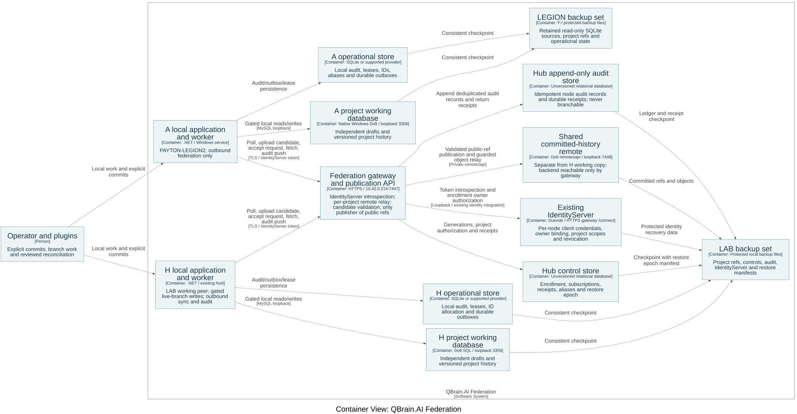
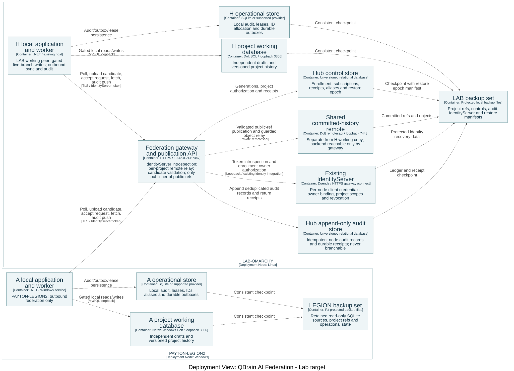

# Federation architecture: independent nodes with Dolt history

Author: Codex. Date: 2026-11-10. Status: proposed architecture for the requested new plan; no implementation or deployment performed. Supersedes the forwarding-first federation completion draft for the new versioned federation mode. Existing DirectProxy behavior remains a separate supported feature.

## 1. Authority and scope

The operator requires LAB-OMARCHY as hub, independent local work on every system, two-way synchronization, two-character creator tags in new IDs, branches in the initial release, and mandatory review of merge conflicts. Pull requests are out of scope. Local **version-history commits**, never ordinary edits or SQL saves, trigger synchronization. Nodes poll a durable hub control table periodically or on demand. A hub request must never implicitly commit a user's working changes.

The operator additionally requires Dolt as the **fourth supported database**, retaining SQLite, PostgreSQL and SQL Server, with appropriate schema migrations and a separate data migration tool from all three original providers. This document adopts that planning direction. The exact maintained EF Core provider/package version and pinned Dolt image must pass the compatibility gate before implementation dependencies are installed. Dolt's relational cell/schema merge is the proposed interpretation of Git-style merging; literal line-level text merging is not claimed.

The three-system example uses H = LAB-OMARCHY, A = PAYTON-LEGION2, and B = NODE-B (illustrative second node, not a discovered host). All three run the same application services and local commit/sync worker. The hub additionally hosts the shared remote and control table. This is eventual consistency, not a distributed transaction across all three hosts.

## 2. Topology and storage boundaries

The authoritative model is [Structurizr workspace](federation/workspace.dsl), with generated [container](federation/diagrams/structurizr-Containers.svg) and [deployment](federation/diagrams/structurizr-Deployment.svg) views. The deployment view uses only LAB-OMARCHY and PAYTON-LEGION2. NODE-B in U01-U12 is a logical test peer, not a claim of a third physical host.

Every host uses a local Dolt SQL-server process/container; .NET reaches it through a MySQL-protocol EF provider and its driver selected in Ph0, subject to compatibility and license review. Dolt is a separate database engine, not an extension installed in an existing MySQL database. It does not wrap arbitrary SQL Server/PostgreSQL/SQLite storage.

For versioned projects, use one Dolt repository/database per logical project on each host. This makes clone/fetch boundaries match project authorization and prevents a project clone from carrying unrelated projects. Local directory paths map to an immutable ProjectId; paths are not distributed identity. The provider resolver must support project-specific routing for enrolled projects; default provider behavior remains unchanged for other workspaces.

The hub's shared remote is a **separate repository/database from the hub's working copy**, optionally served by the same Dolt process. No user edits the shared remote's working set. This matters because a push to a live SQL-server branch can fail when that branch has uncommitted changes. The hub's own draft work must not block A and B from exchanging commits.

Keep host configuration, credentials, enrollment, control requests, receipts, local audit tables and ID-allocation state in a separate unversioned control store. It may use any supported provider, including a separate Dolt database that is never published. Do not merely hide these rows with filters or `dolt_ignore` inside a repository that will be cloned. FR-MCP-AUDIT-001 and TR-MCP-AUDIT-004 are amended: preserve permanent local audit AND deliver it append-only to the hub unversioned audit store. Exclusion from Dolt project history does not mean exclusion from federation. Audit delivery is independent of version commits; section 11 defines it.

Versioned project data includes TODOs, requirements and mappings, use cases, workspace-scoped memories, portable project configuration and explicitly promoted sanitized session-log snapshots. Continuous session-log capture writes local operational storage, without an editing lease; promoting a snapshot is an explicit versioned edit visible in commit preview. Automatic writers must not modify versioned working sets. Ph0 classifies every entity, relationship, writer and auto-updated column as project-versioned, local-operational, derived or explicitly excluded; no unclassified writer/table is permitted. Global memories, machine paths, tokens and host-specific agent/runtime configuration remain local. Derived search indexes, caches and projections live outside versioned databases and rebuild after accepted head changes. Source-code Git repositories and filesystem assets retain their existing Git/file workflows.

Context topology is explicit: original providers and standalone Dolt keep the full `McpDbContext` and existing/baseline migrations. Versioned mode uses a Dolt-only project context plus a control context with additive migrations for each of the four providers. Ph0's relationship manifest names every cross-database reference, replacing impossible database FKs/joins with stable soft references and application validators. Historical migration files are never edited; new additive migrations are allowed where the manifest requires.

## 3. Local edits, commits and branch ownership

Ordinary business reads/writes always execute locally. Saving creates durable local working changes but neither publishes them nor creates a version commit. The server exposes status, diff and commit preview. An explicit commit includes ProjectId, branch, expected head, expected working-set fingerprint, author, message and request id. The preview identifies exactly which working changes will be committed. A changed fingerprint rejects the request for a new preview.

One editing owner per project/branch working set is the initial policy. A durable branch lease, with fencing token checked by every mutating service, prevents one agent's commit from accidentally including another agent's unfinished work. Other sessions may read or use a different branch. Expired ownership with dirty data requires explicit takeover review; no automatic discard or commit. This policy applies to the hub too. A future finer-grained staging UX is not needed for this release.

Connections and DbContexts are bound to ProjectId and branch for their entire lifetime; never change a shared connection's branch underneath an active request. Pools must not leak branch/session state. APIs, search, caches and plugin context include branch identity. A branch switch does not switch the source-code Git branch unless separately requested.

Exactly one host-local server process owns live-branch writes to each project database, enforced by an exclusive process/storage ownership lock and server-only credentials. Its per-(project,branch) write gate serializes lease issuance/takeover, fence checks, edits, preview-hash validation and Dolt commit. Expiry denies new commands; an already admitted transaction holds the gate through completion, and takeover waits. Process death rolls back uncommitted SQL work before a replacement writer opens. There is no claimed atomic transaction between control storage and Dolt. Use a Dolt-provided working-set hash, verified in Ph0, not a custom approximate hash. Put the unique commit requestId in a commit trailer; recover lost replies by finding that ID in retained Dolt history and returning the same hash. Never issue a second commit merely because the operational receipt is missing.

After a successful version commit, the local worker records publication intent. Because a version commit and an operational ledger write may not share a transaction, startup/reconnect scans compare local branch history with durable publication receipts and reconstruct missing intents. Repeated scans must not create extra commits. Existing imported commits do not count as newly authored commits for echo scheduling.

Sync-worker mutations of a live branch, including its dirty/lease check, merge into live and head move, run under that branch's write gate holding a fenced lease. Temporary integration may run against a captured snapshot outside the gate, but final application reacquires the gate and rechecks head, working-set fingerprint and editing ownership. If B5 isolates the worker into another process, it holds remote credentials and integration-branch rights only; it requests live-branch moves through the owning server's gate API. Every live-branch write remains covered by the exclusive writer lock.

New record IDs contain the assigned two-character creator tag plus a durable nonreused sequence. Proposed tag alphabet: uppercase ASCII letters/digits. Actual host tag assignments require registration before first tagged creation. The allocator is outside branches so branching or reverting cannot reuse an ID. Restored/cloned writers must prove a safe high-water mark or enroll with a fresh never-reused tag. Replication preserves IDs. Legacy collision resolution preserves permanent origin-scoped aliases and updates relational identity links through the reviewed mapping. It never rewrites historical commit, PR, session-log, memory or document text. Equal old IDs are not proof of shared identity; different IDs are not proof of different work. Section 12 covers duplicate detection and human ID reservations.

Ph0 must lock the exact grammar per entity family, distinguish system-generated and human-assigned IDs, and enumerate validators, traceability tooling, plugin regexes, sort and display rules. Existing canonical requirements and legacy IDs remain valid. No blanket renumbering of the 48 newly registered planning records is intended.

## 4. Publication and synchronization protocol

Use Dolt for object transfer, ancestry, diff, branch creation and merge. Do not implement a competing event-replay database, merge engine or reliable messaging broker.

The shared remote keeps named public branches and private upload refs. A node may upload only its authenticated project-scoped candidate namespace in a physically isolated upload repository. The gateway controls the backend; no node receives credentials capable of writing the public repository. The hub publication API owns advancement of public branch heads; ordinary node/plugin credentials must not bypass it. Before accepting a candidate it verifies project membership, ancestry, schema compatibility, constraints and domain invariants. The candidate must be a descendant of the expected published head. Use Dolt fast-forward protection plus one durable fenced publisher per project/branch; never force-push a public branch. A stale expected head returns `head_changed`; the node fetches and reconciles again.

This candidate-upload/accept step is **not a PR workflow**: no PR entity, reviewer assignment, approval voting or forge. It is a guarded publication boundary. Ph0 must demonstrate that the chosen remote transport can enforce these permissions, including direct remote calls; SQL branch permissions alone are not assumed to protect remotesapi. If the transport cannot provide this boundary, select a supported isolated transport arrangement and review it before implementation, rather than exposing writable public refs.

Normal worker sequence:

1. Authenticate, read current published heads, and retrieve its pending control requests. Also inspect unpublished local commits, even if no control request exists.
2. Fetch committed history into remote-tracking refs. Fetching does not commit or overwrite local drafts.
3. If the target local branch is dirty or has an active edit lease, record `waiting_local_work`. Keep the prior readable local state. The user may finish and commit, explicitly discard with normal safeguards, or work on another branch; sync chooses none of these for them.
4. On a clean branch, use a temporary integration branch based on the current local head. Fast-forward if possible; otherwise use Dolt's merge. Preserve the old live branch until the candidate passes review/validation.
5. If Dolt reports conflicts or validation detects a domain violation, persist `needs_review` with base/local/incoming heads and affected entities. Nothing silently wins. Independent projects and branches continue.
6. For a valid clean merge, move the local live branch using expected-head/fencing checks. Publish any new local/merge commits through candidate upload and the hub acceptance API. If the hub advanced, repeat from fetch without creating duplicate effects or force-pushing.
7. Persist receipt with resulting local/published heads, refresh branch-scoped derived indexes and report the outcome. A receipt proves this synchronization target was reached, not that every other node is already current.

Both directions are node-initiated. H's local worker uses the same authenticated gateway endpoint, never a file:// URL into a repository served by a running SQL server. No inbound connection to A or B is required. Successful publication advances each subscriber's desired state. Periodic remote-head reconciliation repairs a missed control-store update. Correctness does not depend on an atomic transaction across Dolt and the control database.

## 5. Hub control table

Implement the logical queue as **one durable state row per subscription**, not a command-message broker. Initial polling default: every 30 seconds with up to 20 percent jitter; also poll immediately on reconnect and explicit sync. Local version commits wake the worker immediately. Backoff transient network failure exponentially from 1 second to a 60-second cap, with cancellation; Ph0 locks final settings against measured behavior.

`SyncSubscription`: unique key `(NodeId, ProjectId, Branch)`; HubEpoch, PublishedHead, PublishedGeneration, DesiredGeneration, SyncRequestedUtc, NodeAcceptedHead, NodeReportedGeneration, Outcome, LastSeenUtc, WorkerEpoch and ErrorCode. Publication advances PublishedGeneration and DesiredGeneration. Explicit on-demand requests advance DesiredGeneration even when the published head has not changed; timestamps are informational, never ordering authority. Poll returns authorized rows with an unsatisfied desired generation or a visible blocked outcome. Locally unpublished commits independently wake the worker even if every row is satisfied.

Generation ordering is scoped to a non-reused HubEpoch. Restore installs a fresh epoch before any endpoint reopens and forces ancestry reconciliation; a node never discards a head because a restored counter is lower. The authenticated worker claims a monotonic WorkerEpoch within the current HubEpoch on reconnect/restart; reports compare epoch and the generation actually observed. A late old-epoch report is rejected. A report for generation g can record its outcome without clearing desired generation g+1. A completed report requires NodeAcceptedHead to include the target and records a durable operation receipt; retries of the same report return that receipt. A transient failure remains unsatisfied with node-local retry scheduling. `waiting_local_work`, `needs_review`, `incompatible_schema` and `denied` are visible non-success outcomes, not completed requests. Do not add per-message leases, acknowledgement deletion or coalescing machinery to this state table.

The hub verifies claimed ancestry against remote objects and the recorded publication receipt for the observed target generation. A node-attested accepted head absent from the remote is provisional until its ancestry is uploaded or published; it cannot complete the subscription generation on assertion alone. Local status may still report that local integration succeeded.

The hub owns a row for each subscribed node, including its own local workspace worker. A committed change is not considered delivered to a node until its recorded accepted head includes the target commit. This permits a later merge commit to satisfy an earlier target without pretending head strings must be equal.

## 6. Conflict review and branches

A review item records project, branch, stable conflict id, common ancestor(s), local head, incoming head, candidate branch, conflict cells/schema, validation failures, author identity, decision and resulting merge commit. The server exposes structured diff/history and resolution preview. A human or explicitly authorized agent selects a resolution; apply requires unchanged source heads and reruns constraints/domain validation. A stale review is refreshed, not applied blindly. Retain `review/<conflictId>` and candidate refs locally and on the remote until a durable resolution receipt permits release under Ph0's retention policy; control-table references alone are not GC roots.

Sharing `feature/search` publishes that branch; it does not merge it into `main`. A and B can independently check out the same feature history. Merging feature into main is a separate explicit command with expected heads, normal review rules and a new version commit. Protected-branch rights govern who may perform it. Branch deletion/rename requires explicit authorization and rejects active/pending-review references; initial release does not force-delete published history.

Clean Dolt merges remain subject to application rules. Two independent edits to different fields can merge mechanically yet violate a cross-row invariant. Treat that outcome as review-required and keep the valid live head. Deletes, delete/update conflicts, schema conflicts and legacy-ID collisions are included.

## 7. Server and plugin interfaces

Implement a typed federation client and equivalent REST, MCP and REPL surfaces; every first-party plugin exposes the same contract through its existing audited wrapper. New names below are planned interfaces, not existing capabilities:

- `federation.status(projectId, branch)` returns local head, published head as last observed, observed time, dirty state, ahead/behind counts, last commit time, waiting-local-work age, incoming target, connectivity, review count and operation status. `branch.list` shows the same freshness indicators. Flag stale branches at a configurable threshold; never automatically delete or rebase them. Never call a stale observation globally synchronized.
- `federation.diff(projectId, branch, from, to)` and `federation.history(...)` support preview without mutation.
- `federation.commit(projectId, branch, expectedHead, expectedWorkingSet, leaseToken, message, requestId)` creates a local version commit and pending publication intent. Reply distinguishes `committed_locally` from `published`.
- `federation.sync(projectId, branch, requestId)` schedules/wakes work and returns OperationId; `federation.operation.get(operationId)` returns durable status. Cancellation stops waiting/work safely without claiming already-published commits were undone.
- `federation.branch.list/create/select/merge` use explicit project/branch contexts and expected heads. Branch selection is session-scoped and survives plugin reconnect only after server revalidation.
- `federation.conflicts.list/get/preview/resolve` retain the full review evidence and reject stale input.
- Administrative `federation.enroll`, `subscriptions`, `control.poll`, `control.report`, `publication.accept`, `migration.plan/run/resume/verify/cutover/status` are permission-separated from ordinary editing.
- `federation.maintenance.preflight`, `federation.maintenance.attest` and `federation.maintenance.status` expose the same permission-separated maintenance service to deployment tooling and plugins. They enumerate drafts/branches, bind readiness to a maintenance epoch and inventory fingerprint, and report blockers before a binary swap.

Use existing normalized error envelopes with stable codes: `head_changed`, `working_set_changed`, `branch_busy`, `waiting_local_work`, `needs_review`, `incompatible_schema`, `unsupported_contract`, `unauthorized_project`, `lease_lost`, `remote_unavailable`, `migration_verification_failed`. Public DTOs and APIs require XMLDocs and OpenAPI documentation. Plugin bootstrap advertises capabilities and server contract version; old plugins fail clearly on unsupported commands without falling back to arbitrary SQL or shell access. Local request authorization uses existing local identities. Hub requests use the existing IdentityServer with per-node client credentials and project scopes; revocation is an IdentityServer action, validated by gateway introspection. It does not erase offline work. See section 13 and TR-MCP-FEDERATION-012.

Audit identifies the real agent/user and records preview, commit, publication, incoming acceptance, review, migration and source references. Replicating data does not execute original business commands again. GitHub actions, email and other external effects require their existing explicit commands and durable effect IDs; importing an effect record never sends it again.

Commit preview runs the existing sanitizer and selected secret-detection facility over promoted snapshots and the versioned diff; detected secrets block commit. Deleting or reverting a record does not erase earlier versions. A disclosure incident requires credential rotation, removal/revert of live content and, only under separate explicit operator approval, coordinated history rewriting plus re-cloning all subscribers. Normal synchronization never force-pushes as an incident shortcut. Ph0 locks the detector and history-retention policy; do not claim existing sanitization finds every possible secret.

## 8. Fourth database provider and schema migration

Current source evidence: `McpDatabaseProviderFactory` registers SQLite/PostgreSQL/SQL Server strategies; `McpDatabaseProviderKind` and `McpDbContextFactory` need a Dolt case. Storage targets net10.0 and central EF Core packages are 10.0.0. A .NET 9 example is not proof of EF10 compatibility.

Add canonical provider `dolt`, `DoltMcpDatabaseProviderStrategy`, configuration validation, design-time connection resolution, runtime health/provider diagnostics, and dedicated `QBrainAi.Storage.DoltMigrations` assembly with its own snapshot and baseline. Do not run SQL Server/PostgreSQL/SQLite migration SQL on Dolt. Preserve existing providers, names, defaults and historical migration files; additive migrations are permitted where the approved context manifest requires. Add Dolt to package/build/deployment/test discovery and database administration UI/CLI selections. Runtime and design-time model options must match.

Ph0 selects a maintained EF10-compatible MySQL provider after executing real schema/query/transaction tests against a pinned Dolt image. Do not silently downgrade EF, install a prerelease provider, or write a bespoke EF provider if compatibility fails; report concrete alternatives for the operator. Test collations/case sensitivity, maximum index/key lengths, decimal precision, UTC timestamps, GUID/binary/text/JSON mappings, identity generation, optimistic concurrency, FK/delete semantics, raw SQL, query translation, migrations and parameterization. SQLite-specific search SQL must use a provider-compatible derived-index path rather than fail on Dolt.

Project-versioned and control contexts have separate migration histories. **Never run EF migrations at startup against a versioned project database.** Only the hub maintenance role applies project migrations on `maintenance/schema-<version>`, commits schema and migration-history rows together, validates and publishes the schema commit. Subscribers obtain schema changes through history exchange after their binaries advertise support, never by independently executing the same migration. Worker-to-hub protocol versions are negotiated separately from plugin capabilities; unsupported contracts return `unsupported_contract`.

Use compatible expand changes first. Contract changes wait for every enrolled subscriber/branch covered by the upgrade to acknowledge, or for explicit de-enrollment and a recovery plan for its unpublished work. An offline node cannot be magically quiesced: it may continue its supported local work, while the hub refuses incompatible publication. After binary upgrade, old-schema unpublished commits and feature branches merge the designated schema head through normal review and validation. Ph0 proves this path on representative schema changes. Do not point an old binary at an unsupported schema or silently discard old-schema commits. Control/standalone databases retain their ordinary controlled migration path.

Choose the **pre-upgrade draft-disposition policy** for this release: before replacing the binary, enumerate every local project branch, require drafts to be explicitly committed or otherwise resolved by their owner, and fetch the designated schema head. A dirty branch blocks the upgrade without touching its draft; no automatic commit/discard. Each branch stays closed to domain writes until the local sync worker merges the designated schema head into it (history merge, never local EF migration execution) and validation passes. A catch-up conflict opens needs_review for that branch only; other integrated branches reopen. The new EF model does not serve an unsupported old-schema branch; history/diff/review use the schema-aware maintenance surface. Retain old binaries/backups until verification. Unpublished commits survive in history; this policy does not assume simultaneous N/N-1 EF model compatibility.

Contract readiness is an authenticated node-attested inventory of **all** local branches, including unpublished ones, with each head and expand-schema ancestry, bound to a maintenance epoch and inventory fingerprint. A missing/offline attestation or a branch lacking the expand head blocks the contract step unless explicitly de-enrolled with recovery disposition. After attestation, branch creation/restore from an old schema is fenced until the transition finishes; historical branches may remain readable through compatible tooling but cannot become writable without catch-up. The hub cannot infer unpublished branch readiness from its remote alone.

## 9. Data migration tool

Deliver `qbrain database migrate` (planned CLI surface) with commands `plan`, `run`, `resume`, `verify`, `status`, `cutover` and `abort`. REST/plugin administration wraps the same application service. Source providers are SQLite, PostgreSQL and SQL Server; target is Dolt. Source access is read-only, and a source backup/snapshot is required. The command accepts secret references, never prints credentials, and does not write connection strings into receipts.

`plan` inventories source schema/version, projects, tables, relationships, provider-specific values, local-only data, legacy pending federation records and identity collisions. It emits an immutable manifest with MigrationId, source fingerprint, target/schema version, transformation rules and per-table counts. A dry run validates mappings and target compatibility without copying project rows or changing routing. Unmapped tables, lossy conversions and ambiguous legacy identity mappings block the run.

Migration has two explicit modes. **seed** is selected exactly once per ProjectId: it creates an isolated target, applies the initial project schema and imports the approved seed snapshot to establish C0. **join** clones that published C0, imports the joining host's mapped legacy differences onto `migration/<tag>/<MigrationId>` as an ordinary descendant commit, and uses the normal merge/review/publication path to join main. Never independently create three unrelated root histories and assume they will merge. The identity manifest accounts for each source row as already identical in C0, an explicitly mapped delta, a deliberate reviewed deletion or a local-only/excluded record. Absence on a joining source alone is not permission to delete a seed row.

Mapped deltas distinguish **new identity** inserts from **legacy divergence**, where the same mapped identity has different seed/join content. Every legacy divergence requires a recorded per-row review decision (keep seed, take join or manual value) in the immutable transformation manifest and audit **before the join commit is created**. This is required even when Dolt would fast-forward or merge cleanly: a common root created during migration does not prove that earlier independent edits were intentional overwrites. Unreviewed divergence blocks import/commit and is surfaced as needs_review. A reviewed manifest is versioned by hash; changing a decision creates a new manifest revision and cannot silently resume an earlier transformation.

Divergence is evaluated over B2-classified versioned columns after canonical normalization. Review decisions may be authored as explicitly scoped rules by entity and column class that expand to an enumerated per-row list in the manifest; there is no wildcard default. Operational timestamps/counters excluded by B2 do not generate artificial project-content conflicts.

Both modes create isolated targets and copy parent/child graphs in dependency order using stable keyset pages. Bulk copy is not a replay of business commands. Preserve IDs, relationships, timestamps, versions, soft deletes and complete sanitized session graphs through explicit promotion. Local audit remains local in control storage or a retained readable source archive according to the manifest. Credentials and source-host operational actions are not activated on the destination.

Use a quiesced source snapshot for initial release. No custom CDC or live dual-write is introduced. Each target batch transaction records its MigrationId/table/key range in a target-local journal; resume verifies that journal and source fingerprint before continuing. A copied batch with a lost acknowledgement is recognized, not inserted twice. Changed source snapshot or changed transformation manifest requires a new migration, not a blind resume.

`verify` compares counts and canonical typed row hashes by project/table, checks FK graphs and explicit excluded-row accounting, validates ID maps and sequence high-water marks, performs representative server reads, and verifies the initial Dolt commit. Canonical hashing specifies null, UTF-8 text, decimal scale/value handling, UTC precision and binary encoding; raw provider serialization is not a comparison standard. Verification failures name the project/table/key and preserve both sides.

`cutover` requires a successful verification receipt matching the exact frozen source and target heads; stops the affected workspace, switches its provider mapping atomically, rebuilds derived state and runs smoke checks before reopening writes. Abort before cutover leaves the source active and retains diagnostics. If writes have occurred after cutover, returning to the source requires an explicit reconciliation/export plan; never silently lose Dolt-only commits. Source databases/backups are retained, not dropped. Each node's divergent legacy data is inventoried independently; do not assume cloning the hub can replace it safely.

For join mode, verify binds to the immutable migration-branch commit and proves C0 is its ancestor. The destination workspace remains closed to writes until that commit has been integrated into local main through required review and validation. The cutover receipt records source snapshot, transformation manifest, migration commit, resulting local main head and published target observation. Verify both imported-source accounting at the migration commit and final-domain invariants at the main head; do not compare a post-merge head to a pre-merge verification hash as if they were identical.

Ph3 includes a verified Dolt-to-new-SQLite recovery export for TODOs and their child/link/alias graph. Keep original SQLite sources read-only. This is not a full-database reverse migration: non-TODO project changes need an explicit reconciliation decision. Ph8 cuts over one node first and requires a 48-hour soak before the second host; rollback cannot silently discard Dolt-only writes.

## 10. Deployment, decisions and evidence

Deployment target, not observed active configuration: LAB-OMARCHY is Linux at 10.42.0.214; PAYTON-LEGION2 is Windows at 10.42.0.143 on the 10.42.0.0/24 link. Both current source stores are SQLite, as clarified by the operator. SQL Server/PostgreSQL remain supported migration test sources. Repository paths are /home/sharpninja/github/McpServer and F:/github/McpServer. Use SSH LEGION2 as kingd through the existing authorized SSH configuration; no WSMan.

LAB uses version/digest-pinned dolthub/dolt-sql-server with persistent data. LEGION uses the checksum-pinned native Windows dolt.exe, supervised as a child of the existing McpServer Windows service; no assumed Linux container, WSL, Docker Desktop or new service-wrapper dependency. Plan data at F:/QBrainAi/Federation/{ProjectId}, binaries under F:/QBrainAi/tools/dolt/{version}, config outside source control. Graceful stop drains writes and checkpoints before stopping Dolt; forced termination is followed by journal/working-set recovery, never deletion of lock/data files. Windows ownership uses an exclusive FileShare.None handle plus a named mutex; Linux uses its supported exclusive owner lock. Ph0 B1-B12 execute on both real OSs, including restart, file locking and case/path behavior. Package/service details become pinned receipts before implementation, not inferred deployment claims.

Bind every SQL listener only to 127.0.0.1:3306 (and loopback IPv6 only if explicitly tested). Backend remotesapi is loopback-only on LAB port7448, hidden behind a proposed federation HTTPS gateway at 10.42.0.214:7447. Control, publication, audit and remote-facing routes are exposed only through that gateway; IdentityServer /connect is forwarded there to the existing local issuer. No new inbound federation listener is exposed on LEGION. Existing unrelated listeners are not changed by this plan. Verify both cross-host3306 probes fail and local health succeeds. Gateway route authorization must cover object/chunk endpoints and redirects as well as ref updates; no redirect may expose a token or bypass it.

Planned issuer name: QBrain Lab Federation Root CA. This is a proposed dedicated issuer, not a claim that a CA already exists. Ph0 records its owner, actual root/SPKI SHA256 fingerprints, leaf SANs (LAB-OMARCHY and10.42.0.214), expiry and rotation procedure before endpoint setup. Bootstrap distributes verified root and approved current/next SPKI pins over the established SSH trust path; TLS must validate chain, SAN and pin, with no trust-on-first-use or certificate-validation bypass. An existing approved lab CA may replace this proposed issuer only through a recorded decision and updated pins. No certificate/private key is generated during planning.

Credentials must never be printed or placed in command arguments, logs, chat, memory or commits. Use protected secret references/files and process-private injection. Receipts record executable, nonsecret arguments, versions, hashes and exit status; secret-bearing fields are omitted, not echoed then redacted. Dolt's documented DOLT_REMOTE_PASSWORD is supplied through ProcessStartInfo.Environment from the protected reference, never shell assignment text or argv. Restrict SQL logging and process-dump access. Canary scans cover receipts, logs, audit payloads and generated files on both hosts.

DEPLOY HOLD must be explicitly lifted by the operator for the exact Ph8 rollout. A passing test, plan approval or old HV verdict does not lift it. Backups cover Dolt objects/refs, local and hub operational stores, audit receipts, IdentityServer configuration/operational state and permission files. Restore starts with ingress disabled, uses a fresh random HubEpoch and reconciles every node's retained heads and audit receipt inventory; see TR-MCP-FEDERATION-006/008. A restored audit store requests resend by record IDs/hashes from permanent node ledgers. Never acknowledge data missing after restore.
Decisions still needing gate evidence are the BDPv4 plan section 5 blocking outputs B1-B12; none is proven by this document. They are explicit feasibility outputs, not permission to invent replacements. No current performance, compatibility or implementation-ready 98/98 HV result is claimed.

Primary sources consulted 2026-11-10:

- [Dolt storage engine](https://www.dolthub.com/docs/architecture/storage-engine/) and [SQL architecture](https://www.dolthub.com/docs/architecture/sql/): versioning belongs to Dolt's own engine.
- [SQL clients](https://www.dolthub.com/docs/sql-reference/supported-clients/clients/), [EF sample](https://github.com/dolthub/efcore-sample), [SQL procedures](https://www.dolthub.com/docs/sql-reference/version-control/dolt-sql-procedures/): existing integration surfaces, not this project's compatibility proof.
- [Commit distinction](https://www.dolthub.com/docs/other/faq/), [conflicts](https://www.dolthub.com/docs/concepts/dolt/git/conflicts/): SQL persistence differs from version commits; merges are relational.
- [Remotes](https://www.dolthub.com/docs/sql-reference/version-control/remotes/), [SQL-server push behavior](https://www.dolthub.com/blog/2023-12-29-sql-server-push-support/), [branch permissions](https://www.dolthub.com/docs/sql-reference/server/branch-permissions/): remote transport and dirty-working-set/authorization boundaries require integration proof.
- [Docker](https://www.dolthub.com/docs/introduction/installation/docker/) and [server configuration](https://www.dolthub.com/docs/sql-reference/server/configuration/): official deployment/configuration surfaces.

## 11. Audit flows to the hub independently of commits

Append audit locally with an outbox in the same operational transaction as its auditable operation where possible; an explicit recovery scanner covers cross-store crash windows. Deliver through authenticated POST /qbrainai/federation/audit/batches without waiting for a project commit. The hub ledger is append-only and unversioned. It does not replay business commands. Identity is (OriginNodeId,RecordId); exact retry returns the same payload-hash receipt; a changed payload under the same ID returns409 audit_id_conflict. Node and hub runtime roles cannot update/delete existing audit records. Hub indexing is a derived projection.

TODO audit history and generic audit history are migration-backfill domains. Verify source counts, typed payload hashes, origin identity and durable hub receipts. Retain permanent node ledgers even after acknowledgement. Audit payloads preserve the original author, event time, source identity and sanitization version; raw secrets never enter transferable payloads. Automatic session audit is delivered through this channel; intentionally promoted sanitized session snapshots may separately appear in project history. Full graph completeness, PlanFile/TodoId and sanitizer parity from TR-MCP-FED-SESSIONLOG-001 remain binding.

## 12. Identity, duplicate work and conflict visibility

Migration planning detects both same-ID/different-entity collisions and different-ID/same-work duplicates. Similarity compares normalized title, description and dependency context and emits evidence plus a score; it is a review aid, never authority to collapse records. Decisions keep both, alias to one canonical identity, or record an explicitly reviewed merge. Alias uniqueness is scoped by project, origin node, entity kind and legacy ID; aliases are permanent and included in recovery export. An ambiguous unqualified legacy ID produces ambiguous_legacy_id and asks for origin context. Historical text is immutable; UI/link resolvers resolve its IDs through the alias service.

Reserve human-assigned IDs such as IMPL-UNITGREEN-001 at the hub using atomic uniqueness and idempotent requestId. Offline creation uses a generated tagged provisional ID; reconnect reserves the requested human ID or reports human_id_reserved for review. This preserves offline autonomy without pretending disconnected nodes can globally reserve the same human label. Immutable generated IDs and old aliases remain usable.

Review visibility is immediate in server status, all plugins and a durable operator inbox. needs_review and waiting_local_work warn at15minutes, escalate at24hours and repeat no more than hourly. These are local UI/inbox notifications; external messaging requires its existing explicit authorization. Identical edits and mechanically independent cells may merge after domain validation. TODO priority/status/completion, conflicting title/description, dependency deletion and delete/update disagreements require review; no time-based winner. One blocked branch cannot stop another branch/project's publication. Later commits dependent on a blocked branch remain local or move to an explicitly created branch; there is no hidden cherry-pick or discard.

## 13. Existing IdentityServer is the authority

Fold MCP-FEDIDENTITY-001 into Ph2/Ph5/Ph7: federation hosts manage users through the integrated Duende IdentityServer; each node is single-user and its machine client is bound to that authenticated owner. Client credentials prove the machine, not the human. Operator-authorized enrollment supplies the owner binding. Provision fed.node.{NodeId} clients and project/action scopes; do not reuse the static sample mcp-agent client as a fleet identity.

Use reference access tokens for network federation so revocation is an IdentityServer action: disable the client and remove its persisted reference grants. Control/publication/enrollment/audit APIs validate token activity, audience, project scope and current branch membership. No positive introspection cache; recheck at the public-ref commit boundary. Existing offline local identity authorization is separate and never waits for remote introspection.

Dolt remotesapi does not automatically understand these bearer tokens. The gateway is the authentication boundary. The planned remote relay accepts the node reference token through the Dolt client's supported protected credential channel, introspects it and translates to backend-only credentials; backend SQL/remotesapi never receives a node's unrestricted authority. Prove actual remotesapi protocol, HTTP/2, credential forwarding, chunk endpoints, redirect containment and candidate-repository isolation in Ph0. If a supported proxy/client integration cannot enforce this, stop that gate and present a supported alternative; do not expose a raw remote or invent a new object-transfer algorithm.

## 14. Current contracts and scope coverage

[Technical requirements](../Project/federation-dolt/Technical-Requirements.md) own schemas, endpoint contracts, scopes and stable error codes. [Testing requirements](../Project/federation-dolt/Testing-Requirements.md) own Given/When/Then expectations. The [current-scope coverage index](2026-11-10-federation-reconciliation.md) identifies applicable requirements recovered from the historical gap check and binds them to the new design. Only current in-scope contracts govern implementation; original source copies are audit evidence.

Additional primary references, consulted 2026-11-10: [Dolt remote authentication](https://www.dolthub.com/docs/sql-reference/version-control/remote-authentication/), [Duende reference tokens](https://docs.duendesoftware.com/identityserver/tokens/reference/), [Duende revocation](https://docs.duendesoftware.com/identityserver/reference/v8/endpoints/revocation/), [Structurizr DSL](https://docs.structurizr.com/dsl/language). Version-specific behavior still requires the pinned Ph0 evidence; newer documentation is not proof of compatibility with the repository's Duende7.4 packages.